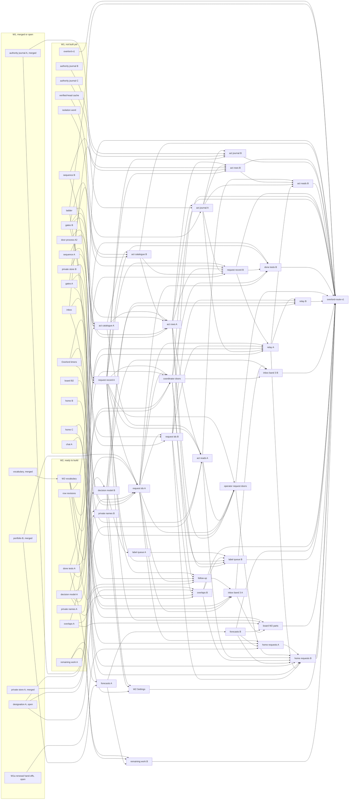

# The Overlord programme: the W2 index, route and follow up

This file is the index of W2, "route and follow up" (spec §14, Table 14's W2 row). It names the pieces, the lanes and
their files, and the order, so that several plan writers can each take one piece at once without colliding. It holds no
piece plan. Each piece's plan lives in `docs/superpowers/plans/2026-11-16-overlord-w2/` as `w2-<piece>.md`.

The spec is `docs/superpowers/specs/2026-11-09-overlord-design.md`, and the programme's ledger is
`docs/superpowers/programs/overlord.md`. The W1 index, whose shape this file follows, is
`docs/superpowers/plans/2026-11-14-overlord-w1.md`. This file defines no D-numbers: every departure below is a plain slug
until the coordinator mints numbers (cross-plan ruling X9).

Written against `main` at `9cf263d44` (2026-11-16), while W1 is building, and revised in fix round 1 (review 2253). The
fix round's rulings are the coordinator's and are marked "(ruled, fix round 1)". The operator asked for the programme to
run side by side to its end, so W2 is planned now and each W2 piece starts the moment its W1 inputs land.

**The fold (2026-11-16).** Every W2 piece plan is now merged under `docs/superpowers/plans/2026-11-16-overlord-w2/`, and
each one listed what this index should change, under "What the index should change". This revision folds every item of
those lists into the questions, the rows, the lanes, Figure W2, "Where lanes meet", "What a merge arms" and "States W3
may read", in each plan's own ruling words, with the coordinator's rulings for the fold marked "(ruled, fold)". Where a
plan's list and a ruling of the fold disagree, the ruling stands. Each piece's own departures stay in its plan's
"Deviations found", where the ledger fold reads them. The fold re-measured `main` at `77c203748`.

## In short

- **Twenty-four pieces in 40 pull requests** build W2. Each piece is one plan of at most ten tasks; only home requests
  has ten.
- **Eight lanes:** vocabulary, acts, requests, egress, follow-up, programmes, the decision model and the console.
- **Thirteen pull requests can be built before W1 finishes,** because each reads only what is on `main`. Seven were
  ready at the fold: the W2 vocabulary, row revisions, private names A, overlaps A, remaining work A, decision model A
  and done tests A. The first six are building. Private names B, forecasts A and B, remaining work B, decision model B
  and label queue A follow them, now that private store A (#2896) and portfolio B (#2904) have merged.
- **Nothing a running session sees changes at merge,** apart from the portfolio facts of question 20, which are
  additive. Every W2 Overlord door refuses `capability-missing` until the last piece, `overlord-route-v1`, moves that
  word into `SERVER_CAP_MAP` and opens the rung `advise`; band 3's settle door alone works under `overlord-v1`.
- **No question waits on the operator.** Item 357 answered question 1, what the operator can rule on a pair of
  programmes whose goals conflict. Every open question carries a recommendation for the coordinator.

## Open questions

The question numbers are stable: piece plans cite them by number. Each question is in one of three states: waiting on
the operator, open with a recommendation, or settled. A piece plan builds the recommendation of an open question unless
the coordinator or the operator rules otherwise, and restates the questions it builds on.

### Waiting on the operator

None. Question 1 was answered by item 357 and is settled below.

### Open, with a recommendation

- **Q2. Routing is a relay** (Table 5.1b; slug `route-moves-ride-the-relay`). Table 5.1b has the Overlord's moves route,
  re-relay and route elsewhere, and the relay door is the one writer of `doneTest`. Each of the three sends the request
  to an owner with a done test. **Recommendation:** the relay door makes all three moves, with a `move` field (`route`,
  `re-relay`, `route-elsewhere`). The Overlord's request doors are open, drop, `close-request` and escalate (question
  7). Re-relay spends no authority (§5.1). As the relay plan builds it (folded):
  - a re-relay needs a counter since the latest relay, and keeps the owner;
  - one relay per owner per root request is held by act rows A's natural key, and a second answers `act-key-taken`;
  - a relay the server cannot send goes to the operator as a server move, `relay-held`, from `received`, `declined` or
    `needs-you` only (ruled, fold), with an `escalate-request` act row;
  - the request record's guard 8 refuses `route`, `route-elsewhere` and `re-relay` on a request with children, with
    `bad-transition` and the detail `has-children` (ruled, fold);
  - the nudge is its own door row on the relay's handler, named `nudge-owner`, at `POST /api/overlord/relay/nudge`
    (ruled, fold: relay A renames its row and tool from `relay-nudge`, and the route path stays).
- **Q3. The operation key: its header, its lookup and its binding** (§10.1; slugs `op-key-header` and
  `op-key-reused-is-a-new-word`). The spec gives the key "a header of its own in W2" and names none. The door-process
  plan keeps `x-ccrc-witness-key` for the witness and leaves `x-ccrc-op-key` to W2 (its F20). This fix round's edit of
  `w1-gates.md` makes gates B build the witness header as `x-ccrc-witness-key` too (ruled, fix round 1).
  **Recommendation, amended (ruled, fix round 1):**
  - The header is `x-ccrc-op-key`: a fresh random key that the door process mints for each write tool call and sends
    again unchanged on a retry. A read carries none.
  - **Where the lookup sits:** in gates B's runner, after the step-7 fence and before step 7a (the witness), scoped to the
    session and the generation. A hit returns the stored row and outcome, consumes no witness and counts toward no
    latch, so a retry after a lost response never meets a spent witness.
  - **What the key is bound to:** it is stored in five columns of the act row (slug `op-key-on-the-act-row`) with its
    door, act kind, natural key and a hash of `{ door, path params, body }` (the act rows plan's F4).
  - **A repeat whose body hash differs** refuses with a new word, `op-key-reused`, which act rows A adds to
    `OVERLORD_REFUSALS` with its Table 11.6 row. It never falls through as a fresh call.
  - **A hit answers the act:** the runner returns the act's projection with `replayed: true`, and every act door's answer
    carries an `act` field (`replay-answers-the-act`).
  - **The door process sends a write again once,** only when no response arrived (exit 3), and a write with no key gets
    one from the server and no dedupe (`missing-op-key-is-minted`). A witness consumed under a key that is then retried
    reads `why: 'retried'` and is not counted as unwitnessed; a second `retried` on the same witness is counted.
  - **A second effect under one natural key** answers `act-key-taken` (409), a new Table 11.6 row that act rows A adds;
    an `op-key-taken` inside the writer answers as a replay.
  - Act rows A builds the store, the lookup and the words, and adds the lookup step to gates B's runner (`GateFacts.opKey`,
    `GateVerdict`'s and `GateRun`'s `replay`). If gates B builds after the act rows plan was accepted, it may ship the
    port bound to `{ kind: 'none' }` with the arm, so act rows A only binds it; otherwise act rows A waits for gates B.
- **Q4. The act journal's file and grammar** (§7.6, Table 11.1a; slug `act-journal-grammar-in-the-plan`). The spec
  names no file, record kinds or verifier. **Recommendation:** `overlord-acts.jsonl`, beside
  `server/src/coord/overlordAuthority.ts#OVERLORD_AUTHORITY_BASENAME`, on `chainedJournal.ts` and
  `chainedJournalFile.ts`. Its record kinds are prefixed for the kernel's disjoint-kinds census: `act-intent`,
  `act-settle` and `act-open-request`, which carries the request's id, and `act-overturn`, which act reads B adds with
  its fold and a no-append reconciliation arm (ruled, fold). An act whose effect commits with its row writes one
  `act-settle` record with `from: null`. Every record carries the operation key and no operator words. The open door's
  order is one: check everything inside the transaction, insert the request row, then the act writer appends with
  `opens`. The journal has its own domain in the signed head, since the journal-kernel plan foresees the act journal as
  the kernel's second user, and a row in `chained-journal-formats.test.ts#FORMATS`. The chained file adapter's
  verified-head cache ships first, as its own small pull request in lane C, owned by the adapter's plan (the act journal
  plan's F16).
- **Q5. Revisions are a column, raised by what an answer acts on** (Table 11.1a's row "Hold columns … on asks and items;
  row revisions"; slug `revision-is-a-counter-column`). **Recommendation, amended (ruled, fix round 1; folded):**
  - `revision INTEGER NOT NULL DEFAULT 0` on asks, items and `overlord_requests`.
  - A revision is raised by one, in the `SET` of each write that changes what an answer acts on: a settled answer, a
    release, a decline, a stale question, an item's move, and `askAt` or `askKey`. The re-stamp raises only when `askAt`
    moves, because it runs every 2 seconds.
  - The in-flight hold and its rollback, and the bookkeeping stamps, leave it alone: the reach stamps, `corrected`,
    `neededBy` and the retention wipe. Otherwise every Overlord act would read `operator-has-it`.
  - The census is a closed classification of every `UPDATE asks` and `UPDATE operator_items` in `server/src`, and any
    upsert of either, `server/src/coord/pushOutboxStore.ts` included, read from `writers-map`'s one scan. Each writer
    reads `raises` or `bookkeeping`, and an unclassified writer is red. Any piece that adds a writer of either table
    classifies it in `server/test/single-definition/row-revisions.test.ts` in its own pull request, and the coordinator
    tells W1's builders.
  - An Overlord door that carries an older revision changes nothing, and answers `operator-has-it` with the row and the
    act that moved it. **No operator tap is refused for the revision alone** (the operator doors plan): it is applied
    when its move can apply, and each act whose move took the row past the tap's revision becomes `concurred` (it
    reached the tap's target or intent state) or `superseded`; a tap a raced act left impossible answers
    `bad-transition` with detail `raced`, leaving those acts for Overturn. `overturned` is the correction door's alone.
  - At the coordinator's own request doors a stale revision is `bad-transition` with the detail `stale-revision` and the
    row.
  - The column on asks and items needs nothing from W1, so it is its own small piece and ready now.
- **Q6. W2's refusal words land at once** (slug `w2-words-at-once`). Eleven W2 words wait on the vocabulary's wave map:
  `act-ceiling`, `dependency-cycle`, `egress-refused`, `goal-conflict-open`, `identity-too-weak`, `operator-has-it`,
  `operator-only`, `relay-carries-method`, `request-not-yours`, `said-not-operator` and `server-not-isolated`.
  **Recommendation:** the W2 vocabulary piece moves all eleven into `shared/refusal.ts#OVERLORD_REFUSALS` in one pull
  request, each with its status by the family rule (the vocabulary plan's Table V1), takes them off the wave map, and
  takes `W2` out of the guard's closed list of waves, as W1's vocabulary did for W1. Each later piece reads its words
  from the group, and no W2 word can go on the wave map. The W1 inbox plan also adds `said-not-operator`; whichever lands second finds it present and adds nothing. As
  in W1, the vocabulary adds no console sentence: an older console shows the raw code, and the piece that ships a door
  ships its words' sentences in `pwa/src/lib/refusalWords.ts`.
- **Q7. The doors the spec does not name** (Table 11.1e; slug `w2-door-paths`). The spec names only
  `POST /api/overlord/requests` and `POST /api/overlord/relay`. **Recommendation**, amended with the escalate door, the
  label door's gate, the row-state door and the act read's projection (ruled, fix round 1), and with the doors and
  gates the piece plans built (folded); the decision model's gates follow spec §7.5 (ruled, fold):

  | Door | Path | Gate |
  |---|---|---|
  | Drop, close, escalate (the Overlord's) | `POST /api/overlord/requests/:id/drop`, `.../close`, `.../escalate` | Overlord door |
  | The relay and `nudge-owner` (the Overlord's) | `POST /api/overlord/relay`, `POST /api/overlord/relay/nudge` | Overlord door |
  | Settle a band-3 row (the Overlord's) | `POST /api/overlord/inbox/settle` | Overlord door, under `overlord-v1` |
  | The act journal's head | `GET /api/overlord/act-head` | session |
  | Read-back and the owner's moves | `POST /api/requests/:id/ack`, `decline`, `blocked`, `failed` | box token, attribution, owner |
  | The operator's request doors | `POST /api/requests/:id/answer`, `confirm`, `withdraw`, `take`, `hand-back` | session, through the account gate; hand back behind the step-up |
  | The operator's requests read | `GET /api/requests` | session (the auth gate) |
  | A request's quote | `GET /api/requests/:id/quote` (read door `home-quote`) | session |
  | Remaining work and edges | `POST /api/coord/programmes/:slug/remaining` | box token, attribution, `claimsProgramme` |
  | The act read | `GET /api/acts?programme=<slug>` | a valid box token (the five fields, armed or dark), or the session (the whole row); both refuse `capability-missing` until `overlord-route-v1` |
  | Seen on an act | `POST /api/acts/:id/seen` | session, through the account gate |
  | Rule a goal-conflict pair | `POST /api/programme-pairs/:key/rule`, body `{ episode, choice }` | session; works dark and records `flag-off`, as the rank door; no step-up |
  | Upload the private-name list | `PUT /api/overlord/private-names` | session, step-up |
  | The name list's status | `GET /api/overlord/private-names` | session |
  | The decision model's read | `GET /api/decision-model` | session |
  | A decision-model row's state | `POST /api/decision-model/rows/:id/arm` (`shadow`, `armed`), `POST /api/decision-model/rows/:id/off` | session; step-up for every widening (arm to `shadow` or `armed`, an armed gate row off), never for a narrowing (`shadow` to off, an advice row off) |
  | A decision-model row's daily ceiling | `POST /api/decision-model/rows/:id/ceiling` | session; step-up for a raised ceiling, none for a lower one |
  | The key | `PUT /api/decision-model/key`, `DELETE /api/decision-model/key` | session; step-up to set it, none to remove it |
  | Label cards | `GET /api/labels`, `POST /api/labels/:id` | session, through the account gate, refusing `auth-off`; the read too |

  The decision model's doors replace the first draft's `rows/:id/state` (the decision model plan, review 2262 F4). Its
  plan said every write asks the step-up, `shadow` to `off` included; the ruling of the fold replaces that with §7.5's
  rule: every widening asks the step-up, which is arming a row, raising a ceiling, setting a key, switching an armed
  gate row off and the name-list upload, and no narrowing does, which is `shadow` to off, an advice row off, a lower
  ceiling and the key's removal (ruled, fold; the W2 Settings plan's Table 1).

  The escalate door (slug `escalate-moves-a-request-to-needs-you`; ruled, fix round 1) moves a request from `received`
  or `declined` to `needs-you` with one of three reasons, `needs-start`, `needs-proposal` or `unnamed-widening`, and
  writes an act row. It sends no mail, so it is not a relay move. It is how W2 carries question 28. Its act kind is
  `escalate-request`: class none, reversible, refused at `chat` and allowed at `advise` and `full`, in the act
  catalogue's `request` ceiling group, 6 and 30 (the request record plan's RQ13). It is named apart from Table 7.1a's
  `escalate`, which hands a held ask or item to the operator and is W3's.

  Every operator write door goes through the account gate and refuses `auth-off` while sign-in is dark, except the
  ruling door, which works dark and records `flag-off`; the operator's reads stay on the auth gate like every console
  read, except the label read, which takes the account gate too. A label must come from an event under the sign-in
  cookie (§3.7). The request doors register from a new routes file, `server/src/coord/requestRoutes.ts`, which is a
  lane source of its own for every census and is created by the first piece that registers a route in it, the
  coordinator doors or the operator's request doors (the request record plan's RQ14). The remaining-work door goes in
  `server/src/coord/programmeRemainingRoute.ts`, registered as `registerCoordCallsRoute` is. The Overlord's doors go in
  `coord/overlordRoutes.ts`. The name list's doors go in `server/src/operatorModel/nameListRoutes.ts`, and the label
  doors in `server/src/coord/labelCardRoutes.ts`, each a new lane source.
- **Q8. Where "its relay carried the widening" is recorded** (§5.5; slug `relay-act-records-the-widening`). `goals
  modify` with a `requestId` must check that the request's relay carried the widening, and nothing stores that.
  **Recommendation, amended (ruled, fix round 1):** `widens` and the widened programme are columns of
  `overlord_acts`, in act rows A's migration, and the relay writes them on its act row. Request ids A builds the
  ownership half of the `goals modify` check. Relay A builds the `widens` half: the goals door looks for a `relay` act
  row of that request and programme with `widens` set, and refuses `reference-unknown` otherwise. Request ids A cannot
  build that half, because no relay row exists before relay A. `relayWidening` treats `superseded` like `overturned`:
  a relay the operator superseded loses its widening (ruled, fold). A re-relay carries no `widens`.
- **Q9. No list, an empty list, and an unreadable list** (Table 11.1a, "Ignores it: no egress check runs"; slug
  `no-name-list-is-not-an-empty-list`). **Recommendation, refined (ruled, fix round 1):** "a list was uploaded" is a
  durable fact in the private store: the list's row and its key slot witness that an upload happened (refined by the
  private names plan's F9).
  - **Never uploaded:** the name check is skipped, and the act row records `skipped: no-list`. It is the only answer that
    skips.
  - **An uploaded empty list** is a list: the check runs and finds nothing.
  - **An uploaded list that cannot be read, or whose key is lost** (the list's canary reads `key-mismatch`), refuses
    `egress-refused` at the relay with the reason, and so does a `privateNameHits` throw. The relay keeps an unreadable
    list's reason on its refusal row (`overlord_relay_refusals`), not on an act row. Two conditions a caller treats
    differently never share one answer.
- **Q10. Asks of a private-state row on a hosted model** (§3.7, ruling 5; slug
  `private-state-rows-never-asked-hosted`). The spec arms a row that carries the operator's words only on `local` or
  `zero-retention`, and is silent on shadow. **Recommendation:** such a row is never asked of a `hosted` adapter, in
  `shadow` or `armed` (question 29's states). It answers `not-asked`, writes no record and gathers no label. The
  `readback.*` rows are private-state rows: never asked on a hosted host, and never shown to the coordinator.
- **Q11. Read-back flags while their rows are not armed** (§5.5; slug `shadow-flags-record-only`). `readback.omits` and
  `readback.adds` ship `off`. **Recommendation:** while a row is `off` it is not asked; in `shadow` its answer is a
  record only, and no inbox row is written. The band-3 row kind, `readback-flag`, ships with inbox band 3 B, whose
  `ack` handler's armed branch writes `overlord_readback_flags` only on an armed clear yes, once the operator arms the
  row on an admitted line.
- **Q12. A fired timer's mail and its band-3 row** (§3.3.12; slug `timer-row-and-mail-are-one-fire`). In W1 a fired
  timer reaches the Overlord as mail only. From W2 it is also a row of band 3. **Recommendation:** the mail still sends,
  under W1's contract. The band-3 row is the same fire, read through `firedTimersOf('overlord', stamp, since)`, and it
  leaves the inbox when the mail is acked. The row declares no nudge of its own, so the coalesced wake counts it once.
  As inbox band 3 A builds it, the row is the mail, not each timer: the `timer` row of `FIXED_LINE_MAIL` holds the
  delivery until it is settled, the designated session's line is the coalesced wake, and the timer line is no longer
  typed to it.
- **Q13. One owner for the done-test predicates** (Table 5.5a; slug `done-test-predicates-owned-once`). Done tests
  close requests, and the server clears a programme edge "when it measures the target using Table 5.5a predicates".
  **Recommendation:** the done-tests piece owns the predicate vocabulary, in its own sibling `shared/doneTests.ts`, and
  its one reader, `readTarget`, which also takes a bare target (a run, a pull request named by a run and number, or an
  item). Remaining work B clears edges through that reader, so it lands after done tests A, which needs nothing
  first.
- **Q14. No rollback floor for `overlord-route-v1`** (§11.5; slug `route-v1-has-no-floor`). **Recommendation:** no row in
  `CAP_FLOOR_ROWS`. W2 holds nothing, so an older server ignores the new tables and columns (Table 11.5: "Ignored"), and
  a request left open re-measures when the newer build returns: its follow-up comes due after the gap (§11.5). W3's
  floor, below `push-outbox-v1`, is the first server-word floor. Table 11.5 still asks for one measurement on a
  rollback to a W1 build with `overlord` mail queued: `server/src/watch.ts`'s `mailSender` reads a `fromId` that is no
  role as a session id, for the park notice and its push. Request ids B measures it and says what an older build does
  (ruled, fix round 1). Its plan's answer: a rollback does not wait, and the exposure it measures is accepted (slug
  `overlord-mail-no-rollback-wait`); `overlord-route-v1` reads that measurement before it ships.
- **Q15. The kickoff's sender parameter waits for the start door** (§11.2; slug `kickoff-sender-waits-for-the-start`).
  `queueProgramKickoff` gains a sender parameter and a sender-scoped dedupe only when something sends a kickoff as the
  Overlord, which is W5's start door. W2 teaches `SYSTEM_MAIL_SENDER_MAP` and `MAIL_ROLE_IDS`
  (`server/src/coord/rundefs.ts`) and their three readers the `overlord` sender, because the relay sends as it, and
  overlaps B adds a second role, `server`, the pair mail's sender, record-only for the operator.
- **Q16. The label queue's cadence** (§3.7; slug `label-queue-picks-weekly-shows-daily`). **Recommendation:** a lane
  picks at most ten cards a week, in the spec's order: a gate row before an advice row, then the row nearest its line
  (the clean labels the next fixed-sequence candidate needs), with each row that has a waiting case getting a card at
  least every fourth week while the operator answers. As the label queue plan builds it, the lane runs daily and keys its
  budget on the UTC ISO week, as the replay quiz's lane does, and holds at most ten cards open. Only rows whose sources
  name `label-queue` get cards. The cards show on Waiting on you behind the operator's own items until answered, and "Not
  sure" is no label. They are never rows of the Overlord's inbox.
- **Q17. Where the operator sees and rules a goal conflict** (§5.6; slug `goal-conflict-shown-on-the-home`). The board
  is served only to the designated session, yet the spec has the operator rule "from that board row".
  **Recommendation:** the board's Goal conflicts part is the Overlord's view. The operator sees a standing pair on the
  home's portfolio strip, read from `GET /api/portfolio`'s `pairs`, and on the Requests rows it blocks, read from
  `GET /api/requests`' `blockedBy`, and rules it from the pair's row on the strip. The console never evaluates a pair
  itself: `blockedBy` is computed on the server from `standingPairs` through `blockingPairs`, and a pairs read that
  fails answers `blockedBy: 'unreadable'` on every row, never an empty list.
- **Q19. The act ceilings are this wave's plan's to set** (Table 11.5b: "set by the plan before W2"). The act-catalogue
  plan proposes each act kind's ceiling per programme and in all, from the relay's 30 and 6 an hour as the model. The
  coordinator approves the values at that plan's review, as W1's question 25 did for the read ceilings. The ceiling
  check is a pure decider that takes the counts as an input; act rows A wires the counts from `overlord_acts`, which act
  catalogue A cannot read because the table does not exist yet. As the act catalogue plan builds it (folded):
  - step 10 reads the counts through a port, `ActCountReader`, whose default refuses, and `overlord-route-v1` refuses to
    ship while that default stands;
  - reads, notes, acknowledgements and `renew` keep the bound their owner already holds, and step 10 asks no count for
    them;
  - an act row counts against its kind's group and its effect's, and the act writer re-runs `actCeilingStep` for both
    inside its own write;
  - the relay's 30 an hour in all and 6 to one target are the catalogue's `relay` group, not a counter of the relay's
    own; `escalate-request` sits in the `request` group, 6 and 30;
  - `act-ceiling-hit` lands with the ceilings in act catalogue A, not in W3.
- **Q20. Portfolio facts are live without the Overlord** (slug `portfolio-facts-live-at-merge`). Remaining work, edges,
  forecasts and health describe programmes, not the Overlord's authority, and §11.4 gates only the coordinator's four
  request doors (`ack`, `decline`, `blocked` and `failed`, which ship beside `ack` under the same word) and the act read
  on `overlord-route-v1`. **Recommendation, accepted with bounds (ruled, fix round 1):** the remaining-work door,
  the forecast lane and `programmeHealth` are live at their merge, gated only by the box token and ownership. Their
  history starts when coordinators begin stating remaining work, which clause 22 asks for only under `overlord-v1`. The
  door bounds each field, the reason and the wave range, as `server/src/coord/coordCallsRoute.ts` bounds a call's text,
  and masks text on the way in and out.
- **Q21. A nudge passes the relay's checks** (Table 7.1a; slug `nudge-owner-passes-egress`). `nudge-owner` carries no
  quote and spends no authority. **Recommendation:** it still passes every check on the Overlord's own part, the private
  names, `overlord-only` entries and `relay.method` included, and counts against the relay's ceilings. It reads the
  request's `nudges`, which the follow-up alone writes, and keys its act on it: its natural key's discriminator is the
  nudge ordinal.
- **Q22. What a request cost** (§5.6; slug `request-spend-through-run-ids`). **Recommendation, as amended by forecasts
  B and home requests A (folded):** a request's and a programme's spend roll up `run_spend`, recorded once per run at
  its close by the forecast lane from a reading inside the run's window, plus the deduplicated, fresh live readings of
  open runs, marked attributed. A closed run with no measured row counts as unmeasured. The coordinator's own spend is
  outside. A request's spend uses the same summation as a programme's (`spendOfRuns`). The Overlord's own spend is its
  bound session's live reading, current generation only. `run_spend` is a new table with one writer, because the usage
  sweep keeps no history (the forecasts plan's `run-spend-measured-at-close`).
- **Q23. W2 pieces start before W1 closes** (slug `w2-pieces-start-before-w1-closes`). Figure 8 draws W1 before W2. The
  operator asked for this parallel work, as W1's question 36 did for W1a. The thirteen pull requests that can be built
  before W1 finishes are listed under Table W2.

### Settled

Settled by W1's index, by the spec's own text, by the operator's answer to an item, or by the coordinator's
rulings in fix round 1 (ruled, fix round 1). Each is built as stated.

- **Q24. `advise` names `overlord-route-v1`.** W1's question 19 settled it: the rung door refuses `advise` with
  `capability-missing` naming `overlord-route-v1`, and `full` names `overlord-answer-v1` (W3). W2's last piece moves
  `overlord-route-v1` from the ladder's `RUNG_WORDS_NOT_YET_SHIPPED` into `SERVER_CAP_MAP`.
- **Q25. The catalogue takes over `RUNG_CELLS`.** The ladder plan's slug `rung-cells-seed-the-act-catalogue`: W2's
  catalogue takes over `RUNG_CELLS` in a move commit and adds its other columns.
- **Q26. The private-name matcher is already in `shared/`** (slug `private-names-already-in-shared`). §9.4 says the
  tokenizer and matcher move from `server/test/private-names.mjs` to `shared/private-names.mjs`. That move shipped with
  the Linear hierarchy's wave 2 (#2661): `shared/private-names.mjs` holds the matcher and `server/test/private-names.mjs`
  re-exports it. W2 gives `hashEntry` its key argument and adds `privateNameHits`. This is a spec fix.
- **Q27. Grants and commands stay dormant in W2.** `overlordMayAct` is built whole with its grant and command branches,
  and W2 passes it no grants and no commands, which ship in W3. In W2 only three answers can fire: the class-none
  allow, `identity-too-weak` and `operator-only`. `evidence-too-weak` is W3's, and `server-not-isolated` applies only
  when an act rests on a grant or a command (H24).
- **Q28. Before W3 and W5 a proposal or a start goes to the operator** (§14). W2 moves such a request to `needs-you`
  through the escalate door (question 7), and nothing raises an item before W3.
- **Q1. What the operator can rule on a goal conflict** (§5.6, Table 11.1e; slug `goal-conflict-choices`). Answered by
  operator item 357: three choices.
  - **Both stand:** not a real conflict; relays to either proceed.
  - **A goes first:** relays that deepen the conflict on B's side say so and wait for A's next landing.
  - **B goes first:** the same, the other way round.

  Every choice lifts `goal-conflict-open`, and the relay quotes the choice to the owning coordinator. A later
  `goals.conflict` flag on the same pair raises nothing new until either programme's goals change.
- **Q18. The timer doors keep `act: null`** (ruled, fix round 1, overturning the first draft's `set-timer`). A timer is
  not an act kind: no rung and no `overlordMayAct` apply, and a timer writes no act row (spec §3.3.12 and §11.2). The
  W1 timers plan's `OverlordDoorRow.act: LadderActKind | null` stands, with its census holding that only the three
  timer rows are null. The act catalogue adds no timer kind.
- **Q29. A decision-model row's three states** (§3.7; slug `decision-model-row-states`; ruled, fix round 1). A row is
  `off`, `shadow` or `armed`, and every row ships `off`. An `off` row is never asked. The operator switches a row to
  `shadow` (session, step-up, under the daily ceiling), and only then is it asked; its answers are records that gather
  labels and admit a line. The order is: set the key, then the admission asks, then arm. Arming is the operator's, on an
  admitted line. Switching an armed gate row off is an authority change: it takes the step-up and is journalled.
  Shadow on a hosted host is spend (O2), so it is the operator's act too. No narrowing asks the step-up: `shadow` to
  off, an advice row off, a lower ceiling and the key's removal (ruled, fold, after §7.5). A gate's caller reads its
  answer through `gateOutcome`, which reads a `shadow` gate as skipped (ruled, fold), and an answer an attacker could
  shape is never wider than the row disarmed.

## Prerequisites, as measured

Measured on 2026-11-16 with `git log origin/main`, `gh pr list` and `git grep origin/main`, and again at the fold, at
`77c203748`.

| W1 piece W2 reads | State on `main` | PR |
|---|---|---|
| Vocabulary | **merged** | #2840 |
| Journal kernel | **merged** | #2848 |
| Authority journal A0, A | **merged** | #2880, #2895 |
| Authority journal B, C | not built | plan #2853 |
| The chained file adapter's verified-head cache (the authority journal plan's, ruled F16 of review 2275) | not built | none yet |
| Portfolio A | **merged** | #2842 |
| Portfolio B | **merged** | #2904 |
| Push outbox A, B | **merged** | #2838, #2859 |
| Responses A; B | **merged**; open | #2884; #2914 |
| Private store A | **merged** | #2896 |
| Private store B | not built | plan #2855 |
| Designation A; B, C | open; not built | #2950; plan #2856 |
| Ladder | not built | plan #2861 |
| Gates A, B | not built | plan #2863 |
| Isolation word | not built | plan #2867 |
| Sequence and monitor A, B, C | not built | plan #2869 |
| Door process A1 to B2 | not built | plan #2864 |
| Inbox and reads | not built | plan #2866 |
| Board and history B1, B2 | not built (A is merged, #2841) | plan #2829 |
| The Overlord's timers | not built | plan #2874 |
| Home A, B, C | not built | plan #2883 |
| `overlord-v1` | not planned yet | none |
| W1a renewal hand-offs (home requests A moves the code they write) | open | #2934 |

The highest migration on `main` is 83 at the fold (`COORD_SCHEMA_VERSION = MIGRATIONS.length`; portfolio B took 83),
and other W1 and W2 builds take the next slots as they land (the migrations' order rule, below).

D-8126's A2 (the goals read, `doneWhen`) and A3 (`coordinator_calls`, #2606) are merged, and W2 reads both: the
remaining-work door uses A3's gate, and `callsFor` replaces A3's own read in each reader. `continuity-v1`, the recall
clause and the renewal hand-offs (W1a) are not merged. W2 reads none of them directly. It meets them only through W1's
designation and `overlord-v1`.

## The large-file programme, and where new code goes

W2 keeps W1's ruling (slug `wire-types-in-sibling-modules`): new wire types go in one-concern `shared/*.ts` siblings,
and `shared/api.ts` takes one `SERVER_CAP_MAP` row, `overlord-route-v1`, and only the in-place edits its piece plans
name: request ids A's one word in `MAIL_REJECT_CODES`, act reads A's two fields on `WaitingView` and one on the run
record (its two words join `DIGEST_REFUSALS`' existing line), and act reads B's `DigestRowKind` row. The siblings W2
adds:

- `shared/overlord.ts`: `OVERLORD_ACT_KINDS`, the act states and `ACT_TRANSITIONS`.
- `shared/overlordRequests.ts`: `REQUEST_TRANSITIONS`, the request states and the decline reasons.
- `shared/doneTests.ts`: the done-test vocabulary, moved out of `shared/overlordRequests.ts` so that done tests A needs
  nothing first (folded).
- `shared/decisionModel.ts`: `DECISION_QUESTIONS`, the outcome words, and decision model B's `DecisionModelView` with its
  one reader `readDecisionModelView`, which W2 Settings imports.
- `shared/programmeFacts.ts`: remaining work, edges, forecasts, the pair vocabulary and the health words.
- `shared/programmes.ts`: the rebuilt-run rule's one owner, `isRebuiltRun`, moved there by forecasts A from portfolio B.
- `shared/overlordHistory.ts`: the `touched` verb's wire, shared with W1's board history.
- `shared/privateNames.ts`: `NAME_LIST_MODES`, pinned to `MODES`, from private names B or W2 Settings.
- `shared/nextSteps.ts`: the next-step controls' three texts and their prompt line.

W2 adds no ccd verb, no ccd library and no capability token, and `ccd/ccd` is untouched. It does edit ccd's tree:
`ccd/door-process.mjs` and `ccd/ccrc-api` (the operation-key header, the one retry and the new tool rows),
`ccd/ccrc-doctor-checks` (the act journal's chain check), `ccd/history/overlord-read.mjs` (a fourth verb of the history
op, `touched`, for the code shortlist) and the skills' references: the coordinator skill's (`api.md`,
`peer-protocol.md`, and the landing and wave-boundary references) and the Overlord skill's (`routing.md` and
`starting.md`, its door tables among them). The coordinator skill's pinned clauses are unchanged. Its growth-checked files are `server/src/coord/schema.ts`,
`server/src/coord/store.ts`, `server/src/coord/routes.ts`, `server/src/server.ts`, `server/src/watch.ts`,
`pwa/src/lib/api.ts`, `shared/api.ts` and `ccd/ccrc-doctor-checks`. Every pull request keeps each of them within its 40
lines, with no waiver. #2811's caps merged on 2026-11-15, so `shared/api.ts` also has a total cap
(`server/test/growth-caps/shared-api-ts.json`), which W2's one line must fit. Each piece plan measures the caps on
`main` when it is written.

## W2, route and follow up: the pieces, the lanes and their order

Twenty-four pieces build W2, in 40 pull requests. Each piece is sized for one worker and one plan of at most ten
tasks (only home requests has ten), and a piece with several pull requests ships them from one plan. Every plan names the files it creates or
changes. Every new L1 decider joins `MUTANT_SETS` (`server/test/sim/mutation-floors.test.ts`) and
`server/test/sim/mutation-floors.json` in the pull request that creates it. Every guard ships with the test that goes
red without it. Every new routes file, table, lane and time-port user carries its census rows in the same pull request,
including `server/test/single-definition/time-ports.test.ts`'s module list. Every first-match decider ships with
exhaustive tests and a monotonicity property (Table 11.7b), and `programmeHealth`, `forecastProgramme` and
`overturnableNow` each get their input table in their own plan, because the spec gives none.

**Migrations are positional** (ruled, fold). `server/src/coord/schema.ts`'s `MIGRATIONS` and the private store's list
take each migration at the next free slot on the `main` its pull request merges onto, and the second of two landers
renumbers its migration at landing, on the coordinator's word. A plan's number, or its "at the earliest", is only an
estimate; nothing reserves a slot. "Where lanes meet" lists the pins that move with a renumber.

**When a pull request starts.** A pull request starts when its "Needs first" are met. Figure W2 is the order. A lane's
order in Table W2 is only the tie-break for its one builder.

| Piece | Plan | What it ships | Size | Needs first | Lane |
|---|---|---|---|---|---|
| W2 vocabulary | `w2-vocabulary.md` | The eleven W2 words of the wave map in `OVERLORD_REFUSALS` at once, each with its status (Table V1 of its plan), off the wave map, and `W2` out of the guard's closed list of waves (question 6); `refusal-table.test.ts` green both ways. No console sentence: each door's piece adds one where the operator sees its word | 1 PR, 3 tasks | vocabulary (#2840, merged): **ready to build**, building (run 2292) | K |
| Row revisions | `w2-revisions.md` | A `revision` column on asks and items (question 5), raised by one in the `SET` of each write that changes what an answer acts on (a settled answer, a release, a decline, a stale question, an item's move, `askAt` and `askKey`; the re-stamp only when `askAt` moves), and never by the in-flight hold and its rollback or by bookkeeping stamps (reach stamps, `corrected`, `neededBy`, the retention wipe); a characterization test of each writer first; a census that classifies every `UPDATE asks` and `UPDATE operator_items` (and any upsert of either) in `server/src`, `pushOutboxStore.ts` included, `raises` or `bookkeeping`, red on an unclassified writer, read from `writers-map`'s one scan; the column on `GET /api/asks` and on `ItemView` from its one builder, `itemViewOf`, additive | 1 PR, 4 tasks | nothing: **ready to build**, building (run 2293) | C |
| Act catalogue | `w2-act-catalogue.md` | A: `OVERLORD_ACT_KINDS` in `shared/overlord.ts` (C25, H24), taking over the ladder's `RUNG_CELLS` in a move commit (question 25), completed from D-8126's §3 and the SAFETY list (`live-box-act`, `account-management` and `accept-limit` among them), with `escalate-request` (question 7) and no timer kind (question 18); a per-row "may carry" list, covers per class member (`CLASS_COVERS`), the `answer` and `carrier` columns; the rung cells as five words, each a decider input bound into the allow; `close-request` as catalogued: a drop and a close are not overturnable in W2 (ruled, fold); `acknowledge`'s ceiling cell reads "one acknowledgement for each operator message, each held delivery to the role and each band-3 request row", under its existing ceiling, and its door column names band 3's settle door beside the inbox's `acknowledge` door, with no new kind (ruled, fold); its three tests: single definition, the D-8126 class map that fails on a row set lower, and the compensator test; the act ceilings per programme and in all (question 19), as a pure decider that takes the counts as an input, read through the `ActCountReader` port whose default refuses; `rung-below` by act kind and `act-ceiling` at gate step 10, in gates B's decider, and the `act-ceiling-hit` latch. B: `overlordMayAct(act, effect, target, grants, facts, now)` (C5, L1), first match, exhaustive with monotonicity, with its nine answers, of which W2 can reach three (question 27); the effect's ceiling verdict and the cell as decider inputs; `identity-too-weak` from `CallerIdentity`'s strength (`strengthAtLeast`), `server-not-isolated` from `IsolationRead` on an act that rests on a grant or command, `operator-only`; the grant and command branches built and fed nothing; the bound allow `MayActAllow`, `mayActW2` and its importer census; the `OverlordPolicy` port (L2), whose default adapter allows everything, so that an outside authoriser can only refuse, and `policy-refused`, which a throwing adapter also answers, with its Table 11.6 row | 2 PRs, 8 tasks (A 4, B 4) | A: ladder, gates B, W2 vocabulary. B: PR A, isolation word, gates A | C |
| Act rows and settling | `w2-act-rows.md` | A: `overlord_acts`, one migration with every column (actor, identity strength, isolation, natural key as kind, target and revision, `widens` and the widened programme (question 8), the allow's `effect`, `summary` up to 200 and `why` up to 600 characters, `outcome` with `outcomeAt` beside `overturnedAt` and `overturnNote` (ruled, fold), `seenAt`, `dependsSince`, `divergedAt`, `checks` holding the decision-model checks run or skipped and the relay's egress entry, the operation key's five columns); the act states and `ACT_TRANSITIONS` (Table 10.1b) in `shared/overlord.ts`; `ActTarget` with the target kinds `delivery` and `request` beside the message, keyed in question 10 as `acknowledge, delivery, <deliveryId>, 0` and `acknowledge, request, <requestId>, <ord>`, `<ord>` the settled row's order number (ruled, fold); the one writer, which takes the decider's `MayActAllow`, asserts `isMayActAllow` at run time, spends it once through `spendMayActAllow`, compares its act, effect and target with the row, maps a `proposal` mode to a proposal row, and re-runs `actCeilingStep` for the act's and the effect's groups inside its synchronous write; the one record type (`ActJournalRecord`), the act id reserved before the append, the port's apply callback, `opens` on `ActWrite`; the natural key's unique index (I3), holding one start per request and answering `act-key-taken` (409, its Table 11.6 row on a `Ledger-Edit` commit); the `act` row of `SEQUENCE_KIND_MAP`; its count filling the gate runner's `ActCountReader`, counting rows by kind and by effect. The operation key (question 3): `x-ccrc-op-key`, minted in `ccd/door-process.mjs` (with the one retry on exit 3) and sent by `ccd/ccrc-api`; the lookup in gates B's runner, a hit answering the act with `replayed: true`; `op-key-reused` with its Table 11.6 row and the lookup's place in §11.2; the `retried` witness arm. B: the settling lane on its own `LANE_SCHEDULE` row with its boot pass, moving nothing while the authority guard is not coherent, re-measuring every `pending` row, sending `unknown` to the operator as one push (`pushedAt`, sent again until sent) and a `refused` act that is not an answer nowhere; `dependsSince` from dispatches and pull requests; the act rows of `write-note` and `acknowledge` (each W1 own-record door then calls the decider through `mayActW2`), `acknowledge` measuring `done` only when the message was settled by `acknowledge` at or after the act; band 3's settle door beside `acknowledge` if band 3 lands first; I3's predicate in the monitor, and I4's, every arm, checking the cell the allow was minted under; M32 | 2 PRs, 9 tasks (A 6, B 3) | A: act catalogue A and B, sequence A, door process A2, gates B (door process B for the witness arm, which act rows A adds if B has not). B: PR A, act journal A, inbox, sequence B, request record A | C |
| Act journal | `w2-act-journal.md` | A: `overlord-acts.jsonl` (question 4) on the kernel, with its grammar (`act-intent`, `act-settle`, `act-open-request`; a one-step act one `act-settle` with `from: null`), its `FORMATS` row and its kinds census; each record appended in the store's transaction before the row, through the act writer; the head signed daily with `server/src/coord/approvalsign.ts` under a domain-separated preimage, unsigned on `shared-user`, an unmeasured isolation word or `approvals-disabled`, its daily lane; one doctor chain check over both the authority journal and the act journal, through a read-only Node helper, naming which journal failed, since W1 left the authority journal's own check for later and `ccd/ccrc-doctor-checks` is growth-checked; the head's line in the digest; the head read `GET /api/overlord/act-head` and the console's line (`pwa/src/overlord/ActHeadLine.tsx`), which keeps each head and checks that the next extends it. B: the epoch's third term, counting every settle record in the file; the witness tuple's `act` field, `'absent'` in W1, now the head, and `highestIds` with acts and requests (`shared/authorityWitness.ts`, `agent/src/witness.ts`, `pwa/src/lib/witness.ts`); boot coherence (a settle record with no row refuses `authority-rolled-back`); the reconciliation pass in Confirm the restore, a row of `restoreStricter`'s table, writing `divergedAt` rows (`writeDivergedActInTx` in its store), sending touched asks and items to the operator and requests to `needs-you` with the reason `restore`, applied in journal-sequence order, updates before inserts, rolled back whole on a writer's `ok: false`; act ids above the highest after Confirm (`raiseActIdFloorInTx`), and `requestIdFloor(db)`, which request record A's open door passes as `nextRequestId`'s second argument and its boot pass reads as `restoreFloor`; the `act-overturn` arm of `actReconcile`, applied through `setActOutcomeInTx`'s replay arm after the `write` list, built by whichever of act journal B and act reads B lands second | 2 PRs, 8 tasks (A 4, B 4) | A: act rows A, authority journal A (#2895, merged), the chained file adapter's verified-head cache. B: PR A, authority journal B and C, request record A | C |
| Act reads, Seen and overturn | `w2-act-reads.md` | A: `ACT_OUTCOMES`, the outcome writer `setActOutcomeInTx` (the one writer of `outcome`, `outcomeAt`, `overturnedAt` and `overturnNote`, with a replay arm; its callers are the correction door and the operator's request doors), and `markActSeen`; `unknown-act` and `not-overturnable`; the act read, its five-field arm selected by a valid box token, armed or dark, and its console arm the whole row, masked, a programme's acts including its requests' acts through the request store's reader (`requestIdsOwnedBy`); the Seen door on any act, through the account gate; `callsFor` (C6, L1) for Waiting on you and the run page, in place of `callsForRun` and `callsForOperator`, the Overlord's answers in fields of their own; `ccrc-api acts`. B: `overturnableNow` (L1, with its input table); `act-overturn` in the act journal, with its fold and a no-append reconciliation arm (ruled, fold); `POST /api/digest/correct`'s `overlord-act` kind through the account gate, with a correction mail for a relay, a drop and a close answering `later-wave` (ruled, fold: the request "reopens" link that would undo them is W3's); `callsFor` in the digest (measured: the digest reads `coordinator_calls` through `bigCallsIn`, and the goals read keeps its own); M4 and M32 on the console's read | 2 PRs, 9 tasks (A 5, B 4) | A: act rows A, act catalogue A, request record A, gates B, designation A. B: PR A, act rows B, act journal A, relay A | C |
| `overlord-route-v1` | `w2-overlord-route-v1.md` | The word moved from `RUNG_WORDS_NOT_YET_SHIPPED` into `SERVER_CAP_MAP`, held back by `overlord-route-readiness.test.ts`, which measures the lanes and the route-level wiring, not symbols (ruled, fold): the W2 doors registered; `W2_LANES` against `LANE_SCHEDULE` and the composition root; route-level cases for the ceilings, the decision rows, the private-name check and the egress throttle; the skill tables against `DOOR_TOOLS`; every W2 verb gated; request ids B's rollback measurement file and both clauses in the coordinator's skill; the ladder's `rung-word-missing`. The goal-conflict week and the coordinator's rulings are read from the pull request body. Also: the rung door accepts `advise`; Table 7.5a's caps at `advise` are reached. `off`'s W2 part is an idempotent sweep, run on every `off` (`changed: false` and `row-only` included) and at boot while the rung reads `off`: `received` and `routed` requests go to `needs-you` with `off-before-ack` and `declined` ones with `off-after-decline`, one savepoint per move; queued `overlord` mail is cancelled; pending acts are left to the settling lane. Pause cancels the queued mail and moves no request. One `ccrc-api` gate by prefixes derived from the doors; `W2_CONTROLS` in the console; the skill's door tables checked against `DOOR_TOOLS`; `CLAUDE.md`'s bullet. It refuses to ship while the `ActCountReader` default stands | 1 PR, 5 tasks | every other W2 piece (act reads B among them), and W1's `overlord-v1`; the ladder's `rung-word-missing` (a W1 carry); overlaps B merged a week before (the goal-conflict signal's week); request ids B's rollback measurement read, and ruled on if it calls for a guard; W1a's recall clause and W1's Overlord clause in the coordinator skill (readiness row 9) | C, last of all |
| Request record | `w2-requests.md` | A: `overlord_requests` (Table 5.1a) with `overlord_request_messages` and `overlord_request_moves`, one migration, each cited message id beside its sha256, with `expectedPaths` (`{ project, path }`), `takenFrom`, `counters`, `nudges` and `revision`; `REQUEST_TRANSITIONS` in `shared/overlordRequests.ts`, shaped as `shared/ledgers.ts#ITEM_TRANSITIONS`, with its tests (no non-terminal state without an exit; hand back as three rows; close and close-unverified apart; `close-unowned` and the `answer-recorded` self-loop as moves of their own; "every move that enters `needs-you` from another state carries a reason", so the `answer-recorded` self-loop is exempt, ruled, fold); `REQUEST_MOVE_FIELDS` (`counter` includes `counters`) and `REQUEST_MOVE_REASONS` (the coordinator doors' words, `restore` and `off-after-decline` among them); the one move writer as a plan and an apply, `planRequestMoveInTx` then `applyRequestMoveInTx`, every refusal before the first append (RQ18), stamping the `request` row of `SEQUENCE_KIND_MAP` and the follow-up clock (a parent left with no open child gets its clock back), clearing `takenFrom` on every move out of `needs-you` (ruled, fold), and its guard 8, which refuses `route`, `route-elsewhere` and `re-relay` on a request with children with `bad-transition`, detail `has-children` (ruled, fold); `answeredSinceNeedsYou`, which reads relay A's `relay-held` move as entering `needs-you`; one message founds one root request within 24 hours, by a unique index, with the message's `spent` copy and the private store's citing reader `citedMessageFacts` (read door `open-request`) and `spent` arm (`moveMessage(id, 'settle' \| 'spend', 'citing-door')`); the boot pass's arm with its `restoreFloor` input; I12's predicate. B: the Overlord's doors, open, drop, `close-request` and escalate (questions 2 and 7), each with its `OVERLORD_DOORS` row through `overlordGateRun`, an act row per move (the escalate door's `escalate-request`, its move run through `ActWrite.thenApply`), `said-not-operator` on a cited id, `operator-has-it` on a stale revision; the code shortlist (§5.3, Table 3.7a), a pure decider naming at most six candidate programmes by matching `expectedPaths` against live claims and history's `touched` (an empty `expectedPaths` matching live claims alone), with its `touched` reader, a fourth verb of the history op, one read of the first eight paths per open, which the open door returns and asks `programme.pick` with as `candidates`; their `ccrc-api` and `DOOR_TOOLS` rows | 2 PRs, 9 tasks (A 4, B 5) | A: private store B, sequence A and B. B: PR A, gates B, act rows A, act journal A, act catalogue B, decision model A | R |
| Request ids | `w2-request-ids.md` | A: `requestId` on runs, on mail rows and on goals versions, in one migration with the `runs_request` index; `CoordStore.runsForRequest(requestId, program)` and `modificationsForRequest(requestId, program)`, the one read of runs and goals changes by request (ruled, fold); `POST /api/runs` refuses `request-not-yours` unless the request's owner is the run's programme; the mail ingress checks the sender owns the request (else `request-not-yours`, a recorded rejection) and stamps `lastNewsAt` and a line of news, the mail's subject masked and cut at 200 characters, in its transaction; check 7 of `POST /api/mail` lifts its `unknown-recipient` refusal for `toId:'overlord'` only from a session that owns the named `requestId`, the mail recorded as news and an unread report, resolved through the designation as the timers' `deliverTo` is, with no wake and no nudge, and everything else unchanged, behind a red-first test (ruled, fix round 1); the report's hold, a row of `FIXED_LINE_MAIL` never typed, held until the inbox acks it and following the role through a retire, with record-only push for reports from the same row (it touches `store.ts#mailOrigin` and `watch.ts#pushNewMail`); the reports' quota, 60 an hour from one coordinator to `overlord`, answering `peer-quota`, beside the peer quotas it skips; `insertSystemMailTx` widened with an optional `requestId` (ruled, fold); `goals modify` answers an unknown or foreign request `request-not-yours` (the `widens` half is relay A's, question 8); `ratifiedBy` gains `{ kind: 'request' }` with its `requestId`, reading `not-opened` until a later piece records an opening. B: `GET /api/mail/:id` and the inbox read serve `overlord` mail only to its recipient or the console and render the attested quote from the private store at fetch ("withdrawn by the operator" after a wipe, "no longer on record" on a hash mismatch), re-running `privateNameHits` over each attested line against the current list, less the recipient programme's own names, and withholding a line that hits; an unreadable list withholds every line, and a list never uploaded renders them (ruled, fold); the recipient rule ships before any relay is sent; `SYSTEM_MAIL_SENDER_MAP` and `MAIL_ROLE_IDS` learn `overlord`, with the park-notice lane, the mail-revive lane and the last-move reader (question 15); `SYSTEM_MAIL_SENDER_PUSH` and `isRecordOnlySystemSender`, unless overlaps B created them; Table 11.5's rollback measurement of `server/src/watch.ts`'s `mailSender` (question 14) | 2 PRs, 9 tasks (A 5, B 4) | A: request record A, portfolio B (#2904, merged), W2 vocabulary, designation A, the Overlord's timers, the inbox. B: PR A, private store B, gates A | R |
| Coordinator request doors | `w2-coordinator-doors.md` | `ack` (the read-back: `revision`, `outcome` in one line, `doneTest` accepted or countered, `firstNewsIn` in minutes, within seven days), the counter (its opaque proposal, reason and owner stored in `counters`, the proposal parsed at the door by done tests A's `parseDoneTest`; two counters by the current owner move the request to `needs-you`, a `server` move under `request-move-callers`' carve-out), `decline` with its closed reasons, `blocked` (`dependsOn`, `dependency-cycle` over requests and the programmes that own blocked requests, `reference-unknown` for an unknown dependency, an ended one accepted for done tests to unblock) and `failed`; an unknown, unowned or foreign request answers `request-not-yours`, and a stale revision `bad-transition` with detail `stale-revision`; the doors work only while the programme has an open run; each move through `planRequestMoveInTx` then `applyRequestMoveInTx`; in `server/src/coord/requestRoutes.ts`, which this piece creates with every census site unless the operator's request doors did first, box token, attribution and owner; `ccrc-api request ack`, `decline`, `blocked` and `failed`; the read-back handed to the `readback.*` shadow asks, whose ref is the request and the revision it answers, private-state rows not asked on a hosted host and never shown to the coordinator | 1 PR, 5 tasks | request record A, request ids A, W2 vocabulary, decision model A, done tests A | R |
| Done tests | `w2-done-tests.md` | A: the done-test vocabulary (Table 5.5a's predicates) in `shared/doneTests.ts`; `runs.closePr`, written by the close; `parseDoneTest`, which refuses any done-test key but `predicate` (ruled, fold) and needs a measured predicate; `targetVerdict`; and the one reader, `readTarget` (question 13), which takes a bare target too, with its census (`requestAnswers.ts`, `doneTestRead.ts` and relay A's handler call the parser). B: `readDoneTest` and `doneTestVerdict`; the done-test lane, passing every minute, closing `done` or `done-unverified` (only when another predicate passed), re-measuring every blocked request and open parent; the follow-on step inside `applyRequestMoveInTx`, under a savepoint (start-parent, close-parent with its boot re-measure, resume-parent and unblock, at once for a request blocked on what has already ended), so every later mover gets it; the close door's arm and `done-test-unmet`, with its Table 11.6 row; the moves to `needs-you`; `requestMeasures`, M5's and M20's reads, through request ids A's `runsForRequest` and `modificationsForRequest`. The `run-closed` and `pr-merged` evidence is the close's recorded PR, read inside the run's own window, not the lineage; `checking` is `pending`; `operator-confirms` passes only at a firm `done`; `goals-modified` waits for its spec PR's merge; its `run-closed` read stays apart from overlaps' `programmeLandedSince`, and may reuse it | 2 PRs, 9 tasks (A 4, B 5) | A: nothing: **ready to build**. B: PR A, request record A and B, coordinator doors, request ids A | R |
| The operator's request doors | `w2-operator-request-doors.md` | Answer (`answer`, or `answer-recorded` on a taken request or one whose owner has not acknowledged, always on a `needs-you` row, with no operator words), confirm `done-unverified`, withdraw, take (storing `takenFrom`, with `operator-took-it` on the move row) and hand back (three moves, picked from `takenFrom`, behind the step-up). The five writes go through the account gate, refusing `auth-off`, with the actor through `CallerIdentity` at `operator` strength. The read is on the auth gate. No tap is refused for the revision alone: each act whose move took the row past the tap's revision, selected by its `actId`, gets `concurred` or `superseded` through act reads A's outcome writer when the tap applies or a raced act carried its intent; a tap a race left impossible answers `bad-transition` with detail `raced`, naming those acts and leaving them for Overturn; a repeated tap answers `satisfied`. Fixed-text owner mail on take, hand back, withdraw and an `answer` to `in-progress`, through `insertSystemMailTx`'s `requestId`. The operator's requests read with Table 4b's groups (L1), through `runsForRequest`, each row carrying `blockedBy` (question 17). A `requests` bus topic. A census list, `OVERLORD_REQUEST_DOORS`, beside `OVERLORD_OPERATOR_DOORS` | 1 PR, 5 tasks | request record A, request ids A, gates A, act rows A, act reads A | R |
| Private names | `w2-private-names.md` | A: the key threaded through every hash of the matcher, on the build path (`hashEntry`, `entryFrom`, `entryFromStream`, `entryOf`, `entriesOf`) and the scan path (`indexOf` with the `words` sub-index, `lookup`, `windows`, `hitsAt`, `hitsIn`, `pairHits` and its cache), the committed entries keeping the public salt, keyed tokens never cached; `privateNameHits(text, list)` (K, L0) in `shared/private-names.mjs`, answering entry ids, never text, and throwing on a list with no key or a canary under another (question 26), its hits decided over the whole text and never gated by lines (ruled, fold; slug `hits-are-whole-text`); characterization first. B: the hashed list in the private store (two tables, `private_name_list` and `private_name_entries`, one writer `replacePrivateNames`, a generation), under a server-minted key in the `.server` slot `private-names-key`, kept with no tail and removed by nothing, checked by the list's canary; the upload door builds every entry under the server key (ruled, fold); the pure decider `nameListState` and the reader `readPrivateNameList`, cached by generation, answering `none` (never uploaded, the only answer that skips the check), `list`, or `unreadable` with its reason (question 9, refined by F9); `PUT /api/overlord/private-names` behind the step-up, serialised, on `credentialBodyRoute` (question 7), and the status read `GET /api/overlord/private-names`, in `server/src/operatorModel/nameListRoutes.ts`, a new lane source; the `DecisionEgress` adapter for the decision model's hosted screen, answering `unreadable` for a list it cannot read, wired in `index.ts`; no journal record for an upload | 2 PRs, 6 tasks (A 3, B 3) | A: nothing: **ready to build**, building (run 2294). B: PR A, private store A (#2896, merged) | X |
| Relay | `w2-relay.md` | A: `POST /api/overlord/relay` with the three route moves (question 2), and `nudge-owner` on its own door row and route, `POST /api/overlord/relay/nudge`, named `nudge-owner` in its door row and tool (ruled, fold: the plan's `relay-nudge` and `relay nudge` are renamed, the route path stays), reading `nudges` and keying its act on the nudge ordinal; its typed body (the attested quote by ids, the Overlord's part up to 1,500 characters, the priority from `portfolio_rank` rendered as the class of service and the place in the order, the `requestId`); mail, act row and request move in one transaction, the move run inside the journal port's `apply` through `ActWrite.thenApply`; the one writer of `doneTest`, stored as `parseDoneTest` accepts it (`{ predicate }` entries), and the refiner of `expectedPaths`; one relay per owner per root request, held by the natural key, `act-key-taken` when taken; a re-relay needs a counter since the latest relay and keeps the owner; the `relay-held` move, from `received`, `declined` and `needs-you` only (ruled, fold), with the reasons `widening-unclear`, `quote-private-name` and `quote-unchecked` and its `escalate-request` row, after `mayActW2`; it refuses a parent (`has-children`) and a cited message whose hash changed (`said-not-operator`), and a cited message absent or unmeasured holds; a widening through `goals modify` only when the cited words name the programme (`citedNamesOf`, on the name matcher, the slug only), a widening the cited words do not name, a child's included, held for the operator, with the relay's `widens` written on its act row and the `widens` half of the goals door's check (question 8), `relayWidening` treating `superseded` like `overturned` (ruled, fold); I4's relay facts; `relayFactsOf`; its act kinds' ceilings from the catalogue (the `relay` group, the `o3-effect` group for a carried widening and the `request` group for a hold, at step 10 and in the writer's re-check); `goal-conflict-open` from overlaps A's `standingPairs` and `relayConflictVerdict`. The operator, told of a hold, can withdraw the request, or take it and hand it back (RL6's sentence, ruled, fold): no answer clears a quote hold before W3. B: the egress checks: the part's shape and cap, over every Overlord-supplied body string less the owner's names; `overlord-only` entries through a port whose W2 adapter refuses every cited entry; `privateNameHits` on the part (`egress-refused`, counted and throttled: `overlord_relay_refusals`, its migration, the throttle counting only `body-hit` and `entry-overlord-only`, three an hour per generation, ending an hour after the oldest counted row, the reason of an unreadable list kept on the refusal row); a hit on the rendered quote less the recipient's own names waiting for the operator's tap; `scope.widens` applied before the decider, its shadow read as disarmed, and `relay.method` while its row is in `shadow` or `armed`; the same checks on a nudge (question 21); M12 and M21 | 2 PRs, 9 tasks (A 6, B 3) | A: request record B, request ids B (and through it A), done tests A, act journal A, overlaps A. B: PR A, request ids B, private names B, decision model B | X |
| Follow-up | `w2-follow-up.md` | `followUpDue` (L1, first match, exhaustive with monotonicity) over its six reasons and a seventh, `not-routed`, for a `received` or `declined` request; re-timed after a follow-up, news, movement and a gap through the store's one bookkeeping writer, the moves' clocks being request record A's (the read-back's promise passed to the move writer); the follow-up arm on a `LANE_SCHEDULE` row of its own, `followUps`, a minute, `mono`, never the timers row (C65); armed at `advise` and `full`, and at `chat` or `off` a due follow-up moves the request to `needs-you`; an unreadable rung holds a due request for 30 passes, then parks it with `due-unarmed`; two nudges with no measured movement (a move that changes the state or the owner, by any actor, or a linked run's act; never a stall observation or news) move it to `needs-you`, which also carries a request orphaned by a closed programme; `nudges` counts the follow-ups only, with this piece its one writer, reset to 0 on movement, and `followedUpAt`, written on every follow-up and never reset or rewritten to an older time, is band 3's key (ruled, fold); one migration, six columns on `overlord_requests`; `runLastActAt` in `server/src/coord/store.ts`; after a gap only follow-ups that came due in it are timed again, spread after boot; notices keyed on the row's own clock and count | 1 PR, 6 tasks | request record A, coordinator doors, ladder, request ids A, row revisions | I |
| Inbox band 3 | `w2-inbox-band-3.md` | A (Tasks 1 to 4): band 3 in `server/src/coord/overlordInbox.ts`, four kinds as `INBOX_KIND_MAP` rows in `shared/overlordInbox.ts` (`request-move`, `follow-up`, `fired-timer`, `report`), every row carrying ids only, oldest first by `(at, ord)`; `band3Ord`, `band3Standing` and `band3SettleVerdict`; a request's rows settled by a seen mark on the request row (`markRequestSeenInTx`, `inboxRequestFacts`) or by the Overlord's own move, its own moves not rows; only the latest follow-up a row, keyed on `followedUpAt` (ruled, fold); the Overlord's fired timers (question 12), the timer row's hold, so the delivery is held until settled and the designated session's line is the coalesced wake; held reports, `HeldReportFact` `{ deliveryId, mailId, requestId, fromId, at }`, ids and times only, served by `heldReportsFor` by the mail row's `toId` as unread reports, counted for the board, waking nothing (`RowNudge.waits`), and acked; a delivery parked other than at the replay ceiling leaves band 3; the settle door, `POST /api/overlord/inbox/settle`, under `overlord-v1`, writing its `acknowledge` row `done` in the settle's own transaction, with every census, its client row, its tool and the skill's paragraph. B (Task 5): the `readback-flag` kind (question 11); `overlord_readback_flags`, its writer and reader, written only on an armed clear yes; the flags source; the `ack` handler's armed branch | 2 PRs, 5 tasks (A 4, B 1) | A: inbox, the Overlord's timers, follow-up, request ids A. B: PR A, decision model B, coordinator doors | I |
| Overlaps and goal conflicts | `w2-overlaps.md` | A: `claim_collisions` (the refused claims' record, after the claim commits, in a transaction of its own) and `programme_pairs` with episodes, in one migration; the overlap and goal-conflict deciders; the episode moves (an unruled goal conflict lapses after 14 days unseen with no open run on either side; a ruled one stays); the relay's check `relayConflictVerdict` with `pairBlocks`, `blockingPairs` and the choice table's three rows (question 1, item 357), and `programmeLandedSince` (a work run reaching `done` after the ruling); the pairs store with `standingPairs`; the overlaps arm on its `LANE_SCHEDULE` row `overlaps`, live at merge, recording only. The goal-conflict signal is the claims history: two A, B, A triples within 14 days, hot paths (three or more programmes) set aside, recorded from merge, its firing rate on the portfolio read; the revert signal is a W3 follow-up (question 6 of its plan). B: the `server` sender, record-only for the operator, and one mail per new episode (at most five a pass), written through `insertSystemMailTx` with `deliverTo`, never through `POST /api/mail`; `goals.conflict` asked behind the signals only while its row is in `shadow` or `armed`; the operator's ruling door with question 1's three choices, its body naming the episode, `pair-changed` on a stale one and `pair-not-rulable`; the standing pairs and `pairRate` on `GET /api/portfolio` (question 17) | 2 PRs, 7 tasks (A 4, B 3) | A: nothing: **ready to build**, building (run 2295). B: PR A, designation A, the Overlord's timers, request ids B, decision model A | P |
| Remaining work and edges | `w2-remaining-work.md` | A: `programme_remaining` (append-only, a range of waves with a reason, and the run it was stated at) and `programme_edges` (`needs-landed`, `needs-decision`; each edge naming one of three targets, at most 20 open per programme, never withdrawn by a later statement), one migration; the coordinator's remaining-work door with D-8126's gate (box token, attribution, `claimsProgramme`, else `not-your-programme`), live at merge (question 20), each field bounded and its text masked on the way in and out, in `programmeRemainingRoute.ts`, registered as `registerCoordCallsRoute` is; `ccrc-api` verb `programme remaining`, with no `DOOR_TOOLS` row; the reference paragraph in the coordinator skill's `wave-lifecycle-5-boundary.md`. B: the server clears an edge on measurement, through done tests A's `readTarget` (question 13): `edgeVerdict`, `settleEdge` and the edge arm on the forecast lane, `EDGE_PREDICATES` moved onto done tests' vocabulary; an edge whose target ends the wrong way reads `target-ended`, and one unmeasured for 7 days `target-unmeasurable`; a `pr-merged` edge names a PR the run's `closePr` names or its lineage holds inside the run's own window, so the door's lineage check widens to the same rule; an `operator-confirms` edge clears only at a firm `done`; `EDGE_CLEARING_SHIPPED` set `true` | 2 PRs, 5 tasks (A 3, B 2) | A: nothing: **ready to build**, building (run 2296). B: PR A, done tests A, forecasts A | P |
| Forecasts and health | `w2-forecasts-health.md` | A: `forecastProgramme(history, remaining, seed)` (L1, Monte Carlo through the `Entropy` port and the first production seeded generator, `server/src/time/seeded.ts`, sampling wave lead time close to close, the programme's own from 20 on, else the fleet's, abandons and rework as extra draws), with its input table; `forecastOutcome` and `forecastCalibration`; `programme_forecasts`, sealed at each wave boundary as of that boundary (waiting up to 30 minutes for its statement), scored at the date against measured closes alone, "uncalibrated" after four weekly cuts outside 75 to 90% (M30); the forecast lane's seal and score arms; the rebuilt-run rule moved to `shared/programmes.ts#isRebuiltRun`. B: the health words in the trigger table (`shared/practice-triggers.ts`), with the `TRIGGER_KINDS` pin in `server/test/sim/vocabularySets.ts` moving with them; `programmeHealth` (one word with its evidence row, first match, with its input table and its starting limits) and `criticalPath`; `programme_health` (a worse word a record-only notice, at most one per programme and word a day) and `run_spend` (one writer, at the run's close), one migration, with the lane's health and spend arms; `portfolioFor` gains the recorded health, the newest seal's median and 85% dates, the edges (counted in `blocking` and health only once `EDGE_CLEARING_SHIPPED` is `true`, listed as "clearing not shipped" until then), spend per wave and the critical path; the spend read per programme (question 22) | 2 PRs, 8 tasks (A 4, B 4) | A: remaining work A, portfolio B (#2904, merged). B: PR A | P |
| Decision-model port | `w2-decision-model.md` | A: the `DecisionModel` port (L2) and one HTTP adapter serving the `hosted`, `local` and `zero-retention` host kinds on one wire contract, built per call from one host snapshot, with its outcome words, its 2 s deadline and one retry, its request checked before sending; `DECISION_QUESTIONS` in `shared/decisionModel.ts`, each row's revision hash pinned and its attacker fields stated; W2's rows `programme.pick` with `programme.any` (its input the code shortlist that request record B ships), `scope.widens`, `relay.method`, `readback.omits` and `readback.adds`, and `goals.conflict`; both orders with opaque ids, disagreement read as `unsure`; `decision_records` and `decision_days`, with the reservation (a call is one HTTP attempt, reserved before it is made, under a fleet-wide daily total); the server's one caller, `gatherDecisions`, gathering before the act's transaction and asking only a row in `shadow` or `armed`; the records, holding refs, never operator text, never asked twice under one key; every row ships `off` (question 29). B: `decision_rows`, `decision_host` and `decision_lines`, one migration; the arm, off and ceiling doors per row, the key's `PUT` and `DELETE` and the read `GET /api/decision-model` (question 7), with Table 11.6's rows (`DECISION_MODEL_REFUSALS`); their step-up by spec §7.5: every widening asks it and no narrowing does (ruled, fold, replacing the plan's "every write asks"); each authority change journalled through `OverlordAuthorityJournal.appendInTx` under the kind `authority-decision-row`; the key in the `.server` slot of the operator-secrets store; the read carrying `host.endpoint` beside `origin` (ruled, fold), its view type `DecisionModelView` and its one reader `readDecisionModelView` in `shared/decisionModel.ts`; the order key, then admission asks, then arm; private-state rows never asked of `hosted` (question 10); line admission by the one-sided bound, fixed-sequence, stopping at the first failure; `lineCounts(row, cases, t)` exported from `server/src/coord/decisionLines.ts`, which `admitLine` calls and the label queue imports (ruled, fold); `canaryVerdict`, `anchorDrift`, `applyDecision` and `gateOutcome`, which reads a `shadow` gate as skipped (ruled, fold) and keeps an attacker's answer no wider than the row disarmed; the `DecisionEgress`, `LabelledCases` and `DecisionStateReads` ports; the anchor-set lane, daily (`sweepDecisionAnchors`); M19. The coordinator doors and overlaps B need only decision model A to ask their rows and record the check: each records `disarmed` until B lands and the operator switches the row on, and a gate's caller uses `gateOutcome` | 2 PRs, 9 tasks (A 5, B 4) | A: nothing: **ready to build**, building (run 2297). B: PR A, authority journal A (#2895, merged): **ready once A lands** | J |
| Label queue | `w2-label-queue.md` | A: `utcIsoWeek` moved from the quiz to `server/src/time/rules.ts` with its mutant set, the `quizWeek` floor keeping its key until the floor guard has a rename path (ruled, fold); the lane (C5), daily, keyed on the UTC ISO week, that picks at most ten cards a week and holds at most ten open (question 16), due rows a card each, then the order a row at a time up to its need; the label sources (`operator-answer`, `overturn`, `routed-to`, `label-queue`, `outcome`), an outcome label outranking and retiring an answer or overturn label, measured labels derived on read, and no card for a row whose labels can all come from outcomes; `label_cards` and `decision_labels`, one migration, and the `LabelledCases` adapter, reading admission as fixed-sequence through decision model B's `lineCounts`; the label doors (`LABEL_DOORS`, in `coord/labelCardRoutes.ts`), through the account gate and refusing `auth-off`, the read too; the cards (C6) on Waiting on you, behind the operator's own items (`pwa/src/labels/`), "Not sure" giving no label. B: the `operator-answer` and `routed-to` adapters of `MeasuredLabels`, wired in `index.ts`; the `goals.conflict` row's `operator-answer` label is a ruling, read through the choice table's `conflict` column, and a choice whose column is null gives no label | 2 PRs, 8 tasks (A 6, B 2) | A: decision model B. B: PR A, overlaps B, request record A, coordinator doors, act rows A | J |
| Board's W2 parts | `w2-board.md` | Requests (per programme, open only, oldest first, and `requests-unowned` for open requests with no listed owner), Unread reports (every unacked report, from band 3's `heldReportsFor`, each subject read through `mailOrigin`), Overlaps and Goal conflicts (overlaps A's `standingPairs`, split by kind, with each ruling), each a new key with a measured and an unmeasured arm, cut at 50 with a count, the Overlord's own summary marked untrusted too; the Portfolio part's `health`, `forecast`, `edges` (each edge's `why` as untrusted text), `criticalPath`, `spend` and `calibration`, copied from `portfolioFor`; the answer's size bound, a fleet-wide 500 request rows and 256 KiB, cut in one fixed order, past either cut carrying `truncated: true` with the counts (ruled, fold); `shared/overlordBoard.ts` gains the parts additively | 1 PR, 4 tasks | board and history B2, request record A, overlaps A, forecasts B, inbox band 3 A | F |
| Home: requests and next steps | `w2-home-requests.md` | A: `shared/nextSteps.ts`'s three fixed texts and prompt line, naming the request, the run and its PR; `nextStepFor` (L1, Table 1 of the plan, over the linked runs' `PrState`, queue word and review facts: any unmeasured sibling PR or an `absent` queue offers nothing, and "Land it" needs a measured accept, offered only when the run reads `merging` or reads `awaiting-review` after its latest review run closed `done` with no send-back (ruled, fold); "Address the comments" never offered in W2) and `tapTargetOf`, the tap's refusal set (`no-owner`, `no-coordinator`); `spendOfRuns`, one summation with `portfolioFor`'s (moved to `server/src/coord/spend.ts` if inline), and `overlordSpendOf`; the request facts reader; the prompt route's tail moved into one function, `promptSession` in `server/src/promptSession.ts` (known id on the target, `renewing`, the draft rule, `sendPrompt`, W1a's mark), a move commit with its characterization, called by both the typed path and the `nextStep` branch (`nextStepTap.ts`), which sends the server's fixed text to the owner's coordinator as resolved at the tap and stamps a fixed news line, with no `operator_messages` row; the coordinator skill's landing reference gains one line, that an operator's "Land it" prompt asks for the normal landing gate (ruled, fold); the Overlord's own spend on the readiness read. B: the requests read's `spend` and `nextStep` and the chat read's `matched` (one server task); the Requests part in Table 4b's groups; the operator's request doors' controls from `REQUEST_TRANSITIONS`, each sending the revision it read and showing raced outcomes; Seen on a request's acts; goal conflicts on the strip and the rows they block (the read's `blockedBy`), with the ruling sheet from `GOAL_CONFLICT_CHOICES`, signed in or dark; the strip's health word and 85% date; the readiness spend; request ids and matched names (`citedNamesOf`) under each operator message; request counts in "since you were last here"; a request's quote, read from the private store on demand through request ids B's `attestedQuoteOf` under the request record's hash rule (`GET /api/requests/:id/quote`, read door `home-quote`); a quote hold's reason word from the move row, with no "send the quote" control in W2 | 2 PRs, 10 tasks (A 3, B 7) | A: request ids A, home B, forecasts B, W1a renewal hand-offs (#2934, whose `renewing` check and mark the move carries). B: PR A, the operator's request doors, act reads A, overlaps B, forecasts B, home C, chat A, request ids B, relay A | F |
| W2 Settings | `w2-settings.md` | The Settings › Overlord cards: each decision-model row's state through the arm door (`shadow`, `armed`, with Approve for an offered line) and the off door, its daily ceiling through the ceiling door, the host (its field filled from the read's `host.endpoint`) and the write-only key through `PUT` and `DELETE /api/decision-model/key`, drawn from `GET /api/decision-model` through decision model B's `DecisionModelView`, with each row's labels gathered and needed; the private-name list's status and its upload, which replaces the list; every write through the section's one step-up hook, mounted with `ASSUME_FRESH`, asking the step only when a door does (spec §7.5, ruled, fold); a held row's Resume; an empty upload refused in the console and a confirmed "Clear the list"; `NAME_LIST_MODES` if private names B did not ship it; the decision model's refusal sentences | 1 PR, 3 tasks | decision model B, private names B, home C | F |

*Table W2. The pieces and their lanes.*

**Where each Table 14 item went.** Every item of Table 14's W2 row, and every W2 half of a W1 item, is in exactly one
piece:

| Table 14, W2 | Piece |
|---|---|
| The act catalogue | Act catalogue A |
| `overlordMayAct` | Act catalogue B |
| Revisions and operation keys | Row revisions (asks, items), request record A (requests), act rows A (the operation key) |
| Two-step acts and the act journal | Act rows (states, settling), act journal |
| Requests as contracts | Request record, coordinator request doors, done tests |
| `requestId` on runs, mail and `goals modify` | Request ids |
| The request doors | Request record B (the Overlord's, the escalate door and the code shortlist among them), coordinator request doors, the operator's request doors |
| The home's Requests groups, the one-tap next steps | Home: requests and next steps |
| What each request and programme cost | Forecasts and health B (per programme), home requests A (per request), home requests B (the rows) |
| Band 3 of the inbox | Inbox band 3 |
| The relay door with its checks | Relay |
| The door that uploads the private-name list | Private names B, W2 Settings |
| `followUpDue` and its `LANE_SCHEDULE` row | Follow-up |
| Overlaps and goal conflicts, the ruling door | Overlaps and goal conflicts |
| Remaining work, forecasts, health and edges | Remaining work and edges, forecasts and health |
| The decision-model port, its W2 rows in shadow | Decision-model port |
| The label queue and its cards | Label queue |
| The ladder at `advise` | `overlord-route-v1` |
| `overlord-route-v1` | `overlord-route-v1` |
| The board's W2 parts (from W1's board plan) | Board's W2 parts |
| `acknowledge`'s act row (Table 11.1e) | Act rows B |
| `callsFor`, `overturnableNow`, Seen and overturn (Table 11.1c, 11.1e) | Act reads, Seen and overturn |
| The act journal's head in the witness, the reconciliation pass (W1's authority-journal plan) | Act journal B |
| W2's refusal words (W1's vocabulary wave map) | W2 vocabulary |
| Health words in the trigger table (Table 11.1b) | Forecasts and health B |
| The `overlord` mail sender (Table 11.1e) | Request ids B |

**Ready to build now** (question 23): the W2 vocabulary, row revisions, private names A, overlaps A, remaining work A,
decision model A and done tests A, which read nothing that is not already on `main`. The first six are building (runs
2292 to 2297). With private store A (#2896) and portfolio B (#2904) merged, six more follow on the same footing:
decision model B and then label queue A after decision model A, forecasts A and then B after remaining work A, remaining
work B after forecasts A and done tests A, and private names B after private names A. These thirteen pull requests can
all be built before W1 finishes. Every other pull request waits on a W1 piece that is not built yet.

**Build first** the pieces that can be built now, then the spine every other piece waits on:

1. The seven ready pull requests, six of them building.
2. Their followers: decision model B, label queue A, forecasts A and B, remaining work B and private names B.
3. Act catalogue, act rows and act journal (lane C): the spine of every Overlord write door, waiting on the ladder,
   gates and sequence, and the act journal on the chained file adapter's verified-head cache.
4. Request record (lane R): every request piece waits on its PR A, which waits on private store B.

**Eight lanes, one builder each.** A lane's builder takes its next pull request whose "Needs first" are met.

- **Lane K, the vocabulary:** `shared/refusal.ts`'s `OVERLORD_REFUSALS` and
  `server/test/single-definition/refusal-table.data.json`'s wave map.
- **Lane C, acts and authority:** row revisions, the act catalogue, act rows and settling, the act journal, act reads,
  and `overlord-route-v1` last.
  - **Revisions:** the ask writers in `server/src/coord/store.ts`, the item writers in
    `server/src/coord/ledgersStore.ts`, `server/src/coord/pushOutboxStore.ts` (whose reach stamps this piece reads and
    classifies as bookkeeping, and does not change), `server/test/single-definition/row-revisions.test.ts`, and one
    migration.
  - **The catalogue:** `shared/overlord.ts`, the ladder's `RUNG_CELLS` (moved out of its module) and its
    single-definition area file, `shared/overlord-ladder.ts` (the cells leave; `act-ceiling-hit` joins
    `LADDER_CAUSE_MAP`), `shared/overlord-identity.ts` (`strengthAtLeast`), gates B's step 10 decider, and the new L1
    module for `overlordMayAct` with the `OverlordPolicy` port under `server/src/coord/`.
  - **Act rows:** `overlord_acts` and its store under `server/src/coord/`, the settling lane, the `x-ccrc-op-key` header in
    `ccd/door-process.mjs` and `ccd/ccrc-api`, the operation-key lookup in gates B's runner, `op-key-reused` in
    `shared/refusal.ts` with its Table 11.6 row in the spec, and `acknowledge`'s handler in `overlordRoutes.ts`.
  - **The act journal:** its module beside `server/src/coord/overlordAuthorityJournal.ts`, the witness files
    (`shared/authorityWitness.ts`, `agent/src/witness.ts`, `pwa/src/lib/witness.ts`), `restoreStricter`'s table, the
    digest's head line, the head read `GET /api/overlord/act-head`, the console's line
    (`pwa/src/overlord/ActHeadLine.tsx`), and one doctor chain check for both journals in `ccd/ccrc-doctor-checks`.
  - **Reads and overturn:** the act read and Seen door, `POST /api/digest/correct`'s new kind in `server/src/server.ts`,
    `server/src/coord/callsFor.ts` in place of `callsForRun` and `callsForOperator`, `overlordOverturn.ts`, the act
    journal's `act-overturn`, `digest.ts`'s reader, and `requestIdsOwnedBy` in the request store.
- **Lane R, requests:** the request record, request ids, the coordinator request doors, done tests and the operator's
  request doors.
  - **The record:** `shared/overlordRequests.ts`, `overlord_requests`, `overlord_request_messages`,
    `overlord_request_moves` and their store (`server/src/coord/overlordRequestStore.ts`), the private store's citing
    reader `citedMessageFacts` with its read door `open-request` (`server/src/operatorModel/`),
    `server/src/coord/requestShortlist.ts` and `requestShortlistRead.ts`, `shared/overlordHistory.ts`,
    `ccd/history/overlord-read.mjs` and its `VERBS` map (the `touched` verb, shared with W1's board history), and
    `server/test/overlord-read-scope.test.ts`.
  - **The ids:** `POST /api/runs`, the mail ingress and check 7's `overlord` recipient in `server/src/coord/routes.ts`,
    `goals modify`'s ownership check in `server/src/coord/ledgersRoutes.ts`, `ratifiedBy`'s source in the portfolio
    module, `CoordStore.runsForRequest` and `modificationsForRequest`, `server/src/coord/rundefsTx.ts#insertSystemMailTx`'s
    `requestId`, the report's row in `server/src/coord/envelope.ts#FIXED_LINE_MAIL`, `store.ts#mailOrigin`, the mail
    fetch and the inbox read, `server/src/coord/rundefs.ts`'s sender map with its three readers, the push predicate, and
    the `mailSender` measurement in `server/src/watch.ts`.
  - **The doors:** `server/src/coord/requestRoutes.ts` (a new lane source, created by its first route's piece), the
    coordinator doors' deciders in `server/src/coord/requestAnswers.ts`, the Overlord's in `overlordRoutes.ts` with the
    code shortlist's decider, and `ccd/ccrc-api`'s `request` verbs.
  - **Done tests:** `shared/doneTests.ts`, `runs.closePr` and its writer in the close, `doneTestRead.ts`, the done-test
    lane, and the follow-on step inside `applyRequestMoveInTx`.
- **Lane X, egress:** private names, then the relay.
  - `shared/private-names.mjs`, with `server/test/private-names.mjs`'s re-export unchanged in shape.
  - The hashed list in the private store's migrations, the `.server` key slot, `server/src/operatorModel/nameListRoutes.ts`
    with the upload and status doors, and `shared/privateNames.ts`'s `NAME_LIST_MODES`.
  - The relay's handler in `overlordRoutes.ts`, its egress module, `overlord_relay_refusals`, its `DOOR_TOOLS` and
    `ccrc-api` rows (`relay` and `nudge-owner`), `relayWidening` and `ActWrite.thenApply` in
    `server/src/coord/overlordActsStore.ts`, `relayFactsOf` in `server/src/coord/overlaps.ts`, and the `widens` half of
    `goals modify`'s check in `server/src/coord/ledgersRoutes.ts`.
- **Lane I, follow-up:** `followUpDue`, the follow-up arm (`followUpLane.ts`) and its `LANE_SCHEDULE` row, its six
  columns and `runLastActAt`, then band 3 in `server/src/coord/overlordInbox.ts` and `shared/overlordInbox.ts`, its
  seen mark in the request store, `overlord_readback_flags`, and the settle door's rows in `ccd/ccrc-api` and
  `ccd/door-process.mjs`.
- **Lane P, programmes:** overlaps and goal conflicts, remaining work and edges, forecasts and health.
  - `shared/programmeFacts.ts`, `claim_collisions`, `programme_pairs`, `programme_remaining`, `programme_edges`,
    `programme_forecasts`, `programme_health` and `run_spend`.
  - Overlaps: `server/src/coord/overlaps.ts`, `claimCollisions.ts`, `programmePairsStore.ts`, `overlapsLane.ts`, and
    the ruling door in `ledgersRoutes.ts`' operator registration.
  - Remaining work: `server/src/coord/programmeRemaining.ts`, `programmeRemainingRoute.ts`, `programmeFactsStore.ts` and
    `edgeVerdict.ts`, `server/test/ccrc-api-closed.test.ts`, and the paragraph in the coordinator skill's
    `wave-lifecycle-5-boundary.md`.
  - Forecasts and health: `server/src/time/seeded.ts`, `server/src/coord/forecast.ts`, `forecastLane.ts` and
    `programmeHealth.ts`, `shared/programmes.ts` (the rebuilt-run rule), `server/src/deps.ts`, and
    `server/src/coord/ledgersRoutes.ts` (the usage port into the portfolio read).
  - `shared/portfolio.ts` and `server/src/coord/portfolio.ts` (`portfolioFor`'s new measures), and
    `shared/practice-triggers.ts` (the health words).
- **Lane J, the decision model:** the port, then the label queue.
  - `shared/decisionModel.ts`, the port, its adapter and its records under `server/src/coord/` (not a new directory;
    `decisionLines.ts` among them), the arming tables, the `.server` key slot in `server/src/coord/ledgersSecrets.ts`,
    and the anchor-set lane.
  - The label lane: `server/src/time/rules.ts` (`utcIsoWeek`, moved from the quiz with `quizLane.ts` and
    `server/test/sim/quizSets.ts`), `coord/labelCard*.ts` with `labelCardRoutes.ts`, `pwa/src/labels/**`, and one mount
    in `pwa/src/ledgers/WaitingScreen.tsx`.
- **Lane F, the console:** the board's W2 parts, home requests, and W2 Settings.
  - `server/src/coord/overlordBoard.ts`, `overlordBoardRead.ts` and `shared/overlordBoard.ts`.
  - `shared/nextSteps.ts`, `server/src/promptSession.ts` (the prompt route's tail, moved), `nextStepTap.ts`,
    `server/src/coord/spend.ts`, `pwa/src/overlord/**` and `pwa/src/stores/overlord.ts`, the coordinator skill's
    landing reference, and the Settings screen's W2 rows.

**All piece plans were written at once,** and each is merged. Each piece plan read the spec, this index and the W1 plans
whose states it reads, not another W2 piece's plan. A plan for a piece that needs an unmerged interface takes the
interface from the spec's tables, or from the W1 plan that defines it, and says so. Where two piece plans meet, this
index, as folded, is the record of what each owes the other.

*Figure W2. The order: a pull request starts when every arrow into it is met. The top two boxes are W1: the first holds
what is merged or has an open pull request (with W1a's renewal hand-offs, which home requests A's move carries), the
second what is planned and not built, the chained file adapter's verified-head cache among it. The "W2, ready to build"
box holds the pieces that read only merged W1 states; six of the seven are building. Decision model B, label queue A,
forecasts A and B, remaining work B and private names B follow them on the same footing, so thirteen pull requests can
be built before W1 finishes. Every piece plan is merged, and the fold drew each edge its plan or a ruling of the fold
asks for. `overlord-route-v1` waits for every other W2 piece, for W1's `overlord-v1`, and for the ladder's
`rung-word-missing`.*

**Where lanes meet.** Files are disjoint across lanes except the files below, and each is shared only as below. The
second piece to land merges `main` once (worker clause 16) and re-measures its slot or count. Every growth-checked
file keeps each pull request within its 40 lines, with no waiver.

- **The migrations:** positional, under the constraint above Table W2, so a number a plan estimates (remaining work
  A's "85 at the earliest") reserves nothing. The renumbering lander edits the pins that count migrations: `server/test/run-close-switch.test.ts`'s undo step and count (it returns a
  database to version 53 by undoing every migration from 54 on), and `server/test/coord-db.test.ts`'s version pins
  (`toBe(83)` at the fold, three of them), which every pull request that adds a migration updates. W2's `coord.db`
  migrations, in no fixed order:
  - row revisions; `overlord_acts` (act rows A, `outcomeAt` among its columns); the act journal's head tables (act
    journal A);
  - `overlord_requests` with `overlord_request_messages` and `overlord_request_moves` (request record A); the three
    `requestId` columns with the `runs_request` index (request ids A); `runs.closePr` (done tests A); the follow-up's
    six columns on `overlord_requests`; band 3 A's two columns and band 3 B's `overlord_readback_flags`;
  - `claim_collisions` with `programme_pairs` (overlaps A); `programme_remaining` with `programme_edges` (remaining
    work A); `programme_forecasts` (forecasts A); `programme_health` with `run_spend` (forecasts B);
  - the decision-model records, `decision_records` and `decision_days` (A), and its arming, `decision_rows`,
    `decision_host` and `decision_lines` (B), as two migrations; `label_cards` with `decision_labels` (label queue A);
    `overlord_relay_refusals` (relay B).

  The private store's own list (`server/src/operatorModel/`) takes private names B's `private_name_list` and
  `private_name_entries` under the same rule (renumber at landing, move the store's version pins and undo). W1's
  migrations still in flight take their slots first only by landing first; nothing reserves a number.
- **The door censuses:** `server/src/auth/gate.ts`'s `EXEMPT`, `server/test/auth-gate.test.ts`'s `scanRoutes` list,
  `server/test/box-token-census.test.ts` (with its `word(ALL_LANES.length)` number words, re-derived after merging
  `main`), `server/test/rings/fastify-l4.data.ts`, `server/test/secret-mask.test.ts`,
  `server/test/coord-pause-route.test.ts`, `server/test/routeRegistrations.ts` (once W1's other-lanes piece creates it;
  re-measured at build), the README's auth paragraph and `CLAUDE.md`'s box-token paragraph.
  - **New lane sources**, each with every census site in the pull request that creates it:
    `server/src/coord/requestRoutes.ts`, created by the first piece that registers a route in it, the coordinator doors
    or the operator's request doors (the other adds its routes to it); `programmeRemainingRoute.ts` (remaining work A);
    `server/src/operatorModel/nameListRoutes.ts` (private names B); and `coord/labelCardRoutes.ts` (label queue A), a
    session-only routes file with `LABEL_DOORS`, whose `GET /api/labels` joins the operator-message readers' operator
    list.
  - **Census lists:** `OVERLORD_REQUEST_DOORS`, beside `OVERLORD_OPERATOR_DOORS` (the operator's request doors),
    `REQUEST_SRC`, `LABEL_DOORS`, and `server/src/bus.ts`'s `requests` topic.
  - `server/test/request-move-callers.test.ts` gains a row per file that moves a request, or per handler where two
    pieces share a file; the close door has its own census pair, the `server` actor with `close`, `close-unverified`
    and `close-unowned` in its handler only, and the second counter's `server` `needs-you` is a carve-out.
  - The session-gated W2 doors (the operator's request doors, Seen, the ruling door, the label doors, the list upload
    and its status read, and the decision-model doors) each join `CLAUDE.md`'s list of session-gated coordination
    writes and the census's session-only list in the pull request that adds them.
- **The request store** (`server/src/coord/overlordRequestStore.ts`): every piece that moves a request uses
  `planRequestMoveInTx` and `applyRequestMoveInTx`, adds its row to `request-move-callers.test.ts`, and decides before
  the RQ18 append. Done tests B adds the follow-on step inside `applyRequestMoveInTx`, under a savepoint, so every later
  mover (relay A, the coordinator doors, the operator's doors, the follow-up) gets the parent and dependency moves
  without a call of its own. The operator's withdraw of a parent moves the parent before its children, so the step reads
  a terminal parent and does nothing. Band 3 adds the seen mark, `markRequestSeenInTx` and `inboxRequestFacts`; the
  follow-up adds its columns; act reads adds `requestIdsOwnedBy`. Different functions.
- **`REQUEST_TRANSITIONS`:** relay A adds the `relay-held` move, from `received`, `declined` and `needs-you` only, never
  `routed` (ruled, fold), with the reasons `widening-unclear`, `quote-private-name` and `quote-unchecked`, and request
  record A's `answeredSinceNeedsYou` reads a `relay-held` move as entering `needs-you`, so an answer given before a hold
  never counts after it. `REQUEST_MOVE_REASONS` takes the coordinator doors' words and `overlord-route-v1`'s
  `off-after-decline`.
- **Act rows A and the request record:** one fence for a throw after the append from a step outside the row's insert:
  the step runs as `ActWrite.thenApply`, inside the journal port's `apply`, so a throw after the append is `trailing` at
  once. The request record's own doors that move a request after an act row (the escalate door's move) take the same
  path. Request record's RQ18 insert-first order is cross-referenced from act rows A's writer, and act journal B feeds
  the request id floor as `nextRequestId`'s second argument.
- **`server/src/coord/overlordDoors.ts#OVERLORD_DOORS`:** every W2 Overlord door adds its row in its own pull request:
  open, drop, close, escalate, the relay and `nudge-owner`, through `overlordGateRun`, each with its act kind from the
  catalogue, and band 3's `settle`. The three timer rows keep `act: null` (question 18). Every act door's answer carries
  an `act` field (question 3); request record B, relay A and the follow-up's nudge build their answers with it.
- **`server/src/coord/overlordRoutes.ts`:** request record B, the relay, act rows B (`acknowledge`'s act row), band 3 A
  (the settle door), act journal A (the head read) and home requests A (`spend` beside `ReadinessWire` on the readiness
  read) each add their handlers. Different handlers. The board's W2 parts change no handler: they pass three readers
  into the board's existing deps.
- **`LANE_SCHEDULE`** (`server/src/laneSchedule.ts`): the settling lane, the act journal's daily head signing, the
  done-test lane (`doneTests`, a minute), the follow-up arm (`followUps`, a minute, `mono`; its own row, never the timers
  row), the overlaps arm (`overlaps`), the forecast lane (`forecasts`, on the monotonic clock, carrying the seal, score,
  spend, health and remaining work B's edge arms), the anchor-set lane (`decisionAnchors`) and the label lane
  (`labelQueue`, daily, `mono`, keyed on the week) each add a row, named in their plans. Each re-derives the count and
  the case title of `lane-schedule.test.ts` at merge and wires its port field in `server/src/deps.ts`.
- **`SEQUENCE_KIND_MAP` and the stamp census:** act rows A adds `act` and the request record A adds `request`. Each
  writer that moves a stamped kind calls `stampSequenceInTx` in its own transaction, after its journal append.
- **The invariant table:** W1's sequence B creates it. Act rows B adds I3's predicate and I4's, every arm, and the
  request record A adds I12's, so both need sequence B, and act rows B needs request record A.
- **`server/test/single-definition/writers-map.test.ts`'s `TABLES`,** `time-ports.test.ts`'s `TIME_PORT_FILES`, and
  `MUTANT_SETS` with `mutation-floors.json`: each new table, time-port user and decider joins in its own pull request.
  The label queue's move of `utcIsoWeek` retargets `QUIZ_WEEK_SET`, and the `quizWeek` floor in
  `server/test/sim/mutation-floors.json` keeps its key and value until the floor guard has a rename path (ruled, fold;
  slug `quiz-week-floor-keeps-its-key`).
- **`server/test/chained-journal-formats.test.ts#FORMATS`:** act journal A adds the act journal's row.
- **The chained file adapter** (`server/src/chainedJournalFile.ts`): the verified-head cache ships unconditionally, as
  its own pull request in lane C, owned by the adapter's plan, before act journal A's writer (the act journal plan's
  F16).
- **`ccd/ccrc-api`'s `ROUTES`,** its count word and `server/test/ccrc-api.test.ts`'s length and `WORDS`; and
  `ccd/door-process.mjs`'s `DOOR_TOOLS`: the request record B, the relay (`relay` and `nudge-owner`), the coordinator
  doors, band 3 A (`settle`) and act reads (`acts`) each add rows; remaining work A adds a `ccrc-api` row only, since its
  door is a coordinator's and takes no `DOOR_TOOLS` row. The second to land re-derives the count words. Act rows A adds
  the operation-key header and the one retry to both files, and every later write tool sends the header. A W2 verb is
  gated by the one block `overlord-route-v1` adds, by prefixes derived from the doors: a piece adds no gate of its own,
  and the coordinator doors' block is folded into it.
- **`shared/refusal.ts`:** the W2 vocabulary adds every W2 word at once (question 6). A later piece that needs a word
  the group lacks adds it, with its Table 11.6 row, in the same pull request, and no W2 word can go on the wave map:
  act catalogue A `policy-refused` (`ROUTE_REFUSALS` is the keys of `REFUSAL_STATUS`, so the guard accepts it with no
  wave-map change); act rows A `op-key-reused` and `act-key-taken`; act reads A `unknown-act` and `not-overturnable`;
  done tests B `done-test-unmet`; overlaps B `pair-changed` and `pair-not-rulable`; decision model B
  `DECISION_MODEL_REFUSALS`, with `server/test/single-definition/refusal-table.test.ts` and its data file; home
  requests A `no-owner` and `no-coordinator` in the prompt route's group. Each piece that ships a door adds its words'
  sentences to `pwa/src/lib/refusalWords.ts`; W2 Settings adds the decision model's.
- **`shared/api.ts`** (growth-checked, and under its total cap): `overlord-route-v1`'s one `SERVER_CAP_MAP` row, last of
  all, and the in-place edits named in the large-file section: request ids A's one word in `MAIL_REJECT_CODES` (no
  code line), and act reads' `WaitingView` fields, run record field and `DigestRowKind` row.
- **`shared/decisionModel.ts`:** decision model A's catalogue, and decision model B's view type `DecisionModelView`
  (with `endpoint` and its own id types) and `readDecisionModelView`, or, failing that, W2 Settings from that plan's
  types.
- **`shared/privateNames.ts`:** `NAME_LIST_MODES`, from private names B or, failing that, W2 Settings, pinned to
  `MODES`.
- **`shared/ledgers.ts` (`RatifiedBy`):** portfolio B's, and request ids A's `request` arm.
- **`server/src/coord/routes.ts`** (growth-checked):
  - Request ids A: the `POST /api/runs` field, the mail-ingress check, check 7's lifted `unknown-recipient` for
    `toId:'overlord'` from a session that owns the named request (ruled, fix round 1), and the reports' quota.
    Request ids B: `GET /api/mail/:id` and `GET /api/mail/inbox`.
  - One registration line for the remaining-work route (remaining work A), registered as `registerCoordCallsRoute` is,
    and one for `server/src/coord/requestRoutes.ts` from the piece that creates it.
  - Act reads: `callsFor` in place of `callsForRun`'s read.
  - Different lines; the second to land merges `main` once.
- **`server/src/coord/ledgersRoutes.ts`** (lanes R, X, C and P): request ids A's ownership check on `goals modify`,
  relay A's `widens` half of the same check (question 8), act reads' `callsFor` in place of `callsForOperator`'s read,
  overlaps B's ruling door and the portfolio read's `pairs`, and forecasts B's usage port into the portfolio read.
  Request ids A lands first.
- **`server/src/coord/store.ts` and `ledgersStore.ts`** (growth-checked): row revisions raise `revision` in each writer
  the census classes `raises`; any piece that adds a writer of `asks` or `operator_items` classifies it in
  `server/test/single-definition/row-revisions.test.ts` in its own pull request, and the coordinator tells W1's builders
  who add such writers (readiness' settle, sequence B's raise, the push outbox's reach stamps). Lane P adds the
  collision record's call in `claimAttempt` and its delegates. Request ids A adds `mailOrigin`'s fields,
  `reportAtsInLastHour` and `recordRejection`'s code through `MAIL_REJECT_CODES`. The follow-up adds `runLastActAt`, a
  public delegate of the act rule. Act reads' `callsFor` reads `coordinator_calls` through a new L1 reader, not through
  these writers. Different functions.
- **`server/src/coord/rundefs.ts` and `server/src/watch.ts#pushNewMail`:** lane R (request ids A's report row, request
  ids B's `overlord` sender, `SYSTEM_MAIL_SENDER_PUSH` and `isRecordOnlySystemSender`) and lane P (overlaps B's
  `server` sender, record-only for the operator, its row only if request ids B created the push table). Request ids B
  lands first. `run-last-move.test.ts`'s pinned role list gains `server`.
- **`server/src/coord/rundefsTx.ts#insertSystemMailTx`:** request ids A adds an optional `requestId` (ruled, fold),
  which relay A and the operator's request doors' owner mail use; the timers piece adds `deliverTo` to the same
  parameter. Different fields.
- **`toId: 'overlord'` writers:** the timer lane (W1) and the overlaps arm (overlaps B). The timers piece's census of
  that writer widens to two.
- **`server/src/coord/envelope.ts#FIXED_LINE_MAIL`:** W1's inbox and timers rows, request ids A's `overlord-report`
  with its new columns, and band 3 A's hold on the `timer` row, after request ids A's `holdUntilAcked`.
- **`server/src/continuity/continuityStore.ts#firedTimersOf`:** band 3 A narrows its unacked-only form; the timers
  piece owns it.
- **`server/src/coord/requestRoutes.ts`:** the coordinator doors' and the operator's request doors' routes, band 3 B's
  armed branch of the `ack` handler, after the coordinator doors, and home requests B's `spend` and `nextStep` on the
  requests read's rows and the quote read, after the operator's request doors.
- **`server/src/coord/overlordChat.ts`, `shared/overlordChat.ts` and the chat's read:** home requests B adds `matched`
  through the relay's `citedNamesOf`, after relay A.
- **`server/src/coord/overlordActsStore.ts`:** act rows A's store, relay A's `relayWidening` and `ActWrite.thenApply`,
  act reads A's outcome writer `setActOutcomeInTx` and `markActSeen`, and act journal B's `writeDivergedActInTx` and
  `raiseActIdFloorInTx`.
- **`server/src/coord/overlaps.ts`:** overlaps A's deciders, and relay A's `relayFactsOf`, through which the requests
  read's `blockedBy` builds its facts too.
- **`server/src/coord/overlordInbox.ts` and `shared/overlordInbox.ts`:** lane I's band 3 only. The inbox's contract is
  W1's, and band 3 adds kinds and changes nothing a W1 caller reads (Table 11.1e). `acknowledge`'s measurer needs the
  inbox's `messageFactsById` widened, text-free, by `settledBy` and `settledAt`: an inbox edit, which the inbox's
  builder ships if it builds after the act rows plan was accepted, and act rows B otherwise.
- **`server/src/coord/overlordAuthority.ts`:** decision model B adds `authority-decision-row`, and other W2 pieces that
  add kinds merge `main` once.
- **`server/src/coord/ledgersSecrets.ts`:** decision model B and private names B share one `.server` slot API
  (`writeServerSecret`, with a no-tail option; `readServerSecretValue`; `removeServerSecret`) and the
  `operatorSecretRows` extension, with the slot's temp sweep, added by whichever lands first; the second widens the
  "only caller" sentence. No door passes the name-list slot to `removeServerSecret`.
- **`server/src/coord/decisionLines.ts`:** decision model B owns `lineCounts`; the label queue only imports it, and
  makes no move commit for it.
- **`server/src/time/rules.ts`:** `utcIsoWeek`, a move from the quiz by label queue A, with
  `server/src/continuity/quizLane.ts` and `server/test/sim/quizSets.ts`.
- **The portfolio module** (`shared/portfolio.ts`, `server/src/coord/portfolio.ts`, `portfolioStore.ts`): request ids A
  adds `ratifiedBy`'s `request` source, after portfolio B; forecasts A moves the rebuilt-run rule into
  `shared/programmes.ts`; forecasts B adds `portfolioFor`'s measures; home requests A moves forecasts B's spend
  summation to `server/src/coord/spend.ts` if it is inline, a move commit with its characterization. Different
  functions; the second to land merges `main` once.
- **The private store** (`server/src/operatorModel/`): the request record A's citing reader and `spent` arm, private
  names B's hashed list and its migration, request ids B's quote renderer at mail fetch, relay A's read door `relay` in
  `READ_DOOR_MAP` for `citedMessageFacts`, and home requests B's read door `home-quote`. Different functions.
- **`shared/private-names.mjs`:** lane X alone. Its consumers (`server/src/linking/publicTextClasses.ts`, and through
  `server/test/private-names.mjs` the suites `topology-clean.test.ts`, `private-names.test.ts`, `license.test.ts` and
  `public-text.test.ts`) keep their imports, and characterization tests pin their answers before the key lands. The
  relay, the decision model's hosted fields and W3's answer, kickoff and brief doors all read the list through
  `readPrivateNameList()`, and take out a recipient's own names by hashing them with `entriesOf` under the same key.
- **The witness:** `shared/authorityWitness.ts`, `agent/src/witness.ts` and `pwa/src/lib/witness.ts` are W1's authority
  journal B's, which parses W2's tuple shape from the start, so act journal B needs no reader-widening first. Act
  journal B widens the tuple's `act` field and `highestIds` additively, after B lands.
- **`restoreStricter`'s table and Confirm the restore:** W1's authority journal C owns Confirm, exposes its transaction
  so that the table takes rows from later pieces and calls them after its record, and on every Confirm adopts the act
  journal's verified head through `adoptHeadInTx`. Act journal B adds the reconciliation pass as one row of the table,
  after C lands; the decision-model row is a follow-up after C.
- **The digest builder:** act journal A's head line and act reads' `callsFor`. Different lines.
- **`server/src/server.ts`** (growth-checked): home requests A's move commit, which moves the prompt route's tail, with
  W1a's renewal hand-offs' `renewing` check and `markOperatorPrompt` (#2934), into `server/src/promptSession.ts`, and
  then its tap's branch beside it (ruled, fold: the tail is a move commit with its characterization; it lands after the
  hand-offs, or its move re-measures and carries whatever of theirs has landed, about -3 net); act reads' `overlord-act`
  kind on `POST /api/digest/correct`; decision model B's one registration call; the routes' new deps of other pieces.
  Different handlers.
- **`server/src/watch.ts`** (growth-checked): each W2 lane's call, if its plan wires it there rather than in its own
  lane module (decision model B's `sweepDecisionAnchors`, the forecast lane's and the label lane's lines among them),
  request ids A's and overlaps B's `pushNewMail`, and request ids B's `mailSender` change if its measurement calls for
  one. The lane modules are preferred, so the file grows little.
- **Gates B's runner** (W1): act rows A adds the operation-key lookup after the step-7 fence and before 7a, hashing
  `{ door, path params, body }`, with `GateFacts.opKey` and the verdict's and run's `replay`, and act catalogue A adds
  the act kind's lookup at step 10 through `ActCountReader`. `w1-gates.md` builds the witness header as
  `x-ccrc-witness-key` and names this lookup.
- **Door process (W1):** door process A2's one retry on exit 3 is act rows A's, in `ccd/door-process.mjs`; door process
  B's check row records the operation key it was consumed under, `witnessVerdict` gains `why: 'retried'`, and a second
  `retried` on the same witness is counted: door process B ships them if it builds first, and act rows A otherwise.
- **`ccd/ccrc-doctor-checks`** (growth-checked): act journal A's one chain check for both journals.
- **`pwa/src/lib/api.ts`** (growth-checked): lane F's calls, the label queue's two calls, W2 Settings' eight, the act
  read's and the act journal's head read. The second to land merges `main` once. Home requests B's ruling call reads a
  404 as "this server rules no pairs".
- **`pwa/src/ledgers/WaitingScreen.tsx`:** one mount, the label cards, lane J.
- **The skill's door tables** (`ccd/overlord-skill/references/*.md`): the skill shipped whole in W1 and names W2's
  doors. A W2 piece whose door differs from the name the skill gives fixes the reference in its own pull request, and
  `overlord-skill.test.ts` stays green. The nudge door is `nudge-owner` everywhere: relay A renames its door row and tool
  from `relay-nudge` and `relay nudge`, keeping the route path (ruled, fold), and the door table names `relay`,
  `nudge-owner` and the `move` field. `overlord-route-v1` checks every W2 door against `DOOR_TOOLS`.
- **The coordinator skill's references** (`ccd/coordinator-skill/references/`): remaining work A adds a paragraph to
  `wave-lifecycle-5-boundary.md`; home requests A adds one line to `wave-lifecycle-5b-landing.md`, in its own pull
  request (ruled, fold): "An operator's 'Land it (request N, run R, PR #P)' prompt asks for the normal landing gate for
  that run: re-measure the wave-done, rule on the review report, and enqueue by the repository's route. It never bypasses
  review or the verdict." `SKILL.md`'s pinned clauses are unchanged.
- **The architecture spec's path table:** each piece that creates a new `server/src` root file, or a file in a new
  directory, adds its row in the same pull request. No row is needed for a file under `coord/**` or a `shared/*.ts`
  sibling (measured: the table has no `shared/` rows), so the decision model's files, in `server/src/coord/`, need none.
  The label queue adds `coord/labelCard*.ts` and `pwa/src/labels/**` in C6. C5 owns the request, act and
  programme-fact modules and the label lane, C6 `callsFor` and the label cards, C11 the hashed list, and K
  `privateNameHits`.

**What a merge arms.** Nothing in W2 changes what a running session sees or does at merge, except the portfolio facts of
question 20, which are additive, and the reads below.

- **Every W2 Overlord door refuses `capability-missing` naming `overlord-route-v1`** until its last piece. So do the
  coordinator's four request doors (`ccrc-api request ack`, `decline`, `blocked` and `failed`) and the act read (§11.4).
  The rung door refuses `advise` until then. Band 3's settle door works under `overlord-v1`.
- **Coordinators gain one live door at merge:** remaining work A's door, which writes only `programme_remaining` and
  `programme_edges` and changes nothing a session reads. Clause 22, which asks for it, acts only under `overlord-v1`.
- **`requestId` is an optional field.** A run, a mail or a `goals modify` without it behaves as today. An older server
  ignores the column (Table 11.5).
- **Lanes that write and send nothing:** the overlaps arm is live at merge, records collisions and pairs and sends no
  mail until overlaps B and a designated Overlord, and the pair mail is record-only for the operator, never a push; the
  forecast lane writes sealed forecasts, health rows (a worse word a record-only notice) and run spend; the settling lane
  and the done-test lane have no rows to move until a door writes one. Done tests A's close records `runs.closePr` from
  its merge.
- **A report waits:** from request ids A, a report a request's owner mails to `overlord` is held until the inbox acks it
  and is never pushed or typed; with no Overlord designated at all it is `unknown-recipient`.
- **The Overlord's own reads gain rows at merge, under `overlord-v1`:** band 3's fired-timer rows and the board's
  Overlaps, Goal conflicts and Portfolio additions. They are reads and change no act. Requests, and so request moves
  and follow-ups, exist only once `overlord-route-v1` opens the doors that make them. Band 3 A: the Overlord's
  fired-timer rows arrive through the coalesced wake, and the timer line is no longer typed to the designated session.
  Band 3 B: nothing until a `readback.*` row is armed.
- **The decision model is off.** Every row ships `off`, and nothing calls a model until the operator sets the key and
  switches a row to `shadow` (question 29). Shadow or armed on a hosted host is spend (O2), so it is the operator's
  act.
- **Revisions are a new column,** raised by today's writers. Nothing refuses on it before an Overlord door reads it.
- **The private-name check runs only once a list has been uploaded,** and an uploaded list that cannot be read refuses
  (question 9).
- **The act journal file appears with its first act,** and its daily head line appears in the digest from then on.
- **After `overlord-route-v1`:** the operator may raise the rung to `advise`, behind the step-up, and only where the
  ladder's conditions allow; on a one-box install `advise` is also the ceiling until the split install exists. From
  there the Overlord opens requests, relays and follows up. Nothing is held, and every question still reaches the
  operator as today (§14). Also:
  - `off` then sweeps: unacknowledged requests go to `needs-you`, queued `overlord` mail is cancelled, and the sweep is
    idempotent and also runs at boot;
  - Pause cancels the queued mail;
  - the console's controls follow the word by `W2_CONTROLS`. The ruling control, the list upload, the decision-model
    rows and the label cards are live before it, and so is band 3's settle door, under `overlord-v1`.

## Capability words

W2 adds one word and reads the W1 words below it. It adds no ccd or agent word, so the capability floor's table
`CAP_FLOOR_ROWS` gains no row (question 14).

| Word | Kind | Added by | What its absence does |
|---|---|---|---|
| `overlord-route-v1` | server | `overlord-route-v1`, last of all | Every W2 Overlord door, the coordinator's four request doors and the act read refuse `capability-missing` naming it, and `ccrc-api` gates every W2 verb by prefixes derived from the doors; the rung door refuses `advise`; the console's controls follow the word by `W2_CONTROLS`, narrowed to those whose door refuses without it or whose object cannot exist before it. The portfolio facts of question 20, band 3's settle door, the ruling control, the list upload, the decision-model rows and the label cards work without it |

W2 reads `overlord-v1` (W1, the Overlord's doors at all), `push-outbox-v1` (W1, merged; the label cards and follow-up
notices reach the operator through the outbox's one sender) and `timers-v1` (W1a, merged; the fired timers in band 3).

## Deviations found

Each entry is a departure from the spec's text that this index makes, by slug. The coordinator mints numbers. Each
piece plan's own departures stay in that plan's "Deviations found", where the ledger fold reads them; they are not
repeated here.

- **`route-moves-ride-the-relay`**: Table 5.1b lists route, re-relay and route elsewhere as Overlord moves without a door.
  The relay door makes all three (question 2).
- **`op-key-header`**: the spec names no header for the operation key. It is `x-ccrc-op-key`, looked up after the
  step-7 fence and before 7a, and bound to its door, act kind, natural key and body hash (question 3).
- **`op-key-reused-is-a-new-word`**: Table 11.6 has no word for a reused operation key with a different body. It is
  `op-key-reused` (question 3).
- **`act-journal-grammar-in-the-plan`**: the spec names no file or grammar for the act journal. The index proposes both
  (question 4).
- **`revision-is-a-counter-column`**: the spec says "row revisions" and defines no column. It is an integer raised only
  by a writer that changes what an answer acts on, over a closed classification of writers (question 5).
- **`w2-door-paths`**: the spec names two of W2's doors. The index proposes the rest (question 7).
- **`escalate-moves-a-request-to-needs-you`**: Table 5.1b gives the move to `needs-you` to the server with no trigger. An
  Overlord door, escalate, makes it, under the act kind `escalate-request` (questions 7 and 28).
- **`relay-act-records-the-widening`**: §5.5's "its relay carried the widening" has no record. The relay's act row holds
  it, and relay A checks it (question 8).
- **`no-name-list-is-not-an-empty-list`**: Table 11.1a's "Ignores it" reads one way. Never uploaded skips, an empty list
  checks, and an unreadable list or a lost key refuses (question 9).
- **`decision-model-row-states`**: §3.7 says "off by default" and "in shadow" and never says who moves a row between
  them. A row is `off`, `shadow` or `armed`, and the operator moves it (question 29).
- **`goal-conflict-shown-on-the-home`**: §5.6 has the operator rule from the board, which only the Overlord reads. The
  operator rules from the home (question 17).
- **`private-names-already-in-shared`**: §9.4's move of the matcher into `shared/` shipped with #2661 (question 26).
- **`kickoff-sender-waits-for-the-start`**: §11.2 puts the kickoff's sender parameter beside W2's mail. It ships with
  W5's start door (question 15).
- **`w2-pieces-start-before-w1-closes`**: Figure 8 draws W1 before W2. Thirteen W2 pull requests can be built before
  W1 finishes, six of them building at once, by the operator's request (question 23).
- **`hits-are-whole-text`** (ruled, fold): §9.4 and H9 do not say over what span a private-name hit is decided.
  Private names A decides `privateNameHits`' hits over the whole text, never gated by lines.

## States W3 may read

Each piece plan that exposes a state names it. W3 adds rows, kinds and columns to these and changes nothing a W2 caller
reads.

- **The W2 refusal words:** the eleven words and their statuses.
- **The act catalogue:** `OVERLORD_ACT_KINDS` and its rung cells; the cell words, `CLASS_COVERS`, the cover kinds, the
  authority words, the modes and `MayActAllow`; W3 adds the `full` rung's behaviour and its doors' kinds
  (`attach-brief`, `answer-item`, `answer-ask`, the proposals) behind `overlord-answer-v1` and `overlord-brief-v1`, lifts
  the importer census and replaces `mayActW2`.
- **`overlordMayAct`:** its signature and nine answers, with the grant and command branches built and fed empty; W3 feeds
  live grants and commands and arms `ask-is-cheaper` and `evidence-too-weak` through `askOrAct`.
- **`overlord_acts`:** its states and outcomes, the staged states (written by nothing until W3's staging), the
  natural key and the operation key; `overturnableNow`'s table, to which W3 adds answer overturns and W5 start overturns.
  - The outcome writer, its replay arm and the `act-overturn` record, a kind every build before act reads B reads as
    `malformed`.
  - A `superseded` or `concurred` act can no longer be overturned (Table 4's row 1 of the act reads plan), as ruled.
  - W3 adds the request record's link naming the old request, and then opens the drop and close arm of
    `overturnableNow` (ruled, fold: a drop and a close are not overturnable in W2).
  - W3 widens `setActOutcomeInTx`'s state rule for a `preempted` row's `concurred`.
  - `callsFor`'s Overlord half fills once W3's answer doors write answer rows.
  - `overturnableNow`'s `end-programme` arm stays `later-wave` until W5.
- **The act journal:** its grammar, its epoch term and its head in the witness tuple; W3 adds record kinds for holds and
  grants.
- **Revisions on asks and items:** raised by what an answer acts on, 0 at insert; the closed census, where W3's hold
  writer classifies itself `raises`; on `GET /api/asks` and `ItemView`, with no reader yet. W3 adds the one reader and the
  field on Waiting on you's ask rows with its taps, and its hold columns (`overlordUntil`, `overlordOutcome`) sit beside
  the column; the stale-revision answer is `operator-has-it`.
- **Requests:** `overlord_requests`, `REQUEST_TRANSITIONS` and the moves to `needs-you`; W3 raises items where W2 only
  moves a request, and W5's start door turns a `needs-you` start into an act.
- **`requestId` on runs, mail and goals,** and the attested quote at mail fetch, which W3's answer and brief doors reuse.
- **The relay's egress checks and `privateNameHits`:** W3's answer, kickoff and brief doors call the same checks, through
  `privateNameHits(text, { key, entries })`, its throw, and `readPrivateNameList()`'s three answers.
- **`followUpDue` and the follow-up arm:** its arming by rung, to which W3 adds `hands-off` and the 30-minute pause after
  `operator-at-programme`.
- **The inbox's band 3:** its kinds and order; W3 adds band 2 (deadline rows) ahead of it and changes nothing band 3
  serves.
- **`programme_pairs` and the ruling door:** W3 raises one O3 item on a new goal-conflict pair.
- **The decision model:** `DECISION_QUESTIONS`, the records, the lines and the label queue; W3's rows (`class.raise`,
  `precedent.same`, `grant.inside`, `answer.maps`, `passage.instructs`, `audit.*`) join the catalogue and share the
  queue's ten cards.
- **Forecasts, health and `portfolioFor`'s W2 measures:** W4b reads the health words in the trigger table and its case
  lane reads `programme_health` rows as `health:<word>` occurrences, M29's spend read reads `run_spend`, W5 reads
  `portfolioFor` for `portfolioFocus`, and W6 ranks by it.
- **The board's W2 keys and their two arms,** for W3's Engagement and Attention parts to sit beside.
- **`overlord-route-v1`'s pieces:** the readiness suite's shape, `OFF_SWEEP` with the sweep and its boot pass,
  `MAIL_OVERLORD_OFF_ERROR`, the client gate by derived prefix, `W2_CONTROLS` and `rung-word-missing`.
- **The next-step controls:** their decider and texts, which W3's attention budget counts as taps.
- **`callsFor`:** the one reader of the operator's call lists (Waiting on you, the run page and the digest), which W3's
  briefs cite; the goals read keeps D-8126's own read of a programme's big calls.

## Where things stand

**Agreed:**
- The index's shape follows W1's.
- The pieces are planned in parallel, and the thirteen pull requests that read only `main` start before W1 closes.
- No piece plan is written here. All twenty-four piece plans are written and merged.
- Fix round 1's rulings (review 2253) are applied, each marked "(ruled, fix round 1)": question 1 answered by item 357;
  question 18 overturned (timer doors keep `act: null`); questions 3, 5, 7, 8, 9 and 20 amended; the escalate door, the
  code shortlist, the decision model's row states (question 29), the `overlord` recipient for request owners, and the
  edge from sequence B into the request record added. That pull request also edited `w1-gates.md` so that gates B
  builds the witness header as `x-ccrc-witness-key` and names W2's operation-key lookup.
- Every piece plan's index changes are folded, with the coordinator's rulings for the fold marked "(ruled, fold)":
  - done tests is two pull requests, with the edges `DTA --> RWB`, `DTA --> RLA`, `DTA --> CD` and `RQB --> DTB`;
    done tests A refuses any done-test key but `predicate`; request ids A owns `CoordStore.runsForRequest` and
    `modificationsForRequest`;
  - request record A's guard 8 refuses `route`, `route-elsewhere` and `re-relay` on a request with children
    (`bad-transition`, detail `has-children`); `relay-held`'s from-states are `received`, `declined` and `needs-you`;
    request record A clears `takenFrom` on every move out of `needs-you`; the `answer-recorded` self-loop is exempt from
    "every move to `needs-you` carries a reason";
  - request ids A widens `insertSystemMailTx` with `requestId`; request ids B's fetch-time render re-runs
    `privateNameHits` against the current list;
  - decision model B's `gateOutcome` reads a `shadow` gate as skipped; its doors follow §7.5 (every widening asks a
    step-up, no narrowing does), replacing its plan's "every write asks", and question 7 follows; its host read carries
    `endpoint` beside `origin`; it exports `lineCounts`, and the label queue imports it;
  - relay A names its tool and door row `nudge-owner` (the route path stays); `relayWidening` treats `superseded` like
    `overturned`; RL6's sentence reads "withdraw it, or take it and hand it back";
  - `acknowledge` gains the target kinds `delivery:<id>` and `request:<id>`, keyed in question 10 of the act rows plan,
    under its existing ceiling; act rows A's migration carries `outcomeAt`; the act journal gains the `act-overturn`
    grammar and a no-append reconcile arm; `close-request` stays as catalogued, a drop and a close are not overturnable
    in W2, and the request "reopens" link is W3's;
  - inbox band 3 is two pull requests (A: Tasks 1 to 4; B: Task 5), and its follow-up key uses `followedUpAt`;
  - the label queue's `quizWeek` floor keeps its key until the floor guard has a rename path;
  - `overlord-route-v1` is five tasks, needs act reads B, and its readiness suite measures the lanes and the route-level
    wiring; `rung-word-missing` is a W1 ladder row, carried into the W1 index's ladder row;
  - home requests is ten tasks (B seven), with the edges `FCB --> HRA` and `RLA --> HRB`; "Land it" needs a measured
    accept; its prompt-route tail is a move commit in `server.ts`; its pull request adds the coordinator skill's
    "Land it" line;
  - the board's answer is bounded fleet-wide at 500 request rows and 256 KiB, with `truncated: true` and the counts;
  - private names A decides hits over the whole text (`hits-are-whole-text`), and private names B's upload door builds
    every entry under the server key;
  - migrations are positional, stated once above Table W2.
- The cross-plan rulings the piece plans carry into W1's builds, each in the plan named, which the coordinator passes
  into those builds' briefs:
  - authority journal B parses W2's tuple shape from the start (the act journal plan's question 6);
  - authority journal C exposes Confirm's transaction for `restoreStricter`'s later rows, adopts the act journal's
    verified head through `adoptHeadInTx` on every Confirm, and applies the reconciliation's rows in journal-sequence
    order, updates before inserts, rolling back whole on a writer's `ok: false` (the act journal plan's F3 and F6);
  - the chained file adapter's verified-head cache ships unconditionally, as its own pull request, before act journal A
    (the act journal plan's F16);
  - gates B may ship the operation-key port bound to `{ kind: 'none' }` with its arm, so act rows A only binds it, and
    its comparison hashes `{ door, path params, body }` (the act rows plan's Table 3 and F4);
  - door process B records the operation key a check was consumed under, gains `why: 'retried'`, and counts a second
    `retried` (the act rows plan's question 4 and F17); door process A2's one retry on exit 3 is act rows A's;
  - the inbox's `messageFactsById` widens, text-free, by `settledBy` and `settledAt` (the act rows plan's F11);
  - the ladder gains `rung-word-missing` (ruled, fold).

**Building:** the W2 vocabulary (run 2292), row revisions (run 2293), private names A (run 2294), overlaps A (run
2295), remaining work A (run 2296) and decision model A (run 2297).

**Waiting on its Needs first:** every other piece, as Table W2 and Figure W2 give them. Done tests A needs nothing and
waits only for its dispatch.

**Waiting on the operator:** nothing.

**Waiting on the coordinator:**
- The open questions with recommendations above (2 to 17 and 19 to 23). Each piece plan restates the questions it builds
  on, with the ruling.
- Dispatching each pull request as its Needs first are met, the thirteen buildable before W1 first.
- Briefing the verified-head cache's pull request, which the authority journal plan owns.
- Carrying the cross-plan rulings above into W1's build briefs.
- Telling W1's builders that a new writer of `asks` or `operator_items` must be classified for the revision census
  (question 5): readiness's settle, sequence B's raise, and the push outbox's reach stamps among them.
- One edge the fold did not draw: the request ids and done tests plans ask for an edge from request ids A to forecasts
  B. The forecasts plan, written after them, reads spend per programme from `run_spend` and no runs by request, and its
  own "Needs first" for PR B is PR A alone; home requests A, which reads a request's spend through `runsForRequest`,
  already needs request ids A. Overrule to add it.

**Spec deltas waiting**, for the coordinator's spec pull request (this index changes no spec text):
- Pause cancels queued `overlord` mail (§7.5).
- `off`'s W2 part is an idempotent sweep, run on `changed: false` and at boot (§7.5).
- `rung-word-missing` as a Table 7.5a row.
- `off-after-decline`, a reason of `REQUEST_MOVE_REASONS`.
- Drop and close overturn deferred to W3.

Later operator acts:
- Raising the rung to `advise` once `overlord-route-v1` is live.
- Uploading the private-name list, so the relay's name check runs.
- Setting the decision model's key, switching a row to `shadow`, and arming it once its line is admitted. Shadow or
  armed on a hosted host is spend.

**Spec fixes for the spec-fixes run** (the sentences this index showed wrong or missing):
- §9.4's move of the private-name matcher, which has already happened (question 26).
- Table 11.6 and Table 11.1e, which name no path for most W2 doors (question 7) and no header for the operation key
  (question 3). Act rows A adds `op-key-reused` and `act-key-taken` to Table 11.6, and the lookup's place to §11.2,
  in its own pull request, and decision model B adds its own Table 11.6 rows, so the spec-fixes run need not.
- Table 11.1a, which gives the act journal no file and kinds, and the act-journal comparison at boot no verdict table
  (question 4).
- Table 7.1a, which lists `raise-item`, `escalate`, `attach-brief`, `return-over-asked` and the proposals as allowed at
  `advise` though their doors are W3's. Their cells hold, and their doors refuse `capability-missing` naming their own
  wave's word until then. It gains `escalate-request` (question 7).
- Table 5.1b, whose server move to `needs-you` has no trigger (question 7's escalate door).
- §3.7, which defines no row states between "off" and "armed" (question 29).
- Table 5.2a, which has no wave column, so the board's W2 parts are read from the board plan.
- §5.6's "the operator rules on the pair from that board row", though the board is served only to the Overlord
  (question 17).
- Question 5's citation: the row revisions row is Table 11.1a's, not Table 11.1e's.
- Each piece plan's own spec-fixes list, under its "What the index should change", which the spec-fixes run reads in
  the plan: act catalogue, act journal, act rows, coordinator doors (Table 11.6's words at the four doors), decision
  model, done tests, follow-up, forecasts and health, inbox band 3, label queue, overlaps, remaining work, request ids
  (Tables 11.5 and 11.6), request record (Table 11.5b's starting values and the `touched` read's budget), and row
  revisions.

**Later:**
- The ledger's W2 rows, on a `ledger/overlord` branch.
- The decision-model row in `restoreStricter`'s table, a follow-up after authority journal C.
- A W3 follow-up, "Revert signal" (after overlaps A): the radar's revert read and the overlaps arm's match. W2 changes no
  ccd code.
- The W3 since-block piece: it records the operator's opening of a request-backed goals version (request ids A's RI10),
  which replaces the `request` source's `not-opened`, and composes the "changed that matters" lines a server row must
  carry (a weakened done test, a goals version on a relayed request, every request move).
