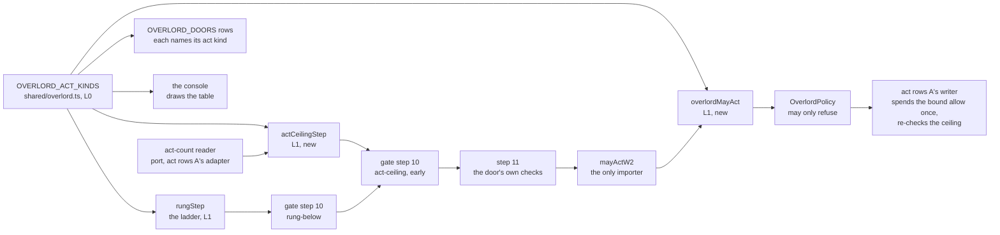
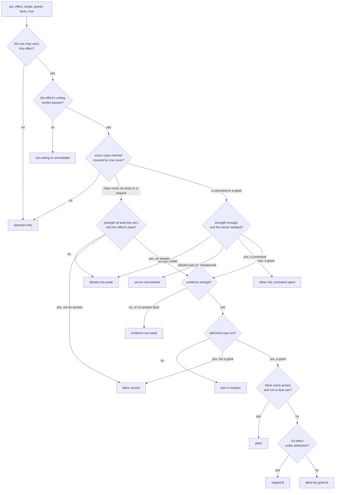
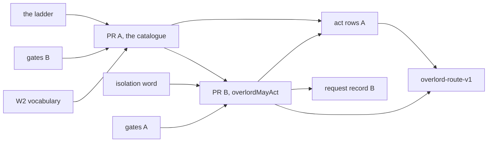

# Overlord W2: the act catalogue, its ceilings and `overlordMayAct` Implementation Plan

> **For agentic workers:** REQUIRED SUB-SKILL: Use superpowers:subagent-driven-development (recommended) or
> superpowers:executing-plans to implement this plan task by task. Steps use checkbox (`- [ ]`) syntax for tracking.

## In short

- **What this is.** The plan for the W2 piece "Act catalogue" (the W2 index, Table W2, lane C). It is the spine every
  Overlord write door needs: one table of every act the Overlord can take, and one decider that says whether an act may
  pass. Two pull requests, eight tasks: PR A four, PR B four.
- **PR A, the catalogue.** `OVERLORD_ACT_KINDS` in `shared/overlord.ts` (C25, H24). It takes over the ladder's
  `RUNG_CELLS` (index question 25): a characterization commit, then a move commit. It then gains its other columns and
  every row of Table 7.1a, with `escalate-request` (the index's question 7) and three rows completed from D-8126 §3 and
  the SAFETY list. Each row says whether it is an answer or a carrier, and which effect it may carry. Timers stay no
  act kind (review 2253, F1), so the timer doors keep `act: null`. Three tests hold the table: one home, D-8126 §3's act
  list mapped onto it, and the compensators. Each act kind gets its ceiling per programme and in all (question 19,
  proposed in §5). Gate step 10 gains `act-ceiling` after `rung-below`, as the early refusal; act rows A's writer
  checks the ceiling again inside its write.
- **PR B, the decider.** `overlordMayAct(act, effect, target, grants, facts, now, lookup)` (C5, L1), first match,
  exhaustive, with a monotonicity property and its nine answers. Covers are keyed per class member, an act may carry
  only the effects its row lists, and the effect's ceiling verdict, the rung cell and the binding facts are its inputs.
  An allow is bound to its act, effect, target, natural key, cell and generation, and act rows A's writer spends it
  once. The grant and command branches are built and fed nothing (question 27), behind one W2 wrapper that a census
  makes the decider's only importer. The `OverlordPolicy` port: its default adapter allows everything, an outside
  authoriser can only refuse, and a throw refuses.
- **What changes at merge.** Nothing a running session sees. No W2 door exists yet, every W1 door's kind keeps its
  cells, and every kind a W1 door performs has its ceiling held by an owner that already exists (question 2).
- **What W2 can answer.** On the catalogue's real rows, `allow` (class none, and a relay carrying a widening an
  operator request names) and `operator-only`. `identity-too-weak` is reachable only on synthetic rows in W2, because
  every row a W2 door performs needs `attributed`, the lowest strength.
- **What the reader must check.** Table 5's ceiling values (question 19, the coordinator's to approve). Fix round 1
  (review 2271) ruled F1 to F15; §2's first table says where each is built. None needs the operator.

## 1. Goal, scope and the rulings this plan builds on

This section says what the piece builds, why, where its files go, and which rulings it builds on.

**Goal:** every act the Overlord can take is one row of one L0 table, and one L1 decider answers for every act from
that row, the effect it carries, the caller's strength, the server's isolation and the covers in force.

**Why:** C25 and H24 (§7.1): "Every act is a row in one L0 table … The server enforces the table, and the console draws
from it", and "One decider answers for every act". R1: start from D-8126's operator-only list unchanged, and build it so
it can be relaxed step by step. §7.3: what never relaxes is held by a row the server reads, not by the skill alone. §7.5:
"Each act kind has a ceiling per programme and in all (Table 11.5b), counted from act rows over a rolling window".

**Architecture:** two pull requests in lane C. Decide in L1, act in L4, one writer per fact.

- **L0, K.** `shared/overlord.ts` (new): the D-8126 class words, the covers each class member takes, the reversibility
  words, the cell words, the cover kinds, the compensators, the ceiling groups and `OVERLORD_ACT_KINDS`; and (PR B)
  the nine answer words, the authority words and the allow's modes. It imports only sibling `shared/` files, by type:
  `shared/overlord-ladder.ts` (`Rung`), `shared/overlord-identity.ts` (`VerbClass`, `CallerStrength`).
- **L1, C5.** `server/src/coord/overlordActCeiling.ts` (new, PR A): `actCeilingStep`. The ladder's
  `server/src/coord/overlordLadder.ts#rungStep` reads the catalogue's cells. Gates B's
  `server/src/coord/overlordGate.ts#overlordGate` composes both at step 10 and names the latch an `act-ceiling` refusal
  raises.
- **L1, C5.** `server/src/coord/overlordMayAct.ts` (new, PR B): `overlordMayAct`, `grantCovers` and the branded
  `MayActAllow` that only `overlordMayAct` mints. `server/src/coord/overlordMayActW2.ts` (new, PR B): `mayActW2`, the W2
  wrapper, the only `server/src` file allowed to import `overlordMayAct`, `GrantFact` or `CommandFact`.
- **L2, C5.** `server/src/coord/overlordPolicy.ts` (new, PR B): the `OverlordPolicy` port, declared by its consumer
  (each Overlord write door), with its failure contract. **L3, C5.** `server/src/coord/overlordPolicyDefault.ts` (new,
  PR B): `allowAllPolicy`. One ring per file, so the port and its adapter are two files.
- **L4, C5.** Gates B's `server/src/coord/overlordGateRun.ts`: the act-count reader port, read as a fact before the
  decider, and the latch raise the decider names (PR A). Every new file under `server/src/coord/` is C5 by the
  architecture spec's `coord/**` row, so no path-table row is added.
- **L5.** `server/src/server.ts` builds the count reader's default and the policy adapter once.


*Figure 1. Where the catalogue is read. One table feeds the rung cells, the ceilings and the decider; the door row
names the act kind; the act row is written only with the decider's bound allow, spent once, and the ceiling is checked
again inside that write.*

**Tech stack:** TypeScript (ESM), vitest. No new dependency, no migration, no ccd change, no route.

**Spec:** `docs/superpowers/specs/2026-11-09-overlord-design.md`:

- §7.1 whole: C25 with its column list, Table 7.1a and the bullets under it, "Verb classes", H24 with its nine answers
  and the covers, "A door reaches the decider only after its gates pass".
- §7.2: C26's grant fields, the conditions, "How a grant lives" (states, expiry read against `now`, suspension read as
  absent), "Staging, the blind check and evidence", Figure 6.
- §7.3 whole: what never relaxes.
- §7.4: C27's three strengths, "Effects and grants carry a least strength", H28's isolation word and "Every reader that
  acts treats `unmeasured` as `shared-user`".
- §7.5: "Ceilings", Table 7.5a's row "an act ceiling hit".
- §3.6: `OverlordPolicy`. §3.8 and C12: the operator's request as the O3 ruling, and "a root request's authority is
  spent once".
- §11.2: step 10 (`rung-below`, `act-ceiling`), step 11 (`overlordMayAct`), "After the gates" (egress, then the policy
  port).
- Table 11.5b: the relay's 30 and 6 an hour, and "Set by the plan before W2: each act kind's ceiling per programme and
  in all". Table 11.6: `act-ceiling`, `operator-only`, `identity-too-weak`, `server-not-isolated`. Table 11.7: I4.
- `docs/superpowers/specs/2026-11-09-coordinator-autonomy-default-design.md` §3 (D-8126): O1 to O6.
- `CLAUDE.md`, "SAFETY — sacred, never violate".

**The index's rulings this plan builds on** (`docs/superpowers/plans/2026-11-16-overlord-w2.md`, in review on #2917,
read from `origin/ws/overlord-plan-w2-index`):

| Question | Ruling | What this plan builds |
|---|---|---|
| 18, `timers-are-own-record-acts` | Overturned (review 2253, F1) | No `set-timer`. A timer is no act kind (§3.3.12, §11.2); the timer doors keep `act: null`, and step 10 skips them, both halves |
| 19, the act ceilings | Proposed here | Table 5's values; the coordinator approves them at review |
| 25, `rung-cells-seed-the-act-catalogue` | Settled | Task A1's characterization commit, then its move commit; Task A2 adds the other columns |
| 27, grants and commands dormant | Settled, read with review 2253's F12.6 and review 2271's F9 and F11 | Both branches built in Task B3, fed nothing by `mayActW2`, the decider's one importer. On real rows W2 answers `allow` and `operator-only`; `identity-too-weak` only on synthetic rows; `evidence-too-weak` is W3's; `server-not-isolated` only on the grant and command paths |
| 7, the W2 door paths, with `escalate-request` | Accepted | The `escalate-request` row (review 2271, F8) |
| 6, `w2-words-at-once` | Accepted | `act-ceiling`, `operator-only`, `identity-too-weak` and `server-not-isolated` are read from `OVERLORD_REFUSALS`, which the W2 vocabulary fills first |
| 20, portfolio facts live | Accepted | Nothing here: no door, no lane |
| 2, `route-moves-ride-the-relay` | Accepted | `relay` covers route, re-relay and route elsewhere; one row |

*Table 1. The index rulings read here.*

## 2. Rulings and open questions

This section records fix round 1's rulings first, then the questions this plan raised, each with its recommendation
or its ruling. None is the operator's.

| Finding (review 2271) | Ruling | Where it is built |
|---|---|---|
| F1, the effect an act may carry; covers per class member | A per-row "may carry" list; covers keyed per class member | §4 (Tables 3 and 4, `CLASS_COVERS`), §6 steps 1 and 3, Tasks A2, A3, B2 |
| F2, what is an answer | A `carrier` and an `answer` column, decided from the act kind; `state-a-fact` is an answer | §4, §6 steps 1, 8 and 9, Tasks A2, B2, B3 |
| F3, a relay carrying a start | Closed by F1's list | §4 |
| F4, the cell | The effective cell is an input and is bound into the allow | §6, Tasks B2, B3 |
| F5, the allow's binding | Target, natural key, cell and generation bound; act rows A's writer asserts it at run time, spends it once and compares | §6, question 8, Task B4, index changes |
| F6, the ceiling under concurrency | Step 10 is the early refusal; act rows A's writer re-runs `actCeilingStep` inside its synchronous write; counts include rows by effect | §5, question 10, index changes |
| F7, `accept-limit` in a counted group | Its ceiling cell is `never` | Table 5 |
| F8, `escalate-request` | A row, class none, reversible, refuse/allow/allow, the `request` group | Tables 4 and 5, Tasks A2 to A4 |
| F9, what holds by door convention | The effect's ceiling verdict is a decider input; `mayActW2` and its census; the stated-entry path is dormant in W2 | §6, Task B3 |
| F10, who spends a request's authority once | Act rows A's natural key for a start, on the request alone; relay A for one relay per owner, a re-relay carrying no `widens`; I4 checks both; relay B consumes `scope.widens` | Table 7, question 11, index changes |
| F11, identity | A `leastStrength` column; a trailing row-lookup parameter; the stronger of the act's and the effect's needs | Tables 3 and 4, §6 step 4, Task B2 |
| F12, the move | Two commits; `RUNG_CELLS` is deleted, read through the catalogue | Task A1 |
| F13, mutation | A mutant count and floor per decider | §8, each task |
| F14, D-8126 coverage | The oracle is D-8126 §3's act list | Task A3 |
| F15, three small rules | A policy throw refuses; no door names `renew`; the latch is raised unless one stands, named by the L1 gate | §6, Tasks A4, B4 |

*Table 2. Fix round 1's rulings.*

The questions this plan raised, each with its recommendation, now accepted at review unless Table 2 says otherwise:

1. **Where step 10's ceiling half reads its counts before act rows land** (slug `ceiling-counter-is-an-act-rows-port`).
   §7.5 counts ceilings "from act rows", and `overlord_acts` is act rows A's, which needs this piece's PR A first. The
   coordinator ruled (review 2253, F16) that the count is an input to a pure decider until act rows A wires it.
   **Recommendation**, which builds that ruling: `actCeilingStep` is pure and takes the counts as input, and PR A
   declares the reader as a port in the gate runner's deps (gates B's own idiom, "a reader whose producer has not
   landed is read as its stated default, and every default that can refuse does"):
   `ActCountReader.count(group, programme, since)`. Its default answers `{ kind: 'unmeasured', why: 'not-wired' }`, so
   a counted kind refuses `unavailable` until act rows A wires its adapter. No W1 door performs a counted kind
   (question 2), and no W2 write door exists before act rows A, so the default refuses nothing that runs today. Act rows
   A replaces the default with its store's count, and `overlord-route-v1` refuses to ship while the default stands
   (index change).
2. **Kinds whose ceiling an owner already holds** (slug `ceilings-held-by-their-owners`). §7.5 gives every kind a
   ceiling, and three kinds that W1 doors perform already have one, held by their own store or lane: reads (the read
   ceilings of Table 11.5b, the inbox piece's `read-ceiling`), `write-note` (`shared/continuity.ts#NOTES_CAP`), and
   `acknowledge`, whose targets are the operator's own messages, one acknowledgement each. (Timers are no act kind, and
   their own rate and cap, `shared/continuity-timers.ts#TIMER_SETS_PER_HOUR` and `FLEET_ROLES`' `timerCap`, hold them
   outside the catalogue.) **Recommendation:** their ceiling cell is `held-by`, naming the owner, and step 10 asks no
   count for them. A second counter beside each owner would be a parallel mechanism (`CLAUDE.md`, "Consolidate, don't
   duplicate"). `renew` is the server's own act, held by the renewal's hold-off and restart bounds, and is `held-by`
   too; no door row may name it (F15).
3. **The ceiling-hit latch lands with the ceilings** (slug `act-ceiling-latch-lands-with-the-ceiling`). The ladder's
   Table 2 gives `act-ceiling-hit` (latch, cap `advise`) to "W3 pieces". The ceilings are W2's, so the first hit can
   happen in W2. **Recommendation:** PR A adds the cause row to `LADDER_CAUSE_MAP`. The L1 gate's `act-ceiling`
   refusal names the cause, and the runner raises it through the ladder's `raiseLatch` unless a latch for that cause
   stands (F15). Before W3 the effective rung is at most `advise`, so the cap changes nothing a session sees, but the
   evidence is kept and the operator sees and clears it.
4. **The start doors keep skipping step 10** (slug `start-doors-skip-the-ceiling`). §11.2 has card, probe and note skip
   the rung of step 10 only at `off`. Gates B skips step 10 at every start door because `rungStep` passes them at every
   W1 rung. **Recommendation:** the start doors keep skipping step 10 whole. Their kinds are `read` and `write-note`,
   whose ceilings are `held-by` (question 2), so no count is lost, and a renewing generation never waits on an act
   count.
5. **Three rows completed from D-8126 §3 and the SAFETY list** (slug `catalogue-completed-from-d8126-and-safety`).
   §7.1: "The plan completes the table from D-8126 §3 and the SAFETY list before W2 ships it." **Recommendation:**
   three rows, each refused at every rung, with no cover and the ceiling `never`:
   - `live-box-act` (O1, irreversible): every verb `CLAUDE.md`'s SAFETY list forbids to sessions, read by reference to
     `server/src/coord/approvalguard.ts#FORBIDDEN_CCD_VERBS` and named in prose, never copied as quoted verbs (that
     list's own comment says why: the verb censuses count a quoted verb as a composer); touching tmux, units or the
     registries; `ccrc update`, `rollback` and `rollout`; `ccrc history` writes; writing live box config, including
     arming markers. `deploy` stays its own row, as Table 7.1a has it.
   - `account-management` (O1 and O4, irreversible): the `ccrc account` subs the SAFETY list forbids. D-8126 lists
     account management under O1 and sign-ins under O4, so its class is the set of both.
   - `accept-limit` (O3, compensable): "dropping or cutting a definition-of-done item; accepting a known limit that
     leaves a definition-of-done item unmet" (D-8126 O3). No cover in version 1.

   The rest of D-8126 §3's acts either map to an existing row or have no door at all, and so are refused by their
   absence (Task A3's oracle lists each).
6. **The rung cell words** (slug `rung-cells-name-their-mode`). **Recommendation:** five cell words, `allow`, `refuse`,
   `proposal`, `armed` and `by-grant`. `rungStep` refuses only `refuse`, and its pass gains the cell, additively.
   `rung-below` names the lowest rung whose cell is not `refuse`, or `null` for a kind refused at every rung. The cell
   is then an input of `overlordMayAct` and is bound into its allow (F4), so the writer, not door convention, tells a
   proposal from an act.
7. **The policy port's refusal word** (slug `policy-refusal-has-its-own-word`). Table 11.6 has no word for the policy's
   refusal, and reusing `operator-only` would fold two conditions into one value. **Recommendation:** `policy-refused`,
   403, added to `shared/refusal.ts#OVERLORD_REFUSALS` with its Table 11.6 row in PR B. The default adapter never
   sends it; a throwing adapter does (F15).
8. **An act row needs the decider's bound allow** (slug `act-row-needs-a-may-act-allow`). H24 runs the decider "inside
   the transaction that commits the act", and nothing makes a door call it. **Ruled (F5):** `overlordMayAct` mints a
   frozen `MayActAllow`, registered in a module `WeakSet`, that binds the act, the effect, the target's programme id and
   incarnation, the natural key, the cell, the mode and the generation. Act rows A's one writer asserts
   `isMayActAllow` at run time, spends the allow once (a second use refuses), and compares its act, effect and target
   with the row it writes. The policy port reads its target from the allow. A census in this plan refuses a second
   minter and any cast, spread or `Object.assign` of a `MayActAllow` in `server/src`; a forgery that slips past the
   census still fails the writer's run-time check.
9. **What an act may carry** (slug `an-act-carries-only-what-its-row-lists`). **Ruled (F1):** a per-row "may carry"
   list. The carriers (`answer-item`, `answer-ask`) carry only their question's fixed effect, which must be a kind that
   is neither a carrier nor the server's; `relay` carries `widen-scope` or nothing; every other act carries nothing.
   Anything else answers `operator-only`. Step 10 reads the act's cell only; an effect's own cells apply only through
   its carrier at `full`. So a relay at `advise` that carries a widening named in an operator request passes step 10
   as a relay, and the decider allows it by the request cover; a relay that carries a start answers `operator-only`.
10. **A carrier counts twice, and the writer re-checks** (slug `a-carrier-counts-against-its-effect`). **Ruled (F6,
    F9):** an act row counts against its own kind's group, and also against its effect's group when the effect has a
    counted ceiling. `ActCountReader.count(group, …)` counts rows whose kind is in the group and rows whose effect is.
    Step 10 checks the act's group as the early refusal. The door gathers the effect's verdict through
    `actCeilingStep` (the act's count `not-asked`) and passes it to `overlordMayAct`, which refuses on it. Act rows A's
    writer re-reads the counts and re-runs `actCeilingStep` for the act's and the effect's groups inside the same
    synchronous write, so two concurrent calls cannot both pass a ceiling (`CoordStore` is synchronous; gates B's
    guarded counter is the precedent, "a TOCTOU re-check").
11. **I4's request arm, and who spends a request's authority once** (the index: "the act catalogue B's plan says
    whether I4's request arm can be gathered in W2 or waits for W3's grants"). **Recommendation:** gathered in W2,
    whole, with act rows B, after request record A. The decider's answer names its authority (`none`, `grant`,
    `command`, `request` or `entry`), the act row stores it, and the predicate checks each arm against its store. In W2
    the grant and command stores are empty, so a classed row naming either is a violation. **Ruled (F10):** C12's
    "spent once" is not the decider's, since a pure decider cannot stop two concurrent calls. Act rows A's natural key
    holds one start per request, keyed on the request alone (stricter than §8's request plus name; slug
    `one-start-per-request`). Relay A holds one relay per owner per root request, and a re-relay carries no `widens`.
    I4 checks both. Relay B consumes the `scope.widens` row and escalates a widening it does not clear before it calls
    the decider, so the decider's request fact never has to fold that verdict into `namesTarget`.

## 3. What exists today

Measured on `main` at `9cf263d44` (2026-11-16) with `git grep` and by reading the files named. `origin/main` has since
moved by two docs-only commits that touch nothing below (review 2271).

| Thing | State on `main` | Cited |
|---|---|---|
| The ladder: `RUNG_CELLS`, `rungStep`, `LadderActKind`, `LADDER_CAUSE_MAP`, `raiseLatch` | **not built**; plan #2861 | `docs/superpowers/plans/2026-11-14-overlord-w1/w1-ladder.md`, Task 1 |
| Gates: `OVERLORD_DOORS`, `OverlordDoorRow.act`, `overlordGate`, `overlordGateRun`, `CallerIdentity`, `shared/overlord-identity.ts` | **not built**; plan #2863 | `w1-gates.md`, Tasks 1, 2, 4, 5 |
| The isolation word: `shared/isolation.ts#IsolationRead`, `IsolationReader` | **not built**; plan #2867 | `w1-isolation.md`, Task 1 |
| The timer doors' rows (`act: null`, step 10 skipped), which this plan keeps | **not built**; plan #2874 | `w1-overlord-timers.md`, question 1 |
| `shared/overlord.ts` | **absent** | none |
| `rung-below`, `read-ceiling` | in the group | `shared/refusal.ts#OVERLORD_REFUSALS` |
| `act-ceiling`, `operator-only`, `identity-too-weak`, `server-not-isolated` | on the wave map, `W2`; the W2 vocabulary moves them into the group | `server/test/single-definition/refusal-table.data.json` (`waveMap`) |
| `evidence-too-weak`, `ask-is-cheaper`, `defer` | on the wave map, `W3` | the same file |
| The SAFETY verbs forbidden to sessions | one `|`-joined list | `server/src/coord/approvalguard.ts#FORBIDDEN_CCD_VERBS` |
| D-8126's O1 to O6 | **prose only**: no code names them. D-8126's code classes are the call record's `routine`, `big` and `block`, a different vocabulary | `shared/api.ts#CALL_CLASSES`; D-8126 spec §3 |
| The notes' cap | 200 notes of 500 characters | `shared/continuity.ts#NOTES_CAP` |
| The timers' rate and cap, which hold timers outside the catalogue | 30 sets an hour; 50 pending for the Overlord | `shared/continuity-timers.ts#TIMER_SETS_PER_HOUR`, `server/src/continuity/timers.ts#timerSetVerdict`, `shared/fleetRoles.ts` (`timerCap`) |
| The correction door, the compensator for a relay and an answer | registered | `server/src/server.ts` (`POST /api/digest/correct`) |
| The programme's end, the compensator for a start | the archive door's `{programme:'end'}` | `server/src/server.ts` (`POST /api/sessions/:id/archive`) |
| Mutation floors | `MUTANT_SETS` spreads one `*_MUTANT_SETS` per area; each floor is a score from 0 to 1, and the suite requires every mutant killed | `server/test/sim/mutation-floors.test.ts`, `server/test/sim/mutation-floors.json` |
| A seeded generator for property cases | present | `server/test/fakeTime.ts#mulberry32` |
| The Overlord authority journal | present | `server/src/coord/overlordAuthorityJournal.ts` |

*Table 3. What exists today.*

So both pull requests are written against the W1 plans' interfaces, which the build reads from `main` once those
pieces land. Each task's first step measures the named symbols on `main` and stops if one differs from its W1 plan.

## 4. The catalogue

This section gives the table PR A ships: its columns, its rows, the covers each class member takes, and its rung
cells. The ceilings are §5.

**The columns** (C25's list, in its order, with this plan's spellings and fix round 1's additions):

| Column | Type | Words |
|---|---|---|
| `what` | string | What the act does, in Table 7.1a's words |
| `actor` | `'overlord' \| 'server'` | `renew` alone is the server's |
| `classes` | `readonly OverlordClass[]` | `O1` to `O6`, a set; empty is class none. A class word the build does not know reads as `unknown`, never none (R1) |
| `answer` | boolean | The act answers a held question (`answer-item`, `answer-ask`, `state-a-fact`), so evidence and `askOrAct` apply (F2) |
| `carrier` | boolean | The act carries its question's fixed effect, and its class and reversibility are that effect's (F2) |
| `mayCarry` | `'question-effect' \| readonly OverlordActKind[]` | The effects the act may carry: a carrier's question's effect, `relay`'s `['widen-scope']`, every other row `[]` (F1) |
| `reversibility` | `Reversibility` | `n/a` (reads), `reversible`, `compensable`, `irreversible` (§10.1) |
| `covers` | `readonly CoverKind[]` | `grant`, `command`, `operator-request`, `stated-entry`: what can cover this row's classes, each also allowed by `CLASS_COVERS` for its member. Table 7.1a's Grant column is `grant`'s presence |
| `verbClass` | `VerbClass` | `view` for reads, `operate` for every act (gates' question 7) |
| `compensator` | `Compensator \| null` | `correction-mail`, `new-request`, `end-programme`, each naming its door; `null` unless compensable and allowed at some rung |
| `ceiling` | `CeilingCell` | §5 |
| `leastStrength` | `CallerStrength` | Table 4's column (F11) |
| `rungs` | `{ chat, advise, full }` of `RungCellWord` | `allow`, `refuse`, `proposal`, `armed`, `by-grant` (question 6); `off` has no cell |

*Table 4a. The columns of `OVERLORD_ACT_KINDS`.*

**Covers per class member** (F1). One L0 map, `CLASS_COVERS`, says which covers can ever cover a member of each
class. A member is covered only by a cover in both `CLASS_COVERS[member]` and the `covers` of the row the member
comes from (the act's row or the effect's), and only when that cover's fact holds.

| Class | Covers it can take | Why |
|---|---|---|
| O3 | `grant`, `command`, `operator-request` | Table 7.1a's grantable effects; a command on a proposal; C12's operator request for a start or a widening |
| O5 | `stated-entry` | §7.1: "For `state-a-fact` only, no grant covers O5. Its one cover is a cited entry …" |
| O1, O2, O4, O6 | none | §7.3: no irreversible effect, and nothing for O2, O4 or O6, in version 1; "a relayed quote never satisfies O1, O2 or O4" |
| `unknown` | none | R1: a class this build does not know is never covered |

*Table 4b. `CLASS_COVERS`.*

**The rows.** Table 7.1a, one row per act kind, with `escalate-request` (F8) and the three completion rows (question
5). A timer is no act kind (§3.3.12), so the catalogue has no row for it. The carriers' class and reversibility are
their effect's (§7.1), so their row holds the least they can be: none and compensable. "Least" is the least caller
strength; every row a door performs needs `attributed`, and every row refused at every rung needs `operator`.

| Act kind | Classes | Answer; carrier; may carry | Reversibility | Covers | Least | Compensator | `chat` | `advise` | `full` |
|---|---|---|---|---|---|---|---|---|---|
| `read` | none | no; no; nothing | n/a | none | attributed | none | allow | allow | allow |
| `write-note`, `acknowledge`, `open-request`, `model-write`, `seal-prediction` | none | no; no; nothing | reversible | none | attributed | none | allow | allow | allow |
| `relay` | none | no; no; `widen-scope` | compensable | none | attributed | correction mail | refuse | allow | allow |
| `drop-request` | none | no; no; nothing | compensable | none | attributed | new request naming the old | refuse | allow | allow |
| `close-request`, `escalate-request`, `attach-brief`, `escalate`, `return-over-asked`, `object`, `propose-grant`, `propose-command`, `propose-retire`, `propose-practice`, `nudge-owner`, `raise-item` | none | no; no; nothing | reversible | none | attributed | none | refuse | allow | allow |
| `answer-item`, `answer-ask` | the effect's | yes; yes; the question's effect | compensable at least | never themselves | attributed | correction mail | refuse | refuse | armed |
| `start-programme` | O3 | no; no; nothing | compensable | operator request, command | attributed | end of the programme | refuse | proposal | allow |
| `rekick-coordinator` | none | no; no; nothing | compensable | none | attributed | correction mail to the same coordinator | refuse | proposal | allow |
| `approve-spec`, `approve-dod` | O3 | no; no; nothing | compensable | grant, command | attributed | correction mail | refuse | refuse | by-grant |
| `widen-scope` | O3 | no; no; nothing | compensable | grant, command, operator request | attributed | correction mail | refuse | refuse | by-grant |
| `state-a-fact` | O5 | yes; no; nothing | compensable | stated entry | attributed | correction mail | refuse | refuse | allow |
| `accept-limit` | O3 | no; no; nothing | compensable | none | operator | none | refuse | refuse | refuse |
| `message-people`, `publish` | O1 | no; no; nothing | irreversible | none | operator | none | refuse | refuse | refuse |
| `deploy` | O1 | no; no; nothing | compensable | none | operator | none (refused at every rung) | refuse | refuse | refuse |
| `live-box-act` | O1 | no; no; nothing | irreversible | none | operator | none | refuse | refuse | refuse |
| `account-management` | O1, O4 | no; no; nothing | irreversible | none | operator | none | refuse | refuse | refuse |
| `spend` | O2 | no; no; nothing | irreversible | none | operator | none | refuse | refuse | refuse |
| `secret-or-access`, `reassign-programme` | O4 | no; no; nothing | irreversible | none | operator | none | refuse | refuse | refuse |
| `override-a-person` | O6 | no; no; nothing | irreversible | none | operator | none | refuse | refuse | refuse |
| `renew` (actor: the server) | none | no; no; nothing | reversible | none | attributed | none | allow | allow | allow |

*Table 4. The rows. `start-programme`'s class is O3, and an operator request that names the project or programme covers
it (C12); Table 7.1a's "none when an `operator` request names the project or programme" is that cover, written as a
cover so that the decider reads one rule. The same holds for `widen-scope` (C12, index question 8). `escalate-request`
is named apart from Table 7.1a's `escalate`, which is W3's: it moves a request to `needs-you` (index question 28), and
request record B's escalate door names it.*

The rules the tests hold over the rows, each the text of §7.3, §7.1 or a ruling, as data:

- **No irreversible row has a cover.** "No irreversible effect through an Overlord door in version 1, by grant or by
  command".
- **No row with O2, O4 or O6 has `grant`.** "O2 and O4 … have 'no' in the Grant column"; "O6 … is never granted".
- **`grant` only on a compensable row whose classes are O3 alone,** the three Table 7.1a lists.
- **`operator-request` only on a row whose classes are O3 alone** (F1).
- **A carrier is an answer; only a carrier has `mayCarry: 'question-effect'`; only `relay` among the rest carries
  anything** (F1, F2).
- **No `OVERLORD_DOORS` row names `renew`**, the server's own act (F15).

## 5. The ceilings

This section proposes the values question 19 asks for, and the rule `actCeilingStep` applies. The coordinator approves
the values at this plan's review.

**The cell.** Each row's `ceiling` is one of three:

- `{ kind: 'counted', group }`: counted from act rows over a rolling hour of wall time, as the relay's are (Table
  11.5b). Rows of one group share one count, and a row counts in its kind's group and in its effect's (question 10).
  A row counts from the moment it is written, whatever becomes of it, except a row settled `refused`, the rule §7.2
  gives `max-per-day`.
- `{ kind: 'held-by', owner }`: an existing owner holds this kind's bound, and no count is asked (question 2).
- `{ kind: 'never' }`: refused at every rung, so no count is ever asked. A test pins `never` exactly on the rows refused
  at every rung, `accept-limit` among them (F7).

**The model.** The relay's 30 an hour in all and 6 to one target (Table 11.5b) are the model for acts that reach a
coordinator. Acts that reach the operator get a third of that, because the operator's attention is what the Overlord
exists to save. Proposals, starts and re-kicks, which create work or sessions, get less again. "Per programme" is the
target's programme; an act with no programme target counts in all only.

| Group | Kinds | Per programme, an hour | In all, an hour | Why |
|---|---|---|---|---|
| `relay` | `relay`, `nudge-owner` | 6 | 30 | Table 11.5b; a nudge counts against the relay's ceilings (index question 21) |
| `request` | `close-request`, `drop-request`, `escalate-request` | 6 | 30 | The relay's model: each moves a request a coordinator owns. A W2 escalation spends this group, not W3's operator reach (F8) |
| `brief` | `attach-brief` | 6 | 30 | The relay's model: a brief reaches a coordinator's item |
| `operator-reach` | `raise-item`, `escalate`, `return-over-asked`, `object` | 3 | 10 | Each lands in front of the operator |
| `proposal` | `propose-grant`, `propose-command`, `propose-retire`, `propose-practice` | 1 | 6 | Each asks the operator for authority |
| `answer` | `answer-item`, `answer-ask` | 6 | 30 | The relay's model (W3 re-fits it from its shadow period) |
| `o3-effect` | `approve-spec`, `approve-dod`, `widen-scope` | 1 | 3 | A programme's goals, scope or definition of done |
| `fact` | `state-a-fact` | 3 | 10 | A fact only the operator holds |
| `start` | `start-programme` | 1 | 2 | Starts a session (C28's caps, W5, apply as well) |
| `rekick` | `rekick-coordinator` | 1 | 3 | Restarts a session |
| `own-record` | `open-request`, `model-write`, `seal-prediction` | none | 60 | Its own records; an open request citing a message is also bounded by its message (24 hours, one root request) |

*Table 5. The proposed ceilings (question 19). Every value is a starting value of Table 11.5b, which the coordinator
re-fits after the first week as W1's read ceilings are.*

| Kind | Held by | Cited |
|---|---|---|
| `read` | The read ceilings, per door (inbox 240, `messages` 120, board 120, history 60 and sequence 120 an hour) | Table 11.5b; the inbox piece's `read-ceiling` |
| `write-note` | 200 notes of 500 characters for one identity | `shared/continuity.ts#NOTES_CAP` |
| `acknowledge` | Its targets: one acknowledgement for each operator message | the inbox piece's acknowledge door |
| `renew` | The renewal's hold-off and restart bounds | Table 11.5b, the W1a rows |

*Table 6. The kinds whose ceiling an existing owner holds (question 2).*

**The rule, `actCeilingStep`** (L1, first match):

1. The act's cell is `held-by` or `never`, and its effect's count was not asked: `pass`.
2. A count the step needs is `unmeasured`: `refuse`, `unavailable`, naming the group and why.
3. The act's group, in all, is at or over its `all`: `refuse`, `act-ceiling`, naming the group, `all` and the window.
4. The act's group, for the target's programme, is at or over its `perProgramme`: `refuse`, `act-ceiling`, naming the
   programme.
5. The same two checks for the effect's group, when its count was asked (question 10).
6. Otherwise `pass`.

An `act-ceiling` refusal names the latch cause `act-ceiling-hit` in its verdict, so the runner acts on a cause the L1
step chose and decides nothing (F15). At gate step 10 the rung half decides first: `rung-below` before `act-ceiling`,
as §11.2 orders them, so a refused rung answers `rung-below` even when its count is `unmeasured`. The runner reads the
count as a fact before it asks the decider: for a door that is not a start door and whose act's cell is `counted`, and
`not-asked` otherwise. Which facts to read follows from the door's row (gates B's idiom for `fence: 'read-door'`).
Step 10 is the early refusal only; act rows A's writer runs the step again inside its write (question 10).

## 6. `overlordMayAct`

This section gives the decider PR B ships: its inputs, its order, its allow and what W2 feeds it.

**Signature.** `overlordMayAct(act, effect, target, grants, facts, now, lookup = actRow)`: H24's six arguments, and a
trailing row lookup so a test can run the decider over synthetic rows (F11).

- `act`: the act kind the door performs. `effect`: the effect it carries, or `null`. An effect read from a stored row
  arrives as a string.
- `target`: the programme's row and incarnation (C26's scope), and who started it (`operator`, `overlord` or
  `unmeasured`), or no programme.
- `grants`: the grant rows the door read, `[]` in W2.
- `facts`: the caller's strength (`CallerIdentity`), the isolation read (`IsolationRead`), a live command or `null`, an
  operator request bound to the act or none, a cited stated entry or none, and, for an answer, its verdicts gathered
  before the transaction (evidence, `askOrAct`, the blind check), each with an `unmeasured` arm. For a grant: the
  generation's model class, uses under it in the last 24 hours and the coordinator's recommendation. And the inputs
  fix round 1 added: the effect's ceiling verdict (F9), the effective cell from step 10 (F4), whether an `armed` kind is
  live (W3's arming; `unmeasured` reads as shadow), and the binding facts (the natural key and the generation, F5).
- `now`: the call's time, which a grant's `expiresAt` is read against.

**The order** (first match), Figure 6 as code, with fix round 1's checks first:

1. **What it may carry** (F1). The act's row is read through `lookup`; a kind the lookup lacks answers
   `operator-only`. The effect must be one the row's `mayCarry` admits: `null` for a row whose list is empty; for
   `relay`, `null` or `widen-scope`; for a carrier, a non-null kind the lookup knows that is neither a carrier nor the
   server's. Anything else answers `operator-only`.
2. **The effect's ceiling** (F9). The effect has a counted ceiling and its verdict is `not-asked`: `unavailable`
   ("the effect's ceiling was not asked"). A verdict that refused passes its word through (`act-ceiling` or
   `unavailable`), with its latch cause.
3. **The effective class and covers** (F1). Each member comes from a row: the act's row for its classes, the effect's
   row for the effect's (a carrier's own class is its effect's). Class none needs no cover. Otherwise one cover must
   cover every member, tried in this order: a cited stated entry (`active`, `stated`, resting on an operator message,
   confirmed or quoting a whole message, with the item's subject); an operator request (`origin` `operator`, and its
   cited words naming the programme or project, C12); a live command for this proposal whose targets have not moved; a
   live grant in scope (`grantCovers`). A cover covers a member only when it is in `CLASS_COVERS[member]` and in the
   member's row's `covers`. A member left uncovered answers `operator-only`.
4. **Identity** (F11). The caller's strength under the stronger of the act row's `leastStrength`, the effect row's,
   and, on the grant path, the grant's: `identity-too-weak`.
5. **Isolation,** on the command and grant paths only: an isolation read of `shared-user` or `unmeasured` answers
   `server-not-isolated`.
6. **The cell** (F4). Under `by-grant`, only the grant and command paths go on; any other cover answers
   `operator-only`.
7. **A command:** `allow`, authority `command:<id>` (the command is spent by the door's transaction).
8. **Not an answer** (decided from the row's `answer` column, never from the facts, F2), by class none or a request:
   `allow`, with that authority. A relay that carries a widening by a grant goes on to step 9.
9. **Evidence,** for an answer or the grant path: anything but an `answer` fact with evidence `enough` answers
   `evidence-too-weak`. An answer whose facts say `not-an-answer` is read as unmeasured and refuses here (F2). This is
   stricter than H24, which asks evidence of a big answer or a classed one; every answer needs it here (slug
   `every-answer-needs-evidence`).
10. **`askOrAct`,** for an answer: not `act` (including `unmeasured`) answers `ask-is-cheaper`.
11. **By class none, an entry or a request:** `allow`.
12. **The blind check,** by grant: armed and not a clear yes (a check in shadow included) answers `defer`.
13. **Staging:** an O3 effect under a caller of strength `attributed` answers `staged:<grant id>`.
14. Otherwise `allow-by-grant:<grant id>`.

**`grantCovers(grant, effect, target, facts, now)`** (L1, first match, each `unmeasured` reading as not covered):
the grant is `live`; its `effect` is the act's effect; its scope's programme and incarnation are the target's; `now` is
before `expiresAt`; every condition holds (`operator-started-only` needs `startedBy: 'operator'`; `max-per-day:<n>`
needs fewer than `n` uses; the model class equals the generation's; `only-when-recommended-by-coordinator` needs the
recommendation); and no suspension condition of Table 7.2a reads now. A suspended grant reads as absent (§7.2).

**The answers.** The nine L0 words in `shared/overlord.ts`: `allow` (authority `none`, `command`, `request` or
`entry`), `allow-by-grant`, `staged`, `defer`, `ask-is-cheaper`, `evidence-too-weak`, `identity-too-weak`,
`server-not-isolated` and `operator-only`; and the ceiling's `act-ceiling` and `unavailable`, passed through from its
verdict. The three W3 words stay on the wave map: the decider's answer is not a route refusal, and the door that maps
one to a refusal ships in W3.

**The allow** (F4, F5). An allowing answer carries a `MayActAllow`, frozen and registered in a module `WeakSet`. It
binds the word, the authority, the act, the effect, the target's programme id and incarnation, the natural key, the
cell, the generation and a mode:

- `act` under an `allow` or `by-grant` cell (a `staged` word under `by-grant` keeps its veto window, W3);
- `proposal` under a `proposal` cell: the word is `staged`, and act rows A's writer maps it to a proposal row, never to
  the effect;
- `live` or `shadow` under an `armed` cell, from the arming fact (`unmeasured` reads `shadow`).

**Monotonicity** (Table 11.7b). Order the answers from least to most permissive: every refusal, then `defer`, then
`staged`, then `allow-by-grant` and `allow`; and the modes `shadow` and `proposal` below `act` and `live`. Weakening any
input never moves the answer up: a lower strength, an isolation read of `shared-user` or `unmeasured`, a grant removed
or expired, a command removed, a request or entry removed, a verdict turned to `unmeasured`, a ceiling verdict
refusing, an arming fact turned to `unmeasured`, `now` later. A property test checks it over a seeded domain.


*Figure 2. `overlordMayAct`'s order. The cell's check under `by-grant` sits between the identity checks and the paths
and is left out for space. In W2 no grant and no command is passed, no W2 door performs an answer, and the stated-entry
path is dormant (`mayActW2` passes no entry). So on real rows W2 answers `allow` (class none, and a relay carrying a
widening an operator request names) and `operator-only`, and the ceiling's two words pass through. `identity-too-weak`
is reachable only on synthetic rows, because every row a W2 door performs needs `attributed`.*

**What W2 feeds it: `mayActW2`** (F9). One wrapper in its own file, `mayActW2(act, effect, target, gathered)`, where
`gathered` holds the caller's strength, the isolation read, the request, the effect's ceiling verdict, the cell, the
natural key and the generation. It calls `overlordMayAct` with `grants: []`, `command: null`, `statedEntry: none`,
`answer: not-an-answer`, no grant facts and arming `unmeasured`. A census holds that no `server/src` file but
`overlordMayActW2.ts` imports `overlordMayAct`, `GrantFact` or `CommandFact`; lifting that census is W3's act, and W3
replaces the wrapper.

**The policy port.** After the decider allows and the egress check passes (§11.2, "After the gates"), the door asks
`OverlordPolicy.check({ allow, verbClass, actor })`. The target is the allow's own (F5). It answers `{ ok: true }` or
`{ ok: false, why }`, synchronously, from what the adapter holds: it makes no I/O inside the call, because the door is
inside its transaction. It can never widen: its only input is an allowed act, and its only other answer is a refusal,
which the door sends as `policy-refused` (question 7). An adapter that throws is read as a refusal, `policy-refused`,
fail closed (F15). `allowAllPolicy` answers `{ ok: true }` for every call.

## 7. Cross-plan seams

What this plan takes and gives, by name. Each name not on `main` is marked with the plan that ships it.

| Seam | Owner | This plan's use |
|---|---|---|
| `RUNG_CELL_MAP`, `RUNG_CELLS`, `LadderActKind`, `LADDER_ACT_KINDS` | the ladder (#2861) | Deleted from the ladder in Task A1's move; the cells are read as `OVERLORD_ACT_KINDS[kind].rungs` |
| `rungStep(effective, door, act)` | the ladder | Reads the catalogue's cells; its pass gains `cell` (Task A2) |
| `LADDER_CAUSE_MAP`, `raiseLatch` | the ladder | `act-ceiling-hit` row; the runner raises it unless one stands (Task A4, question 3) |
| `OVERLORD_DOORS`, `OverlordDoorRow.act` | gates A (#2863) | `act` becomes `OverlordActKind \| null`; the timer rows keep `null`; no row names `renew` (Tasks A1, A3) |
| `overlordGate`, `GateFacts`, `GateWord`, `GateStep` | gates B (#2863) | Step 10 gains the ceiling half and names its latch cause; `GateFacts.ceiling` (Task A4) |
| `overlordGateRun` and its deps | gates B | The `ActCountReader` port, its default, the latch raise (Task A4) |
| `CallerStrength`, `VerbClass`, `RecordedActor` | gates A (`shared/overlord-identity.ts`, `server/src/auth/callerIdentity.ts`) | Row columns; `strengthAtLeast` added beside them (Task B1); the policy's actor |
| `IsolationRead` | isolation word (#2867) | The decider's isolation fact (Task B2) |
| `OVERLORD_REFUSALS` with the four W2 words | W2 vocabulary | Read, never re-spelled; PR B adds `policy-refused` |
| `overlord_acts`, its one writer, its count | act rows A | The writer asserts `isMayActAllow`, spends the allow once, compares act, effect and target with its row, maps a `proposal` mode to a proposal row, and re-runs `actCeilingStep` for the act's and the effect's groups inside its synchronous write; its count fills `ActCountReader`, by kind and by effect; its natural key holds one start per request (F5, F6, F10) |
| One relay per owner per root request; a re-relay carries no `widens` | relay A | Not the decider's: a pure decider cannot hold "spent once" (F10) |
| The `scope.widens` row | relay B | Consumed before the decider is called: a widening the row does not clear escalates (F10) |
| `escalate-request` on its escalate door | request record B | The row this plan adds (F8) |
| The timer doors' rows | the Overlord's timers (#2874) | Kept at `act: null`; step 10 skips a row with no act kind, both halves |

*Table 7. The seams.*

## 8. Global constraints and review focus

This section lists what every task holds to, and what a reviewer should look at first.

- **One home.** `OVERLORD_ACT_KINDS`, `CLASS_COVERS`, the cell words and the ceiling values are defined in
  `shared/overlord.ts` alone. The ladder's single-definition area file is re-pointed there: no `{ chat, advise, full }`
  cell map, no list of act kinds and no ceiling value elsewhere in `shared/`, `server/src` or `pwa/src`.
- **Derived lists.** Every exported union has its runtime list built from its map (`Object.keys`), never by hand.
- **Rings.** `shared/overlord.ts` imports only sibling `shared/` files, by type. `overlordActCeiling.ts`,
  `overlordMayAct.ts` and `overlordMayActW2.ts` import `shared/` and each other only, and make no I/O.
  `overlordPolicy.ts` is a port with one adapter, allowed because it is a port at an edge (`CLAUDE.md`); the port and
  the adapter are two files, one ring each.
- **No overloaded null.** `rung-below`'s `needs: null` means "no rung allows it", and is never read as "no rung
  needed". A count's `unmeasured` is never a count of zero. An effect `null` means "carries nothing", which a carrier
  may not do.
- **Unmeasured never passes.** Every fact with an `unmeasured` arm refuses at its own step or answer, as gates B's
  question 9 rules.
- **Characterization first for the move.** Task A1's characterization commit is green on `main` with the ladder's code;
  the move commit changes only the test's imports.
- **Mutation** (F13). Each decider joins `MUTANT_SETS` through a new `server/test/sim/actCatalogueSets.ts`
  (`ACT_CATALOGUE_MUTANT_SETS`), and its floor in `mutation-floors.json` is 1, every mutant killed (the suite's rule).
  The plan's least mutant counts, which the builder measures and records in the task's commit message: `overlordMayAct`
  24 (one per step's comparison and one per binding field), `actCeilingStep` 12, `grantCovers` 10, `effectiveClasses`
  5, `actRow` 3, `mayActW2` 5; `rungStep`'s existing set gains 5 for the new cells.
- **Public repository.** Fixtures use `project-a`, `lane-a` and `pool-a`. Run the private-name scan on every changed
  file.

**Review focus:** the move changes no behaviour; Table 4 against Table 7.1a and D-8126 §3's act list; the rules under
Table 4 as tests; Table 5's values; the "may carry" check and per-member covers; that an answer is read from the row;
the allow's binding and its single spend at the writer; `actCeilingStep`'s order after `rung-below` and its re-run at
the writer; the monotonicity property's input order; that only `mayActW2` imports the decider; that the policy port
cannot widen and a throw refuses.

## 9. The PR split

Two pull requests, both in lane C. Each keeps every growth-checked file within its 40 lines with no waiver. #2811's
caps merged on 2026-11-15; of the files this plan touches only `server/src/server.ts` is growth-checked, and it has no
total-cap file under `server/test/growth-caps/` (measured on `main`). `shared/api.ts`, which does have one, is untouched.

| PR | Tasks | Ships | Needs first | Growth-checked files |
|---|---|---|---|---|
| A | A1 to A4 | The characterization and the move; the full catalogue with `CLASS_COVERS`; its tests and the SAFETY scan; the ceilings, `actCeilingStep`, step 10's ceiling half, the count port and the latch | the ladder, gates B, the W2 vocabulary | `server/src/server.ts` about +4 (the count reader's default and the latch raise in the runner's deps); `shared/api.ts` 0; `schema.ts`, `store.ts`, `routes.ts`, `watch.ts` 0 |
| B | B1 to B4 | The answer words, the modes and `strengthAtLeast`; `overlordMayAct` with its exhaustive and monotonicity tests; `grantCovers` and the dormant branches; `mayActW2` and its census; the bound `MayActAllow` and its census; the `OverlordPolicy` port, its default adapter and `policy-refused` | PR A, the isolation word, gates A | `server/src/server.ts` about +3 (the policy adapter into the deps); every other growth-checked file 0 |

*Table 8. The pull requests.*

New files, not growth-checked: `shared/overlord.ts` about +290 (A) and +70 (B); `server/src/coord/overlordActCeiling.ts`
about +65; `server/src/coord/overlordMayAct.ts` about +260; `server/src/coord/overlordMayActW2.ts` about +40;
`server/src/coord/overlordPolicy.ts` about +25 and `overlordPolicyDefault.ts` about +10. Changed W1 files:
`shared/overlord-ladder.ts` about -12 (the cells leave), `server/src/coord/overlordLadder.ts` about +10,
`server/src/coord/overlordGate.ts` about +25, `server/src/coord/overlordGateRun.ts` about +30,
`server/src/coord/overlordDoors.ts` about +4, `shared/overlord-identity.ts` about +8, `shared/refusal.ts` +2,
`docs/superpowers/specs/2026-11-09-overlord-design.md` +1 (Table 11.6's `policy-refused` row).


*Figure 3. The two pull requests in W2's order. Act rows A needs PR A for the ceilings and PR B for the bound allow its
writer spends; request record B and every later write door need PR B.*

## 10. Tasks

Every test runs from `server/`, in the foreground, one file at a time, through `ccrc test --`, for example
`ccrc test -- ./node_modules/.bin/vitest run test/overlord-act-catalogue.test.ts`. Typecheck with
`ccrc test -- npx tsc --noEmit -p .` and `ccrc test -- npx tsc --noEmit -p test/tsconfig.tests.json`.

### Task A1: Characterize the rung cells, then move them (PR A)

**Files:**
- Create: `server/test/overlord-rung-cells-characterization.test.ts` (commit 1)
- Create: `shared/overlord.ts` (K, L0) (commit 2)
- Modify (commit 2): `shared/overlord-ladder.ts` (`RUNG_CELL_MAP`, `RUNG_CELLS`, `LadderActKind` and
  `LADDER_ACT_KINDS` are deleted), `server/src/coord/overlordLadder.ts` (`rungStep` reads
  `OVERLORD_ACT_KINDS[act].rungs`), `server/src/coord/overlordDoors.ts` and `server/src/coord/overlordGate.ts`
  (`LadderActKind` becomes `OverlordActKind`; a row's `act` stays `OverlordActKind | null`, the timers plan's `null` for
  no act kind), the ladder's single-definition area file (the home moves)

**Interfaces** (commit 2's whole content):

```ts
// shared/overlord.ts (L0)
import type { Rung } from './overlord-ladder.js';
/** W1's cells, moved from the ladder (index question 25). Each row's cells sit under `rungs`, because a catalogue row
 *  carries more columns (Task A2 adds them). `RUNG_CELLS` is gone: its one reader, `rungStep`, reads the rows. */
const OVERLORD_ACT_KIND_MAP = {
  read: { rungs: { chat: 'allow', advise: 'allow', full: 'allow' } },
  'write-note': { rungs: { chat: 'allow', advise: 'allow', full: 'allow' } },
  acknowledge: { rungs: { chat: 'allow', advise: 'allow', full: 'allow' } },
} as const satisfies Readonly<Record<string, { readonly rungs: Readonly<Record<Exclude<Rung, 'off'>, 'allow' | 'refuse'>> }>>;
export type OverlordActKind = keyof typeof OVERLORD_ACT_KIND_MAP;
export const OVERLORD_ACT_KINDS = OVERLORD_ACT_KIND_MAP;
export const OVERLORD_ACT_KIND_LIST = Object.keys(OVERLORD_ACT_KIND_MAP) as OverlordActKind[];
export function isOverlordActKind(v: unknown): v is OverlordActKind;
```

- [ ] **Step 1: Measure.** On `main`, read `RUNG_CELL_MAP`, `RUNG_CELLS`, `rungStep`, `OverlordDoorRow.act` and the area
  file; stop and report if any differs from the ladder's or gates' plan.
- [ ] **Step 2: Characterization, green on `main`.** For every W1 act kind (written out in the test, not read from
  `LADDER_ACT_KINDS`) × every rung × both door classes, pin `rungStep`'s answer; pin every `OVERLORD_DOORS` row's `act`.
  Run: green against the ladder's code.
- [ ] **Step 3: Commit 1.** `test(overlord): pin rungStep's answers and the door rows' act kinds before the move`
- [ ] **Step 4: Move.** Create `shared/overlord.ts` as above; delete the four ladder names; re-point every importer and
  the area file's home. No alias is left behind. The rows change shape (their cells sit under `rungs`); `rungStep`'s
  answers do not.
- [ ] **Step 5: Run** the characterization (only its imports changed), the ladder's and gates' suites, the area file,
  `rings/*` and both `tsc` runs. Green.
- [ ] **Step 6: Commit 2.** `refactor(overlord): the rung cells move into the act catalogue (W2 act catalogue)`

### Task A2: The whole catalogue, and the cells that name their mode (PR A)

**Files:**
- Modify: `shared/overlord.ts` (every column of Table 4a, `CLASS_COVERS`, every row of Table 4)
- Modify: `server/src/coord/overlordLadder.ts` (`rungStep`'s five cells, its pass's `cell`, `needs: Rung | null`)
- Create: `server/test/overlord-act-catalogue.test.ts`
- Modify: `server/test/sim/actCatalogueSets.ts` (create; `effectiveClasses` 5 mutants, `actRow` 3), the ladder's mutant
  set (`rungStep` +5), `server/test/sim/mutation-floors.test.ts`, `mutation-floors.json` (floor 1 each)

**Interfaces:**

```ts
// shared/overlord.ts (L0), added
const OVERLORD_CLASS_MAP = { O1: 'irreversible or outward-facing', O2: 'spend beyond plan',
  O3: "the programme's goals, scope or definition of done", O4: 'credentials and access',
  O5: 'a fact only the operator holds', O6: 'overriding a person', unknown: 'a class this build does not know' } as const;
export type OverlordClass = keyof typeof OVERLORD_CLASS_MAP;
const REVERSIBILITY_MAP = { 'n/a': '', reversible: '', compensable: '', irreversible: '' } as const;   // §10.1's words
const RUNG_CELL_WORD_MAP = { allow: '', refuse: '', proposal: 'staged for one tap',
  armed: 'allow when the kind is armed, shadow while not', 'by-grant': 'allow only by grant or command' } as const;
const COVER_KIND_MAP = { grant: '', command: '', 'operator-request': '', 'stated-entry': '' } as const;
/** Table 4b: the covers a member of each class can ever take (F1). */
export const CLASS_COVERS: Readonly<Record<OverlordClass, readonly CoverKind[]>> = {
  O3: ['grant', 'command', 'operator-request'], O5: ['stated-entry'], O1: [], O2: [], O4: [], O6: [], unknown: [],
};
const COMPENSATOR_MAP = {
  'correction-mail': { door: 'POST /api/digest/correct' },
  'new-request': { door: 'POST /api/overlord/requests' },
  'end-programme': { door: 'POST /api/sessions/:id/archive' },
} as const;
export type CeilingCell =
  | { readonly kind: 'counted'; readonly group: CeilingGroup }
  | { readonly kind: 'held-by'; readonly owner: string }
  | { readonly kind: 'never' };
export interface OverlordActRow {
  readonly what: string; readonly actor: 'overlord' | 'server';
  readonly classes: readonly Exclude<OverlordClass, 'unknown'>[];
  readonly answer: boolean; readonly carrier: boolean;
  readonly mayCarry: 'question-effect' | readonly OverlordActKind[];
  readonly reversibility: Reversibility; readonly covers: readonly CoverKind[]; readonly verbClass: VerbClass;
  readonly compensator: Compensator | null; readonly ceiling: CeilingCell; readonly leastStrength: CallerStrength;
  readonly rungs: Readonly<Record<Exclude<Rung, 'off'>, RungCellWord>>;
}
export type ActRowLookup = (kind: string) => OverlordActRow | null;
export const actRow: ActRowLookup;   // a stored string; null for a kind the build lacks
/** Each member with the row it comes from; a carrier's own classes are its effect's. An unknown effect adds `unknown`. */
export function effectiveClasses(act: OverlordActKind, effect: string | null, lookup?: ActRowLookup):
  readonly { readonly member: OverlordClass; readonly from: 'act' | 'effect' }[];
```

```ts
// server/src/coord/overlordLadder.ts, changed
export function rungStep(effective: Rung, door: DoorClass, act: OverlordActKind):
  | { readonly pass: true; readonly cell: RungCellWord | 'skipped' }
  | { readonly pass: false; readonly word: 'rung-below'; readonly needs: Rung | null };
```

- [ ] **Step 1: Failing tests** (`overlord-act-catalogue.test.ts`):
  - every row's keys and every column's words are from their maps; every list equals `Object.keys` of its map;
  - Table 4 written out in the test as data, row by row, equals the catalogue (classes, answer, carrier, may carry,
    reversibility, covers, least strength, compensator, actor, the three cells), `escalate-request` included;
  - `CLASS_COVERS` equals Table 4b;
  - `effectiveClasses`: a carrier takes its effect's classes, marked `effect`; a relay carrying `widen-scope` gives O3
    from the effect; an unknown effect adds `unknown`; `null` adds nothing;
  - `rungStep`: each cell word at each rung; `rung-below` names the lowest rung with a cell other than `refuse`, and
    `null` for a kind refused at every rung; `card-probe-note` at `off` is `skipped`; W1's three kinds answer as the
    characterization pinned;
  - every `OVERLORD_DOORS` overlord row names a catalogue kind or `null`, only the three timer rows are `null` (the
    timers plan's census, kept), and no row names `renew` (F15).
- [ ] **Step 2: Run.** Red. **Step 3: Implement** the rows, `CLASS_COVERS`, `rungStep`'s cells and the mutant sets.
- [ ] **Step 4: Run** this suite, the characterization (W1's kinds unchanged), the ladder's and gates' suites,
  `mutation-floors`, `wire-totality`, `shared-imports`, `rings/*` and both `tsc` runs. Green. Record the measured
  mutant counts in the commit message.
- [ ] **Step 5: Mutation, by hand.** Each reds a case, then restore: `relay`'s `advise` cell to `refuse`;
  `rung-below`'s `needs` to `chat` for a never row; `write-note`'s `chat` cell to `refuse`; a carrier reading its own
  classes; a door row naming `renew`.
- [ ] **Step 6: Commit.** `feat(overlord): the act catalogue whole, Table 7.1a with escalate-request and the completion rows (C25)`

### Task A3: The table's tests: D-8126's act list, what never relaxes, the SAFETY scan, the compensators (PR A)

**Files:**
- Create: `server/test/overlord-act-classes.test.ts`, `server/test/overlord-act-compensators.test.ts`
- Modify: the ladder's single-definition area file (one home for the catalogue, `CLASS_COVERS`, the cell words and the
  ceiling values)

**D-8126 §3's act list** (F14), the oracle's data, each act mapped to the kind that must carry at least its class, or
marked "no door": no catalogue row, so no Overlord door can perform it, refused by absence.

| D-8126 §3 act | Class | Kind |
|---|---|---|
| A verb the SAFETY rules forbid to sessions; reaping, removing, expiring or reclaiming workspaces; touching units or tmux; rolling or selecting a Claude Code build; `ccrc history` writes; writing live box config, including arming markers | O1 | `live-box-act` |
| Account management | O1 | `account-management` |
| Deploys and rollouts | O1 | `deploy` |
| Publishing: a repository or package public, a release, a public page | O1 | `publish` |
| Messaging people | O1 | `message-people` |
| Usage credits, "Switch to usage credits", a model billed on credits; paid services; new accounts | O2 | `spend` |
| Approving a spec | O3 | `approve-spec` |
| Approving or changing the definition of done | O3 | `approve-dod` |
| Changing a spec's goals or scope; starting work outside the definition of done | O3 | `widen-scope` |
| Dropping or cutting a definition-of-done item; accepting a known limit that leaves one unmet | O3 | `accept-limit` |
| Starting a new programme | O3 | `start-programme` |
| Choosing what the programme does next once its definition of done holds | O3 | no door |
| Secrets; sign-ins and account auth; granting or removing people's access | O4 | `secret-or-access` |
| Who may act on a programme (handing it to another session) | O4 | `reassign-programme` |
| Repository settings: rulesets, branch protection, merge methods, auto-merge | O4 | no door |
| Delegated worktrees: attaching a lease, saying a worktree is not delegated, any act on one in conflict | O4 | no door |
| A fact only the operator holds | O5 | `state-a-fact` |
| Overriding a person: ignoring a reviewer's requested change or another person's ruling | O6 | `override-a-person` |

*Table 9. D-8126 §3's act list, as Task A3's oracle holds it.*

- [ ] **Step 1: Failing tests.**
  - **D-8126's act list** (`overlord-act-classes.test.ts`): Table 9 as data. For each mapped act, the kind's classes
    are a superset of its class. Every catalogue kind with a class is named by at least one entry, so a new classed
    kind must be placed in the list. CONTROL: `approve-spec` with no class is red; a classed kind no entry names is
    red.
  - **What never relaxes** (same file), the rules under Table 4: no irreversible row has a cover; no row with O2, O4 or
    O6 has `grant`; `grant` and `operator-request` only on compensable rows whose classes are O3 alone; a carrier is an
    answer; only a carrier carries the question's effect; only `relay` among the rest carries anything; `leastStrength`
    is `operator` on every row refused at every rung.
  - **The SAFETY scan** (same file): `live-box-act` refuses at every rung with no cover and classes including O1; no
    row's `what` names `ccd` followed by a verb of `server/src/coord/approvalguard.ts#FORBIDDEN_CCD_VERBS`; and
    `shared/overlord.ts` holds no string literal equal to one of them. A plain word such as `deploy`'s "roll the fleet"
    is prose, not a verb, so the scan reads the `ccd`-prefixed form. CONTROL: a planted row whose `what` names `ccd`
    and the list's first verb is red.
  - **The compensators** (`overlord-act-compensators.test.ts`): every compensable row allowed at some rung names a
    compensator; a row refused at every rung is skipped; a reversible, irreversible or `n/a` row names none; each
    compensator's door is registered (found through `server/test/scan/parse.ts`), or is on the test's shrink-only
    `LATER_DOORS` with the piece that registers it (`POST /api/overlord/requests`: request record B). CONTROL: `relay`
    without one is red.
  - **One home** (the area file): no other file under `shared/`, `server/src` or `pwa/src` defines an object with
    `chat`, `advise` and `full` keys whose values are cell words, exports a list of act kinds, or defines a map from
    class words to covers.
- [ ] **Step 2: Run.** Red where the catalogue lacks a rule (none should be, after A2; a red here is a row to fix).
- [ ] **Step 3: Implement** only what the tests find. **Step 4: Run** the three files and the area file. Green.
- [ ] **Step 5: Mutation, by hand.** Each reds a case, then restore: give `spend` the cover `grant`; give
  `secret-or-access` the cover `operator-request`; drop O4 from `account-management`; remove `drop-request`'s
  compensator; let `close-request` carry `widen-scope`; name `ccd` and the archive verb of the SAFETY list in
  `propose-retire`'s `what`.
- [ ] **Step 6: Commit.** `test(overlord): the act catalogue held to D-8126's act list, §7.3 and the SAFETY list (C25)`

### Task A4: The ceilings, step 10's second half and the ceiling-hit latch (PR A)

**Files:**
- Modify: `shared/overlord.ts` (`CEILING_GROUP_MAP` with Table 5's values; each row's `ceiling`)
- Create: `server/src/coord/overlordActCeiling.ts` (C5, L1), `server/test/overlord-act-ceiling.test.ts`
- Modify: `server/src/coord/overlordGate.ts` (`GateFacts.ceiling`, step 10's ceiling half, the latch cause in its
  refusal), `server/src/coord/overlordGateRun.ts` (the `ActCountReader` port and its use, the latch raise unless one
  stands), `server/src/server.ts` (the default), `shared/overlord-ladder.ts` (`act-ceiling-hit` in `LADDER_CAUSE_MAP`)
- Modify: `server/test/sim/actCatalogueSets.ts` (`actCeilingStep`, 12 mutants), `mutation-floors.json` (floor 1),
  `server/test/single-definition/time-ports.test.ts` if the runner's file list needs it

**Interfaces:**

```ts
// shared/overlord.ts (L0), added
const CEILING_GROUP_MAP = {
  relay: { perProgramme: 6, all: 30 }, request: { perProgramme: 6, all: 30 }, brief: { perProgramme: 6, all: 30 },
  'operator-reach': { perProgramme: 3, all: 10 }, proposal: { perProgramme: 1, all: 6 },
  answer: { perProgramme: 6, all: 30 }, 'o3-effect': { perProgramme: 1, all: 3 }, fact: { perProgramme: 3, all: 10 },
  start: { perProgramme: 1, all: 2 }, rekick: { perProgramme: 1, all: 3 }, 'own-record': { perProgramme: null, all: 60 },
} as const;
export type CeilingGroup = keyof typeof CEILING_GROUP_MAP;
export const ACT_CEILING_WINDOW_MS = 3_600_000;   // a rolling hour of wall time (Table 11.5b)

// server/src/coord/overlordActCeiling.ts (L1)
export type GroupCount =
  | { readonly kind: 'counted'; readonly programme: number | null; readonly all: number }
  | { readonly kind: 'unmeasured'; readonly why: string };
export type CeilingVerdict =
  | { readonly pass: true }
  | { readonly pass: false; readonly word: 'act-ceiling'; readonly group: CeilingGroup; readonly scope: 'programme' | 'all';
      readonly latch: 'act-ceiling-hit' }
  | { readonly pass: false; readonly word: 'unavailable'; readonly group: CeilingGroup; readonly why: string; readonly latch: null };
export function actCeilingStep(act: OverlordActKind, effect: string | null,
  counts: { readonly act: GroupCount | 'not-asked'; readonly effect: GroupCount | 'not-asked' }): CeilingVerdict;

// server/src/coord/overlordGateRun.ts (L4), its deps gain
export interface ActCountReader {
  /** Act rows written since `since` whose kind or effect is in the group, all and for the programme; a row settled
   *  `refused` does not count. */
  count(group: CeilingGroup, programme: number | null, since: number): GroupCount;
}
```

- [ ] **Step 1: Failing tests** (`overlord-act-ceiling.test.ts`):
  - `actCeilingStep` over every row × count (under, at, over, `unmeasured`) × programme or none, against an oracle
    written in the test from §5's rule; a `held-by` or `never` row passes and asks no count; a carrier refuses on its
    effect's count (question 10); `accept-limit`'s cell is `never` (F7); `escalate-request` counts in `request` (F8);
  - an `act-ceiling` verdict names `act-ceiling-hit`, and an `unavailable` one names no latch;
  - `overlordGate`'s `first-refusal` property gains the ceiling half: `rung-below` before `act-ceiling`; a start door
    and a row with no act kind (the timer doors) skip both; `unmeasured` refuses `unavailable` and never passes;
  - the runner reads a count only for a door that is not a start door and whose act's cell is `counted`, and passes
    `not-asked` otherwise; the default reader's answer refuses `unavailable` with `not-wired`; a verdict naming
    `act-ceiling-hit` raises it through `raiseLatch` unless a latch for the cause stands, and a verdict naming none
    raises nothing (F15);
  - `act-ceiling-hit` is a latch capping `advise`, notice `none`.
- [ ] **Step 2: Run.** Red. **Step 3: Implement** the decider, the gate's half, the port, the default in `server.ts`,
  the cause row, the raise, the mutant set and its floor.
- [ ] **Step 4: Run** this suite, the gates' and ladder's suites, `mutation-floors`, `refusal-status`,
  `refusal-table`, `time-ports`, `rings/*`, `growth-check` armed and both `tsc` runs. Green. Record the measured mutant
  count.
- [ ] **Step 5: Mutation, by hand.** Each reds a case, then restore: `>=` to `>` in the `all` check; decide the ceiling
  before the rung; read `unmeasured` as zero; skip the effect's count; raise the latch on `unavailable`; raise it when
  one stands.
- [ ] **Step 6: Commit.** `feat(overlord): each act kind's ceiling at gate step 10, and the ceiling-hit latch (H25)`

### Task B1: The answer words, the modes and the strengths' order (PR B)

**Files:**
- Modify: `shared/overlord.ts` (`MAY_ACT_ANSWER_MAP`, the authority words, `ALLOW_MODE_MAP`)
- Modify: `shared/overlord-identity.ts` (`CALLER_STRENGTH_RANK`, `strengthAtLeast`)
- Modify: `shared/refusal.ts` (`policy-refused`: 403), `docs/superpowers/specs/2026-11-09-overlord-design.md` (its Table
  11.6 row)
- Create: `server/test/overlord-may-act-vocab.test.ts`

**Interfaces:**

```ts
// shared/overlord.ts (L0), added
const MAY_ACT_ANSWER_MAP = { allow: '', 'allow-by-grant': '', staged: '', defer: '', 'ask-is-cheaper': '',
  'evidence-too-weak': '', 'identity-too-weak': '', 'server-not-isolated': '', 'operator-only': '' } as const;
export type MayActWord = keyof typeof MAY_ACT_ANSWER_MAP;          // nine
const ACT_AUTHORITY_MAP = { none: '', command: '', request: '', entry: '', grant: '' } as const;
export type ActAuthority = { readonly kind: keyof typeof ACT_AUTHORITY_MAP; readonly id: number | null };
/** How a writer uses an allow (F4): act on the effect, write a proposal row, or record a shadow or live answer. */
const ALLOW_MODE_MAP = { act: '', proposal: '', live: '', shadow: '' } as const;
export type AllowMode = keyof typeof ALLOW_MODE_MAP;
// shared/overlord-identity.ts, added
export const CALLER_STRENGTH_RANK: Readonly<Record<CallerStrength, number>>;   // attributed 0, workload 1, operator 2
export function strengthAtLeast(have: CallerStrength, need: CallerStrength): boolean;
```

- [ ] **Step 1: Failing tests:** nine answer words, five authority kinds and four modes, each list from its map;
  `strengthAtLeast` over the nine pairs; `policy-refused` is 403 in `OVERLORD_REFUSALS` and in Table 11.6.
- [ ] **Step 2: Run.** Red. **Step 3: Implement.** **Step 4: Run** this suite, `refusal-status`, `refusal-table`,
  `vocabularies`, `docs-grammar` and both `tsc` runs. Green.
- [ ] **Step 5: Commit.** `feat(overlord): overlordMayAct's answers and modes, the strengths' order and policy-refused (H24)`

### Task B2: `overlordMayAct`: what it may carry, covers per member, class none, the request and the entry (PR B)

**Files:**
- Create: `server/src/coord/overlordMayAct.ts` (C5, L1), `server/test/overlord-may-act.test.ts`
- Modify: `server/test/sim/actCatalogueSets.ts` (`overlordMayAct`, 24 mutants once B3 lands; B2 registers the set),
  `mutation-floors.json` (floor 1)

**Interfaces:**

```ts
// server/src/coord/overlordMayAct.ts (L1)
export interface ActTarget {
  readonly programme: { readonly id: number; readonly incarnation: number } | null;
  readonly startedBy: 'operator' | 'overlord' | 'unmeasured' | null;     // null when there is no programme
}
export interface MayActFacts {
  readonly caller: CallerStrength;
  readonly isolation: IsolationRead;
  readonly command: CommandFact | null;
  readonly request: { readonly kind: 'none' } | { readonly kind: 'bound'; readonly id: number;
    readonly origin: 'operator' | 'overlord'; readonly namesTarget: boolean | 'unmeasured' };
  readonly statedEntry: { readonly kind: 'none' } | { readonly kind: 'cited'; readonly id: number;
    readonly active: boolean; readonly stated: boolean; readonly restsOnOperatorMessage: boolean;
    readonly confirmedOrWhole: boolean; readonly subjectMatches: boolean };
  readonly answer: { readonly kind: 'not-an-answer' } | { readonly kind: 'answer';
    readonly evidence: 'enough' | 'too-weak' | 'unmeasured'; readonly askOrAct: 'act' | 'ask' | 'unmeasured';
    readonly blindCheck: 'not-armed' | 'clear-yes' | 'not-clear' | 'shadow' };
  readonly grantFacts: { readonly modelClass: string | 'unmeasured';
    readonly usesToday: Readonly<Record<number, number | 'unmeasured'>>;
    readonly recommendedByCoordinator: boolean | 'unmeasured'; readonly suspendedNow: readonly number[] } | null;
  readonly effectCeiling: CeilingVerdict | 'not-asked';                 // F9
  readonly cell: Exclude<RungCellWord, 'refuse'>;                       // F4: step 10's cell for the act
  readonly armedLive: boolean | 'unmeasured';                           // read only under `armed`
  readonly naturalKey: string;                                          // F5
  readonly generation: number;                                          // F5: the gate's live generation
}
declare const mayActAllowBrand: unique symbol;
export type MayActAllow = {
  readonly word: 'allow' | 'allow-by-grant' | 'staged'; readonly mode: AllowMode; readonly authority: ActAuthority;
  readonly act: OverlordActKind; readonly effect: OverlordActKind | null;
  readonly target: { readonly programme: number | null; readonly incarnation: number | null };
  readonly naturalKey: string; readonly cell: Exclude<RungCellWord, 'refuse'>; readonly generation: number;
} & { readonly [mayActAllowBrand]: true };
export type MayActAnswer =
  | { readonly kind: 'allowed'; readonly allow: MayActAllow }
  | { readonly kind: 'refused'; readonly word: Exclude<MayActWord, 'allow' | 'allow-by-grant' | 'staged'>; readonly detail: string }
  | { readonly kind: 'ceiling'; readonly verdict: Exclude<CeilingVerdict, { pass: true }> };
export function overlordMayAct(act: OverlordActKind, effect: string | null, target: ActTarget,
  grants: readonly GrantFact[], facts: MayActFacts, now: number, lookup?: ActRowLookup): MayActAnswer;
/** Run time: true only for an allow `overlordMayAct` minted and nobody has spent. */
export function isMayActAllow(v: unknown): v is MayActAllow;
/** Act rows A's writer spends an allow once; a second spend answers `false`. */
export function spendMayActAllow(a: MayActAllow): boolean;
```

- [ ] **Step 1: Failing tests** (`overlord-may-act.test.ts`), with `grants: []` and `command: null`:
  - **may carry** (F1): a carrier with `effect: null`, with a carrier's effect (`answer-ask`), with the server's
    (`renew`) or with an unknown string answers `operator-only`; `relay` with anything but `widen-scope` or `null`
    (`start-programme` among them, F3) answers `operator-only`; every other act with a non-null effect answers
    `operator-only`;
  - **covers per member** (F1): with an operator request that names the target, `answer-item` carrying
    `secret-or-access`, `deploy`, `message-people` and `state-a-fact` each answers `operator-only`; `relay` carrying
    `widen-scope` is `allow`, authority `request`; an `overlord` origin, a request not naming it, `namesTarget:
    'unmeasured'` and no request each answer `operator-only`;
  - **what is an answer** (F2): `answer-item` carrying a class-none effect with `answer: not-an-answer` answers
    `evidence-too-weak`; `state-a-fact` with a cited entry and `not-an-answer` answers `evidence-too-weak`, and with
    evidence `enough` and `askOrAct: act` answers `allow`, authority `entry`; each entry condition false answers
    `operator-only`;
  - **the effect's ceiling** (F9): a counted effect with `not-asked` answers `unavailable`; a refusing verdict passes
    through with its latch cause;
  - **identity** (F11), through a synthetic `lookup`: a caller under the act row's least, and under the effect row's
    when the act's is lower, answers `identity-too-weak`; on the real rows no W2-reachable case answers it;
  - **the cell** (F4): a `proposal` cell mints `staged` with mode `proposal`; `armed` mints `live` only for
    `armedLive: true`, `shadow` otherwise; `by-grant` refuses class none, a request and an entry with `operator-only`;
  - **the allow** (F5): it binds act, effect, target, natural key, cell and generation; it is frozen; `isMayActAllow`
    is true for a minted allow and false for an equal literal and for a spread copy; `spendMayActAllow` answers true
    once and false after;
  - **an exhaustive table:** every act kind × effect (none, each kind, an unknown string) × answer facts (none, each
    verdict combination) × request × entry × strength × isolation × cell, against an oracle written in the test as
    data, with `grants: []` and `command: null`.
- [ ] **Step 2: Run.** Red. **Step 3: Implement** the order of §6 up to the grant and command branches, which answer
  `operator-only` until Task B3; register the mutant set.
- [ ] **Step 4: Run** this suite, `mutation-floors`, `rings/*` and both `tsc` runs. Green.
- [ ] **Step 5: Mutation, by hand.** Each reds a case, then restore: widen the request cover to every class member;
  read "is an answer" from the facts; accept an `overlord`-origin request; read `namesTarget: 'unmeasured'` as true;
  check identity against the act's row only; mint `mode: act` under a `proposal` cell (a door acting on `proposal`);
  mint an allow outside the `WeakSet`.
- [ ] **Step 6: Commit.** `feat(overlord): overlordMayAct, what an act may carry, covers per member, the request and the entry (H24, C12)`

### Task B3: The grant and command branches, dormant, and `mayActW2` (PR B)

**Files:**
- Modify: `server/src/coord/overlordMayAct.ts` (`grantCovers`, the command path, evidence, `askOrAct`, the blind check,
  staging)
- Create: `server/src/coord/overlordMayActW2.ts` (C5, L1), `server/test/overlord-may-act-w2.test.ts`
- Modify: `server/test/overlord-may-act.test.ts`, `server/test/sim/actCatalogueSets.ts` (`grantCovers` 10,
  `mayActW2` 5), `mutation-floors.json` (floor 1 each), the area file (the importer census)

**Interfaces:**

```ts
// server/src/coord/overlordMayAct.ts, added
export type GrantState = 'shadow' | 'live' | 'suspended' | 'revoked' | 'expired';
export type GrantCondition =
  | { readonly kind: 'operator-started-only' } | { readonly kind: 'max-per-day'; readonly n: number }
  | { readonly kind: 'model-class'; readonly modelClass: string } | { readonly kind: 'only-when-recommended-by-coordinator' };
export interface GrantFact {
  readonly id: number; readonly effect: string; readonly scope: { readonly programme: number; readonly incarnation: number };
  readonly state: GrantState; readonly expiresAt: number; readonly leastStrength: CallerStrength;
  readonly conditions: readonly GrantCondition[];
}
export interface CommandFact { readonly id: number; readonly live: boolean; readonly forThisProposal: boolean;
  readonly targetsMoved: boolean | 'unmeasured' }
export function grantCovers(g: GrantFact, effect: string | null, target: ActTarget, facts: MayActFacts, now: number): boolean;

// server/src/coord/overlordMayActW2.ts (L1): W2's one door into the decider (F9, question 27). W3 replaces it.
export interface W2Gathered {
  readonly caller: CallerStrength; readonly isolation: IsolationRead; readonly request: MayActFacts['request'];
  readonly effectCeiling: MayActFacts['effectCeiling']; readonly cell: MayActFacts['cell'];
  readonly naturalKey: string; readonly generation: number;
}
export function mayActW2(act: OverlordActKind, effect: string | null, target: ActTarget, g: W2Gathered, now: number): MayActAnswer;
```

- [ ] **Step 1: Failing tests:**
  - `grantCovers`: each of its conditions false in turn answers false; `unmeasured` in each answers false; `now` at
    `expiresAt` is not covered; a suspended or shadow grant is not covered;
  - the grant path: `server-not-isolated` for `shared-user` and for every `unmeasured` isolation reason;
    `identity-too-weak` under the grant's least; `evidence-too-weak`, and for a relay carrying `widen-scope` by a grant
    with no answer facts (F2); `ask-is-cheaper`; `defer` for `not-clear` and `shadow`; `staged:<id>` for an O3 effect
    under `attributed`; `allow-by-grant:<id>` under `operator`;
  - the command path: `allow`, authority `command:<id>`; a command not live, for another proposal, or whose targets
    moved or are `unmeasured`, covers nothing;
  - **first-refusal**: an oracle of §6's order, written in the test as data, against `overlordMayAct` over a domain
    drawn through `mulberry32` with a fixed seed and 2,000 cases, with `answer` as one of its axes (F2);
  - **monotonicity**: for each case, weakening each input in turn (the list in §6) never moves the answer or the mode
    up the order;
  - `mayActW2` (`overlord-may-act-w2.test.ts`): it passes `grants: []`, `command: null`, `statedEntry: none`, `answer:
    not-an-answer`, no grant facts and `armedLive: 'unmeasured'`, whatever it is given, so the entry path is dormant
    (F9c); a CONTROL wrapper that passes a grant through is red;
  - **the importer census** (the area file): no `server/src` file but `overlordMayActW2.ts` imports `overlordMayAct`,
    `GrantFact` or `CommandFact`; CONTROL: a planted importer is red.
- [ ] **Step 2: Run.** Red. **Step 3: Implement** and add `grantCovers` and `mayActW2` to the mutant sets.
- [ ] **Step 4: Run** both suites, the area file, `mutation-floors`, `rings/*` and both `tsc` runs. Green. Record the
  measured mutant counts.
- [ ] **Step 5: Mutation, by hand.** Each reds a case, then restore: `<` to `<=` on `expiresAt`; skip isolation on the
  command path; stage an O3 effect under `operator`; read `defer` for `not-armed`; let `mayActW2` pass its grants; let
  the grant path skip evidence when the facts say `not-an-answer`.
- [ ] **Step 6: Commit.** `feat(overlord): overlordMayAct's grant and command branches, behind mayActW2 and fed nothing (H24, H26)`

### Task B4: The `OverlordPolicy` port, its default adapter and the allow's census (PR B)

**Files:**
- Create: `server/src/coord/overlordPolicy.ts` (C5, L2), `server/src/coord/overlordPolicyDefault.ts` (C5, L3),
  `server/test/overlord-policy.test.ts`
- Modify: `server/src/server.ts` (the adapter, built once, into the deps the Overlord's routes take)
- Modify: the area file (the census of `MayActAllow`'s one minter, and of casts and spreads)

**Interfaces:**

```ts
// server/src/coord/overlordPolicy.ts (L2)
/** Asked after `overlordMayAct` allowed and the egress check passed (§11.2). Synchronous: the door is inside its
 *  transaction, so an adapter answers from what it holds and makes no I/O in the call. It cannot widen: it sees only
 *  allowed acts, and its other answer is a refusal, which the door sends as `policy-refused`. A throw is read as that
 *  refusal (fail closed). The target is the allow's own. */
export interface OverlordPolicy {
  check(q: { readonly allow: MayActAllow; readonly verbClass: VerbClass; readonly actor: RecordedActor }):
    { readonly ok: true } | { readonly ok: false; readonly why: string };
}
/** The door's one call: a throw answers `{ ok: false, why: 'policy-threw' }`. */
export function askPolicy(p: OverlordPolicy, q: Parameters<OverlordPolicy['check']>[0]): ReturnType<OverlordPolicy['check']>;
// server/src/coord/overlordPolicyDefault.ts (L3)
export const allowAllPolicy: OverlordPolicy;
```

- [ ] **Step 1: Failing tests:** `allowAllPolicy` answers `ok` for every row's allow; `askPolicy` answers `ok: false`
  for an adapter that throws (F15); `check` takes a `MayActAllow` only (a plain object does not compile, in
  `test/tsconfig.tests.json`'s expect-error form); **the allow's census** (the area file): no file in `server/src` but
  `overlordMayAct.ts` mints the brand or adds to its `WeakSet`, and no file holds `as MayActAllow`, `as unknown as`
  next to an allow, a spread of an allow or `Object.assign` onto one (F5); CONTROLs: a planted cast and a planted
  spread are red; `rings/*` reads each new file's ring from its imports.
- [ ] **Step 2: Run.** Red. **Step 3: Implement** and wire it in `server.ts`.
- [ ] **Step 4: Run** this suite, the area file, `rings/*`, `growth-check` armed, `anchors`, `citations` and both `tsc`
  runs. Green.
- [ ] **Step 5: Mutation, by hand.** Each reds a case, then restore: make `check` accept a plain object; mint the brand
  in a second file; let `askPolicy` rethrow.
- [ ] **Step 6: Commit.** `feat(overlord): the OverlordPolicy port and its default, which can only refuse, and fails closed (§3.6)`

## Deviations found

Departures from the spec's text, and from the index and the W1 plans, that this plan makes, by slug. The coordinator
mints the numbers.

- **`ceiling-counter-is-an-act-rows-port`**: §7.5 counts from act rows, which land after this piece. Step 10 reads the
  counts through a port whose default refuses (question 1).
- **`ceilings-held-by-their-owners`**: §7.5 gives every kind a ceiling. Reads, notes, acknowledgements and `renew`
  keep the bound their owner already holds, and step 10 asks no count for them (question 2).
- **`act-ceiling-latch-lands-with-the-ceiling`**: the ladder plan gives `act-ceiling-hit` to W3. It lands in W2 with
  the ceilings (question 3).
- **`start-doors-skip-the-ceiling`**: §11.2 has the card, probe and note doors skip step 10's rung only at `off`. They
  skip step 10 whole, as gates B built (question 4).
- **`catalogue-completed-from-d8126-and-safety`**: Table 7.1a gains `live-box-act`, `account-management` and
  `accept-limit` (question 5).
- **`rung-cells-name-their-mode`**: the rung cells are five words, the cell is a decider input bound into the allow,
  and `rung-below` can name no rung (question 6).
- **`policy-refusal-has-its-own-word`**: Table 11.6 gains `policy-refused`, which a throwing adapter also answers
  (question 7).
- **`act-row-needs-a-may-act-allow`**: the act row's writer takes the decider's bound allow, checks it at run time and
  spends it once (question 8).
- **`an-act-carries-only-what-its-row-lists`**: H24's `effect` is any carried effect, limited by the row's "may carry"
  list; covers are keyed per class member (question 9).
- **`a-carrier-counts-against-its-effect`**: an act row counts against its kind's group and its effect's, and the
  writer re-checks both inside its write (question 10).
- **`start-and-widening-covered-by-request`**: Table 7.1a writes `start-programme`'s class as "none when an operator
  request names it, O3 otherwise". The catalogue writes O3 with the cover `operator-request`, and `widen-scope` gets the
  same cover (C12), so the decider reads one rule.
- **`every-answer-needs-evidence`**: H24 asks evidence of "a big answer, or any answer whose effect carries a class".
  The decider asks it of every answer, and reads an answer with no answer facts as unmeasured (F2).
- **`one-start-per-request`**: §8's start key is the request plus the name; act rows A's natural key holds one start
  per request alone (F10).
- **`escalate-request-is-its-own-kind`**: Table 7.1a has only W3's `escalate`. W2's escalation of a request to
  `needs-you` is `escalate-request`, in the `request` ceiling group (F8, index question 7).

## What the index should change

- **Table W2, act catalogue row:** add "a per-row 'may carry' list, covers per class member (`CLASS_COVERS`), the
  `answer` and `carrier` columns, `escalate-request`, the effect's ceiling verdict and the cell as decider inputs, the
  bound allow, `mayActW2` and its importer census".
- **Table W2, act rows A:** "its writer takes the decider's `MayActAllow`, asserts `isMayActAllow` at run time, spends
  it once through `spendMayActAllow`, compares its act, effect and target with the row, maps a `proposal` mode to a
  proposal row, and re-runs `actCeilingStep` for the act's and the effect's groups inside its synchronous write"; "its
  count fills the gate runner's `ActCountReader`, counting rows by kind and by effect"; "its natural key holds one
  start per request" (F5, F6, F10). Act rows A's Needs first gains act catalogue B. Act rows B: "the act rows of
  `write-note` and `acknowledge`" (each W1 own-record door then calls the decider through `mayActW2`), and "I4's
  predicate, every arm, checking the cell the allow was minted under" (question 11; it needs request record A, so add
  that to act rows B's Needs first).
- **Table W2, relay A:** the ceilings are the catalogue's (`relay` group, step 10, and the writer's re-check), not a
  counter of the relay's own; "the ceilings, 30 an hour in all and 6 to one target" becomes "its act kinds' ceilings
  from the catalogue". It holds one relay per owner per root request, and a re-relay carries no `widens` (F10).
- **Table W2, relay B:** consumes the `scope.widens` row and escalates a widening it does not clear before it calls the
  decider (F10).
- **Table W2, request record B:** its escalate door's act kind is `escalate-request` (F8).
- **Table W2, `overlord-route-v1`:** "refuses to ship while the `ActCountReader` default stands" (question 1).
- **Where lanes meet:** the ladder's single-definition area file and `shared/overlord-ladder.ts` (the cells leave;
  `act-ceiling-hit` joins `LADDER_CAUSE_MAP`); `shared/overlord-identity.ts` (`strengthAtLeast`); `shared/refusal.ts`
  (`policy-refused`, with its Table 11.6 row: `ROUTE_REFUSALS` is the keys of `REFUSAL_STATUS`, so the refusal-table
  guard accepts it with no wave-map change).
- **The ladder's Table 2:** `act-ceiling-hit` moves from "W3 pieces" to the act catalogue A (question 3).
- **"States W3 may read":** the cell words, `CLASS_COVERS`, the cover kinds, the authority words, the modes and
  `MayActAllow`; W3 lifts the importer census and replaces `mayActW2`.
- **Question 18 and Table W2's act catalogue row:** drop `set-timer` and the `timers-are-own-record-acts` slug, as
  review 2253's F1 says; the timer doors keep `act: null`.
- **Spec fixes:** Table 7.1a's completion rows and `escalate-request`; `start-programme`'s and `widen-scope`'s request
  cover; §7.5's ceilings per Table 5 into Table 11.5b; §11.2's start doors skipping step 10 whole; Table 11.6's
  `policy-refused`; H24's evidence rule as built (`every-answer-needs-evidence`); §8's start key on the request alone
  (`one-start-per-request`).

## Where things stand

**Agreed:**
- The index's rulings in Table 1: the move of `RUNG_CELLS`, the dormant grant and command branches, the W2 words read
  from the group, `escalate-request`.
- Review 2253's rulings on this piece: F1 (no `set-timer`; the timer doors keep `act: null`), F12.6 (W2's answers),
  F12.7 (the default adapter allows) and F16 (the count is an input to a pure decider).
- Review 2271's rulings F1 to F15, built as Table 2 says.
- No D-number. Plan decisions are slugs.

**Waiting on the coordinator:**
- The ceiling values of Table 5 (question 19), approved at this plan's review.

**Later:**
- Building PR A once the ladder, gates B and the W2 vocabulary land; PR B once PR A, the isolation word and gates A
  land.
- W3 feeds the grant and command branches, lifts the importer census and replaces `mayActW2`, and maps `defer`,
  `ask-is-cheaper` and `evidence-too-weak` to its doors' refusals.
- The coordinator re-fits Table 5 after the first week of relays, as W1's read ceilings are re-fitted.
