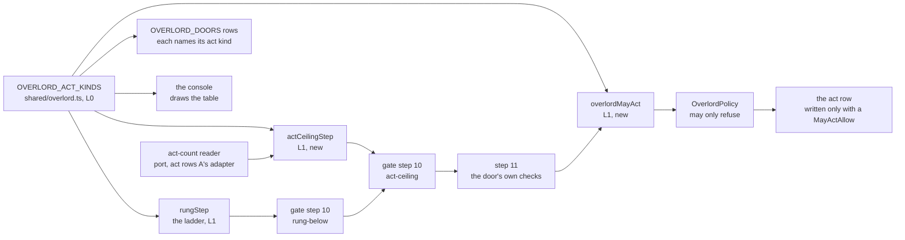
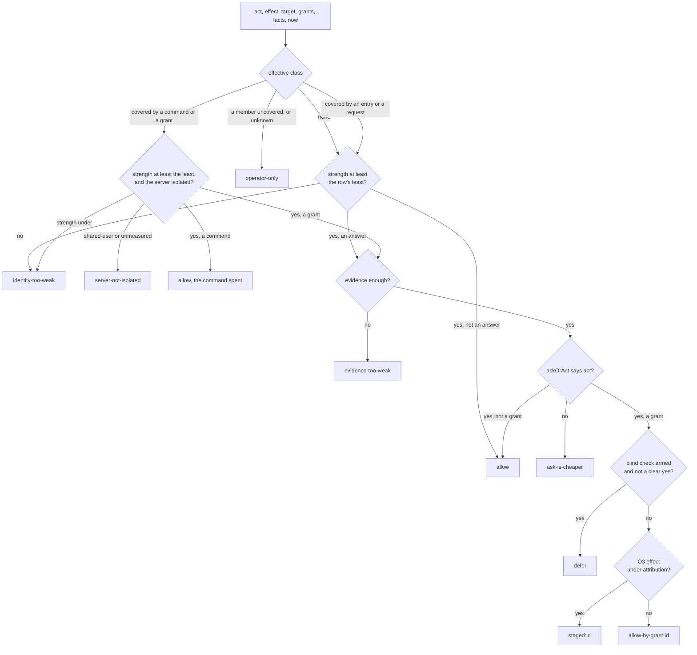
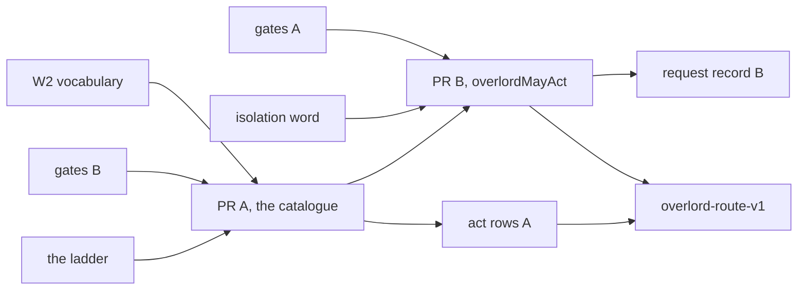

# Overlord W2: the act catalogue, its ceilings and `overlordMayAct` Implementation Plan

> **For agentic workers:** REQUIRED SUB-SKILL: Use superpowers:subagent-driven-development (recommended) or
> superpowers:executing-plans to implement this plan task by task. Steps use checkbox (`- [ ]`) syntax for tracking.

## In short

- **What this is.** The plan for the W2 piece "Act catalogue" (the W2 index, Table W2, lane C). It is the spine every
  Overlord write door needs: one table of every act the Overlord can take, and one decider that says whether an act may
  pass. Two pull requests, eight tasks: PR A four, PR B four.
- **PR A, the catalogue.** `OVERLORD_ACT_KINDS` in `shared/overlord.ts` (C25, H24). It takes over the ladder's
  `RUNG_CELLS` in a move commit (index question 25), then gains its other columns and every row of Table 7.1a, with
  `set-timer` (question 18) and three rows completed from D-8126 §3 and the SAFETY list. Three tests hold it: one home,
  the D-8126 class map that fails on a row set lower, and the compensator test. Each act kind gets its ceiling per
  programme and in all (question 19, proposed in §5 for the coordinator to approve). Gate step 10 gains `act-ceiling`
  after `rung-below`.
- **PR B, the decider.** `overlordMayAct(act, effect, target, grants, facts, now)` (C5, L1), first match, exhaustive,
  with a monotonicity property and its nine answers. The grant and command branches are built and fed nothing (question
  27). The `OverlordPolicy` port (L2) and its default adapter, which allows everything and can only ever refuse.
- **What changes at merge.** Nothing a running session sees. No W2 door exists yet, every W1 door's kind keeps its
  cells, and every kind a W1 door performs has its ceiling held by an owner that already exists (question 2).
- **What the reader must check.** The ceiling values in Table 5 (question 19 is the coordinator's to approve at this
  plan's review), and the eleven open questions in §2. None needs the operator: each is an implementation choice.

## 1. Goal, scope and the rulings this plan builds on

This section says what the piece builds, why, where its files go, and which index rulings it builds on.

**Goal:** every act the Overlord can take is one row of one L0 table, and one L1 decider answers for every act from
that row, the caller's strength, the server's isolation and the covers in force.

**Why:** C25 and H24 (§7.1): "Every act is a row in one L0 table … The server enforces the table, and the console draws
from it", and "One decider answers for every act". R1: start from D-8126's operator-only list unchanged, and build it so
it can be relaxed step by step. §7.3: what never relaxes is held by a row the server reads, not by the skill alone. §7.5:
"Each act kind has a ceiling per programme and in all (Table 11.5b), counted from act rows over a rolling window".

**Architecture:** two pull requests in lane C. Decide in L1, act in L4, one writer per fact.

- **L0, K.** `shared/overlord.ts` (new): the D-8126 class words, the reversibility words, the cell words, the cover
  kinds, the compensators, the ceiling groups and `OVERLORD_ACT_KINDS`; and (PR B) the nine answer words. It imports
  only sibling `shared/` files, by type: `shared/overlord-ladder.ts` (`Rung`), `shared/overlord-identity.ts`
  (`VerbClass`, `CallerStrength`).
- **L1, C5.** `server/src/coord/overlordActCeiling.ts` (new, PR A): `actCeilingStep`. The ladder's
  `server/src/coord/overlordLadder.ts#rungStep` reads the catalogue's cells. Gates B's
  `server/src/coord/overlordGate.ts#overlordGate` composes both at step 10.
- **L1, C5.** `server/src/coord/overlordMayAct.ts` (new, PR B): `overlordMayAct` and `grantCovers`, and the branded
  `MayActAllow` that only `overlordMayAct` mints.
- **L2, C5.** `server/src/coord/overlordPolicy.ts` (new, PR B): the `OverlordPolicy` port, declared by its consumer
  (each Overlord write door), with its failure contract. **L3, C5.** `server/src/coord/overlordPolicyDefault.ts` (new,
  PR B): `allowAllPolicy`, the default adapter. One ring per file, so the port and its adapter are two files.
- **L4, C5.** Gates B's `server/src/coord/overlordGateRun.ts`: the act-count reader port, read as a fact before the
  decider, and the latch raise on an `act-ceiling` refusal (PR A). Every new file under `server/src/coord/` is C5 by
  the architecture spec's `coord/**` row, so no path-table row is added.
- **L5.** `server/src/server.ts` builds the count reader's default and the policy adapter once.


*Figure 1. Where the catalogue is read. One table feeds the rung cells, the ceilings and the decider; the door row
names the act kind; the act row can be written only with the decider's allow.*

**Tech stack:** TypeScript (ESM), vitest. No new dependency, no migration, no ccd change, no route.

**Spec:** `docs/superpowers/specs/2026-11-09-overlord-design.md`:

- §7.1 whole: C25 with its column list, Table 7.1a and the bullets under it, "Verb classes", H24 with its nine answers
  and the covers, "A door reaches the decider only after its gates pass".
- §7.2: C26's grant fields, the conditions, "How a grant lives" (states, expiry read against `now`, suspension read as
  absent), "Staging, the blind check and evidence", Figure 6.
- §7.3 whole: what never relaxes.
- §7.4: C27's three strengths, "Effects and grants carry a least strength", H28's isolation word and "Every reader that
  acts treats `unmeasured` as `shared-user`".
- §7.5: "Ceilings", Table 7.5a's row "an act ceiling hit".
- §3.6: `OverlordPolicy`. §3.8 and C12: the operator's request as the O3 ruling.
- §11.2: step 10 (`rung-below`, `act-ceiling`), step 11 (`overlordMayAct`), "After the gates" (egress, then the policy
  port).
- Table 11.5b: the relay's 30 and 6 an hour, and "Set by the plan before W2: each act kind's ceiling per programme and
  in all". Table 11.6: `act-ceiling`, `operator-only`, `identity-too-weak`, `server-not-isolated`. Table 11.7: I4.
- `docs/superpowers/specs/2026-11-09-coordinator-autonomy-default-design.md` §3 (D-8126): O1 to O6.
- `CLAUDE.md`, "SAFETY — sacred, never violate".

**The index's rulings this plan builds on** (`docs/superpowers/plans/2026-11-16-overlord-w2.md`, in review on #2917,
read from `origin/ws/overlord-plan-w2-index`):

| Question | Ruling | What this plan builds |
|---|---|---|
| 18, `timers-are-own-record-acts` | Accepted | `set-timer`: class none, reversible, allowed at `chat` and above; the timer doors' rows name it |
| 19, the act ceilings | Proposed here | Table 5's values; the coordinator approves them at review |
| 25, `rung-cells-seed-the-act-catalogue` | Settled | The move commit of Task A1, then the other columns in Task A2 |
| 27, grants and commands dormant | Settled | Both branches built in Task B3; W2's fact builder passes `[]` and `null`, pinned |
| 6, `w2-words-at-once` | Accepted | `act-ceiling`, `operator-only`, `identity-too-weak` and `server-not-isolated` are read from `OVERLORD_REFUSALS`, which the W2 vocabulary fills first |
| 20, portfolio facts live | Accepted | Nothing here: no door, no lane |
| 2, `route-moves-ride-the-relay` | Accepted | `relay` covers route, re-relay and route elsewhere; one row |

*Table 1. The index rulings read here.*

## 2. Open questions

Each question carries a recommendation, which this plan builds unless the coordinator rules otherwise. All are
implementation choices; none is the operator's.

1. **Where step 10's ceiling half reads its counts before act rows land** (slug `ceiling-counter-is-an-act-rows-port`).
   §7.5 counts ceilings "from act rows", and `overlord_acts` is act rows A's, which needs this piece's PR A first.
   **Recommendation:** PR A declares the reader as a port in the gate runner's deps (gates B's own idiom, "a reader
   whose producer has not landed is read as its stated default, and every default that can refuse does"):
   `ActCountReader.count(group, programme, since)`. Its default answers `{ kind: 'unmeasured', why: 'not-wired' }`, so
   a counted kind refuses `unavailable` until act rows A wires its adapter. No W1 door performs a counted kind
   (question 2), and no W2 write door exists before act rows A, so the default refuses nothing that runs today. Act rows
   A replaces the default with its store's count, and `overlord-route-v1` refuses to ship while the default stands
   (index change).
2. **Kinds whose ceiling an owner already holds** (slug `ceilings-held-by-their-owners`). §7.5 gives every kind a
   ceiling, and four kinds that W1 doors perform already have one, held by their own store or lane: reads (the read
   ceilings of Table 11.5b, the inbox piece's `read-ceiling`), `write-note` (`shared/continuity.ts#NOTES_CAP`),
   `set-timer` (`shared/continuity-timers.ts#TIMER_SETS_PER_HOUR` and `FLEET_ROLES`' `timerCap`), and `acknowledge`,
   whose targets are the operator's own messages, one acknowledgement each. **Recommendation:** their ceiling cell is
   `held-by`, naming the owner, and step 10 asks no count for them. A second counter beside each owner would be a
   parallel mechanism (`CLAUDE.md`, "Consolidate, don't duplicate"). `renew` is the server's own act, held by the
   renewal's hold-off and restart bounds, and is `held-by` too.
3. **The ceiling-hit latch lands with the ceilings** (slug `act-ceiling-latch-lands-with-the-ceiling`). The ladder's
   Table 2 gives `act-ceiling-hit` (latch, cap `advise`) to "W3 pieces". The ceilings are W2's, so the first hit can
   happen in W2. **Recommendation:** PR A adds the cause row to `LADDER_CAUSE_MAP` and the runner raises it through the
   ladder's `raiseLatch` on an `act-ceiling` refusal. Before W3 the effective rung is at most `advise`, so the cap
   changes nothing a session sees, but the evidence is kept and the operator sees and clears it. The alternative, raising
   nothing until W3, loses W2's hits.
4. **The start doors keep skipping step 10** (slug `start-doors-skip-the-ceiling`). §11.2 has card, probe and note skip
   the rung of step 10 only at `off`. Gates B skips step 10 at every start door because `rungStep` passes them at every
   W1 rung. With ceilings, step 10 has a second half. **Recommendation:** the start doors keep skipping step 10 whole.
   Their kinds are `read` and `write-note`, whose ceilings are `held-by` (question 2), so no count is lost, and a
   renewing generation never waits on an act count.
5. **Three rows completed from D-8126 §3 and the SAFETY list** (slug `catalogue-completed-from-d8126-and-safety`).
   §7.1: "The plan completes the table from D-8126 §3 and the SAFETY list before W2 ships it." Table 7.1a has no row
   for three of D-8126's named acts. **Recommendation:** three rows, each refused at every rung with no cover:
   - `live-box-act` (O1, irreversible): every verb `CLAUDE.md`'s SAFETY list forbids to sessions, read by reference to
     `server/src/coord/approvalguard.ts#FORBIDDEN_CCD_VERBS` and named in prose, never copied as quoted verbs (that
     list's own comment says why: the verb censuses count a quoted verb as a composer); touching tmux, units or the
     registries; `ccrc update`, `rollback` and `rollout`; `ccrc history` writes; writing live box config, including
     arming markers. `deploy` stays its own row, as Table 7.1a has it.
   - `account-management` (O1 and O4, irreversible): the `ccrc account` subs the SAFETY list forbids. D-8126 lists
     account management under O1 and sign-ins under O4, so its class is the set of both.
   - `accept-limit` (O3, compensable): "dropping or cutting a definition-of-done item; accepting a known limit that
     leaves a definition-of-done item unmet" (D-8126 O3). No cover in version 1: it is not one of Table 7.1a's grantable
     effects, so it stays the operator's until a later spec makes it one.
6. **The rung cell words** (slug `rung-cells-name-their-mode`). W1's cells are `allow` and `refuse`. Table 7.1a also has
   "proposal for one tap", "allow, when that kind is armed; shadow while it is not" and "allow by grant, staged".
   **Recommendation:** five cell words, `allow`, `refuse`, `proposal`, `armed` and `by-grant`. `rungStep` refuses only
   `refuse`, and its pass gains the cell, additively, so the door knows its mode. `rung-below` names the lowest rung
   whose cell is not `refuse`, or `null` for a kind refused at every rung. In W2 no reachable door has a cell other than
   `allow` or `refuse`.
7. **The policy port's refusal word** (slug `policy-refusal-has-its-own-word`). §3.6: "an outside authoriser can only
   refuse what `overlordMayAct` allowed". Table 11.6 has no word for that refusal, and reusing `operator-only` would
   fold two conditions into one value. **Recommendation:** `policy-refused`, 403, added to
   `shared/refusal.ts#OVERLORD_REFUSALS` with its Table 11.6 row in PR B (the vocabulary's rule for a later piece's
   word). The default adapter never sends it.
8. **An act row needs the decider's allow** (slug `act-row-needs-a-may-act-allow`). H24 runs the decider "inside the
   transaction that commits the act", and nothing makes a door call it. **Recommendation:** `overlordMayAct` mints a
   frozen, branded `MayActAllow` for each allowing answer (as `RecordedActor` is minted, gates A), and act rows A's one
   writer takes one as a parameter. A door that skips the decider cannot write an act row. A census of the brand's
   minters (one function) ships here.
9. **A relay carries a widening as its effect** (slug `a-relay-carries-a-widening-as-its-effect`). C12 makes an
   operator's request the O3 ruling for a widening it names, and the relay carries it (index question 8). The decider's
   `effect` argument is not only the carriers'. **Recommendation:** `effect` is the effect an act carries: an answer's
   fixed effect, or `widen-scope` on a relay that widens. The decider reads the union of the act's class and the
   effect's. Step 10 reads the act's cell only; an effect's own cells apply only through its carrier at `full`. So a
   relay at `advise` that carries a widening named in an operator request passes step 10 as a relay, and the decider
   allows it by the request cover.
10. **A carrier counts twice** (slug `a-carrier-counts-against-its-effect`). **Recommendation:** an act row counts
    against its own kind's group, and also against its effect's group when the effect has a counted ceiling, so an
    answer that approves a spec spends both the answer and the O3 ceilings. The gate runner knows only the door's act
    kind: the effect is fixed on the question or named in the body, which step 11 reads. So step 10 checks the act's
    group, and the door checks the effect's group at step 11, before `overlordMayAct`, through the same
    `actCeilingStep` with the act's count `not-asked`. One decider, two call sites with different inputs, and one
    refusal path in the runner that raises the latch.
11. **I4's request arm** (the index: "the act catalogue B's plan says whether I4's request arm can be gathered in W2 or
    waits for W3's grants"). I4: "Every act of a class other than none commits with a live grant in scope, a command …,
    a request bound to an operator message, or … a cited stated entry". **Recommendation:** gathered in W2, whole.
    The decider's answer names its authority (`none`, `grant`, `command`, `request` or `entry`), the act row stores it,
    and the predicate checks each arm against its store. In W2 the grant and command stores are empty, so a classed row
    naming either is a violation, which is what the monitor should say. The request arm needs `overlord_requests`, so I4
    ships with act rows B, after request record A (index change).

## 3. What exists today

Measured on `main` at `9cf263d44` (2026-11-16) with `git grep` and by reading the files named.

| Thing | State on `main` | Cited |
|---|---|---|
| The ladder: `RUNG_CELLS`, `rungStep`, `LadderActKind`, `LADDER_CAUSE_MAP`, `raiseLatch` | **not built**; plan #2861 | `docs/superpowers/plans/2026-11-14-overlord-w1/w1-ladder.md`, Task 1 |
| Gates: `OVERLORD_DOORS`, `OverlordDoorRow.act`, `overlordGate`, `overlordGateRun`, `CallerIdentity`, `shared/overlord-identity.ts` | **not built**; plan #2863 | `w1-gates.md`, Tasks 1, 2, 4, 5 |
| The isolation word: `shared/isolation.ts#IsolationRead`, `IsolationReader` | **not built**; plan #2867 | `w1-isolation.md`, Task 1 |
| The timer doors' rows (`act: null`, step 10 skipped) | **not built**; plan #2874 | `w1-overlord-timers.md`, question 1 |
| `shared/overlord.ts` | **absent** | none |
| `rung-below`, `read-ceiling` | in the group | `shared/refusal.ts#OVERLORD_REFUSALS` |
| `act-ceiling`, `operator-only`, `identity-too-weak`, `server-not-isolated` | on the wave map, `W2`; the W2 vocabulary moves them into the group | `server/test/single-definition/refusal-table.data.json` (`waveMap`) |
| `evidence-too-weak`, `ask-is-cheaper`, `defer` | on the wave map, `W3` | the same file |
| The SAFETY verbs forbidden to sessions | one `|`-joined list | `server/src/coord/approvalguard.ts#FORBIDDEN_CCD_VERBS` |
| D-8126's O1 to O6 | **prose only**: no code names them. D-8126's code classes are the call record's `routine`, `big` and `block`, a different vocabulary | `shared/api.ts#CALL_CLASSES`; D-8126 spec §3 |
| The notes' cap | 200 notes of 500 characters | `shared/continuity.ts#NOTES_CAP` |
| The timers' rate and cap | 30 sets an hour; 50 pending for the Overlord | `shared/continuity-timers.ts#TIMER_SETS_PER_HOUR`, `server/src/continuity/timers.ts#timerSetVerdict`, `shared/fleetRoles.ts` (`timerCap`) |
| The correction door, the compensator for a relay and an answer | registered | `server/src/server.ts` (`POST /api/digest/correct`) |
| The programme's end, the compensator for a start | the archive door's `{programme:'end'}` | `server/src/server.ts` (`POST /api/sessions/:id/archive`) |
| Mutation floors | `MUTANT_SETS` spreads one `*_MUTANT_SETS` per area | `server/test/sim/mutation-floors.test.ts`, `server/test/sim/mutation-floors.json` |
| A seeded generator for property cases | present | `server/test/fakeTime.ts#mulberry32` |
| The Overlord authority journal | present | `server/src/coord/overlordAuthorityJournal.ts` |

*Table 2. What exists today.*

So both pull requests are written against the W1 plans' interfaces, which the build reads from `main` once those
pieces land. Each task's first step measures the named symbols on `main` and stops if one differs from its W1 plan.

## 4. The catalogue

This section gives the table PR A ships: its columns, its rows and its rung cells. The ceilings are §5.

**The columns** (C25's list, in its order, with this plan's spellings):

| Column | Type | Words |
|---|---|---|
| `what` | string | What the act does, in Table 7.1a's words |
| `actor` | `'overlord' \| 'server'` | `renew` alone is the server's |
| `classes` | `readonly OverlordClass[]` | `O1` to `O6`, a set; empty is class none. A class word the build does not know reads as `unknown`, never none (R1) |
| `reversibility` | `Reversibility` | `n/a` (reads), `reversible`, `compensable`, `irreversible` (§10.1) |
| `covers` | `readonly CoverKind[]` | `grant`, `command`, `operator-request`, `stated-entry`: what can cover a member of its class. Table 7.1a's Grant column is `grant`'s presence |
| `verbClass` | `VerbClass` | `view` for reads, `operate` for every act (gates' question 7) |
| `compensator` | `Compensator \| null` | `correction-mail`, `new-request`, `end-programme`, each naming its door; `null` unless compensable and allowed at some rung |
| `ceiling` | `CeilingCell` | §5 |
| `leastStrength` | `CallerStrength` | `attributed` for every kind a door performs today; `operator` for the kinds refused at every rung |
| `rungs` | `{ chat, advise, full }` of `RungCell` | `allow`, `refuse`, `proposal`, `armed`, `by-grant` (question 6); `off` has no cell |

*Table 3. The columns of `OVERLORD_ACT_KINDS`.*

**The rows.** Table 7.1a, one row per act kind, with `set-timer` (question 18) and the three completion rows
(question 5). The carriers' class and reversibility are their effect's (§7.1), so their row holds the least they can be:
none and compensable.

| Act kind | Classes | Reversibility | Covers | Compensator | `chat` | `advise` | `full` |
|---|---|---|---|---|---|---|---|
| `read` | none | n/a | none | none | allow | allow | allow |
| `write-note`, `acknowledge`, `open-request`, `model-write`, `seal-prediction`, `set-timer` | none | reversible | none | none | allow | allow | allow |
| `relay` | none | compensable | none | correction mail | refuse | allow | allow |
| `drop-request` | none | compensable | none | new request naming the old | refuse | allow | allow |
| `close-request`, `attach-brief`, `escalate`, `return-over-asked`, `object`, `propose-grant`, `propose-command`, `propose-retire`, `propose-practice`, `nudge-owner`, `raise-item` | none | reversible | none | none | refuse | allow | allow |
| `answer-item`, `answer-ask` | the effect's | compensable at least | never themselves | correction mail | refuse | refuse | armed |
| `start-programme` | O3 | compensable | operator request, command | end of the programme | refuse | proposal | allow |
| `rekick-coordinator` | none | compensable | none | correction mail to the same coordinator | refuse | proposal | allow |
| `approve-spec`, `approve-dod` | O3 | compensable | grant, command | correction mail | refuse | refuse | by-grant |
| `widen-scope` | O3 | compensable | grant, command, operator request | correction mail | refuse | refuse | by-grant |
| `accept-limit` | O3 | compensable | none | none | refuse | refuse | refuse |
| `state-a-fact` | O5 | compensable | stated entry | correction mail | refuse | refuse | allow |
| `message-people`, `publish` | O1 | irreversible | none | none | refuse | refuse | refuse |
| `deploy` | O1 | compensable | none | none (refused at every rung) | refuse | refuse | refuse |
| `live-box-act` | O1 | irreversible | none | none | refuse | refuse | refuse |
| `account-management` | O1, O4 | irreversible | none | none | refuse | refuse | refuse |
| `spend` | O2 | irreversible | none | none | refuse | refuse | refuse |
| `secret-or-access`, `reassign-programme` | O4 | irreversible | none | none | refuse | refuse | refuse |
| `override-a-person` | O6 | irreversible | none | none | refuse | refuse | refuse |
| `renew` (actor: the server) | none | reversible | none | none | allow | allow | allow |

*Table 4. The rows. `start-programme`'s class is O3, and an operator request that names the project or programme covers
it (C12); Table 7.1a's "none when an `operator` request names the project or programme" is that cover, written as a
cover so that the decider reads one rule. The same holds for `widen-scope` (C12, index question 8).*

Three rules the tests hold over the rows, each the text of §7.3 as data:

- **No irreversible row has a cover.** "No irreversible effect through an Overlord door in version 1, by grant or by
  command".
- **No row with O2, O4 or O6 has `grant`.** "O2 and O4 … have 'no' in the Grant column"; "O6 … is never granted".
- **`grant` only on a compensable row whose classes are O3 alone,** the three Table 7.1a lists.

## 5. The ceilings

This section proposes the values question 19 asks for, and the rule step 10 applies. The coordinator approves the
values at this plan's review.

**The cell.** Each row's `ceiling` is one of three:

- `{ kind: 'counted', group }`: counted from act rows over a rolling hour of wall time, as the relay's are (Table
  11.5b). Rows of one group share one count. A row counts from the moment it is written, whatever becomes of it, except
  a row settled `refused`, the rule §7.2 gives `max-per-day` (act rows A's count follows it).
- `{ kind: 'held-by', owner }`: an existing owner holds this kind's bound, and step 10 asks no count (question 2).
- `{ kind: 'never' }`: refused at every rung, so no count is ever asked. A test pins `never` exactly on the rows refused
  at every rung.

**The model.** The relay's 30 an hour in all and 6 to one target (Table 11.5b) are the model for acts that reach a
coordinator. Acts that reach the operator get a third of that, because the operator's attention is what the Overlord
exists to save. Proposals, starts and re-kicks, which create work or sessions, get less again. "Per programme" is the
target's programme; an act with no programme target counts in all only.

| Group | Kinds | Per programme, an hour | In all, an hour | Why |
|---|---|---|---|---|
| `relay` | `relay`, `nudge-owner` | 6 | 30 | Table 11.5b; a nudge counts against the relay's ceilings (index question 21) |
| `request` | `close-request`, `drop-request` | 6 | 30 | The relay's model: each moves a request a coordinator owns |
| `brief` | `attach-brief` | 6 | 30 | The relay's model: a brief reaches a coordinator's item |
| `operator-reach` | `raise-item`, `escalate`, `return-over-asked`, `object` | 3 | 10 | Each lands in front of the operator |
| `proposal` | `propose-grant`, `propose-command`, `propose-retire`, `propose-practice` | 1 | 6 | Each asks the operator for authority |
| `answer` | `answer-item`, `answer-ask` | 6 | 30 | The relay's model (W3 re-fits it from its shadow period) |
| `o3-effect` | `approve-spec`, `approve-dod`, `widen-scope`, `accept-limit` | 1 | 3 | A programme's goals, scope or definition of done |
| `fact` | `state-a-fact` | 3 | 10 | A fact only the operator holds |
| `start` | `start-programme` | 1 | 2 | Starts a session (C28's caps, W5, apply as well) |
| `rekick` | `rekick-coordinator` | 1 | 3 | Restarts a session |
| `own-record` | `open-request`, `model-write`, `seal-prediction` | none | 60 | Its own records; an open request citing a message is also bounded by its message (24 hours, one root request) |

*Table 5. The proposed ceilings (question 19). Every value is a starting value of Table 11.5b, which the coordinator
re-fits after the first week as W1's read ceilings are.*

| Kind | Held by | Cited |
|---|---|---|
| `read` | The read ceilings, per door (inbox 240, `messages` 120, board 120, history 60 and sequence 120 an hour) | Table 11.5b; the inbox piece's `read-ceiling` |
| `write-note` | 200 notes of 500 characters for one identity | `shared/continuity.ts#NOTES_CAP` |
| `set-timer` | 30 sets an hour, 50 pending for the Overlord | `shared/continuity-timers.ts#TIMER_SETS_PER_HOUR`, `timerCap` |
| `acknowledge` | Its targets: one acknowledgement for each operator message | the inbox piece's acknowledge door |
| `renew` | The renewal's hold-off and restart bounds | Table 11.5b, the W1a rows |

*Table 6. The kinds whose ceiling an existing owner holds (question 2).*

**The rule, `actCeilingStep`** (L1, first match):

1. The act's cell is `held-by` or `never`, and it carries no counted effect: `pass`.
2. A count the step needs is `unmeasured`: `refuse`, `unavailable`, naming the group and why.
3. The act's group, in all, is at or over its `all`: `refuse`, `act-ceiling`, naming the group, `all` and the window.
4. The act's group, for the target's programme, is at or over its `perProgramme`: `refuse`, `act-ceiling`, naming the
   programme.
5. The same two checks for the effect's group, when the effect is counted and its count was asked (question 10).
6. Otherwise `pass`.

At gate step 10 the rung half decides first: `rung-below` before `act-ceiling`, as §11.2 orders them, so a refused rung
answers `rung-below` even when its count is `unmeasured`. The runner reads the count as a fact before it asks the
decider, as it reads every other fact: for a door that is not a start door and whose act's cell is `counted`, and
`not-asked` otherwise. Which facts to read follows from the door's row, so the runner decides nothing (gates B's idiom
for `fence: 'read-door'`).

## 6. `overlordMayAct`

This section gives the decider PR B ships: its inputs, its order and what W2 feeds it.

**Signature.** `overlordMayAct(act, effect, target, grants, facts, now)`, as H24 names it:

- `act`: the act kind the door performs. `effect`: the effect it carries, or `null` (question 9). An effect read from
  a stored row arrives as a string, and a string that is no act kind reads as the class `unknown`.
- `target`: the programme's row and incarnation (C26's scope), and who started it (`operator`, `overlord` or
  `unmeasured`), or no programme.
- `grants`: the grant rows the door read, `[]` in W2.
- `facts`: the caller's strength (`CallerIdentity`), the isolation read (`IsolationRead`), a live command or `null`,
  an operator request bound to the act or none, a cited stated entry or none, and, for an answer, the answer's
  verdicts gathered before the transaction: evidence, `askOrAct` and the blind check, each with an `unmeasured` arm.
  For a grant: the generation's model class, uses under it in the last 24 hours and the coordinator's recommendation,
  each with an `unmeasured` arm.
- `now`: the call's time, which a grant's `expiresAt` is read against.

**The order** (first match), Figure 6 as code:

1. **The effective class.** The union of the act's classes and the effect's. An effect the catalogue lacks adds
   `unknown`.
2. **Covers.** Class none needs no cover. Otherwise every member must be covered, by one cover for the whole act, tried
   in this order: a cited stated entry (only for `state-a-fact`'s O5, and only when the entry is `active`, `stated`,
   rests on an operator message, was confirmed or quotes a whole message, and has the item's subject); an operator
   request (only where the row's `covers` has `operator-request`, and only when the request's `origin` is `operator`
   and its cited words name the programme or project, C12); a live command for this proposal whose targets have not
   moved; a live grant in scope (`grantCovers`). A member left uncovered, or `unknown`, answers `operator-only`.
3. **Identity.** The caller's strength under the row's `leastStrength`, or under the grant's on the grant path:
   `identity-too-weak`.
4. **Isolation,** on the command and grant paths only: an isolation read of `shared-user` or `unmeasured` answers
   `server-not-isolated`.
5. **A command:** `allow`, authority `command:<id>` (the command is spent by the door's transaction).
6. **Not an answer,** by class none, an entry or a request: `allow`, with that authority.
7. **Evidence,** for an answer or the grant path: not `enough` (including `unmeasured`) answers `evidence-too-weak`.
8. **`askOrAct`:** not `act` (including `unmeasured`) answers `ask-is-cheaper`.
9. **By class none, an entry or a request:** `allow`.
10. **The blind check,** by grant: armed and not a clear yes (a check in shadow included) answers `defer`.
11. **Staging:** an O3 effect under a caller of strength `attributed` answers `staged:<grant id>`.
12. Otherwise `allow-by-grant:<grant id>`.

**`grantCovers(grant, effect, target, facts, now)`** (L1, first match, each `unmeasured` reading as not covered):
the grant is `live`; its `effect` is the act's effect; its scope's programme and incarnation are the target's; `now` is
before `expiresAt`; every condition holds (`operator-started-only` needs `startedBy: 'operator'`; `max-per-day:<n>`
needs fewer than `n` uses; the model class equals the generation's; `only-when-recommended-by-coordinator` needs the
recommendation); and no suspension condition of Table 7.2a reads now. A suspended grant reads as absent (§7.2).

**The nine answers** are L0 words in `shared/overlord.ts`, each with its authority: `allow` (`none`, `command`,
`request` or `entry`), `allow-by-grant`, `staged`, `defer`, `ask-is-cheaper`, `evidence-too-weak`, `identity-too-weak`,
`server-not-isolated` and `operator-only`. An allowing answer (`allow`, `allow-by-grant`, `staged`) carries a
`MayActAllow`, frozen and branded (question 8). The three W3 words stay on the wave map: the decider's answer is not a
route refusal, and the door that maps one to a refusal ships in W3.

**Monotonicity** (Table 11.7b). Order the answers from least to most permissive: every refusal, then `defer`, then
`staged`, then `allow-by-grant` and `allow`. Weakening any input never moves the answer up: a lower strength, an
isolation read of `shared-user` or `unmeasured`, a grant removed or expired, a command removed, a request or entry
removed, a verdict turned to `unmeasured`, `now` later. A property test checks it over a seeded domain.


*Figure 2. `overlordMayAct`'s order. In W2 no grant and no command is passed, and no W2 door performs an answer, so the
paths that answer are class none (`allow`), the operator request (a relay that carries a widening, `allow`), identity,
and `operator-only`. The rest is built and tested with synthetic facts, and waits for W3 to feed it.*

**What W2 feeds it.** One fact builder, `mayActFactsW2(caller, isolation, request)`, used by every W2 door, fills
`grants: []`, `command: null`, `statedEntry: { kind: 'none' }` and `answer: { kind: 'not-an-answer' }`. A test pins
that it fills nothing else (question 27); W3 replaces it.

**The policy port.** After the decider allows and the egress check passes (§11.2, "After the gates"), the door asks
`OverlordPolicy.check({ allow, verbClass, target, actor })`, where `allow` is the decider's `MayActAllow` (it names
the act and its effect). It answers `{ ok: true }` or `{ ok: false, why }`,
synchronously, from what the adapter holds: it makes no I/O inside the call, because the door is inside its
transaction. It can never widen: its only input is an allowed act, and its only other answer is a refusal, which the
door sends as `policy-refused` (question 7). `allowAllPolicy` answers `{ ok: true }` for every call.

## 7. Cross-plan seams

What this plan takes and gives, by name. Each name not on `main` is marked with the plan that ships it.

| Seam | Owner | This plan's use |
|---|---|---|
| `RUNG_CELL_MAP`, `RUNG_CELLS`, `LadderActKind`, `LADDER_ACT_KINDS` | the ladder (#2861) | Moved into `shared/overlord.ts` in Task A1; the ladder keeps no copy |
| `rungStep(effective, door, act)` | the ladder | Reads `OVERLORD_ACT_KINDS[act].rungs`; its pass gains `cell` (Task A2) |
| `LADDER_CAUSE_MAP`, `raiseLatch` | the ladder | `act-ceiling-hit` row and its raise (Task A4, question 3) |
| `OVERLORD_DOORS`, `OverlordDoorRow.act` | gates A (#2863) | `act` becomes `OverlordActKind`; the timer rows name `set-timer` (Task A2) |
| `overlordGate`, `GateFacts`, `GateWord`, `GateStep` | gates B (#2863) | Step 10 gains the ceiling half; `GateFacts.ceiling` (Task A4) |
| `overlordGateRun` and its deps | gates B | The `ActCountReader` port, its default, the latch raise (Task A4) |
| `CallerStrength`, `VerbClass` | gates A (`shared/overlord-identity.ts`) | Row columns; `strengthAtLeast` added beside them (Task B1) |
| `IsolationRead` | isolation word (#2867) | The decider's isolation fact (Task B2) |
| `OVERLORD_REFUSALS` with the four W2 words | W2 vocabulary | Read, never re-spelled; PR B adds `policy-refused` |
| `overlord_acts`, its writer, its count | act rows A | Writer takes `MayActAllow`; its count fills `ActCountReader` |
| The timer doors' rows | the Overlord's timers (#2874) | Named `set-timer` here if they landed first, or built on `set-timer` if they land after |

*Table 7. The seams.*

## 8. Global constraints and review focus

This section lists what every task holds to, and what a reviewer should look at first.

- **One home.** `OVERLORD_ACT_KINDS` and the cell words are defined in `shared/overlord.ts` alone. The ladder's
  single-definition area file is re-pointed there in the move commit: no `{ chat, advise, full }` cell map, no list of
  act kinds and no ceiling value elsewhere in `shared/`, `server/src` or `pwa/src`.
- **Derived lists.** Every exported union has its runtime list built from its map (`Object.keys`), never by hand.
- **Rings.** `shared/overlord.ts` imports only sibling `shared/` files, by type. `overlordActCeiling.ts` and
  `overlordMayAct.ts` import `shared/` only, and make no I/O. `overlordPolicy.ts` is a port with one adapter, allowed
  because it is a port at an edge (`CLAUDE.md`); the port and the adapter are two files, one ring each.
- **No overloaded null.** `rung-below`'s `needs: null` means "no rung allows it", and is never read as "no rung
  needed". A count's `unmeasured` is never a count of zero.
- **Unmeasured never passes.** Every fact with an `unmeasured` arm refuses at its own step or answer, as gates B's
  question 9 rules.
- **Characterization first for the move.** Task A1's characterization is green on `main` with the ladder's code, and
  the move commit changes only test imports.
- **Mutation.** `actCeilingStep`, `overlordMayAct` and `grantCovers` join `MUTANT_SETS` through a new
  `server/test/sim/actCatalogueSets.ts` (`ACT_CATALOGUE_MUTANT_SETS`) with floors in `mutation-floors.json`; `rungStep`'s
  existing set gains mutants for the new cells.
- **Public repository.** Fixtures use `project-a`, `lane-a` and `pool-a`. Run the private-name scan on every changed
  file.

**Review focus:** the move commit changes no behaviour; Table 4 against Table 7.1a and D-8126 §3 row by row; the §7.3
rules as tests; Table 5's values; `actCeilingStep`'s order after `rung-below`; the decider's order against Figure 6; the
monotonicity property's input order; that the W2 fact builder passes no grant and no command; that the policy port
cannot widen.

## 9. The PR split

Two pull requests, both in lane C. Each keeps every growth-checked file within its 40 lines with no waiver. The caps
are measured again at build, since #2811's caps may have landed by then.

| PR | Tasks | Ships | Needs first | Growth-checked files |
|---|---|---|---|---|
| A | A1 to A4 | The move commit; the full catalogue; its three tests and the SAFETY scan; the ceilings, `actCeilingStep`, step 10's ceiling half, the count port and the latch | the ladder, gates B, the W2 vocabulary | `server/src/server.ts` about +4 (the count reader's default and the latch raise in the runner's deps); `shared/api.ts` 0; `schema.ts`, `store.ts`, `routes.ts`, `watch.ts` 0 |
| B | B1 to B4 | The answer words and `strengthAtLeast`; `overlordMayAct` with its exhaustive and monotonicity tests; `grantCovers` and the dormant branches; the `MayActAllow` brand; the W2 fact builder; the `OverlordPolicy` port, its default adapter and `policy-refused` | PR A, the isolation word, gates A | `server/src/server.ts` about +3 (the policy adapter into the deps); every other growth-checked file 0 |

*Table 8. The pull requests.*

New files, not growth-checked: `shared/overlord.ts` about +260 (A) and +60 (B); `server/src/coord/overlordActCeiling.ts`
about +60; `server/src/coord/overlordMayAct.ts` about +200; `server/src/coord/overlordPolicy.ts` about +25 and
`overlordPolicyDefault.ts` about +10. Changed W1
files: `shared/overlord-ladder.ts` about -12 (the cells leave), `server/src/coord/overlordLadder.ts` about +10,
`server/src/coord/overlordGate.ts` about +25, `server/src/coord/overlordGateRun.ts` about +30,
`server/src/coord/overlordDoors.ts` about +4, `shared/overlord-identity.ts` about +8, `shared/refusal.ts` +2,
`docs/superpowers/specs/2026-11-09-overlord-design.md` +1 (Table 11.6's `policy-refused` row).


*Figure 3. The two pull requests in W2's order. Act rows A needs PR A; request record B and every later write door need
PR B.*

## 10. Tasks

Every test runs from `server/`, in the foreground, one file at a time, through `ccrc test --`, for example
`ccrc test -- ./node_modules/.bin/vitest run test/overlord-act-catalogue.test.ts`. Typecheck with
`ccrc test -- npx tsc --noEmit -p .` and `ccrc test -- npx tsc --noEmit -p test/tsconfig.tests.json`.

### Task A1: Characterize the rung cells, then move them (PR A)

**Files:**
- Create: `server/test/overlord-rung-cells-characterization.test.ts`
- Create: `shared/overlord.ts` (K, L0)
- Modify: `shared/overlord-ladder.ts` (the cell map leaves), `server/src/coord/overlordLadder.ts` (`rungStep` reads the
  catalogue), `server/src/coord/overlordDoors.ts` and `server/src/coord/overlordGate.ts` (`LadderActKind` becomes
  `OverlordActKind`), the ladder's single-definition area file (the home moves)

**Interfaces** (the move commit's whole content):

```ts
// shared/overlord.ts (L0)
import type { Rung } from './overlord-ladder.js';
/** W1's cells, moved from the ladder unchanged (index question 25). Task A2 adds the columns and the rows. */
const OVERLORD_ACT_KIND_MAP = {
  read: { rungs: { chat: 'allow', advise: 'allow', full: 'allow' } },
  'write-note': { rungs: { chat: 'allow', advise: 'allow', full: 'allow' } },
  acknowledge: { rungs: { chat: 'allow', advise: 'allow', full: 'allow' } },
} as const satisfies Readonly<Record<string, { readonly rungs: Readonly<Record<Exclude<Rung, 'off'>, 'allow' | 'refuse'>> }>>;
export type OverlordActKind = keyof typeof OVERLORD_ACT_KIND_MAP;
export const OVERLORD_ACT_KINDS = OVERLORD_ACT_KIND_MAP;
export const OVERLORD_ACT_KIND_LIST = Object.keys(OVERLORD_ACT_KIND_MAP) as OverlordActKind[];
export function isOverlordActKind(v: unknown): v is OverlordActKind;
```

- [ ] **Step 1: Measure.** On `main`, read `RUNG_CELL_MAP`, `rungStep`, `OverlordDoorRow.act` and the area file; stop and
  report if any differs from the ladder's or gates' plan.
- [ ] **Step 2: Characterization, green on `main`.** For every W1 act kind × every rung × both door classes, pin
  `rungStep`'s answer; pin every `OVERLORD_DOORS` row's `act`. Run: green against the ladder's code.
- [ ] **Step 3: Move.** Create `shared/overlord.ts` as above; delete the cell map, `LadderActKind` and
  `LADDER_ACT_KINDS` from the ladder; re-point every importer and the area file's home. No alias is left behind.
- [ ] **Step 4: Run** the characterization (only its imports changed), the ladder's and gates' suites, the area file,
  `rings/*` and both `tsc` runs. Green.
- [ ] **Step 5: Commit.** `refactor(overlord): the rung cells move into the act catalogue, a pure move (W2 act catalogue)`

### Task A2: The whole catalogue, and the cells that name their mode (PR A)

**Files:**
- Modify: `shared/overlord.ts` (every column of Table 3 and every row of Table 4)
- Modify: `server/src/coord/overlordLadder.ts` (`rungStep`'s five cells, its pass's `cell`, `needs: Rung | null`)
- Modify: `server/src/coord/overlordDoors.ts` (the timer rows name `set-timer`; `act` loses `null` once no row uses it)
- Create: `server/test/overlord-act-catalogue.test.ts`
- Modify: the ladder's mutant set (`rungStep`'s new mutants), `server/test/sim/mutation-floors.json`

**Interfaces:**

```ts
// shared/overlord.ts (L0), added
const OVERLORD_CLASS_MAP = { O1: 'irreversible or outward-facing', O2: 'spend beyond plan',
  O3: "the programme's goals, scope or definition of done", O4: 'credentials and access',
  O5: 'a fact only the operator holds', O6: 'overriding a person', unknown: 'a class this build does not know' } as const;
export type OverlordClass = keyof typeof OVERLORD_CLASS_MAP;
const REVERSIBILITY_MAP = { 'n/a': '', reversible: '', compensable: '', irreversible: '' } as const;   // §10.1's words
const RUNG_CELL_WORD_MAP = { allow: '', refuse: '', proposal: 'staged for one tap',
  armed: 'allow when the kind is armed, shadow while not', 'by-grant': 'allow only by grant, staged as the decider says' } as const;
const COVER_KIND_MAP = { grant: '', command: '', 'operator-request': '', 'stated-entry': '' } as const;
const COMPENSATOR_MAP = {
  'correction-mail': { door: 'POST /api/digest/correct' },
  'new-request': { door: 'POST /api/overlord/requests' },
  'end-programme': { door: 'POST /api/sessions/:id/archive' },
} as const;
export type CeilingCell =
  | { readonly kind: 'counted'; readonly group: CeilingGroup }
  | { readonly kind: 'held-by'; readonly owner: string }
  | { readonly kind: 'never' };
export interface OverlordActRow {
  readonly what: string; readonly actor: 'overlord' | 'server';
  readonly classes: readonly Exclude<OverlordClass, 'unknown'>[]; readonly reversibility: Reversibility;
  readonly covers: readonly CoverKind[]; readonly verbClass: VerbClass; readonly compensator: Compensator | null;
  readonly ceiling: CeilingCell; readonly leastStrength: CallerStrength;
  readonly rungs: Readonly<Record<Exclude<Rung, 'off'>, RungCellWord>>;
}
export function actRow(kind: string): OverlordActRow | null;   // a stored string; null for a kind the build lacks
export function effectiveClasses(act: OverlordActKind, effect: string | null): readonly OverlordClass[];
```

```ts
// server/src/coord/overlordLadder.ts, changed
export function rungStep(effective: Rung, door: DoorClass, act: OverlordActKind):
  | { readonly pass: true; readonly cell: RungCellWord | 'skipped' }
  | { readonly pass: false; readonly word: 'rung-below'; readonly needs: Rung | null };
```

- [ ] **Step 1: Failing tests** (`overlord-act-catalogue.test.ts`):
  - every row's keys and every column's words are from their maps; every list equals `Object.keys` of its map;
  - Table 4 written out in the test as data, row by row, equals the catalogue (classes, reversibility, covers, the
    three cells, compensator, actor, least strength);
  - `effectiveClasses`: a carrier takes its effect's classes; an effect the catalogue lacks adds `unknown`; `null`
    adds nothing;
  - `rungStep`: each cell word at each rung; `rung-below` names the lowest rung with a cell other than `refuse`, and
    `null` for a kind refused at every rung; `card-probe-note` at `off` is `skipped`; W1's three kinds answer as the
    characterization pinned;
  - every `OVERLORD_DOORS` overlord row names a catalogue kind, and the timer rows name `set-timer`.
- [ ] **Step 2: Run.** Red. **Step 3: Implement** the rows, `rungStep`'s cells and the door rows.
- [ ] **Step 4: Run** this suite, the characterization (W1's kinds unchanged), the ladder's and gates' suites,
  `mutation-floors`, `wire-totality`, `shared-imports`, `rings/*` and both `tsc` runs. Green.
- [ ] **Step 5: Mutation, by hand.** Each reds a case, then restore: `relay`'s `advise` cell to `refuse`;
  `rung-below`'s `needs` to `chat` for a never row; `set-timer`'s `chat` cell to `refuse`; a carrier reading its own
  classes.
- [ ] **Step 6: Commit.** `feat(overlord): the act catalogue whole, Table 7.1a with set-timer and the completion rows (C25)`

### Task A3: The three tests, and the SAFETY scan (PR A)

**Files:**
- Create: `server/test/overlord-act-classes.test.ts`, `server/test/overlord-act-compensators.test.ts`
- Modify: the ladder's single-definition area file (one home for the catalogue, the cell words and the ceiling values)

- [ ] **Step 1: Failing tests.**
  - **The D-8126 class map** (`overlord-act-classes.test.ts`): an oracle written in the test, each act kind with the
    least class set D-8126 §3 gives it (Table 4's classes, quoted from §3 in each case's comment). It fails when a
    row's classes are not a superset of the oracle's, and when the oracle and the catalogue disagree on the set of
    kinds, so a new kind must be classified here. CONTROL: `approve-spec` with no class is red.
  - **What never relaxes** (same file): no irreversible row has a cover; no row with O2, O4 or O6 has `grant`; `grant`
    only on compensable rows whose classes are O3 alone; `leastStrength` is `operator` on every row refused at every
    rung.
  - **The SAFETY scan** (same file): `live-box-act` refuses at every rung with no cover and classes including O1; no
    row's `what` names `ccd` followed by a verb of `server/src/coord/approvalguard.ts#FORBIDDEN_CCD_VERBS`; and
    `shared/overlord.ts` holds no string literal equal to one of them. A plain word such as `deploy`'s "roll the fleet"
    is prose, not a verb, so the scan reads the `ccd`-prefixed form. CONTROL: a planted row whose `what` names `ccd`
    and the list's first verb is red.
  - **The compensators** (`overlord-act-compensators.test.ts`): every compensable row allowed at some rung names a
    compensator; a row refused at every rung is skipped; a reversible, irreversible or `n/a` row names none; each
    compensator's door is registered (found through `server/test/scan/parse.ts`), or is on the test's shrink-only
    `LATER_DOORS` with the piece that registers it (`POST /api/overlord/requests`: request record B). CONTROL: `relay`
    without one is red.
  - **One home** (the area file): no other file under `shared/`, `server/src` or `pwa/src` defines an object with
    `chat`, `advise` and `full` keys whose values are cell words, or exports a list of act kinds.
- [ ] **Step 2: Run.** Red where the catalogue lacks a rule (none should be, after A2; a red here is a row to fix).
- [ ] **Step 3: Implement** only what the tests find. **Step 4: Run** the three files and the area file. Green.
- [ ] **Step 5: Mutation, by hand.** Each reds a case, then restore: give `spend` the cover `grant`; drop O4 from
  `account-management`; remove `drop-request`'s compensator; name `ccd` and the archive verb of the SAFETY list in
  `propose-retire`'s `what`.
- [ ] **Step 6: Commit.** `test(overlord): the act catalogue held to D-8126, §7.3 and the SAFETY list (C25)`

### Task A4: The ceilings, step 10's second half and the ceiling-hit latch (PR A)

**Files:**
- Modify: `shared/overlord.ts` (`CEILING_GROUP_MAP` with Table 5's values; each row's `ceiling`)
- Create: `server/src/coord/overlordActCeiling.ts` (C5, L1), `server/test/overlord-act-ceiling.test.ts`
- Modify: `server/src/coord/overlordGate.ts` (`GateFacts.ceiling`, step 10's ceiling half), `server/src/coord/overlordGateRun.ts`
  (the `ActCountReader` port and its use, the latch raise), `server/src/server.ts` (the default), `shared/overlord-ladder.ts`
  (`act-ceiling-hit` in `LADDER_CAUSE_MAP`)
- Create: `server/test/sim/actCatalogueSets.ts`; Modify: `server/test/sim/mutation-floors.test.ts`, `mutation-floors.json`,
  `server/test/single-definition/time-ports.test.ts` if the runner's file list needs it

**Interfaces:**

```ts
// shared/overlord.ts (L0), added
const CEILING_GROUP_MAP = {
  relay: { perProgramme: 6, all: 30 }, request: { perProgramme: 6, all: 30 }, brief: { perProgramme: 6, all: 30 },
  'operator-reach': { perProgramme: 3, all: 10 }, proposal: { perProgramme: 1, all: 6 },
  answer: { perProgramme: 6, all: 30 }, 'o3-effect': { perProgramme: 1, all: 3 }, fact: { perProgramme: 3, all: 10 },
  start: { perProgramme: 1, all: 2 }, rekick: { perProgramme: 1, all: 3 }, 'own-record': { perProgramme: null, all: 60 },
} as const;
export type CeilingGroup = keyof typeof CEILING_GROUP_MAP;
export const ACT_CEILING_WINDOW_MS = 3_600_000;   // a rolling hour of wall time (Table 11.5b)

// server/src/coord/overlordActCeiling.ts (L1)
export type GroupCount =
  | { readonly kind: 'counted'; readonly programme: number | null; readonly all: number }
  | { readonly kind: 'unmeasured'; readonly why: string };
export type CeilingVerdict =
  | { readonly pass: true }
  | { readonly pass: false; readonly word: 'act-ceiling'; readonly group: CeilingGroup; readonly scope: 'programme' | 'all' }
  | { readonly pass: false; readonly word: 'unavailable'; readonly group: CeilingGroup; readonly why: string };
export function actCeilingStep(act: OverlordActKind, effect: string | null,
  counts: { readonly act: GroupCount | 'not-asked'; readonly effect: GroupCount | 'not-asked' }): CeilingVerdict;

// server/src/coord/overlordGateRun.ts (L4), its deps gain
export interface ActCountReader {
  /** Act rows of the group written since `since`, all and for the programme; a row settled `refused` does not count. */
  count(group: CeilingGroup, programme: number | null, since: number): GroupCount;
}
```

- [ ] **Step 1: Failing tests** (`overlord-act-ceiling.test.ts`):
  - `actCeilingStep` over every row × count (under, at, over, `unmeasured`) × programme or none, against an oracle
    written in the test from §5's rule; a `held-by` or `never` row passes and asks no count; a carrier refuses on its
    effect's count (question 10);
  - `overlordGate`'s `first-refusal` property gains the ceiling half: `rung-below` before `act-ceiling`; a start door
    skips both; `unmeasured` refuses `unavailable` and never passes;
  - the runner reads a count only for a door that is not a start door and whose act's cell is `counted`, and passes
    `not-asked` otherwise; the default reader's answer refuses `unavailable` with `not-wired`; an `act-ceiling`
    refusal, from step 10 or from a door's step-11 call, raises `act-ceiling-hit` once per refusal through
    `raiseLatch`, and a refusal of `unavailable` raises nothing;
  - `act-ceiling-hit` is a latch capping `advise`, notice `none`.
- [ ] **Step 2: Run.** Red. **Step 3: Implement** the decider, the gate's half, the port, the default in `server.ts`,
  the cause row, the raise, the mutant set and its floor.
- [ ] **Step 4: Run** this suite, the gates' and ladder's suites, `mutation-floors`, `refusal-status`,
  `refusal-table`, `time-ports`, `rings/*`, `growth-check` armed and both `tsc` runs. Green.
- [ ] **Step 5: Mutation, by hand.** Each reds a case, then restore: `>=` to `>` in the `all` check; decide the ceiling
  before the rung; read `unmeasured` as zero; skip the effect's count; raise the latch on `unavailable`.
- [ ] **Step 6: Commit.** `feat(overlord): each act kind's ceiling at gate step 10, and the ceiling-hit latch (H25)`

### Task B1: The answer words and the strengths' order (PR B)

**Files:**
- Modify: `shared/overlord.ts` (`MAY_ACT_ANSWER_MAP`, the authority words, `MayActAllow`'s wire half)
- Modify: `shared/overlord-identity.ts` (`CALLER_STRENGTH_RANK`, `strengthAtLeast`)
- Modify: `shared/refusal.ts` (`policy-refused`: 403), `docs/superpowers/specs/2026-11-09-overlord-design.md` (its Table
  11.6 row)
- Create: `server/test/overlord-may-act-vocab.test.ts`

**Interfaces:**

```ts
// shared/overlord.ts (L0), added
const MAY_ACT_ANSWER_MAP = { allow: '', 'allow-by-grant': '', staged: '', defer: '', 'ask-is-cheaper': '',
  'evidence-too-weak': '', 'identity-too-weak': '', 'server-not-isolated': '', 'operator-only': '' } as const;
export type MayActWord = keyof typeof MAY_ACT_ANSWER_MAP;          // nine
const ACT_AUTHORITY_MAP = { none: '', command: '', request: '', entry: '', grant: '' } as const;
export type ActAuthority = { readonly kind: keyof typeof ACT_AUTHORITY_MAP; readonly id: number | null };
// shared/overlord-identity.ts, added
export const CALLER_STRENGTH_RANK: Readonly<Record<CallerStrength, number>>;   // attributed 0, workload 1, operator 2
export function strengthAtLeast(have: CallerStrength, need: CallerStrength): boolean;
```

- [ ] **Step 1: Failing tests:** nine answer words, five authority kinds, each list from its map; `strengthAtLeast`
  over the nine pairs; `policy-refused` is 403 in `OVERLORD_REFUSALS` and in Table 11.6.
- [ ] **Step 2: Run.** Red. **Step 3: Implement.** **Step 4: Run** this suite, `refusal-status`, `refusal-table`,
  `vocabularies`, `docs-grammar` and both `tsc` runs. Green.
- [ ] **Step 5: Commit.** `feat(overlord): overlordMayAct's nine answers, the strengths' order and policy-refused (H24)`

### Task B2: `overlordMayAct`'s live paths (PR B)

**Files:**
- Create: `server/src/coord/overlordMayAct.ts` (C5, L1), `server/test/overlord-may-act.test.ts`
- Modify: `server/test/sim/actCatalogueSets.ts`, `mutation-floors.json`

**Interfaces:**

```ts
// server/src/coord/overlordMayAct.ts (L1)
export interface ActTarget {
  readonly programme: { readonly id: number; readonly incarnation: number } | null;
  readonly startedBy: 'operator' | 'overlord' | 'unmeasured' | null;     // null when there is no programme
}
export interface MayActFacts {
  readonly caller: CallerStrength;
  readonly isolation: IsolationRead;
  readonly command: CommandFact | null;
  readonly request: { readonly kind: 'none' } | { readonly kind: 'bound'; readonly id: number;
    readonly origin: 'operator' | 'overlord'; readonly namesTarget: boolean | 'unmeasured' };
  readonly statedEntry: { readonly kind: 'none' } | { readonly kind: 'cited'; readonly id: number;
    readonly active: boolean; readonly stated: boolean; readonly restsOnOperatorMessage: boolean;
    readonly confirmedOrWhole: boolean; readonly subjectMatches: boolean };
  readonly answer: { readonly kind: 'not-an-answer' } | { readonly kind: 'answer';
    readonly evidence: 'enough' | 'too-weak' | 'unmeasured'; readonly askOrAct: 'act' | 'ask' | 'unmeasured';
    readonly blindCheck: 'not-armed' | 'clear-yes' | 'not-clear' | 'shadow' };
  readonly grantFacts: { readonly modelClass: string | 'unmeasured';
    readonly usesToday: Readonly<Record<number, number | 'unmeasured'>>;
    readonly recommendedByCoordinator: boolean | 'unmeasured'; readonly suspendedNow: readonly number[] };
}
declare const mayActAllowBrand: unique symbol;
export type MayActAllow = { readonly word: 'allow' | 'allow-by-grant' | 'staged'; readonly authority: ActAuthority;
  readonly act: OverlordActKind; readonly effect: string | null } & { readonly [mayActAllowBrand]: true };
export type MayActAnswer =
  | { readonly kind: 'allowed'; readonly allow: MayActAllow }
  | { readonly kind: 'refused'; readonly word: Exclude<MayActWord, 'allow' | 'allow-by-grant' | 'staged'>; readonly detail: string };
export function overlordMayAct(act: OverlordActKind, effect: string | null, target: ActTarget,
  grants: readonly GrantFact[], facts: MayActFacts, now: number): MayActAnswer;
export function isMayActAllow(v: unknown): v is MayActAllow;    // a WeakSet of minted answers
```

- [ ] **Step 1: Failing tests** (`overlord-may-act.test.ts`), the live paths with `grants: []` and `command: null`:
  - class none: `allow`, authority `none`, for every class-none row; `identity-too-weak` for a caller under the row's
    least (synthetic rows through a test catalogue);
  - the operator request (question 9): a relay carrying `widen-scope` with an operator request naming the target is
    `allow`, authority `request`; an `overlord` origin, a request not naming it, `namesTarget: 'unmeasured'` and no
    request each answer `operator-only`;
  - the stated entry: `state-a-fact` with a cited entry meeting every condition is `allow`, authority `entry`; each
    condition false answers `operator-only`;
  - every classed row with no cover answers `operator-only`; an effect the catalogue lacks answers `operator-only`;
  - an exhaustive table: every act kind × effect (none, each kind, an unknown string) × request × entry × strength ×
    isolation, against an oracle written in the test as data, with `grants: []` and `command: null`;
  - `isMayActAllow` is true for each minted answer and false for an equal literal; each is frozen.
- [ ] **Step 2: Run.** Red. **Step 3: Implement** the order of §6 up to the grant and command branches, which answer
  `operator-only` until Task B3; the mutant set and floor.
- [ ] **Step 4: Run** this suite, `mutation-floors`, `rings/*` and both `tsc` runs. Green.
- [ ] **Step 5: Mutation, by hand.** Each reds a case, then restore: accept an `overlord`-origin request; read
  `namesTarget: 'unmeasured'` as true; skip the identity check on the request path; mint an allow without the brand.
- [ ] **Step 6: Commit.** `feat(overlord): overlordMayAct, class none, the operator request and the stated entry (H24, C12)`

### Task B3: The grant and command branches, dormant, and the W2 fact builder (PR B)

**Files:**
- Modify: `server/src/coord/overlordMayAct.ts` (`grantCovers`, the command path, evidence, `askOrAct`, the blind check,
  staging; `mayActFactsW2`)
- Modify: `server/test/overlord-may-act.test.ts`, `server/test/sim/actCatalogueSets.ts`, `mutation-floors.json`

**Interfaces:**

```ts
export type GrantState = 'shadow' | 'live' | 'suspended' | 'revoked' | 'expired';
export type GrantCondition =
  | { readonly kind: 'operator-started-only' } | { readonly kind: 'max-per-day'; readonly n: number }
  | { readonly kind: 'model-class'; readonly modelClass: string } | { readonly kind: 'only-when-recommended-by-coordinator' };
export interface GrantFact {
  readonly id: number; readonly effect: string; readonly scope: { readonly programme: number; readonly incarnation: number };
  readonly state: GrantState; readonly expiresAt: number; readonly leastStrength: CallerStrength;
  readonly conditions: readonly GrantCondition[];
}
export interface CommandFact { readonly id: number; readonly live: boolean; readonly forThisProposal: boolean;
  readonly targetsMoved: boolean | 'unmeasured' }
export function grantCovers(g: GrantFact, effect: string | null, target: ActTarget, facts: MayActFacts, now: number): boolean;
/** W2's one fact builder (question 27): no grant, no command, no entry, no answer. W3 replaces it. */
export function mayActFactsW2(caller: CallerStrength, isolation: IsolationRead, request: MayActFacts['request']):
  { readonly grants: readonly []; readonly facts: MayActFacts };
```

- [ ] **Step 1: Failing tests:**
  - `grantCovers`: each of its conditions false in turn answers false; `unmeasured` in each answers false; `now` at
    `expiresAt` is not covered; a suspended or shadow grant is not covered;
  - the grant path: `server-not-isolated` for `shared-user` and for every `unmeasured` isolation reason;
    `identity-too-weak` under the grant's least; `evidence-too-weak`; `ask-is-cheaper`; `defer` for `not-clear` and
    `shadow`; `staged:<id>` for an O3 effect under `attributed`; `allow-by-grant:<id>` under `operator`;
  - the command path: `allow`, authority `command:<id>`; a command not live, for another proposal, or whose targets
    moved or are `unmeasured`, covers nothing;
  - **first-refusal**: an oracle of §6's order, written in the test as data, against `overlordMayAct` over a domain
    drawn through `mulberry32` with a fixed seed and 2,000 cases;
  - **monotonicity**: for each case, weakening each input in turn (the list in §6) never moves the answer up the
    order;
  - `mayActFactsW2` answers `grants: []`, `command: null`, `statedEntry: none` and `answer: not-an-answer`, whatever it
    is given; a CONTROL that passes a grant through it is red.
- [ ] **Step 2: Run.** Red. **Step 3: Implement** and add `grantCovers` to the mutant sets with its floor.
- [ ] **Step 4: Run** this suite, `mutation-floors`, `rings/*` and both `tsc` runs. Green.
- [ ] **Step 5: Mutation, by hand.** Each reds a case, then restore: `<` to `<=` on `expiresAt`; skip isolation on the
  command path; stage an O3 effect under `operator`; read `defer` for `not-armed`; let `mayActFactsW2` pass its grants.
- [ ] **Step 6: Commit.** `feat(overlord): overlordMayAct's grant and command branches, built and fed nothing in W2 (H24, H26)`

### Task B4: The `OverlordPolicy` port and its default adapter (PR B)

**Files:**
- Create: `server/src/coord/overlordPolicy.ts` (C5, L2), `server/src/coord/overlordPolicyDefault.ts` (C5, L3),
  `server/test/overlord-policy.test.ts`
- Modify: `server/src/server.ts` (the adapter, built once, into the deps the Overlord's routes take)
- Modify: `server/test/single-definition/` area file (the census of `MayActAllow`'s one minter)

**Interfaces:**

```ts
// server/src/coord/overlordPolicy.ts
/** Asked after `overlordMayAct` allowed and the egress check passed (§11.2). Synchronous: the door is inside its
 *  transaction, so an adapter answers from what it holds and makes no I/O in the call. It cannot widen: it sees only
 *  allowed acts, and its other answer is a refusal, which the door sends as `policy-refused`. */
export interface OverlordPolicy {
  check(q: { readonly allow: MayActAllow; readonly verbClass: VerbClass; readonly target: ActTarget;
    readonly actor: RecordedActor }): { readonly ok: true } | { readonly ok: false; readonly why: string };
}
// server/src/coord/overlordPolicyDefault.ts (L3)
export const allowAllPolicy: OverlordPolicy;
```

- [ ] **Step 1: Failing tests:** `allowAllPolicy` answers `ok` for every row's allow; `check` takes a `MayActAllow`
  only (a type test that a plain object does not compile, in `test/tsconfig.tests.json`'s expect-error form); the one
  minter census: no file in `server/src` but `overlordMayAct.ts` mints the brand; `rings/*` reads each new file's
  ring from its imports.
- [ ] **Step 2: Run.** Red. **Step 3: Implement** and wire it in `server.ts`.
- [ ] **Step 4: Run** this suite, the area file, `rings/*`, `growth-check` armed, `anchors`, `citations` and both `tsc`
  runs. Green.
- [ ] **Step 5: Mutation, by hand.** Each reds a case, then restore: make `check` accept a plain object; mint the brand
  in a second file.
- [ ] **Step 6: Commit.** `feat(overlord): the OverlordPolicy port and its default, which can only refuse (§3.6)`

## Deviations found

Departures from the spec's text, and from the index and the W1 plans, that this plan makes, by slug. The coordinator
mints the numbers.

- **`ceiling-counter-is-an-act-rows-port`**: §7.5 counts from act rows, which land after this piece. Step 10 reads the
  counts through a port whose default refuses (question 1).
- **`ceilings-held-by-their-owners`**: §7.5 gives every kind a ceiling. Reads, notes, timers, acknowledgements and
  `renew` keep the bound their owner already holds, and step 10 asks no count for them (question 2).
- **`act-ceiling-latch-lands-with-the-ceiling`**: the ladder plan gives `act-ceiling-hit` to W3. It lands in W2 with
  the ceilings (question 3).
- **`start-doors-skip-the-ceiling`**: §11.2 has the card, probe and note doors skip step 10's rung only at `off`. They
  skip step 10 whole, as gates B built (question 4).
- **`catalogue-completed-from-d8126-and-safety`**: Table 7.1a gains `live-box-act`, `account-management` and
  `accept-limit` (question 5).
- **`rung-cells-name-their-mode`**: the rung cells are five words, and `rung-below` can name no rung (question 6).
- **`policy-refusal-has-its-own-word`**: Table 11.6 gains `policy-refused` (question 7).
- **`act-row-needs-a-may-act-allow`**: the act row's writer takes the decider's branded allow (question 8).
- **`a-relay-carries-a-widening-as-its-effect`**: H24's `effect` is any carried effect, not only an answer's
  (question 9).
- **`a-carrier-counts-against-its-effect`**: an act row counts against its kind's group and its effect's (question 10).
- **`start-and-widening-covered-by-request`**: Table 7.1a writes `start-programme`'s class as "none when an operator
  request names it, O3 otherwise". The catalogue writes O3 with the cover `operator-request`, and `widen-scope` gets the
  same cover (C12), so the decider reads one rule.
- **`timers-are-own-record-acts`** (the index's): the timer doors' rows name `set-timer`, and `OverlordDoorRow.act`
  loses its `null` arm once no row uses it.

## What the index should change

- **Table W2, act rows A:** "its writer takes the decider's `MayActAllow`" and "its count fills the gate runner's
  `ActCountReader`". Act rows B: "the act rows of `write-note`, `acknowledge` and `set-timer`" (each W1 own-record door
  then calls `overlordMayAct` through `mayActFactsW2`), and "I4's predicate, every arm" (question 11; it needs request
  record A, so add that to act rows B's Needs first).
- **Table W2, relay A:** the ceilings are the catalogue's (`relay` group, step 10), not a counter of the relay's own;
  "the ceilings, 30 an hour in all and 6 to one target" becomes "its act kinds' ceilings at step 10".
- **Table W2, `overlord-route-v1`:** "refuses to ship while the `ActCountReader` default stands" (question 1).
- **Where lanes meet:** the ladder's single-definition area file and `shared/overlord-ladder.ts` (the cells leave;
  `act-ceiling-hit` joins `LADDER_CAUSE_MAP`); `shared/overlord-identity.ts` (`strengthAtLeast`); `shared/refusal.ts`
  (`policy-refused`, with its Table 11.6 row).
- **The ladder's Table 2:** `act-ceiling-hit` moves from "W3 pieces" to the act catalogue A (question 3).
- **"States W3 may read":** the cell words, the cover kinds, the authority words and `MayActAllow`; W3 replaces
  `mayActFactsW2`.
- **Spec fixes:** Table 7.1a's three completion rows and `set-timer`; `start-programme`'s and `widen-scope`'s request
  cover; §7.5's ceilings per Table 5 into Table 11.5b; §11.2's start doors skipping step 10 whole; Table 11.6's
  `policy-refused`; §3.3.12's "A timer is not an act kind" (question 18).

## Where things stand

**Agreed:**
- The index's rulings in Table 1: `set-timer`, the move of `RUNG_CELLS`, the dormant grant and command branches, the
  W2 words read from the group.
- No D-number. Plan decisions are slugs.

**Waiting on the coordinator:**
- The ceiling values of Table 5 (question 19), approved at this plan's review.
- Questions 1 to 11 in §2, each with its recommendation. None needs the operator: each is an implementation choice.

**Later:**
- Building PR A once the ladder, gates B and the W2 vocabulary land; PR B once PR A, the isolation word and gates A
  land.
- W3 feeds the grant and command branches and replaces `mayActFactsW2`, and maps `defer`, `ask-is-cheaper` and
  `evidence-too-weak` to its doors' refusals.
- The coordinator re-fits Table 5 after the first week of relays, as W1's read ceilings are re-fitted.
