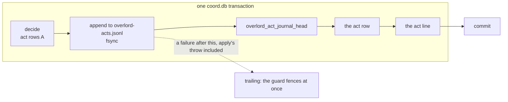
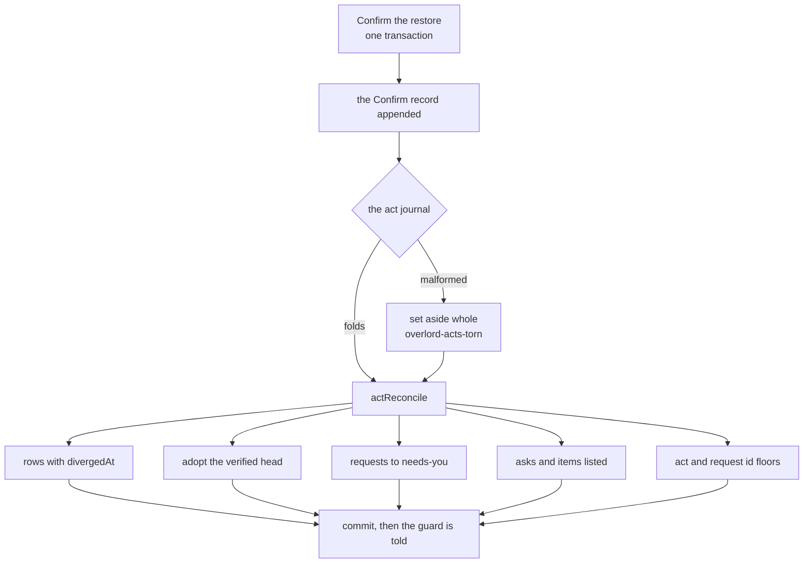

# Overlord W2: the act journal, its signed head and the reconciliation pass Implementation Plan

> **For agentic workers:** REQUIRED SUB-SKILL: Use superpowers:subagent-driven-development (recommended) or
> superpowers:executing-plans to implement this plan task by task. Steps use checkbox (`- [ ]`) syntax for tracking.

## In short

- **What this is.** The plan for the W2 piece "Act journal" (the W2 index, Table W2, lane C). Every act the Overlord
  takes is written first to a hash-chained file that no snapshot carries, `overlord-acts.jsonl`, and then to its row
  in `coord.db`. The file is the second chained journal on W1's kernel, after the authority journal, and follows its
  rules. Two pull requests, eight tasks: PR A four, PR B four.
- **PR A, the journal.** The grammar (records `act-intent`, `act-settle` and `act-open-request`, ids and states only,
  no words), its `FORMATS` row and its census rows. The writer, which implements act rows A's `ActJournalPort`: inside
  the store's transaction, before the row, with a head row and the same decide, append, apply as the authority
  journal. The torn-tail heal through `cutAside` alone, into the bare-name directory `overlord-acts-torn`. The file and
  its directory pinned out of every snapshot. The head signed each day with the server's existing key under a
  domain-separated preimage, unsigned on `shared-user`, an unmeasured isolation word or `approvals-disabled`. The head's
  line in the digest. The console keeps each head and checks that the next extends it. One doctor check verifies both
  journals' chains.
- **PR B, the restore.** The epoch's third term. The witness tuple's `act` field, `'absent'` in W1, becomes the act
  journal's head, and `highestIds` gains acts and requests. Boot coherence compares the act journal with its head row:
  a settle record whose act has no row refuses `authority-rolled-back`. Confirm the restore gains the reconciliation
  pass, one row of `restoreStricter`'s table: rows with `divergedAt` for acts the journal holds and the table lacks,
  requests to `needs-you`, and act and request ids above the highest after Confirm.
- **What changes at merge.** Nothing a running session sees. The file appears with the first act, and no act is written
  before `overlord-route-v1`, except `acknowledge`'s under `overlord-v1`. The digest's head line appears from then on.
  PR B changes what a witness is sent, additively, and refuses only on a restore.
- **What the reader must check.** Twelve open questions (§2), each with a recommendation, none for the operator. Three
  need the coordinator's eye: the epoch's act term counts the whole file, so the authority journal's Confirm record needs
  no new field (question 5); W1's witness parser is strict, so authority journal B should accept W2's tuple shape now
  (question 6); and appending re-verifies the whole file, which grows with every act, so the verified-head cache ships
  with PR A (question 10).

## 1. Goal, scope and the rulings this plan builds on

This section says what the piece builds, why, and which rulings bind it.

**Goal:** a restored `coord.db` or a restored volume can never lose an act silently. The act journal holds an intent
record before each effect and a settle record after its commit, the row in `coord.db` is its projection, and the server
can tell, at boot and against witnesses off its volume, when the rows went back. After the operator confirms a restore,
every act the rows lost is written back, marked, and the requests it touched go to the operator.

**Why:** H27 (§7.6 and §10.1): "Three journals on one kernel", "Each is a new file that no snapshot carries", "Each record
is appended inside the store's transaction, before the row", "Acts are journal-first and chained", the signed head and
its digest line, "Doctor verifies the chain", the epoch's third term, boot coherence's act arm, "No id is used twice
across a restore", and the reconciliation pass. Table 11.1a's rows "The act journal" (C5, L3, never in a snapshot,
daily head signing) and "The witness epoch" (the act journal's head in W2).

**Architecture:** context C5, under `server/src/coord/`, on the chained kernel (`server/src/chainedJournal.ts`, K) and
its file adapter (`server/src/chainedJournalFile.ts`, K).
- **L0:** `headExtends`, the console's check, in `shared/actJournalHead.ts`; the witness tuple's widening in
  `shared/authorityWitness.ts` (authority journal B's).
- **L1:** the grammar and its fold (`server/src/coord/overlordActRecords.ts`); the head-signing verdict; the act arm of
  boot coherence; the reconciliation pass's decider.
- **L2:** the guard's port, reused from the authority journal; `ActJournalPort`, declared by act rows A's writer.
- **L3:** the writer (`server/src/coord/overlordActJournal.ts`), and the signed-head store.
- **L4:** the boot step, the head-signing lane, the head read door, the digest line and the console's line.

**Rulings this plan builds on** (from the W2 index and review 2253's fix round, restated so this plan stands alone):

| Ruling | What it binds here |
|---|---|
| Index question 4, Q4 of the brief | `overlord-acts.jsonl`, beside `OVERLORD_AUTHORITY_BASENAME`, on `chainedJournal.ts` and `chainedJournalFile.ts`. Three record kinds: intent, settle, and open-request, which carries the request's id. Every record carries the operation key and no operator words. Its own domain in the signed head, and a `FORMATS` row |
| The brief, Q4 | Heal only through `cutAside`, with a bare-name torn directory, added to the callers census. Follow the authority journal's rules (W1, #2895): one writer process per file, the writer canonicalises, and the caller passes the row's own `from`, read in the same `tx()`. Pin the journal out of every snapshot |
| The brief, F16 | One doctor check for both journals: `ccd/ccrc-doctor-checks` is growth-checked, and W1 left the authority journal's check for later |
| The brief | The act journal's head joins the witness, and the reconciliation pass is this piece's PR B (from W1's authority-journal plan) |
| Index "Where lanes meet" | The witness files are authority journal B's, and this piece widens them additively after B. Confirm is authority journal C's, and this piece adds the reconciliation pass as one row of `restoreStricter`'s table after C |
| Index question 28 | Nothing raises an item before W3, so no ask or item is held in W2 |
| This plan's review (run 2275), as the coordinator ruled | Confirm adopts the act journal's verified head whenever the file verifies (F3). Reconciliation writes run in journal-sequence order, updates before inserts (F6). The writer takes the apply through its port (F12). The request id floor reaches `nextRequestId` as its second argument (F5). The verified-head cache ships unconditionally (F16) |

**Out of scope:** the act row and its writer (act rows A), which this journal serves through `ActJournalPort`; the act
read and the Log's gap (act reads); the privacy journal (the private store); the digest's Overlord section (W6); grants,
holds and classes after a restore (W3).

## 2. Open questions

Each question carries a recommendation, and this plan builds it unless the coordinator rules otherwise. None needs the
operator.

1. **The record kinds' spelling** (slug `act-record-kinds-are-prefixed`). The ruling names the kinds intent, settle and
   open-request. `chained-journal-formats.test.ts` holds every format's kinds disjoint, the authority journal prefixes
   its kinds `authority-`, and bare `intent` and `settle` are words a later grammar could take. **Recommendation:**
   `act-intent`, `act-settle` and `act-open-request`, the three kinds of the ruling under the journal's prefix.
2. **One record for a one-step act** (slug `one-step-act-one-record`). H27 says an intent record before the effect and a
   settle record after the commit. An act whose effect is inside `coord.db` commits as `done` with its row.
   **Recommendation:** such an act appends one `act-settle` record, with `from: null`, in its transaction. A two-step act
   appends `act-intent` in its first transaction and `act-settle` in its second. The epoch's term and boot coherence
   count settle records, so a one-step act counts once, and the file grows by one line, not two, for most acts.
3. **What a record holds** (slug `act-records-rebuild-a-row`). §7.6 says no journal holds the operator's words, and the
   reconciliation pass must write a lost act's row. **Recommendation:** each `act-settle` carries what rebuilds the row
   but its text: the act id, the act kind, the effect, the operation key, `from` and `to`, the natural key, the targets
   with their revisions, the request id, and the non-text fields the act read projects: `authority` (a word and an id,
   Table 10.1a), the fence's `term` and `generationId`, and the actor's kind and subject, its identity strength and its
   isolation word (review 2275, F14). `act-intent` carries the same less `from` and `to`. `act-open-request` carries the
   request id, the act id that opened it, and the operation key. No record carries `summary`, `why`, `dissent`, the
   model's name or any answer text: a rebuilt row's text reads empty, and its `divergedAt` says why.
4. **When `act-open-request` is appended** (slug `open-request-after-its-row`). The request id comes from the request
   row's insert, and §7.6 appends "before the row". **Recommendation:** the open door inserts the request row first, then
   calls act rows A's writer with `opens: <request id>`, which appends `act-settle`, then `act-open-request`, then writes
   the act row, all before the commit. Both records precede the commit, which is what "before the row" protects: the
   file is never behind the database. A failure before the append rolls the request row back with the rest.
5. **The epoch's act term** (slug `act-term-counts-the-whole-file`). §7.6: the epoch is the last Confirm's
   `epochAtConfirm` plus the records after it, and "the act journal's settle records join as a third term in W2". To
   count act records after a Confirm, the Confirm record would need the act journal's sequence at Confirm, and the
   authority grammar on `main` holds exact keys, so a new key would read `malformed` on every build before it.
   **Recommendation:** the act term counts every `act-settle` record in the file. The epoch still only rises: no record
   is removed, a torn-tail heal cuts only bytes that were never a record, and a Confirm sets the base above every
   witness's epoch. A `coord.db` restore leaves the term unchanged, which boot coherence catches; a volume restore
   lowers it, which a witness catches. No authority grammar change is needed.
6. **W1's witness parser is strict** (slug `witness-tuple-parses-w2-ahead`). Authority journal B's `parseWitnessTuple`
   answers `malformed` on an unknown key or a wrong type, and its tuple fixes `act: 'absent'`. An agent on a W1 build
   offered W2's tuple would neither refuse nor keep it, and would stop witnessing until updated. **Recommendation:** the
   coordinator asks authority journal B, not yet built, to parse W2's shape from the start: `act` as a head or
   `'absent'`, `terms.act` as a count or `'absent'`, and `highestIds.act` and `highestIds.request` as optional counts,
   while its server still sends `'absent'`. Then PR B widens only the sender. If B has merged first, PR B's first commit
   widens the three parsers, and the release that carries PR B rolls out fleet box first, as `ccrc rollout` does by
   default.
7. **The signer's new method** (slug `act-head-signed-by-a-typed-method`). `server/src/coord/approvalsign.ts#ApprovalSigner`
   signs only `ApprovalRulingRecord`s, over `approvalRulingBytes`, with no domain tag. **Recommendation:** the signer
   gains one typed method, `signActHead(head)`, which builds the preimage itself: the domain tag
   `ccrc/overlord-act-journal-head/v1`, one LF, then `rfc8785Json({ day, sequence, journalId, digest })`. No caller can
   ask the key to sign arbitrary bytes, and no preimage of one kind can be another's: an approval's preimage is a JSON
   object, and this one starts with the tag. One key, one module.
8. **When the head is unsigned** (slug `act-head-unsigned-where-the-key-is-reachable`). §7.6 names `shared-user` and
   `approvals-disabled`; the isolation piece makes an unmeasured isolation word act as `shared-user`.
   **Recommendation:** the head is recorded unsigned, with the word, on `shared-user`, on `unmeasured` (named apart), and
   while `approvals-disabled` stands (`serverApprovalsDisabled`). The digest and the console say "unsigned" and why.
9. **The doctor check** (slug `one-doctor-check-runs-a-node-verifier`). `ccd/ccrc-doctor-checks` is bash, and the
   chain's hashes are RFC 8785 JSON under SHA-256. Doctor already runs Node helpers from the shipped tree
   (`deploy/verify-provenance.mjs`, `deploy/account-op.mjs`). **Recommendation:** one check, `overlord-journals`, which
   runs `deploy/overlord-journals-verify.mjs`. The helper imports the kernel and both formats from the shipped server
   build (`server/dist/`), reads each file read-only, and prints one JSON line per journal. It never heals. The check
   passes `absent` and `ok`, warns on a torn tail (the server heals it at its next boot), and fails on `malformed` or
   `unreadable`, naming Confirm the restore as the remedy. It runs on `server` and `both` boxes and skips elsewhere.
   Task A4's first step measures that the shipped tree carries `server/dist/` beside `deploy/`; if not, the helper moves
   into `server/scripts/` and is shipped with the server.
10. **The cost of an append** (slug `act-journal-ships-the-head-cache`). `chainedJournalFile.ts#chainedJournalFileAt`'s
    `appendNext` re-reads and verifies the whole file on every call (the authority plan's ruling X1), and the act journal
    grows with every act. The authority plan left a verified-head cache (keyed on device, inode, size and digest) as a
    "Later" line. The whole-file verify runs inside `BEGIN IMMEDIATE` and blocks the event loop, and the head read, the
    head-signing lane and the boot pass verify the whole file too. **Recommendation** (the coordinator's word on review
    2275, F16): the cache ships unconditionally, in the adapter, before PR A's writer, as its own small pull request in
    lane C, owned by the adapter's plan. A hit re-verifies only the bytes after the cached head. Task A2 still measures
    one append and one head read at 10,000 and 100,000 records, with and without the cache, and writes the figures into
    the PR. The journal is not rotated or pruned in W2.
11. **Two head checks** (slug `signed-head-and-witness-are-apart`). PR A's console check (the next signed head extends
    the one kept) and PR B's witness (the tuple's act head) both compare heads. **Recommendation:** keep both, as
    legitimately different. The signed head lets the operator see that the server's key vouched for an append-only
    history, and works with no witness; the witness refuses a rollback at the doors. They share one comparison,
    `headExtends`, in `shared/actJournalHead.ts`.
12. **The guard learns which journal failed** (slug `guard-names-the-journal`). The authority guard holds the one
    refusal, and its port's `writerFailed(cause)` names no journal. **Recommendation:** an optional second argument,
    `writerFailed(cause, journal?: 'acts')`, and an optional `journal` on the guard's `rolled-back` state; absent reads
    as the authority journal. The refusal's detail names the journal. Additive, and an older reader of the state is
    unchanged.

## 3. What exists today

Measured on `main` at `b779a9c20`.

- **The kernel.** `server/src/chainedJournal.ts` (K, L1) writes one envelope per line,
  `{v, sequence, journalId, acceptedAt, previousDigest, entry, digest}`, canonical RFC 8785 JSON with an LF, and has no
  domain tag: a format's `kinds` must be disjoint from every other's. `chainNext`, `verifyChainedBytes` and
  `chainedTailHealPlan` are its chain, verifier and heal plan.
- **The file adapter.** `server/src/chainedJournalFile.ts#chainedJournalFileAt(fmt, dir, basename, ops)` (K, L3) answers
  `read()`, `appendNext(check)` and `cutAside(how, asideDir)`. `appendNext` re-reads and verifies the whole file, hands
  `check` what it saw, and appends on `go`. `cutAside` keeps the cut bytes in a one-name directory inside the journal's
  own directory. `server/src/appendOnlyFile.ts`'s header: "ONE WRITER PROCESS PER FILE", with no lock.
- **The authority journal.** `server/src/coord/overlordAuthority.ts` (L1) holds `OVERLORD_AUTHORITY_BASENAME`,
  `OVERLORD_AUTHORITY_TORN_DIR`, the grammar, `canonicalAuthorityMove`, `authorityAgainstFold` and `authorityFold`.
  `server/src/coord/overlordAuthorityJournal.ts` (L3) holds `AuthorityGuardPort`, `overlordAuthorityFileAt` and
  `OverlordAuthorityJournal`, whose `appendInTx` runs on `server/src/journalKernel.ts#appendThenApply`, canonicalises the
  entry, checks the caller's `from` against the fold, writes the singleton `overlord_authority_head`, and never throws.
  `server/src/coord/overlordAuthorityCoherence.ts#authorityCoherence` is Table 7.6a, and
  `server/src/coord/overlordAuthorityGuard.ts#OverlordAuthorityGuard` holds the refusal. `server/src/index.ts` builds
  them and calls `runOverlordAuthorityBoot` before the fleet link.
- **The censuses.** `server/test/chained-journal-formats.test.ts#FORMATS` (rows `delegation`, `probe`,
  `overlordAuthority`), `server/test/journal-file-callers.test.ts` (`CHAINED_BINDERS`, `CUT_CALLS`),
  `server/test/overlord-authority-snapshot.test.ts` (`NAMES`, over `ccd/ccrc`'s `_upd_backup_set` and
  `_upd_backup_pairs`, `deploy/backup-coord.mjs` and `deploy/coordination-snapshot.mjs`), and `mail-routes.test.ts`'s
  kebab scan, which admits `isOverlordAuthorityKebab`.
- **The signer.** `server/src/coord/approvalsign.ts#loadOrCreateApprovalSigner` loads or creates the Ed25519 key, and
  `ApprovalSigner` has `signRuling` and `publicKeyPem`. `#serverApprovalsDisabled` reads `~/.ccrc/approvals-disabled`.
  `shared-user` is not in code: it is the isolation piece's word (W1, not built).
- **The digest.** `server/src/coord/digest.ts#buildDigest` builds the day's lines, totals, drift and closes, and
  `server/src/watch.ts`'s `digestBeat` sends it once a day. No journal head appears in it.
- **Doctor.** `ccd/ccrc-doctor-checks` lists its checks in `CCRC_DOCTOR_CHECKS` and reports through `_dr_pass`,
  `_dr_warn`, `_dr_fail` and `_dr_skip`. No check reads a journal. It is a growth-checked file
  (`server/test/growthCheck.ts#GROWTH_FILES`).
- **Lanes.** `server/src/laneSchedule.ts#LANE_SCHEDULE`; a daily lane is a row with a day's cadence or a beat with a day
  key (`digestBeat` and its `digestDayFor`).
- **Not on `main`**, so this plan takes their interfaces from their W1 plans: the witness tuple, `authorityEpoch` and
  `witnessVerdict` (authority journal B, `w1-authority-journal.md` Task 5), Confirm the restore and `restoreStricter`
  (authority journal C, Task 8), `appendConfirmInTx` (named in a comment only), the isolation word and `IsolationRead`
  (`w1-isolation.md`), and the request's move writer (request record A). Act rows A's `ActJournalPort` is this piece's
  consumer contract (`w2-act-rows.md`, §4.3).

## 4. The journal

### 4.1 The grammar

`server/src/coord/overlordActRecords.ts` (C5, L1), in the authority grammar's shape: closed, exact keys, every value
checked.

| Kind | Fields besides `kind` and `opKey` |
|---|---|
| `act-intent` | `actId`, `act` (a kind of `OVERLORD_ACT_KINDS`), `effect` (an effect word or null), `natural` (`{ kind: 'row', target, id, revision }` or `{ kind: 'start', requestId }`, one start per request), `targets` (each `{ kind, id, revision }`, sorted), `requestId` (a count or null), `authority` (Table 10.1a's word and id), `term`, `generationId`, `actor` (`{ kind, subject }`, ids only), `identityStrength`, `isolation` |
| `act-settle` | the same, and `from` (`pending`, `unknown`, or null for a one-step act) and `to` (an act state of `ACT_STATES`) |
| `act-open-request` | `requestId`, `actId` |

*Table 1. The act journal's grammar. `opKey` is 32 lowercase hex characters (act rows A, question 6). `actId` is the id
act rows A's writer reserved inside the transaction before the append, and the row is inserted with it (review 2275,
F7).*

```ts
// server/src/coord/overlordActRecords.ts (L1)
export const OVERLORD_ACTS_BASENAME = 'overlord-acts.jsonl';
export const OVERLORD_ACTS_TORN_DIR = 'overlord-acts-torn';
export const OVERLORD_ACT_RECORD_KINDS = { 'act-intent': true, 'act-settle': true, 'act-open-request': true } as const;
/** Act rows A's `ActJournalRecord` (`overlordActs.ts`, L1), the one record type: an alias, never a second shape (F7). */
export type OverlordActRecord = ActJournalRecord;
export class OverlordActRecordError extends Error { readonly code: string }
export const OVERLORD_ACTS_FORMAT: ChainedJournalFormat<OverlordActRecord, OverlordActRecordError>;
/** The canonical form a writer appends: targets sorted, ids as numbers, nothing optional left undefined. */
export function canonicalActRecord(raw: OverlordActRecord): OverlordActRecord;
/** What the journal says about acts and requests: per act its last record, and the highest ids. */
export interface ActJournalView {
  acts: ReadonlyMap<number, { last: OverlordActRecord; sequence: number }>;
  highestActId: number; highestRequestId: number; settleCount: number;
}
export function actJournalFold(records: readonly ChainedJournalRecord<OverlordActRecord>[]): ActJournalView;
```

- **`from` is the caller's, read in the same transaction** (the authority journal's rule). Act rows A's
  `settleActInTx` reads the row's state inside its `tx()` and passes it. The writer checks it against the fold's last
  record for that act: an `act-settle` whose `from` is not the last record's state is a mismatch, told to the guard as
  `diverged`, and refused.
- **The writer canonicalises** through `canonicalActRecord`, so two equal records are equal bytes.

### 4.2 The writer

```ts
// server/src/coord/overlordActJournal.ts (L3)
export function overlordActsFileAt(ccrcDir: string, ops?: AppendOnlyFsOps): ChainedJournalFile<OverlordActRecord>;
/** Implements act rows A's ActJournalPort. One instance per server process: the file's one writer. */
export class OverlordActJournal implements ActJournalPort {
  constructor(file: ChainedJournalFile<OverlordActRecord>, time: { clock: Clock }, guard: AuthorityGuardPort);
  /** Appends `records` in order, writes the head row, then runs `apply` (the act row and its line), on
   *  `appendThenApply`. A throw from `apply` answers `journal-append` and calls `writerFailed('trailing', 'acts')`. */
  appendInTx(db: DatabaseSync, records: readonly OverlordActRecord[], apply: () => void): ActJournalAppend;
  adoptHeadInTx(db: DatabaseSync, head: ActFileHead | 'empty'): ActAdopt;   // Confirm's only (§6.3)
  readVerified(): ActFileRead;          // the whole file, verified: boot coherence, the fold, Confirm
  readHeadRow(db: DatabaseSync): ActHeadRowRead;
  healTornTail(db: DatabaseSync): ActHeal;   // through this.file.cutAside, into OVERLORD_ACTS_TORN_DIR
}
```

`appendInTx`'s decision, first match, on `appendThenApply`:

| # | The guard | The file against `overlord_act_journal_head` | Answer |
|---|---|---|---|
| 1 | not in a transaction | any | `not-in-transaction` |
| 2 | `unmeasured` | any | `authority-unmeasured` |
| 3 | `rolled-back` | any | `authority-rolled-back` |
| 4 | `coherent` | unreadable | `authority-unmeasured`, and `writerFailed('unreadable', 'acts')` |
| 5 | `coherent` | they disagree, or `from` disagrees with the fold | `authority-rolled-back`, and `writerFailed(verdict, 'acts')` |
| 6 | `coherent` | they agree | append, then the head row, then the caller's `apply`: `ok`; on a failure at or after the append, a throw from `apply` included, `journal-append` and `writerFailed('trailing', 'acts')` at once (F12) |

*Table 2. The act writer's decision. Unlike the authority journal, no act is a narrowing, so nothing is written
row-only: an act over an incoherent journal is refused, and the door answers `authority-rolled-back` (503) or
`journal-unreadable` (503) as §7.6 maps them. Every Overlord door but card, probe and note already refuses at step 3
then.*

**Schema** (one migration, beside the signed heads of §5):

```sql
CREATE TABLE overlord_act_journal_head (id INTEGER PRIMARY KEY CHECK (id = 1), sequence INTEGER NOT NULL,
  journalId TEXT NOT NULL, digest TEXT NOT NULL, at INTEGER NOT NULL, requestFloor INTEGER NOT NULL DEFAULT 0);
```

- **One writer of the head row:** `appendInTx`, and in PR B `adoptHeadInTx`, which only Confirm calls, on every Confirm
  whose act file verifies (§6.3, F3).
- **The heal.** At boot, `healTornTail` cuts a torn tail by the kernel's plan, only when the complete records verify and
  the head row equals the last record, into `~/.ccrc/overlord-acts-torn/` through `this.file.cutAside`: a new row of
  `CUT_CALLS`. The file is bound once, so `CHAINED_BINDERS` gains this module.
- **Never in a snapshot.** `overlord-authority-snapshot.test.ts`'s `NAMES` gains `OVERLORD_ACTS_BASENAME`,
  `OVERLORD_ACTS_TORN_DIR` and the stem `overlord-acts`. No copy list changes: the lists are positive.
- **Wiring.** `server/src/index.ts` builds `overlordActsFileAt(cfg.ccrcDir)` and the journal with the authority guard,
  heals the tail at boot after `runOverlordAuthorityBoot`, and hands the journal to act rows A's writer through the
  deps of the doors that write acts.



*Figure 1. Where the record sits. The file is fsynced before the commit, so the journal is never behind `coord.db`, and
a failure after the append is the guard's `trailing`.*

## 5. The signed head, the digest and the console

**The lane.** `actHeadSign`, a `LANE_SCHEDULE` row: an hourly beat with `startsDue: true`, keyed on the digest's own day
(`digestDayFor`), so the digest reads the same day's head. Each beat:
1. If today's row exists, or the file has no record, it ends.
2. It reads the verified head (`readVerified`). Anything but a verified head writes nothing and logs one warn line.
3. `actHeadSignVerdict` (L1) from the isolation word and `serverApprovalsDisabled`: `sign`, or `unsigned` with
   `shared-user`, `isolation-unmeasured` or `approvals-disabled`.
4. `recordActHeadInTx` writes today's row: the day, the head's sequence, journal id and digest, and either the signature
   from `signActHead` or the unsigned word.

```sql
CREATE TABLE overlord_act_heads (day TEXT PRIMARY KEY, sequence INTEGER NOT NULL, journalId TEXT NOT NULL,
  digest TEXT NOT NULL, signature TEXT, unsigned TEXT, at INTEGER NOT NULL,
  CHECK ((signature IS NULL) <> (unsigned IS NULL)));
```

A signed head that comes back with a restored `coord.db` still verifies against the key, so the table needs no journal.
One row a day; not pruned in W2.

**The digest line.** `buildDigest` gains an optional `actHead`: the newest row at or before the digest's day. The
console's digest view draws one line, "Overlord act journal: record 1,234, signed" or "… unsigned (shared-user)". With no
row, no line.

**The head read.** `GET /api/overlord/act-head?at=<sequence>`, session-gated, a masked GET, registered in
`overlordRoutes.ts`. It answers the newest signed head row, the public key, and the digest of the record at `at` (or
`absent` past the head, or `unmeasured`). It joins the census's session-only list and `CLAUDE.md`'s sentence of
session-gated reads that write nothing.

**The console's check.** `pwa/src/lib/actHead.ts` keeps the last head it verified on the device, wrapped in `try`, and
on each read asks for the digest at the kept sequence. `headExtends(kept, offered, digestAtKept)` (L0,
`shared/actJournalHead.ts`) answers `extends`, `does-not-extend`, `first` or `unmeasured`. The signature is checked with
WebCrypto's Ed25519 against the domain-tagged preimage, and a browser without it reads `cannot-verify-here`. One line,
`pwa/src/overlord/ActHeadLine.tsx`, shows the answer beside the Overlord's readiness line; `does-not-extend` is drawn as
a warning that names the kept record.

**The doctor check** (question 9). `_check_overlord-journals` runs `deploy/overlord-journals-verify.mjs` with the box's
`~/.ccrc`, and grades its lines:

| The helper's answer, per journal | Doctor |
|---|---|
| `absent` | pass: "no record yet" |
| `ok`, with the head's sequence | pass |
| `torn-tail` | warn: the server cuts it aside at its next boot |
| `malformed` | fail: "open the console and Confirm the restore" |
| `unreadable` | fail, with the reason |
| the helper prints nothing, or its build is missing | warn: unmeasured, never pass |

*Table 3. The doctor check's grades. It reads only, and on a box whose role is `fleet` it skips.*

## 6. The restore (PR B)

### 6.1 The epoch and the witness

`authorityEpoch` (authority journal B's) gains the act term: `settleCount` from `actJournalFold`, read at boot and kept
current by the writer (question 5). The tuple widens additively:

```ts
// shared/authorityWitness.ts (authority journal B's), widened
terms: { authority: number; privacy: number | 'absent'; act: number | 'absent' };
act: WitnessHead | 'absent';                 // the act journal's head: sequence and digest
highestIds: { restoreGeneration: number; message?: number; act?: number; request?: number };
```

`witnessVerdict`'s rows 5 and 6 read the act term and head as they read the privacy ones: a term this build reads that
is higher on the witness refuses `witness-epoch`, a head the act journal does not hold at that sequence with that digest
refuses `witness-heads`, and a side `absent` is skipped, never compared as zero. The agent (`agent/src/witness.ts`) and
the console (`pwa/src/lib/witness.ts`) keep the widened tuple through `witnessKeep` unchanged.

### 6.2 Boot coherence

At boot, after the heal, `actJournalCoherence` (L1, `server/src/coord/overlordActCoherence.ts`) compares the file's head
with `overlord_act_journal_head`, by `authorityCoherence`'s Table 7.6a over the two positions, and then checks the
newest settle record against its row: a settle record whose act has no row, or a row in an earlier state than the
record's `to`, reads `rolled-back`. The verdict goes to the one guard as `bootVerdict(verdict, 'acts')`. The guard keeps
a verdict per journal and answers the first that is not `coherent`, the authority journal's first.

| The act journal against its head row and its newest act | Verdict |
|---|---|
| equal, and the newest settled act's row holds that state | coherent |
| the file absent and no head row | coherent (no act yet) |
| missing beside an act row, behind, ahead, malformed, diverged, or one trailing record | refuse `authority-rolled-back`, the journal named |
| unreadable | `unmeasured`, answered `authority-rolled-back` with the cause, never folded into missing |
| equal, but the newest settle's act has no row or an earlier state | refuse `authority-rolled-back`: the database went back |

*Table 4. The act arm of boot coherence (§7.6: "a settle record whose act has no row means the database went back").*

### 6.3 The reconciliation pass

One row of `restoreStricter`'s table, run inside Confirm's one transaction after the Confirm record is appended:

```ts
// server/src/coord/overlordActReconcile.ts (L1)
export interface ActReconcileFacts {
  view: ActJournalView | 'malformed';            // the fold, or a file Confirm sets aside
  rows: ReadonlyMap<number, { state: ActState }>;
  witnessActHead: WitnessHead | 'absent' | 'none';
  openRequests: readonly number[]; openAsks: readonly number[]; openItems: readonly number[];
}
export type ActReconcilePlan = {
  /** Rows to write with divergedAt, in journal-sequence order, every update before every insert (F6). */
  write: readonly { actId: number; how: 'update' | 'insert'; record: OverlordActRecord; sequence: number }[];
  requestsToNeedsYou: readonly number[]; asksAndItems: readonly { kind: 'ask' | 'item'; id: number }[];
  wholeVolume: boolean;                            // the journal is no further on than the database
  floors: { act: number; request: number };
  adoptHead: ActFileHead | 'empty';                // the verified file's head, adopted on every Confirm (F3)
};
export function actReconcile(f: ActReconcileFacts): ActReconcilePlan;
```

- **An act the journal holds and the table lacks, or holds in an earlier state** than the journal's last record: a row
  in the journal's state, written by act rows A's store through `writeDivergedActInTx` (its one writer of `divergedAt`).
  The row holds its natural key as its state does, by the same partial index as any row: taken unless the journal's
  state is `refused` (review 2275, F18). Its targets name the asks, items and requests it touched.
- **The order of the writes** (F6). `actReconcile` lists them in journal-sequence order, every update of an existing row
  before every insert, so a restored row on key K that the journal moved to `refused` frees K before the journal's later
  act on K is inserted. `writeDivergedActInTx(db, write)` answers `{ ok: true }` or
  `{ ok: false, error: 'natural-key-taken' | 'bad-row' | 'unmeasured', detail }` and never throws. Confirm reads the
  answer: any `ok: false` aborts Confirm's one transaction, which rolls back whole, and Confirm's door answers 500 with
  the writer's error, the act id and the detail, logged as one `ccrc-server:` line: a programming error, as act rows A's
  `allow-mismatch` is, so no refusal word is added. The guard stays `rolled-back`, the doors stay fenced,
  and nothing is half-written; the operator's next Confirm runs the pass again. A failure that repeats is a bug the
  answer names, never a state Confirm steps over.
- **The requests** move to `needs-you` through the request record's one move writer, with the reason `restore`.
- **The asks and items** go to the operator. In W2 the Overlord holds none (index question 28), so the plan lists them in
  Confirm's answer and the console names them; W3's holds release them through this list.
- **The whole volume came back** (a witness holds an act head the journal lacks, or the file was set aside as
  `malformed`): no record says which rows were acted on, so every open request moves to `needs-you` and every open ask
  and item is listed.
- **The head row** (review 2275, F3). Whenever the act file verifies, Confirm sets `overlord_act_journal_head` to the
  file's verified head through `adoptHeadInTx`, after the pass's writes, so a head row restored behind the file, or a
  file with a record past its head row (`trailing`), agrees with the file after Confirm, and the next act appends. The
  authority journal's head moves through its own Confirm record; the act journal has none (question 5), so this is its
  one move. An absent file adopts `empty`.
- **A malformed act journal.** Confirm sets the whole file aside under `~/.ccrc/overlord-acts-torn/`, through
  `cutAside`, and the next act starts a new chain at sequence 1. The act journal's head row is set to `empty` by
  `adoptHeadInTx`, and the first act's append writes it.
- **Ids above the highest** (§7.6, "No id is used twice across a restore"). The act floor is the highest of the fold's
  `highestActId`, every witness's `highestIds.act` and the table's own maximum, and for a malformed file also the file's
  line count above that. The request floor is the same over `act-open-request` records and `highestIds.request`. The act
  floor is written to `sqlite_sequence` by act rows A's store (`raiseActIdFloorInTx`), whose writer reserves each next id
  from it (act rows A, F7). The request table is never `AUTOINCREMENT` (the request record plan, RQ10), so its floor is
  no row of `sqlite_sequence`. Confirm keeps the part no later read can recompute (the witnesses' and the set-aside
  file's) in `overlord_act_journal_head.requestFloor`, written by `adoptHeadInTx`. The journal's reader
  `requestIdFloor(db)` answers the larger of that and the fold's `highestRequestId`, and the request record's open door
  passes it as `nextRequestId(storeHighest, journalHighest)`'s second argument, as that plan's seam row says (review
  2275, F5).



*Figure 2. The reconciliation pass inside Confirm. It writes only through each table's own writer, and runs after the
Confirm record, as every other row of `restoreStricter`'s table does.*

## 7. Cross-plan seams

| Seam | Owner | What this plan needs or gives |
|---|---|---|
| `ActJournalPort` | act rows A | Declared there, implemented here, wired in `index.ts` by PR A |
| `writeActInTx`'s `opens` and `writeDivergedActInTx` | act rows A | The open door's request id (question 4); the restore pass's rows. If act rows A has merged, PR B adds `writeDivergedActInTx` to its store |
| The authority guard and its port | authority journal A (merged) | `writerFailed(cause, journal?)` and `bootVerdict(verdict, journal?)`, additive (question 12) |
| The witness tuple and its parsers | authority journal B | The widened shape (question 6) |
| `restoreStricter`, Confirm, `appendConfirmInTx` | authority journal C | One row; Confirm calls `actReconcile` after its record, applies its writes in order, adopts the act head on every Confirm, and rolls back whole on a writer's `ok: false` (F3, F6) |
| The isolation word | the isolation piece (W1) | `actHeadSignVerdict`'s input |
| The request move writer and the request id floor | request record A | `restore` as a move reason; the floor as `nextRequestId`'s second argument (F5) |
| The open door | request record B | Calls the writer with `opens` |
| The Log's gap | act reads | Reads the fold's gaps from the head read |
| The digest | the digest (C6) | One optional field, `actHead` |

## 8. Global constraints and review focus

- **Rings.** The grammar, the fold, the coherence arm, the signing verdict and `actReconcile` are L1, pure. `headExtends`
  is L0 and imports nothing. The writer and the head store are L3. The lane, the boot step and the head read are L4.
- **One writer per fact.** The file has one writer process and one writer object. `overlord_act_journal_head` has
  `appendInTx` and `adoptHeadInTx` (Confirm's only, on every Confirm); `overlord_act_heads` has `recordActHeadInTx`. Each is named in
  `writers-map.test.ts`.
- **Consolidate.** The journal reuses the kernel, the file adapter, the guard, the authority writer's decide, append,
  apply, and Table 7.6a's decider. The signer gains a typed method, not a second key. One doctor check covers both
  journals. The console's head check and the witness share `headExtends`; they are legitimately different (question
  11).
- **Never in a snapshot,** and never restored over: the snapshot census names the file, its stem and its torn directory.
- **No words in a record.** A test proves no record kind has a text field beyond ids, kinds and states.
- **Growth.** Each growth-checked file stays within its 40 lines in each pull request, with no waiver (§9).
- **Review focus.** That nothing appends outside the store's transaction; that a failure after the append fences; that
  the heal is the only cut and the snapshot pin holds; that the preimage cannot be confused with an approval's; that an
  absent term or head is skipped, never compared as zero; and that the reconciliation pass writes only through each
  table's own writer.

## 9. The PR split

| PR | Tasks | What it ships | Needs first | Growth-checked files, estimate |
|---|---|---|---|---|
| A, the journal | A1 to A4 | The grammar, its fold and its census rows; the writer, its head row, the heal and the snapshot pin; the daily signed head, its table, its lane, the digest line, the head read and the console's line; the doctor check over both journals | act rows A, authority journal A (#2895, merged), the adapter's verified-head cache | `server/src/coord/schema.ts` about +6 code lines (one migration, two tables of three and two lines and the backticks; comments are not counted), and the PR states its measured figure (F15); `server/src/server.ts` about +3 (the head read's mask entry and deps); `server/src/watch.ts` about +5 (the lane's beat); `pwa/src/lib/api.ts` about +4; `ccd/ccrc-doctor-checks` about +30 (one check and its array entry) |
| B, the restore | B1 to B4 | The act term and the tuple's widening; the act arm of boot coherence; the reconciliation pass in Confirm; the id floors | PR A, authority journal B and C, request record A | `server/src/coord/schema.ts` 0; `server/src/server.ts` about +2; `server/src/coord/store.ts` 0 |

*Table 5. The PR split.*

**Order inside PR A:** A1, A2, then A3 and A4. **Inside PR B:** B1, B2, then B3 and B4.

## 10. Tasks

### Task A1: The grammar, the fold and the census rows (L1, PR A)

**Files:**
- Create: `server/src/coord/overlordActRecords.ts` (C5, L1)
- Modify: `server/test/chained-journal-formats.test.ts` (`FORMATS` gains `overlordActs`, its binding and a sample)
- Modify: `server/test/mail-routes.test.ts` (its kebab scan admits `isOverlordActsKebab`, if the grammar's words meet it,
  measured)
- Test: `server/test/overlord-act-records.test.ts` (new)
- Create: `server/test/sim/overlordActJournalSets.ts`; Modify: `mutation-floors.test.ts`'s `MUTANT_SETS` and
  `mutation-floors.json`

- [ ] **Step 1: Failing tests:**
  - a sample of each kind round-trips through the kernel; each refuses a missing key, an unknown key and a wrong word;
  - the census: every other format's kinds are refused, and these by every other format;
  - no kind has a field that could carry text: every value is an id, a count, a kind, a state or hex;
  - `canonicalActRecord` sorts targets, so two orders give one byte string;
  - `actJournalFold`: an intent then a settle; a one-step settle alone; the highest act and request ids; `settleCount`;
    an empty journal.
- [ ] **Step 2: Run.** `cd server && ccrc test -- ./node_modules/.bin/vitest run test/overlord-act-records.test.ts`. Red.
- [ ] **Step 3: Implement.**
- [ ] **Step 4: Mutation.** The sets are the grammar's entry and `actJournalFold`.
- [ ] **Step 5: Run** the test, `test/chained-journal-formats.test.ts`, `test/single-definition/*.test.ts`,
  `test/rings/*.test.ts` and `test/sim/mutation-floors.test.ts`. Green.
- [ ] **Step 6: Commit.** `feat(coord): the Overlord act journal's grammar on the chained kernel (Overlord W2, H27)`

### Task A2: The writer, its head row, the heal and the snapshot pin (L3 and L4, PR A)

**Files:**
- Create: `server/src/coord/overlordActJournal.ts` (C5, L3)
- Modify: `server/src/coord/schema.ts` (`overlord_act_journal_head`; the migration also holds Task A3's table)
- Modify: `server/src/coord/overlordAuthorityJournal.ts` and `overlordAuthorityGuard.ts` (`writerFailed`'s and
  `bootVerdict`'s optional `journal`, question 12)
- Modify: `server/src/index.ts` (the file, the journal, the boot heal, the writer's deps)
- Modify: `server/test/journal-file-callers.test.ts` (`CHAINED_BINDERS`, `CUT_CALLS`),
  `server/test/overlord-authority-snapshot.test.ts` (`NAMES`), `server/test/single-definition/writers-map.test.ts`,
  `server/test/coord-db.test.ts`, `server/test/run-close-switch.test.ts`
- Test: `server/test/overlord-act-journal.test.ts` (new)

- [ ] **Step 1: Measure** one append and one head read at 10,000 and 100,000 records on a fixture directory, with and
  without the verified-head cache (question 10), and write the figures into the PR. The cache's own pull request merges
  first; this step measures it, and gates nothing (F16).
- [ ] **Step 2: Failing tests** (fixture `DatabaseSync`, fixture directory, a guard double):
  - every row of Table 2;
  - two records in a row chain, and the second re-reads the file;
  - a settle whose `from` is not the fold's last state for its act refuses and tells the guard `diverged`;
  - an `AppendOnlyFsOps` double that fails at each step answers `journal-append`, never throws, and calls
    `writerFailed('trailing', 'acts')`;
  - an `apply` that throws after the append answers `journal-append` and calls `writerFailed('trailing', 'acts')` in the
    same call, before the transaction rolls back (F12); an `apply` that returns runs after the head row;
  - the heal cuts only a torn tail behind a sound prefix, into `overlord-acts-torn`, and refuses otherwise;
  - the snapshot pin: neither the file nor the directory is copied or listed by any backup path;
  - the guard: a `journal: 'acts'` failure fences, and its detail names the journal; an older call with no journal
    reads as the authority journal's.
- [ ] **Step 3: Run.** Red. **Step 4: Implement.**
- [ ] **Step 5: Mutation, by hand.** Each of these reds a case, then is reverted: write the head row before the append;
  append outside a transaction; cut without the sound-prefix check; skip the `from` check.
- [ ] **Step 6: Run** the test, `test/journal-file-callers.test.ts`, `test/overlord-authority-snapshot.test.ts`,
  `test/overlord-authority-guard.test.ts`, `test/coord-db.test.ts`, `test/run-close-switch.test.ts` and
  `test/single-definition/*.test.ts`. Green.
- [ ] **Step 7: Commit.** `feat(coord): the act journal's writer, its head row and its torn-tail heal (Overlord W2, H27)`

### Task A3: The signed head, the digest line, the head read and the console's line (PR A)

**Files:**
- Modify: `server/src/coord/approvalsign.ts` (`signActHead`)
- Create: `server/src/coord/overlordActHead.ts` (C5: `actHeadSignVerdict` (L1), `recordActHeadInTx` and the head read's
  store (L3), in two modules if the ring check asks)
- Modify: `server/src/laneSchedule.ts` (`actHeadSign`), `server/src/watch.ts` (its beat)
- Modify: `server/src/coord/digest.ts` (`actHead`), the console's digest view
- Modify: `server/src/coord/overlordRoutes.ts` (`GET /api/overlord/act-head`), `server/src/server.ts`
  (`MASKED_GET_ROUTES`), the door censuses, `CLAUDE.md`'s sentence
- Create: `shared/actJournalHead.ts` (`headExtends`), `pwa/src/lib/actHead.ts`, `pwa/src/overlord/ActHeadLine.tsx`;
  Modify: `pwa/src/lib/api.ts`
- Test: `server/test/overlord-act-head.test.ts` (new), `pwa/test/act-head.test.ts` (new)

- [ ] **Step 1: Failing tests:**
  - the preimage is the tag, an LF and the canonical JSON; a signature verifies with the public key; an approval's
    bytes never equal a head's preimage;
  - `actHeadSignVerdict`: `separate-user` and `separate-host` sign; `shared-user`, an unmeasured word and
    `approvals-disabled` record unsigned with their words;
  - the lane writes one row a day, none with no record, none on an unverified file;
  - the digest prints the newest row at or before its day, and nothing with none;
  - the head read answers the digest at `at`, `absent` past the head, `unmeasured` on an unreadable file;
  - `headExtends`: every arm; the console keeps nothing on a failed verify, and storage that throws still renders.
- [ ] **Step 2: Run.** Red. **Step 3: Implement.**
- [ ] **Step 4: Mutation.** The sets are `actHeadSignVerdict` and `headExtends`.
- [ ] **Step 5: Run** the tests, the door censuses (`test/box-token-census.test.ts`, `test/auth-gate.test.ts`,
  `test/secret-mask.test.ts`), `test/lane-schedule.test.ts`, and pwa's suite for the new file. Green.
- [ ] **Step 6: Commit.** `feat(coord): the act journal's head, signed daily under its own domain (Overlord W2, H27)`

### Task A4: One doctor check over both journals (PR A)

**Files:**
- Create: `deploy/overlord-journals-verify.mjs` (the read-only helper)
- Modify: `ccd/ccrc-doctor-checks` (`_check_overlord-journals` and its `CCRC_DOCTOR_CHECKS` entry)
- Test: `server/test/ccrc-doctor-overlord-journals.test.ts` (new, in a fixture HOME through `makeCcdHarness`)

- [ ] **Step 1: Measure** that the shipped tree carries `server/dist/` beside `deploy/` (question 9).
- [ ] **Step 2: Failing tests:** every row of Table 3, for each journal; the helper never writes (the fixture's bytes
  and modes are unchanged); a `fleet`-role box skips.
- [ ] **Step 3: Run.** Red. **Step 4: Implement.**
- [ ] **Step 5: Run** the test and the doctor suites. Green, with `GROWTH_CHECK=1` for the doctor file.
- [ ] **Step 6: Commit.** `feat(ccd): one doctor check verifies both Overlord journals' chains (Overlord W2, H27)`

### Task B1: The act term and the witness tuple's widening (L0 and L1, PR B)

**Files:**
- Modify: `shared/authorityWitness.ts`, `server/src/coord/overlordAuthorityWitness.ts` (authority journal B's),
  `agent/src/witness.ts`, `pwa/src/lib/witness.ts`
- Create: the act head's port beside the privacy head's (`server/src/coord/actJournalHead.ts`, L2)
- Test: authority journal B's witness suites, with the act cases

- [ ] **Step 1: Failing tests:** the epoch with the act term; a witness holding a higher act term refuses
  `witness-epoch`; one holding an act head the journal lacks refuses `witness-heads`; a server that does not read the
  act term skips it; `highestIds.act` and `.request` are carried; an older tuple with `act: 'absent'` still parses.
- [ ] **Step 2: Run.** Red. **Step 3: Implement.** **Step 4: Mutation.** Authority journal B's sets gain the act cases.
- [ ] **Step 5: Run** the server's, the agent's and pwa's suites for the witness, and the three `tsc` runs. Green.
- [ ] **Step 6: Commit.** `feat(coord): the act journal joins the witness epoch and tuple (Overlord W2, §7.6)`

### Task B2: The act arm of boot coherence (L1 and L4, PR B)

**Files:**
- Create: `server/src/coord/overlordActCoherence.ts` (L1: `actJournalCoherence`)
- Modify: `server/src/coord/overlordAuthorityGuard.ts` (a verdict per journal), `server/src/index.ts` (the boot step)
- Test: `server/test/overlord-act-coherence.test.ts` (new)

- [ ] **Step 1: Failing tests:** every row of Table 4; a `coord.db` restored one act behind refuses; a guard with one
  journal `coherent` and the other not refuses, naming the other.
- [ ] **Step 2: Run.** Red. **Step 3: Implement.** **Step 4: Mutation.** The set is `actJournalCoherence`.
- [ ] **Step 5: Run.** Green. **Step 6: Commit.** `feat(coord): boot coherence reads the act journal against its rows (Overlord W2, §7.6)`

### Task B3: The reconciliation pass in Confirm the restore (L1 and L4, PR B)

**Files:**
- Create: `server/src/coord/overlordActReconcile.ts` (L1: `actReconcile`)
- Modify: `server/src/coord/overlordRestore.ts` (authority journal C's: the row of `restoreStricter`'s table) and the
  Confirm door's transaction
- Modify: `server/src/coord/overlordActsStore.ts` (`writeDivergedActInTx`), `server/src/coord/overlordActJournal.ts`
  (`adoptHeadInTx`)
- Test: `server/test/overlord-act-reconcile.test.ts` (new), authority journal C's Confirm suite

- [ ] **Step 1: Failing tests:**
  - an act the journal holds and the table lacks gets a row with `divergedAt`, its key taken (a `done` one) or free (a
    `refused` one); an act in an earlier state is brought to the journal's; its requests move to `needs-you`; its asks
    and items are listed; a whole-volume restore moves every open request; a malformed act journal is set aside whole
    and the next act starts sequence 1; the pass runs after the Confirm record;
  - the head row (F3): a head row restored behind the file, then Confirm, then an act append succeeds; a file with one
    trailing record past its head row, then Confirm, then an act append succeeds; boot coherence then reads `coherent`;
  - the order (F6): a restored table with B `pending` on key K and a journal with B `refused` then A `done` on K: the
    pass moves B before it inserts A, and Confirm commits; a writer that answers `ok: false` rolls Confirm back whole,
    Confirm's door answers 500 naming the act, and the guard stays `rolled-back`.
- [ ] **Step 2: Run.** Red. **Step 3: Implement.** **Step 4: Mutation.** The set is `actReconcile`. By hand: adopt the
  head only for a malformed file; insert before updating; commit past a writer's `ok: false`.
- [ ] **Step 5: Run.** Green. **Step 6: Commit.** `feat(coord): Confirm the restore reconciles the act rows with the act journal (Overlord W2, §7.6)`

### Task B4: Act and request ids above the highest after Confirm (PR B)

**Files:**
- Modify: `server/src/coord/overlordActsStore.ts` (`raiseActIdFloorInTx`, over `sqlite_sequence`),
  `server/src/coord/overlordActJournal.ts` (`requestFloor` through `adoptHeadInTx`, and `requestIdFloor`), the Confirm
  transaction, and the request record's open door (the floor passed as `nextRequestId`'s second argument, F5)
- Test: `server/test/overlord-act-reconcile.test.ts`

- [ ] **Step 1: Failing tests:** after Confirm, the next act id and request id are above the journal's, every witness's
  and the table's highest; over a malformed file, above that plus the line count; a floor never lowers; the next act
  row's id equals its record's `actId` after the floor is raised (act rows A, F7); `nextRequestId` receives the floor as
  its second argument, and no `sqlite_sequence` row is written for `overlord_requests`.
- [ ] **Step 2: Run.** Red. **Step 3: Implement.** **Step 4: Run.** Green.
- [ ] **Step 5: Commit.** `feat(coord): no act or request id is used twice across a restore (Overlord W2, §7.6)`

## Deviations found

Each entry is a departure from the spec's text, by slug. The coordinator mints numbers.

- **`act-record-kinds-are-prefixed`**: the kinds are `act-intent`, `act-settle` and `act-open-request`, for the
  kernel's disjoint-kinds census (question 1).
- **`one-step-act-one-record`**: H27's intent-then-settle is one `act-settle` record with `from: null` for an act whose
  effect commits with its row (question 2).
- **`open-request-after-its-row`**: the open act's records follow the request row's insert inside the transaction, and
  precede the commit (question 4).
- **`act-term-counts-the-whole-file`**: §7.6's third term counts every settle record in the file, not those after the
  last Confirm (question 5).
- **`act-head-unsigned-where-the-key-is-reachable`**: an unmeasured isolation word, not only `shared-user`, records the
  head unsigned (question 8).
- **`one-doctor-check-runs-a-node-verifier`**: the doctor check verifies the chains through a read-only Node helper
  (question 9).
- **`guard-names-the-journal`**: the guard's failure and verdict name which journal failed (question 12).

## What the index should change

- **Authority journal B** parses W2's tuple shape from the start (question 6). This is the one request that decides
  whether PR B needs a reader-widening first.
- **Authority journal C** exposes Confirm's transaction so that `restoreStricter`'s table takes rows from later pieces,
  as its plan says (question 16 there), and calls them after its record.
- **Request record A** gives `restore` as a reason of its move to `needs-you`. It has no `raiseRequestIdFloorInTx`: its
  open door passes act journal B's `requestIdFloor(db)` as `nextRequestId`'s second argument (review 2275, F5).
- **Authority journal C (Confirm):** on every Confirm, adopt the act journal's verified head through `adoptHeadInTx`
  (F3); apply the reconciliation's rows in journal-sequence order, updates before inserts, and roll back whole on a
  writer's `ok: false` (F6). The coordinator carries F3 into C's brief.
- **The chained file adapter:** the verified-head cache ships unconditionally, as its own pull request in lane C, before
  act journal A's writer (F16).
- **Act rows A:** the one record type (`ActJournalRecord`, aliased here as `OverlordActRecord`), the act id reserved
  before the append, and the port's apply callback (F7, F12).
- **Act rows A** carries `opens` on `ActWrite` (its plan, §4.3) and leaves `writeDivergedActInTx` and
  `raiseActIdFloorInTx` to this plan's PR B, in its store.
- **Table W2's act journal row** names the console's line (`pwa/src/overlord/ActHeadLine.tsx`) and the head read
  (`GET /api/overlord/act-head`), which the index's lane C list does not.
- **The spec-fixes run:** Table 11.1a gains the act journal's file and kinds (question 4 of the index); §7.6's third
  term counts the whole file (question 5); §10.1's "intent before the effect" names the one-step case (question 2).

## States W3 may read

- **The grammar.** W3 adds record kinds for holds and grants, as the index says, under the `act-` prefix or its own.
- **`actJournalFold` and `ActJournalView`**, which W3's staged answers extend with their states.
- **The epoch's act term and the tuple's act head**, unchanged.
- **The reconciliation pass**, whose ask and item list W3's holds release through.

## Where things stand

**Agreed:**
- The journal follows the authority journal's rules (#2895) and the brief's Q4 and F16, and its head joins the witness
  in PR B.
- The coordinator's rulings on this plan's review (run 2275): Confirm adopts the verified head on every Confirm (F3);
  the reconciliation's order and its failure (F6); the request floor through `nextRequestId` (F5); the port's apply (F12);
  the records' non-text fields (F14); and the cache shipped unconditionally (F16).

**Waiting on the coordinator:**
- The twelve open questions (§2), each with a recommendation. Questions 5, 6 and 10 change what other pieces build or
  when.

**Waiting on the operator:** nothing.

**Later:**
- The journal's rotation; W3's record kinds;
  W6's digest section, which takes the head line over.
