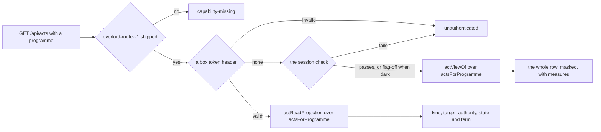
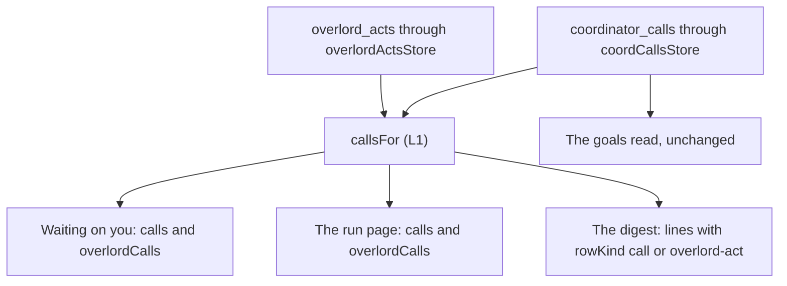
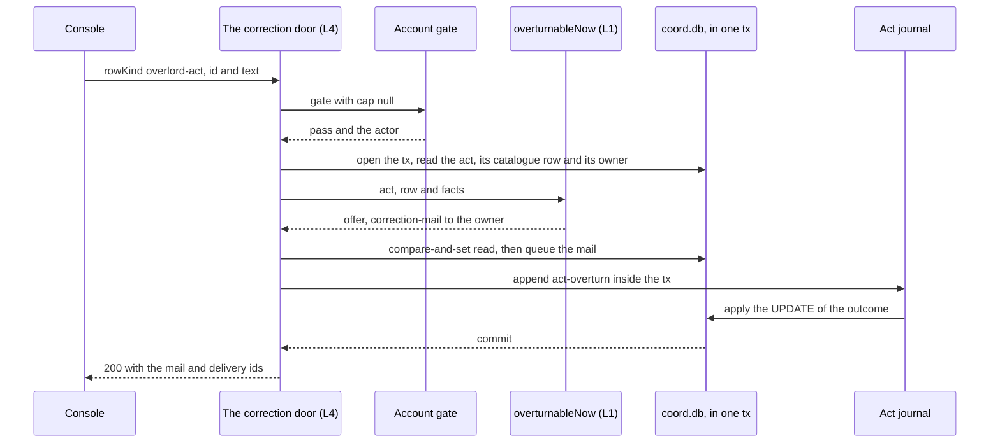

# Overlord W2: the act reads, Seen and overturn Implementation Plan

> **For agentic workers:** REQUIRED SUB-SKILL: Use superpowers:subagent-driven-development (recommended) or
> superpowers:executing-plans to implement this plan task by task. Steps use checkbox (`- [ ]`) syntax for tracking.

**Goal:** the Overlord's acts can be read, marked Seen and overturned.
- **The act read.** A coordinator checks a claimed act through a box-token read of five fields. The console reads the
  whole row.
- **Seen.** The operator marks an act Seen.
- **Overturn.** The operator overturns an act through the one correction door. A pure decider says whether that can
  still be honoured, and the catalogue's compensator carries it out.
- **`callsFor`.** "Calls made for you" reads the coordinators' calls and the Overlord's answers through one reader.

**Why:** spec §10.1, "The act read", and Table 10.1a's `outcome`, `overturnedAt`, `overturnNote` and `seenAt`. Spec
§10.2's overturn horizon and "Waiting on you". Spec §10.3, "Overturning", in full. §6, "Overlord answers are not also
coordinator calls" (`callsFor`). Table 11.1c's rows for `overturnableNow` and `callsFor` (C5 and C6, L1). Table 11.1e's
rows "The Seen door on act rows, the operator's" and "Overturn: `POST /api/digest/correct`, kind `overlord-act`" (C6,
L4). §11.4: the act read refuses `capability-missing` until `overlord-route-v1`. M4 and M32.

**Architecture:** two pull requests in lane C.

- **PR A, the reads and Seen.**
  - New L0 pieces: `ACT_OUTCOMES`, the act read's two wire shapes, the call-view mapping and two refusal words.
  - Two new L3 writers, the only writers of their columns:
    - `setActOutcomeInTx` writes `outcome`, `outcomeAt`, `overturnedAt` and `overturnNote`.
    - `markActSeen` writes `seenAt`.
  - `GET /api/acts?programme=<slug>`, with two credentials and two projections.
  - `POST /api/acts/:id/seen`, through the account gate.
  - `callsFor` (C6, L1), in place of D-8126's own reads for Waiting on you and the run page.
- **PR B, overturn.**
  - `overturnableNow` (C5, L1), with its input table.
  - One act journal record, `act-overturn`, with its fold and a reconciliation arm.
  - The correction door's new row kind, `overlord-act`, with its one W2 compensator arm: a correction mail for a relay.
  - `callsFor` in the digest.
  - The M4 and M32 figures on the console's read.

**Tech Stack:** TypeScript (ESM), Fastify, `node:sqlite`, vitest. No new dependency, no migration of its own and no ccd
verb. One row in `ccd/ccrc-api`'s `ROUTES`.

**Spec:** `docs/superpowers/specs/2026-11-09-overlord-design.md`, §6 (the `callsFor` paragraph), §7.6 and H27 (the act
journal), §10.1 to §10.3, Table 10.1a, Table 11.1c, Table 11.1e, §11.4, M4 and M32.

**The index:** `docs/superpowers/plans/2026-11-16-overlord-w2.md`, read from PR #2917's branch. This plan builds:
- its row "Act reads, Seen and overturn" (lane C);
- question 7's rows "The act read" and "Seen on an act";
- Table W2's "Where each Table 14 item went" row for `callsFor`, `overturnableNow`, Seen and overturn;
- the lane C bullet "Reads and overturn".

**The plans this one reads:**
- Act rows, `w2-act-rows.md`: `overlord_acts`, `overlordActsStore.ts`, `ActJournalPort`, `ActJournalRecord`,
  `ActAnswer`, the M32 figure.
- The act journal, `w2-act-journal.md`: `overlordActRecords.ts`, `ActJournalView`, `actJournalFold`, `actReconcile`,
  boot coherence's act arm.
- The act catalogue, `w2-act-catalogue.md`: `OVERLORD_ACT_KINDS`, `COMPENSATOR_MAP`, reversibility.
- The relay, `w2-relay.md` (PR #2933): the relay's act row and `relayWidening`.
- The request record, `w2-requests.md`: request states, the Overlord's request doors' act targets (`request:<id>`), and
  the request store, the one SQL owner of `overlord_requests`.
- The operator's request doors, `w2-operator-request-doors.md` (this pull request): the second caller of
  `setActOutcomeInTx`.

Written against `main` at `1834eb8cd` (2026-11-16) and revised in fix round 1 (review 2286). The coordinator's rulings
in that round are marked "(ruled, fix round 1)". None of those W2 pieces is built yet. Task A1 re-measures every name
this plan takes from them before it builds.

## In short

- **Two pull requests, nine tasks:** A has five (the reads and Seen), and B has four (overturn).
- **The coordinator's read is five fields:** kind, target, authority, state and term, and nothing else. A valid box
  token selects it, on an armed box or a dark one. It refuses `capability-missing` until `overlord-route-v1`. A
  coordinator checks a claimed act this way, never from the words of a mail.
- **The console's read is the whole row,** with the Overlord's words masked and the overturn horizon computed.
- **A programme's acts include its requests' acts:** a `request:<id>` target is resolved to the request's owner through
  the request store's own reader (ruled, fix round 1).
- **One writer each.** `setActOutcomeInTx` writes the outcome. It is a compare-and-set, so the first outcome stands.
  `markActSeen` writes `seenAt`. The operator's request doors are the outcome writer's second caller (`superseded` and
  `concurred`), and the correction door its first (`overturned`).
- **An overturn is journal-first.** `overturned` frees a relay's widening, and in W3 it latches grants and the ladder,
  so a restore must not lose it: the act journal gains `act-overturn`, with an exact key set, a fold and a no-append
  reconciliation arm. `superseded`, `concurred` and Seen are row-only.
- **`overturnableNow` decides from measured state at the tap.** In W2 one arm carries an overturn out: a correction
  mail to the owning coordinator, for a relay. A drop and a close answer `later-wave` until the request record gains a
  link naming the old request (ruled, fix round 1). Every other W2 kind answers why there is nothing to overturn.
- **`callsFor` keeps the Overlord's answers in fields of their own,** so an older console can never mark a coordinator
  call Seen with an act's id. In W2 there are no Overlord answers, so those fields are empty until W3.
- **The digest reads `coordinator_calls` too** (measured): `server/src/coord/digest.ts#buildDigest` reads
  `bigCallsIn`. PR B moves it onto `callsFor`. The goals read keeps its own read (AR9).

## 1. Open questions

The coordinator accepted the index's questions 2 to 23 as written, and settled 24 to 29. The coordinator ruled F2 and
F6 of this plan's review in fix round 1; they are marked. Every other question carries a recommendation, which this plan
builds unless the coordinator rules otherwise. None needs the operator.

- **AR1. The outcome words and their one writer** (slug `act-outcome-has-one-writer`). The act rows plan creates
  `outcome`, `overturnedAt` and `overturnNote` and gives them no vocabulary and no writer ("later columns get their
  writers from their pieces").
  **Recommendation:**
  - `ACT_OUTCOMES` (`overturned`, `superseded`, `concurred`) is an L0 key map in `shared/overlord.ts`, beside
    `ACT_STATE_MAP`.
  - `setActOutcomeInTx(db, journal, w)` in `overlordActsStore.ts` is the only writer of the four outcome columns. `w` is
    `{ id, outcome, note, actor, opKey, at }`. `journal` is the act journal's `ActJournalPort`, or the word `'replay'`
    for the reconciliation arm (AR3). It answers `'set' | 'already' | 'unknown' | 'not-settled'`, or the append's own
    refusal for an `overturned` (AR3).
  - It writes only where `outcome IS NULL`, and only on a row whose state is `done` or `effective`. An act that never
    took effect has nothing to overturn.
  - W3's `preempted` row with `concurred` (Table 10.1b: "its outcome is `concurred` when the operator picks the same
    option") widens that state rule. W3's plan does it, and "States W3 may read" says so (F13).
- **AR2. When an outcome was written** (slug `outcome-at-on-every-outcome`). Table 10.1a lists `outcome`, `overturnedAt`
  and `overturnNote` together. `actCallClearedAt` needs a time for every outcome, as `coordCalls.ts#callClearedAt` dates
  a clear from `seenAt` or `overturnedAt` (F13).
  **Recommendation:**
  - Every outcome stamps `outcomeAt`, a column act rows A's one migration adds (its question 11: every column in one
    migration). It is listed in "What the index should change".
  - `overturnedAt` and `overturnNote` are written with `overturned` only, so `overturnedAt` keeps meaning "overturned
    at".
  - `relayWidening` treats `superseded` like `overturned` (ruled, fix round 1, F13): a relay the operator superseded
    loses its widening. A `concurred` relay keeps it. Relay A builds that read; it is listed in "What the index should
    change".
- **AR3. Only an overturn is journalled, as `act-overturn`** (slug `overturn-is-journal-first`). The act journal plan
  writes no record for an outcome or a Seen mark, and says later pieces may add record kinds under `act-`.
  **Recommendation, specified in fix round 1 (F5):**
  - **Why.** An overturn changes authority. It frees a relay's widening (the relay plan) and, from W3, suspends a grant
    and counts toward the ladder's latch (§10.3). A snapshot restore that dropped it would revive both, which is the
    failure H27's journal exists to prevent. Seen, `superseded` and `concurred` change no authority, so they stay
    row-only, and a Seen lost to a restore shows its row again.
  - **The record's exact keys:** `kind: 'act-overturn'`, `opKey`, `actId` and `actor` (`{ kind, subject }`, ids only).
    It carries no note, by H27's "no words in a record", and no state.
  - **`opKey`.** The correction door is an operator door, with no door-process key. The door reads `x-ccrc-op-key` when
    the console sends one, and otherwise mints one with act rows A's mint (`entropy.hex(16)`, its question 6,
    `missing-op-key-is-minted`). The request doors never append, so they need none.
  - **The fold.** `ActJournalView.acts`' entry gains `overturned: boolean`. An `act-overturn` never becomes an act's
    `last`: `last` stays its last `act-intent` or `act-settle`, which still holds `to` and `targets` for a rebuild. So
    the fold is the same whether the overturn is an act's last record or not.
  - **What the grammar refuses.** An `act-overturn` for an act whose fold holds no settled `done` or `effective` record,
    or a second one for the same act, reads `malformed`, by the grammar's exactness.
  - **The writer's own check.** As for `from` (the act journal plan, §4.1), `setActOutcomeInTx` checks the fold before
    it appends: an act the fold already holds overturned, or one whose last record is not `done` or `effective`, is
    told to the guard as `diverged` and refused.
  - **Reconciliation, with no append.** `actReconcile`'s plan gains `overturns: readonly number[]`: the act ids the fold
    holds overturned whose row lacks `overturned`. Confirm applies each through `setActOutcomeInTx(db, 'replay', w)`,
    the same one writer, whose replay arm writes the row and appends nothing. It runs after the plan's `write` list, so
    an act the pass rebuilds is overturned after its row exists. It never calls the writer with the journal port, so it
    never appends a second record.
  - **Boot coherence needs no new arm.** Every append moves the head row, so a restore that lost an overturn reads
    `behind` and refuses `authority-rolled-back`, as for any lost record.
  - **Older builds.** The grammar is closed, so a build without this record kind reads a journal holding one as
    `malformed`. Its boot coherence refuses `authority-rolled-back`, and Confirm the restore sets the file aside (the act
    journal plan's malformed arm). No overturn can be written before `overlord-route-v1`, because no act exists before
    it. So PR B lands before `overlord-route-v1`, and every build that can hold an overturn reads one. A rollback below
    PR B after overturns were written meets the malformed arm. Both points are in "What the index should change".
- **AR4. Which acts the read answers for a programme** (slug `act-read-resolves-request-targets`; ruled, fix round 1,
  F6). `overlord_acts` has no programme column, and the Overlord's request doors write the target `request:<id>` only.
  **Recommendation, as ruled:**
  - An act belongs to a programme when its `targets` name that programme, its `widenedProgramme` is the programme, or a
    `request:<id>` target names a request the programme owns. The act targets stay as the request plans wrote them.
  - The request ids come from the request store's own reader, `requestIdsOwnedBy(db, slug)`, which this piece adds to
    `server/src/coord/overlordRequestStore.ts`, the one SQL owner of `overlord_requests`.
  - `actsForProgramme(db, slug, requestIds, since, limit)` reads the acts with SQLite's `json_each` over `targets`,
    inside `overlordActsStore.ts`, the table's one SQL owner. Neither store names the other's table.
  - A request never routed has no owner, so its acts appear under no programme.
  - The window is the last 30 days, newest first, at most 200 rows.
- **AR5. The coordinator's projection is exactly five fields** (slug `act-read-five-fields`). §10.1 says "kind, target,
  authority, state and term, and nothing else".
  **Recommendation:** `ActReadRow` is `{ kind, target, authority, state, term }`, built by `actReadProjection` (L1).
  - `target` is the natural target `{ kind, id, revision }`.
  - It has no `id`, no `requestId` and no time. A coordinator matches a claimed act by its content. That is what clause 22
    asks for: whether this act exists, with this authority, in this state, in the current term. Nothing in it can carry
    words.
  - A test pins the key set.
- **AR6. The arm is chosen by the credential, and needs no attribution and no ownership** (slugs
  `act-read-like-the-goals-read` and `act-read-arm-by-credential`). The goals read (`GET /api/programmes/:slug/goals`) is
  the model: box token or session, no attribution. It passes everyone on a dark box (F15).
  **Recommendation:**
  - A request carrying a valid box token (`x-ccrc-mail-token`, checked by `checkMailToken`) gets the five-field arm, on
    an armed box or a dark one. So a coordinator never gets the whole row by calling while sign-in is dark.
  - A request carrying an invalid token answers `unauthenticated`.
  - A request without a token gets the console's arm when the session check passes, which on a dark box is the auth
    gate's `flag-off`, as for every console read. Otherwise it answers `unauthenticated`.
  - The five fields carry no words. A coordinator that reads another programme's acts learns only what the coordinator
    doors already show: that an act of a kind exists. The door gets a row in `server/src/auth/gate.ts#EXEMPT` with that
    reason.
- **AR7. The whole door, both arms, waits for `overlord-route-v1`** (§11.4: "`ccrc-api request ack` and the act read
  land in W2. Until then each refuses `capability-missing`, naming `overlord-route-v1`").
  **Recommendation:** the act read and the Seen door both refuse `capability-missing` naming `overlord-route-v1`, through
  the same capability check gates B's step 2 uses. No act exists before the word ships, so the console loses nothing.
- **AR8. Seen marks any act, through the account gate** (slug `seen-on-every-act`). D-8126's call Seen refuses a call
  that is not big (`not-big`). The act Log and the home show every act.
  **Recommendation:** Seen marks any act row, whatever its state, and is idempotent: a second Seen answers 200 and keeps
  the first time. It changes no authority, so it takes no step-up. It goes through the account gate, as index question 7
  rules for every operator door, and so refuses `auth-off` while dark. Its refusal word `unknown-act`, and PR B's
  `not-overturnable`, both join `shared/api.ts#DIGEST_REFUSALS` in PR A, each with its status row in
  `shared/refusal.ts#REFUSAL_STATUS` (F7).
- **AR9. Which readers `callsFor` replaces, measured** (the index: "with the plan measuring whether the digest reads
  `coordinator_calls` too"). Four readers of `coordinator_calls` list calls on `main`:

  | Reader | Where | What it lists | `callsFor` |
  |---|---|---|---|
  | Waiting on you | `server/src/coord/ledgersRoutes.ts#waitingViewOf`, through `coordCallsStore.ts#callsForOperator` | the open and cleared big calls | PR A |
  | The run page | `server/src/coord/routes.ts`, `GET /api/runs/:id`, through `coordCallsStore.ts#callsForRun` | every call naming the run | PR A |
  | The digest | `server/src/coord/digest.ts#buildDigest`, through `coordCallsStore.ts#bigCallsIn` | each big call in the window, as a line | PR B |
  | The goals read | `server/src/coord/ledgersRoutes.ts#goalsReadOf`, through `coordCallsStore.ts#bigCallsFor` | a programme's recent big calls, for its coordinator | unchanged |

  *Table 1. The readers of `coordinator_calls`.*

  **Recommendation:** the first three move onto `callsFor`, because they are the operator's "Calls made for you" (§6).
  The goals read is the coordinator's record of its own calls, served on a box-token arm. Carrying the Overlord's `why`
  there would make it a second box-token read of act words beside AR5's projection, so it stays as it is.
- **AR10. The Overlord's answers keep fields of their own** (slug `overlord-calls-in-their-own-field`). A call view's
  `id` is a `coordinator_calls` id, and the console's Seen on a call posts it to `POST /api/calls/:id/seen`. An older
  console given an act in that list would mark the coordinator call with the act's number Seen.
  **Recommendation:**
  - `WaitingView` gains `overlordCalls?` and `overlordCallsCleared?`, and the run record gains `overlordCalls?`, each a
    list of `OverlordCallView`. These fields are additive, and an older console ignores them.
  - A digest line from an act has `rowKind: 'overlord-act'`, whose id space PR B's correction kind knows.
  - `callsFor` is still the one reader: it decides both sources' membership in one function and answers both lists.
- **AR11. Which acts are "Calls made for you"** (§10.2: "the Overlord's `big` answers ... An answer that rests on no
  evidence is always listed there too").
  **Recommendation:** `actIsCallForOperator(act, now)` (L1) is true when all of these hold:
  - the act is an answer kind (the catalogue's `answer: true`);
  - its class is `big` or its evidence class is `none`;
  - it is settled `done` or `effective`;
  - it has no Seen and no outcome;
  - it is inside D-8126's seven-day window (`coordCalls.ts#CALL_SEEN_WINDOW_MS`).

  `actCallClearedAt` mirrors `coordCalls.ts#callClearedAt`, dating the clear from the earliest of `seenAt`, `outcomeAt`
  and the window's end (AR2). W2 has no reachable answer kinds, so both lists stay empty until W3. They are tested on
  fixture rows.
- **AR12. What `overturnableNow` answers for each W2 kind** (slug `w2-overturn-arms`; ruled, fix round 1, F2).
  **Recommendation, as ruled:** Table 4 in §5. In brief:
  - **A relay** (and, from W3, an answer) is overturned by a correction mail to the owning coordinator.
  - **A drop and a close** answer `later-wave`. Spec §5.1 makes reopening "a new request that names the old one", and
    no request yet has a field naming an old request, so an overturn would record `overturned` for an act nothing
    undid. The link is W3's to add ("States W3 may read"), and then this arm opens. The act catalogue's `close-request`
    row stays as it is.
  - **An escalation and an opened request** are not overturned: the operator's request doors already answer or
    withdraw them.
  - **A reversible kind with no compensator** (`nudge-owner`, `acknowledge`, and W3's `attach-brief` and `object`
    among them) answers `nothing-to-undo` (F12a). §10.1's "reversible: an overturn restores the before-state" assumes a
    move that restores it. These kinds have none in W2: a nudge's mail cannot be unsent, and an acknowledgement settles
    a message. The only one a W2 door writes is `nudge-owner`.
  - **A start** (`end-programme`) answers `later-wave` until W5 builds its confirm sheet.
  - **A re-kick** (`rekick-coordinator`, compensable by a correction mail to the same coordinator) mails the session the
    act re-kicked, read from its target, not the programme's owner (F12c). It is reachable from W5.
- **AR13. The overturn horizon** (§10.2: "From `dependsSince` the Log shows 'cheap to overturn until' and, after that,
  what an overturn now costs").
  **Recommendation:**
  - `cost` is `cheap` while `dependsSince` is empty. Once it is set, `cost` is `work-depends`, with `since` set to
    `dependsSince`, read from act rows B's stamp.
  - The cost never refuses an overturn the arm can honour. "Cannot be undone" is only for an irreversible kind, or for a
    correction with nobody to send it to.
- **AR14. The overturn's gate** (slug `overturn-through-the-account-gate`). §10.3: "It is made under the sign-in cookie".
  **Recommendation:**
  - For `rowKind: 'overlord-act'`, the correction door first calls the account gate (`cap: null`, no step-up, because an
    overturn only lowers), so it refuses `auth-off` while dark. It records the actor at `operator` strength.
  - The other three row kinds keep today's session gate, unchanged.
  - The door chooses the gate from an L0 table, `DIGEST_ROW_GATE`, keyed by row kind, so the handler makes no decision
    of its own.
- **AR15. M4 and M32 on the console's read** (the index row's "M4"). **Recommendation:** the session arm of
  `GET /api/acts` gains `measures`:
  - M4 is `{ overturned, settled, days: 28 }`, from one reader, `actOutcomeCounts(db, since)`.
  - M32's part is `{ unsettled }`, act rows B's count of acts left `pending` or `unknown` after the boot pass.

  W6's digest section reads the same reader.

## 2. What exists today

Measured on `main` at `1834eb8cd`.

| What | Where | What this plan does with it |
|---|---|---|
| The call record's one-writer store: `insertCall`, `markCallSeen` (only writer of `seenAt`), `overturnCallTx` (only writer of `overturnedAt`, `overturnNote`) | `server/src/coord/coordCallsStore.ts` | The model for `markActSeen` and `setActOutcomeInTx` |
| The readers `callsForRun`, `callsForOperator`, `bigCallsIn`, `bigCallsFor`, `callById` | `server/src/coord/coordCallsStore.ts` | Table 1 |
| The pure call rules `callIsForOperator`, `callClearedAt`, `callViewOf` (masks every text with `redactCommand`), `callDecision`, `CALL_SEEN_WINDOW_MS` | `server/src/coord/coordCalls.ts` | `callsFor`'s coordinator half; the window |
| The call Seen door, session-gated, `not-big` refused | `server/src/coord/ledgersRoutes.ts` (`POST /api/calls/:id/seen`) | The model for the act Seen door |
| The correction door: `parseDigestCorrectBody`, `correctDigestRow`, `digestCorrectionSubject`, `isDigestCorrectionSubject` | `server/src/coord/digest.ts`; the route in `server/src/server.ts` | Gains the `overlord-act` kind (PR B) |
| The mark and its mail in one transaction | `server/src/coord/store.ts` (`CoordStore#correctWithMail`) | The shape of `overturnActWithMail` |
| `DigestRowKind`, `DIGEST_ROW_KINDS`, `DigestLine`, `DigestCorrectBody`, `DIGEST_REFUSALS` | `shared/api.ts` | Widened in PR A (the words) and PR B (the kind) |
| The digest row kinds' other holders: `DIGEST_KEY_ROW_KIND_MAP`, the digest's line order, the correction subject's reader | `shared/responses.ts`; `server/src/coord/digest.ts#buildDigest`; `server/src/continuity/continuityStore.ts` (classes a correction subject); their tests `server/test/responses-vocab.test.ts`, `server/test/continuity-checkpoint.test.ts` | Each gains `overlord-act` in PR B (F14) |
| The goals read's two credentials | `server/src/coord/ledgersRoutes.ts` (`GET /api/programmes/:slug/goals`, `checkMailToken` after the session check) | The act read's model (AR6) |
| The account gate, `cap: null` | `server/src/accounts/gate.ts#createAccountGate` | Seen and the overturn (AR8, AR14) |
| The masker | `server/src/coord/redact.ts` (`redactCommand`) | Every text on the session arm |
| Census lists, and the README check for an exempt-but-authenticated door | `server/test/box-token-census.test.ts` (`LEDGER_OPERATOR_DOORS`, `DIGEST_CORRECT`, `SESSION_ONLY_ALL`, its `README` reads) | The Seen door's row; the act read's README mention |
| The mutation floors | `server/test/sim/mutation-floors.test.ts#MUTANT_SETS`, `server/test/sim/mutation-floors.json` | Six deciders join |
| Growth checks | `server/test/growthCheck.ts#GROWTH_FILES`, `#GROWTH_LIMIT` (40); `server/test/growth-caps/shared-api-ts.json` (5,140 code lines) | §7 |

**Not on `main`, taken from the plans that build them:**

| What | Plan |
|---|---|
| `overlord_acts`; `writeActInTx`, `settleActInTx`, `actById`, `ActJournalPort` in `overlordActsStore.ts`; `ActJournalRecord` in `overlordActs.ts`; `ActAnswer`, `ACT_STATE_MAP`, `ACT_SUMMARY_MAX`, `ACT_WHY_MAX` in `shared/overlord.ts`; the operation-key mint | act rows A |
| The settling lane's M32 count, `dependsSince` | act rows B |
| `overlordActRecords.ts` (`OVERLORD_ACTS_FORMAT`, `actJournalFold`, `ActJournalView`), `OverlordActJournal` | act journal A |
| `actReconcile` and its plan, in `overlordActReconcile.ts` | act journal B |
| `OVERLORD_ACT_KINDS`, `COMPENSATOR_MAP`, the compensator test | act catalogue A |
| The relay's act row and `relayWidening` | relay A |
| The request store, `overlordRequestStore.ts`; the Overlord's request acts targeting `request:<id>` | request record A and B |
| `OVERLORD_DOORS`, `NOT_OVERLORD_DOORS`, `CallerIdentity`, the capability step | W1 gates A and B |
| `OVERLORD_OPERATOR_DOORS`, `coord/overlordRoutes.ts` | W1 designation A |

## 3. The act read and Seen

| Arm | Selected by | Answers | Built by |
|---|---|---|---|
| The coordinator's | a valid box token (`x-ccrc-mail-token`), armed or dark | `{ ok: true, acts: ActReadRow[] }`, the five fields only | `actReadProjection` (L1) |
| The console's | no token, and the session check (the auth gate; `flag-off` on a dark box) | `{ ok: true, acts: ActView[], measures }`, the whole row: `summary`, `why` and `overturnNote` masked, the actor, the outcome, `seenAt`, `dependsSince` and the overturn horizon from `overturnableNow` (PR B; PR A answers `overturn: null` and `measures: null`) | `actViewOf` (L1) |

*Table 2. `GET /api/acts?programme=<slug>`. The slug is checked by the programme ledgers' slug grammar. A missing or bad
slug answers `bad-request`, and an invalid token `unauthenticated`. Both arms refuse `capability-missing` until
`overlord-route-v1` (AR7).*

*Figure 1. The act read's two arms. The credential chooses the arm, so a coordinator gets the five fields whether
sign-in is armed or dark. One store reader feeds both, and only the projection differs.*

**What no act read carries.**
- **The operator's words.** The acts table holds none: `summary` and `why` are the Overlord's, and `citedIds` are ids.
  `overturnNote` is the operator's correction to a coordinator (D-5300's lane), and only the console's arm carries it.
- **A private-state value.** The console's arm passes `summary`, `why` and `overturnNote` through `redactCommand`, as
  `callViewOf` does. It carries `checks` as each question's id, band and outcome only, never an answer's text. Neither
  arm carries a message's text or a stored secret.
- A test seeds a row whose `why` holds a secret-shaped token and an operator message's sentence. It asserts that the
  token is masked on the console's arm, and that the coordinator's arm holds exactly the five keys.

**Seen.** `POST /api/acts/:id/seen` answers `{ ok: true, act: ActView }`. It goes through the account gate with
`cap: null`, so it refuses `auth-off` while dark (AR8). `markActSeen(db, id, at)` answers `'seen' | 'already' |
'unknown'`, and `unknown` answers `unknown-act`. On `seen` the door emits `waiting`, because `callsFor`'s operator lists
may change.

## 4. `callsFor`

`callsFor` lives in `server/src/coord/callsFor.ts` (C6, L1). Its signature is
`callsFor(view, calls: CallRow[], acts: ActRow[], now)`, and it is pure. The L3 readers stay where they are. Each caller
reads the two lists and hands them to `callsFor`, so membership, order and window are decided in one place.

| View | Coordinator calls | Overlord answers | Order |
|---|---|---|---|
| `operator` | open (`callIsForOperator`) and cleared (`callClearedAt`, inside `CLEARED_WINDOW_MS`) | the same, through `actIsCallForOperator` and `actCallClearedAt` | newest first |
| `run` | every call naming the run | every answer whose `targets` name the run | oldest first |
| `digest` | each big call in `[from, to)` (`callDecision`) | each answer `actIsCallForOperator` would list, made in `[from, to)` | by time, then row kind, then id |

*Table 3. `callsFor`'s views. The answers' half is empty in W2, because no answer door ships before W3.*

*Figure 2. The readers before and after. Three readers go through `callsFor`. The goals read keeps D-8126's own read
(AR9).*

**Characterization first.** Task A2 pins the output of each of the three readers on `main` before anything moves:
- `waitingViewOf`'s `calls` and `callsCleared`;
- the run page's `calls`;
- the digest's call lines and `totals.calls`.

Each move commit changes only what those tests import. The new fields and the new kind are commits of their own.

## 5. Overturn

`overturnableNow(act, row, facts, now)` lives in `server/src/coord/overlordOverturn.ts` (C5, L1).
- `act` is the act row.
- `row` is its catalogue row (`reversibility`, `compensator`).
- `facts` is `{ owner, reKicked }`. Each is `{ kind: 'session', id } | { kind: 'none' } | { kind: 'unmeasured', why }`.
  `owner` is the coordinator of the programme the act's targets name, through the request store's reader for a
  `request:<id>` target (AR4) and `CoordStore#programmeCoordinator`. `reKicked` is the session a `rekick-coordinator`
  act targets. Both are read in the door's transaction.

It answers one of two shapes:
- `{ offer: true, arm: 'correction-mail', to, cost, since }`;
- `{ offer: false, why, doneAt }`.

| Order | When | Answer |
|---|---|---|
| 1 | The act has an outcome | `offer: false`, `why: 'outcome-set'` |
| 2 | Its state is not `done` or `effective` | `offer: false`, `why: 'not-settled'` |
| 3 | Its reversibility is `n/a` | `offer: false`, `why: 'nothing-to-undo'` |
| 4 | Its reversibility is `irreversible` | `offer: false`, `why: 'cannot'`, `doneAt` = the act's time |
| 5 | Its kind is `escalate-request` or `open-request` | `offer: false`, `why: 'request-door'` (the operator's request doors answer or withdraw it) |
| 6 | Its kind is `drop-request` or `close-request` | `offer: false`, `why: 'later-wave'` (the request record has no link naming an old request until W3; ruled F2) |
| 7 | It has no compensator | `offer: false`, `why: 'nothing-to-undo'` (AR12, F12a) |
| 8 | The compensator is `end-programme` | `offer: false`, `why: 'later-wave'` (W5's confirm sheet) |
| 9 | Its kind is `rekick-coordinator`: `reKicked` is unmeasured, none, or a session | `unmeasured`, `cannot`, or `offer: true` to that session |
| 10 | `owner` is unmeasured | `offer: false`, `why: 'unmeasured'` |
| 11 | `owner` is none | `offer: false`, `why: 'cannot'` |
| 12 | Otherwise (the compensator is `correction-mail`) | `offer: true`, `arm: 'correction-mail'`, `to` the owner's coordinator |

*Table 4. `overturnableNow`'s input table, first match. Every `offer: true` carries `cost` and `since` (AR13). Row 2
also covers W3's `staged` row, which a Veto settles instead (§10.3). Row 5 comes before row 7 so that the reason shown
is the door to use. Row 6 comes before row 7 because both kinds have a compensator in the catalogue that W2 cannot yet
honour.*

**Monotonicity (Table 11.7b).** Only facts that arrive later can change the answer: an outcome set, a state settled, a
`dependsSince` stamped. A property test holds that adding an outcome, or moving `cost` from `cheap` to `work-depends`,
never turns `offer: false` into `offer: true`.

*Figure 3. An overturn of a relay. Everything after the gate runs in the caller's one `tx()`: the read, the
compare-and-set, the mail, the append, and then the `UPDATE` as the append's `apply`. The mail is queued before the
append, so a refused append rolls the mail back with the rest, and the journal never runs ahead of the table (H27).*

**The door's steps, all inside one `tx()` after the gate.**
1. `parseDigestCorrectBody` accepts `rowKind: 'overlord-act'`. Its `text` is required, as for every kind.
2. `server.ts` calls the gate `DIGEST_ROW_GATE` names for the kind (AR14), before the `tx()` opens.
3. **Read.** `correctDigestRow`'s new branch reads the act (`actById`; unknown answers `unknown-act`), its catalogue
   row and the facts. It asks `overturnableNow`, and answers `not-overturnable` with the `why` in the detail when there
   is no offer.
4. **Compare-and-set.** An act whose outcome is already set answers `already`, appends nothing and queues nothing. The
   door answers `not-overturnable`, `why: 'outcome-set'`. A correction on the same act still undelivered answers
   `duplicate`, as today.
5. **Queue the mail.** `CoordStore#overturnActWithMail(id, journal, queue, w)` calls `queue()` first:
   `insertSystemMailTx` from `operator` to the owner's coordinator, kind `finding`, subject
   `digestCorrectionSubject('overlord-act', id)`, body the operator's text.
6. **Append.** It then calls `setActOutcomeInTx(db, journal, w)` with `overturned`, the note and the operation key
   (AR3). That function appends `act-overturn` through `ActJournalPort.appendInTx`.
7. **UPDATE.** The append's `apply` runs the compare-and-set `UPDATE ... WHERE outcome IS NULL`.
8. **A refused append.** `not-in-transaction`, `authority-rolled-back`, `authority-unmeasured` or `journal-append`
   throws a typed error inside the `tx()`, which rolls the mail back with everything else. The door answers the word:
   `authority-rolled-back` as `OVERLORD_REFUSALS` states it, and the other three as 502 `unmeasured`, naming the cause.
9. On success the door emits `waiting`.

No mail goes to the Overlord in W2, so the reopen arm's need for W1 timers' `deliverTo` does not arise (F2, F15).

**What an overturn sets off in W2.**
- `relayWidening` stops reading the relay as carrying its widening (the relay plan; it also treats `superseded` so, AR2).
- The decision model's label sources read `overturned` as an `overturn` label (the label queue piece).
- M4 counts it.

The grant suspension, the ladder latch and the cited-entry marks are W3's and W4's. They read the same column.

## 6. Global constraints and review focus

- **Architecture (`CLAUDE.md`).**
  - **One writer per fact.** `setActOutcomeInTx` is the only writer of `outcome`, `outcomeAt`, `overturnedAt` and
    `overturnNote`, with its replay arm for reconciliation. `markActSeen` is the only writer of `seenAt`. Both are named
    in `writers-map.test.ts#TABLES`.
  - **Decide in L1.** The deciders are `actReadProjection`, `actViewOf`, `callsFor`, `actIsCallForOperator` with
    `actCallClearedAt`, and `overturnableNow`. Each handler only maps their answers.
  - **Consolidate.** The overturn is a kind of the one correction door, not a door of its own. The Seen door copies the
    call Seen door's shape and is not a second mechanism for calls.
  - **Wire discipline.** Every new field is additive. `rowKind: 'overlord-act'` is new to `DIGEST_ROW_KINDS`, and an
    older server answers it `bad-request`, which is Table 11.1e's "Refuses the unknown kind".
  - **No overloaded null.** `overturn` and `measures` on the console's arm are `null` only in PR A, before their
    deciders ship. From PR B each is always the decider's answer.
- **What a merge arms.** Nothing a session sees:
  - the reads and Seen refuse `capability-missing` until `overlord-route-v1`;
  - the correction door's new kind finds no act to overturn before then;
  - `callsFor`'s Overlord half is empty until W3.
- **Public repository.** Fixtures use `project-a` and `lane-a` names. Run the private-name scan over every changed file.
- **Mutation.** Each decider joins `MUTANT_SETS` and `mutation-floors.json` with its measured floor. Every task with a
  guard has a mutation step using `../ccrc-coordinator/references/mutation-run.py`.
- **`shared/api.ts` headroom.** The total cap is 5,140 code lines, and the W2 pieces share what is left. This piece adds
  about 3 lines in PR A and 1 in PR B. Task A1 measures the headroom first. If it is short, the view types stay in
  `shared/overlord.ts` and `shared/api.ts` takes only the field lines.
- **Tests.** From `server/`, in the foreground, one file at a time, through
  `ccrc test -- ./node_modules/.bin/vitest run test/<file>`. Each task ends with
  `ccrc test -- npx tsc --noEmit -p tsconfig.json` and `-p test/tsconfig.tests.json`. Tasks that touch `pwa/` also run
  `ccrc test -- ./node_modules/.bin/tsc --noEmit` there.

**Review focus.**
1. The coordinator's arm answers exactly five keys whenever a valid box token is presented, armed or dark, and no arm
   carries the operator's words or an unmasked text.
2. `setActOutcomeInTx` is a compare-and-set. Only `overturned` is journalled, through `appendInTx` inside the caller's
   `tx()`, after the mail is queued and before the `UPDATE`. A refused append rolls the mail back. The replay arm
   appends nothing.
3. `act-overturn` has an exact key set, never becomes an act's `last` in the fold, and a build without it reads the
   file `malformed`.
4. A drop or close act appears under its owner's `?programme=` and answers `later-wave`.
5. The three moved readers' outputs are byte-for-byte what the characterization tests pinned on `main`.
6. `overturnableNow` is exhaustive over every catalogue kind and state, and monotone.
7. The overturn takes the account gate, and the other correction kinds do not change.

## 7. The PR split

| PR | Tasks | What it ships | Needs first | Growth-checked files, estimate |
|---|---|---|---|---|
| A, the reads and Seen | A1 to A5 | `ACT_OUTCOMES`, the wire shapes and the two refusal words; `setActOutcomeInTx`, `markActSeen`, `actsForProgramme`, `requestIdsOwnedBy`, the answers' readers; `GET /api/acts` and the Seen door; `callsFor` for Waiting on you and the run page; `ccrc-api acts`; the client | act rows A (with `outcomeAt`), act catalogue A, request record A, gates B (the capability step and `OVERLORD_DOORS`), designation A (`OVERLORD_OPERATOR_DOORS`, `overlordRoutes.ts`) | `shared/api.ts` about +3 (`WaitingView`'s two fields and the run record's one; the two words join `DIGEST_REFUSALS`'s existing line); `server/src/coord/store.ts` about +5 (delegates); `server/src/coord/routes.ts` about +2; `pwa/src/lib/api.ts` about +4; `server/src/server.ts` 0; `server/src/watch.ts` 0; `server/src/coord/schema.ts` 0 |
| B, overturn | B1 to B4 | `overturnableNow`; `act-overturn` in the act journal, its fold and the reconciliation arm; the `overlord-act` correction kind; `callsFor` in the digest; M4 and M32 on the console's read | PR A, act rows B, act journal A (and act journal B for the reconciliation arm, or that arm joins act journal B's build), relay A | `shared/api.ts` about +1 (`DigestRowKind` and its map); `server/src/server.ts` about +5; `server/src/coord/store.ts` about +6 (`overturnActWithMail`); `pwa/src/lib/api.ts` about +1; `server/src/watch.ts` 0; `server/src/coord/schema.ts` 0 |

*Table 5. The pull requests. The new modules (`callsFor.ts`, `overlordOverturn.ts`, `overlordActViews.ts`),
`digest.ts`, `shared/responses.ts` and the request store are not growth-checked.*

## 8. Tasks

### Task A1: The outcome words, the wire shapes and the stores' writers and readers (L0, L3)

**Files:**
- Modify: `shared/overlord.ts` (`ACT_OUTCOMES`, `ActReadRow`, `ActView`, `OverlordCallView`), `shared/api.ts`
  (`DIGEST_REFUSALS` gains `unknown-act` and `not-overturnable`), `shared/refusal.ts` (their `REFUSAL_STATUS` rows),
  `server/src/coord/overlordActsStore.ts` (`setActOutcomeInTx`, `markActSeen`, `actsForProgramme`, `answerActsIn`,
  `answerActsForRun`, `actOutcomeCounts`), `server/src/coord/overlordRequestStore.ts` (`requestIdsOwnedBy`),
  `server/test/single-definition/writers-map.test.ts`, `server/test/single-definition/refusal-table.test.ts` (if the two
  words need a group row)
- Create: `server/test/overlord-acts-outcome.test.ts`

- [ ] **Step 1: Re-measure.** Read `shared/overlord.ts`, `overlordActsStore.ts`, `overlordActRecords.ts` and the
  request store as landed, and use the landed names. Read act rows A's `targets` encoding, and confirm `json_each`
  reads it. Confirm act rows A's migration carries `outcomeAt`; if it does not, stop and tell the coordinator. Measure
  `shared/api.ts`'s headroom under its cap.
- [ ] **Step 2: Write the failing tests** over a fresh store with act rows A's and request record A's migrations,
  seeding rows through their writers:
  - `setActOutcomeInTx` sets once and answers `already` after. It answers `not-settled` for a `pending` row. It stamps
    `outcomeAt` with every outcome, and `overturnedAt` and `overturnNote` only with `overturned`. A second call racing
    inside one transaction finds `already`. The `'replay'` arm writes the row and calls no journal method (a stub port
    that throws on any call).
  - `markActSeen` keeps the first time.
  - `actsForProgramme` finds a relay by its owner target, an act by `widenedProgramme`, and a drop act through its
    `request:<id>` target and `requestIdsOwnedBy`. It leaves out an act of another programme, an act on a never-routed
    request, and an act older than 30 days, and it caps at 200.
  - The writers census names both writers and the replay arm's function.
- [ ] **Step 3: Run red.** `cd server && ccrc test -- ./node_modules/.bin/vitest run test/overlord-acts-outcome.test.ts`.
- [ ] **Step 4: Write the writers and readers.** `setActOutcomeInTx` takes the journal port now and appends nothing until
  Task B2. Add the two words and their status rows.
- [ ] **Step 5: Run green**, then run `writers-map.test.ts` and `refusal-table.test.ts`.
- [ ] **Step 6: Mutation.** Drop the `outcome IS NULL` compare-and-set, drop the `done` or `effective` restriction, and
  write `overturnedAt` for `superseded`. Each must go red.
- [ ] **Step 7: Commit:** `feat(coord): the act outcome and Seen writers, and the programme read`.

### Task A2: Characterize the call readers, green on `main`

**Files:**
- Create: `server/test/calls-for-characterization.test.ts`

- [ ] **Step 1: Pin today's output.** Seed `coordinator_calls` with a routine, a big and a block call, one Seen, one
  overturned and one older than the window. Pin `waitingViewOf`'s `calls` and `callsCleared`, the run page's `calls`
  (through Fastify `inject` on `GET /api/runs/:id`), and `buildDigest`'s call lines and `totals.calls`.
- [ ] **Step 2: Run it green on `main`.**
  `ccrc test -- ./node_modules/.bin/vitest run test/calls-for-characterization.test.ts`. Expected: PASS.
- [ ] **Step 3: Commit:** `test(coord): characterize the three readers of coordinator calls`.

### Task A3: `callsFor` and the act views (L1)

**Files:**
- Create: `server/src/coord/callsFor.ts`, `server/src/coord/overlordActViews.ts` (`actReadProjection`, `actViewOf`,
  `actIsCallForOperator`, `actCallClearedAt`), `server/test/calls-for.test.ts`
- Modify: `server/src/coord/ledgersRoutes.ts` (`waitingViewOf`), `server/src/coord/routes.ts` (the run page),
  `shared/api.ts` (`WaitingView.overlordCalls?`, `overlordCallsCleared?`, and the run record's `overlordCalls?`),
  `server/test/sim/mutation-floors.test.ts`, `server/test/sim/mutation-floors.json`

- [ ] **Step 1: Write the failing tests:**
  - Table 3's three views over both sources.
  - The Overlord half picks only answer kinds, `big` or evidence `none`, settled, unseen, with no outcome and inside the
    window. `actCallClearedAt` dates a clear from `seenAt`, `outcomeAt` or the window's end, the earliest.
  - `actReadProjection`'s key set is exactly the five.
  - `actViewOf` masks a secret-shaped `why`.
  - A monotonicity property: a Seen or an outcome only ever removes a row from the open list.
- [ ] **Step 2: Run red.** `ccrc test -- ./node_modules/.bin/vitest run test/calls-for.test.ts`.
- [ ] **Step 3: Write the modules,** then move the run page and Waiting on you onto `callsFor` in one move commit that
  changes only their imports and calls. Re-run Task A2's file: it must pass unchanged.
- [ ] **Step 4: The new fields,** in a commit of their own, then run green.
- [ ] **Step 5: Mutation.** Drop `actIsCallForOperator`'s evidence arm, its window and its outcome check, drop
  `outcomeAt` from `actCallClearedAt`, and swap the views' orders. Each must go red. Add the five deciders to
  `MUTANT_SETS`.
- [ ] **Step 6: Commit:** `feat(coord): callsFor reads the Overlord's answers beside the coordinators' calls`.

### Task A4: The act read and the Seen door (L4)

**Files:**
- Modify: `server/src/coord/overlordRoutes.ts` (both routes), `server/src/coord/overlordDoors.ts` (the Seen door's
  operator row, and the act read's `NOT_OVERLORD_DOORS` entry with its reason), `server/src/auth/gate.ts#EXEMPT` (the
  act read's row, AR6), `server/test/box-token-census.test.ts` (`OVERLORD_OPERATOR_DOORS` gains `/api/acts/:id/seen`,
  and the dual-credential read joins its class), `server/test/auth-gate.test.ts`, `server/test/secret-mask.test.ts`,
  `README.md` (the auth paragraph names the act read among the exempt-but-authenticated reads, which the census checks),
  `CLAUDE.md` (the session-gated writes sentence and the dual-credential reads sentence)
- Create: `server/test/overlord-act-read.test.ts`

- [ ] **Step 1: Write the failing route tests:**
  - `capability-missing` before the word.
  - The console's arm: the whole row, with `overturn` and `measures` null until PR B.
  - The coordinator's arm: exactly five keys with a valid token, on an armed box and on a dark one.
  - `unauthenticated` with an invalid token, and with neither credential on an armed box.
  - `bad-request` on a bad slug.
  - Seen's 200, idempotence, `unknown-act`, and `auth-off` while dark.
  - The `waiting` emit on `seen` only.
- [ ] **Step 2: Run red**, write the handlers, then run green. Use
  `ccrc test -- ./node_modules/.bin/vitest run test/overlord-act-read.test.ts`, then run the census files.
- [ ] **Step 3: Mutation.** Swap the two arms' projections, choose the arm by the auth state instead of the token, drop
  the capability check, and drop the gate call. Each must go red.
- [ ] **Step 4: Commit:** `feat(coord): the act read and the Seen door`.

### Task A5: The client and the coordinator's verb

**Files:**
- Modify: `ccd/ccrc-api` (`ROUTES`: `acts list --programme <slug>`, `GET /api/acts`), `ccd/coordinator-skill/references/`
  (the door table's act read row, if the skill's references list doors), `pwa/src/lib/api.ts` (the read and Seen),
  `pwa/src/lib/refusalWords.ts` (`unknown-act` and `not-overturnable`)

- [ ] **Step 1:** Add the row and the client functions. Run the `ccrc-api` route-table test and the skill's pin tests.
- [ ] **Step 2: The whole check.** Run the docs guards from `server/`: `anchors`, `citations`, `dtbd`, `docs-grammar` and
  `topology-clean`, and `deviation-refs` after `git fetch origin main`. Then run both typechecks in `server/` and
  `pwa/`'s.
- [ ] **Step 3: Commit:** `feat(api): the act read and Seen on the client and in ccrc-api`.

### Task B1: `overturnableNow` (L1)

**Files:**
- Create: `server/src/coord/overlordOverturn.ts`, `server/test/overlord-overturn.test.ts`
- Modify: `server/test/sim/mutation-floors.test.ts`, `server/test/sim/mutation-floors.json`

- [ ] **Step 1: Write the failing tests:**
  - One case per row of Table 4, and one that misses it.
  - A drop act and a close act answer `later-wave`, and a re-kick act answers to its target session, not the owner.
  - An exhaustive property over every catalogue kind, every act state and the owner and re-kick facts.
  - The monotonicity property of §5.
- [ ] **Step 2: Run red**, write the decider, then run green. Use
  `ccrc test -- ./node_modules/.bin/vitest run test/overlord-overturn.test.ts`.
- [ ] **Step 3: Mutation.** Swap rows 1 and 2, drop row 5, drop row 6, and send row 9 to the owner. Each must go red.
  Add the decider to `MUTANT_SETS`.
- [ ] **Step 4: Commit:** `feat(coord): overturnableNow decides from measured state`.

### Task B2: `act-overturn` in the act journal

**Files:**
- Modify: `server/src/coord/overlordActs.ts` (`ActJournalRecord` gains `act-overturn`),
  `server/src/coord/overlordActRecords.ts` (the record kind, its exact keys, `canonicalActRecord`, and `actJournalFold`'s
  `overturned` flag), `server/src/coord/overlordActsStore.ts` (`setActOutcomeInTx` checks the fold and appends it for
  `overturned`), `server/src/coord/overlordActReconcile.ts` (the plan's `overturns` list, applied through the replay
  arm), `server/test/chained-journal-formats.test.ts` (the format's record list)
- Create: `server/test/overlord-act-overturn-journal.test.ts`

If act journal B has not landed, the reconciliation arm is not built here: it joins act journal B's build brief
(listed in "What the index should change"), and this task builds the rest.

- [ ] **Step 1: Write the failing tests:**
  - The record's canonical bytes, and its exact key set: a record with an extra key, or without `opKey`, reads
    `malformed`.
  - The fold: an act whose last record is `act-overturn` keeps its last `act-settle` as `last` and reads
    `overturned: true`; a second `act-overturn`, or one for an act with no settled record, reads `malformed`.
  - `overturned` appends one record inside the caller's `tx()`, after the mail is queued and before the `UPDATE`;
    `superseded` and `concurred` append none.
  - An append refused `authority-rolled-back` leaves the row and the mail as they were, with the guard told.
  - A restored table that lacks an overturn the journal holds gets it from the reconciliation's replay arm, and the file
    gains no record.
  - A build without the kind (the grammar with the kind removed) reads a file holding one as `malformed`.
- [ ] **Step 2: Run red**, write, then run green. Use
  `ccrc test -- ./node_modules/.bin/vitest run test/overlord-act-overturn-journal.test.ts`, then run the journal suites.
- [ ] **Step 3: Mutation.** Drop the append, append for `superseded`, append from the replay arm, make
  `act-overturn` the fold's `last`, and queue the mail after the append. Each must go red.
- [ ] **Step 4: Commit:** `feat(coord): an overturn is journal-first`.

### Task B3: The digest on `callsFor`, then the correction door's `overlord-act` kind (L4)

**Files:**
- Modify: `shared/api.ts` (`DigestRowKind` and its map), `shared/responses.ts` (`DIGEST_KEY_ROW_KIND_MAP`),
  `shared/overlord.ts` (`DIGEST_ROW_GATE`), `server/src/coord/digest.ts` (`parseDigestCorrectBody`, `correctDigestRow`'s
  branch, `buildDigest`'s line order map and its lines through `callsFor`; an act's line has `coordinator` the owner's
  coordinator or `''`, `childId` `''`, `kind` `big-call`, `text` the masked summary, `answer` the chosen option, `reason`
  the masked why, and `corrected` true when the outcome is `overturned`), `server/src/coord/store.ts`
  (`overturnActWithMail`), `server/src/server.ts` (the gate by kind, the emit), `pwa/src/lib/api.ts` (the body's kind),
  `server/test/responses-vocab.test.ts`, `server/test/continuity-checkpoint.test.ts` (an `overlord-act` correction
  subject is a correction, so `server/src/continuity/continuityStore.ts` needs no change)
- Create: `server/test/overlord-overturn-door.test.ts`

- [ ] **Step 1: The move commit.** Move `buildDigest`'s call lines onto `callsFor`, changing only its imports and calls.
  Re-run `calls-for-characterization.test.ts`: it must pass unchanged. Commit:
  `refactor(coord): the digest reads calls through callsFor`.
- [ ] **Step 2: Write the failing tests.** For a relay act: the correction mail to its owner's coordinator, the outcome,
  `outcomeAt`, `overturnedAt`, the note, the `act-overturn` record, and `relayWidening` now `none`. Also:
  - `not-overturnable` for an escalation (`why: 'request-door'`), a drop and a close (`why: 'later-wave'`), and an act
    already superseded (`why: 'outcome-set'`);
  - `unknown-act`;
  - `duplicate` while undelivered;
  - a refused append answers `authority-rolled-back` and leaves no mail;
  - `auth-off` while dark for `overlord-act`, while the `call` kind still works dark;
  - the digest's lines with an `overlord-act` fixture answer, and `isDigestCorrectionSubject` for the new kind.
- [ ] **Step 3: Run red**, write, then run green. Use
  `ccrc test -- ./node_modules/.bin/vitest run test/overlord-overturn-door.test.ts`, then
  `calls-for-characterization.test.ts`, `responses-vocab.test.ts`, `continuity-checkpoint.test.ts`,
  `box-token-census.test.ts` and the digest suites.
- [ ] **Step 4: Mutation.** Drop the gate for the new kind, skip the decider, and queue the mail after the `UPDATE`. Each
  must go red.
- [ ] **Step 5: Commit:** `feat(coord): overturn an Overlord act through the correction door`.

### Task B4: M4 and M32 on the console's read

**Files:**
- Modify: `server/src/coord/overlordRoutes.ts` (the console arm's `measures` and `overturn`),
  `server/test/overlord-act-read.test.ts`

- [ ] **Step 1: Write the failing tests:**
  - M4 counts `overturned` over settled acts in 28 days, and ignores `superseded` and `concurred`.
  - M32's `unsettled` is act rows B's figure.
  - Each `ActView` carries `overturnableNow`'s answer.
- [ ] **Step 2: Run red**, write, then run green. Then run the whole check of Task A5's step 2.
- [ ] **Step 3: Mutation.** Count `superseded` in M4, and drop the 28-day window. Each must go red.
- [ ] **Step 4: Commit:** `feat(coord): the act read carries M4, M32 and each act's overturn horizon`.

## Deviations found

By slug. The coordinator mints the numbers (cross-plan ruling X9).

- **`act-outcome-has-one-writer`:** `ACT_OUTCOMES` and `setActOutcomeInTx`, which the act rows plan leaves to this
  piece, with a replay arm for reconciliation (AR1, AR3).
- **`outcome-at-on-every-outcome`:** every outcome stamps `outcomeAt`, a column act rows A's migration adds;
  `overturnedAt` and `overturnNote` are written with `overturned` only (AR2).
- **`overturn-is-journal-first`:** a new act journal record kind, `act-overturn`, with exact keys, a fold flag and a
  no-append reconciliation arm. Seen, `superseded` and `concurred` are row-only (AR3).
- **`act-read-resolves-request-targets`:** a programme's acts include those whose `request:<id>` target names a request
  it owns, resolved through the request store's own reader (AR4, ruled F6).
- **`act-read-five-fields`:** the coordinator's arm carries no id (AR5).
- **`act-read-like-the-goals-read`:** the box-token arm takes no attribution and no ownership check (AR6).
- **`act-read-arm-by-credential`:** a valid box token selects the five-field arm whether sign-in is armed or dark (AR6).
- **`seen-on-every-act`:** Seen marks any act, unlike the call Seen's `not-big` (AR8).
- **`overlord-calls-in-their-own-field`:** the Overlord's answers ride new fields, never inside `calls` (AR10).
- **`goals-read-keeps-its-own-calls`:** the goals read stays off `callsFor` (AR9).
- **`w2-overturn-arms`:** one arm in W2, the correction mail. A drop and a close wait for a request link naming the old
  request; an escalation and an opened request point to the request doors; a reversible kind with no compensator has
  nothing to undo (AR12, ruled F2).
- **`overturn-through-the-account-gate`:** the `overlord-act` kind alone takes the account gate (AR14).

## What the index should change

- **Table W2, the row "Act reads, Seen and overturn":**
  - **What it ships:** "A: `ACT_OUTCOMES`, the outcome writer `setActOutcomeInTx` (the one writer of `outcome`,
    `outcomeAt`, `overturnedAt` and `overturnNote`, with a replay arm; its callers are the correction door and the
    operator's request doors), and `markActSeen`; `unknown-act` and `not-overturnable`; the act read, its five-field arm
    selected by a valid box token, armed or dark, and its console arm the whole row, masked, a programme's acts including
    its requests' acts through the request store's reader; the Seen door on any act, through the account gate;
    `callsFor` (C6, L1) for Waiting on you and the run page, the Overlord's answers in fields of their own;
    `ccrc-api acts`. B: `overturnableNow` (L1, with its input table); `act-overturn` in the act journal, with its fold
    and a no-append reconciliation arm; `POST /api/digest/correct`'s `overlord-act` kind through the account gate, with
    a correction mail for a relay, a drop and a close answering `later-wave`; `callsFor` in the digest (measured: the
    digest reads `coordinator_calls` through `bigCallsIn`, and the goals read keeps its own); M4 and M32 on the console's
    read."
  - **Size:** 2 PRs, 9 tasks (A 5, B 4).
  - **Needs first:** A: act rows A, act catalogue A, request record A, gates B, designation A. B: PR A, act rows B, act
    journal A, relay A.
- **Act rows A (for its build brief):** its one migration adds `outcomeAt` to `overlord_acts`, beside `outcome`,
  `overturnedAt` and `overturnNote` (AR2, F13).
- **Act journal A and B (for their build briefs):** the grammar gains `act-overturn` and `ActJournalView`'s entry gains
  `overturned` (act reads B builds both if act journal A has landed); `actReconcile`'s plan gains `overturns`, applied
  through `setActOutcomeInTx`'s replay arm after the `write` list (built by whichever of act journal B and act reads B
  lands second).
- **Relay A (for its build brief):** `relayWidening` treats `superseded` like `overturned` (ruled, F13).
- **`overlord-route-v1`'s "Needs first":** act reads B, so every build that can write an `act-overturn` reads one.
- **The operator's request doors' row:** "Needs first" gains act reads A, the outcome writer's home.
- **Question 7's door table:** the act read's gate reads "a valid box token (the five fields, armed or dark), or the
  session (the whole row); both refuse `capability-missing` until `overlord-route-v1`". Seen reads "session, through the
  account gate".
- **The index's sentence calling `callsFor` "the one reader of `coordinator_calls`":** it becomes "the one reader of
  the operator's call lists (Waiting on you, the run page and the digest); the goals read keeps D-8126's own read of a
  programme's big calls".
- **The lane C bullet "Reads and overturn":** add `server/src/coord/callsFor.ts`, `overlordOverturn.ts`, the act
  journal's `act-overturn`, `digest.ts`'s reader, and `requestIdsOwnedBy` in the request store.
- **The act catalogue's `close-request` row:** unchanged (ruled, F2).
- **"States W3 may read":**
  - the outcome writer, its replay arm and the `act-overturn` record, a kind every build before act reads B reads as
    `malformed`;
  - a `superseded` or `concurred` act can no longer be overturned (Table 4's row 1), as ruled;
  - W3 adds the request record's link naming the old request, and then opens the drop and close arm of
    `overturnableNow`;
  - W3 widens `setActOutcomeInTx`'s state rule for a `preempted` row's `concurred`;
  - `callsFor`'s Overlord half fills once W3's answer doors write answer rows;
  - `overturnableNow`'s `end-programme` arm stays `later-wave` until W5.

## Where things stand

**Agreed:**
- The act read's two arms and the Seen door, with the paths of index question 7 (accepted by the coordinator).
- Overturn through the one correction door (§10.3; the index row).
- `callsFor` replaces D-8126's reads for the operator's lists (§6; the index row).
- A drop and a close are not overturnable in W2 (ruled, fix round 1, F2).
- A programme's acts resolve `request:<id>` targets to the owner through the request store's reader (ruled, F6).
- `relayWidening` treats `superseded` like `overturned` (ruled, F13).

**Waiting on the coordinator:** the build briefs of act rows A, act journal A and B, relay A and `overlord-route-v1`
carry the changes listed under "What the index should change".

**Waiting on the operator:** nothing.

**Later:**
- W3's answer doors write answer rows, which fill `callsFor`'s Overlord half, and its staged answers' Veto.
- W3's request link naming an old request opens the drop and close arm.
- W3's grant suspension and the ladder's three-overturn latch read `outcome`.
- W4 marks the entries an overturned act cited.
- W5's confirm sheet builds the `end-programme` arm, and its re-kick door makes the re-kick arm reachable.
- W6's digest section reads M4.
- The Log tab draws the console's arm.
