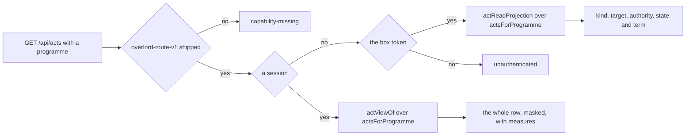
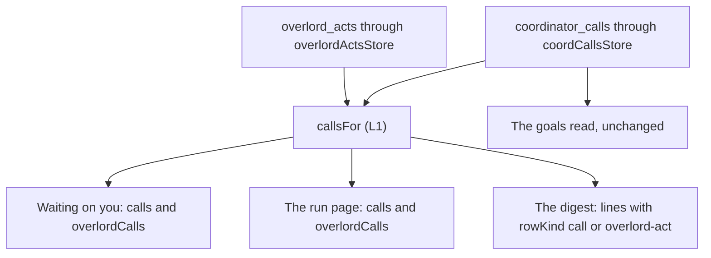
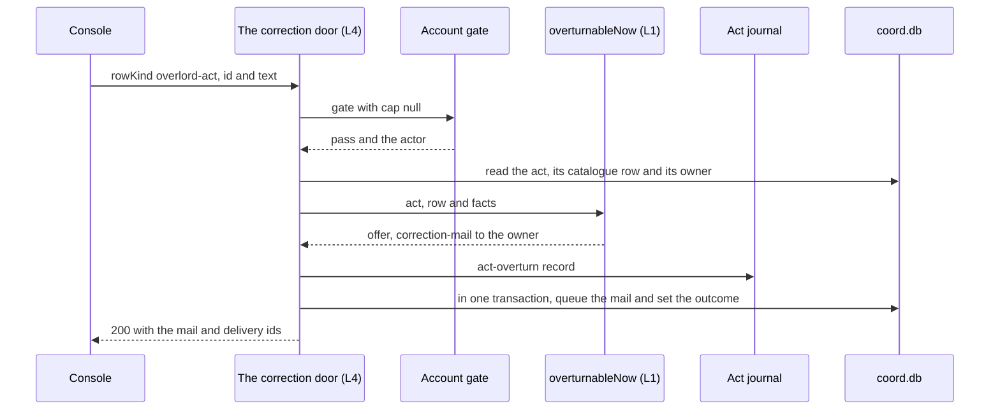

# Overlord W2: the act reads, Seen and overturn Implementation Plan

> **For agentic workers:** REQUIRED SUB-SKILL: Use superpowers:subagent-driven-development (recommended) or
> superpowers:executing-plans to implement this plan task by task. Steps use checkbox (`- [ ]`) syntax for tracking.

**Goal:** the Overlord's acts can be read, marked Seen and overturned.
- **The act read.** A coordinator checks a claimed act through a box-token read of five fields. The console reads the
  whole row.
- **Seen.** The operator marks an act Seen.
- **Overturn.** The operator overturns an act through the one correction door. A pure decider says whether that can
  still be honoured, and the catalogue's compensator carries it out.
- **`callsFor`.** "Calls made for you" reads the coordinators' calls and the Overlord's answers through one reader.

**Why:** spec §10.1, "The act read", and Table 10.1a's `outcome`, `overturnedAt`, `overturnNote` and `seenAt`. Spec
§10.2's overturn horizon and "Waiting on you". Spec §10.3, "Overturning", in full. §6, "Overlord answers are not also
coordinator calls" (`callsFor`). Table 11.1c's rows for `overturnableNow` and `callsFor` (C5 and C6, L1). Table 11.1e's
rows "The Seen door on act rows, the operator's" and "Overturn: `POST /api/digest/correct`, kind `overlord-act`" (C6,
L4). §11.4: the act read refuses `capability-missing` until `overlord-route-v1`. M4 and M32.

**Architecture:** two pull requests in lane C.

- **PR A, the reads and Seen.**
  - Three new L0 pieces: `ACT_OUTCOMES`, the act read's two wire shapes and the call-view mapping.
  - Two new L3 writers, the only writers of their columns:
    - `setActOutcomeInTx` writes `outcome`, `overturnedAt` and `overturnNote`.
    - `markActSeen` writes `seenAt`.
  - `GET /api/acts?programme=<slug>`, with two credentials and two projections.
  - `POST /api/acts/:id/seen`, through the account gate.
  - `callsFor` (C6, L1), in place of D-8126's own reads for Waiting on you and the run page.
- **PR B, overturn.**
  - `overturnableNow` (C5, L1), with its input table.
  - One act journal record, `act-overturn`.
  - The correction door's new row kind, `overlord-act`, with its two W2 compensator arms.
  - `callsFor` in the digest.
  - The M4 and M32 figures on the console's read.

**Tech Stack:** TypeScript (ESM), Fastify, `node:sqlite`, vitest. No new dependency, no migration and no ccd verb. One
row in `ccd/ccrc-api`'s `ROUTES`.

**Spec:** `docs/superpowers/specs/2026-11-09-overlord-design.md`, §6 (the `callsFor` paragraph), §7.6 and H27 (the act
journal), §10.1 to §10.3, Table 10.1a, Table 11.1c, Table 11.1e, §11.4, M4 and M32.

**The index:** `docs/superpowers/plans/2026-11-16-overlord-w2.md`, read from PR #2917's branch. This plan builds:
- its row "Act reads, Seen and overturn" (lane C);
- question 7's rows "The act read" and "Seen on an act";
- Table W2's "Where each Table 14 item went" row for `callsFor`, `overturnableNow`, Seen and overturn;
- the lane C bullet "Reads and overturn".

**The plans this one reads:**
- Act rows, `w2-act-rows.md` (PR #2930): `overlord_acts`, `overlordActsStore.ts`, `ActAnswer`, the M32 figure.
- The act journal, `w2-act-journal.md` (PR #2930): `overlordActRecords.ts`, `OverlordActJournal`, `ActJournalPort`.
- The act catalogue, `w2-act-catalogue.md` (PR #2924): `OVERLORD_ACT_KINDS`, `COMPENSATOR_MAP`, reversibility.
- The relay, `w2-relay.md` (PR #2933): the relay's act row and `relayWidening`'s `overturnedAt IS NULL`.
- The request record, `w2-requests.md` (PR #2928): request states.
- The operator's request doors, `w2-operator-request-doors.md` (this pull request): the second caller of
  `setActOutcomeInTx`.

Written against `main` at `1834eb8cd` (2026-11-16). None of those W2 pieces is on `main` yet. Task A1 re-measures every
name this plan takes from them before it builds.

## In short

- **Two pull requests, nine tasks:** A has five (the reads and Seen), and B has four (overturn).
- **The coordinator's read is five fields:** kind, target, authority, state and term, and nothing else. It needs the box
  token, and refuses `capability-missing` until `overlord-route-v1`. A coordinator checks a claimed act this way, never
  from the words of a mail.
- **The console's read is the whole row,** with the Overlord's words masked and the overturn horizon computed.
- **One writer each.** `setActOutcomeInTx` writes the outcome. It is a compare-and-set, so the first outcome stands.
  `markActSeen` writes `seenAt`. The operator's request doors are the outcome writer's second caller (`superseded` and
  `concurred`), and the correction door its first (`overturned`).
- **An overturn is journal-first.** `overturned` frees a relay's widening, and in W3 it latches grants and the ladder,
  so a restore must not lose it: the act journal gains `act-overturn`. `superseded`, `concurred` and Seen are row-only.
- **`overturnableNow` decides from measured state at the tap.** In W2 two arms carry an overturn out:
  - a correction mail to the owning coordinator, for a relay;
  - a reopen mail to the Overlord, for a drop or a close.

  Every other W2 kind answers why there is nothing to overturn.
- **`callsFor` keeps the Overlord's answers in fields of their own,** so an older console can never mark a coordinator
  call Seen with an act's id. In W2 there are no Overlord answers, so those fields are empty until W3.
- **The digest reads `coordinator_calls` too** (measured): `server/src/coord/digest.ts#buildDigest` reads
  `bigCallsIn`. PR B moves it onto `callsFor`. The goals read keeps its own read (AR9).

## 1. Open questions

The coordinator accepted the index's questions 2 to 23 as written, and settled 24 to 29. Every question below carries a
recommendation, which this plan builds unless the coordinator rules otherwise. None needs the operator.

- **AR1. The outcome words and their one writer** (slug `act-outcome-has-one-writer`). The act rows plan creates
  `outcome`, `overturnedAt` and `overturnNote` and gives them no vocabulary and no writer ("later columns get their
  writers from their pieces").
  **Recommendation:**
  - `ACT_OUTCOMES` (`overturned`, `superseded`, `concurred`) is an L0 key map in `shared/overlord.ts`, beside
    `ACT_STATE_MAP`.
  - `setActOutcomeInTx(db, journal, id, outcome, note, actor, at)` in `overlordActsStore.ts` is the only writer of the
    three columns. It answers `'set' | 'already' | 'unknown'`.
  - It writes only where `outcome IS NULL`, and only on a row whose state is `done` or `effective`. An act that never
    took effect has nothing to overturn.
- **AR2. `overturnedAt` and `overturnNote` only with `overturned`** (slug `outcome-time-only-for-an-overturn`). Table
  10.1a lists the three columns together.
  **Recommendation:** `superseded` and `concurred` set `outcome` alone. The relay plan's `relayWidening` reads
  `overturnedAt IS NULL` to decide whether a relay still carries its widening. A superseded or concurred relay keeps it,
  and only an overturn takes it away. Nothing in W2 reads when a superseded or concurred outcome was written: M4 counts
  `overturned` only, and the request's move row already holds the tap's time.
- **AR3. Only an overturn is journalled** (slug `overturn-is-journal-first`). The act journal plan writes no record for
  an outcome or a Seen mark, and says W3 may add record kinds under `act-`.
  **Recommendation:** add one record kind, `act-overturn`, carrying `actId`, `at` and the actor
  (`{ kind, subject }`). It carries no note, by H27's "no words in a record".
  - `setActOutcomeInTx` appends it through `ActJournalPort` before its `UPDATE` when the outcome is `overturned`. It
    appends nothing for `superseded` or `concurred`.
  - The fold reads it, and act journal B's reconciliation applies it: a row the journal holds as overturned and the table
    does not is set.
  - Why: an overturn changes authority. It frees a relay's widening (the relay plan) and, from W3, suspends a grant and
    counts toward the ladder's latch (§10.3). A snapshot restore that dropped it would revive both, which is the failure
    H27's journal exists to prevent.
  - Seen, `superseded` and `concurred` change no authority, so they stay row-only. A Seen lost to a restore shows its row
    again.
- **AR4. Which acts the read answers for a programme** (slug `act-read-scoped-by-targets`). `overlord_acts` has no
  programme column. **Recommendation:** an act belongs to a programme when its `targets` name that programme, or its
  `widenedProgramme` is the programme.
  - `actsForProgramme(db, slug, since, limit)` reads it with SQLite's `json_each` over `targets`, inside
    `overlordActsStore.ts`, the table's one SQL owner. It never joins `overlord_requests`, whose SQL is the request
    store's.
  - A relay's targets name its owner (relay plan RL17), and every act on a programme's run or item names the run or item,
    and the programme beside it. So an act that concerns a programme names it.
  - The window is the last 30 days, newest first, at most 200 rows.
- **AR5. The coordinator's projection is exactly five fields** (slug `act-read-five-fields`). §10.1 says "kind, target,
  authority, state and term, and nothing else".
  **Recommendation:** `ActReadRow` is `{ kind, target, authority, state, term }`, built by `actReadProjection` (L1).
  - `target` is the natural target `{ kind, id, revision }`.
  - It has no `id`, no `requestId` and no time. A coordinator matches a claimed act by its content. That is what clause 22
    asks for: whether this act exists, with this authority, in this state, in the current term. Nothing in it can carry
    words.
  - A test pins the key set.
- **AR6. The box-token arm needs no attribution and no ownership** (slug `act-read-like-the-goals-read`). The goals read
  (`GET /api/programmes/:slug/goals`) is the model: box token or session, no attribution.
  **Recommendation:** the box-token arm checks the token only, through `checkMailToken` after a failed session check, as
  the goals read does in `server/src/coord/ledgersRoutes.ts`. Its projection carries no words. A coordinator that reads
  another programme's acts learns only what the coordinator doors already show: that an act of a kind exists. The door
  gets a row in `server/src/auth/gate.ts#EXEMPT` with that reason.
- **AR7. The whole door, both arms, waits for `overlord-route-v1`** (§11.4: "`ccrc-api request ack` and the act read
  land in W2. Until then each refuses `capability-missing`, naming `overlord-route-v1`").
  **Recommendation:** the act read and the Seen door both refuse `capability-missing` naming `overlord-route-v1`, through
  the same capability check gates B's step 2 uses. No act exists before the word ships, so the console loses nothing.
- **AR8. Seen marks any act, through the account gate** (slug `seen-on-every-act`). D-8126's call Seen refuses a call
  that is not big (`not-big`). The act Log and the home show every act.
  **Recommendation:** Seen marks any act row, whatever its state, and is idempotent: a second Seen answers 200 and keeps
  the first time. It changes no authority, so it takes no step-up. It goes through the account gate, as index question 7
  rules for every operator door, and so refuses `auth-off` while dark.
- **AR9. Which readers `callsFor` replaces, measured** (the index: "with the plan measuring whether the digest reads
  `coordinator_calls` too"). Four readers of `coordinator_calls` list calls on `main`:

  | Reader | Where | What it lists | `callsFor` |
  |---|---|---|---|
  | Waiting on you | `server/src/coord/ledgersRoutes.ts#waitingViewOf`, through `coordCallsStore.ts#callsForOperator` | the open and cleared big calls | PR A |
  | The run page | `server/src/coord/routes.ts`, `GET /api/runs/:id`, through `coordCallsStore.ts#callsForRun` | every call naming the run | PR A |
  | The digest | `server/src/coord/digest.ts#buildDigest`, through `coordCallsStore.ts#bigCallsIn` | each big call in the window, as a line | PR B |
  | The goals read | `server/src/coord/ledgersRoutes.ts#goalsReadOf`, through `coordCallsStore.ts#bigCallsFor` | a programme's recent big calls, for its coordinator | unchanged |

  *Table 1. The readers of `coordinator_calls`.*

  **Recommendation:** the first three move onto `callsFor`, because they are the operator's "Calls made for you" (§6).
  The goals read is the coordinator's record of its own calls, served on a box-token arm. Carrying the Overlord's `why`
  there would make it a second box-token read of act words beside AR5's projection, so it stays as it is.
- **AR10. The Overlord's answers keep fields of their own** (slug `overlord-calls-in-their-own-field`). A call view's
  `id` is a `coordinator_calls` id, and the console's Seen on a call posts it to `POST /api/calls/:id/seen`. An older
  console given an act in that list would mark the coordinator call with the act's number Seen.
  **Recommendation:**
  - `WaitingView` gains `overlordCalls?` and `overlordCallsCleared?`, and the run record gains `overlordCalls?`, each a
    list of `OverlordCallView`. These fields are additive, and an older console ignores them.
  - A digest line from an act has `rowKind: 'overlord-act'`, whose id space PR B's correction kind knows.
  - `callsFor` is still the one reader: it decides both sources' membership in one function and answers both lists.
- **AR11. Which acts are "Calls made for you"** (§10.2: "the Overlord's `big` answers ... An answer that rests on no
  evidence is always listed there too").
  **Recommendation:** `actIsCallForOperator(act, now)` (L1) is true when all of these hold:
  - the act is an answer kind (the catalogue's `answer: true`);
  - its class is `big` or its evidence class is `none`;
  - it is settled `done` or `effective`;
  - it has no Seen and no outcome;
  - it is inside D-8126's seven-day window (`coordCalls.ts#CALL_SEEN_WINDOW_MS`).

  `actCallClearedAt` mirrors `coordCalls.ts#callClearedAt`. W2 has no answer kinds that are reachable, so both lists stay
  empty until W3. They are tested on fixture rows.
- **AR12. What `overturnableNow` answers for each W2 kind** (slug `w2-overturn-arms`). The catalogue gives each kind a
  reversibility and a compensator. Some W2 kinds have no move that restores their before-state.
  **Recommendation:** Table 4 in §5. In brief:
  - a relay (and, from W3, an answer) is overturned by a correction mail to the owning coordinator;
  - a drop or a close by a reopen mail to the Overlord;
  - an escalation or an opened request is not overturned: the operator's request doors already answer or withdraw it;
  - a nudge or an acknowledgement has nothing to undo;
  - a start's arm (`end-programme`) answers `later-wave` until W5 builds its confirm sheet.
- **AR13. A close is undone like a drop** (slug `close-request-reopens-like-a-drop`). The catalogue marks
  `close-request` reversible with no compensator, but its move ends in `done`, which no move leaves (§5.1: "Reopening is
  a new request").
  **Recommendation:** treat it as the catalogue treats `drop-request`, compensable by `new-request`. The act catalogue's
  row changes in PR B (`reversibility: 'compensable'`, `compensator: 'new-request'`), and its compensator test still
  passes.
- **AR14. The reopen mail carries no operator words** (slug `reopen-mail-is-a-server-line`). The operator's words to the
  Overlord live in the private store (§5.1, H7, H31). The correction door today mails the operator's sentence verbatim
  to a coordinator (D-5300).
  **Recommendation:**
  - **The correction arm** keeps D-5300's shape. The operator's sentence goes to the coordinator, as a correction does
    today, and is stored as `overturnNote`.
  - **The reopen arm** mails the Overlord a fixed server line from an L0 map, `OVERTURN_MAIL`, naming the act and the
    request. It stores no note. The console's sheet tells the operator to say why in the chat.
  - The body's `text` is optional for `overlord-act`. `overturnableNow`'s answer says whether the arm needs it, and the
    door refuses `bad-request` when that arm's text is missing.
- **AR15. The overturn horizon** (§10.2: "From `dependsSince` the Log shows 'cheap to overturn until' and, after that,
  what an overturn now costs").
  **Recommendation:**
  - `cost` is `cheap` while `dependsSince` is empty. Once it is set, `cost` is `work-depends`, with `since` set to
    `dependsSince`, read from act rows B's stamp.
  - The cost never refuses an overturn the arm can honour. "Cannot be undone" is only for an irreversible kind or a kind
    with no compensator.
- **AR16. The overturn's gate** (slug `overturn-through-the-account-gate`). §10.3: "It is made under the sign-in cookie".
  **Recommendation:**
  - For `rowKind: 'overlord-act'`, the correction door first calls the account gate (`cap: null`, no step-up, because an
    overturn only lowers), so it refuses `auth-off` while dark. It records the actor at `operator` strength.
  - The other three row kinds keep today's session gate, unchanged.
  - The door chooses the gate from an L0 table, `DIGEST_ROW_GATE`, keyed by row kind, so the handler makes no decision
    of its own.
- **AR17. M4 and M32 on the console's read** (the index row's "M4"). **Recommendation:** the session arm of
  `GET /api/acts` gains `measures`:
  - M4 is `{ overturned, settled, days: 28 }`, from one reader, `actOutcomeCounts(db, since)`.
  - M32's part is `{ unsettled }`, act rows B's count of acts left `pending` or `unknown` after the boot pass.

  W6's digest section reads the same reader.

## 2. What exists today

Measured on `main` at `1834eb8cd`.

| What | Where | What this plan does with it |
|---|---|---|
| The call record's one-writer store: `insertCall`, `markCallSeen` (only writer of `seenAt`), `overturnCallTx` (only writer of `overturnedAt`, `overturnNote`) | `server/src/coord/coordCallsStore.ts` | The model for `markActSeen` and `setActOutcomeInTx` |
| The readers `callsForRun`, `callsForOperator`, `bigCallsIn`, `bigCallsFor`, `callById` | `server/src/coord/coordCallsStore.ts` | Table 1 |
| The pure call rules `callIsForOperator`, `callClearedAt`, `callViewOf` (masks every text with `redactCommand`), `callDecision`, `CALL_SEEN_WINDOW_MS` | `server/src/coord/coordCalls.ts` | `callsFor`'s coordinator half; the window |
| The call Seen door, session-gated, `not-big` refused | `server/src/coord/ledgersRoutes.ts` (`POST /api/calls/:id/seen`) | The model for the act Seen door |
| The correction door: `parseDigestCorrectBody`, `correctDigestRow`, `digestCorrectionSubject`, `isDigestCorrectionSubject` | `server/src/coord/digest.ts`; the route in `server/src/server.ts` | Gains the `overlord-act` kind (PR B) |
| The mark and its mail in one transaction | `server/src/coord/store.ts` (`CoordStore#correctWithMail`) | The shape of `overturnActWithMail` |
| `DigestRowKind`, `DIGEST_ROW_KINDS`, `DigestLine`, `DigestCorrectBody`, `DIGEST_REFUSALS` | `shared/api.ts` | Widened in PR B |
| The goals read's two credentials | `server/src/coord/ledgersRoutes.ts` (`GET /api/programmes/:slug/goals`, `checkMailToken` after the session check) | The act read's model (AR6) |
| The account gate, `cap: null` | `server/src/accounts/gate.ts#createAccountGate` | Seen and the overturn (AR8, AR16) |
| The masker | `server/src/coord/redact.ts` (`redactCommand`) | Every text on the session arm |
| Census lists | `server/test/box-token-census.test.ts` (`LEDGER_OPERATOR_DOORS`, `DIGEST_CORRECT`, `SESSION_ONLY_ALL`) | The Seen door's row |
| The mutation floors | `server/test/sim/mutation-floors.test.ts#MUTANT_SETS`, `server/test/sim/mutation-floors.json` | Six deciders join |
| Growth checks | `server/test/growthCheck.ts#GROWTH_FILES`, `#GROWTH_LIMIT` (40); `server/test/growth-caps/shared-api-ts.json` | §7 |

**Not on `main`, taken from the plans that build them:**

| What | Plan |
|---|---|
| `overlord_acts`; `writeActInTx`, `settleActInTx`, `actById`, `stampDependsSinceInTx` in `overlordActsStore.ts`; `ActAnswer`, `ACT_STATE_MAP`, `ACT_SUMMARY_MAX`, `ACT_WHY_MAX` in `shared/overlord.ts` | act rows A |
| The settling lane's M32 count, `dependsSince` | act rows B |
| `overlordActRecords.ts` (`OVERLORD_ACTS_FORMAT`, `actJournalFold`), `OverlordActJournal`, `ActJournalPort` | act journal A |
| `OVERLORD_ACT_KINDS`, `COMPENSATOR_MAP`, the compensator test with `LATER_DOORS` | act catalogue A |
| The relay's act row and `relayWidening` | relay A |
| `OVERLORD_DOORS`, `NOT_OVERLORD_DOORS`, `OVERLORD_OPERATOR_DOORS`, `CallerIdentity`, the capability step | W1 gates A and B, designation A |
| The `overlord` mail recipient, `SYSTEM_MAIL_SENDER_MAP`'s `overlord` | request ids B |

## 3. The act read and Seen

| Arm | Credential | Answers | Built by |
|---|---|---|---|
| The coordinator's | the box token (`x-ccrc-mail-token`), after a failed session check | `{ ok: true, acts: ActReadRow[] }`, the five fields only | `actReadProjection` (L1) |
| The console's | the session (the auth gate) | `{ ok: true, acts: ActView[], measures }`, the whole row: `summary`, `why` and `overturnNote` masked, the actor, the outcome, `seenAt`, `dependsSince` and the overturn horizon from `overturnableNow` (PR B; PR A answers `overturn: null`) | `actViewOf` (L1) |

*Table 2. `GET /api/acts?programme=<slug>`. The slug is checked by the programme ledgers' slug grammar. A missing or bad
slug answers `bad-request`. Both arms refuse `capability-missing` until `overlord-route-v1` (AR7).*

*Figure 1. The act read's two arms. One store reader feeds both, and only the projection differs.*

**What no act read carries.**
- **The operator's words.** The acts table holds none: `summary` and `why` are the Overlord's, and `citedIds` are ids.
  `overturnNote` is the operator's correction to a coordinator (AR14), and only the console's arm carries it.
- **A private-state value.** The console's arm passes `summary`, `why` and `overturnNote` through `redactCommand`, as
  `callViewOf` does. It carries `checks` as each question's id, band and outcome only, never an answer's text. Neither
  arm carries a message's text or a stored secret.
- A test seeds a row whose `why` holds a secret-shaped token and an operator message's sentence. It asserts that the
  token is masked on the console's arm, and that the coordinator's arm holds exactly the five keys.

**Seen.** `POST /api/acts/:id/seen` answers `{ ok: true, act: ActView }`. It goes through the account gate with
`cap: null`, so it refuses `auth-off` while dark (AR8). `markActSeen(db, id, at)` answers `'seen' | 'already' |
'unknown'`, and `unknown` answers `unknown-act`. On `seen` the door emits `waiting`, because `callsFor`'s operator lists
may change.

## 4. `callsFor`

`callsFor` lives in `server/src/coord/callsFor.ts` (C6, L1). Its signature is
`callsFor(view, calls: CallRow[], acts: ActRow[], now)`, and it is pure. The L3 readers stay where they are. Each caller
reads the two lists and hands them to `callsFor`, so membership, order and window are decided in one place.

| View | Coordinator calls | Overlord answers | Order |
|---|---|---|---|
| `operator` | open (`callIsForOperator`) and cleared (`callClearedAt`, inside `CLEARED_WINDOW_MS`) | the same, through `actIsCallForOperator` and `actCallClearedAt` | newest first |
| `run` | every call naming the run | every answer whose `targets` name the run | oldest first |
| `digest` | each big call in `[from, to)` (`callDecision`) | each answer `actIsCallForOperator` would list, made in `[from, to)` | by time, then row kind, then id |

*Table 3. `callsFor`'s views. The answers' half is empty in W2, because no answer door ships before W3.*

*Figure 2. The readers before and after. Three readers go through `callsFor`. The goals read keeps D-8126's own read
(AR9).*

**Characterization first.** Task A2 pins the output of each of the three readers on `main` before anything moves:
- `waitingViewOf`'s `calls` and `callsCleared`;
- the run page's `calls`;
- the digest's call lines and `totals.calls`.

The move commit changes only what those tests import. The new fields are a commit of their own.

## 5. Overturn

`overturnableNow(act, row, facts, now)` lives in `server/src/coord/overlordOverturn.ts` (C5, L1).
- `act` is the act row.
- `row` is its catalogue row (`reversibility`, `compensator`).
- `facts` is `{ owner: { kind: 'coordinator', id } | { kind: 'none' } | { kind: 'unmeasured', why } }`, read in the
  door's transaction from the act's `targets` and `CoordStore#programmeCoordinator`.

It answers one of two shapes:
- `{ offer: true, arm, to, needsText, cost, since }`;
- `{ offer: false, why, doneAt }`.

| Order | When | Answer |
|---|---|---|
| 1 | The act has an outcome | `offer: false`, `why: 'outcome-set'` |
| 2 | Its state is not `done` or `effective` | `offer: false`, `why: 'not-settled'` |
| 3 | Its reversibility is `n/a` | `offer: false`, `why: 'nothing-to-undo'` |
| 4 | Its reversibility is `irreversible` | `offer: false`, `why: 'cannot'`, `doneAt` = the act's time |
| 5 | Its kind is `escalate-request` or `open-request` | `offer: false`, `why: 'request-door'` (the operator's request doors answer or withdraw it) |
| 6 | It has no compensator | `offer: false`, `why: 'nothing-to-undo'` |
| 7 | The compensator is `end-programme` | `offer: false`, `why: 'later-wave'` (W5's confirm sheet) |
| 8 | The compensator is `correction-mail`, and the owner is unmeasured | `offer: false`, `why: 'unmeasured'` |
| 9 | The compensator is `correction-mail`, and there is no owner | `offer: false`, `why: 'cannot'` |
| 10 | The compensator is `correction-mail` | `offer: true`, `arm: 'correction-mail'`, `to` the owner's coordinator, `needsText: true` |
| 11 | The compensator is `new-request` | `offer: true`, `arm: 'reopen-mail'`, `to: 'overlord'`, `needsText: false` |

*Table 4. `overturnableNow`'s input table, first match. Rows 10 and 11 carry `cost` and `since` (AR15). Row 2 also
covers W3's `staged` row, which a Veto settles instead (§10.3). Row 5 comes before row 6 so that the reason shown is
the door to use.*

**Monotonicity (Table 11.7b).** Only facts that arrive later can change the answer: an outcome set, a state settled, a
`dependsSince` stamped. A property test holds that adding an outcome, or moving `cost` from `cheap` to `work-depends`,
never turns `offer: false` into `offer: true`.

*Figure 3. An overturn of a relay. The journal record comes before the transaction that queues the mail and writes the
outcome, as every act journal write does (H27).*

**The door's steps.**
1. `parseDigestCorrectBody` accepts `rowKind: 'overlord-act'`, with `text` optional for that kind only.
2. `server.ts` calls the gate `DIGEST_ROW_GATE` names for the kind (AR16).
3. `correctDigestRow`'s new branch reads the act (`actById`; unknown answers `unknown-act`) and its catalogue row. It
   asks `overturnableNow`, and answers `not-overturnable` with the `why` in the detail when there is no offer. It
   refuses `bad-request` when the arm needs text and none came.
4. It refuses `duplicate` while a correction on the same act is undelivered, as today.
5. It then calls `CoordStore#overturnActWithMail(id, journal, queue, note, actor)`. This is one transaction that queues
   the mail and calls `setActOutcomeInTx` with `overturned`.
   - **Correction arm:** from `operator` to the owner's coordinator, kind `finding`, subject
     `digestCorrectionSubject('overlord-act', id)`, body the operator's text. The note is stored.
   - **Reopen arm:** from `operator` to `overlord`, kind `status`, the same subject, body the fixed `OVERTURN_MAIL` line.
     No note is stored.
6. The door emits `waiting`.

**What an overturn sets off in W2.**
- `relayWidening` stops reading the relay as carrying its widening (`overturnedAt IS NOT NULL`, the relay plan).
- The decision model's label sources read `overturned` as an `overturn` label (the label queue piece).
- M4 counts it.

The grant suspension, the ladder latch and the cited-entry marks are W3's and W4's. They read the same column.

## 6. Global constraints and review focus

- **Architecture (`CLAUDE.md`).**
  - **One writer per fact.** `setActOutcomeInTx` is the only writer of `outcome`, `overturnedAt` and `overturnNote`, and
    `markActSeen` is the only writer of `seenAt`. Both are named in `writers-map.test.ts#TABLES`.
  - **Decide in L1.** The deciders are `actReadProjection`, `actViewOf`, `callsFor`, `actIsCallForOperator` with
    `actCallClearedAt`, and `overturnableNow`. Each handler only maps their answers.
  - **Consolidate.** The overturn is a kind of the one correction door, not a door of its own. The Seen door copies the
    call Seen door's shape and is not a second mechanism for calls.
  - **Wire discipline.** Every new field is additive. `rowKind: 'overlord-act'` is new to `DIGEST_ROW_KINDS`, and an
    older server answers it `bad-request`, which is Table 11.1e's "Refuses the unknown kind".
  - **No overloaded null.** `overturn` on an `ActView` is `null` only in PR A, before the decider ships. From PR B it is
    always the decider's answer.
- **What a merge arms.** Nothing a session sees:
  - the reads and Seen refuse `capability-missing` until `overlord-route-v1`;
  - the correction door's new kind finds no act to overturn before then;
  - `callsFor`'s Overlord half is empty until W3.
- **Public repository.** Fixtures use `project-a` and `lane-a` names. Run the private-name scan over every changed file.
- **Mutation.** Each decider joins `MUTANT_SETS` and `mutation-floors.json` with its measured floor. Each task's mutation
  step uses `../ccrc-coordinator/references/mutation-run.py`.
- **Tests.** From `server/`, in the foreground, one file at a time, through
  `ccrc test -- ./node_modules/.bin/vitest run test/<file>`. Each task ends with
  `ccrc test -- npx tsc --noEmit -p tsconfig.json` and `-p test/tsconfig.tests.json`. Tasks that touch `pwa/` also run
  `ccrc test -- ./node_modules/.bin/tsc --noEmit` there.

**Review focus.**
1. The coordinator's arm answers exactly five keys, and no arm carries the operator's words or an unmasked text.
2. `setActOutcomeInTx` is a compare-and-set, and only `overturned` is journalled, before the transaction.
3. The three moved readers' outputs are byte-for-byte what the characterization tests pinned on `main`.
4. `overturnableNow` is exhaustive over every catalogue kind and state, and monotone.
5. The overturn takes the account gate, and the other correction kinds do not change.

## 7. The PR split

| PR | Tasks | What it ships | Needs first | Growth-checked files, estimate |
|---|---|---|---|---|
| A, the reads and Seen | A1 to A5 | `ACT_OUTCOMES` and the wire shapes; `setActOutcomeInTx`, `markActSeen`, `actsForProgramme`, the answers' readers; `GET /api/acts` and the Seen door; `callsFor` for Waiting on you and the run page; `ccrc-api acts`; the client | act rows A, act catalogue A, gates B (the capability step and `OVERLORD_DOORS`) | `shared/api.ts` about +4 (`WaitingView` and the run record's new fields); `server/src/coord/store.ts` about +5 (delegates); `server/src/coord/routes.ts` about +2; `pwa/src/lib/api.ts` about +4; `server/src/server.ts` 0; `server/src/watch.ts` 0; `server/src/coord/schema.ts` 0 |
| B, overturn | B1 to B4 | `overturnableNow`; `act-overturn` in the act journal; the `overlord-act` correction kind with its two arms; `callsFor` in the digest; M4 and M32 on the console's read | PR A, act rows B, act journal A, relay A, request ids B (the `overlord` recipient) | `shared/api.ts` about +4 (`DigestRowKind`, its map, two refusal words); `server/src/server.ts` about +5; `server/src/coord/store.ts` about +6 (`overturnActWithMail`); `pwa/src/lib/api.ts` about +1; `server/src/watch.ts` 0; `server/src/coord/schema.ts` 0 |

*Table 5. The pull requests. `shared/api.ts`'s total cap (`server/test/growth-caps/shared-api-ts.json`) is measured when
each PR is built. The new modules (`callsFor.ts`, `overlordOverturn.ts`) and `digest.ts` are not growth-checked.*

## 8. Tasks

### Task A1: The outcome words, the wire shapes and the store's writers (L0, L3)

**Files:**
- Modify: `shared/overlord.ts` (`ACT_OUTCOMES`, `ActReadRow`, `ActView`, `OverlordCallView`),
  `server/src/coord/overlordActsStore.ts` (`setActOutcomeInTx`, `markActSeen`, `actsForProgramme`, `answerActsIn`,
  `answerActsForRun`, `actOutcomeCounts`), `server/test/single-definition/writers-map.test.ts`
- Create: `server/test/overlord-acts-outcome.test.ts`

- [ ] **Step 1: Re-measure.** Read `shared/overlord.ts`, `overlordActsStore.ts` and `overlordActRecords.ts` as landed,
  and use the landed names. Read act rows A's `targets` encoding, and confirm `json_each` reads it.
- [ ] **Step 2: Write the failing tests** over a fresh store with act rows A's migration, seeding rows through
  `writeActInTx`:
  - `setActOutcomeInTx` sets once and answers `already` after. It refuses a `pending` row. It sets `overturnedAt` and
    `overturnNote` only with `overturned`. A second writer racing inside one transaction finds `already`.
  - `markActSeen` keeps the first time.
  - `actsForProgramme` finds a relay by its owner target and an act by `widenedProgramme`. It leaves out an act of
    another programme and an act older than 30 days, and caps at 200.
  - The writers census names both writers.
- [ ] **Step 3: Run red.** `cd server && ccrc test -- ./node_modules/.bin/vitest run test/overlord-acts-outcome.test.ts`.
- [ ] **Step 4: Write the writers and readers.** `setActOutcomeInTx` takes the journal port now and appends nothing until
  Task B2.
- [ ] **Step 5: Run green**, then run `writers-map.test.ts`.
- [ ] **Step 6: Commit:** `feat(coord): the act outcome and Seen writers, and the programme read`.

### Task A2: Characterize the call readers, green on `main`

**Files:**
- Create: `server/test/calls-for-characterization.test.ts`

- [ ] **Step 1: Pin today's output.** Seed `coordinator_calls` with a routine, a big and a block call, one Seen, one
  overturned and one older than the window. Pin `waitingViewOf`'s `calls` and `callsCleared`, the run page's `calls`
  (through Fastify `inject` on `GET /api/runs/:id`), and `buildDigest`'s call lines and `totals.calls`.
- [ ] **Step 2: Run it green on `main`.**
  `ccrc test -- ./node_modules/.bin/vitest run test/calls-for-characterization.test.ts`. Expected: PASS.
- [ ] **Step 3: Commit:** `test(coord): characterize the three readers of coordinator calls`.

### Task A3: `callsFor` and the act views (L1)

**Files:**
- Create: `server/src/coord/callsFor.ts`, `server/src/coord/overlordActViews.ts` (`actReadProjection`, `actViewOf`,
  `actIsCallForOperator`, `actCallClearedAt`), `server/test/calls-for.test.ts`
- Modify: `server/src/coord/ledgersRoutes.ts` (`waitingViewOf`), `server/src/coord/routes.ts` (the run page),
  `shared/api.ts` (`WaitingView.overlordCalls?`, `overlordCallsCleared?`, and the run record's `overlordCalls?`),
  `server/test/sim/mutation-floors.test.ts`, `server/test/sim/mutation-floors.json`

- [ ] **Step 1: Write the failing tests:**
  - Table 3's three views over both sources.
  - The Overlord half picks only answer kinds, `big` or evidence `none`, settled, unseen, with no outcome and inside the
    window.
  - `actReadProjection`'s key set is exactly the five.
  - `actViewOf` masks a secret-shaped `why`.
  - A monotonicity property: a Seen or an outcome only ever removes a row from the open list.
- [ ] **Step 2: Run red.** `ccrc test -- ./node_modules/.bin/vitest run test/calls-for.test.ts`.
- [ ] **Step 3: Write the modules,** then move the run page and Waiting on you onto `callsFor` in one move commit that
  changes only their imports and calls. Re-run Task A2's file: it must pass unchanged.
- [ ] **Step 4: The new fields,** in a commit of their own, then run green.
- [ ] **Step 5: Mutation.** Drop `actIsCallForOperator`'s evidence arm, its window and its outcome check, and swap the
  views' orders. Each must go red. Add the five deciders to `MUTANT_SETS`.
- [ ] **Step 6: Commit:** `feat(coord): callsFor reads the Overlord's answers beside the coordinators' calls`.

### Task A4: The act read and the Seen door (L4)

**Files:**
- Modify: `server/src/coord/overlordRoutes.ts` (both routes), `server/src/coord/overlordDoors.ts` (the Seen door's
  operator row, and the act read's `NOT_OVERLORD_DOORS` entry with its reason), `server/src/auth/gate.ts#EXEMPT` (the
  act read's row, AR6), `server/test/box-token-census.test.ts` (`OVERLORD_OPERATOR_DOORS` gains
  `/api/acts/:id/seen`, and the dual-credential read joins its class), `server/test/auth-gate.test.ts`,
  `server/test/secret-mask.test.ts`, `CLAUDE.md` (the session-gated writes sentence and the dual-credential reads
  sentence)
- Create: `server/test/overlord-act-read.test.ts`

- [ ] **Step 1: Write the failing route tests:**
  - `capability-missing` before the word.
  - The session arm's whole row, with `measures` null until PR B.
  - The box-token arm's five keys.
  - `unauthenticated` with neither credential.
  - `bad-request` on a bad slug.
  - Seen's 200, idempotence, `unknown-act`, and `auth-off` while dark.
  - The `waiting` emit on `seen` only.
- [ ] **Step 2: Run red**, write the handlers, then run green. Use
  `ccrc test -- ./node_modules/.bin/vitest run test/overlord-act-read.test.ts`, then run the census files.
- [ ] **Step 3: Mutation.** Swap the two arms' projections, drop the capability check, and drop the gate call. Each must
  go red.
- [ ] **Step 4: Commit:** `feat(coord): the act read and the Seen door`.

### Task A5: The client and the coordinator's verb

**Files:**
- Modify: `ccd/ccrc-api` (`ROUTES`: `acts list --programme <slug>`, `GET /api/acts`), `ccd/coordinator-skill/references/`
  (the door table's act read row, if the skill's references list doors), `pwa/src/lib/api.ts` (the read and Seen),
  `pwa/src/lib/refusalWords.ts` (`unknown-act`)

- [ ] **Step 1:** Add the row and the client functions. Run the `ccrc-api` route-table test and the skill's pin tests.
- [ ] **Step 2: The whole check.** Run the docs guards from `server/`: `anchors`, `citations`, `dtbd`, `docs-grammar` and
  `topology-clean`, and `deviation-refs` after `git fetch origin main`. Then run both typechecks in `server/` and
  `pwa/`'s.
- [ ] **Step 3: Commit:** `feat(api): the act read and Seen on the client and in ccrc-api`.

### Task B1: `overturnableNow` (L1)

**Files:**
- Create: `server/src/coord/overlordOverturn.ts`, `server/test/overlord-overturn.test.ts`
- Modify: `shared/overlord.ts` (the catalogue's `close-request` row, AR13), `server/test/sim/mutation-floors.test.ts`,
  `server/test/sim/mutation-floors.json`

- [ ] **Step 1: Write the failing tests:**
  - One case per row of Table 4, and one that misses it.
  - An exhaustive property over every catalogue kind, every act state and the three owner facts.
  - The monotonicity property of §5.
  - The catalogue's compensator test still passes with `close-request` compensable.
- [ ] **Step 2: Run red**, write the decider, then run green. Use
  `ccrc test -- ./node_modules/.bin/vitest run test/overlord-overturn.test.ts`.
- [ ] **Step 3: Mutation.** Swap rows 1 and 2, drop row 5, invert row 8, and turn row 11's `needsText` to true. Each must
  go red. Add the decider to `MUTANT_SETS`.
- [ ] **Step 4: Commit:** `feat(coord): overturnableNow decides from measured state`.

### Task B2: `act-overturn` in the act journal

**Files:**
- Modify: `server/src/coord/overlordActRecords.ts` (the record kind, its canonical form, the fold's arm),
  `server/src/coord/overlordActsStore.ts` (`setActOutcomeInTx` appends it for `overturned`),
  `server/test/chained-journal-formats.test.ts` (the format's record list), and act journal B's reconciliation, if it has
  landed (apply the record to a row that lacks it)
- Create: `server/test/overlord-act-overturn-journal.test.ts`

- [ ] **Step 1: Write the failing tests:**
  - The record's canonical bytes.
  - The fold reads it.
  - `overturned` appends one record before the row changes, and `superseded` and `concurred` append none.
  - An append failure leaves the row as it was, with the guard told.
  - A restored table that lacks an overturn the journal holds gets it from the reconciliation.
- [ ] **Step 2: Run red**, write, then run green. Use
  `ccrc test -- ./node_modules/.bin/vitest run test/overlord-act-overturn-journal.test.ts`, then run the journal suites.
- [ ] **Step 3: Mutation.** Drop the append, and append for `superseded`. Each must go red.
- [ ] **Step 4: Commit:** `feat(coord): an overturn is journal-first`.

### Task B3: The correction door's `overlord-act` kind (L4)

**Files:**
- Modify: `shared/api.ts` (`DigestRowKind` and its map; `DIGEST_REFUSALS` gains `unknown-act` and `not-overturnable`),
  `shared/overlord.ts` (`OVERTURN_MAIL`, `DIGEST_ROW_GATE`), `server/src/coord/digest.ts` (`parseDigestCorrectBody`,
  `correctDigestRow`'s branch, and the digest's lines through `callsFor`), `server/src/coord/store.ts`
  (`overturnActWithMail`), `server/src/server.ts` (the gate by kind, the emit), `pwa/src/lib/refusalWords.ts`
  (`not-overturnable`), `pwa/src/lib/api.ts` (the body's kind)
- Create: `server/test/overlord-overturn-door.test.ts`

- [ ] **Step 1: Write the failing tests.** For a relay act, the correction mail to its owner's coordinator, the outcome,
  `overturnedAt`, the note, and `relayWidening` now `none`. For a drop act, the reopen mail to `overlord` with the fixed
  line, and no note. Also:
  - `not-overturnable` for an escalation, with `why: 'request-door'`;
  - `unknown-act`;
  - `duplicate` while undelivered;
  - `bad-request` for a relay with no text;
  - `auth-off` while dark for `overlord-act`, while the `call` kind still works dark;
  - the digest's lines with an `overlord-act` fixture answer, and the characterization file still passing.
- [ ] **Step 2: Run red**, write, then run green. Use
  `ccrc test -- ./node_modules/.bin/vitest run test/overlord-overturn-door.test.ts`, then
  `calls-for-characterization.test.ts`, `box-token-census.test.ts` and the digest suites.
- [ ] **Step 3: Mutation.** Route the reopen arm's text into the note, drop the gate for the new kind, and skip the
  decider. Each must go red.
- [ ] **Step 4: Commit:** `feat(coord): overturn an Overlord act through the correction door`.

### Task B4: M4 and M32 on the console's read

**Files:**
- Modify: `server/src/coord/overlordRoutes.ts` (the session arm's `measures` and `overturn`),
  `server/test/overlord-act-read.test.ts`

- [ ] **Step 1: Write the failing tests:**
  - M4 counts `overturned` over settled acts in 28 days, and ignores `superseded` and `concurred`.
  - M32's `unsettled` is act rows B's figure.
  - Each `ActView` carries `overturnableNow`'s answer.
- [ ] **Step 2: Run red**, write, then run green. Then run the whole check of Task A5's step 2.
- [ ] **Step 3: Commit:** `feat(coord): the act read carries M4, M32 and each act's overturn horizon`.

## Deviations found

By slug. The coordinator mints the numbers (cross-plan ruling X9).

- **`act-outcome-has-one-writer`:** `ACT_OUTCOMES` and `setActOutcomeInTx`, which the act rows plan leaves to this
  piece (AR1).
- **`outcome-time-only-for-an-overturn`:** `overturnedAt` and `overturnNote` are written with `overturned` only (AR2).
- **`overturn-is-journal-first`:** a new act journal record kind, `act-overturn`. Seen, `superseded` and `concurred` are
  row-only (AR3).
- **`act-read-scoped-by-targets`:** a programme's acts are those whose `targets` or `widenedProgramme` name it (AR4).
- **`act-read-five-fields`:** the coordinator's arm carries no id (AR5).
- **`act-read-like-the-goals-read`:** the box-token arm takes no attribution and no ownership check (AR6).
- **`seen-on-every-act`:** Seen marks any act, unlike the call Seen's `not-big` (AR8).
- **`overlord-calls-in-their-own-field`:** the Overlord's answers ride new fields, never inside `calls` (AR10).
- **`goals-read-keeps-its-own-calls`:** the goals read stays off `callsFor` (AR9).
- **`w2-overturn-arms`:** two arms in W2, a correction mail and a reopen mail. The escalation and the opened request
  point to the request doors (AR12).
- **`close-request-reopens-like-a-drop`:** the catalogue's `close-request` row becomes compensable by `new-request`
  (AR13).
- **`reopen-mail-is-a-server-line`:** the reopen arm mails the Overlord a fixed line and stores no note (AR14).
- **`overturn-through-the-account-gate`:** the `overlord-act` kind alone takes the account gate (AR16).

## What the index should change

- **Table W2, the row "Act reads, Seen and overturn":**
  - **What it ships:** "A: `ACT_OUTCOMES` and the outcome writer, `setActOutcomeInTx`, the one writer of `outcome`,
    `overturnedAt` and `overturnNote`, whose callers are the correction door and the operator's request doors;
    `markActSeen`; the act read, its box-token arm projected to exactly kind, target, authority, state and term, and its
    session arm the whole row, masked; the Seen door on any act, through the account gate; `callsFor` (C6, L1) for
    Waiting on you and the run page, the Overlord's answers in fields of their own; `ccrc-api acts`. B: `overturnableNow`
    (L1, with its input table); `act-overturn` in the act journal; `POST /api/digest/correct`'s `overlord-act` kind
    through the account gate, with a correction mail for a relay and a reopen mail for a drop or a close; `callsFor` in
    the digest (measured: the digest reads `coordinator_calls` through `bigCallsIn`, and the goals read keeps its own);
    M4 and M32 on the console's read."
  - **Size:** 2 PRs, 9 tasks (A 5, B 4).
  - **Needs first:** A: act rows A, act catalogue A, gates B. B: PR A, act rows B, act journal A, relay A, request ids
    B.
- **The operator's request doors' row:** "Needs first" gains act reads A, the outcome writer's home.
- **Question 7's door table:** the act read's gate reads "box token (the five fields), or session (the whole row); both
  refuse `capability-missing` until `overlord-route-v1`". Seen reads "session, through the account gate".
- **The lane C bullet "Reads and overturn":** add `server/src/coord/callsFor.ts`, `overlordOverturn.ts`, the act journal's
  `act-overturn`, and `digest.ts`'s reader.
- **The act catalogue's row for `close-request`:** compensable, compensator `new-request` (AR13).
- **"States W3 may read":** the outcome writer and its journal record; `callsFor`'s Overlord half, which fills once W3's
  answer doors write answer rows; `overturnableNow`'s `end-programme` arm, `later-wave` until W5.

## Where things stand

**Agreed:**
- The act read's two arms and the Seen door, with the paths of index question 7 (accepted by the coordinator).
- Overturn through the one correction door (§10.3; the index row).
- `callsFor` replaces D-8126's reads (§6; the index row).

**Waiting on the coordinator** (at this plan's review):
- AR3: journalling `overturned` only.
- AR5 and AR6: the five-field projection with no id and no ownership check.
- AR9: the goals read stays off `callsFor`.
- AR12 to AR14: the W2 overturn arms, a close treated as a drop, and the reopen mail's fixed line.
- AR16: the account gate for the `overlord-act` kind only.
- The split into two pull requests, and their "Needs first".

**Waiting on the operator:** nothing.

**Later:**
- W3's answer doors write answer rows, which fill `callsFor`'s Overlord half, and its staged answers' Veto.
- W3's grant suspension and the ladder's three-overturn latch read `outcome`.
- W4 marks the entries an overturned act cited.
- W5's confirm sheet builds the `end-programme` arm.
- W6's digest section reads M4.
- The Log tab draws the console's arm.
