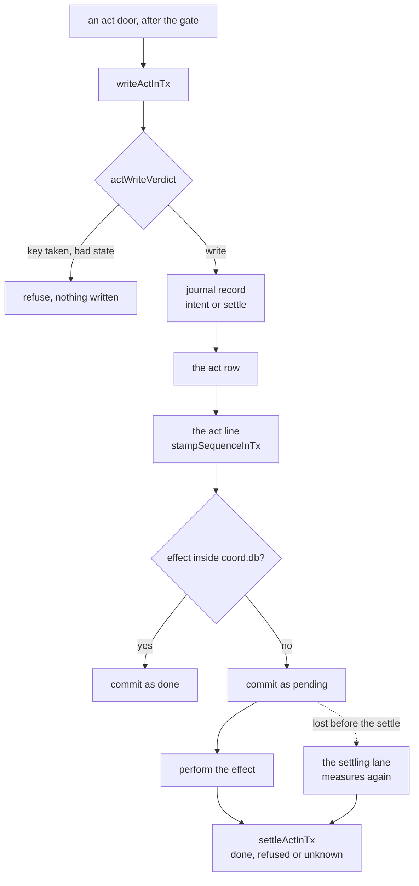
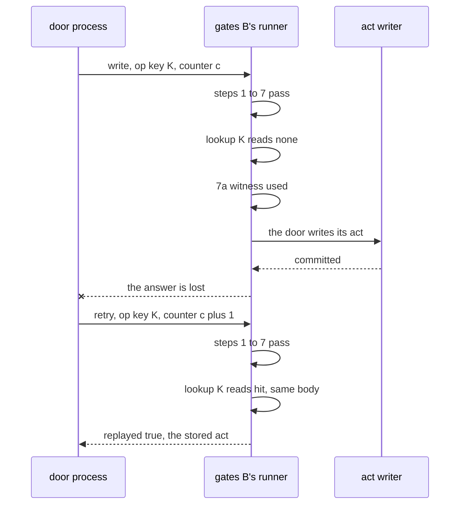

# Overlord W2: act rows, the operation key and settling Implementation Plan

> **For agentic workers:** REQUIRED SUB-SKILL: Use superpowers:subagent-driven-development (recommended) or
> superpowers:executing-plans to implement this plan task by task. Steps use checkbox (`- [ ]`) syntax for tracking.

## In short

- **What this is.** The plan for the W2 piece "Act rows and settling" (the W2 index, Table W2, lane C). It builds the
  record every Overlord write door leaves behind: one row of `overlord_acts` per act, written by one writer, under a
  natural key that admits at most one effect, and settled by measuring when the effect lies outside the database. It
  also builds the operation key, the transport's dedupe. Two pull requests, nine tasks: PR A six, PR B three.
- **PR A, the row and the key.** The act states and `ACT_TRANSITIONS` (Table 10.1b) join `shared/overlord.ts`.
  `overlord_acts` is one migration with every column of Table 10.1a, `widens` and the widened programme among them
  (index question 8). One writer decides, appends through the act journal's port, writes the row and stamps the `act`
  line of the sequence, in one transaction. The natural key is unique among rows not settled `refused`. The operation
  key rides `x-ccrc-op-key`: the door process mints one per write tool call, and gates B's runner looks it up after the
  step-7 fence and before step 7a. A hit returns the stored row and outcome, consumes no witness and counts toward no
  latch. A repeat with another body refuses `op-key-reused`, a new word with its Table 11.6 row. The writer takes act
  catalogue B's `MayActAllow`, asserts it at runtime, consumes it once and checks it against the row it writes, and
  re-runs the ceilings for the act's group and the effect's group inside its own synchronous write: the gate's step 10
  is only the early refusal (the coordinator's ruling on the act catalogue's review).
- **PR B, settling.** The settling lane on its own `LANE_SCHEDULE` row, with a boot pass, re-measures every `pending` and
  `unknown` row. `acknowledge`, W2's one act whose effect lies in another store, writes its act row in two steps. I3's
  predicate joins sequence B's invariant table, and M32's "unsettled after the boot pass" figure is counted.
- **What changes at merge.** Nothing a running session sees. Every door that writes an act row refuses
  `capability-missing` naming `overlord-route-v1` until the index's last piece. The door process sends the new header
  from PR A, and the server ignores it on every door that writes no act row. The settling lane has no rows to move until
  `acknowledge` writes one, and `acknowledge` itself refuses until `overlord-v1`.
- **What the reader must check.** Eleven open questions (§2), each with a recommendation, none for the operator. Three
  need the coordinator's eye: the natural key includes the act kind (question 2), a lost answer to a refusal past step
  7a would count as unwitnessed without a new witness arm (question 4), and what "sends `unknown` and `refused` to the
  operator" means in a wave that holds nothing (question 8).

## 1. Goal, scope and the rulings this plan builds on

This section says what the piece builds, why, and which rulings bind it.

**Goal:** every act the Overlord takes leaves one row the operator can read and the server can trust, written by the
door that performs the act, in the act's own transaction. An effect the database cannot commit with its row is written
`pending` first and settled by measuring. A call the transport repeats acts once.

**Why:** C25, H24 and H27 (§10.1): "Every act is one row of `overlord_acts`", "One writer", "An effect outside the
database is written in two steps", "Act states are one closed L0 table", "Two keys" and "An authority is spent once".
Table 11.1a's `overlord_acts` row names the writers this piece ships: the act door, the settling lane and the boot pass.
Table 11.1e gives `acknowledge` its act row in W2. Table 11.7a's I3 reads "At most one effect per natural key, and every
effect has an act row", and §12's M32 counts "acts left in the act state `pending` or `unknown` after the boot pass".

**Architecture:** context C5, under `server/src/coord/`.
- **L0:** the act states, `ACT_TRANSITIONS` and the act's natural-key and answer shapes, in `shared/overlord.ts` (the
  index's sibling module, which act catalogue A creates).
- **L1:** `actNaturalKey`, `actWriteVerdict`, `opKeyVerdict` (an arm of gates B's `overlordGate`), `settleVerdict`,
  `dependsSinceOf` and I3's predicate. No I/O.
- **L2:** `ActJournalPort`, declared by the act writer, its consumer. The act journal implements it (the act journal
  plan). `ActSettleMeasure`, declared by the settling lane: one measurer per act kind whose effect lies outside
  `coord.db`.
- **L3:** `server/src/coord/overlordActsStore.ts`, the one writer of `overlord_acts` and its readers.
- **L4:** the settling lane and its boot pass, the runner's two new fact ports, and `acknowledge`'s handler.

**Rulings this plan builds on** (from the W2 index and review 2253's fix round, restated so this plan stands alone):

| Ruling | What it binds here |
|---|---|
| Index question 3, amended (F2) | `x-ccrc-op-key`, a fresh random key the door process mints for each write tool call and sends again unchanged on a retry. Looked up in gates B's runner after the step-7 fence and before step 7a, scoped to the session and the generation. A hit returns the stored row and outcome, consumes no witness and counts toward no latch. Stored with its door, act kind, natural key and a canonical body hash. A repeat whose hash differs refuses `op-key-reused`, which this piece adds to `OVERLORD_REFUSALS` with its Table 11.6 row |
| Index question 8, amended (F4) | `widens` and the widened programme are columns of `overlord_acts`, in this piece's one migration. Relay A writes them, and request ids A's `goals modify` check reads them |
| Index question 18 | A timer is no act kind and writes no act row. The three timer doors keep `act: null` |
| Index question 19 | Act catalogue A's ceiling check is a pure decider that takes counts. This piece wires the counts from `overlord_acts` |
| Index question 27 | `overlordMayAct` reaches three answers in W2. This piece records the identity strength and the isolation word it was given |
| Index question 28 | Nothing raises an item before W3 |
| Index "Where lanes meet" | `SEQUENCE_KIND_MAP` gains `act` here, and each writer that moves a stamped kind calls `stampSequenceInTx` after its journal append. I3's predicate needs sequence B |
| Table 11.1e (index, coordinator's brief) | `acknowledge`'s act row is this piece's PR B |
| The W1 door-process plan, F20 | The witness key is `x-ccrc-witness-key`; this piece's key is a header of its own |
| The act catalogue's review (run 2271), as the coordinator ruled (mail of the run, F5) | The writer takes `MayActAllow`, asserts `isMayActAllow` at runtime, consumes the allow once, and compares the allow's act, effect, target (programme id and incarnation), natural key, cell and generation with the row it writes |
| The same review, F6 | The writer re-reads `ActCountReader` and re-runs `actCeilingStep` for the act's group and the effect's group inside the same synchronous write. Step 10 is only the early refusal. `count(group)` counts rows whose effect is in the group as well as rows whose kind is |
| The same review, F10 | A start's natural key is its request alone: one start per request. The natural key is the owner of "a request authorises at most one start", and relay A owns "one relay per owner" |
| The same review, F4 | A `proposal` cell mints a staged allow, which the writer maps to a proposal row. An `armed` allow says shadow or live |
| The same review, F8 | `escalate-request` is a catalogue act kind (class none, in the `request` ceiling group), which request record B's escalate door writes through this writer |

**Out of scope:** the act catalogue and `overlordMayAct` (act catalogue A and B); the act journal's file, head and
witness (the act journal plan); the act read, Seen and overturn (act reads); every door that performs an act other than
`acknowledge` (each door's own piece writes its row through this writer); act rows for W1a's note, probe and card
doors, which the spec gives no act row (Table 11.1e lists only `acknowledge` among W1 doors); and the staged states,
which nothing writes until W3.

## 2. Open questions

Each question carries a recommendation, and this plan builds the recommendation unless the coordinator rules otherwise.
None needs the operator: each is implementation detail under the rulings above.

1. **Where the operation key is stored** (slug `op-key-on-the-act-row`). Question 3 stores the key "with its door, act
   kind, natural key and a hash of the canonical body", and names no table. **Recommendation:** five columns of
   `overlord_acts` (`opKey`, `opDoor`, `opBodySha256`, `opSessionId`, `opGenerationId`) and one partial unique index on
   `(opSessionId, opGenerationId, opKey) WHERE opKey IS NOT NULL`. A key exists only where a row exists, so a refusal at
   the gate stores none (§10.1), and a row settled `refused` keeps its key, so a repeat returns that row. A table of its
   own would be a second writer of the same fact.
2. **The natural key includes the act kind** (slug `natural-key-includes-the-kind`). §10.1: "An act's natural key is its
   target row and that row's revision." Read literally, a relay and an escalate on one request revision would collide,
   and so would the follow-up's second nudge at an unchanged revision. **Recommendation:** the key is the act kind, the
   target's kind, its id and its revision, as one canonical text from `actNaturalKey`. A kind that may repeat at one
   revision names a discriminator in its target, which its own piece chooses: the follow-up's nudge ordinal, for
   example (relay A). A start, which has no target row, is keyed by its request alone, in the same function, for W5:
   one start per request (the coordinator's ruling on the act catalogue's review, F10, narrowing §8.2's "its request
   and its name"). A target with no revision column, such as an operator message, reads revision 0, and its door's own
   state check stops a second effect (question 10).
3. **The replay answer** (slug `replay-answers-the-act`). A hit "returns the stored row and outcome", and each door
   answers in its own shape. **Recommendation:** every door that writes an act row answers with an `act` field, the
   row's projection (`ActAnswer` in `shared/overlord.ts`: id, kind, state, outcome, natural key, targets and
   `requestId`), beside its own fields. A replay answers the same `act` projection with `replayed: true`, from the
   runner, without entering the door. A door whose first answer needs more than the row carries reads it from the
   targets. This keeps the replay door-independent.
4. **A retry after a lost refusal past step 7a** (slug `a-retried-witness-is-not-unwitnessed`). The witness is a digest
   of the tool call, used once (door process B's question 6). If a first call passed 7a and was refused later (steps 8
   to 11), it stored no key, so its retry misses the lookup and meets a `used` witness, which reads `unwitnessed` and
   counts toward the ladder's latch. **Recommendation:** the witness check row records the operation key it was
   consumed under, and a `used` witness whose consuming check carried the same operation key reads
   `{ unwitnessed, why: 'retried' }`, which refuses as `unwitnessed` and is never counted. The Overlord then calls
   again, with a new tool call, a new key and a new witness. Door process B owns the check row
   (`continuity_witness_checks`). If B has landed when PR A builds, PR A's migration adds the nullable column and the
   arm; otherwise the index asks B to ship both (What the index should change).
5. **The door process's retry** (slug `door-process-retries-once-on-transport`). Door process A2 never retries, and its
   counter "rises by one before each fenced send and is never reused". **Recommendation:** a write whose `ccrc-api`
   child exits 3 (`transport`: no response arrived) is sent once more after one second, with the same operation key and
   a new counter. A response of any status is final. One retry bounds the work, and the counter's rule already admits
   the gap.
6. **A write with no operation key** (slug `missing-op-key-is-minted`). A door process older than PR A sends no header.
   **Recommendation:** the lookup reads `none`, and the writer mints a key through the `Entropy` port
   (`entropy.hex(16)`), as the authority journal's doors do, so every row and every journal record carries one. Nothing
   is deduped for such a call. A malformed header (not 32 lowercase hex characters) refuses `bad-request` before the
   gate, as the other headers' shape checks do.
7. **The settling lane's cadence, and the guard** (slug `settling-waits-for-a-coherent-guard`). Table 11.5b names no
   cadence. **Recommendation:** 60 seconds on the monotonic clock, `flight: 'skip'`, with the boot pass at boot. While
   the authority guard does not read `coherent`, a pass moves nothing and appends nothing: Confirm the restore's
   reconciliation pass owns the rows then (the act journal plan), and a settle record over an incoherent journal would
   be refused anyway.
8. **What "sends `unknown` and `refused` to the operator" means in W2** (slug `unknown-acts-push-once`). Table 10.1b
   sends the question of an `unknown` act, and of a `refused` answer, to the operator. In W2 the Overlord holds nothing
   and answers nothing (questions 27 and 28), and its one two-step act is `acknowledge`. **Recommendation:** an act that
   settles `unknown` sends the operator one push through the push outbox's one sender, as an unbound row keyed
   `act-unknown:<id>`, naming the act and what could not be measured. A `refused` settle of a kind that is not an answer
   sends nothing: no effect happened, and its subject stays with whoever held it (for `acknowledge`, the message stays in
   the Overlord's inbox). The answer arm is a row of the settle decider's table that W3 fills.
9. **What `dependsSince` reads in W2** (slug `depends-since-reads-dispatch-and-prs`). Table 10.1a: "The first dispatch,
   commit, pull request or merge the server measures after the act." Table 11.1a gives it to the settling lane.
   **Recommendation:** the lane stamps it on `done` rows that name a programme or a request, from the facts the server
   already records: a dispatch in `run_events` on a run of that programme, or a pull request opened or merged on such a
   run, after the act's `at`. A commit with no pull request is not measured in W2. The fact port is
   `ActDependsFacts`, and a later reader of commits adds an arm to it.
10. **`acknowledge`'s natural key** (slug `acknowledge-keys-on-the-message`). An operator message has no revision.
    **Recommendation:** the key is `acknowledge`, `message`, the message id and revision 0. The W1 door's own check
    answers an already settled message with `changed: false` before any row is written (the inbox plan, question 11),
    and a row settled `refused` frees the key, so a later `acknowledge` of the same message can act.
11. **Every column in one migration** (slug `act-rows-one-migration`). Table 10.1a includes W3's answer, staging and
    performer columns. **Recommendation:** the migration carries all of them, nullable, as the index asks, so W3 adds
    behaviour and no column. The columns are grouped several to a line, so the migration fits `schema.ts`'s 40 lines.

## 3. What exists today

Measured on `main` at `b779a9c20`. Nothing of this piece exists; these are the parts it reads or extends.

- **The transaction.** `server/src/coord/tx.ts#tx` runs `BEGIN IMMEDIATE` and commits, or rolls back on a throw. It is
  synchronous, and the callback never awaits.
- **Decide, append, apply.** `server/src/journalKernel.ts#appendThenApply` runs a journalled write in three phases, and
  `server/src/coord/overlordAuthorityJournal.ts#OverlordAuthorityJournal.appendInTx` runs on it. The authority writer
  never throws, refuses outside a transaction, and reports a failure after its append to the guard as `trailing`.
- **A partial unique index on a natural key.** Migration 82 (`server/src/coord/schema.ts`) creates
  `operator_responses_one_waiting ON operator_responses(refKind, refId) WHERE kind = 'waiting'`. `MIGRATIONS` holds 82
  entries, and `COORD_SCHEMA_VERSION` is its length. `server/test/coord-db.test.ts` pins 82 three times, and
  `server/test/run-close-switch.test.ts` undoes later migrations by hand.
- **One-writer stores outside `store.ts`.** `server/src/coord/coordCallsStore.ts` and
  `server/src/coord/responsesStore.ts` keep their SQL out of the growth-checked store. `writers-map.test.ts#TABLES` lists
  each table and its writers as `file#symbol`.
- **No idempotency key anywhere.** No route reads an `Idempotency-Key` or an operation-key header, and no table stores a
  request body's hash. The only `x-ccrc-` headers in code are `x-ccrc-mail-token` and `x-ccrc-docs`. The authority
  journal's records already carry an `opKey` field (`server/src/coord/overlordAuthority.ts#OverlordAuthorityEntry`),
  minted by the door through `Entropy`.
- **Canonical hashing.** `server/src/canonical.ts#rfc8785Json` and `#sha256HexOfText` are the journals' encoder and
  hash. `shared/api.ts#canonicalJson` is the approvals' integer-only encoder, apart by its own header's argument. The
  body hash uses the first pair.
- **Refusal words.** `shared/refusal.ts#OVERLORD_REFUSALS` holds the Overlord's words with their statuses, spread into
  `REFUSAL_STATUS`. `server/test/single-definition/refusal-table.test.ts` pins the group's exact map (`W1_GROUP`) and
  checks spec Table 11.6 against the code both ways. `op-key-reused` is in neither, nor on the wave map
  (`refusal-table.data.json`), and `codeOnly` is empty and shrink-only.
- **The client.** `ccd/ccrc-api` routes through `ROUTES` (84 rows, "eighty-four" twice in prose) and sends the box token
  as a header in a curl config on stdin. It is not a growth-checked file. `ccd/door-process.mjs` does not exist yet
  (door process A2).
- **Lanes and boot passes.** `server/src/laneSchedule.ts#LANE_SCHEDULE` holds one row per lane (`name`, `cadenceMs`,
  `clock`, `flight`, `staleAfterMs`, `warnKey`, `startsDue`). A boot pass is a function `server/src/index.ts` calls
  once, after the store opens: `server/src/pushSender.ts#bootPushOutbox` is the precedent, beside
  `runOverlordAuthorityBoot`. Lanes run from `server/src/watch.ts` through `runLane`.
- **The settle precedent.** The push outbox (`server/src/coord/pushOutboxStore.ts#openOutboxRows`, `#sealAtBoot`,
  `server/src/coord/pushOutbox.ts`'s boot verdict) re-measures every open row at boot and on its lane.
- **Unbound pushes.** `server/src/pushSender.ts` is the outbox's one sender, and inserts an unbound row through
  `CoordStore#insertUnboundRow`.
- **Mutation floors.** `server/test/sim/mutation-floors.test.ts#MUTANT_SETS` spreads each module's sets, and
  `server/test/sim/mutation-floors.json` holds a floor per `path#symbol`.
- **Not on `main`**, so this plan takes their interfaces from their W1 plans: `shared/overlord.ts` and
  `OVERLORD_ACT_KINDS` (act catalogue A), `overlordGate`, `overlordGateRun` and `OVERLORD_DOORS` (gates B,
  `w1-gates.md` as amended by the W2 index's PR), `SEQUENCE_KIND_MAP` and `stampSequenceInTx` (sequence A), the invariant
  table (sequence B), `witnessVerdict` and `continuity_witness_checks` (door process B), `ccd/door-process.mjs` and
  `DOOR_TOOLS` (door process A2), and the inbox's `acknowledge` door and `OperatorModelStore.moveMessage` (the inbox and
  private store B).

## 4. The act row

This section fixes the table, its states and its one writer.

### 4.1 The states

`ACT_STATES` and `ACT_TRANSITIONS` join `shared/overlord.ts`, shaped as `shared/ledgers.ts#ITEM_TRANSITIONS`: a list of
`{ from, to, by }` rows, where `by` names the writer allowed to make the move.

| From | To | By |
|---|---|---|
| (none) | `pending` | the act door, for an effect outside the database |
| (none) | `done` | the act door, for an effect inside the database |
| `pending` | `done`, `refused`, `unknown` | the act door's second step, the settling lane, the boot pass |
| `unknown` | `done`, `refused` | the settling lane, the boot pass (only by a measurement) |
| (none) | `staged` | W3's staging (no writer in W2) |
| `staged` | `effective`, `vetoed`, `voided`, `preempted` | W3's writers (no writer in W2) |

*Table 1. `ACT_TRANSITIONS`. `done`, `refused`, `effective`, `vetoed`, `voided`, `preempted` and `shadow` are terminal,
and nothing writes `shadow` (Table 10.1b).*

`ACT_TERMINAL_STATES` derives from the table: a state with no row leaving it. The tests prove that every non-terminal
state has an exit, that `unknown` leaves only through the lane and the boot pass, and that `shadow` has no entering row.

### 4.2 The table

One migration creates `overlord_acts` with every column of Table 10.1a, nullable where the column is a later wave's.

| Columns | Notes |
|---|---|
| `id INTEGER PRIMARY KEY AUTOINCREMENT`, `at`, `sequence` | `AUTOINCREMENT`, so Confirm the restore can raise the floor (the act journal plan). `sequence` is the line stamped at insert |
| `kind`, `effect`, `class`, `effectiveClass`, `evidenceClass` | `effect` and the classes are W3's answers, NULL in W2 |
| `requestId`, `targets`, `naturalKey`, `naturalKind`, `naturalId`, `naturalRevision` | `targets` is canonical JSON text. `naturalKey` is `actNaturalKey`'s text, and its three parts are kept beside it for reads |
| `widens`, `widenedProgramme` | Question 8 of the index. `widens INTEGER NOT NULL DEFAULT 0 CHECK (widens IN (0, 1))`, and `widenedProgramme` is NULL unless `widens` is 1 |
| `summary`, `why` | The Overlord's words, cut whole at 200 and 600 characters (Table 11.5b), after `redactCommand` |
| `authority`, `dissent`, `reversibility` | `reversibility` copied from the catalogue row at insert |
| `state`, `outcome`, `overturnedAt`, `overturnNote` | `state` checked against `ACT_STATES` by the writer and by a `CHECK` |
| `seenAt`, `dependsSince`, `divergedAt` | Writers: the Seen door, the settling lane, the restore pass |
| `term`, `generationId`, `model`, `lane` | The fence's stamps (§3.3.11) |
| `actorKind`, `actorSubject`, `actorIssuer`, `identityStrength`, `isolation` | `CallerIdentity`'s answer and the `server-isolation` word |
| `opKey`, `opDoor`, `opBodySha256`, `opSessionId`, `opGenerationId` | Question 1 |
| `options`, `chosen`, `recommended`, `citedIds`, `probability` | W3's answer fields |
| `checks` | The decision-model answers, canonical JSON: per question its id, answer, band, model and time, or `skipped` with its reason (index question 9 and the decision-model piece) |
| `stagedUntil`, `stagedOutcome`, `performerSession`, `performedAt` | W3 |

*Table 2. The columns of `overlord_acts`, grouped as Table 10.1a groups them.*

Two indexes:
- `overlord_acts_natural`: `UNIQUE (naturalKey) WHERE state <> 'refused'`. A row settled `refused` frees its key
  (§10.1), and a row the restore pass writes with `divergedAt` keeps it taken (§7.6).
- `overlord_acts_op_key`: `UNIQUE (opSessionId, opGenerationId, opKey) WHERE opKey IS NOT NULL`.

And one plain index for the lane and the counts: `(state)` and `(kind, at)`.

### 4.3 The one writer

`server/src/coord/overlordActsStore.ts` (C5, L3) is the only module whose SQL names `overlord_acts`. It writes through
two functions, each inside the caller's `tx()`, each never throwing:

```ts
// server/src/coord/overlordActsStore.ts (L3)
/** L2, declared here by its consumer. The act journal implements it (the act journal plan). */
export interface ActJournalPort {
  /** Appends one record inside the caller's tx(), before the row. Never throws. */
  appendInTx(db: DatabaseSync, record: ActJournalRecord): ActJournalAppend;
}
export type ActJournalAppend =
  | { ok: true; sequence: number }
  | { ok: false; error: 'not-in-transaction' | 'authority-rolled-back' | 'authority-unmeasured' | 'journal-append';
      detail: string };

export interface ActWrite {
  /** Act catalogue B's allow for this act: checked, consumed once, and compared with the row (F5). */
  allow: MayActAllow;
  kind: OverlordActKind; state: 'pending' | 'done'; target: ActTarget; targets: readonly ActTargetRef[];
  requestId: number | null; widens: { programme: string } | null;
  opens: number | null;          // the open door's new request id: an act-open-request record follows the settle
  summary: string; why: string; authority: string;
  actor: RecordedActor; identityStrength: CallerStrength; isolation: IsolationWord;
  fence: { term: number; generationId: number; model: string | null; lane: string | null };
  op: { key: string; door: string; bodySha256: string; sessionId: string };
  checks: readonly DecisionCheck[];
}
export type ActWritten =
  | { ok: true; act: ActAnswer }
  | { ok: false; error: 'natural-key-taken' | 'op-key-taken'; detail: string; holder: ActAnswer }
  | { ok: false; error: 'act-ceiling'; detail: string; group: string }
  | { ok: false; error: 'allow-forged' | 'allow-spent' | 'allow-mismatch' | 'cell-not-built'; detail: string }
  | { ok: false; error: 'not-in-transaction' | 'bad-row' | 'authority-rolled-back' | 'authority-unmeasured'
      | 'journal-append'; detail: string };
/** Implements act catalogue A's `ActCountReader` over `overlord_acts`: rows not settled `refused` whose kind OR
 *  effect is in the group, since a time, in all and for one programme (F6). */
export function actCountReaderInTx(db: DatabaseSync): ActCountReader;
/** Decide, append, apply: `actWriteVerdict` first (the allow, the ceilings, natural key and operation key free, the
 *  state an entering one);
 *  then the journal's record (`act-settle` with `from: null` for `done`, `act-intent` for `pending`, and
 *  `act-open-request` after it when `opens` is set); then the row; then the `act` line through
 *  `stampSequenceInTx`. A refusal before the append writes nothing. */
export function writeActInTx(db: DatabaseSync, journal: ActJournalPort, w: ActWrite, at: number): ActWritten;
/** The second step and the lane's settle: `ACT_TRANSITIONS` checked against the row read in this tx, then the
 *  journal's `act-settle` record carrying that `from`, then the row, then the `act` line. */
export function settleActInTx(db: DatabaseSync, journal: ActJournalPort, id: number,
  to: 'done' | 'refused' | 'unknown', by: 'door' | 'lane' | 'boot', at: number): ActSettled;
```

- **The allow** (F5). `isMayActAllow(allow)` is asserted at runtime: an object the catalogue did not mint answers
  `allow-forged`, whatever its static type, so a spread or a cast is caught. The allow is consumed once, through act
  catalogue B's consume step, and a second use answers `allow-spent`. Its act, effect, target (programme id and
  incarnation), natural key, cell and generation must equal the row's, or the writer answers `allow-mismatch`. None of
  the three is a refusal word: each is a programming error, which the door answers 500 and logs, and a census test reds
  a door that writes an act row without passing the allow it got.
- **The cell** (F4). `ALLOW_CELL_WRITES` (L1) maps the allow's cell to what is written: `allow` writes the act row as
  asked; `armed` writes it with the allow's mode, shadow or live; `proposal` writes a proposal row in the act's place;
  `by-grant` writes the act row with the grant's authority. In W2 only `allow` is reachable. The `proposal`, `armed`
  and `by-grant` rows answer `cell-not-built` and write nothing until W3 ships their tables and doors, and a test pins
  that no act row is ever written under a `proposal` allow.
- **The ceilings, again** (F6). Inside the same synchronous write, the writer reads the counts through
  `actCountReaderInTx` and re-runs act catalogue A's `actCeilingStep` for the act's group and, when the act carries an
  effect, the effect's group. A refusal answers `act-ceiling`, and the door answers that word (429). Gates B's step 10
  ran the same decider over the same reader outside the transaction; that was the early refusal, and this is the
  TOCTOU re-check, legitimately different as `advanceCounterGuarded` is in the gates plan.
- **Decide before the append.** Every check that can refuse runs before the journal record is appended: the transaction,
  the allow, the ceilings, the state's row in `ACT_TRANSITIONS`, the natural key and the operation key read free inside
  this `BEGIN IMMEDIATE`.
  So the insert can never meet a unique-index failure after its record, which would leave the record trailing and fence
  every Overlord door (§7.6). A failure after the append is still possible (the disk), and it reads as the journal
  plan's `trailing`, as the authority writer's does.
- **The journal before the row** (§7.6, "Each record is appended inside the store's transaction, before the row"). Until
  the act journal lands, no production caller exists (every act door waits on act journal A), and the tests bind the
  port to a double.
- **The sequence after the journal** (the index's "Where lanes meet"). `SEQUENCE_KIND_MAP` gains `act`, its states read
  from `ACT_STATES` by identity, its id the act row's id. `writeActInTx` and `settleActInTx` are its stampers in the
  stamp census.
- **Text.** `summary` and `why` pass `redactCommand` and are cut whole (`ACT_SUMMARY_MAX` 200, `ACT_WHY_MAX` 600, in
  `shared/overlord.ts`), as review-cap reasons are.
- **Readers.** `actByOpKey(db, sessionId, generationId, key)`, `actById`, `openActs(db)` (every `pending` and `unknown`
  row, for the lane), and `actCountReaderInTx` (above), which gates B's step 10 and the writer both read. Each answers
  `unmeasured` with its detail on a failed read, never a folded empty, and an `unmeasured` count refuses, never passes.



*Figure 1. One act through the one writer. A refusal before the journal record writes nothing. An effect outside the
database commits its row `pending` and is settled by its door, or, if the door never settles it, by the lane.*

## 5. The operation key

This section places the key in the door process, the client and gates B's runner.

**Minting and sending.** `ccd/door-process.mjs` mints a key for each write tool call (`crypto.randomBytes(16)`, as 32
lowercase hex) and passes it to the `ccrc-api` child as `CCRC_OP_KEY`. `ccd/ccrc-api` sends it as `x-ccrc-op-key` in the
same curl config on stdin that carries the token, only when the variable is set and well-formed. A read sends none. On
a child that exits 3, the door process sends the call once more after one second with the same key and a new counter
(question 5).

**The lookup.** Gates B's runner gains one fact port and the decider one arm:

```ts
// server/src/coord/overlordGateRun.ts (gates B's), one port added
readonly opKey: (sessionId: string, generationId: number, presented: string | null) => OpKeyRead;
export type OpKeyRead =
  | { kind: 'none' }                                    // no header, or no row under it
  | { kind: 'hit'; act: ActAnswer; door: string; bodySha256: string }
  | { kind: 'unmeasured'; why: string };
// server/src/coord/overlordGate.ts (gates B's), GateFacts gains
readonly opKey: { read: OpKeyRead; door: string; bodySha256: string } | 'no-act';   // 'no-act': a read, or a row with act: null
// GateVerdict gains
| { readonly kind: 'replay'; readonly act: ActAnswer }
```

`opKeyVerdict` (L1, in `overlordGate.ts`) runs right after step 7 passes and before step 7a:

| # | The read | The stored door and body hash against this call's | Answer |
|---|---|---|---|
| 1 | `no-act` | n/a | continue to 7a |
| 2 | `none` | n/a | continue to 7a |
| 3 | `unmeasured` | n/a | refuse `unmeasured` (502), recorded nowhere, never counted |
| 4 | `hit` | equal | `replay`: the stored row and outcome |
| 5 | `hit` | different | refuse `op-key-reused` (409) |

*Table 3. `opKeyVerdict`, first match. Row 4 consumes no witness and advances the counter: the retry was a send, and a
counter that never moved would let a forked copy reuse it.*

- **Scope.** The key is looked up under the session and the generation the fence has just proven, so a key from an
  ended generation never matches: its call is refused at step 7.
- **The body hash.** `sha256HexOfText(rfc8785Json(body))` over the parsed body, from `server/src/canonical.ts`. The body
  carries the caller's id and uuid, which a retry repeats unchanged.
- **What the comparison binds.** The door's key in `OVERLORD_DOORS` and the body hash. The act kind follows from the
  door, and the natural key from the door and the body, so both are stored and read back but not compared.
- **The replay answer.** The runner answers `{ ok: true, replayed: true, act }` and the door is never entered (question
  3). `GateRun` gains `{ kind: 'replay' }` so a door that calls the runner returns at once.
- **Doors with no act.** The three timer rows (`act: null`, index question 18) and the reads read `no-act`. A key they
  are sent is ignored.



*Figure 2. A retry after a lost answer. The second call passes the fence with its new counter, finds its key, and gets
the first call's row back. It meets no witness, so it can never read as unwitnessed.*

**The new word.** `op-key-reused` (409) joins `OVERLORD_REFUSALS` and `W1_GROUP`'s pin is widened by one. Its Table 11.6
row, added to the spec in PR A:

| Word | Door or lane | Meaning | Call |
|---|---|---|---|
| `op-key-reused` | Every Overlord door that writes an act row | The call's operation key already names an act of this session and generation, made by another door or with another body. Nothing is done | H24 |

The console's sentence joins `pwa/src/lib/refusalWords.ts` with the door that first shows it (act reads); this piece's
words reach only the Overlord, whose door process prints the raw word.

## 6. Settling

This section is PR B: the lane, the boot pass and `acknowledge`.

**The measurers.** One table, `ACT_SETTLE_MAP` (L1, `server/src/coord/overlordActSettle.ts`), names a measurer for every
act kind whose effect lies outside `coord.db`. A census test reds a catalogue kind that a door writes `pending` and that
has no row. In W2 it has one row:

| Act kind | Measures | `done` when | `refused` when | `unknown` when |
|---|---|---|---|---|
| `acknowledge` | the message's state in the private store | the message reads `settled` | it reads any state but `settled` | the store cannot be read |

*Table 4. `ACT_SETTLE_MAP` in W2. W3 adds the answers (a key press measured in the pane's transcript) and W5 the start.*

**`settleVerdict`** (L1): from the row, its measurement and the time, first match.

| # | Row | Measurement | Answer |
|---|---|---|---|
| 1 | not `pending` or `unknown` | any | nothing |
| 2 | any open | `done` | settle `done` |
| 3 | any open | `refused` | settle `refused`; an answer's question to the operator (W3's row) |
| 4 | `pending` | `unmeasured` | settle `unknown`, and one push |
| 5 | `unknown` | `unmeasured` | nothing: it waits for a measurement |

*Table 5. `settleVerdict`. `unknown` leaves only by a measurement (Table 10.1b), and a second `unmeasured` sends no
second push.*

**The lane.** `actSettle`, a `LANE_SCHEDULE` row: `cadenceMs` 60,000, `clock: 'mono'`, `flight: 'skip'`, `staleAfterMs`
twice the cadence, `warnKey: 'ccrc-server: the act settling lane failed'`. Each pass (L4,
`server/src/coord/overlordActSettleLane.ts`):
1. Reads the guard. Not `coherent`: the pass ends, writing nothing (question 7).
2. Reads `openActs`. `unmeasured`: one warn line, nothing written.
3. For each row, asks its measurer, then `settleVerdict`, and writes through `settleActInTx` in a transaction of its
   own, so one row's failure never holds another.
4. Sends the `unknown` push through the push sender, keyed `act-unknown:<id>`, after its settle commits.
5. Stamps `dependsSince` on `done` rows that lack it, from `dependsSinceOf` (L1) over `ActDependsFacts` (question 9),
   through the writer's `stampDependsSinceInTx`, its one writer of that column.

**The boot pass.** `bootActSettle`, called once from `server/src/index.ts` after `runOverlordAuthorityBoot` and after the
private store opens, runs steps 1 to 4 over every open row before the fleet link and the HTTP server start. It counts
the rows still `pending` or `unknown` after it: M32's figure. A nonzero count logs one `ccrc-server:` line, and the lane
keeps the figure for the act read (the act reads piece serves it).

**`acknowledge` in two steps.** The W1 inbox's handler (in `server/src/coord/overlordRoutes.ts`) keeps its gate, its
`acknowledgeVerdict` and its `changed: false` for a settled message. When the message can be settled:
1. `tx()`: `writeActInTx` with state `pending`, kind `acknowledge`, natural key (question 10). The journal's `act-intent`
   record, the row, the `act` line.
2. `OperatorModelStore.moveMessage(id, 'settle', 'acknowledge')` in the private store.
3. `tx()`: `settleActInTx` to `done` (the move answered `changed: true`) or `refused` (`changed: false`: someone settled
   it first), and in the same transaction the `message` line the inbox stamps today (its question 19), so both lines sit
   in the act's settle transaction.
4. A throw or a crash between 1 and 3 leaves the row `pending`, and the lane settles it by reading the message.

The door answers as W1's does, with the `act` field added (question 3).

## 7. I3 and M32

**I3's predicate** (`server/src/coord/invariants.ts`, sequence B's table, added as a row and a function):
`i3OneEffectPerKey: LivePredicate<I3Facts>`, where `I3Facts` is the act rows' id, kind, natural key and state, read by
the gatherer in one synchronous read.
- **At most one effect per natural key:** two rows not settled `refused` that share a natural key are a finding, keyed
  by the natural key. The unique index makes this unreachable through the writer, so the predicate catches a row the
  restore pass or a hand edit made.
- **Every effect has an act row:** a `message` line of state `settled` and actor `acknowledge`, at or after the first
  `act` line in the window, whose message has no `acknowledge` row in `pending`, `unknown` or `done`, is a finding. A
  line before the first `act` line is W1's and holds. An act row still `pending` for that message holds (the crash
  window). An unreadable act table answers `unmeasured`.

**M32's act arm** is the boot pass's count above. The measure's other arms (reads, accounts) are other pieces'.

## 8. Cross-plan seams

| Seam | Owner | What this plan needs or gives |
|---|---|---|
| `shared/overlord.ts`, `OVERLORD_ACT_KINDS` | act catalogue A | This plan adds `ACT_STATES`, `ACT_TRANSITIONS`, `ActAnswer`, `ActTarget` and the text caps beside it |
| `actCeilingStep` and `ActCountReader` | act catalogue A | The decider takes counts through the reader. This plan implements the reader over `overlord_acts`, counting by kind and by effect, binds gates B's step 10 to it, and re-runs the decider in the writer (F6) |
| `MayActAllow`, `isMayActAllow` and its consume step | act catalogue B | The writer's input. The allow carries the act, effect, target (programme id and incarnation), natural key, cell and generation that the writer compares (F5) |
| Gates B's runner and `overlordGate` | gates B (W1) | The `opKey` port, the `opKeyVerdict` arm after step 7 and `GateRun`'s `replay`, as `w1-gates.md` names them |
| `continuity_witness_checks`, `witnessVerdict` | door process B (W1) | The consuming operation key and the `retried` arm (question 4) |
| `ccd/door-process.mjs`, `ccd/ccrc-api` | door process A2 (W1) | The minted key, its environment variable, the header and the one retry |
| `SEQUENCE_KIND_MAP`, the stamp census | sequence A (W1) | The `act` row and its two stampers |
| The invariant table | sequence B (W1) | I3's row and predicate |
| `ActJournalPort` | the act journal plan | This plan declares it, the journal implements it, and act journal A wires it in `index.ts` |
| `acknowledge`'s handler | the inbox (W1) | Its two steps |
| Every W2 act door | request record B, relay A, the follow-up's nudge | Each writes its row through `writeActInTx` and answers `act` |
| `widens` | relay A, request ids A | The relay writes it, and the goals door reads it |
| The act read and `dependsSince`'s reader | act reads | The console's whole row, M32's figure, `overturnableNow`'s input |

## 9. Global constraints and review focus

- **Rings.** `shared/overlord.ts` imports nothing. The deciders (`actNaturalKey`, `actWriteVerdict`, `opKeyVerdict`,
  `settleVerdict`, `dependsSinceOf`, I3's predicate) take facts and answer words, with no fs, no clock and no
  randomness. The store is L3, the lane and the boot pass L4, and `index.ts` composes.
- **One writer per fact.** `overlord_acts` has two writer functions in one module, `writeActInTx` and `settleActInTx`,
  plus `stampDependsSinceInTx` for its one column; later columns get their writers from their pieces (Seen, overturn,
  the restore pass), each named in `writers-map.test.ts`.
- **No overloaded null.** Every reader tells `unmeasured` from empty, and the lookup tells `none` from `unmeasured`.
- **Consolidate.** The body hash reuses the journals' canonical encoder. The key reuses the authority journal's `opKey`
  vocabulary. The lane follows the push outbox's boot-and-lane shape. The operation key is legitimately different from
  the witness key (the W1 door-process plan, F20): one dedupes the transport, the other proves a model turn.
- **Time.** Every module under `server/src/coord/overlord*` is in `time-ports.test.ts`'s family and takes its clock
  through the `Clock` port.
- **Growth.** Each growth-checked file stays within its 40 lines in each pull request, with no waiver (§10).
- **Review focus.** That nothing can refuse after the journal record; that a replay consumes no witness; that the lookup
  is scoped to the proven session and generation; that `unknown` leaves only by a measurement; that the lane writes
  nothing while the guard is not coherent; and that the `act` and `message` lines of `acknowledge` sit in one
  transaction.

## 10. The PR split

| PR | Tasks | What it ships | Needs first | Growth-checked files, estimate |
|---|---|---|---|---|
| A, the row and the key | A1 to A6 | The act states and `ACT_TRANSITIONS`; `overlord_acts` and its store; the natural key and its index; the `act` sequence kind; the operation key end to end, `op-key-reused` and its Table 11.6 row; the `retried` witness arm; the allow, the cell and the ceilings inside the write | act catalogue A and B, sequence A, door process A2, gates B (door process B for the witness arm, else the index's request) | `server/src/coord/schema.ts` about +24 (one migration, columns grouped several to a line; question 11); `server/src/server.ts` about +6 (the runner's two ports bound); `server/src/coord/store.ts` 0; `shared/api.ts` 0 |
| B, settling | B1 to B3 | The settle decider and its table; the lane, its `LANE_SCHEDULE` row and the boot pass; `dependsSince`; `acknowledge` in two steps; I3's predicate and M32's figure | PR A, act journal A, the inbox, sequence B | `server/src/watch.ts` about +6 (the lane's `runLane` line and its deps); `server/src/server.ts` about +2; `server/src/coord/schema.ts` 0 |

*Table 6. The PR split. `ccd/ccrc-api` and `ccd/door-process.mjs` are not growth-checked.*

**Order inside PR A:** A1, then A2 and A3 (the writer needs the states and the key), then A4 and A5 (the server's half,
then the client's), then A6, once act catalogue B's allow has merged. **Inside PR B:** B1, then B2, then B3.

## 11. Tasks

### Task A1: The act states and `ACT_TRANSITIONS` (L0, PR A)

**Files:**
- Modify: `shared/overlord.ts` (`ACT_STATE_MAP`, `ACT_STATES`, `ACT_TERMINAL_STATES`, `ACT_TRANSITIONS`, `ActAnswer`,
  `ActTarget`, `ActTargetRef`, `ACT_SUMMARY_MAX`, `ACT_WHY_MAX`)
- Test: `server/test/overlord-act-states.test.ts` (new)

- [ ] **Step 1: Failing tests.** Table 1, row by row; every non-terminal state has an exit; `unknown`'s exits are
  `lane` and `boot` only; nothing enters `shadow`; `ACT_TERMINAL_STATES` equals the derived set; `ACT_STATES` is
  `Object.keys(ACT_STATE_MAP)`.
- [ ] **Step 2: Run.** `cd server && ccrc test -- ./node_modules/.bin/vitest run test/overlord-act-states.test.ts`. Red.
- [ ] **Step 3: Implement** the table and its derived lists, beside `OVERLORD_ACT_KINDS`.
- [ ] **Step 4: Run** the test, `test/single-definition/*.test.ts` and `test/rings/*.test.ts`, and the agent's and
  pwa's `ccrc test -- npx tsc --noEmit` (a `shared/` change). Green.
- [ ] **Step 5: Commit.** `feat(shared): the act states and ACT_TRANSITIONS (Overlord W2, Table 10.1b)`

### Task A2: `overlord_acts`, its one writer and its readers (L3, PR A)

**Files:**
- Modify: `server/src/coord/schema.ts` (one migration: the table, two partial unique indexes, two plain ones)
- Create: `server/src/coord/overlordActsStore.ts` (C5, L3: `ActJournalPort`, `writeActInTx`, `settleActInTx`,
  `stampDependsSinceInTx`, the readers)
- Create: `server/src/coord/overlordActs.ts` (C5, L1: `actWriteVerdict`)
- Modify: `server/test/single-definition/writers-map.test.ts` (`TABLES` and the expected writers)
- Modify: `server/test/coord-db.test.ts` (the three version pins) and `server/test/run-close-switch.test.ts` (the undo
  list)
- Test: `server/test/overlord-acts-store.test.ts` (new)
- Create: `server/test/sim/overlordActsSets.ts`; Modify: `mutation-floors.test.ts`'s `MUTANT_SETS` and
  `mutation-floors.json`

- [ ] **Step 1: Failing tests** (in-memory `coord.db` with every migration, the journal port a double that records):
  - outside `tx()`, both writers refuse `not-in-transaction` and write nothing;
  - `writeActInTx` of `done` appends one `act-settle` record with `from: null`, then writes the row, then stamps one `act`
    line, in that order (the double and the sequence read back);
  - of `pending`, one `act-intent` record;
  - a journal double that refuses: nothing is written, and the writer answers the journal's word;
  - a journal double that answers `ok` and an apply that throws after it: the transaction rolls back, and the double saw
    the record (the `trailing` case the journal reports to its guard);
  - `settleActInTx` reads the row's state in the transaction and passes it as `from`; a move not in `ACT_TRANSITIONS`
    refuses `bad-row`;
  - `summary` of 201 characters and `why` of 601 are cut whole, after `redactCommand`;
  - each reader answers `unmeasured` on a dropped table, never an empty list.
- [ ] **Step 2: Run.** Red.
- [ ] **Step 3: Implement** the migration and the store, re-measuring the slot (`git show
  origin/main:server/src/coord/schema.ts | grep -c '^  // ── [0-9]*: user_version'`) and the pins.
- [ ] **Step 4: Mutation.** The set is `actWriteVerdict`. By hand, each of these reds a case, then is reverted: append
  after the row; skip the transaction check; stamp before the append; write the row when the journal refused.
- [ ] **Step 5: Run** the test, `test/coord-db.test.ts`, `test/run-close-switch.test.ts`,
  `test/single-definition/*.test.ts`, `test/rings/*.test.ts` and `test/sim/mutation-floors.test.ts`. Green.
- [ ] **Step 6: Commit.** `feat(coord): overlord_acts, its one writer and its readers (Overlord W2, C25, H24)`

### Task A3: The natural key, its index and the `act` sequence kind (L1, PR A)

**Files:**
- Modify: `server/src/coord/overlordActs.ts` (`actNaturalKey`)
- Modify: `server/src/coord/overlordSequence.ts` (sequence A's: the `act` row of `SEQUENCE_KIND_MAP`)
- Modify: `server/test/sequence-stamp-census.test.ts` (`STAMPED_TABLES`: `act`, `overlord_acts`, its two stampers, and
  `stampDependsSinceInTx` among the writers that stamp nothing, with its reason)
- Test: `server/test/overlord-acts-store.test.ts`, `server/test/overlord-acts.test.ts` (new)
- Modify: `server/test/sim/overlordActsSets.ts` and `mutation-floors.json`

- [ ] **Step 1: Failing tests:**
  - `actNaturalKey`: kind, target kind, id and revision each change the key; a start's key from request and name; the
    text is canonical (key order cannot change it);
  - two `done` writes under one key: the second answers `natural-key-taken` with the holder, before any append;
  - a `refused` row frees its key; a row with `divergedAt` keeps it;
  - the `act` kind's states are `ACT_STATES` by identity.
- [ ] **Step 2: Run.** Red. **Step 3: Implement.**
- [ ] **Step 4: Mutation.** The set is `actNaturalKey`. By hand: drop the kind from the key; drop the index's `WHERE`.
- [ ] **Step 5: Run** the tests and `test/sequence-stamp-census.test.ts`. Green.
- [ ] **Step 6: Commit.** `feat(coord): the act's natural key and its sequence kind (Overlord W2, I3)`

### Task A4: The operation key on the server, and `op-key-reused` (L1 and L4, PR A)

**Files:**
- Modify: `server/src/coord/overlordGate.ts` (gates B's: `GateFacts.opKey`, `opKeyVerdict`, `GateVerdict`'s `replay`)
- Modify: `server/src/coord/overlordGateRun.ts` (gates B's: the `opKey` port, the body hash, the replay answer,
  `GateRun`'s `replay`)
- Modify: `server/src/server.ts` (the port bound to `actByOpKey`)
- Modify: `shared/refusal.ts` (`op-key-reused`: 409), `server/test/single-definition/refusal-table.test.ts`
  (`W1_GROUP`)
- Modify: `docs/superpowers/specs/2026-11-09-overlord-design.md` (Table 11.6's row; §11.2's "After the gates" gains the
  lookup's place)
- Test: `server/test/overlord-gate.test.ts` (gates B's: Table 3's rows), `server/test/overlord-op-key.test.ts` (new,
  through the runner)

- [ ] **Step 1: Failing tests:**
  - every row of Table 3, at its place: a stale generation refuses at step 7 whatever the key reads; a hit never
    reaches 7a (the witness port double sees no call);
  - a replay advances the counter, and a replay whose counter is not above refuses at step 7;
  - a different body under one key refuses `op-key-reused` and writes nothing; a different door under one key too;
  - a key from another session, or the same session's earlier generation, reads `none`;
  - `unmeasured` refuses 502 and records no fence refusal and no witness;
  - a door with `act: null` reads `no-act`, and a timer write sent a key acts as today;
  - the refusal table is green both ways with the new row.
- [ ] **Step 2: Run.** Red. **Step 3: Implement.**
- [ ] **Step 4: Mutation.** Gates B's set gains Table 3's cases. By hand: move the lookup before step 7; let a replay
  consume the witness; compare the body hash only; skip the generation in the scope.
- [ ] **Step 5: Run** the tests, `test/single-definition/refusal-table.test.ts`, `test/sim/mutation-floors.test.ts` and
  both `tsc` runs. Green.
- [ ] **Step 6: Commit.** `feat(coord): the operation key's lookup after the fence, and op-key-reused (Overlord W2, §10.1)`

### Task A5: The door process mints and sends the key, and the retried witness (PR A)

**Files:**
- Modify: `ccd/door-process.mjs` (door process A2's: the key per write tool call, `CCRC_OP_KEY`, one retry on exit 3)
- Modify: `ccd/ccrc-api` (`x-ccrc-op-key` from `CCRC_OP_KEY`, shape-checked, in the curl config on stdin)
- Modify: `server/src/continuity/hookReports.ts` and its store (door process B's: the consuming key on the check row,
  `why: 'retried'`), and `server/src/coord/schema.ts` (the nullable column, in Task A2's migration if B has landed)
- Test: door process A2's suite, `server/test/ccrc-api.test.ts`, door process B's witness suite

- [ ] **Step 1: Failing tests:**
  - every write tool call gets a fresh key, and a read none; the retry after exit 3 carries the same key and a counter
    one above; a response of any status is not retried; the key is never logged;
  - `ccrc-api` sends the header only with a well-formed variable, and never on a read verb;
  - the witness: a `used` witness consumed under the same key reads `retried`, is refused as `unwitnessed`, and the
    latch's count does not move; under another key it reads `used` as today.
- [ ] **Step 2: Run.** Red. **Step 3: Implement.**
- [ ] **Step 4: Mutation, by hand.** Reuse a key across tool calls; retry on a 4xx; count a `retried` witness.
- [ ] **Step 5: Run** the three suites. Green.
- [ ] **Step 6: Commit.** `feat(ccd): the door process mints the operation key and retries once on transport (Overlord W2, §10.1)`

### Task A6: The allow, the cell and the ceilings inside the write (L1 and L3, PR A)

**Files:**
- Modify: `server/src/coord/overlordActs.ts` (`actWriteVerdict`'s allow, cell and ceiling arms; `ALLOW_CELL_WRITES`)
- Modify: `server/src/coord/overlordActsStore.ts` (`actCountReaderInTx`; the writer calls `isMayActAllow`, the consume
  step and `actCeilingStep`)
- Modify: `server/src/coord/overlordGateRun.ts` (step 10's count port, act catalogue A's) and `server/src/server.ts`
  (the port bound to `actCountReaderInTx`)
- Test: `server/test/overlord-acts-store.test.ts`, `server/test/overlord-acts.test.ts`, act catalogue A's ceiling suite
  through the runner, and a census of every `writeActInTx(` call (`server/test/overlord-act-writers.test.ts`, new)
- Modify: `server/test/sim/overlordActsSets.ts` and `mutation-floors.json`

- [ ] **Step 1: Failing tests:**
  - an allow the catalogue did not mint (a literal, a spread `{ ...allow, act: 'relay' }`, an `Object.assign` copy)
    answers `allow-forged` and writes nothing; a second use of one allow answers `allow-spent`;
  - each of the allow's act, effect, programme id, incarnation, natural key, cell and generation, changed alone, answers
    `allow-mismatch`;
  - every row of `ALLOW_CELL_WRITES`; under a `proposal` allow no act row is ever written;
  - the reader counts rows not `refused` whose kind or effect is in the group, in all and for one programme, inside the
    window and not before it; overturned rows count (§10.3); a carrier whose effect is in a second group counts in both;
  - two writes that each passed step 10 at five of six: the second answers `act-ceiling` inside the write, and nothing
    of it is appended;
  - an unreadable count answers `unmeasured` at step 10 and in the writer, never passes;
  - the census: every `writeActInTx(` call in `server/src` passes the allow its door's `overlordMayAct` call answered.
- [ ] **Step 2: Run.** Red. **Step 3: Implement.**
- [ ] **Step 4: Mutation.** `actWriteVerdict`'s set gains the allow, cell and ceiling arms. By hand: skip the runtime
  assert; count by kind only; check the ceiling after the append; write the act row under a `proposal` allow.
- [ ] **Step 5: Run** the tests and `test/sim/mutation-floors.test.ts`. Green.
- [ ] **Step 6: Commit.** `feat(coord): the act writer checks and consumes its allow and re-runs the ceilings inside the write (Overlord W2)`

### Task B1: `settleVerdict`, the lane and the boot pass (L1 and L4, PR B)

**Files:**
- Create: `server/src/coord/overlordActSettle.ts` (C5, L1: `ACT_SETTLE_MAP`, `settleVerdict`, `dependsSinceOf`, the
  `ActSettleMeasure` and `ActDependsFacts` ports)
- Create: `server/src/coord/overlordActSettleLane.ts` (C5, L4: the pass, `bootActSettle`, M32's figure)
- Modify: `server/src/laneSchedule.ts` (`actSettle` in `LaneName` and `LANE_SCHEDULE`)
- Modify: `server/src/watch.ts` (the `runLane` line), `server/src/index.ts` (the boot call)
- Test: `server/test/overlord-act-settle.test.ts` (new), `server/test/lane-schedule.test.ts`
- Modify: `server/test/sim/overlordActsSets.ts` and `mutation-floors.json`

- [ ] **Step 1: Failing tests:**
  - every row of Table 5; a census reds a kind written `pending` with no `ACT_SETTLE_MAP` row;
  - a pass over a guard that is not `coherent` writes nothing;
  - one row whose settle throws leaves the others settled;
  - a second `unmeasured` on an `unknown` row sends no second push, and the push is keyed `act-unknown:<id>`;
  - the boot pass runs before the HTTP server (`index.ts`'s order), and its count is M32's figure;
  - `dependsSinceOf`: the first dispatch or pull request after `at`, none before it, `unmeasured` kept apart from none.
- [ ] **Step 2: Run.** Red. **Step 3: Implement.**
- [ ] **Step 4: Mutation.** The sets are `settleVerdict` and `dependsSinceOf`. By hand: settle while rolled back; let
  `unknown` leave on `unmeasured`.
- [ ] **Step 5: Run** the tests, `test/lane-schedule.test.ts`, `test/consolidation-census.test.ts` and
  `test/sim/mutation-floors.test.ts`. Green.
- [ ] **Step 6: Commit.** `feat(coord): the act settling lane and its boot pass (Overlord W2, H24, M32)`

### Task B2: `acknowledge` writes its act row in two steps (L4, PR B)

**Files:**
- Modify: `server/src/coord/overlordRoutes.ts` (the inbox's `acknowledge` handler)
- Modify: `server/src/coord/overlordActSettle.ts` (`acknowledge`'s measurer row) and `server/src/server.ts` (its port
  bound to the private store's message reader)
- Modify: `server/test/sequence-stamp-census.test.ts` if the `message` line's stamper moves into the settle
- Test: the inbox's `acknowledge` suite

- [ ] **Step 1: Failing tests:** a settled message answers `changed: false` and writes no row; a settle writes
  `pending`, moves the message, then `done`, with the `message` and `act` lines in the second transaction; a race that
  answers `changed: false` settles `refused` and frees the key; a throw after the move leaves `pending`, and the lane
  settles it `done`; the answer carries `act`.
- [ ] **Step 2: Run.** Red. **Step 3: Implement.** **Step 4: Run.** Green.
- [ ] **Step 5: Commit.** `feat(coord): acknowledge writes its act row in two steps (Overlord W2, Table 11.1e)`

### Task B3: I3's predicate and the act arm of M32 (L1, PR B)

**Files:**
- Modify: `server/src/coord/invariants.ts` (I3's row and `i3OneEffectPerKey`) and `server/src/coord/invariantFacts.ts`
  (its facts)
- Test: sequence B's invariant suite, with I3's cases, and the simulator wrapper
- Modify: `server/test/sim/overlordActsSets.ts` and `mutation-floors.json`

- [ ] **Step 1: Failing tests:** two live rows on one key are a finding; a `refused` and a live row are not; a W1
  `message` line before the first `act` line holds; a settled line with a `pending` act holds; one with no act is a
  finding; an unreadable table is `unmeasured`; the predicate is total and monotonic over the generated domain.
- [ ] **Step 2: Run.** Red. **Step 3: Implement.**
- [ ] **Step 4: Mutation.** The set is `i3OneEffectPerKey`.
- [ ] **Step 5: Run.** Green. **Step 6: Commit.** `feat(coord): I3, one effect per natural key and a row for every effect (Overlord W2)`

## Deviations found

Each entry is a departure from the spec's text, by slug. The coordinator mints numbers.

- **`op-key-on-the-act-row`**: the spec names no store for the operation key. It is five columns of the act row
  (question 1).
- **`natural-key-includes-the-kind`**: §10.1 keys an act on its target and revision alone. The key includes the act
  kind, and a kind that repeats at one revision names a discriminator (question 2).
- **`replay-answers-the-act`**: §10.1's "returns the first call's row and outcome" is answered by the runner, as the
  act projection with `replayed: true` (question 3).
- **`a-retried-witness-is-not-unwitnessed`**: §7.4's unwitnessed count would count a transport retry after a lost
  refusal. Such a witness reads `retried` and is not counted (question 4).
- **`door-process-retries-once-on-transport`**: the door process sends a write again once, only when no response
  arrived (question 5).
- **`missing-op-key-is-minted`**: a write with no key gets one from the server and no dedupe (question 6).
- **`settling-waits-for-a-coherent-guard`**: the settling lane moves nothing while the authority guard is not coherent
  (question 7).
- **`unknown-acts-push-once`**: Table 10.1b sends an `unknown` act's question to the operator. In W2 that is one push,
  and a `refused` act that is not an answer sends nothing (question 8).
- **`depends-since-reads-dispatch-and-prs`**: `dependsSince` reads dispatches and pull requests, not bare commits, in
  W2 (question 9).
- **`start-keyed-on-its-request`**: §8.2 keys a start by its request and its name. The coordinator ruled the request
  alone, one start per request (the act catalogue's review, F10).
- **`ceilings-rechecked-in-the-write`**: §11.2 places the act ceiling at step 10 only. The writer re-runs it inside the
  act's own transaction, for the act's group and the effect's (the act catalogue's review, F6).

## What the index should change

- **Table W2's act rows row:** PR A needs act catalogue B too, for `MayActAllow` (the coordinator's ruling on the act
  catalogue's review, F5), and Figure W2 gains the edge from act catalogue B to act rows A.
- **Gates B's runner:** `GateFacts.opKey`, `GateVerdict`'s `replay` and `GateRun`'s `replay` (Table 3). If gates B builds
  after this plan is accepted, it may ship the port bound to `{ kind: 'none' }` and the arm, so PR A only binds it.
- **Door process B:** its check row records the operation key it was consumed under, and `witnessVerdict` gains
  `why: 'retried'` (question 4). If B builds first, it ships both; otherwise this plan's PR A adds them.
- **Door process A2:** the one retry on exit 3 (question 5) is this plan's, in `ccd/door-process.mjs`.
- **The answer shape of every act door:** an `act` field (question 3). Request record B, relay A and the follow-up's
  nudge build their answers with it.
- **Relay A:** `nudge-owner`'s natural key needs a discriminator, such as the nudge ordinal (question 2).
- **Table 11.6 and §11.2:** this plan's PR A adds `op-key-reused`'s row and the lookup's place in the spec, so the
  spec-fixes run need not.
- **Table W2's act rows row:** PR B needs the private store's message reader (private store B) through the inbox. The
  row already names the inbox.

## States W3 may read

- **`ACT_TRANSITIONS`** and the staged states, which W3's staging and veto clock write through new rows of the table.
- **`overlord_acts`'s columns,** every W3 column among them, and `writeActInTx`'s shape, which W3's answer doors call.
- **`ACT_SETTLE_MAP`**, to which W3 adds the answers' measurer (the key press in the pane's transcript), and
  `settleVerdict`'s answer arm of `refused`.
- **The operation key**, which W3's answer doors use unchanged, and the natural key, which W5's start uses with its
  request-and-name arm.

## Where things stand

**Agreed:**
- The piece's scope and its two pull requests follow the W2 index and review 2253's rulings: F2's operation key after
  the fence, F4's `widens` columns, and `acknowledge`'s act row in PR B.

**Waiting on the coordinator:**
- The eleven open questions (§2), each with a recommendation. Questions 2, 4 and 8 change what other pieces build.

**Waiting on the operator:** nothing.

**Later:**
- W3's answer measurer, staging and performer; W5's start key; a reader of bare commits for `dependsSince`.
