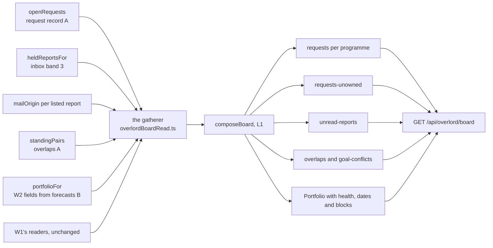

# Overlord W2: the board's W2 parts Implementation Plan

> **For agentic workers:** REQUIRED SUB-SKILL: Use superpowers:subagent-driven-development (recommended) or
> superpowers:executing-plans to implement this plan task by task. Steps use checkbox (`- [ ]`) syntax for tracking.

**Goal:** the Overlord's one read, `GET /api/overlord/board`, carries what W2 adds to it: the requests each programme
owns, the reports no Overlord has read, the overlaps and goal conflicts between programmes, and each programme's health,
dates and what blocks it.

- **Four new parts.** Requests (per programme, with a fleet-wide list for requests that have no owner yet), Unread
  reports (fleet-wide), Overlaps and Goal conflicts (between programmes). Each is a new key, so nothing a W1 caller
  reads changes.
- **The Portfolio part gains fields.** Forecasts B adds health, the sealed dates, the edges, the critical path and the
  spend to `portfolioFor`'s entry. The board copies them into the Portfolio part as the reader answers them.
- **The board still decides nothing.** Every new part is a reader's answer, grouped and cut to a bound. The gatherer
  calls each new reader once per read, each in its own `try`, so one failed reader makes its own part `unmeasured` and
  never fails the board.

**Why:** spec §5.2 and Table 5.2a list fifteen parts. W1's board and history plan (`w1-board-history.md`) built the W1
parts and left four to W2, "because their inputs are W2's: Requests (`overlord_requests`), Unread reports (requests'
reports, §5.4), Overlaps (H23's composer and `programme_pairs`) and Goal conflicts (`programme_pairs`)". Table 5.2a's
Portfolio row also names "the health word, the median and 85% dates, and what blocks it", which W1 could not measure.
The Overlord routes from this read (§5.3): it checks overlaps before a relay, it must not relay what deepens an unruled
goal conflict, and it learns of reports that came while it was away from here and from its next card (§5.4).

**Architecture:** one pull request in lane F, all on the server. No console change: the board is served only to the
designated session (§5.2), and the operator sees goal conflicts on the home (index question 17, the home requests
piece).

| Part | File | Ring and context |
|---|---|---|
| The four parts' wire types; the Portfolio part's new fields | `shared/overlordBoard.ts` (board B2's) | L0, C5 |
| `composeBoard` gains the parts | `server/src/coord/overlordBoard.ts` (board B2's) | L1, C5 |
| The gatherer gains three readers | `server/src/coord/overlordBoardRead.ts` (board B2's) | L3, C5 |
| The handler's deps | `server/src/coord/overlordRoutes.ts` (designation A's), `server/src/index.ts` | L4, L5 |

**Tech Stack:** TypeScript (ESM), `node:sqlite`, Fastify, vitest. No new dependency, no migration, no door, no ccd verb.

**Spec:** `docs/superpowers/specs/2026-11-09-overlord-design.md`: §5.2 (C10, Table 5.2a), §5.4 (C14's "A report that
arrives while no Overlord is `ready` is recorded, shown on the board, and listed on the next card"), §5.5 (H23's
overlaps), §5.6 (goal conflicts, `portfolioFor`, health, forecasts, edges), §3.8 (H9, text a session wrote is data),
Table 11.5b (the board's read ceiling).

**The index:** `docs/superpowers/plans/2026-11-16-overlord-w2.md`: its row "Board's W2 parts" (lane F, 1 PR, 4 tasks;
needs board and history B2, request record A, overlaps A, forecasts B and inbox band 3), its question 17, and the
"Where lanes meet" bullet for `server/src/coord/overlordRoutes.ts`.

**The plans this one reads** (each piece's own plan is the authority for its interface; Task 1 re-measures every name
below on `main` before it builds):

| Plan | What this plan takes from it |
|---|---|
| `docs/superpowers/plans/2026-11-14-overlord-w1/w1-board-history.md`, PR B2 | `shared/overlordBoard.ts` (`BOARD_PART_MAP`, one type per part, `UntrustedText`), `composeBoard`, the gatherer `overlordBoardRead.ts`, the handler in `overlordRoutes.ts`, its read-ledger line and its 120-an-hour ceiling, the size test over 50 programmes |
| `w2-requests.md` (request record A, #2928) | `server/src/coord/overlordRequestStore.ts#openRequests`, `RequestRow`, the ten states, `OPEN_REQUEST_STATES` |
| `w2-overlaps.md` (overlaps A, #2923) | `server/src/coord/programmePairsStore.ts#standingPairs`, `StandingPairWire` and `standingPairWire` in `shared/programmeFacts.ts` |
| `w2-forecasts-health.md` (forecasts B, #2921) | `PortfolioEntry`'s optional `health`, `forecast`, `edges`, `spend` and `criticalPath`, and `PortfolioView.calibration` (`shared/portfolio.ts`) |
| `w2-inbox-band-3.md` (inbox band 3, run 2280's branch) | `CoordStore#heldReportsFor(limit)`, ids and times only, and its sentence "the board's W2 piece reads `heldReportsFor` for its Unread reports part" |

Written against `main` at `fe887521f` (2026-11-16). None of the five pieces is on `main` yet.

## In short

- **One pull request, four tasks:** the wire types, the composer, the gatherer, then the door-level checks.
- **Requests:** each programme's open requests, ids, states and the latest news, oldest first, at most 50 a programme.
  Open requests with no owner (a parent, or one not routed yet) are a fleet-wide list of their own.
- **Unread reports:** the reports to the Overlord that are not acked yet, from band 3's one reader, each with its
  request id, sender and subject, at most 50, with the total.
- **Overlaps and Goal conflicts:** the standing pairs from overlaps A's one reader, split by kind, with each goal
  conflict's ruling.
- **Portfolio:** the five fields forecasts B adds to `portfolioFor`'s entry, copied as answered.
- **Every text a session wrote is `UntrustedText`:** a request's summary and news, a report's subject, a pair's paths,
  an edge's reason.
- **Nothing a running session sees changes at merge** beyond the board's own answer, which only the designated session
  reads, under `overlord-v1`. Requests exist only once `overlord-route-v1` opens the doors that make them, so until
  then the Requests parts are measured and empty.

## 1. Open questions

The coordinator accepted the index's questions 2 to 23 as written; this plan builds on 12, 17 and 20, and question 24 to
29's settlements. Question 19 (the act ceilings) does not touch this piece: the board is a read and adds no act kind.
Every question below carries a recommendation, which this plan builds unless the coordinator rules otherwise. None needs
the operator.

- **BQ1. The parts' names and shapes** (slug `board-w2-parts-additive`). W1's plan fixes the rule and not the names:
  "a later part is a new key", and each W1 part is `{ state: 'measured', … }` or `{ state: 'unmeasured', reason }`.
  **Recommendation:** four rows of `BOARD_PART_MAP`, in Table 5.2a's words, each with the same two arms:

  | Key | Scope | Measured arm carries |
  |---|---|---|
  | `requests` | per programme | `requests: BoardRequest[]`, `omitted` |
  | `requests-unowned` | fleet-wide | `requests: BoardRequest[]`, `omitted` |
  | `unread-reports` | fleet-wide | `reports: BoardReport[]`, `total` |
  | `overlaps` | fleet-wide (between programmes) | `pairs: BoardPair[]`, `omitted` |
  | `goal-conflicts` | fleet-wide (between programmes) | `pairs: BoardPair[]`, `omitted` |

  *Table 1. The four W2 keys, and one for requests without an owner.* A key spelled otherwise by board B2 (its own map
  may use a different case) follows B2's spelling; the five are still five keys.

- **BQ2. Requests with no owner** (slug `unowned-requests-on-the-board`). Table 5.2a puts Requests per programme. A
  request has no owner while it is `received` and when it is a parent (§5.5: "A parent has no owner"). Those are the
  ones the Overlord must still route.
  **Recommendation:** a fleet-wide key, `requests-unowned`, with the same row shape. The per-programme part lists only
  rows whose `owner` is that programme. A request whose owner is a programme the board does not list (one retired since)
  goes in `requests-unowned` too, with its `owner` kept, so no open request drops off the read.
- **BQ3. Which requests, in what order, and how many** (slug `board-requests-open-oldest-first`). The board ranks nothing
  (W1, "it ranks nothing and filters nothing beyond that grouping"), yet a bound needs an order.
  **Recommendation:** the open requests only (`openRequests`, every state outside `done`, `failed` and `dropped`), in
  ascending id, which is the order they were opened. At most `BOARD_REQUESTS_MAX` (50) a programme and 50 unowned; past
  it, `omitted` counts the rest. Endings reach the Overlord as band 3's `request-move` rows, so the board need not list
  closed requests. Fifty is the W1 size test's own fixture count, so the bound the size test checks is the one shipped.
- **BQ4. A request row's fields** (slug `board-request-row`). §5.2 says Requests carry "their states and last news", and
  C44 says the board carries ids and one-liners only.
  **Recommendation:** `BoardRequest` is `{ id, state, owner, parentRequestId, revision, openedAt, lastNewsAt, news,
  summary, takenFrom, followUpAt, nudges, counters, dependsOn }`. `news` and `summary` are `UntrustedText` (BQ6). No row
  carries a cited message id's text, `doneTest`, `expectedPaths` or `closeNote`: the first is the operator's and the
  request record never holds it, and the Overlord reads the others through its request doors' answers. `revision` is
  carried so a door call the Overlord makes from this read can name it, and the door answers `operator-has-it` when the
  row moved (index question 5).
- **BQ5. Unread reports are the unacked ones** (slug `unread-reports-are-the-unacked`). Table 5.2a says "Reports that
  arrived while no Overlord was `ready`". Band 3 holds every report's delivery until the Overlord settles it, ready or
  not (its IB3), so a report that came while it was ready and is still unsettled is unread too.
  **Recommendation:** the part lists `heldReportsFor(BOARD_REPORTS_MAX)`'s rows, each `{ deliveryId, mailId, requestId,
  fromId, at, subject }`, oldest first, with the reader's `total`. `heldReportsFor` carries no subject (band 3's IB1:
  "the board's Requests and Unread reports parts … serve the words"), so the gatherer reads each row's subject through
  `CoordStore#mailOrigin(mailId)`, one call per listed row, at most 50. A row whose `mailOrigin` answers `null` carries
  `subject: null`, never an empty string. The words are served here, behind the board's own read-ledger line.
- **BQ6. What is untrusted** (slug `board-w2-untrusted-text`). W1's question 17 marks "text a session wrote" as data.
  **Recommendation:** these W2 fields are `UntrustedText`, each with its source:

  | Field | Written by | Source word |
  |---|---|---|
  | A request's `summary` | the Overlord, at its open door | `overlord` |
  | A request's `news` | the owning coordinator's mail subject, masked at stamping (request ids A) | `coordinator` |
  | A report's `subject` | a coordinator's mail | `coordinator` |
  | A pair's `evidence.paths` | path claims and the landing radar, each a session's own | `session` |
  | An edge's `why` (in the Portfolio part) | the coordinator's remaining-work door | `coordinator` |

  *Table 2. W2's untrusted fields.* The Overlord's own summary is untrusted too: a later generation reads it, and a
  generation that wrote an injected line must not get to promote it to an instruction. Numbers, ids, state words and
  health evidence values are typed and carry no mark.
- **BQ7. A failed reader** (slug `board-w2-unmeasured-per-input`). W1's gatherer puts each reader in its own `try`.
  **Recommendation:** the same, per new input:
  - `openRequests` throws: every programme's `requests` part and `requests-unowned` are `unmeasured`, with the reason.
    Never an empty list.
  - `heldReportsFor` throws: `unread-reports` is `unmeasured`. One `mailOrigin` that throws makes that row's subject
    `null` and adds the row's id to the part's `subjectsUnread`, so the part is still measured.
  - `standingPairs` throws: `overlaps` and `goal-conflicts` are both `unmeasured`.
  - `portfolioFor` already has its own `try` (W1). A field forecasts B answers as absent stays absent: the Overlord reads
    absence as "not measured on this server", as the console does (forecasts B's "Wire: additive").
- **BQ8. Pairs: which, and how many** (slug `board-pairs-standing-only`). `standingPairs` answers the episodes that
  stand, goal conflicts first and unruled before ruled (overlaps B's Task 7 order).
  **Recommendation:** the board splits them by `kind` and keeps that order inside each part, with at most
  `BOARD_PAIRS_MAX` (50) a part and `omitted` past it. `BoardPair` is `StandingPairWire` with `evidence.paths` marked
  untrusted. A goal conflict carries its `ruled` (`{ choice, at, by }`, `'unreadable'` or `null`) as the reader answers
  it, so the Overlord sees whether the operator ruled, and which way, before it relays (§5.3's `goal-conflict-open`).
  The board never evaluates a pair: the relay's refusal is the relay piece's, through `relayConflictVerdict`.
- **BQ9. The Portfolio part copies, and computes nothing** (slug `board-portfolio-copies-the-entry`). §5.6 has the
  board answer "the health word, the median and 85% dates, and what blocks it".
  **Recommendation:** the board's Portfolio part carries `health`, `forecast`, `edges`, `criticalPath` and `spend` from
  each `PortfolioEntry` unchanged, and the view's `calibration` once. "What blocks it" is the entry's `edges` (with
  `clearingShipped`, so a list "clearing not shipped" is read as such) and `criticalPath`. The board adds no field of
  its own, and never calls `programmeHealth` or `forecastProgramme` (forecasts B's question 7).
- **BQ10. No new census row, no new door** (slug `board-w2-no-new-door`). **Recommendation:** the handler, its gate
  order, its ceiling (120 an hour), its read-ledger line (door `board`, scope `fleet`, the programme count) and its
  masking (`MASKED_GET_ROUTES`) stay as board B2 built them. The ledger line's count stays the programme count: a
  reader of the ledger compares reads, and a count that changed meaning in W2 would break that comparison.

## 2. What exists today

Measured on `main` at `fe887521f`.

| What | Where | What this plan does with it |
|---|---|---|
| The history half of the board and history piece (PR A, #2841): the history op and its wire | `shared/overlordHistory.ts`, `agent/src/historyOp.ts`, `ccd/history/overlord-read.mjs` | Nothing: this plan does not touch history |
| The portfolio reader and its wire | `server/src/coord/portfolio.ts#portfolioFor`, `shared/portfolio.ts#PortfolioEntry`, `#PortfolioView` | The Portfolio part's source; forecasts B widens both |
| A mail row's subject and sender by id | `server/src/coord/store.ts` (`CoordStore#mailOrigin`) | The Unread reports part's words (BQ5) |
| The claim conflict type the overlaps composer reads | `shared/api.ts#ClaimConflict` | Read by overlaps A, not here |
| The masked GET list | `server/src/server.ts#MASKED_GET_ROUTES` | Board B2 adds the board; no change here |
| The time-port census scope, which already covers `server/src/**/overlord*.ts` and `shared/overlord*.ts` | `server/test/single-definition/time-ports.test.ts` | No new row: no new file |
| The mutation floors | `server/test/sim/mutation-floors.test.ts#MUTANT_SETS`, `server/test/sim/mutation-floors.json` | `composeBoard`'s set gains mutants (Task 2) |

**Not on `main`, taken from the plans that build them:** `shared/overlordBoard.ts`, `server/src/coord/overlordBoard.ts`,
`server/src/coord/overlordBoardRead.ts` and the board's handler (board B2); `server/src/coord/overlordRoutes.ts`
(designation A); `openRequests` (request record A); `standingPairs` (overlaps A); `PortfolioEntry`'s W2 fields
(forecasts B); `heldReportsFor` (inbox band 3).


*Figure 1. The board's W2 inputs. Each new reader is called once per read, in its own `try`. `composeBoard` groups and
cuts, and decides nothing.*

## 3. Global constraints

- **Architecture (`CLAUDE.md`).**
  - **Decide nothing.** `composeBoard` stays a composer (W1): it groups by slug, splits pairs by kind, cuts at the
    bounds and marks untrusted text. It ranks, filters and evaluates nothing else.
  - **One reader per fact.** Requests through `openRequests`, reports through `heldReportsFor`, pairs through
    `standingPairs`, the portfolio through `portfolioFor`. No second query of `overlord_requests`, `programme_pairs` or
    the mail tables is written here.
  - **No overloaded null.** A failed reader is its part's `unmeasured`, never an empty list (BQ7). A subject that could
    not be read is `null` with the row named in `subjectsUnread`, and a field forecasts B did not answer stays absent.
  - **Rings.** `shared/overlordBoard.ts` imports nothing. `overlordBoard.ts` imports `shared/` only.
    `overlordBoardRead.ts` takes every reader as an injected dependency.
- **Wire: additive.** Five new keys and five new optional Portfolio fields. Nothing a W1 caller reads changes, and no
  W1 field changes type. `FLEET_PROTO` is not bumped.
- **What a merge arms.** Only the board's answer changes, and only the designated session reads it, under `overlord-v1`.
  The Overlaps, Goal conflicts and Portfolio additions carry rows from the merge (index, "What a merge arms"). Requests
  and reports carry rows only once `overlord-route-v1` opens the doors that make them.
- **Size.** Board B2's size test over 50 programmes stays green with every W2 part at its bound (Task 4).
- **SAFETY.** No ccd verb, no fleet act, no live `~/.ccrc`. Tests build `coord.db` in memory or under the per-run temp
  root.
- **Growth.** No growth-checked file is touched except, possibly, `server/src/index.ts`'s deps (not growth-checked).
  `server/src/server.ts`, `server/src/coord/routes.ts`, `server/src/coord/store.ts`, `shared/api.ts` and
  `pwa/src/lib/api.ts`: 0.
- **Mutation floors.** `composeBoard`'s set, which board B2 adds to `MUTANT_SETS`, gains the mutants of Task 2, and its
  floor in `server/test/sim/mutation-floors.json` is raised to the measured score.
- **Public repository.** Fixtures use `prog-a`, `prog-b`, `lane-a-coordinator` and `lane-a-overlord`. No private name.
  No D-number is invented: departures are slugs under "Deviations found".
- **Tests.** From `server/`, in the foreground, one file at a time:
  `ccrc test -- ./node_modules/.bin/vitest run test/<file>.test.ts`. Each task ends with
  `ccrc test -- npx tsc --noEmit -p tsconfig.json` and `ccrc test -- npx tsc --noEmit -p test/tsconfig.tests.json` in
  `server/`, and, for a `shared/` change, `ccrc test -- ./node_modules/.bin/tsc --noEmit` in `pwa/`.

## 4. Review focus

1. A failed new reader makes its own part `unmeasured`, never an empty list, and never fails the board.
2. Every field Table 2 names is `UntrustedText`, and no field carries an operator message's text, a `doneTest`, a
   `closeNote` or a report's body.
3. `composeBoard` decides nothing: no sort but the stated ones, no filter but the owner grouping and the bounds.
4. The board's answer for 50 programmes with every W2 part full stays inside board B2's size bound.
5. Nothing a W1 caller reads changes.

## 5. The PR split

| PR | Tasks | What it ships | Needs first | Growth-checked files, estimate |
|---|---|---|---|---|
| The board's W2 parts | 1 to 4 | The five keys and the Portfolio fields on the wire; `composeBoard`'s new parts; the gatherer's three readers; the size and door checks | board and history B2, request record A, overlaps A, forecasts B, inbox band 3 | none: `server/src/server.ts` 0, `server/src/coord/routes.ts` 0, `server/src/coord/store.ts` 0, `shared/api.ts` 0, `pwa/src/lib/api.ts` 0 |

For scale, the files that are not growth-checked change by about this much: `shared/overlordBoard.ts` +90;
`server/src/coord/overlordBoard.ts` +80; `server/src/coord/overlordBoardRead.ts` +50;
`server/src/coord/overlordRoutes.ts` +4 (the deps); `server/test/overlord-board.test.ts` +220;
`server/test/overlord-board-door.test.ts` +60; the mutation set +40.

## 6. Tasks

### Task 1: The parts on the wire (L0)

**Files:**
- Modify: `shared/overlordBoard.ts` (`BOARD_PART_MAP` gains the five keys of Table 1; `BoardRequest`, `BoardReport`,
  `BoardPair`, the five parts' types; the Portfolio part's type gains `health?`, `forecast?`, `edges?`,
  `criticalPath?`, `spend?` and the view's `calibration?`, each typed from `shared/portfolio.ts`; `BOARD_REQUESTS_MAX`,
  `BOARD_REPORTS_MAX` and `BOARD_PAIRS_MAX`, each 50)
- Modify: `server/test/overlord-board.test.ts` (the wire's own cases)

**Interfaces:**

```ts
// shared/overlordBoard.ts (L0, C5). RequestState, StandingPairWire and PairEvidence come from
// shared/overlordRequests.ts and shared/programmeFacts.ts under board B2's import rule (below).
export interface BoardRequest {
  readonly id: number; readonly state: RequestState; readonly owner: string | null;
  readonly parentRequestId: number | null; readonly revision: number;
  readonly openedAt: number; readonly lastNewsAt: number | null;
  readonly news: UntrustedText | null; readonly summary: UntrustedText;
  readonly takenFrom: RequestState | null; readonly followUpAt: number | null;
  readonly nudges: number; readonly counters: number; readonly dependsOn: string | null;
}
export interface BoardReport {
  readonly deliveryId: number; readonly mailId: number; readonly requestId: number;
  readonly fromId: string; readonly at: number; readonly subject: UntrustedText | null;
}
export type BoardPair = Omit<StandingPairWire, 'evidence'> & {
  readonly evidence: (Omit<PairEvidence, 'paths'> & { readonly paths: readonly UntrustedText[] }) | 'unreadable';
};
export type BoardRequestsPart =
  | { readonly state: 'measured'; readonly requests: readonly BoardRequest[]; readonly omitted: number }
  | { readonly state: 'unmeasured'; readonly reason: string };
export type BoardReportsPart =
  | { readonly state: 'measured'; readonly reports: readonly BoardReport[]; readonly total: number;
      readonly subjectsUnread: readonly number[] }
  | { readonly state: 'unmeasured'; readonly reason: string };
export type BoardPairsPart =
  | { readonly state: 'measured'; readonly pairs: readonly BoardPair[]; readonly omitted: number }
  | { readonly state: 'unmeasured'; readonly reason: string };
```

Whether `shared/overlordBoard.ts` imports the request and pair types by type-only import or restates them is board
B2's rule for its own file (it "imports nothing"); a type-only import emits no code, so the step measures B2's census
first and follows it.

- [ ] **Step 1: Re-measure the inputs.** On `main`, read `shared/overlordBoard.ts`'s `BOARD_PART_MAP` spelling, the
  W1 part shape and `UntrustedText`'s constructor; `overlordRequestStore.ts#openRequests` and `RequestRow`;
  `programmePairsStore.ts#standingPairs` and `StandingPairWire`; `PortfolioEntry`'s W2 fields; and
  `CoordStore#heldReportsFor`'s row type. If any name differs from this plan, use `main`'s and record the difference
  under "Deviations found" in the pull request's notes file.
- [ ] **Step 2: Failing tests** (`overlord-board.test.ts`, its wire block):
  - `BOARD_PART_MAP` lists the five new keys and every W1 key unchanged (a characterization of the W1 keys first,
    green on `main` before this task's edit);
  - each new key's scope is the one Table 1 gives;
  - the three bounds are 50.
- [ ] **Step 3: Run.** `ccrc test -- ./node_modules/.bin/vitest run test/overlord-board.test.ts`. Red.
- [ ] **Step 4: Implement** the types and the map's rows. **Step 5: Run.** Green, and the three typechecks.
- [ ] **Step 6: Commit.** `feat(overlord): the board's W2 parts on the wire (Overlord W2 board)`

### Task 2: `composeBoard` composes the parts (L1)

**Files:**
- Modify: `server/src/coord/overlordBoard.ts` (`composeBoard`'s input gains `requests`, `reports` and `pairs`, each a
  reader answer or a failure; the five parts; the Portfolio part's copy)
- Modify: `server/test/overlord-board.test.ts`, and the board's mutation set (board B2's file under `server/test/sim/`)
  with `server/test/sim/mutation-floors.json`

**What `composeBoard` does with each input:**

| Input | Part | Rule |
|---|---|---|
| `requests: { ok: true, rows } \| { ok: false, reason }` | `requests` per listed programme, `requests-unowned` | Rows with `owner` equal to a listed programme's slug go to that programme; the others, `owner` null or a slug the board does not list, go to `requests-unowned`. Ascending id. Cut at 50 with `omitted`. `ok: false` makes every one of these parts `unmeasured` with the reason |
| `reports: { ok: true, rows, total, subjects } \| { ok: false, reason }` | `unread-reports` | Rows in the reader's order (oldest first), each with its subject from `subjects` (a map from mail id to text, `null`, or `'unread'`); a row whose subject is `'unread'` gets `subject: null` and its delivery id in `subjectsUnread` |
| `pairs: { ok: true, rows } \| { ok: false, reason }` | `overlaps`, `goal-conflicts` | Split by `kind`, the reader's order kept, each cut at 50 with `omitted`, `evidence.paths` marked |
| `portfolioFor`'s entry and view | Portfolio | The five fields copied when present, absent when absent; `calibration` once |

*Table 3. The composer's W2 rules. Nothing else is sorted, filtered or computed.*

- [ ] **Step 1: Failing tests** (`overlord-board.test.ts`):
  - a request owned by `prog-a` lands in `prog-a`'s part and nowhere else; one with no owner, and one whose owner is a
    programme not listed, land in `requests-unowned` with `owner` kept;
  - 53 open requests for `prog-a` answer 50 rows in ascending id and `omitted: 3`;
  - a failed requests read makes every `requests` part and `requests-unowned` `unmeasured`, never `[]`;
  - a request's `summary` and `news` are `UntrustedText` with sources `overlord` and `coordinator`; no field holds a
    `doneTest`, `expectedPaths` or `closeNote` value (the fixture's rows carry each with a marker string, and the test
    searches the whole answer for the markers);
  - reports keep the reader's order and `total`; a report whose subject read failed has `subject: null` and its id in
    `subjectsUnread`, and the part stays measured; a failed reports read makes the part `unmeasured`;
  - pairs split by kind keep the reader's order; a goal conflict carries `ruled` as read, `null`, a ruling and
    `'unreadable'` each passed through unchanged; `evidence.paths` are marked, and `evidence: 'unreadable'` passes
    through; a failed pairs read makes both parts `unmeasured`;
  - the Portfolio part carries each of the five fields when the entry has it, and lacks it when the entry lacks it
    (an absent field is never `null` and never `[]`); `calibration` appears once;
  - every W1 part's answer is unchanged for a fixture with no W2 input (the characterization, green on `main` first).
- [ ] **Step 2: Run.** Red. **Step 3: Implement.** **Step 4: Run.** Green, and the typechecks.
- [ ] **Step 5: Mutation.** Add to `composeBoard`'s set, each a named mutant, and run
  `ccrc test -- ./node_modules/.bin/vitest run test/sim/mutation-floors.test.ts`:
  - W2-1: read a failed requests read as `[]`;
  - W2-2: drop the untrusted mark on `news`;
  - W2-3: file an unowned request under the first programme;
  - W2-4: cut requests newest first;
  - W2-5: read a failed pairs read as `[]`;
  - W2-6: copy a portfolio field that is absent as `null`;
  - W2-7: drop a report whose subject read failed.

  Each must be killed. Raise the set's floor in `mutation-floors.json` to the measured score.
- [ ] **Step 6: Commit.** `feat(overlord): composeBoard composes requests, reports, pairs and the portfolio's W2 fields (Overlord W2 board)`

### Task 3: The gatherer reads the new inputs (L3)

**Files:**
- Modify: `server/src/coord/overlordBoardRead.ts` (three injected readers: `openRequests`, `heldReportsFor` with
  `mailOrigin`, `standingPairs`; each in its own `try`)
- Modify: `server/src/coord/overlordRoutes.ts` (the handler passes the three readers through the deps it already
  builds), `server/src/index.ts` only if board B2 wires the gatherer's deps there
- Create: `server/test/overlord-board-read-w2.test.ts`

- [ ] **Step 1: Failing tests** (`overlord-board-read-w2.test.ts`, over an in-memory `coord.db` with request record A's,
  overlaps A's and band 3's migrations, and stub readers where a fault is injected):
  - one gather calls `openRequests`, `heldReportsFor` and `standingPairs` once each (counted by spies), and
    `mailOrigin` once per listed report and never past 50;
  - `heldReportsFor` is called with `BOARD_REPORTS_MAX`;
  - each reader that throws yields its own `{ ok: false, reason }` and the other two still answer;
  - a `mailOrigin` that throws for one mail id yields `'unread'` for that id only;
  - the gather never reads `overlord_requests`, `programme_pairs` or the mail tables by SQL of its own (a census over
    the file's source for `FROM overlord_requests`, `FROM programme_pairs` and `FROM mail`);
  - the gather reads the time only through `deps.now()` (W1's rule).
- [ ] **Step 2: Run.** `ccrc test -- ./node_modules/.bin/vitest run test/overlord-board-read-w2.test.ts`. Red.
- [ ] **Step 3: Implement.** **Step 4: Run.** Green; then `test/overlord-board.test.ts`,
  `test/single-definition/time-ports.test.ts`, `test/rings/*.test.ts` and the typechecks.
- [ ] **Step 5: Red check.** Let the reports reader's throw fail the whole gather: its case reds. Read the requests
  table directly in the gatherer: the census case reds. Revert each.
- [ ] **Step 6: Commit.** `feat(overlord): the board's gatherer reads requests, held reports and standing pairs (Overlord W2 board)`

### Task 4: The door's answer, its bound and the last runs

**Files:**
- Modify: `server/test/overlord-board-door.test.ts` (board B2's door suite)

- [ ] **Step 1: Failing tests** (over the real handler, as board B2's door suite builds it):
  - a designated session with its card read gets the five new keys, and an older W1 fixture's answer still parses with
    W1's own readers (the additive rule);
  - with 50 programmes, 50 requests each, 50 unowned, 50 reports and 50 pairs of each kind, the answer stays inside
    board B2's size bound, and each part's `omitted` counts the overflow;
  - the read-ledger line is unchanged: door `board`, scope `fleet`, the programme count, one line per read;
  - every refusal of the gate order (`not-the-overlord`, `capability-missing`, `card-unread`, `renewing`,
    `overlord-off`, `read-ceiling`) answers before any W2 reader is called (spies at zero);
  - a request's `news` that holds a secret-shaped token comes back masked (the board is a masked GET).
- [ ] **Step 2: Run.** Red where the new parts are expected; implement nothing new unless a case reds for a reason
  Tasks 1 to 3 missed. **Step 3: Run.** Green.
- [ ] **Step 4: The last runs** (from `server/`, one file at a time): the docs guards `anchors`, `citations`, `dtbd`,
  `docs-grammar`, `topology-clean`, and `deviation-refs` after `git fetch origin main`; `growth-check`;
  `single-definition/*.test.ts`; `rings/*.test.ts`; `box-token-census`; `auth-gate`; `secret-mask`; the mutation floors;
  and the typechecks in `server/` and `pwa/`. Expected: PASS.
- [ ] **Step 5: Commit.** `test(overlord): the board's W2 parts at their bounds, behind the gate (Overlord W2 board)`
- [ ] **Step 6: Before the push.** Merge `main` once if a sibling piece in `overlordRoutes.ts` landed first (worker
  clause 16), re-run the files above, run the private-name scan over every changed file, then push once (clause 20).

## 7. Deviations found

By slug; the coordinator mints the numbers (cross-plan ruling X9).

- **`board-w2-parts-additive`**: the five keys and their two arms, in Table 5.2a's words (BQ1).
- **`unowned-requests-on-the-board`**: a fleet-wide part for open requests with no owner, or an owner the board does not
  list, which Table 5.2a does not name (BQ2).
- **`board-requests-open-oldest-first`**: open requests only, ascending id, 50 a programme (BQ3).
- **`board-request-row`**: the request row's fields, and what it never carries (BQ4).
- **`unread-reports-are-the-unacked`**: the part lists every unacked report, a superset of Table 5.2a's "arrived while no
  Overlord was `ready`", with its subject read here (BQ5).
- **`board-w2-untrusted-text`**: the Overlord's own summary is untrusted too (BQ6).
- **`board-pairs-standing-only`** and **`board-portfolio-copies-the-entry`**: the board copies its readers' answers and
  evaluates nothing (BQ8, BQ9).

## 8. What the index should change

- **Table W2, the row "Board's W2 parts":** "Requests (per programme, and `requests-unowned` for open requests with no
  listed owner), Unread reports (every unacked report, from band 3's `heldReportsFor`, each subject read through
  `mailOrigin`), Overlaps and Goal conflicts (overlaps A's `standingPairs`, split by kind, with each ruling), each a new
  key with a measured and an unmeasured arm, cut at 50 with a count; the Portfolio part's `health`, `forecast`, `edges`,
  `criticalPath`, `spend` and `calibration`, copied from `portfolioFor`; `shared/overlordBoard.ts` gains the parts
  additively". Size unchanged: 1 PR, 4 tasks.
- **"Where lanes meet", `server/src/coord/overlordRoutes.ts`:** the board's W2 parts change no handler; they pass three
  readers into the board's existing deps.
- **"States W3 may read":** the board's W2 keys and their two arms, for W3's Engagement and Attention parts to sit
  beside.

## 9. Where things stand

**Agreed:**
- From the brief and the index: lane F, one pull request, after board B2, request record A, overlaps A, forecasts B and
  inbox band 3; the board is the Overlord's view, and the operator rules goal conflicts on the home (index question 17).
- From W1: the board composes and decides nothing; a later part is a new key; a failed input is its part's
  `unmeasured`; text a session wrote is data.

**Waiting on the coordinator** (at this plan's review): BQ1 to BQ10 stand as recommendations. The two that change what
the Overlord sees are BQ2 (a fleet-wide part for unowned requests) and BQ5 (every unacked report, with its subject).

**Waiting on the operator:** nothing.

**Later:**
- W3 adds Engagement and Attention, each a new key.
- If routing needs it, the skill's routing reference names the Overlaps and Goal conflicts parts as the pre-relay
  check; the skill shipped whole in W1 and names `board` as one read, so no reference changes here.
