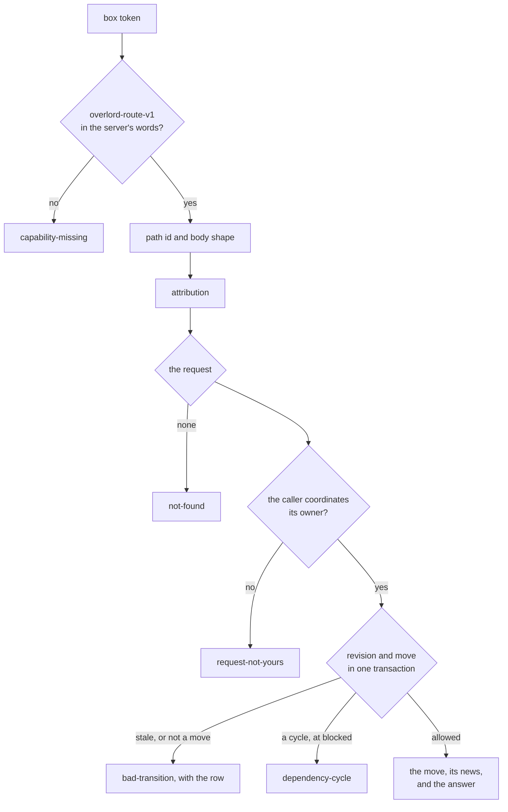
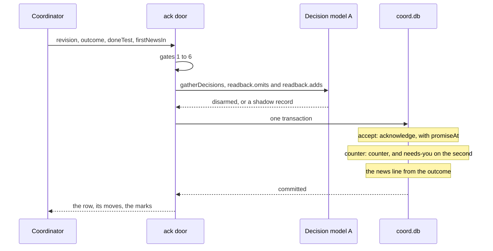
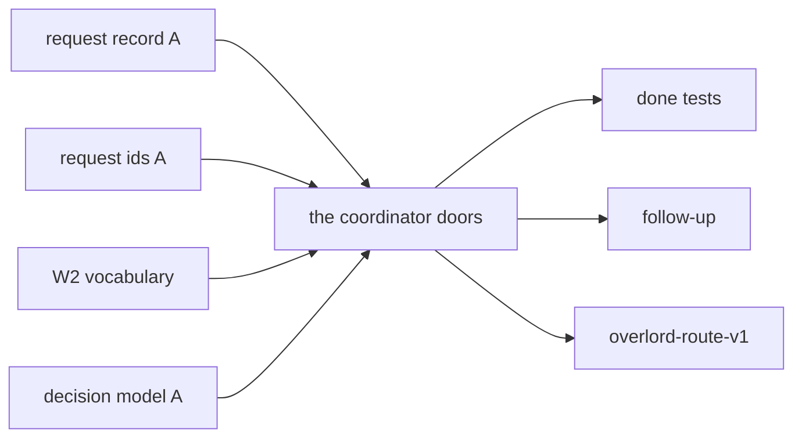

# Overlord W2: the coordinator's request doors Implementation Plan

> **For agentic workers:** REQUIRED SUB-SKILL: Use superpowers:subagent-driven-development (recommended) or
> superpowers:executing-plans to implement this plan task by task. Steps use checkbox (`- [ ]`) syntax for tracking.

## In short

- **What this is.** The plan for the W2 piece "Coordinator request doors" (the W2 index, Table W2, lane R). A request
  is a contract with one owner (spec §5.5, H22). These four doors are how the owning coordinator answers it. One pull
  request, five tasks.
- **The doors.** `POST /api/requests/:id/ack`, `decline`, `blocked` and `failed` (index question 7), in the new
  `server/src/coord/requestRoutes.ts`. Each takes the box token, checks attribution, and checks that the caller
  coordinates the request's owning programme.
  - **`ack`, the read-back.** It restates the outcome in one line, accepts the done test or counters it, and promises
    first news within seven days. A second counter moves the request to `needs-you`.
  - **`decline`** takes a reason from a closed list. **`blocked`** names what the request waits on, and refuses
    `dependency-cycle`. **`failed`** ends the request with the owner's note.
  - Their `ccrc-api` verbs: `request ack`, `request decline`, `request blocked` and `request failed`.
- **The read-back flags.** The read-back is handed to the decision model's `readback.omits` and `readback.adds` rows.
  While those rows are in shadow, their answers are records only (index question 11).
- **What changes at merge.** Nothing a running session sees. Each door refuses `capability-missing` naming
  `overlord-route-v1` until that word ships, and no request exists before then.
- **What the reader must check.** Twelve open questions (§2), each with a recommendation. None is for the operator.
  One needs the coordinator's eye: which word a stale revision answers (RD7).

## 1. Goal, scope and the rulings this plan builds on

This section says what the piece builds, why, and which rulings it builds on.

**Goal:** the owning coordinator answers a relayed request through typed doors, never through free mail. Each answer
moves the request through the request record's one move writer, so the Requests list and the Overlord's inbox are true
without the Overlord reading prose.

**Why:** H22 (§5.5): "Mail's `acked` state proves receipt, not understanding. So the owner answers a relay with
`ccrc-api request ack`. It restates the outcome in one line, accepts the done test or counter-proposes, and says how
soon first news is due." "Two counter-proposals move the request to `needs-you`." "`declined`, with a reason from a
closed list … `blocked`, on a named request or programme. `failed`." "The `blocked` door refuses a cycle." "The
coordinator's request doors have their own prefix … guarded by 'the caller is the owning programme's coordinator'. They
are box-token doors and join the census (§11.2)."

**Architecture.** Context C5 (Coordination) owns the doors, their deciders and the moves.

| Ring | File | What it holds |
|---|---|---|
| L0 | `shared/overlordRequests.ts` (request record A's) | `DECLINE_REASONS`, `READBACK_BOUNDS`, `FIRST_NEWS_MAX_MS` (seven days), the move reasons `two-counters` and the four decline words |
| L1 | `server/src/coord/requestAnswers.ts` (new) | `ackBodyOf`, `declineBodyOf`, `blockedBodyOf`, `failedBodyOf`; `counterVerdict`; `dependencyCycle` |
| L3 | `server/src/coord/overlordRequestStore.ts` (request record A's) | `dependencyEdges`, the read `dependencyCycle` takes |
| L4 | `server/src/coord/requestRoutes.ts` (new, or request record's if it landed first) | The four handlers and `registerRequestRoutes` |
| L5 | `server/src/index.ts` | The doors' deps |

*Table 1. Where the code goes.*

**The rulings this plan builds on.** The coordinator accepted every recommendation of the W2 index's questions 2 to
23, and questions 24 to 28 are settled. This plan builds on these:

- **Q7:** the paths `POST /api/requests/:id/ack`, `decline`, `blocked` and `failed`, each gated by the box token,
  attribution and the owner. They register from `server/src/coord/requestRoutes.ts`, a lane source of its own for every
  census.
- **Q11:** `readback.omits` and `readback.adds` ship `off`. While a row is `off` it is not asked. In `shadow` its answer
  is a record only, and no inbox row is written.
- **Q6:** `dependency-cycle` and `request-not-yours` reach `shared/refusal.ts#OVERLORD_REFUSALS` with the W2
  vocabulary. This plan reads them from the group.
- **Q13:** the done-test predicates and their one reader are the done tests piece's. This plan treats a done test and a
  counter's proposal as opaque.
- **Q23:** this plan is written now, against plans not yet built, and takes each interface from the plan that defines
  it.
- **The request record's RQ14:** `requestRoutes.ts` is created by the first piece that registers a route in it, the
  coordinator doors or the operator's request doors, with every census site.
- **The brief's binding text:** the doors take the box token, attribution and ownership (Q7), and the read-back flags
  are records only while their rows are in shadow (Q11).

## 2. Open questions

Each question carries a recommendation, which this plan builds unless the coordinator rules otherwise. None needs the
operator: each is an implementation choice under a direction the spec already gives.

- **RD1. The gate order.** **Recommendation**, the order of `server/src/coord/coordCallsRoute.ts`, with two steps
  added:
  1. The box token, before any await (`requireMailToken`, 401 `unauthenticated`).
  2. The capability word: `overlord-route-v1` not in the server's words answers 501 `capability-missing`, naming it
     (RD2).
  3. The path's id and the body's shape (`bad-request`, `too-large`).
  4. Attribution (`requireAttribution`, its own words).
  5. The request: `not-found` (404) when there is none; a read that throws is 503 `run-unreadable`.
  6. The owner (RD3): `request-not-yours` (403).
  7. The revision (RD7), then the move through `moveRequestInTx`, which re-decides the move inside the transaction.
- **RD2. The capability word is checked by the server, and by the client.** §11.4: "`ccrc-api request ack` and the act
  read land in W2. Until then each refuses `capability-missing`, naming `overlord-route-v1`." **Recommendation:** the
  doors take `serverCaps: ReadonlySet<string>` as a dependency, wired to `shared/api.ts#SERVER_CAPS` in production so a
  test can widen it (the ladder plan's ruling F12). `ccrc-api` refuses the four verbs unsent when a current cap file
  omits the word, as it does for `calls-v1`.
- **RD3. The owner is the programme's coordinator** (the request ids plan's RI2). **Recommendation:** the caller passes
  when the request has an owner and `CoordStore.claimsProgramme(byId, owner)` is true. A request with no owner is
  nobody's. A worker of the owning programme is refused, since only the coordinator answers a relay (§5.5). The detail
  names no other programme (H23).
- **RD4. The read-back's body** (slug `readback-body-fields`). **Recommendation:**

  | Field | Shape | Required |
  |---|---|---|
  | `revision` | The request's revision the coordinator read (RD7) | yes |
  | `outcome` | One line, 1 to 200 characters, masked: the outcome in the owner's words | yes |
  | `doneTest` | `'accept'`, or `{ counter: { proposed, why } }` | yes |
  | `firstNewsIn` | A duration in minutes, 1 to 10,080 (seven days, `FIRST_NEWS_MAX_MS`); the server stamps the time | with `accept` |

  An accept moves `acknowledge` (`routed` to `in-progress`) and passes `promiseAt = now + firstNewsIn` to the move
  writer, which sets `followUpAt` from it (the request record's RQ6). The outcome becomes the request's news line,
  through request ids A's `stampRequestNewsInTx`, in the same transaction. A counter moves `counter` and carries no
  promise: the next step is the Overlord's re-relay.
- **RD5. A counter's proposal is stored, opaque, on the request** (slug `counters-store-the-proposal`). Table 5.1a's
  `counters` is "Counter-proposals received in the read-back", and the Overlord must read the proposal to re-relay.
  **Recommendation:** `counters` is a JSON list of `{ at, proposed, why }`: `proposed` is the counter's done test, a JSON
  value of at most 2,048 bytes checked for shape only until the done tests piece checks it against its vocabulary;
  `why` is 1 to 600 characters, masked. The move writer appends the entry on the `counter` move, so the request
  record's `REQUEST_MOVE_FIELDS.counter` gains `counters` (append-only). This is the coordinator's text, never the
  operator's.
- **RD6. The second counter moves the request to `needs-you` in the same transaction.** §5.5: "Two counter-proposals
  move the request to `needs-you`." **Recommendation:** `counterVerdict(countersBefore)` (L1) answers `stay` for the
  first and `needs-you` for the second. On `needs-you` the door makes two moves in one transaction: `counter`, then
  `needs-you` with the reason `two-counters`, so the move rows say what happened in order. A counter after a re-relay
  counts toward the two: the spec counts proposals, not rounds.
- **RD7. A stale revision answers `bad-transition`, with the row** (slug `owner-stale-revision-is-bad-transition`). The
  Overlord can re-relay a request while the coordinator reads it (a self-loop on `routed` that changes the done test),
  and an `ack` must accept the test the coordinator read. `operator-has-it` is the Overlord's word for the operator's
  hold and does not fit an owner. **Recommendation:** `ack` and `decline` carry `revision`. A stale one answers 409
  `bad-transition` with the detail `stale-revision`, the current row and its last move. The coordinator's next act is
  the same as for any `bad-transition`: read the row it was handed, then answer again. So no word is added. `blocked`
  and `failed` act on `in-progress`, which no Overlord move changes in place, so they carry no revision.
- **RD8. Decline's closed reasons.** §5.5: "outside its goals, in conflict with a goal, impossible, or a duplicate".
  **Recommendation:** `DECLINE_REASONS`: `outside-goals`, `goal-conflict`, `impossible` and `duplicate`, as an L0 key
  map, each also a word of `REQUEST_MOVE_REASONS` carried on the `decline` move row. An optional `duplicateOf` (a
  request id that must exist, else `reference-unknown`) goes with `duplicate` only. An optional note, 1 to 600
  characters, masked, becomes the request's news line, led by "duplicate of request <id>" when `duplicateOf` is given,
  since a move row holds no text.
- **RD9. `blocked` names one dependency, and refuses only a cycle** (slug `blocked-refuses-cycles-only`).
  **Recommendation:** the body's `dependsOn` is `request:<id>` or `programme:<slug>`, stored as the request record's
  `dependsOn`. An unknown request or programme answers `reference-unknown` (400), the word Table 11.6 gives a reference
  that names no row. A dependency that has already ended is accepted: the done tests piece unblocks a request "when a
  request enters `blocked`" too (§5.5), so the door does not judge it. The request itself, or its own programme, is a
  cycle.
- **RD10. A cycle runs through requests and their programmes** (slug `dependency-graph-requests-and-programmes`).
  §5.5 says only "the dependency would close a cycle". A request waits on a request or on a programme, and a programme
  cannot finish while its own requests wait. **Recommendation:** `dependencyCycle(edges, from, to)` (L1) walks a graph
  whose edges are:
  - each `blocked` request to what it depends on;
  - each programme to every `blocked` request it owns.

  It answers `cycle` with the path, or `none`. It carries a visited set, so a cycle already planted (from a restore) is
  reported and never loops. The edges are read inside the move's transaction, so two racing `blocked` calls cannot
  both pass. Remaining work's `programme_edges` are statements of plan, not waits, and are not read.
- **RD11. `failed` needs the owner's note.** **Recommendation:** a note of 1 to 600 characters, masked, written as the
  request's `closeNote`, since `failed` is terminal and every terminal move sets `closeNote` (the request record's
  `REQUEST_MOVE_FIELDS`).
- **RD12. The read-back flags are gathered before the transaction, and recorded only** (index question 11).
  **Recommendation:** the `ack` door calls decision model A's `gatherDecisions` before its transaction, with the rows
  `readback.omits` and `readback.adds`. Their inputs are the request's `summary` and `doneTest` and the read-back's
  `outcome` and `doneTest` answer, all words of the Overlord or of the coordinator. The operator's cited words are not
  an input, so the rows are not private-state rows (index question 10). With a row `off`, the check is `disarmed` and
  costs nothing. In `shadow` the answer is the decision model's record only: the door writes no inbox row and changes
  no move. Arming a row (an inbox flag) is the operator's act on an admitted line (question 29), and the inbox band 3
  piece serves the flag once it is armed.

## 3. What exists today

Measured on `main` at `7ab4d41f5` (2026-11-16), each cited by symbol. None of the pieces this plan builds on is merged:
the request record is in review (#2928), and the W2 vocabulary, request ids and decision model A are planned.

| What | Where | What this plan does with it |
|---|---|---|
| A box-token coordinator door in its own file: not configured, token, slug, attribution, `claimsProgramme`, insert | `server/src/coord/coordCallsRoute.ts#registerCoordCallsRoute` | The model for `requestRoutes.ts` |
| Its registration | `server/src/coord/routes.ts` calls `registerCoordCallsRoute(app, { … })` | One line beside it for `registerRequestRoutes` |
| The refusal helper | `server/src/refuse.ts#refuseRoute(reply, word, { detail })` | Every refusal |
| The ownership test | `server/src/coord/store.ts#CoordStore.claimsProgramme` | RD3 |
| Attribution | `routes.ts`'s `requireAttribution`, `attributionVerdict` | RD1's step 4 |
| The masker | `server/src/accounts/mask.ts#maskText` | Outcome, notes, `why` |
| Words | `shared/refusal.ts#GENERIC_REFUSALS` (`not-found`, `bad-transition`, `bad-request`, `too-large`, `run-unreadable`); the note group's `reference-unknown`; `OVERLORD_REFUSALS`'s `capability-missing` (501) | Reused (RD1, RD7, RD9) |
| `dependency-cycle`, `request-not-yours` | `server/test/single-definition/refusal-table.data.json`'s `waveMap`, `W2` | Read once the W2 vocabulary moves them |
| The server's capability words | `shared/api.ts#SERVER_CAPS`, derived from `SERVER_CAP_MAP` (not exported); no server route refuses `capability-missing` today | RD2 |
| The client | `ccd/ccrc-api` `ROUTES`, 84 rows; `calls.record`'s identity splice and its `calls-v1` cap gate | Four rows, each with the same splice and an `overlord-route-v1` gate |
| The coordination path rule | `server/test/coord-routes-single-file.test.ts#COORD_PREFIXES` does not include `/api/requests` | No `OWN_FILE_ROUTES` entry is needed |
| The censuses a lane source joins | `server/src/auth/gate.ts#EXEMPT`; `server/test/auth-gate.test.ts` (`ROUTES`, the per-file count, the files' count prose); `server/test/box-token-census.test.ts` (a `*_SRC` read, `lanesIn`, `ALL_LANES`, the length identity, the number words); `server/test/rings/fastify-l4.data.ts`; `server/test/secret-mask.test.ts` (scans every `app.post('/…'` itself); the `CLAUDE.md` box-token bullet | §6 |
| The coordinator skill's verb list | `ccd/coordinator-skill/references/api.md` | Gains the four verbs |

*Table 2. What exists today.*

**From the plans not yet built** (each taken from the plan that defines it, as the index asks):

- **Request record A** (`w2-requests.md`, #2928): `REQUEST_TRANSITIONS` with `acknowledge`, `counter`, `decline`,
  `block`, `fail` (actor `owner`) and `needs-you` (actor `server`); `moveRequestInTx(db, { id, move, actor, actorId,
  at, expectRevision, reason, actId, promiseAt, set })`, answering `stale-revision` with the row and its last move;
  `requestById`; `REQUEST_MOVE_FIELDS`; `REQUEST_MOVE_REASONS`, to which "each later piece adds its own words";
  `followUpAfterMove`, which takes the read-back's promise.
- **Request ids A** (`w2-request-ids.md`): `stampRequestNewsInTx`, and `requestOwnerOf`.
- **Decision model A** (`w2-decision-model.md`, #2922): `gatherDecisions`, run before the act's transaction and asking
  only a row in `shadow` or `armed`; the rows `readback.omits` and `readback.adds`.
- **The W2 vocabulary** (`w2-vocabulary.md`): `dependency-cycle` (409) and `request-not-yours` (403).

## 4. The doors

This section gives each door's body, its move and its answer.

| Door | Body | Move, from, to | Writes beside the move | Answer |
|---|---|---|---|---|
| `POST /api/requests/:id/ack` | `revision`, `outcome`, `doneTest`, `firstNewsIn` (RD4) | accept: `acknowledge`, `routed` to `in-progress`; counter: `counter`, stays `routed` (and `needs-you` on the second, RD6) | The news line; on a counter, the `counters` entry | The row, its moves this call, and the read-back's decision marks |
| `POST /api/requests/:id/decline` | `revision`, `reason`, `duplicateOf`, `note` | `decline`, `routed` to `declined` | The news line from `note` | The row and its move |
| `POST /api/requests/:id/blocked` | `dependsOn` | `block`, `in-progress` to `blocked` | `dependsOn` | The row and its move |
| `POST /api/requests/:id/failed` | `note` | `fail`, `in-progress` to `failed` | `closeNote` | The row and its move |

*Table 3. The four doors. Every body names `byId` and `byUuid`, which `ccrc-api` splices in, as for `calls.record`.*


*Figure 1. One door's order. The revision, the move and the cycle are decided again inside the transaction, so a race
answers as the table says.*

**The read-back.** The `ack` door's one transaction, in order:


*Figure 2. The read-back. The decision model is asked before the transaction, as `gatherDecisions` requires. In shadow
its answer is a record and changes nothing in the transaction.*

**The deciders** (L1, `server/src/coord/requestAnswers.ts`):

```ts
export type AckBody = { revision: number; outcome: string;
  answer: { kind: 'accept'; firstNewsMs: number } | { kind: 'counter'; proposed: unknown; why: string } };
export function ackBodyOf(raw: unknown): { ok: true; body: AckBody } | { ok: false; word: 'bad-request' | 'too-large'; detail: string };
export function declineBodyOf(raw: unknown): { ok: true; body: { revision: number; reason: DeclineReason;
  duplicateOf: number | null; note: string | null } } | { ok: false; word: 'bad-request' | 'too-large'; detail: string };
export function blockedBodyOf(raw: unknown): { ok: true; dependsOn: { kind: 'request'; id: number }
  | { kind: 'programme'; slug: string } } | { ok: false; word: 'bad-request'; detail: string };
export function failedBodyOf(raw: unknown): { ok: true; note: string } | { ok: false; word: 'bad-request' | 'too-large'; detail: string };
export function counterVerdict(countersBefore: number): 'stay' | 'needs-you';
export type DependencyEdge = { from: string; to: string };   // 'request:<id>' or 'programme:<slug>'
export function dependencyCycle(edges: readonly DependencyEdge[], from: string, to: string):
  { kind: 'none' } | { kind: 'cycle'; path: readonly string[] };
```

Each body decider is first match and total, measures a text's length after masking, and never reads the clock: the
door passes `now`.

## 5. Cross-plan seams

This section names what this plan takes from other pieces, and what it hands them.

| Piece | What this plan takes or hands | Direction |
|---|---|---|
| Request record A | `moveRequestInTx`, `requestById`, `REQUEST_TRANSITIONS`, `followUpAfterMove`; `REQUEST_MOVE_FIELDS.counter` gains `counters` (RD5); `REQUEST_MOVE_REASONS` gains `two-counters` and the four decline words | takes; adds the field and the words |
| Request ids A | `stampRequestNewsInTx`, `requestOwnerOf`, and the owner test | takes |
| Request record B or the operator's request doors | `requestRoutes.ts` and its census sites, if either landed first (RQ14) | takes; else creates |
| W2 vocabulary | `dependency-cycle`, `request-not-yours` | takes |
| Decision model A | `gatherDecisions`, the `readback.*` rows | takes |
| Done tests | Reads `dependsOn` to unblock; validates a counter's `proposed` against its vocabulary; unblocks at once a request blocked on what has already ended | hands |
| Follow-up | Reads `followUpAt` set from the read-back's promise; a decline leaves the next step to the Overlord | hands |
| Inbox band 3 | Serves each move as an inbox row, which wakes the Overlord; serves the read-back flags once a row is armed | hands |
| Home requests B, the board | Read the moves, the counters and the news | hand |
| `overlord-route-v1` | Moves the word into `SERVER_CAP_MAP`, which opens these doors; checks the skill's door tables | hands |

*Table 4. The seams.*

## 6. The censuses

This section lists every site a new box-token lane source joins, measured on `main` by how `coordCallsRoute.ts` is
listed. If the request record B or the operator's request doors created `requestRoutes.ts` first, this plan adds its
four routes to each site instead of the file.

| Site | What it gains |
|---|---|
| `server/src/auth/gate.ts#EXEMPT` | Four rows, each "box-token machine lane, box token and attribution checked", with its own reason |
| `server/test/auth-gate.test.ts` | `...scanRoutes('coord/requestRoutes.ts')` in `ROUTES`; its per-file count; the files' count prose; the two exempt-set listings |
| `server/test/box-token-census.test.ts` | `REQUEST_SRC` and `REQUEST_LANES`; `ALL_LANES`; the length identity; the next number words, re-derived after merging `main` |
| `server/test/rings/fastify-l4.data.ts` | The file's row, with its reason and date |
| `server/test/secret-mask.test.ts` | Nothing by name: it scans every `app.post('/…'`. Each answer passes the write-answer hook |
| `CLAUDE.md`'s box-token bullet | One sentence naming the four doors and their file, as the coordinator call record's does, checked by the census's count words |
| `README.md`'s auth paragraph | The same sentence, if the census reads it there |
| The architecture spec's path table | Nothing: `server/src/coord/**` is C5 by its directory row (the request record's measurement) |

*Table 5. The census sites.*

Each handler is registered as `app.post('<literal path>'`, so the scanners see it.

## 7. Global constraints and review focus

This section lists the rules every task keeps and what a reviewer should check first.

**Constraints:**

- **One writer per fact.** Every move goes through `moveRequestInTx`. News goes through `stampRequestNewsInTx`. No
  handler writes a request column itself.
- **Decide in L1, act in L4.** The bodies, the counter rule and the cycle are in `requestAnswers.ts`. The handlers read,
  ask and write.
- **No act row.** These are the owner's moves, not the Overlord's acts, so `overlord_acts` is not written. The move row
  and the sequence line (stamped by the move writer) are the record.
- **No overloaded null.** A request read that throws is `run-unreadable`, never `not-found`. An unreadable decision
  model is the decision model's `unmeasured` mark, recorded, and never blocks a shadow read-back.
- **No operator words.** Every text is the coordinator's, masked. The read-back flags' inputs carry no cited message.
- **The client spells no attribution in a body** it did not splice: `ccrc-api` splices `byId` and `byUuid`.
- **Tests run one file at a time**, through `ccrc test -- ./node_modules/.bin/vitest run test/<file>` from `server/`.

**Review focus:**

1. The owner test: another programme's coordinator, a worker, and an unowned request are each refused, and the detail
   names no other programme.
2. The counter rule: the second counter makes two move rows in one transaction and lands in `needs-you`.
3. `dependencyCycle` against a self-dependency, a two-request cycle, a cycle through a programme, and a planted cycle.
4. A stale revision on `ack` writes nothing.
5. With every decision row `off`, the `ack` door makes no model call; in `shadow` it writes no inbox row.

## 8. The PR split

This section gives the pull request, its files and its growth against the 40-line cap.

| PR | Tasks | Ships | Needs first |
|---|---|---|---|
| The one PR | 1 to 5 | The four doors, their deciders, the read-back flags in shadow, the `ccrc-api` verbs, the censuses | Request record A, request ids A, the W2 vocabulary, decision model A |

*Table 6. The pull request. Its needs gain the W2 vocabulary and decision model A (§12).*

| Growth-checked file | The PR |
|---|---|
| `server/src/coord/routes.ts` | +1 (the registration line), or 0 if the file was created first by another piece |
| `server/src/coord/schema.ts`, `store.ts`, `watch.ts`, `server.ts` | 0 |
| `shared/api.ts`, `pwa/src/lib/api.ts`, `ccd/ccrc-doctor-checks` | 0 |

*Table 7. Growth. `requestRoutes.ts`, `requestAnswers.ts`, `overlordRequestStore.ts`, `ccd/ccrc-api` and `CLAUDE.md` are
not growth-checked.*


*Figure 3. The order. Done tests and the follow-up wait on these doors, and `overlord-route-v1` opens them.*

## 9. Tasks

Each task is red first, then green, then its mutation step where it adds a guard. Run every command from `server/`.

### Task 1: The vocabulary and the deciders (L0 and L1)

**Files:**
- Modify: `shared/overlordRequests.ts` (`DECLINE_REASONS` and its key map, `READBACK_BOUNDS`, `FIRST_NEWS_MAX_MS`;
  `REQUEST_MOVE_REASONS` gains `two-counters` and the four decline words; `REQUEST_MOVE_FIELDS.counter` gains `counters`)
- Create: `server/src/coord/requestAnswers.ts`, `server/test/request-answers.test.ts`, `server/test/requestAnswerCases.ts`
- Modify: `server/test/sim/requestSets.ts` and `server/test/sim/mutation-floors.json` (each decider at floor 1),
  `server/test/single-definition/time-ports.test.ts` (`TIME_PORT_FILES`), `server/test/overlord-requests-transitions.test.ts`
  (the counter's field and the reasons)

- [ ] **Step 1: Write the failing tests**, an exhaustive table per decider in `requestAnswerCases.ts`:
  - each body decider: every field missing, wrong in type, at its bound and over it, and a text that grows past its
    bound when masked;
  - `ackBodyOf`: `firstNewsIn` of 0, 1, 10,080 and 10,081 minutes; a counter with no `why`; an accept with a
    `proposed`;
  - `counterVerdict`: 0 gives `stay`, 1 and more give `needs-you`;
  - `dependencyCycle`: a self-dependency, the request's own programme, a two-request cycle, request to programme to
    request, a long chain with no cycle, a planted cycle not through `from` (answered `none` for an unrelated edge, and
    never a loop), and a property: adding an edge never turns `cycle` into `none`;
  - the vocabulary: each list equals its key map, and every move to `needs-you` still carries a reason.
- [ ] **Step 2: Run red:** `ccrc test -- ./node_modules/.bin/vitest run test/request-answers.test.ts`, then
  `overlord-requests-transitions`.
- [ ] **Step 3: Implement.** Every list is derived from its key map.
- [ ] **Step 4: Run green**, the same files, then `sim/mutation-floors`, `rings/wire-totality` and `rings/shared-imports`.
- [ ] **Step 5: Mutation.** Let `counterVerdict(1)` answer `stay`: its case reds. Drop the visited set: the planted
  cycle case times out or reds. Let `firstNewsIn` reach 10,081: its bound case reds. Restore each from a saved copy.
- [ ] **Step 6: Commit** (no push: the PR pushes once, at Task 5).

### Task 2: The routes file and the `ack` door (L4)

**Files:**
- Create (or modify, if it exists, RQ14): `server/src/coord/requestRoutes.ts` (`registerRequestRoutes`, the `ack`
  handler), `server/test/request-ack-door.test.ts`
- Modify: `server/src/coord/routes.ts` (the registration line, if this piece creates the file), `server/src/index.ts`
  (deps: `serverCaps`, the decision model's `gatherDecisions`), `server/src/coord/overlordRequestStore.ts` (nothing new
  if request ids A landed `stampRequestNewsInTx`)

- [ ] **Step 1: Write the failing tests**, against the real handler with an in-memory `coord.db` and a decision model
  double:
  - with `overlord-route-v1` missing from `serverCaps`, every call answers 501 `capability-missing` naming it, before
    the body is read;
  - no token is 401; a bad pair is attribution's word;
  - an unknown request is `not-found`; another programme's coordinator, a worker and an unowned request are each
    `request-not-yours`, with a detail that names no other programme;
  - accept: `routed` to `in-progress`, `followUpAt` is the promise, the news line is the masked outcome, one move row,
    one sequence line;
  - counter: stays `routed`, `counters` gains the entry; a second counter makes two move rows, `counter` then
    `needs-you` with `two-counters`;
  - a stale revision is 409 `bad-transition`, detail `stale-revision`, with the row and its last move, and writes
    nothing;
  - `ack` on `in-progress` is `bad-transition`;
  - with both `readback.*` rows `off`, no model call; in `shadow`, one record each and no inbox row; an `unmeasured`
    decision model answer is recorded and the ack still moves.
- [ ] **Step 2: Run red:** `ccrc test -- ./node_modules/.bin/vitest run test/request-ack-door.test.ts`.
- [ ] **Step 3: Implement** in the order of Figure 1. The token check is the handler's first statement, before any
  await.
- [ ] **Step 4: Run green**, then `rings/fastify-l4`, `secret-mask`, `growth-check` and `typecheck-tests`.
- [ ] **Step 5: Mutation.** Remove the owner check: the other-programme case reds. Skip the revision compare: the stale
  case reds. Move `gatherDecisions` inside the transaction: the "asked before the transaction" case reds. Restore each.
- [ ] **Step 6: Commit.**

### Task 3: The `decline`, `blocked` and `failed` doors (L4)

**Files:**
- Modify: `server/src/coord/requestRoutes.ts` (three handlers), `server/src/coord/overlordRequestStore.ts`
  (`dependencyEdges(db)`: every `blocked` request's `dependsOn` and owner)
- Create: `server/test/request-owner-moves.test.ts`

- [ ] **Step 1: Write the failing tests:**
  - **decline:** each of the four reasons moves `routed` to `declined` and carries its word on the move row; an unknown
    reason is `bad-request`; `duplicateOf` with another reason is `bad-request`; the note becomes the news line; a stale
    revision is `bad-transition`;
  - **blocked:** `request:<id>` and `programme:<slug>` move `in-progress` to `blocked` and store `dependsOn`; an unknown
    one is `reference-unknown`; a cycle is 409 `dependency-cycle` and writes nothing; a dependency already ended is
    accepted; two racing `blocked` calls that would close a cycle between them give one move and one
    `dependency-cycle`;
  - **failed:** `in-progress` to `failed`, `closeNote` the masked note, `closedAt` set; no note is `bad-request`;
  - **all three:** the gate order of Figure 1, as for `ack`.
- [ ] **Step 2: Run red:** `ccrc test -- ./node_modules/.bin/vitest run test/request-owner-moves.test.ts`.
- [ ] **Step 3: Implement.** The cycle is decided on edges read inside the move's transaction.
- [ ] **Step 4: Run green**, then `rings/fastify-l4`, `secret-mask` and `typecheck-tests`.
- [ ] **Step 5: Mutation.** Read the edges before the transaction: the race case reds. Drop the decline reason check:
  the unknown reason case reds. Restore each.
- [ ] **Step 6: Commit.**

### Task 4: The censuses (PR)

**Files:**
- Modify: `server/src/auth/gate.ts` (`EXEMPT`: four rows), `server/test/auth-gate.test.ts`,
  `server/test/box-token-census.test.ts`, `server/test/rings/fastify-l4.data.ts`, `CLAUDE.md` (the box-token bullet),
  `README.md` (if the census reads the sentence there)

- [ ] **Step 1: Run the censuses red**, one file at a time: `auth-gate`, `box-token-census`, `rings/fastify-l4`,
  `coord-routes-single-file`.
- [ ] **Step 2: Add the rows** of Table 5. Merge `main` once first if another lane source landed since this branch
  started, and re-derive the number words from `word(ALL_LANES.length)`.
- [ ] **Step 3: Run green**, the same files, then `coord-pause-route` (unchanged: these doors are not operator doors).
- [ ] **Step 4: Commit.**

### Task 5: The client verbs and the skill's references

**Files:**
- Modify: `ccd/ccrc-api` (`ROUTES`: `request.ack`, `request.decline`, `request.blocked`, `request.failed`, each
  `POST|/api/requests/{id}/<door>|yes|-`; the identity splice for the four; the `overlord-route-v1` cap gate; the count
  words), `server/test/ccrc-api.test.ts` (length and `WORDS`)
- Modify: `ccd/coordinator-skill/references/api.md` (the four verbs, and that a relay is answered with `request ack`,
  never free mail), and the Overlord skill's door tables in `ccd/overlord-skill/references/` where they name these
  doors, keeping `overlord-skill.test.ts` green
- Modify: `server/test/coordinator-skill.test.ts` only if it pins the references' text

- [ ] **Step 1: Run red**, one file at a time: `ccrc-api`, `coordinator-skill`, `overlord-skill`.
- [ ] **Step 2: Implement.** Each verb takes its body on `--json -`. A current cap file that omits `overlord-route-v1`
  refuses the verb unsent with `capability-missing`.
- [ ] **Step 3: Run green**, the same files, then `topology-clean`, `anchors`, `citations`, `docs-grammar`,
  `typecheck-tests` and `growth-check`.
- [ ] **Step 4: Run the private-name scan** over every changed file.
- [ ] **Step 5: Commit and push once** (worker clause 20). Open the PR against `main`. Its body names RD1 to RD12, the
  four doors, and that each refuses `capability-missing` until `overlord-route-v1`.

**The PR ends here.**

## Deviations found

Each entry is a departure from the spec's or the index's text, by slug. The coordinator mints numbers.

- **`readback-body-fields`:** §5.5's read-back names its content, not its fields. They are `revision`, `outcome`,
  `doneTest` and `firstNewsIn`, in minutes (RD4).
- **`counters-store-the-proposal`:** Table 5.1a's `counters` holds each counter's opaque proposal and its reason, and
  the counter move may set it (RD5).
- **`owner-stale-revision-is-bad-transition`:** the spec gives the owner no word for a stale revision. It is
  `bad-transition` with the detail `stale-revision` and the row (RD7).
- **`blocked-refuses-cycles-only`:** §5.5 names only the cycle. An unknown dependency is `reference-unknown`, and an
  ended one is accepted for the done tests piece to unblock (RD9).
- **`dependency-graph-requests-and-programmes`:** §5.5's "close a cycle" is over requests and the programmes that own
  blocked requests (RD10).

## What the index should change

- **Table W2's coordinator doors row:**
  - its "Needs first" gains the W2 vocabulary (`dependency-cycle`, `request-not-yours`) and decision model A (the
    read-back flags);
  - "in `server/src/coord/requestRoutes.ts`" becomes "in `server/src/coord/requestRoutes.ts`, which this piece creates
    with every census site unless the operator's request doors did first" (the request record's RQ14);
  - the ack's fields as RD4, and the counter's proposal stored in `counters` (RD5).
- **Figure W2:** edges `VOC --> CD` and `DMA --> CD`.
- **The request record row:** `REQUEST_MOVE_FIELDS.counter` includes `counters` (RD5), and `REQUEST_MOVE_REASONS` takes
  the coordinator doors' words.
- **"Where lanes meet", the censuses bullet:** `requestRoutes.ts` is created by the first piece that registers a route
  in it (the coordinator doors or the operator's request doors).
- **The done tests row:** it validates a counter's `proposed` against its vocabulary once it lands (RD5), and unblocks at
  once a request blocked on what has already ended (RD9).
- **Table 11.6's spec fix:** `bad-transition` with `stale-revision` at the coordinator's request doors (RD7), and
  `reference-unknown` at `blocked` (RD9).

## States W3 may read

- **The four doors and their moves,** unchanged in W3. W3 raises an item where W2 moves a request to `needs-you` on the
  second counter.
- **`counters`, with each proposal and its reason,** which the Overlord reads to re-relay and W3's attention budget
  lists under "since you were last here".
- **`dependencyCycle` and `dependsOn`,** which W5's start door reads for "depends on the owner's open work".
- **The read-back's decision records,** which the label queue turns into cards once the rows are in shadow.

## Where things stand

**Agreed:**
- The index's coordinator doors row, with Q6, Q7, Q11, Q13, Q23 and the request record's RQ14, built as stated.
- The doors take the box token, attribution and ownership, and the read-back flags are records only in shadow.

**Waiting on the coordinator** (at this plan's review):
- RD1 to RD12, each with its recommendation.
- RD7 in particular: a stale revision at an owner's door answers `bad-transition` rather than a new word.
- The index changes above, the needs among them.

**Waiting on the operator:** nothing.

**Later:**
- Done tests: unblocking, and checking a counter's proposal against the vocabulary.
- Inbox band 3: each move as an inbox row, and the read-back flags once armed.
- `overlord-route-v1`: opening the doors.
