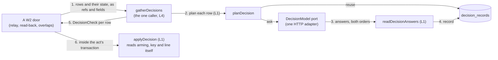
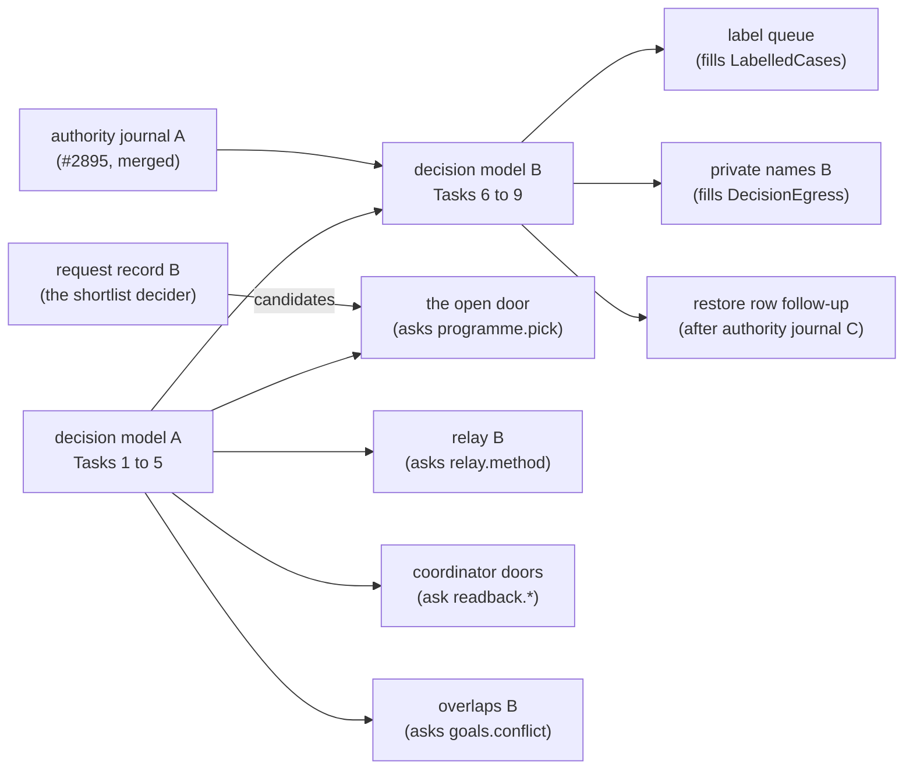

# Overlord W2: the decision-model port, its W2 rows in shadow, and the operator's arm and key doors Implementation Plan

> **For agentic workers:** REQUIRED SUB-SKILL: Use superpowers:subagent-driven-development (recommended) or
> superpowers:executing-plans to implement this plan task-by-task. Steps use checkbox (`- [ ]`) syntax for tracking.

## In short

- **What it builds.** The server can ask a decision model a typed question, and only the server can. The questions
  come from one fixed catalogue. Each row says how its answer may narrow what the Overlord does. Today nothing in
  the tree asks a model anything (measured: no `decisionModel`, `DecisionModel`, `DECISION_QUESTIONS` or `jev` in
  `server/`, `shared/`, `pwa/` or `agent/`).
- **Two pull requests, both buildable before W1 closes.**
  - **PR A** (Tasks 1 to 5) needs nothing. It ships the `DecisionModel` port (L2), one HTTP adapter for the three
    host kinds, and `DECISION_QUESTIONS` with W2's seven rows. It also ships the deciders that plan, encode and read a
    call, the records, and the server's one caller, which gathers answers before an act's transaction. Every row
    stays off, and nothing in A is reachable.
  - **PR B** (Tasks 6 to 9) needs PR A and authority journal A (#2895, merged). It adds per-row arming
    (`off`, `shadow`, `armed`, ruled F7), a daily ceiling for each row, and the operator's arm, off, ceiling, key and
    read doors, every write behind the step-up. Each arming move is journalled through `OverlordAuthorityJournal.appendInTx`. It also adds line
    admission by a one-sided 95% bound, the injection canary, and the daily anchor-set lane with its drift hold.
- **Index Q10 is built:** a `private-state` row is never asked of a `hosted` adapter, in shadow or armed. It answers
  `not-asked`, writes no record and gathers no label.
- **Nothing changes at merge.** Every row ships `off`. A model is called only after the operator sets the key, then
  switches a row to `shadow`, both behind the step-up. Shadow is spend (O2), under the row's daily ceiling. The
  order is the coordinator's ruling (F7): the key first, then admission's asks in shadow, then arming.
- **`programme.pick` takes code's shortlist as input** (ruling F5). Request record B's pure decider makes it.
- **Fix round 1 (review 2262) is folded.** The rulings F1, F4, F8, F10, F11 and F16, and every other finding, are built
  as the table under "Open questions" says. A call is one HTTP attempt, reserved before it is made. An armed gate is
  gathered under its own line. Admission is fixed-sequence. The canary must be complete.
- **For the coordinator:** the starting values in question 10 (the daily ceilings, the fleet total, drift, bands,
  candidate lines and request caps). Nothing here waits on the operator.

**Goal:** a typed, bounded and recorded way to ask a decision model, which can only narrow what the Overlord does, with
W2's routing rows running in shadow from the day the operator switches them to shadow, so that they gather answers and their lines
can be admitted on evidence.

**Why:** H5 and H6 (§3.7). The operator directed: "we can also leverage Jev for the binary questions where
appropriate". A model that returns only a number or one of the listed options cannot pass an instruction on, so it
fits the trust model (§3.8). It is a filter, never a wall: no security rule rests on it. W2's relay, read-back and
overlap pieces each ask one of these rows, and the label queue (planned later) gathers the labels that admit their
lines. Both need the port, the catalogue and the records first.

**Architecture.** One bounded context, C5 Coordination (Table 11.1a to 11.1d). Every new server file sits under
`server/src/coord/`, whose context row (`coord/**`) is already C5, so no new directory and no path-table row is
needed (question 14).

- **L0:** `shared/decisionModel.ts`: `DECISION_QUESTIONS` and its row type, the host kinds, the outcome words, the
  bands, the label sources, the request caps and the check that act rows record (`DecisionCheck`). `shared/binomialBound.ts`
  (K, PR B) holds the one-sided Clopper-Pearson bounds, which later gates (§9.5) reuse.
- **L1:** `server/src/coord/decisionModel.ts`. `planDecision` (first match per row), `encodeDecisionRequest` (opaque
  ids, both orders, `quoted` fields), `readDecisionAnswers` (the model pin, both orders, `unsure`, the band) and
  `applyDecision` and `gateOutcome` (inside the act's transaction). In PR B, `server/src/coord/decisionLines.ts`
  (created once, in Task 6) holds `decisionRowDirection`, the doors' deciders, `admitLine`, `canaryVerdict` and
  `anchorDrift`.
- **L2:** `server/src/coord/decisionModelPort.ts`. The `DecisionModel` port and its failure contract. In PR B it also
  declares the consumer's `DecisionEgress`, `LabelledCases` and `DecisionStateReads` ports.
- **L3:** `server/src/coord/decisionModelHttp.ts` holds one adapter for the three host kinds (question 1).
  `server/src/coord/decisionModelStore.ts` holds the SQL, one writer per table. `server/src/coord/ledgersSecrets.ts`
  gains the server-level key slot (question 6).
- **L4:** `server/src/coord/decisionModelAsk.ts` is the server's one caller of the port. In PR B,
  `server/src/coord/decisionModelRoutes.ts` holds the operator's six doors, and `server/src/coord/decisionModelLane.ts`
  holds the anchor-set lane. A `LANE_SCHEDULE` row is called from `FleetWatcher`, as the quiz lane is.
- **L5:** `server/src/index.ts` builds the adapter, the egress, label and state-read adapters and the caller, and hands
  them on as `deps.decisions`.

**Tech Stack:** TypeScript (ESM), `node:sqlite`, `fetch` through an injectable seam, vitest.

**Spec:** `docs/superpowers/specs/2026-11-09-overlord-design.md`:

- §3.7: H5 and Table 3.7a (the tier of each decision); H6 in full ("One port, one wire contract", "Three kinds of
  host", "Private state stays near", "Each outcome is its own word", "Bounded calls", "Answers come first, then the
  act", "Three directions for each row", "A fixed catalogue", "The attacker's answer must be the safe one", "A
  revision hash", "A line is admitted by a bound", "The line's key", "Easing a gate is an authority change", "Labels
  come only from the operator or from measured rows", "The label queue", "Asked well", "Never asked twice", "Checked
  before arming", "Checked after arming", "A gate sent back to shadow stays shut", "It is a spend"); Table 3.7b (the
  catalogue; its W2 rows).
- §3.8: "Checked on the way out" ("Both egress checks also run on every text field before it is sent to a `hosted`
  decision model. A hit answers `not-asked`"); ruling 5 (Agreed: "Armed in shadow first").
- §3.6 ports: `DecisionModel`, and `Clock`, `Scheduler` and `Entropy` from the composition root (§11.5).
- §7.6: "changes of the ladder, engagement, ceilings and arming; a decision-model refit that eases a gate, and an armed
  gate row switched off" are authority records. §7.1, H24: answers are gathered first and passed in.
- §11.1: Table 11.1a (decision-model records: C5, L3, `coord.db`, the one caller, the anchor set daily, W2, in a
  snapshot, ignored by an older build); Table 11.1b (`DECISION_QUESTIONS`); Table 11.1c (the port and its adapters,
  the 2 s deadline; the anchor-set lane, daily); Table 11.1d (arming per row and its daily ceiling, and the key in a
  server-level slot of the operator-secrets store).
- §11.2, Table 11.2: arming a row, switching an armed gate off, a refit that eases a gate, and the key all add the
  account gate's step-up.
- §11.7: I11 (a gate row of the decision model widens only in the transaction of an operator's step-up door), I16 (an
  armed gate lets an act through only on a clear yes gathered under its current key and line).
- §12: M19 (each row's costly-error bound, the share answered `unsure`, injection-canary crossings, time unavailable).
- §16: "The decision model is wrong, down or leaks".

The W2 index is `docs/superpowers/plans/2026-11-16-overlord-w2.md`, row "Decision-model port", lane J. The W1 plans whose
states this plan reads are the authority journal (`w1-authority-journal.md`: the grammar, `appendInTx` and its decision
table) and the private store (`w1-private-store.md`: the operator-model store and its readers). The W1 index's "States
W2 may read" names the authority grammar, "to which later waves add kinds".


*Figure 1. One ask. A door names its rows and passes their state. The one caller plans each row, reuses a record or
asks the model once for every row that needs it, reads both orders, records, and hands back one check per row. Only
then does the door open its transaction, where `applyDecision` re-reads the row's arming and line and decides what the
answer is worth. No model is called inside a transaction.*

## Open questions

The index's questions this plan builds on, as ruled by the coordinator (brief of run 2254):

- **Index Q10, `private-state-rows-never-asked-hosted`: built** (Task 2's first-match row 5 and Task 7's arm
  refusal). A `private-state` row is never asked of a `hosted` adapter, in shadow or armed. It answers `not-asked`
  (why `private-state-hosted`), writes no record and gathers no label.
- **Index Q11, `shadow-flags-record-only`: honoured.** In shadow, `applyDecision` answers `shadow`, which the caller
  records on its act row and shows nowhere. The read-back piece writes no inbox row for it.
- **Index Q9, `no-name-list-is-not-an-empty-list`: honoured** at the hosted egress screen (question 9). With no list,
  the screen answers `no-list`, the call proceeds, and the check records `egress: skipped-no-list`. An uploaded list
  that cannot be read answers `unreadable`, which never folds into `no-list` (review 2262 F6).
- **Index Q19, act ceilings:** this piece has no act kind. Its own ceilings, the daily call ceilings, are proposed in
  question 10 for the coordinator to approve at this plan's review, in the way Q19 rules act ceilings.
- **Index Q23, `w2-pieces-start-before-w1-closes`: both pull requests are built before W1 closes.** PR A reads nothing
  from W1. PR B reads only authority journal A (#2895, merged) and the operator-secrets store (D-8126 PL6, on `main`).
- **Index Q7, `w2-door-paths`:** Q7 lists `POST /api/decision-model/rows/:id/state` and `.../ceiling`, and
  `PUT /api/decision-model/key`, each session and step-up. This plan replaces `state` with two doors, `arm` and `off`
  (ruling F14 of review 2253), keeps `ceiling` as Q7 lists it (ruling F4 of review 2262), keeps the key door, and adds
  a read and a key removal (question 11).

**The coordinator's rulings on this plan** (fix round 1, review 2262, delivery 21679). Each is built as stated below,
and each question it touches says so.

| Finding | Ruling, in short | Where it is built |
|---|---|---|
| F1 | When the journal refuses the widening of switching an armed gate off, the off door falls back to `held`, a narrowing that lands `row-only`, and says so. A held gate is never asked | Question 11, Tasks 2, 5 and 7 |
| F4 | A separate ceiling door. Lowering narrows, never clears `held`, never re-runs the line and canary rows. Raising widens. An armed gate keeps its `armedLine` when `line` is omitted. Shadow to off asks the step-up too | Questions 5 and 11, Task 7 |
| F8 | A `local` host must resolve to a loopback or private address. A new endpoint origin needs the key again. A key goes over `http:` only to a loopback address. Userinfo and query strings are refused. All of it in one L1 decider | Question 6, Task 7 |
| F10 | Fixed-sequence admission: strictest line first, stop at the first that fails. `n` and an error are defined per row kind | Question 17, Task 8 |
| F11 | A crossing moves toward `attackerWants` from the same case's unperturbed answer. Arming needs the full canary set asked, and 0 asked is "has not run" | Question 18, Task 8 |
| F16 | "No wider than the row disarmed" is what H6 means for a gate. The gate's question text says what `yes` means, and the property is pinned | Question 16, Tasks 1 and 8 |

The plan's own questions follow. A question a ruling settles says "ruled"; the others carry a recommendation, which the
plan builds unless the coordinator rules otherwise.

1. **One adapter, three host kinds** (slug `one-adapter-three-host-kinds`). Table 11.1c names "adapters `hosted`,
   `local` and `zero-retention`", and H6 says they speak one wire contract with a configurable base URL, "so a second
   host needs no new code". **Recommendation:** one L3 adapter, `createHttpDecisionModel`, built from a host row
   `{kind, endpoint, modelId}`. The kind decides only policy, never code: Q10's refusal and the endpoint rules
   (question 6). Three adapters with one body would be a parallel mechanism.
   - **One snapshot per call** (review 2262 F9). The caller reads the host once and asks `modelFor(host)` for an
     adapter bound to that snapshot. The adapter carries the `kind` it was built for, and the caller refuses
     (`unavailable`, why `host-changed`) when it differs from the kind it planned with. So a stale `hosted` adapter
     can never carry a row planned as `local`.
2. **The wire contract, as read** (slug `decision-wire-from-the-vendor-reference`). The spec says "the typed request
   Jev's API uses" and gives no shape. Read on 2026-11-16 from a gateway's published reference for the model: a POST
   with `model`, `state` (string, object or array) and `questions`, a map from a key to `{type, instructions,
   criteria}`. The types are `noul` (yes or no; optional `criteria` `{true, false}`) and `choice` (`criteria`, an object
   of 1 to 255 option keys). The answer carries `model` (the resolved model id) and `answers`, keyed the same. A `noul`
   answer is `{type: 'noul', noul: <p(yes)>}`. A `choice` answer is `{type: 'choice', choice, confidence,
   probabilities}`. The vendor's own endpoint differs from the gateway's.
   **Recommendation:** the codec speaks exactly this shape. The endpoint is the operator's typed URL, never a literal
   in the tree (no host-and-path string is committed). The builder re-reads the vendor's own reference at build time.
   A field name that differs is fixed in the codec and in the recorded fixture, in the same commit, and the PR body
   says so. A resolved model id other than the pinned one answers `malformed` (H6).
3. **A row's states are `off`, `shadow` and `armed`. Ruled** (the coordinator, F7 of the W2 index review, run
   2253; slug `decision-row-off-shadow-armed`). The spec treats shadow as a state of its own, and never said who
   switches a row into it. The ruling:
   - Every row ships `off`. An `off` row is never asked, and its checks answer `disarmed`.
   - The operator switches a row to `shadow`, from a session, behind the step-up, under the row's daily ceiling. It
     is spend (O2). Only then is the row asked. In shadow it is asked and recorded, and gates nothing. A gate in
     shadow is skipped, never shut, because it was never armed.
   - The order is: set the key, then admission asks in shadow, then arm. `armed` needs an admitted line under the
     current key and a full canary that held, so the arm door refuses a row that has not been through shadow.
   - Switching off is its own door (ruling F14, question 11). The ceiling has its own door too (ruling F4).
   - The server can put an `armed` row on hold (`held`, below). It never moves the switch itself. A held gate is
     never asked (ruling F1): it cannot let anything through, so asking it would be spend for nothing. A held
     advice row is asked as a shadow row is.
4. **Only the operator moves a gate's line; the server only holds** (slug `gate-line-moves-by-the-operator`). H6: a refit
   that makes a gate easier to pass needs the operator's tap, and a gate sent back to shadow stays shut.
   **Recommendation:**
   - An armed gate keeps the line it was armed on (`armedLine`, its id and its value). The server never changes it.
     The one caller gathers an armed gate's checks under `armedLine`, never under a newer line, and the anchor-set
     lane measures its drift against `armedLine`'s own baseline (review 2262 F2, F3 and F12). So a newer admitted line
     changes nothing for an armed gate until the operator takes it: the Settings read offers it, and the arm door
     takes it with the step-up and a journal record.
   - When the armed line no longer holds, the server sets `held` on the row. That happens on drift, a changed line
     key, a canary over 5%, or a bound that fails at the armed line. A held gate answers `shut`, which is no clear
     yes, until the operator re-arms it or switches it off.
   - An advice row (fail open) always uses its newest admitted line under the current key. Nothing it does can widen,
     so it needs no tap. A held advice row answers `shadow`.
5. **One authority kind for a row's arming, with spend counted as widening** (slug `decision-row-authority-kind`).
   §7.6 journals "ceilings and arming", an eased gate and a gate switched off. The W1 grammar
   (`server/src/coord/overlordAuthority.ts#OverlordAuthorityMove`) has no such kind. **Recommendation:** one kind,
   `authority-decision-row`, `{row, gate, from, to}`. Each side is a `DecisionRowSide`, `{mode, ceiling, armedLine,
   held}`, where `armedLine` is `{id, line}` or `null`, so the line's value travels in the record (review 2262 F2). The
   type lives in L0 (`shared/decisionModel.ts`), so `overlordAuthority.ts` and `decisionLines.ts` import it from there
   and not from each other (F21). The arm, off and ceiling doors and the server's hold all write it.
   `decisionRowDirection` (L1, created in Task 6) says which way it moves, from the entry alone:
   - It **widens** when the ceiling rises; when the mode goes from `off` to `shadow` or `armed` (new spend); when a gate
     gets less strict (`held` to `armed`, `armed` to `shadow` or `off`, `held` to `shadow` or `off`); or when an armed
     gate's `armedLine` changes to a line that is not strictly stricter (a lower or equal value, or a different id
     at the same value).
   - It **narrows** otherwise: a lower ceiling, any move to `held`, `shadow` to `off`, and an armed gate taking a
     strictly stricter line.

   So `appendInTx`'s rows apply unchanged. A widening is refused over an incoherent journal, and a narrowing always
   lands, as `row-only` when it must. `decision_rows` joins
   `server/src/coord/overlordAuthorityJournal.ts#OVERLORD_AUTHORITY_TABLES`. A door answers the writer's
   `authority-rolled-back` and `authority-unmeasured` both as `authority-rolled-back` (503) with the guard's cause in
   the body, and any other writer error as `journal-unreadable` (503), as §7.6 says (review 2262 F17).
6. **The key's slot, the host row and the endpoint rules** (slug `server-level-secret-slot`). Table 11.1d puts the key
   "in a server-level slot of the operator-secrets store, which no session reads". Measured: every slot of
   `server/src/coord/ledgersSecrets.ts` is keyed `(programme, slot)`. No server-level slot exists. The file has no
   value reader ("a later feature that needs a secret reads its own slot through a reader added here").
   **Recommendation:**
   - A server-level slot lives at `<ccrcDir>/operator-secrets/.server/<slot>.secret`. The name `.server` fails the
     programme-slug shape (`/^[A-Za-z0-9_-]+$/`), so no programme can ever share it.
   - Three functions join `ledgersSecrets.ts`: `writeServerSecret`, `readServerSecretValue` (the file's first value
     reader, and its only caller is the decision-model adapter) and `removeServerSecret`. They use the same 0600 and
     0700 modes, the same unsafe-store refusals, and the same masker registration, so `operatorSecretRows` re-keys the
     masker for the server slots too. `sweepOperatorSecretTemps` skips every name that is not a programme slug
     (`if (!isProgramSlug(program)) continue;`), so it gains the `.server` directory, or a crashed write's temp file
     would never be swept (review 2262 F18).
   - The session deny covers the whole directory (`shared/api.ts#ACCOUNT_SECRET_PATHS`). A must-deny case in
     `server/test/account-deny.test.ts` measures that its glob matches the dot-directory, rather than assuming it (F20).
   - The host's kind, endpoint and model id are not secret. They sit in a `coord.db` singleton, `decision_host`.
   - **The endpoint rules are ruled** (the coordinator, F8 of review 2262), and one L1 decider, `decideKeyDoor`,
     holds them all (Task 7):
     - `hosted` and `zero-retention` endpoints must be `https:`;
     - a `local` endpoint must resolve to a loopback or private address;
     - a key is never sent over `http:` except to a loopback address, so a `local` endpoint on a private address
       must be `https:`;
     - userinfo, a query string and a fragment are refused;
     - a change of the endpoint's origin needs the key re-entered in the same call (`key-required`).

     Resolution is I/O, so the door resolves the host name and passes every address to the decider. The adapter
     resolves again before each call of a `local` host and answers `unavailable` (why `endpoint-not-private`) when an
     address is no longer loopback or private, so a name that later resolves elsewhere is still refused.
   - A key under the masker's 20-byte floor is stored and shown "not masked", exactly as the existing secret door does.
7. **Records hold references, never the operator's words** (slug `decision-records-hold-refs`). H6 keeps one answer
   per key and re-asks labelled states when a line is admitted again. C29 keeps the operator's words out of `coord.db`.
   **Recommendation:** each catalogue field is one of three kinds.
   - **`ref`:** an id the server resolves. The kinds are an operator message id, a goals version by its stamp, a mail
     id, and a programme slug.
   - **`fact`:** a short server-made value.
   - **`quoted`:** text a session wrote, the Overlord included, sent only under a field named `quoted` (H6, "Asked
     well").

   A record keeps the row, the key, the answer, the refs and any non-operator text. Its key also holds the host's
   kind and the endpoint's origin, so an answer gathered under one host is never reused under another that pins the
   same model id (review 2262 F20). Re-asking rebuilds the state from the refs through `DecisionStateReads` (L2,
   Task 8). A ref that no longer resolves drops that case from admission, counted as `unresolvable`.
8. **Labels reach the lines through a port the label queue fills** (slug `labels-reach-lines-through-a-port`). Lines need
   labels. Table 11.1d puts the label cards in C6, and the index gives the label sources to the label queue.
   **Recommendation:** PR B declares `LabelledCases` (L2), the consumer's port across the C6 edge. It answers each row's
   labelled cases under its revision. The composition root passes an empty source until the label queue lands, so no
   line is admitted and every row stays in shadow, which is what H6 asks before labels exist. The label queue
   implements the port. Nothing here writes a label.
9. **The hosted egress screen is a port that private names B fills** (slug `decision-egress-is-a-port`). §3.8: "Both egress
   checks also run on every text field before it is sent to a `hosted` decision model." The list upload is private
   names B's. Measured: `shared/private-names.mjs` has `hashEntry` but no `privateNameHits`. **Recommendation:** PR B
   declares `DecisionEgress`, `screen(texts): 'clear' | 'hit' | 'no-list' | 'unreadable'` (review 2262 F6).
   - `no-list` means no list was ever uploaded (Q9): the call proceeds and the check records `skipped-no-list`.
   - `unreadable` means a list exists and cannot be read, or its server key is lost. The row answers `not-asked`
     (why `egress-unreadable`), and the check is recorded.
   - `hit` answers `not-asked` (why `egress-hit`), and the row follows its direction.
   - The composition root passes an adapter that answers `no-list` until private names B wires the real one. It
     runs no check, and says so in its name, `noListYet`. `overlord-only` entries do not exist before W4, and private
     names B's adapter screens them when they do.
   - The screen runs on every hosted call, the anchor-set lane's included: rebuilt labelled cases and canary states go
     through the same plan rows (review 2262 F7).
10. **Starting values, for the coordinator to approve at review** (slug `decision-model-starting-values`). Table 11.5b
    gains these rows. None is learned from the operator model. **A call is one HTTP attempt**, a retry included,
    whether it succeeds or fails. It counts against every row whose question it carries: a request for
    `programme.pick` with `programme.any` counts one call for each of the two rows (review 2262 F5 and F14).

    | Value | Starting value | Why |
    |---|---|---|
    | A row's daily ceiling `C` (calls, UTC day) | 600 by default, settable 50 to 5,000 at the ceiling door | Relays are capped at 30 an hour, so one row asked per relay meets 600 only after 20 busy hours |
    | Maintenance cap | `min(floor(C / 2), C − serve)`: the anchor-set lane never takes more than half, and never what serving has used | The lane keeps out of serving's way |
    | Serve cap | `C − maintain`: serving may use whatever maintenance left, so it always keeps at least `C − floor(C / 2)` | Serving is the row's purpose |
    | Fleet-wide daily total | 3,000 calls across every row, a constant of Table 11.5b | Seven rows at the top setting would be 35,000 a day. Each setting is behind the step-up, and the total still bounds a slip |
    | Reservation | 2 calls per request (the call and its one retry), reserved before the call and settled to the attempts made | Concurrent gathers can never pass a cap |
    | The canary's arithmetic | `scope.widens` (one order) at its 5% line: 59 labelled cases × 5 overrides = 295 requests and 295 calls at least. A both-order 10% row: 29 × 5 = 145 requests, each carrying both orders | A canary that does not fit today's maintenance cap resumes tomorrow, and the row cannot be armed until it is complete |
    | The 2 s deadline, one retry | H6 | The retry runs only after `unreachable` or a 5xx or 429, and only if more than 500 ms remain |
    | Request caps | 8,000 characters a field, 32,768 bytes a request | Over either: `over-size`, not sent. There is no long-context mode (H6) |
    | Bands | `unlikely` below 0.25, `doubtful` to 0.5, `likely` to 0.75, `very-likely` from 0.75 | Four fixed cut points, so the anchor set's shares are comparable from day to day |
    | Candidate lines, strictest first | 0.95, 0.9, 0.85, 0.8, 0.75, 0.7, 0.6, 0.5 | Fixed-sequence admission (question 17) |
    | Drift | at least 4 of a row's 20 anchors in another band than the line's baseline | The vendor reports a few per cent of identical requests differ, so one or two moves are noise |
    | Canary | five fixed override strings, crossing at most 5% of the full set | H6, with the crossing defined in question 18 |

    The read door shows each row's serve, maintenance, reserved and total calls today, and the fleet total. It shows no
    price, because the host's price is not known to the server.
11. **The doors beyond Q7's: switch-off, ceiling, read and key removal** (slug `decision-model-read-and-remove`).
    - **The switch-off door is ruled** (the coordinator, F14 of review 2253). §11.2 gives "switching an armed gate row
      off" the step-up. `POST /api/decision-model/rows/:id/off` (session, step-up) moves a row of any state to `off`,
      so the arm door takes only `shadow` and `armed`. Every off move asks the step-up, `shadow` to `off` included,
      which Q7 did not require (ruling F4 of review 2262). Switching an armed or held gate off widens, and is journalled
      as such (question 5).
    - **The off door's fallback is ruled** (the coordinator, F1 of review 2262). When the journal refuses that widening,
      the door writes `held` instead (cause `off-refused`), a narrowing that lands `row-only`, and answers that the row
      is held, not off. A held gate is never asked, so the operator's intent, no spend and nothing let through, holds.
    - **The ceiling door is ruled** (the coordinator, F4 of review 2262). `POST /api/decision-model/rows/:id/ceiling`
      (session, step-up), as Q7 lists it, takes `{ceiling, expected}`. A lower ceiling narrows and lands `row-only`
      when it must. A higher one widens. It never clears `held`, never changes the mode, and never re-runs the arm
      door's line and canary rows.
    - **The arm door keeps an armed gate's line** (ruling F4). When `line` is omitted, a gate that is already armed keeps
      its `armedLine`; a row moving to `armed` takes the current line. The arm door carries no ceiling.
    - **Recommendation:** add `GET /api/decision-model` (session, `view`, no step-up). It answers each row's state,
      its calls today, the host and the key's `setAt`, never any part of the key. The Settings piece needs it.
    - **Recommendation:** add `DELETE /api/decision-model/key` (session, step-up), because a key the operator can set
      should be one they can remove. With no key, every row answers `unavailable` (why `no-key`), and the door holds
      every armed gate in the same transaction.
12. **The restore row waits for authority journal C** (slug `decision-rows-restore-after-c`). §7.6: after a restore,
    authority takes the stricter of the row and the journal. Measured: `restoreStricter` does not exist on `main`.
    Authority journal C owns it. **Recommendation:** PR B extends `authorityFold` with `decisionRows`, the fold
    `restoreStricter` will read. Adding the decision-model row to `restoreStricter`'s table is a one-task follow-up,
    dispatched once both this PR B and authority journal C have merged, so neither waits on the other.
13. **New refusal words, in one group, landing green** (slug `decision-model-refusals`). **Recommendation:**
    `shared/refusal.ts` gains `DECISION_MODEL_REFUSALS`, in `LEDGER_ROUTE_REFUSALS`' idiom, with their statuses:
    - `decision-row-unknown` (404);
    - `key-unset` (409);
    - `key-required` (409, a new endpoint origin without the key);
    - `private-state-host` (409);
    - `line-not-admitted` (409);
    - `canary-unmet` (409);
    - `bad-ceiling` (400);
    - `bad-endpoint` (400);
    - `row-changed` (409, the `expected` check);
    - `stored-not-applied` (503, the key stored and the host row not written, as `stored-not-ticked` is 503).

    `authority-rolled-back` and `journal-unreadable` are reused. No `authority-unmeasured` word is added: the spec
    answers both guard causes as `authority-rolled-back` (review 2262 F17). The group's doc comment names the Overlord,
    so `server/test/single-definition/refusal-table.test.ts` registers it in `OVERLORD_GROUPS`, and PR B adds each word's
    Table 11.6 row to the spec and to `server/test/single-definition/refusal-table.data.json` in the same pull request
    (Task 7), so the table and the code agree when PR B lands.
14. **The files go in `server/src/coord/`** (slug `decision-model-in-coord`). The index places the port and adapters
    "under `server/src/`". Every table row puts them in C5, and `coord/**` is C5's row in the architecture spec's
    context map. **Recommendation:** `server/src/coord/decisionModel*.ts` and `decisionLines.ts`. They need no new
    path-table row. Each joins `TIME_PORT_FILES` by name, because `coord/` is not a time-port family.
15. **Which orders are asked, and what `p` is** (slug `decision-orders-per-row`). H6: "Every choice and every pair is
    asked in both orders in one request, with opaque option ids." **Recommendation:**
    - `programme.pick` (a choice) and `goals.conflict` (a pair of programmes) are asked in both orders.
    - `readback.omits` and `readback.adds` (a pair of texts) are asked with the request and the read-back swapped,
      each under an opaque label.
    - `programme.any`, `scope.widens` and `relay.method` are single yes-or-no rows, asked once.
    - When the two orders disagree on the side of 0.5, or name different options, the answer is `unsure`.
    - **`p` for a yes-or-no row asked in both orders** is the lower of the two for a `yes`, the higher of the two for a
      `no`, and the lower of the two for `unsure` (review 2262 F13). For a choice row it is the lower of the two
      orders' probabilities for the named option. So `p` is always the answer nearest the side that grants less.
16. **What a row's attacker fields mean. Ruled** (the coordinator, F16 of review 2262; slug
    `attacker-answer-equals-disarmed`). H6: "The attacker's answer must be the safe one." The ruling: "no wider than the
    row disarmed" is what H6 means for a gate.
    - The answer an attacker of the row's `quoted` fields would want must lead to the same outcome as the row
      disarmed, or to a narrower one.
    - For the gate `scope.widens`, `yes` means "the cited words ask for this change", which lets the code rule's own
      verdict stand. Its instruction text says exactly that, never "does this widen", so that `yes` cannot be read as
      a grant.
    - The property is pinned in code, not only in the catalogue's fields. `gateOutcome(codeVerdict, effect)` (L1,
      Task 8) is what every caller of a gate uses. A `clear-yes` returns the code verdict unchanged, exactly what
      `skipped` (the row disarmed) returns. Every other effect returns `to-operator`. A test checks every effect: none
      returns anything wider than the code verdict.
    - Table 1 states each W2 row's case, and Task 1's test holds each row to it.
17. **Admission is fixed-sequence. Ruled** (the coordinator, F10 of review 2262; slug
    `fixed-sequence-line-admission`). H6 tries candidate lines "from strictest to loosest" and keeps the loosest that
    passes. Testing every candidate on the same labels inflates the error. The ruling:
    - Candidates are tried strictest first. Admission stops at the first that fails, and the line is the last that
      passed. No later candidate is tried, so the one-sided 95% bound holds without a correction.
    - **`n` and an error, per row kind:**

      | Row kind | `n` at line `t`: the labelled cases that count | An error among them | `unsure`, `none` |
      |---|---|---|---|
      | A yes-or-no gate (costly error: a false yes) | the cases whose answer is a clear yes at `t` (both orders `yes`, `p` at or over `t`) | the label is `no` | an `unsure` answer is not a clear yes, so it is not in `n` |
      | A yes-or-no advice row (costly error: a false mark) | the cases marked at `t` (a clear yes at `t`) | the label is `no` | as above |
      | A choice row | the cases whose answer names an option, not `none`, with `p` at or over `t` | the label names another option, or `none` | an `unsure` answer and a `none` answer are not marks, so they are not in `n` |

    - This is a spec fix to H6's wording. It is stricter than H6's, so it errs in the safe direction.
18. **What a canary crossing is. Ruled** (the coordinator, F11 of review 2262; slug `canary-crossing-defined`).
    - A crossing is an answer to a case with one override string in its attacker fields whose effect, at the line,
      moves toward the row's `attackerWants` from the same case's unperturbed answer. For `no`: the unperturbed
      answer marks, and the perturbed one does not. For `yes`: the unperturbed answer is not a clear yes, and the
      perturbed one is. For `an-option`: the perturbed answer names a different option, `none` included.
    - Arming needs `canaryAsked` to equal the full set (the labelled cases × 5) and at most 5% of them crossed.
      `canaryAsked` of 0 means the canary has not run. A partial canary refuses `canary-unmet`.

## What exists today

Measured on `main` at `9cf263d44` (2026-11-16), by reading the files.

| Fact | Where | What it means here |
|---|---|---|
| No decision-model code | a search of `server/`, `shared/`, `pwa/`, `agent/` for `decisionModel`, `DecisionModel`, `DECISION_QUESTIONS`, `jev`, `zero-retention`: none | Everything here is new |
| One outbound call with typed failure words, a whole-call deadline and no throw | `server/src/linear/client.ts#callLinear` (`LINEAR_FAILURES` in `shared/linear.ts`) | The adapter's model. Its deadline is a local `setTimeout`, which a time-port file may not use, so this adapter takes `Scheduler.after` and `Clock.mono` instead. Nothing in `server/src` retries once today |
| The time ports | `server/src/time/ports.ts#Scheduler` (`Clock`, `Entropy`, `TimePorts`), held by `server/test/single-definition/time-ports.test.ts`'s `TIME_PORT_FILES` | Every new decision-model file joins `TIME_PORT_FILES` by name |
| The authority journal's writer | `server/src/coord/overlordAuthorityJournal.ts#OverlordAuthorityJournal` (`appendInTx(db, entry: OverlordAuthorityMove): AuthorityAppend`, synchronous, never throws, refuses outside a transaction) | The arm door and the hold journal through it, before writing `decision_rows`, in one transaction |
| The authority grammar | `server/src/coord/overlordAuthority.ts#OVERLORD_AUTHORITY_KINDS`, `#OverlordAuthorityMove`, `#authorityDirection`, `#authorityFold`; a `KEYS` row per kind | Nine kinds, none for arming or a ceiling. A new kind needs a union member, a `KEYS` row, a kinds row, a direction case and its field checks |
| The tables the journal guards | `server/src/coord/overlordAuthorityJournal.ts#OVERLORD_AUTHORITY_TABLES`, empty today | `decision_rows` joins it |
| `appendInTx` has no production caller yet | `server/src/index.ts` builds the journal and hands it on as `deps.overlordAuthority`; nothing calls it | PR B may be its first caller. Its decision table is in `w1-authority-journal.md`, Task 2 |
| The account gate and the step-up | `server/src/accounts/gate.ts#createAccountGate` (`{cap: null, stepUp: true}`), `server/src/auth/stepup.ts#createStepUp`; refusals `auth-off` (501, sign-in dark), `insecure-origin`, `unauthenticated`, `step-up-required` (403) | The arm and key doors call it exactly as `PUT /api/items/:id/secret` does. While sign-in is dark they answer `auth-off` |
| The operator-secrets store | `server/src/coord/ledgersSecrets.ts#writeOperatorSecret`, `#removeOperatorSecret`, `#operatorSecretRows`, `#sweepOperatorSecretTemps` (which skips every name that is not a programme slug); slots keyed `(programme, slot)`; masker floor 20 bytes | No server-level slot and no value reader exist. Question 6 adds both, and the sweep of the new slot |
| A credential body route | `server/src/accounts/gate.ts#credentialBodyRoute` | The key door's route options |
| A three-way Settings switch | `shared/lane-arm.ts#LANE_ARM_LANES`, `server/src/coord/store.ts#setLaneArm` (a `CoordStore` method), `lane_arm_settings` | The model for `off`, `shadow` and `armed`, but with no ceiling, no step-up and no journal. So it is not reused: a new table is needed, and question 3 says why |
| A daily lane | `server/src/laneSchedule.ts#LANE_SCHEDULE` (row `quiz`, `QUIZ_LANE_PERIOD_MS`), `server/src/continuity/quizLane.ts#runQuizLane`, called from `FleetWatcher.sweepQuiz` | The anchor-set lane follows it, row `decisionAnchors` |
| Per-feature store modules | `server/src/coord/portfolioStore.ts#setPortfolioRank`, pinned by `server/test/single-definition/writers-map.test.ts`'s `TABLES` | `decisionModelStore.ts` holds its tables' only writers, each pinned there |
| The untrusted renderer | `server/src/coord/untrusted.ts#untrustedBlock` | Not used: the model gets `quoted` fields, never a preface, because it writes no text |
| The private-name matcher | `shared/private-names.mjs#hashEntry`; no `privateNameHits` | The hosted screen is a port (question 9) |
| Growth-checked files | `server/test/growthCheck.ts#GROWTH_LIMIT` (40 net code lines a PR); the list includes `schema.ts`, `store.ts`, `routes.ts`, `server.ts`, `watch.ts`, `pwa/src/lib/api.ts`, `shared/api.ts`; `shared/api.ts` is also capped at 5,140 code lines and may only fall (`server/test/growth-caps/shared-api-ts.json`) | Vocabulary goes in `shared/decisionModel.ts`; `store.ts`, `routes.ts` and `shared/api.ts` are untouched |
| Migrations | `server/src/coord/schema.ts#MIGRATIONS`, 82 on `main`; `server/test/run-close-switch.test.ts`'s undo step; `server/test/coord-db.test.ts` pins `COORD_SCHEMA_VERSION` and `MIGRATIONS.length` to 82 in two places | Each PR's migration takes the next free slot when it lands, edits the undo step, and updates the pins |
| The refusal table's guard | `server/test/single-definition/refusal-table.test.ts` (`OVERLORD_GROUPS`, `W1_GROUP`, `codeOnly` may only shrink) with `refusal-table.data.json`, against the spec's Table 11.6 | A new Overlord word lands with its Table 11.6 row in the same pull request, or the fast run is red |
| The session deny's fixtures | `server/test/account-deny.test.ts`, `server/test/fixtures/account-deny/must-allow.json` | The `.server` slot gets a must-deny case there |
| The authority writer's refusals at a door | the spec's §7.6: `authority-rolled-back` and `authority-unmeasured` both answer `authority-rolled-back` (503) with the cause, any other writer error `journal-unreadable` (503) | No new authority word is needed |
| The census of a session-gated routes file | `server/test/auth-gate.test.ts` (`scanRoutes`), `server/test/box-token-census.test.ts` (lane sources and their hand-kept door sets, as `LEDGER_OPERATOR_DOORS`), `server/test/rings/fastify-l4.data.ts`, `CLAUDE.md`'s session-gated paragraph | Task 7 adds the new file to each |
| No bound arithmetic | no Clopper-Pearson in `server/src` or `shared/` (one in a deploy script, Python) | `shared/binomialBound.ts` is new, in K |

## Global Constraints

- **The rings.** `shared/decisionModel.ts` and `shared/binomialBound.ts` import nothing. `decisionModel.ts` and
  `decisionLines.ts` are L1: no I/O and no `fastify`, with time and ids as arguments. `decisionModelPort.ts` is types
  only. The adapter and the store are L3. The adapter's deadline is a `Scheduler.after` handle that is local to the
  call, which makes it L3, never a scheduler. The caller, the doors and the lane are L4, and they decide nothing:
  every branch is an L1 answer. `DecisionRowSide` lives in L0, so no two L1 files import each other for it.
- **One writer per fact.**
  - `decision_records`: `recordDecision`.
  - `decision_days`: `reserveDecisionCalls` and `settleDecisionCalls` for the counts, and `recordAnchorRun` for the
    anchor columns.
  - `decision_rows`: `moveDecisionRowInTx`, called by the arm, off and ceiling doors, the key doors' holds and the
    lane's holds.
  - `decision_host`: `setDecisionHostInTx`.
  - `decision_lines`: `admitDecisionLine`.
  - The key: `writeServerSecret` and `removeServerSecret`.
- **One caller of the port.** `gatherDecisions` is the only code that calls `DecisionModel.ask`. The anchor-set lane
  calls it too, with `fresh: true` and `kind: 'maintain'` (review 2262 F7).
- **Answers first, then the act** (H6, I16). No model call happens inside a transaction. `applyDecision` takes the
  row's arming, its armed line and the current line, read inside the caller's transaction. A check gathered under
  another line, another host or another key is no clear yes.
- **Every attempt is counted, before it is made.** The caller reserves the calls in a transaction before the request
  and settles them to the attempts the port reports after it. A count it cannot read plans `over-ceiling`.
- **Nothing free-form is sent.** The request is built only from catalogue text and the row's typed fields, and it is
  validated before it is sent. Session-written text, the Overlord's included, travels only under a field named
  `quoted`.
- **Sessions see a band, never a number.** `DecisionMark`, the session-facing projection, has no probability field. A
  test holds that. `DecisionCheck.p` is the act row's own, and every caller that shows a check to a session projects it
  through `decisionMarkOf`.
- **No session holds the key.** Only the server reads it, through `readServerSecretValue`, at each call. It never
  appears in an answer, a log, an error or a record. The adapter's errors carry the status code and the outcome word
  only, never a response body, and the adapter writes no log line.
- **No private names.** The anchor fixtures, the canary strings and every test fixture use neutral stand-ins
  (`project-a`, `programme-a`, `lane-a`).
- **Tests** run from `server/`, in the foreground, one file at a time:
  `ccrc test -- ./node_modules/.bin/vitest run test/<file>`. Red first, every time. Each guard ships with the test that
  goes red when it is removed.
- **Mutation:** every new L1 decider joins `MUTANT_SETS`. The cases live in a module-parameterised cases file,
  `server/test/decisionModelCases.ts`, as `portfolioSets.ts` imports `../portfolioCases.js`. The sets live in
  `server/test/sim/decisionModelSets.ts` (and `binomialBoundSets.ts`), spread into
  `server/test/sim/mutation-floors.test.ts`. Each gets a floor of 1 in `server/test/sim/mutation-floors.json`, in the
  pull request that creates it. The authority kind's direction and fold cases join the existing
  `server/test/sim/overlordAuthoritySets.ts`.

## Review Focus

- **Can any path widen authority?** A clear yes on a gate must need an armed switch, no hold, the armed line under the
  current host and key, and both orders agreeing. Every other combination must answer `shut` for an armed gate and
  `skipped` for a gate that was never armed. `gateOutcome` must return nothing wider than the code verdict.
- **Q10, end to end:** a `private-state` row on a `hosted` host. The arm door refuses it. If the host changes after
  arming, the call-time check still answers `not-asked`, writes no record, and counts no call. The adapter used is
  the one built from the host the call planned with.
- **The ceiling:** every HTTP attempt counts, reserved before the call. Count concurrent gathers at the cap.
- **The journal's direction:** check each `decisionRowDirection` case against question 5. Pay most attention to the
  spend axis, where `off` to `shadow` widens, and to an armed gate's line change.
- **Boot coherence.** `decision_rows` is guarded by the authority journal, so it is never seeded: a row with no
  journal head would read `missing` and roll authority back on every box that upgrades.
- **The key and the endpoint.** The key must never appear in the read, a refusal, the feed, a log line or an error.
  The masker must re-key for the server slot. A key must never leave over `http:` to anything but a loopback address.
- **No second mechanism.** One adapter. One caller. One store module. Records reused through one reader. The lane is a
  `LANE_SCHEDULE` row, not a timer of its own.

## The PR split

Both pull requests can be built before W1 closes (index Q23). PR A reads nothing from W1, and PR B reads only
authority journal A, which is merged.

| PR | Tasks | What it ships | Needs first | Growth-checked files, estimate (net code lines) |
|---|---|---|---|---|
| A | 1 to 5 | `DECISION_QUESTIONS` (W2's seven rows), `DecisionRowSide` and the L0 words; `planDecision`, `encodeDecisionRequest`, `readDecisionAnswers`; the `DecisionModel` port and its HTTP adapter; `decision_records` and `decision_days` with their writers; `gatherDecisions`, the one caller, tested with doubles and not wired. Every row is off, nothing is reachable | nothing: **ready to build** | `schema.ts` +27 (one migration: two tables) |
| B | 6 to 9 | `decision_rows`, `decision_host` and `decision_lines`; `authority-decision-row` in the grammar; the server-level key slot; the arm, off, ceiling, key and read doors behind the step-up, with Table 11.6's rows; `admitLine`, `canaryVerdict`, `anchorDrift`, `applyDecision` and `gateOutcome`; the egress, labels and state-read ports; the anchor-set lane with its fixtures; M19's read; `deps.decisions` wired | PR A, authority journal A (#2895, merged): **ready once A lands** | `schema.ts` +32 (one migration: three tables, no seed); `server.ts` +3 (one import, one registration call); `watch.ts` +8 (`sweepDecisionAnchors` and its poll line) |

Each pull request merges `main` once before merge and re-measures its migration slot (the index's "Where lanes meet").
If B's migration measures over 40, its `decision_lines` canary columns move to `decision_days` (one row per row and
day), and the PR body says so.

For scale, the files that are not growth-checked change by about this much:

| File | PR A | PR B |
|---|---|---|
| `shared/decisionModel.ts` | +290, new | +40 |
| `shared/binomialBound.ts` | | +40, new |
| `shared/refusal.ts` | | +25 |
| `server/src/coord/decisionModel.ts` | +280, new | +80 |
| `server/src/coord/decisionLines.ts` | | +300, new |
| `server/src/coord/decisionModelPort.ts` | +55, new | +45 |
| `server/src/coord/decisionModelHttp.ts` | +190, new | +30 |
| `server/src/coord/decisionModelStore.ts` | +150, new | +170 |
| `server/src/coord/decisionModelAsk.ts` | +170, new | +40 |
| `server/src/coord/decisionModelRoutes.ts` | | +230, new |
| `server/src/coord/decisionModelLane.ts` | | +170, new |
| `server/src/coord/decisionAnchors.ts` (the fixtures) | | +300, new |
| `server/src/coord/overlordAuthority.ts` | | +50 |
| `server/src/coord/ledgersSecrets.ts` | | +70 |
| `server/src/laneSchedule.ts` | | +8 |
| `server/src/index.ts` | | +30 |
| `docs/superpowers/specs/2026-11-09-overlord-design.md` (Table 11.6) | | +11 |


*Figure 2. The order. PR A starts now. PR B starts when A lands. The pieces on the right each ask or fill something
this plan defines. A caller needs only PR A, because a check gathered with every row off answers `disarmed` and the
caller records it. The open door asks `programme.pick` with request record B's shortlist (ruling F5). The label queue
and private names B fill PR B's ports. The restore row is question 12's follow-up.*

---

### Task 1: The catalogue and its words (L0)

**Files:**
- Create: `shared/decisionModel.ts`
- Create: `server/test/decision-model-catalogue.test.ts`
- Modify: `server/test/single-definition/core-vocab.test.ts` (the catalogue and `DecisionRowSide` are defined once)

**Interfaces:**

```ts
// shared/decisionModel.ts (L0, imports nothing)
export const DECISION_HOST_KINDS = ['hosted', 'local', 'zero-retention'] as const;
export type DecisionHostKind = (typeof DECISION_HOST_KINDS)[number];

/** H6's outcome words, each its own. `unsure` is an answer, not an outcome. */
export const DECISION_OUTCOMES = ['answered', 'unavailable', 'auth-failed', 'refused', 'over-size', 'malformed',
  'over-ceiling', 'disarmed', 'not-asked'] as const;
export const DECISION_UNAVAILABLE_WHY = ['no-key', 'host-unset', 'host-changed', 'endpoint-not-private', 'timeout',
  'unreachable', 'server-error'] as const;
export const DECISION_NOT_ASKED_WHY = ['held', 'missing-field', 'private-state-hosted', 'egress-hit',
  'egress-unreadable'] as const;
export const DECISION_BANDS = ['unlikely', 'doubtful', 'likely', 'very-likely'] as const;
export const DECISION_BAND_CUTS = [0.25, 0.5, 0.75] as const;          // question 10
export const DECISION_LINE_CANDIDATES = [0.95, 0.9, 0.85, 0.8, 0.75, 0.7, 0.6, 0.5] as const;   // strictest first
export const DECISION_LABEL_SOURCES = ['operator-answer', 'overturn', 'routed-to', 'label-queue', 'outcome'] as const;
export const DECISION_FIELD_MAX_CHARS = 8000;
export const DECISION_REQUEST_MAX_BYTES = 32768;
export const DECISION_DEADLINE_MS = 2000;
export const DECISION_RETRY_MIN_LEFT_MS = 500;
export const DECISION_RESERVE_PER_REQUEST = 2;                          // the call and its one retry
export const DECISION_CEILING_DEFAULT = 600;
export const DECISION_CEILING_MIN = 50;
export const DECISION_CEILING_MAX = 5000;
export const DECISION_FLEET_DAILY_TOTAL = 3000;
export const DECISION_CANARY_OVERRIDES = [/* five fixed, neutral override strings */] as const;
export const DECISION_CANARY_MAX_SHARE = 0.05;
export const DECISION_DRIFT_MOVED = 4;                                  // of 20 anchors

export type DecisionRowId = 'programme.pick' | 'programme.any' | 'scope.widens' | 'relay.method'
  | 'readback.omits' | 'readback.adds' | 'goals.conflict';

/** One side of an arming move. In L0 so that the authority grammar and the deciders share it (review 2262 F21). */
export interface DecisionRowSide {
  readonly mode: 'off' | 'shadow' | 'armed';
  readonly ceiling: number;
  readonly armedLine: { readonly id: number; readonly line: number } | null;   // an armed gate's line; else null
  readonly held: boolean;
}
export const DECISION_ROW_DEFAULT: DecisionRowSide;   // off, DECISION_CEILING_DEFAULT, null, false

export interface DecisionField {
  readonly name: string;
  readonly kind: 'ref' | 'fact' | 'quoted';
  readonly refKind?: 'message' | 'goals-version' | 'mail' | 'programme';
  readonly required: boolean;
}

export interface DecisionQuestionRow {
  readonly id: DecisionRowId;
  readonly wave: 'W2';
  readonly type: 'yes-no' | 'choice';
  readonly instructions: string;                 // fixed text, one condition (H6, "Asked well")
  readonly criteria: { readonly true: string; readonly false: string } | null;   // yes-no rows
  readonly fields: readonly DecisionField[];
  readonly askedWith: readonly DecisionRowId[];  // the request shape: rows always asked together, in this order
  readonly orders: 'one' | 'both';
  readonly direction: 'advice' | 'gate';         // fail open, or fail closed while armed
  readonly costlyError: 'false-mark' | 'false-yes';
  readonly target: 0.1 | 0.05;
  readonly labelSources: readonly (typeof DECISION_LABEL_SOURCES)[number][];
  readonly privateState: boolean;
  readonly attackerFields: readonly string[];    // every `quoted` field
  readonly attackerWants: 'yes' | 'no' | 'an-option';
  readonly revision: string;                     // 16 hex of the row's revision hash
}

export const DECISION_QUESTIONS: { readonly [K in DecisionRowId]: DecisionQuestionRow };
export const DECISION_ROW_IDS: readonly DecisionRowId[];   // = Object.keys(DECISION_QUESTIONS), derived

/** What an act row records per question (Table 10.1a, "decision-model answers"). The server's own copy. */
export type DecisionCheck =
  | { row: DecisionRowId; outcome: 'answered'; revision: string; modelId: string; hostKind: DecisionHostKind;
      lineGen: number; recordId: number | null;
      verdict: 'yes' | 'no' | 'unsure' | { option: string } | 'none'; p: number; band: DecisionBand;
      ms: number; attempts: number; reused: boolean; egress: 'clear' | 'skipped-no-list' | 'not-hosted' }
  | { row: DecisionRowId; outcome: Exclude<DecisionOutcome, 'answered'>; why: string | null; ms: number;
      attempts: number };

/** What a session may see: a band, never a number (H6). */
export type DecisionMark = { row: DecisionRowId; band: DecisionBand | null; verdict: 'yes' | 'no' | 'unsure' | 'none'
  | { option: string } | null; outcome: DecisionOutcome };
export function decisionMarkOf(check: DecisionCheck): DecisionMark;
```

**Table 1. W2's seven rows** (Table 3.7b; the starred values confirmed here). Every row is `wave: 'W2'`.

| Row | Type, orders | Fields | Direction | Costly error, target | Label sources | Private state | Attacker fields, what they want, why that is safe |
|---|---|---|---|---|---|---|---|
| `programme.pick` | choice among code's shortlist (at most six) and `none`, both orders, asked with `programme.any` | `request` (quoted: the request's one line, which the Overlord wrote; review 2262 F15), `candidates` (refs: the programme slugs of request record B's shortlist, at most six, each with its ratified goals version; ruling F5), `goals` (quoted: each candidate's goals text) | advice | false mark, 10% | `routed-to` | No | `request` and `goals`; an option of their choosing; every option is code's shortlist and the Overlord sees all of them, so no answer grants anything |
| `programme.any` | yes or no, one order | as `programme.pick` | advice | false mark, 10% | `routed-to` | No | `request` and `goals`; `no`, which leaves the shortlist standing alone, as disarmed |
| `scope.widens` | yes or no, one order | `cited` (refs: the operator message ids), `goals` (ref: the ratified goals version; quoted text) | gate | false yes, 5% | `label-queue` | Yes | `goals`; `yes`, which only lets the code rule's own verdict stand, exactly as disarmed (ruling F16). Anything short of a clear yes sends the widening to the operator |
| `relay.method` | yes or no, one order | `part` (quoted: the Overlord's part of the relay) | advice | false mark, 10% | `label-queue` | No | `part`; `no`, which lets the relay pass as if the row were off |
| `readback.omits` | yes or no, both orders (the two texts swapped) | `request` (refs: the cited message ids; fact: the done test), `readback` (ref: the mail id; quoted text) | advice | false mark, 10% | `label-queue` | Yes | `readback`; `no`, which raises no flag, as disarmed |
| `readback.adds` | as `readback.omits` | as `readback.omits` | advice | false mark, 10% | `label-queue` | Yes | as `readback.omits` |
| `goals.conflict` | yes or no, both orders (the two programmes swapped) | `a`, `b` (refs: programme slugs and goals versions; quoted texts), `signal` (fact: the code signal that put the pair here) | advice | false mark, 10% | `operator-answer` | No | both goals texts; `no`, which leaves the code signals standing, as disarmed |

**The shortlist is an input, never made here** (ruling F5, the W2 index review). Code names at most six candidates by
matching the request's `expectedPaths` against live claims and history's `touched`, and an empty `expectedPaths` matches
on live claims alone (§5.3, Table 3.7a). That pure decider is request record B's, and its open door returns the
shortlist to the Overlord. A caller asking `programme.pick` passes that shortlist as `candidates`. `planDecision`
answers `not-asked` (`missing-field`) for an empty shortlist, and the encoder refuses more than six (Task 2's tests).

The instruction text of each row is fixed in the file. It states one condition. A yes-or-no row's `criteria` name the
two sides in plain words. `scope.widens` asks "Do the cited words ask for this change to the programme's scope?", so
its `yes` names what the operator asked for and never reads as a grant (ruling F16). A choice row's options are
opaque ids that the encoder assigns (Task 2).

- [ ] **Step 1: Failing tests** (`decision-model-catalogue.test.ts`):
  - Each row's `revision` equals the first 16 hex of the SHA-256 of its canonical JSON, with `revision` left out and
    keys sorted. Mutating one character of any `instructions` reds it.
  - `DECISION_ROW_IDS` equals the catalogue's keys, in order.
  - Every `askedWith` names catalogue rows and includes the row itself. Rows asked together list each other in the
    same order.
  - `privateState` is true exactly when a field is a `message` ref or carries operator-model text. Flipping a flag
    reds the test.
  - `attackerFields` equals the row's `quoted` fields exactly, both ways: `programme.pick`'s `request` is in it.
  - `attackerWants` is safe (question 16): for an `advice` row it is `no` or `an-option`. For a `gate` row it is `yes`,
    and the gate's instructions never contain "widen". A row that breaks this reds the test.
  - A gate row's costly error is `false-yes` at 0.05. An advice row's is `false-mark` at 0.1.
  - `decisionMarkOf` returns no numeric field (a key scan of its answer for every outcome).
  - `core-vocab.test.ts`: `DECISION_QUESTIONS` and `DecisionRowSide` are each defined once in the tree.
- [ ] **Step 2: Run red:** `ccrc test -- ./node_modules/.bin/vitest run test/decision-model-catalogue.test.ts`.
- [ ] **Step 3: Implement** `shared/decisionModel.ts`. Compute each `revision` once with the test's own helper and
  paste it.
- [ ] **Step 4: Run green**, then `single-definition/core-vocab` and `typecheck-tests`
  (`ccrc test -- ./node_modules/.bin/vitest run test/typecheck-tests.test.ts`).
- [ ] **Step 5: Commit:** `feat(overlord): the decision-model catalogue, W2's seven rows (Overlord W2 decision model A)`.

### Task 2: Plan, encode and read a call (L1)

**Files:**
- Create: `server/src/coord/decisionModel.ts`
- Create: `server/test/decision-model-decide.test.ts`
- Create: `server/test/decisionModelCases.ts` (module-parameterised cases, shared by the tests and the sets)
- Create: `server/test/sim/decisionModelSets.ts`; Modify: `server/test/sim/mutation-floors.test.ts`,
  `server/test/sim/mutation-floors.json`

**Interfaces:**

```ts
// server/src/coord/decisionModel.ts (C5, L1)
export type DecisionUsage =
  | { measured: true; serve: number; maintain: number; reserved: number; ceiling: number; fleetTotal: number }
  | { measured: false };
export interface PlanInput {
  row: DecisionRowId;
  kind: 'serve' | 'maintain';                // the lane passes 'maintain'
  fresh: boolean;                            // the lane passes true: never served from the record
  side: DecisionRowSide;                     // PR A: always DECISION_ROW_DEFAULT from its caller
  host: { kind: DecisionHostKind; modelId: string; origin: string } | null;
  keySet: boolean;
  fields: Readonly<Record<string, string | readonly string[]>>;   // after state build
  requestBytes: number;
  egress: 'clear' | 'hit' | 'no-list' | 'unreadable' | 'not-hosted';
  record: { id: number } | null;             // a record under this row's key: revision, model, host kind, origin, state, lineGen
  usage: DecisionUsage;
}
export type RowPlan =
  | { do: 'ask' }
  | { do: 'reuse'; recordId: number }
  | { do: 'skip'; outcome: 'disarmed' | 'unavailable' | 'not-asked' | 'over-size' | 'over-ceiling'; why: string | null };

/** First match, top to bottom. */
export function planDecision(input: PlanInput): RowPlan;

/** The caps of question 10, exactly. */
export function serveCap(u: { ceiling: number; maintain: number }): number;           // ceiling − maintain
export function maintainCap(u: { ceiling: number; serve: number }): number;            // min(floor(C/2), C − serve)

export function bandOf(p: number): DecisionBand;

/** Loopback: 127.0.0.0/8, ::1. Private: 10/8, 172.16/12, 192.168/16, fc00::/7, fe80::/10. With `loopbackOnly`, loopback
 *  alone. An IPv4-mapped IPv6 address is read as its IPv4 address. Anything unparseable is false. */
export function isPrivateAddress(address: string, loopbackOnly: boolean): boolean;

/** The request: catalogue text and typed fields only. Opaque ids come from the caller's `Entropy`. */
export function encodeDecisionRequest(rows: readonly DecisionRowId[], fields: ReadonlyMap<DecisionRowId,
  Readonly<Record<string, string | readonly string[]>>>, modelId: string, opaque: readonly string[]):
  { body: DecisionWireRequest; keys: ReadonlyMap<string, { row: DecisionRowId; order: 'a' | 'b';
    options: ReadonlyMap<string, string> }> } | { refused: 'over-size' | 'missing-field'; row: DecisionRowId };

/** Read both orders against the pinned model. */
export function readDecisionAnswers(keys: /* as above */ ReadonlyMap<string, unknown>, pinnedModel: string,
  answer: unknown): ReadonlyMap<DecisionRowId, { verdict: 'yes' | 'no' | 'unsure' | { option: string } | 'none';
    p: number; band: DecisionBand }> | { malformed: string };
```

**`planDecision`'s table** (first match):

| # | When | Answer |
|---|---|---|
| 1 | `side.mode` is `off` | skip, `disarmed` |
| 2 | the row is a gate, `side.mode` is `armed` and `side.held` | skip, `not-asked`, `held` (ruling F1: a held gate cannot let anything through, so it costs nothing) |
| 3 | no host | skip, `unavailable`, `host-unset` |
| 4 | no key | skip, `unavailable`, `no-key` |
| 5 | the row is `privateState` and the host is `hosted` | skip, `not-asked`, `private-state-hosted` (index Q10) |
| 6 | a required field is missing, an empty `programme.pick` shortlist included | skip, `not-asked`, `missing-field` |
| 7 | a field over `DECISION_FIELD_MAX_CHARS`, or the request over `DECISION_REQUEST_MAX_BYTES` | skip, `over-size` |
| 8 | the host is `hosted` and the egress screen says `hit` | skip, `not-asked`, `egress-hit` |
| 9 | the host is `hosted` and the egress screen says `unreadable` | skip, `not-asked`, `egress-unreadable` (review 2262 F6) |
| 10 | not `fresh`, and a record exists under this row's key | reuse |
| 11 | the usage is not measured | skip, `over-ceiling` (review 2262 F5) |
| 12 | the fleet's total today, with what is reserved, plus this request's reservation would pass `DECISION_FLEET_DAILY_TOTAL` | skip, `over-ceiling` |
| 13 | `kind` is `serve`, and serve plus reserved plus this request's reservation would pass `serveCap` | skip, `over-ceiling` |
| 14 | `kind` is `maintain`, and maintain plus reserved plus this request's reservation would pass `maintainCap` | skip, `over-ceiling` |
| 15 | otherwise | ask |

Rows 2, 5, 8 and 9 come before row 10, so a held gate, a `private-state` row on `hosted` and a row whose screen did
not clear are never served from an earlier record either. The record's key carries the host's kind and origin and the
line generation the row is gathered under (an armed gate's `armedLine.id`, else the current line's id, 0 before any),
so a record is reused only under the same host, model and line.

**`readDecisionAnswers`:**
- A `model` that differs from the pinned id, a missing key, a type that does not match the row, or a probability
  outside 0 to 1 all answer `malformed`.
- For a yes-or-no row, the verdict is `yes` when every order asked gives `noul` at or over 0.5, `no` when every order
  gives under 0.5, and `unsure` otherwise. `p` is the lower of the orders' values for `yes` and for `unsure`, and the
  higher for `no` (question 15).
- For a choice row, both orders must name the same option, after the opaque ids are mapped back, or the verdict is
  `unsure`. `p` is the lower of the two orders' probabilities for that option.
- `none` is its own option.

- [ ] **Step 1: Failing tests** (`decision-model-decide.test.ts`, its cases in `decisionModelCases.ts`):
  - Each row of the table above, with a double in each state. A property: setting any earlier row's condition never
    lets a later answer through.
  - Monotonicity (Table 11.7b): adding a skip condition never turns a skip into `ask`.
  - `serveCap` and `maintainCap` at `C` = 600 with maintain 0, 200, 300 and 400, and serve 0, 500 and 600: serving always
    keeps at least 300, maintenance never passes 300, and the two never pass 600 together.
  - Concurrency, as arithmetic: two plans at a count of 597 reserved 0 with a reservation of 2 each: the first asks, and
    the second, given the first's reservation, refuses.
  - The encoder: only catalogue `instructions` and `criteria` appear. Session text, the Overlord's included, appears
    only under keys named `quoted`. Option ids are the opaque ones, never a slug. Both-order rows produce two question
    keys with reversed options. `askedWith` order is kept. Seven candidates refuse.
  - `isPrivateAddress`: each range's edges in and out (the last address below `172.16.0.0` out, `172.16.0.0` itself in; the test builds the outside address, so no public address is written in the tree), `::ffff:10.0.0.1` in,
    a public address out, `localhost` (a name, not an address) out, and `loopbackOnly` refusing `10.0.0.1`.
  - The reader: model mismatch is `malformed`; orders that disagree give `unsure`; a probability of 1.2 is `malformed`;
    each band boundary falls in the right band (0.25 is `doubtful`); for a both-order `yes` at 0.9 and 0.7, `p` is 0.7.
- [ ] **Step 2: Run red:** `ccrc test -- ./node_modules/.bin/vitest run test/decision-model-decide.test.ts`.
- [ ] **Step 3: Implement.**
- [ ] **Step 4: Run green.**
- [ ] **Step 5: Mutation.** Add `planDecision`, `serveCap`, `maintainCap`, `isPrivateAddress`,
  `encodeDecisionRequest`, `readDecisionAnswers` and `bandOf` to `decisionModelSets.ts`. The mutants include:
  - drop row 1, row 2, row 5, and each of rows 8 and 9 (review 2262 F19);
  - in `isPrivateAddress`, widen `172.16/12` to `/8`, and ignore `loopbackOnly`;
  - swap rows 5 and 10;
  - reuse when `fresh`;
  - drop row 11;
  - drop the reservation term from rows 12 to 14;
  - drop the model pin;
  - take the higher `p` for a `yes`;
  - `<=` for `<` at a band cut.

  Floors of 1. Run `ccrc test -- ./node_modules/.bin/vitest run test/sim/mutation-floors.test.ts` and see each mutant
  killed.
- [ ] **Step 6: Commit:** `feat(overlord): plan, encode and read a decision-model call (L1)`.

### Task 3: The port and its one HTTP adapter (L2, L3)

**Files:**
- Create: `server/src/coord/decisionModelPort.ts` (L2, types only)
- Create: `server/src/coord/decisionModelHttp.ts` (L3)
- Create: `server/test/decision-model-http.test.ts`, with a recorded fixture `server/test/fixtures/decision-model/`
  (a request and an answer in question 2's shape, neutral content)
- Modify: `server/test/single-definition/time-ports.test.ts` (`TIME_PORT_FILES` gains the adapter)

**Interfaces:**

```ts
// server/src/coord/decisionModelPort.ts (C5, L2). Declared by its consumer, the one caller.
export interface DecisionWireRequest { model: string; state: Record<string, unknown>;
  questions: Record<string, { type: 'noul' | 'choice'; instructions: string; criteria?: unknown }> }
/** The failure contract: every distinction the adapter receives survives as its own word. It never throws.
 *  `attempts` is the HTTP attempts made, 0 to 2, on every answer (review 2262 F5). */
export type DecisionCall =
  | { ok: true; answer: unknown; ms: number; attempts: number }                       // the parsed JSON body
  | { ok: false; outcome: 'unavailable'; why: 'timeout' | 'unreachable' | 'server-error' | 'endpoint-not-private';
      status: number | null; ms: number; attempts: number }
  | { ok: false; outcome: 'auth-failed' | 'refused' | 'over-size'; status: number; ms: number; attempts: number }
  | { ok: false; outcome: 'malformed'; why: 'not-json' | 'too-large'; ms: number; attempts: number };
export interface DecisionModel {
  readonly kind: DecisionHostKind;   // the host kind this adapter was built from (question 1)
  readonly origin: string;
  ask(req: DecisionWireRequest): Promise<DecisionCall>;
}

// server/src/coord/decisionModelHttp.ts (C5, L3)
export function createHttpDecisionModel(host: { kind: DecisionHostKind; endpoint: string },
  key: () => { kind: 'value'; value: string } | { kind: 'absent' | 'unreadable' },
  deps: { fetch: FetchLike; resolve: (hostname: string) => Promise<readonly string[]>; time: TimePorts;
    isPrivateAddress: (address: string, loopbackOnly: boolean) => boolean }): DecisionModel;
```

`isPrivateAddress` is Task 2's L1 predicate. The key door's decider (Task 7) uses the same one, so the door and the
adapter apply one rule.

**How the adapter maps what it receives:**

| Received | Answer | Retried |
|---|---|---|
| a `local` host that resolves to any address not loopback or private, or an `http:` endpoint that resolves to any address not loopback | `unavailable`, `endpoint-not-private`, 0 attempts | no |
| 200 with a JSON body within 64 KiB | `ok` | no |
| 401, 403 | `auth-failed` | no |
| 413 | `over-size` | no |
| any other 4xx but 429 | `refused` | no |
| 429, 5xx | `unavailable`, `server-error` | once, if more than `DECISION_RETRY_MIN_LEFT_MS` remain |
| a network error | `unavailable`, `unreachable` | once, as above |
| the 2 s deadline passes | `unavailable`, `timeout` | no; the deadline covers the call and its retry |
| a body that is not JSON, or larger than 64 KiB | `malformed` | no |
| the key reads `absent` or `unreadable` | not called: the caller plans `unavailable`, `no-key` (Task 2, row 4) | n/a |

The deadline is one `AbortController` and one `time.scheduler.after(DECISION_DEADLINE_MS, abort)`. Its `Cancel` is a
local of the call, so the file stays L3 (the spec's rule for a deadline timer inside one adapter call). Every request
sets `redirect: 'error'`, sends the key as `authorization: Bearer <key>`, and the adapter writes no log line. No answer
carries a response body's text.

- [ ] **Step 1: Failing tests** (`decision-model-http.test.ts`), against a fake `fetch` and a fake resolver driven by
  `fakeTime`:
  - Each row of the table above, with `attempts` checked on each: 1 for a first-try answer, 2 after a retry, 0 when
    refused before sending.
  - The retry fires once only, and never after 401, 413 or a timeout. A 5xx at 1,600 ms is not retried (400 ms left).
  - The `Cancel` runs on every path (the fake scheduler counts open handles).
  - The fetch init (review 2262 F19): `redirect` is `'error'`, the key travels only in `authorization` as a bearer
    value, and the URL is the endpoint as stored.
  - The adapter logs nothing: a spy on `console` sees no call on any path, and removing that spy's assertion is the
    only way the test passes with a log line added.
  - The key appears in no answer: a scan of every answer and every caught path for the key's text.
  - A `local` host whose name now resolves to a public address is refused before any `fetch`.
  - The recorded fixture's request round-trips through `encodeDecisionRequest` byte for byte, and its answer reads
    through `readDecisionAnswers`.
- [ ] **Step 2: Run red:** `ccrc test -- ./node_modules/.bin/vitest run test/decision-model-http.test.ts`.
- [ ] **Step 3: Implement.** Re-read the vendor's reference first (question 2). If a field name differs, fix the
  codec and the fixture in this commit and say so in the PR body.
- [ ] **Step 4: Run green**, then `time-ports` (`ccrc test -- ./node_modules/.bin/vitest run test/single-definition/time-ports.test.ts`).
- [ ] **Step 5: Commit:** `feat(overlord): the DecisionModel port and its HTTP adapter, one wire for three host kinds`.

### Task 4: The records and the day counts (L3)

**Files:**
- Modify: `server/src/coord/schema.ts` (one migration)
- Create: `server/src/coord/decisionModelStore.ts`
- Create: `server/test/decision-model-records.test.ts`
- Modify: `server/test/single-definition/writers-map.test.ts` (`TABLES` and the writers pin),
  `server/test/run-close-switch.test.ts` (the undo step and its comment), `server/test/coord-db.test.ts` (the two
  pins of `COORD_SCHEMA_VERSION` and `MIGRATIONS.length` and their comments; review 2262 F18)

**Schema** (one migration; its number is the next free slot when the PR lands):

```sql
CREATE TABLE decision_records (
  id           INTEGER PRIMARY KEY,
  row          TEXT NOT NULL,
  revision     TEXT NOT NULL,
  modelId      TEXT NOT NULL,
  hostKind     TEXT NOT NULL,
  origin       TEXT NOT NULL,          -- the endpoint's scheme, host and port (review 2262 F20)
  stateHash    TEXT NOT NULL,          -- SHA-256 of the canonical state sent, hex
  lineGen      INTEGER NOT NULL,       -- the line the row was gathered under: an armed gate's armedLine, else current; 0 before any
  verdict      TEXT NOT NULL,          -- 'yes' | 'no' | 'unsure' | 'none' | 'option:<slug>'
  p            REAL NOT NULL,
  band         TEXT NOT NULL,
  ms           INTEGER NOT NULL,
  refs         TEXT NOT NULL,          -- JSON: the state's ref fields, ids only (question 7)
  inline       TEXT,                   -- JSON: the non-private quoted and fact fields, or NULL
  at           INTEGER NOT NULL,
  UNIQUE (row, revision, modelId, hostKind, origin, stateHash, lineGen)
);
CREATE TABLE decision_days (
  row TEXT NOT NULL, day TEXT NOT NULL,             -- UTC date, YYYY-MM-DD
  serve INTEGER NOT NULL DEFAULT 0, maintain INTEGER NOT NULL DEFAULT 0,
  reserved INTEGER NOT NULL DEFAULT 0,              -- calls reserved by requests still in flight
  unavailableMs INTEGER NOT NULL DEFAULT 0,         -- M19's time unavailable
  anchorBands TEXT, anchorDrift INTEGER,            -- the anchor-set lane's, PR B
  PRIMARY KEY (row, day)
);
```

`refs` and `inline` never hold an operator message's text. A private-state row's `inline` is `NULL` (the test below).

**Interfaces:**

```ts
// server/src/coord/decisionModelStore.ts (C5, L3)
export function recordDecision(db: DatabaseSync, r: DecisionRecordWrite): { recorded: true; id: number } | { recorded: false; id: number };
export function decisionRecordOf(db: DatabaseSync, key: DecisionRecordKey): DecisionRecordRow | null;
/** Inside one transaction: read the counts, ask the plan, and reserve. Answers the usage it planned on. */
export function reserveDecisionCalls(db: DatabaseSync, rows: readonly DecisionRowId[], day: string, kind: 'serve' | 'maintain',
  calls: number): void;
/** After the call: release the reservation and count the attempts made, success or failure. */
export function settleDecisionCalls(db: DatabaseSync, rows: readonly DecisionRowId[], day: string, kind: 'serve' | 'maintain',
  reserved: number, attempts: number, unavailableMs: number): void;
/** Today's counts, or `measured: false` when they cannot be read: never a bare null. */
export function decisionUsage(db: DatabaseSync, row: DecisionRowId, day: string, ceiling: number): DecisionUsage;
```

A reservation that is never settled (a crash between the two) is released at the next boot: the store's boot step sets
`reserved` to 0 for today, counting what it releases as `maintain`, so a crash can only over-count spend, never
under-count it.

- [ ] **Step 1: Failing tests** (`decision-model-records.test.ts`):
  - A second `recordDecision` under the same key answers `{recorded: false}` with the first id ("never asked twice").
  - The same state under a new `lineGen`, a new host kind or a new origin records anew.
  - A private-state row's write with `inline` set is refused by the writer (it throws a programming error, caught by
    the test).
  - Reserve then settle: `reserved` returns to 0 and `serve` or `maintain` rises by the attempts. A settle of 0
    attempts (refused before sending) counts nothing. A failed call's attempts count.
  - A database whose `decision_days` read throws answers `measured: false`.
  - The boot release moves a stale reservation into `maintain`.
  - The migration from the previous version keeps every row of every older table.
- [ ] **Step 2: Run red**, then implement, then run green:
  `ccrc test -- ./node_modules/.bin/vitest run test/decision-model-records.test.ts`, then `coord-db`,
  `run-close-switch` and `single-definition/writers-map`, one file at a time.
- [ ] **Step 3: Commit:** `feat(overlord): decision-model records and day counts, never asked twice under one key`.

### Task 5: The one caller, and PR A's census

**Files:**
- Create: `server/src/coord/decisionModelAsk.ts` (L4)
- Create: `server/test/decision-model-ask.test.ts`
- Modify: `server/test/single-definition/time-ports.test.ts` (`TIME_PORT_FILES`: the caller, `decisionModel.ts`)

**Interfaces:**

```ts
// server/src/coord/decisionModelAsk.ts (C5, L4)
export interface DecisionAskDeps {
  db: DatabaseSync; time: TimePorts;
  arming(row: DecisionRowId): DecisionRowSide;                          // PR A: always DECISION_ROW_DEFAULT
  currentLine(row: DecisionRowId): { id: number; line: number } | null; // PR A: always null
  host(): { kind: DecisionHostKind; endpoint: string; origin: string; modelId: string } | null;
  keySet(): boolean;
  /** One adapter per call, bound to the host snapshot the call planned with (question 1, review 2262 F9). */
  modelFor(host: { kind: DecisionHostKind; endpoint: string }): DecisionModel;
  egress(texts: readonly string[]): 'clear' | 'hit' | 'no-list' | 'unreadable';   // PR B wires it
  stateHash(state: unknown): string;                                    // SHA-256, from index.ts
}
/** The server's one caller of DecisionModel. Gathers before the act's transaction; never inside one. */
export function gatherDecisions(deps: DecisionAskDeps, ask: { rows: readonly DecisionRowId[];
  fields: ReadonlyMap<DecisionRowId, Readonly<Record<string, string | readonly string[]>>>;
  refs: ReadonlyMap<DecisionRowId, Readonly<Record<string, string | readonly string[]>>>;
  kind?: 'serve' | 'maintain'; fresh?: boolean }): Promise<readonly DecisionCheck[]>;
```

What it does, with no decision of its own:
1. It refuses to run inside a transaction (`db.isTransaction`), which is H6's rule as a guard.
2. It completes `askedWith`, and reads the host once. That snapshot is used for every row of this call.
3. For each row it reads `arming`, picks the line it is gathered under (an armed gate's `armedLine`, else the current
   line), screens the fields when the host is `hosted`, and plans the row (Task 2). A row is planned with `fresh` and
   `kind` as given; the anchor-set lane passes `fresh: true, kind: 'maintain'` (review 2262 F7).
4. In one transaction it re-reads the usage, re-plans the rows that would ask (so concurrent gathers see each other's
   reservations), and reserves `DECISION_RESERVE_PER_REQUEST` calls on each row that asks.
5. It takes `modelFor(host)` and refuses the request (`unavailable`, `host-changed`, settled at 0 attempts) when the
   adapter's `kind` or `origin` differs from the snapshot's.
6. It sends one request for every row whose plan is `ask`, reads the answers, and records each answered row, unless
   `fresh` (a maintenance answer is never a record to serve from).
7. It settles each reservation to the attempts made, success or failure, with time unavailable.
8. It returns one check per requested row, in request order.

- [ ] **Step 1: Failing tests** (`decision-model-ask.test.ts`, with a double port):
  - With every row off, it makes no call and every check is `disarmed`.
  - With a row in shadow and a good answer, it makes one call, records it, and counts one attempt. The same state again
    reuses the record and makes no call. With `fresh: true` it calls again, records nothing, and counts `maintain`.
  - `programme.pick` alone brings in `programme.any`, and one attempt counts once on each row.
  - Inside an open transaction, it throws before any call. Removing the guard reds this.
  - A `private-state` row on `hosted` makes no call, writes no record and counts no call.
  - A held armed gate makes no call and answers `not-asked`, `held` (ruling F1).
  - An armed gate is gathered under its `armedLine` while a newer current line exists (review 2262 F3).
  - A port answer of each failure word gives a check with that outcome, records nothing, and counts its attempts (2
    after a retried 5xx) and time unavailable.
  - Two gathers started together at a count of 597 of 600 with a reservation of 2: exactly one asks.
  - `modelFor` returning an adapter whose `kind` differs from the snapshot (the snapshot `local`, the adapter
    `hosted`): no request is sent, and the check is `unavailable`, `host-changed` (review 2262 F9).
- [ ] **Step 2: Run red**, then implement, then run green:
  `ccrc test -- ./node_modules/.bin/vitest run test/decision-model-ask.test.ts`.
- [ ] **Step 3: The guards for PR A**, one file at a time: `rings/totality`, `rings/outward-edges`,
  `single-definition/time-ports`, `single-definition/core-vocab`, `single-definition/writers-map`, `coord-db`,
  `run-close-switch`, `sim/mutation-floors`, `typecheck-tests`, `growth-check`, `anchors`, `citations`.
- [ ] **Step 4: Commit and push once** (worker clause 20). Open PR A against `main`. Its body names questions 1, 2, 7,
  10, 14, 15 and 16, the vendor reference as read, and that nothing is reachable.

**PR A ends here.**

### Task 6: Arming, the host, the lines, and the authority kind (L1, L3)

**Files:**
- Modify: `server/src/coord/schema.ts` (one migration)
- Modify: `server/src/coord/decisionModelStore.ts` (the writers)
- Create: `server/src/coord/decisionLines.ts` (L1; created here once, with `decisionRowDirection`, and Tasks 7 and 8
  add to it)
- Modify: `server/src/coord/overlordAuthority.ts` (the kind, its `KEYS` row, its field checks, `authorityDirection`'s
  case delegating to `decisionRowDirection`, and `authorityFold`'s `decisionRows`; `DecisionRowSide` imported from
  `shared/decisionModel.ts`)
- Modify: `server/src/coord/overlordAuthorityJournal.ts` (`OVERLORD_AUTHORITY_TABLES` gains `decision_rows`)
- Modify: `server/src/coord/ledgersSecrets.ts` (question 6's three functions; `operatorSecretRows` and
  `sweepOperatorSecretTemps` read the `.server` slots)
- Create: `server/test/decision-model-arming.test.ts`; Modify: `server/test/overlord-authority.test.ts`,
  `server/test/chained-journal-formats.test.ts` (the kinds row), `server/test/ledgers-secrets.test.ts`,
  `server/test/account-deny.test.ts` (a must-deny case for a `.server` path; review 2262 F20),
  `server/test/single-definition/writers-map.test.ts`, `server/test/run-close-switch.test.ts`,
  `server/test/coord-db.test.ts` (the version pins), `server/test/sim/overlordAuthoritySets.ts` (the new direction and
  fold cases; review 2262 F19), `server/test/decisionModelCases.ts`, `server/test/sim/decisionModelSets.ts`

**Schema:**

```sql
CREATE TABLE decision_rows (
  row            TEXT PRIMARY KEY,
  mode           TEXT NOT NULL CHECK (mode IN ('off','shadow','armed')),
  ceiling        INTEGER NOT NULL,
  armedLineId    INTEGER,               -- decision_lines.id an armed gate was armed on; NULL otherwise
  armedLineValue REAL,                  -- that line's value, so the side is whole without a join
  heldCause      TEXT,                  -- 'drift' | 'line-key' | 'canary' | 'bound' | 'no-key' | 'off-refused'; NULL when not held
  heldAt         INTEGER,
  updatedAt      INTEGER NOT NULL,
  actor          TEXT NOT NULL          -- the device actor, or 'server' for a hold
);
-- NO seed. A table in OVERLORD_AUTHORITY_TABLES that holds a row while the journal has no head row reads `missing` at
-- boot, and the guard rolls authority back. So an absent row reads DECISION_ROW_DEFAULT through the one reader,
-- decisionRowOf, and the operator's first move on a row inserts it, journal record first.
CREATE TABLE decision_host (
  id INTEGER PRIMARY KEY CHECK (id = 1),
  kind TEXT NOT NULL, endpoint TEXT NOT NULL, origin TEXT NOT NULL, modelId TEXT NOT NULL,
  keySetAt INTEGER, updatedAt INTEGER NOT NULL, actor TEXT NOT NULL
);
CREATE TABLE decision_lines (
  id INTEGER PRIMARY KEY,               -- the line generation
  row TEXT NOT NULL, revision TEXT NOT NULL, hostKind TEXT NOT NULL, origin TEXT NOT NULL, modelId TEXT NOT NULL,
  line REAL NOT NULL, labelled INTEGER NOT NULL, errors INTEGER NOT NULL, bound REAL NOT NULL,
  canaryExpected INTEGER NOT NULL, canaryAsked INTEGER NOT NULL DEFAULT 0, canaryCrossed INTEGER NOT NULL DEFAULT 0,
  baseline TEXT NOT NULL,               -- the anchors' bands on the day of admission (review 2262 F12)
  admittedAt INTEGER NOT NULL
);
```

A row's current line is its newest `decision_lines` row whose `(hostKind, origin, modelId, revision)` equals today's.
The request shape is part of the revision, because `askedWith` is hashed with the row. When there is no such line, the
row's line generation is 0.

**The authority kind** (question 5):

```ts
// server/src/coord/overlordAuthority.ts (L1): one more member of OverlordAuthorityMove
| { kind: 'authority-decision-row'; opKey: string; row: DecisionRowId; gate: boolean;
    from: DecisionRowSide; to: DecisionRowSide }      // DecisionRowSide from shared/decisionModel.ts

// server/src/coord/decisionLines.ts (L1)
export function decisionRowDirection(gate: boolean, from: DecisionRowSide, to: DecisionRowSide): 'narrows' | 'widens';
```

**`decisionRowDirection`** (first match; the record carries no actor, as the W1 grammar rules):

| # | When | Answer |
|---|---|---|
| 1 | `to.ceiling` is above `from.ceiling` | widens |
| 2 | `from.mode` is `off` and `to.mode` is not | widens (new spend) |
| 3 | a gate, `from` armed or held, and `to.mode` is `shadow` or `off` | widens (the gate stops shutting) |
| 4 | a gate, `from.held`, and `to` armed and not held | widens |
| 5 | a gate armed on both sides, both not held, and `to.armedLine` differs from `from.armedLine` while its `line` is not strictly above `from.armedLine.line` | widens (not provably stricter; review 2262 F2) |
| 6 | otherwise | narrows |

**The writers, each inside its caller's `tx()`:**

```ts
export function decisionRowOf(db: DatabaseSync, row: DecisionRowId): DecisionRowSide & { heldCause: string | null };
export function moveDecisionRowInTx(db: DatabaseSync, journal: OverlordAuthorityJournal, move: { row: DecisionRowId;
  expected: DecisionRowSide; to: DecisionRowSide; heldCause: string | null; actor: string; at: number; opKey: string }):
  { ok: true; kind: 'appended' | 'row-only' } | { ok: false; error: 'row-changed' | AuthorityAppendError };
export function setDecisionHostInTx(db: DatabaseSync, host: { kind: DecisionHostKind; endpoint: string; origin: string;
  modelId: string; keySetAt: number | null }, actor: string, at: number): void;
export function admitDecisionLine(db: DatabaseSync, line: DecisionLineWrite): number;
export function recordCanary(db: DatabaseSync, lineId: number, asked: number, crossed: number): void;
```

`moveDecisionRowInTx` reads the row in the transaction (an absent row as `DECISION_ROW_DEFAULT`), refuses
`row-changed` when it is not `expected`, then calls `appendInTx` with `from` set to the row it read, and writes the row
only on `appended` or `row-only`.

- [ ] **Step 1: Failing tests:**
  - `overlord-authority.test.ts`: the new kind's grammar (exact keys; an unknown row; a ceiling outside 50 to 5,000; an
    `armedLine` without a value), its fold, and `authorityDirection` on it.
  - `decision-model-arming.test.ts`, `decisionRowDirection`, one test per row of its table, and the cases between
    them (review 2262 F2):
    - ceiling up; ceiling down;
    - off to shadow; shadow to off;
    - armed to off; held to off; armed to shadow;
    - held to armed; armed to held;
    - an armed gate's line from 0.8 to 0.9 (narrows), and from 0.9 to 0.8 (widens);
    - a different line id at the same value (widens);
    - an advice row armed to off (narrows: it was never a gate).
  - `chained-journal-formats.test.ts`: the kind's row.
  - `decision-model-arming.test.ts`:
    - the migration writes no `decision_rows` row, and an absent row reads `DECISION_ROW_DEFAULT` through
      `decisionRowOf`;
    - a box upgraded with no authority head row boots `coherent` (seeding a row reds this: the guard reads
      `missing`);
    - a move appends, then writes, in one transaction; a first move on an absent row inserts it, with `from` read as
      the default;
    - a widening over a `rolled-back` guard writes nothing, and a narrowing writes `row-only`;
    - `row-changed` refuses;
    - a table listed in `OVERLORD_AUTHORITY_TABLES` with no head row reads `missing` at boot.
  - `ledgers-secrets.test.ts`:
    - a `.server` slot round-trips;
    - a programme named `.server` is refused by the existing shape;
    - the masker re-keys it;
    - `readServerSecretValue` answers `absent`, `unreadable` or the value, never folding them;
    - a temp file left in `.server` is swept at boot.
  - `account-deny.test.ts`: a read and a write of `~/.ccrc/operator-secrets/.server/decision-model.secret` are denied.
- [ ] **Step 2: Run red**, then implement, then run green: `decision-model-arming`, `overlord-authority`,
  `chained-journal-formats`, `ledgers-secrets`, `account-deny`, `coord-db`, `run-close-switch` and
  `single-definition/writers-map`, one file at a time.
- [ ] **Step 3: Mutation:** `decisionRowDirection` joins `decisionModelSets.ts` (mutants: drop row 2; `>=` for `>` in
  row 5; drop row 4). The authority kind's direction case and its fold case join `overlordAuthoritySets.ts`. Run
  `test/sim/mutation-floors.test.ts`.
- [ ] **Step 4: Commit:** `feat(overlord): decision-model arming, host and lines, journalled as authority`.

### Task 7: The operator's doors

**Files:**
- Create: `server/src/coord/decisionModelRoutes.ts` (L4, `registerDecisionModelRoutes`)
- Modify: `server/src/coord/decisionLines.ts` (`decideRowArm`, `decideRowOff`, `decideRowCeiling`, `decideKeyDoor`)
- Modify: `server/src/server.ts` (the call, beside `registerLedgerOperatorRoutes`)
- Modify: `shared/refusal.ts` (`DECISION_MODEL_REFUSALS` and statuses, question 13)
- Modify: `docs/superpowers/specs/2026-11-09-overlord-design.md` (Table 11.6 gains one row per word of
  `DECISION_MODEL_REFUSALS`), `server/test/single-definition/refusal-table.data.json`,
  `server/test/single-definition/refusal-table.test.ts` (`OVERLORD_GROUPS` gains `DECISION_MODEL_REFUSALS`; review
  2262 F17)
- Create: `server/test/decision-model-routes.test.ts`, `server/test/decision-model-lines.test.ts` (the four deciders'
  tables; Task 8 adds to it)
- Modify (census): `server/test/auth-gate.test.ts` (`scanRoutes` list and its file count),
  `server/test/box-token-census.test.ts` (a new lane source, `DECISION_MODEL_DOORS`, both directions, and the prose
  numerals), `server/test/rings/fastify-l4.data.ts` (the file's reason and date), `CLAUDE.md` (the session-gated
  paragraph names the doors), `README.md` (the auth paragraph, if the census counts it)

**The doors** (index Q7 and question 11; every one session-gated, none in `EXEMPT`; every write calls the account gate
with the step-up, so it refuses `auth-off` while sign-in is dark). There are six doors on five paths: the key's `PUT`
and `DELETE` share one. The census matches by path, so `DECISION_MODEL_DOORS` holds five paths. The doors follow the
ledger operator doors' precedent: `CLAUDE.md`'s session-gated paragraph names them, and the census reads the routes
file as a lane source of its own (review 2262 F18).

| Door | Gate | Body | Answer |
|---|---|---|---|
| `GET /api/decision-model` | session (`view`), no step-up | none | each row: mode, ceiling, held and why, today's serve, maintenance, reserved and total calls, the current line (admitted or not, labelled, errors, bound, canary asked of expected and crossed), the newest line offered to an armed gate, `privateState`, `direction`; the fleet's total today and its cap; the host's kind, origin and model id; the key's `setAt` and masked flag. Never any part of the key |
| `POST /api/decision-model/rows/:id/arm` | session, account gate with step-up | `{mode: 'shadow' or 'armed', line?, expected}` | the row, or a refusal |
| `POST /api/decision-model/rows/:id/off` (ruling F14) | session, account gate with step-up | `{expected}` | the row, `off`; or `held` with `offRefused: true` (ruling F1); or a refusal |
| `POST /api/decision-model/rows/:id/ceiling` (ruling F4) | session, account gate with step-up | `{ceiling, expected}` | the row, or a refusal |
| `PUT /api/decision-model/key` | session, step-up, `credentialBodyRoute` | `{kind, endpoint, modelId, key?}` | the host and the key's meta |
| `DELETE /api/decision-model/key` | session, step-up | none | the host, `keySetAt: null` |

`expected` is the row's `DecisionRowSide` as the operator last read it.

**`decideRowArm`** (L1, first match after the account gate):

| # | When | Answer |
|---|---|---|
| 1 | `:id` is not a catalogue row | `decision-row-unknown` |
| 2 | the body is malformed, or names `off` | `bad-request` |
| 3 | no host, or no key | `key-unset` |
| 4 | the row is `privateState` and the host is `hosted` | `private-state-host` (index Q10) |
| 5 | `mode` is `armed` and the row has no admitted line under today's host and model, or `line` names another | `line-not-admitted` |
| 6 | `mode` is `armed` and the line's canary is not complete (`canaryAsked` below `canaryExpected`, 0 included) or crossed over 5% | `canary-unmet` (ruling F11) |
| 7 | otherwise | the move: `to.held` is false; for an armed gate, `armedLine` is the line named, or, when `line` is omitted, its `armedLine` if it is already armed, else the current line (ruling F4); for an advice row, `null`. The ceiling is unchanged |

**`decideRowOff`:** `decision-row-unknown`, then `bad-request`, then the move to `off` with the ceiling unchanged. The
door calls `moveDecisionRowInTx`. When that refuses a widening with `authority-rolled-back` or
`authority-unmeasured` and the row is a gate that is armed, the door makes a second move in the same transaction:
`held` with cause `off-refused`, a narrowing that lands `row-only`. It answers `{state: 'held', offRefused: true}`
with the guard's cause. When the row is already held, it answers the same and writes nothing (ruling F1).

**`decideRowCeiling`:** `decision-row-unknown`, `bad-request`, `bad-ceiling` (outside 50 to 5,000), then the move: only
`ceiling` changes. `held`, the mode and `armedLine` are copied from the row as read, and rows 3 to 6 of
`decideRowArm` are not run (ruling F4). `decisionRowDirection` makes a lower ceiling a narrowing, which lands
`row-only` over an incoherent journal, and a higher one a widening.

**`decideKeyDoor`** (ruling F8; L1, first match; the door resolves the host name first and passes every address):

| # | When | Answer |
|---|---|---|
| 1 | the body is malformed, `kind` is not a host kind, or `modelId` is empty or over 200 characters | `bad-request` |
| 2 | `endpoint` does not parse as a URL, its scheme is not `https:` or `http:`, or it carries userinfo, a query string or a fragment | `bad-endpoint` |
| 3 | `kind` is `hosted` or `zero-retention` and the scheme is not `https:` | `bad-endpoint` |
| 4 | `kind` is `local` and any resolved address is not loopback or private (`isPrivateAddress(a, false)`), or the name resolved to nothing | `bad-endpoint` |
| 5 | the scheme is `http:` and any resolved address is not loopback (`isPrivateAddress(a, true)`) | `bad-endpoint` (a key never leaves over `http:` except to loopback) |
| 6 | the endpoint's origin differs from the stored host's, and `key` is absent | `key-required` |
| 7 | `key` is absent and no key is stored | `key-unset` |
| 8 | otherwise | apply: `{origin, hostChanged, keyChanged}` |

The arm, off and ceiling doors each call `moveDecisionRowInTx`. Its `row-changed` maps to that word, and the journal's
refusals map as question 5 says: `authority-rolled-back` and `authority-unmeasured` both to `authority-rolled-back`
(503, the guard's cause in the body), any other to `journal-unreadable` (503). A change writes one record-only feed row
naming the device actor, as the Settings switches do.

The key door writes the secret first (`writeServerSecret`, under its slot serialiser), when a key is given. Then, in one
transaction, it writes the host row and holds every armed row whose line no longer matches the new host
(`heldCause: 'line-key'`) through `moveDecisionRowInTx`. A failure after the secret is stored answers
`stored-not-applied` (503), as the item secret door's `stored-not-ticked` does. The delete door removes the slot and
holds every armed gate with `no-key` in one transaction.

- [ ] **Step 1: Failing tests** (`decision-model-routes.test.ts`, and the deciders' tables in
  `decision-model-lines.test.ts` with their cases in `decisionModelCases.ts`):
  - Each row of each decider's table. `decideKeyDoor` with each scheme, kind and address class: `http://127.0.0.1`
    for `local` passes; `http://10.0.0.5` for `local` refuses (row 5); `https://10.0.0.5` for `local` passes;
    `https://` with a public address for `local` refuses (row 4); `https://user@host` and `https://host/?q=1` refuse
    (row 2); a new origin with no key refuses `key-required`.
  - Sign-in dark: `auth-off` on all five writes. No fresh step-up: `step-up-required`. `shadow` to `off` asks the
    step-up too.
  - The off door turns an armed gate `off` with one `authority-decision-row` record that widens. Over a rolled-back
    journal it writes `held` (cause `off-refused`) as `row-only` and answers `offRefused: true`. The next serve gather
    of that gate makes no call (ruling F1). The off door maps `decision-row-unknown`, `row-changed` and a malformed body
    each to its own word (review 2262 F19).
  - The ceiling door lowers a held gate's ceiling over a rolled-back journal (`row-only`), and the row is still held
    and still armed. Raising it over a rolled-back journal answers `authority-rolled-back` and writes nothing.
  - The arm door refuses `armed` for a row never in shadow (`line-not-admitted`), and for a partial canary (`canary-unmet`
    at 100 of 295 asked with 0 crossed). It keeps an armed gate's `armedLine` when `line` is omitted.
  - The read never contains the key's text, or its last four characters unless the masker caught it, matching the
    existing secret door. The test scans every answer and the feed row.
  - The key door's own holds (review 2262 F19): a host change to another origin, with the key, holds an armed gate with
    `line-key` in the door's transaction. A host change to `hosted` leaves a `private-state` row's mode as it was, so
    the row is still `not-asked` at call time (Task 2, row 5). A key delete holds every armed gate.
  - `refusal-table.test.ts`: every word of `DECISION_MODEL_REFUSALS` is in Table 11.6 and in the data file, and the
    group is registered.
- [ ] **Step 2: Run red**, then implement, then run green: `decision-model-routes`, `decision-model-lines`, then
  `single-definition/refusal-table` and the census files (`auth-gate`, `box-token-census`, `coord-pause-route`,
  `rings/fastify-l4`, `secret-mask`), one at a time.
- [ ] **Step 3: Mutation:** `decideRowArm`, `decideRowOff`, `decideRowCeiling` and `decideKeyDoor` join
  `decisionModelSets.ts` (mutants include: drop `decideKeyDoor` rows 4, 5 and 6; let the ceiling move clear `held`; drop
  arm row 6's completeness term). Run `test/sim/mutation-floors.test.ts`.
- [ ] **Step 4: Commit:** `feat(overlord): the operator's decision-model doors, behind the step-up`.

### Task 8: Lines, canary, drift, and applying an answer (L0 K, L1, L2)

**Files:**
- Create: `shared/binomialBound.ts` (K, L0)
- Modify: `server/src/coord/decisionLines.ts` (`admitLine`, `canaryVerdict`, `canaryCrossed`, `anchorDrift`)
- Modify: `server/src/coord/decisionModel.ts` (`applyDecision`, `gateOutcome`)
- Modify: `server/src/coord/decisionModelPort.ts` (`DecisionEgress`, `LabelledCases`, `DecisionStateReads`)
- Create: `server/test/binomial-bound.test.ts`, `server/test/sim/binomialBoundSets.ts`; Modify:
  `server/test/decision-model-lines.test.ts`, `server/test/decisionModelCases.ts`, `server/test/sim/decisionModelSets.ts`,
  `server/test/sim/mutation-floors.test.ts`, `mutation-floors.json`

**Interfaces:**

```ts
// shared/binomialBound.ts (K, L0): exact, by bisection over the binomial CDF; no import
export function upperBound95(errors: number, n: number): number;   // one-sided Clopper-Pearson

// server/src/coord/decisionLines.ts (C5, L1)
export interface LabelledAnswer { p: number; verdict: 'yes' | 'no' | 'unsure' | { option: string } | 'none';
  label: 'yes' | 'no' | { option: string } | 'none' }
/** Fixed-sequence admission (ruling F10): strictest candidate first, stop at the first that fails. */
export function admitLine(row: DecisionQuestionRow, cases: readonly LabelledAnswer[]):
  { admitted: true; line: number; labelled: number; errors: number; bound: number } | { admitted: false; triedFirst: number };
/** One perturbed answer against the same case's unperturbed one, at the line (ruling F11). */
export function canaryCrossed(row: DecisionQuestionRow, line: number, plain: LabelledAnswer['verdict'] & {}, plainP: number,
  perturbed: LabelledAnswer['verdict'] & {}, perturbedP: number): boolean;
export function canaryVerdict(asked: number, crossed: number, expected: number): 'not-run' | 'incomplete' | 'held' | 'unmet';
export function anchorDrift(baseline: readonly DecisionBand[], today: readonly DecisionBand[]): boolean;  // >= 4 of 20 moved

// server/src/coord/decisionModel.ts (L1), called inside the act's transaction
export type DecisionEffect = 'clear-yes' | 'clear-no' | 'unsure' | { pick: string } | 'none-picked'
  | 'shadow' | 'skipped' | 'shut';
export function applyDecision(check: DecisionCheck, now: { row: DecisionQuestionRow; side: DecisionRowSide;
  currentLine: { id: number; line: number } | null; host: { kind: DecisionHostKind; origin: string; modelId: string } | null }):
  DecisionEffect;
/** What every caller of a gate does with an effect (ruling F16): never wider than the row disarmed. */
export function gateOutcome<V>(codeVerdict: V, effect: DecisionEffect): V | 'to-operator';

// server/src/coord/decisionModelPort.ts (L2), declared by this consumer
export interface DecisionEgress { screen(texts: readonly string[]): 'clear' | 'hit' | 'no-list' | 'unreadable' }
export interface LabelledCases { casesFor(row: DecisionRowId, revision: string): readonly { refs: Record<string,
  string | readonly string[]>; inline: Record<string, string> | null; label: LabelledAnswer['label'] }[] }
export interface DecisionStateReads { fieldsOf(row: DecisionRowId, refs: Record<string, string | readonly string[]>,
  inline: Record<string, string> | null): Record<string, string | readonly string[]> | 'unresolvable' }
```

**`admitLine`** (question 17): for each candidate `t` of `DECISION_LINE_CANDIDATES`, strictest first, count `n` and
the errors by the row kind's rule in question 17's table, and compute `upperBound95(errors, n)`. Stop at the first `t`
whose bound is over the row's `target`. Admit the last `t` that passed, with its counts. When the first candidate
fails, nothing is admitted.

**`applyDecision`** (first match):

| # | When | Effect |
|---|---|---|
| 1 | `side.mode` is `off` | `skipped` |
| 2 | a gate, armed, and held | `shut` |
| 3 | `side.mode` is `shadow`, or an advice row armed and held | `shadow` (a record only, index Q11) |
| 4 | the check is not `answered` | a gate: `shut`; advice: `skipped` |
| 5 | the check's host kind, origin or model is not today's | a gate: `shut`; advice: `skipped` |
| 6 | the line used is none, or its id is not the check's `lineGen` | a gate: `shut`; advice: `skipped` (I16: "gathered under its current key and line") |
| 7 | the verdict is `unsure` | a gate: `shut`; advice: `unsure` |
| 8 | a yes-or-no row, `p` at or over the line | `clear-yes` |
| 9 | a yes-or-no row, otherwise | a gate: `shut`; advice: `clear-no` |
| 10 | a choice row, `p` at or over the line | `{pick}` or `none-picked` |
| 11 | a choice row, otherwise | `unsure` |

The line a gate uses is its `armedLine`. An advice row uses its `currentLine`.

**`gateOutcome`:** `clear-yes` and `skipped` return the code verdict unchanged. Every other effect returns
`to-operator`. This is the property of ruling F16: a gate's yes changes nothing beyond what the row disarmed would do.

- [ ] **Step 1: Failing tests:**
  - `binomial-bound.test.ts`: `upperBound95(0, 29)` is under 0.1 and `upperBound95(0, 28)` over it.
    `upperBound95(0, 59)` is under 0.05 and `upperBound95(0, 58)` over it. These are H6's own counts. The bound
    agrees with a reference table to 4 decimals at 20 points, and is monotone in both arguments.
  - `decision-model-lines.test.ts`:
    - `admitLine` on hand-built cases: no line under 29 clean cases at 10%; a strict line passing, then a looser one
      failing, then a looser one that would pass: the strict one is admitted (fixed sequence; a mutant that skips past
      a failure reds this); an `unsure` and a `none` answer are not in `n`; a wrong option is an error on a choice row.
    - `canaryCrossed` for each `attackerWants`: a mark lost for `no`, a clear yes gained for `yes`, a changed option
      (to `none` included) for `an-option`, and no crossing when the answer moves away from `attackerWants`.
    - `canaryVerdict`: 0 asked is `not-run`; 100 of 295 is `incomplete`; 295 of 295 with 14 crossed is `held`, and
      with 15 crossed is `unmet` (5% of 295 is 14.75).
    - `anchorDrift` holds at 3 of 20 moved and fires at 4.
    - `applyDecision`, every row of its table. A property: no input outside rows 8 and 10 gives `clear-yes` or a
      pick. A mutant that drops row 5 or row 6 reds it. An armed gate's check gathered under its `armedLine` clears
      while a newer current line exists (review 2262 F3).
    - `gateOutcome`, for every effect: the answer is the code verdict or `to-operator`, and the code verdict only for
      `clear-yes` and `skipped`.
- [ ] **Step 2: Run red**, then implement, then run green, one file at a time.
- [ ] **Step 3: Mutation:** `admitLine`, `canaryCrossed`, `canaryVerdict`, `anchorDrift`, `applyDecision` and
  `gateOutcome` join `decisionModelSets.ts`. `upperBound95` gets its own set, `binomialBoundSets.ts` (mutants: a
  two-sided 0.025 tail; an off-by-one in `n`). Floors of 1. Run `test/sim/mutation-floors.test.ts`.
- [ ] **Step 4: Commit:** `feat(overlord): decision-model lines by fixed-sequence admission, the canary, drift, and
  applying an answer`.

### Task 9: The anchor-set lane, M19's read, and the wiring

**Files:**
- Create: `server/src/coord/decisionModelLane.ts` (L4), `server/src/coord/decisionAnchors.ts` (20 public, synthetic
  states per row, with each state's expected band at authoring, neutral names only)
- Modify: `server/src/laneSchedule.ts` (`decisionAnchors` in `LaneName`, a daily row, `DECISION_ANCHOR_PERIOD_MS`
  derived from `QUIZ_LANE_PERIOD_MS`), `server/src/watch.ts` (`sweepDecisionAnchors`), `server/src/index.ts`
  (`deps.decisions`: `modelFor`, which builds an adapter from a host snapshot and the key reader; the egress
  `noListYet` adapter; the empty labels source; the state reads over the goals and mail readers; the store's boot
  release of stale reservations), `server/src/deps.ts`
- Modify: `server/test/single-definition/time-ports.test.ts`, `server/test/lane-schedule.test.ts` (if it lists rows)
- Create: `server/test/decision-model-lane.test.ts`

**The lane's pass**, per row that is not `off`. Every ask goes through `gatherDecisions` with `fresh: true` and
`kind: 'maintain'`, so it takes the same plan rows as a serve ask: off, a held gate, Q10, the egress screen on a hosted
host (rebuilt labelled cases and canary states included), and the maintenance cap (review 2262 F7).

1. **Line key.** If an armed row's line key (host kind, origin, model, revision) no longer matches, hold it
   (`line-key`). This is a narrowing, journalled through `moveDecisionRowInTx`.
2. **Anchors.** Re-ask the row's 20 anchors. Write today's bands to `decision_days`. For an armed gate, compare them
   with its `armedLine`'s baseline. For any other row, compare them with its current line's baseline. If `anchorDrift`
   fires, hold an armed row (`drift`).
3. **Admission.** When the labelled cases changed since the last admission, or the host or model did, re-ask every
   labelled case. Each case's state is rebuilt through `DecisionStateReads`, and a case is skipped when that answers
   `unresolvable`. Then run `admitLine`. An admitted line is written with `admitDecisionLine`, with today's anchor
   bands from step 2 as its baseline, and `canaryExpected` set to the labelled cases × 5 (review 2262 F12).
   - For an armed gate, a newer line is only offered: the read shows it, and the operator's tap takes it (question 4).
   - If the armed line's own bound now fails on today's answers, hold the gate (`bound`).
4. **Canary.** For each line whose canary is not complete, re-ask labelled cases with each of the five override
   strings in the row's `attackerFields`, up to the maintenance cap, and record asked and crossed (`canaryCrossed`
   against the same case's answer from step 3). It resumes the next day where it stopped. For an armed row whose
   line's canary is `unmet`, hold it (`canary`).

The lane writes nothing else and sends no mail.

**M19's read:**

```ts
export function decisionMeasures(db: DatabaseSync, sinceDay: string): readonly { row: DecisionRowId; bound: number | null;
  unsureShare: number; canaryCrossed: number; canaryAsked: number; canaryExpected: number; unavailableMs: number;
  calls: { serve: number; maintain: number }; held: string | null }[];
```

This is the read M19's report uses. The report itself belongs to the measures work, as W1's M36 does.

- [ ] **Step 1: Failing tests** (`decision-model-lane.test.ts`, with a double port and `fakeTime`):
  - An `off` row is never asked.
  - Every lane ask goes through `gatherDecisions` and counts as `maintain`: a spy on the port sees no call that the
    caller did not reserve.
  - Drift at 4 of 20 against the armed line's baseline holds an armed gate, and the next serve check answers
    `not-asked`, `held`.
  - A newer line is admitted while a gate is armed on an older one: the gate's next serve check still clears under its
    armed line (review 2262 F3), and its drift is measured against the older line's baseline.
  - A new line's baseline is the same day's bands (review 2262 F12).
  - A changed model id holds an armed row.
  - An empty labels source admits nothing, so every row stays in shadow.
  - A labelled set of 29 clean cases admits 10% rows and offers, never applies, a looser line to an armed gate.
  - On a hosted host, a rebuilt case whose screen answers `hit` is not sent.
  - The canary resumes across days at the maintenance cap, and the row cannot be armed until it is complete.
  - A `private-state` row on `hosted` is not asked.
  - The lane's row passes `lane-schedule.test.ts`.
- [ ] **Step 2: Run red**, then implement, then run green, one file at a time.
- [ ] **Step 3: The guards for PR B**, one file at a time: `rings/totality`, `rings/outward-edges`,
  `rings/fastify-l4`, `single-definition/time-ports`, `single-definition/writers-map`,
  `single-definition/refusal-table`, `single-definition/core-vocab`, `sim/mutation-floors`, `consolidation-census`,
  `lane-schedule`, `auth-gate`, `box-token-census`, `coord-pause-route`, `secret-mask`, `account-deny`, `coord-db`,
  `run-close-switch`, `typecheck-tests`, `growth-check`, `anchors`, `citations`, `docs-grammar`.
- [ ] **Step 4: Commit and push once.** Open PR B. Its body lists questions 3 to 18, the starting values (question 10)
  as approved at review, the Table 11.6 rows it adds, that every row ships `off`, and the follow-ups (question 12, and
  the ports the label queue and private names B fill).

**PR B ends here.**

## Rollback and older builds

- **An older server** reads the newer `coord.db` and ignores `decision_records`, `decision_days`, `decision_rows`,
  `decision_host` and `decision_lines` (Table 11.1a: "Ignores them"). With no route, it shows no Settings row.
- **The authority journal** may hold `authority-decision-row` records that an older build's grammar does not know.
  That build fails to parse the journal, which is the authority journal's existing rule for a newer kind, already
  argued there. No new floor row is needed, because W2 adds no capability word to `CAP_FLOOR_ROWS` (index Q14).
- **The key** stays in its `.server` slot under an older build, which never reads it.
- **A reservation left by a crash** is released at the next boot and counted as maintenance, so a crash can only
  over-count spend.
- **A restore** of `coord.db` alone can return a row to an older arming. Question 12's follow-up adds the restore row,
  so the stricter of the row and the journal wins. Until it lands, the next lane pass re-measures each armed row's line
  key, drift and canary, and holds what no longer holds.

## What the label queue reads

The label queue (index row "Label queue", planned later) builds on these, and changes nothing a W2 caller reads:

- `DECISION_QUESTIONS`: each row's `direction`, used to order gate rows before advice rows, its `labelSources`, and its
  `revision`.
- `decision_records`: the states to card, with the model's answer hidden. A record's `refs` and `inline` rebuild the
  card's text through `DecisionStateReads`.
- `decision_lines` and `admitLine`'s answer: how near each row is to its line, to order "the row nearest its line".
  Admission is fixed-sequence (question 17), so "nearest" is how many clean labels the next candidate still needs.
- `decision_rows`: whether a row is `off`. An off row gets no card.
- **Its label door calls the account gate** (ruling F14 of review 2253), so it refuses `auth-off` while sign-in is
  dark: a label must come from an event under the sign-in cookie (H6). That door is the label queue's, not this plan's.
- `LabelledCases`, the port it implements, so its labels reach admission. An outcome label outranking and retiring an
  answer or overturn label is its own rule, applied before it answers the port.

W3's rows (`class.raise`, `precedent.same`, `grant.inside`, `answer.maps`, `passage.instructs`, `audit.*`) join
`DECISION_QUESTIONS` as rows, with nothing added beside them. `grant.inside` is the second gate row: it takes
`applyDecision`'s gate arms and `gateOutcome` as they stand, and a both-order gate takes question 15's `p`.

## Deviations found

Each entry is a departure from the spec's text, by slug. The coordinator mints numbers (cross-plan ruling X9).

- **`one-adapter-three-host-kinds`:** Table 11.1c names three adapters. One adapter serves three host kinds, which H6's
  "no new code" asks for, built per call from one host snapshot (question 1).
- **`decision-wire-from-the-vendor-reference`:** the spec gives no wire shape. The plan fixes it from the published
  reference (question 2).
- **`decision-row-off-shadow-armed`:** the spec says "armed" and "in shadow" without a switch. Each row has three
  states, and the operator switches a row to shadow (ruled, F7 of review 2253; question 3).
- **`gate-line-moves-by-the-operator`:** the server never moves a gate's line, and only holds it. An armed gate is
  gathered and drift-checked under its own line (question 4).
- **`decision-row-authority-kind`:** §7.6's arming records get one kind, and spend counts as widening (question 5).
- **`server-level-secret-slot`:** the operator-secrets store had no server-level slot. The plan adds `.server`, and the
  endpoint rules (ruled, F8 of review 2262; question 6).
- **`decision-records-hold-refs`:** records keep refs, never operator text (question 7).
- **`labels-reach-lines-through-a-port`:** admission reads labels through a C6 port (question 8).
- **`decision-egress-is-a-port`:** the hosted egress screen is a port, filled by private names B, with `unreadable` its
  own word (question 9).
- **`decision-call-is-one-attempt`:** the spec's daily ceiling names no unit. A call is one HTTP attempt, reserved before
  it is made, and a fleet-wide daily total bounds every row together (question 10).
- **`decision-model-read-and-remove`:** four doors beyond Q7's: the switch-off door (ruled, F14 of review 2253), the
  ceiling door as its own door (ruled, F4 of review 2262), the read and the key removal (question 11). Q7's
  `rows/:id/state` becomes `arm` and `off`.
- **`decision-rows-restore-after-c`:** the restore row is a follow-up after authority journal C (question 12).
- **`decision-model-in-coord`:** the files go in `server/src/coord/`, not a new directory (question 14).
- **`attacker-answer-equals-disarmed`:** "the safe direction" is "no wider than the row disarmed", pinned in
  `gateOutcome` (ruled, F16 of review 2262; question 16).
- **`fixed-sequence-line-admission`:** H6 keeps the loosest passing line. Admission stops at the first failure instead
  (ruled, F10 of review 2262; question 17). Stricter than H6, so it errs in the safe direction.
- **`canary-crossing-defined`:** H6 does not say what a crossing is or how much of the canary must run. Both are defined
  (ruled, F11 of review 2262; question 18).
- **`decision-records-own-table`:** Table 11.1a puts decision-model records "on act and hold rows". They have their own
  table, `decision_records`, which the act rows' check cites by `recordId` (question 7).

## What the index should change

The coordinator passes these to the index's fix round.

- **The "Decision-model port" row:**
  - A ships "`decision_records` and `decision_days`, with the reservation".
  - B ships "`decision_rows`, `decision_host` and `decision_lines`; the arm, off, ceiling, key and read doors
    (question 11) with Table 11.6's rows; the `DecisionEgress`, `LabelledCases` and `DecisionStateReads` ports".
  - The migration list in "Where lanes meet" reads "the decision-model records (A) and arming (B)", as two
    migrations.
- **Q7's door table** (review 2262 F4): `POST /api/decision-model/rows/:id/state` becomes
  `POST /api/decision-model/rows/:id/arm` and `POST /api/decision-model/rows/:id/off`. `.../ceiling` and
  `PUT /api/decision-model/key` stay. The table gains `GET /api/decision-model` (session) and
  `DELETE /api/decision-model/key` (session, step-up). Every write asks the step-up, `shadow` to `off` included
  (ruling F14 of review 2253).
- **The W2 Settings row** ("each … through its own server door") names these doors: arm, off and ceiling per row, the
  key's `PUT` and `DELETE`, and the read.
- **"Where lanes meet":**
  - `server/src/coord/overlordAuthority.ts`: decision model B adds `authority-decision-row`, and other W2 pieces that
    add kinds merge `main` once.
  - `server/src/coord/ledgersSecrets.ts`: decision model B adds the `.server` slot, its temp sweep and the first value
    reader. It is shared with private names B, if that piece keys its hash there.
  - `shared/refusal.ts`, `server/test/single-definition/refusal-table.test.ts`, its data file and the spec's Table 11.6:
    decision model B adds `DECISION_MODEL_REFUSALS` and its rows in one pull request (review 2262 F17).
  - `server/test/coord-db.test.ts`: each pull request that adds a migration updates its two version pins (F18).
  - `server/src/server.ts`: decision model B adds one registration call.
  - `server/src/watch.ts`: decision model B adds `sweepDecisionAnchors`.
- **The label queue's row:** it implements `LabelledCases`, needs decision model B (unchanged), and reads admission as
  fixed-sequence (ruling F10).
- **The private names B row:** it implements `DecisionEgress` for the hosted screen (§3.8), answering `unreadable` for
  a list it cannot read (review 2262 F6), and wires it in `index.ts`.
- **The request record B row** (ruling F5 of review 2253): it owns the shortlist decider (L1, at most six candidates, an
  empty `expectedPaths` matching live claims alone), and its open door returns the shortlist. The open door asks
  `programme.pick` with it as `candidates`, so it needs decision model A too.
- **The relay B, coordinator doors and overlaps B rows:** each needs only decision model A to ask its row and record
  the check. It records `disarmed` until B lands and the operator switches the row on. A gate's caller uses
  `gateOutcome`.
- **A follow-up after authority journal C:** the decision-model row in `restoreStricter`'s table (question 12).
- **The architecture spec's path table:** no row. The files are in `coord/**` (question 14).
- **Table 11.5b** gains question 10's starting values once approved, among them the fleet-wide daily total, and defines
  a call as one HTTP attempt.
- **The spec-fixes list gains:**
  - H6's admission sentence, read as fixed-sequence (question 17);
  - H6's canary sentence, with the crossing and the full set (question 18);
  - Table 11.1a's "on act and hold rows", which is `decision_records` (question 7);
  - Table 11.1c's three adapters as one (question 1);
  - Table 11.1d's server-level slot, which did not exist (question 6);
  - §3.7's switch positions (question 3).

  Table 11.6's rows are not on the list: decision model B adds them itself.

## Where things stand

**Agreed:**
- The coordinator's rulings from the W2 index review (run 2253): F7 (the states `off`, `shadow` and `armed`; the order
  key, then shadow's admission asks, then arm), F5 (`programme.pick` takes request record B's shortlist), and F14 (the
  switch-off door, behind the step-up; the label door's account gate).
- The coordinator's rulings from this plan's review (run 2262): F1 (the off door falls back to `held`, and a held gate
  is never asked), F4 (the ceiling door), F8 (the endpoint rules), F10 (fixed-sequence admission), F11 (the crossing
  and the full canary) and F16 ("no wider than disarmed"), and the fixes F2, F3, F5 to F7, F9, F12 to F15 and F17 to
  F21, all folded.
- The two pull requests, their tasks and their order, and that both are built before W1 closes (index Q23).
- Index Q10 is built: a `private-state` row is never asked of a `hosted` adapter.
- Every row ships `off`. Nothing calls a model until the operator sets a host and a key and switches a row to
  `shadow`.

**Waiting on the coordinator:** the starting values in question 10. The coordinator lands this plan from its
fix-round wave-done.

**Waiting on the operator:** nothing. Setting the key and switching rows on are later acts of theirs, below.

**Later:**
- The label queue, which fills `LabelledCases`. Until it lands, no line is admitted and every row stays in shadow.
- Private names B, which fills `DecisionEgress`.
- The restore row after authority journal C (question 12).
- The operator's acts once B lands: setting a host and its key, switching a row to `shadow` (spend), and arming it
  once its line is admitted and its full canary holds. A hosted row is spend.
