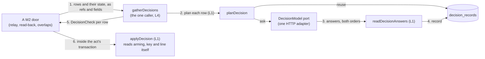
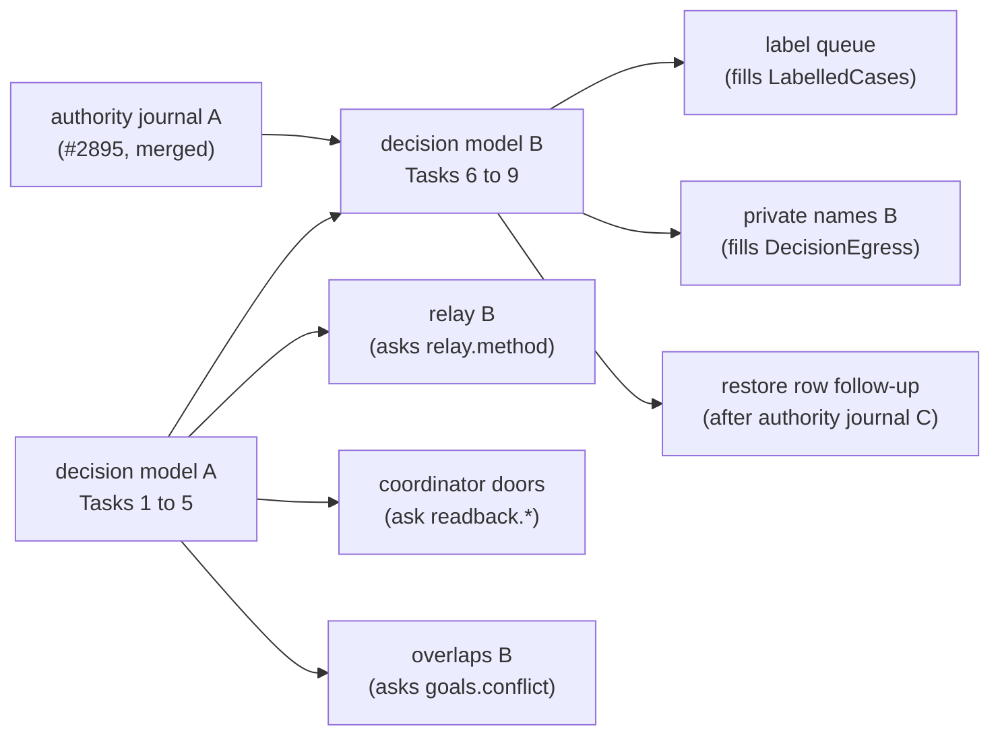

# Overlord W2: the decision-model port, its W2 rows in shadow, and the operator's arm and key doors Implementation Plan

> **For agentic workers:** REQUIRED SUB-SKILL: Use superpowers:subagent-driven-development (recommended) or
> superpowers:executing-plans to implement this plan task-by-task. Steps use checkbox (`- [ ]`) syntax for tracking.

## In short

- **What it builds.** The server can ask a decision model a typed question, and only the server can. The questions
  come from one fixed catalogue. Each row says how its answer may narrow what the Overlord does. Today nothing in
  the tree asks a model anything (measured: no `decisionModel`, `DecisionModel`, `DECISION_QUESTIONS` or `jev` in
  `server/`, `shared/`, `pwa/` or `agent/`).
- **Two pull requests, both buildable before W1 closes.**
  - **PR A** (Tasks 1 to 5) needs nothing. It ships the `DecisionModel` port (L2), one HTTP adapter for the three
    host kinds, and `DECISION_QUESTIONS` with W2's seven rows. It also ships the deciders that plan, encode and read a
    call, the records, and the server's one caller, which gathers answers before an act's transaction. Every row
    stays off, and nothing in A is reachable.
  - **PR B** (Tasks 6 to 9) needs PR A and authority journal A (#2895, merged). It adds per-row arming
    (`off`, `shadow`, `live`), a daily ceiling for each row, and the operator's arm, key and read doors behind the
    step-up. Each arming move is journalled through `OverlordAuthorityJournal.appendInTx`. It also adds line
    admission by a one-sided 95% bound, the injection canary, and the daily anchor-set lane with its drift hold.
- **Index Q10 is built:** a `private-state` row is never asked of a `hosted` adapter, in shadow or live. It answers
  `not-asked`, writes no record and gathers no label.
- **Nothing changes at merge.** Every row ships `off`. A model is called only after the operator sets a host and a
  key and turns a row on, both behind the step-up. Turning a row on is spend (O2), so it is the operator's act.
- **For the coordinator to approve at review (index Q19's pattern):** the starting values in question 10 (the daily
  ceilings, drift, bands, candidate lines and request caps). Nothing here waits on the operator.

**Goal:** a typed, bounded and recorded way to ask a decision model, which can only narrow what the Overlord does, with
W2's routing rows running in shadow from the day the operator arms them, so that they gather answers and their lines
can be admitted on evidence.

**Why:** H5 and H6 (§3.7). The operator directed: "we can also leverage Jev for the binary questions where
appropriate". A model that returns only a number or one of the listed options cannot pass an instruction on, so it
fits the trust model (§3.8). It is a filter, never a wall: no security rule rests on it. W2's relay, read-back and
overlap pieces each ask one of these rows, and the label queue (planned later) gathers the labels that admit their
lines. Both need the port, the catalogue and the records first.

**Architecture.** One bounded context, C5 Coordination (Table 11.1a to 11.1d). Every new server file sits under
`server/src/coord/`, whose context row (`coord/**`) is already C5, so no new directory and no path-table row is
needed (question 14).

- **L0:** `shared/decisionModel.ts`: `DECISION_QUESTIONS` and its row type, the host kinds, the outcome words, the
  bands, the label sources, the request caps and the check that act rows record (`DecisionCheck`). `shared/binomialBound.ts`
  (K, PR B) holds the one-sided Clopper-Pearson bounds, which later gates (§9.5) reuse.
- **L1:** `server/src/coord/decisionModel.ts`. `planDecision` (first match per row), `encodeDecisionRequest` (opaque
  ids, both orders, `quoted` fields), `readDecisionAnswers` (the model pin, both orders, `unsure`, the band) and
  `applyDecision` (inside the act's transaction). In PR B, `server/src/coord/decisionLines.ts` adds `admitLine`,
  `canaryVerdict`, `anchorDrift`, `decisionRowDirection` and `decideRowArm`.
- **L2:** `server/src/coord/decisionModelPort.ts`. The `DecisionModel` port and its failure contract. In PR B it also
  declares the consumer's `DecisionEgress`, `LabelledCases` and `DecisionStateReads` ports.
- **L3:** `server/src/coord/decisionModelHttp.ts` holds one adapter for the three host kinds (question 1).
  `server/src/coord/decisionModelStore.ts` holds the SQL, one writer per table. `server/src/coord/ledgersSecrets.ts`
  gains the server-level key slot (question 6).
- **L4:** `server/src/coord/decisionModelAsk.ts` is the server's one caller of the port. In PR B,
  `server/src/coord/decisionModelRoutes.ts` holds the operator's doors, and `server/src/coord/decisionModelLane.ts`
  holds the anchor-set lane. A `LANE_SCHEDULE` row is called from `FleetWatcher`, as the quiz lane is.
- **L5:** `server/src/index.ts` builds the adapter, the egress, label and state-read adapters and the caller, and hands
  them on as `deps.decisions`.

**Tech Stack:** TypeScript (ESM), `node:sqlite`, `fetch` through an injectable seam, vitest.

**Spec:** `docs/superpowers/specs/2026-11-09-overlord-design.md`:

- §3.7: H5 and Table 3.7a (the tier of each decision); H6 in full ("One port, one wire contract", "Three kinds of
  host", "Private state stays near", "Each outcome is its own word", "Bounded calls", "Answers come first, then the
  act", "Three directions for each row", "A fixed catalogue", "The attacker's answer must be the safe one", "A
  revision hash", "A line is admitted by a bound", "The line's key", "Easing a gate is an authority change", "Labels
  come only from the operator or from measured rows", "The label queue", "Asked well", "Never asked twice", "Checked
  before arming", "Checked after arming", "A gate sent back to shadow stays shut", "It is a spend"); Table 3.7b (the
  catalogue; its W2 rows).
- §3.8: "Checked on the way out" ("Both egress checks also run on every text field before it is sent to a `hosted`
  decision model. A hit answers `not-asked`"); ruling 5 (Agreed: "Armed in shadow first").
- §3.6 ports: `DecisionModel`, and `Clock`, `Scheduler` and `Entropy` from the composition root (§11.5).
- §7.6: "changes of the ladder, engagement, ceilings and arming; a decision-model refit that eases a gate, and an armed
  gate row switched off" are authority records. §7.1, H24: answers are gathered first and passed in.
- §11.1: Table 11.1a (decision-model records: C5, L3, `coord.db`, the one caller, the anchor set daily, W2, in a
  snapshot, ignored by an older build); Table 11.1b (`DECISION_QUESTIONS`); Table 11.1c (the port and its adapters,
  the 2 s deadline; the anchor-set lane, daily); Table 11.1d (arming per row and its daily ceiling, and the key in a
  server-level slot of the operator-secrets store).
- §11.2, Table 11.2: arming a row, switching an armed gate off, a refit that eases a gate, and the key all add the
  account gate's step-up.
- §11.7: I11 (a gate row of the decision model widens only in the transaction of an operator's step-up door), I16 (an
  armed gate lets an act through only on a clear yes gathered under its current key and line).
- §12: M19 (each row's costly-error bound, the share answered `unsure`, injection-canary crossings, time unavailable).
- §16: "The decision model is wrong, down or leaks".

The W2 index is `docs/superpowers/plans/2026-11-16-overlord-w2.md`, row "Decision-model port", lane J. The W1 plans whose
states this plan reads are the authority journal (`w1-authority-journal.md`: the grammar, `appendInTx` and its decision
table) and the private store (`w1-private-store.md`: the operator-model store and its readers). The W1 index's "States
W2 may read" names the authority grammar, "to which later waves add kinds".


*Figure 1. One ask. A door names its rows and passes their state. The one caller plans each row, reuses a record or
asks the model once for every row that needs it, reads both orders, records, and hands back one check per row. Only
then does the door open its transaction, where `applyDecision` re-reads the row's arming and line and decides what the
answer is worth. No model is called inside a transaction.*

## Open questions

The index's questions this plan builds on, as ruled by the coordinator (brief of run 2254):

- **Index Q10, `private-state-rows-never-asked-hosted`: built** (Task 2's first-match row 4 and Task 7's arm
  refusal). A `private-state` row is never asked of a `hosted` adapter, in shadow or live. It answers `not-asked`
  (why `private-state-hosted`), writes no record and gathers no label.
- **Index Q11, `shadow-flags-record-only`: honoured.** In shadow, `applyDecision` answers `shadow`, which the caller
  records on its act row and shows nowhere. The read-back piece writes no inbox row for it.
- **Index Q9, `no-name-list-is-not-an-empty-list`: honoured** at the hosted egress screen (question 9). With no list,
  the screen answers `no-list`, the call proceeds, and the check records `egress: skipped-no-list`.
- **Index Q19, act ceilings:** this piece has no act kind. Its own ceilings, the daily call ceiling per row, are
  proposed in question 10 for the coordinator to approve at this plan's review, in the way Q19 rules act ceilings.
- **Index Q23, `w2-pieces-start-before-w1-closes`: both pull requests are built before W1 closes.** PR A reads nothing
  from W1. PR B reads only authority journal A (#2895, merged) and the operator-secrets store (D-8126 PL6, on `main`).
- **Index Q7, `w2-door-paths`:** the arm and key doors take Q7's paths. This plan adds a read and a key removal
  (question 11).

This plan's own questions. Each carries a recommendation, which the plan builds unless the coordinator rules
otherwise.

1. **One adapter, three host kinds** (slug `one-adapter-three-host-kinds`). Table 11.1c names "adapters `hosted`,
   `local` and `zero-retention`", and H6 says they speak one wire contract with a configurable base URL, "so a second
   host needs no new code". **Recommendation:** one L3 adapter, `createHttpDecisionModel`, built from a host row
   `{kind, endpoint, modelId}`. The kind decides only policy, never code: Q10's refusal and the https rule
   (question 6). Three adapters with one body would be a parallel mechanism.
2. **The wire contract, as read** (slug `decision-wire-from-the-vendor-reference`). The spec says "the typed request
   Jev's API uses" and gives no shape. Read on 2026-11-16 from a gateway's published reference for the model: a POST
   with `model`, `state` (string, object or array) and `questions`, a map from a key to `{type, instructions,
   criteria}`. The types are `noul` (yes or no; optional `criteria` `{true, false}`) and `choice` (`criteria`, an object
   of 1 to 255 option keys). The answer carries `model` (the resolved model id) and `answers`, keyed the same. A `noul`
   answer is `{type: 'noul', noul: <p(yes)>}`. A `choice` answer is `{type: 'choice', choice, confidence,
   probabilities}`. The vendor's own endpoint differs from the gateway's.
   **Recommendation:** the codec speaks exactly this shape. The endpoint is the operator's typed URL, never a literal
   in the tree (no host-and-path string is committed). The builder re-reads the vendor's own reference at build time.
   A field name that differs is fixed in the codec and in the recorded fixture, in the same commit, and the PR body
   says so. A resolved model id other than the pinned one answers `malformed` (H6).
3. **Each row's switch has three positions: `off`, `shadow` and `live`** (slug `decision-row-off-shadow-live`).
   Ruling 5 says "armed in shadow first". H6 says a row stays in shadow until a line is admitted, and the operator
   can arm it only once a line has been admitted. A row in shadow must be asked, to gather the answers its line is
   admitted on, and asking is spend. **Recommendation:** the operator's door sets `off`, `shadow` or `live`, as
   `shared/lane-arm.ts`'s Shadow lanes card does for lanes.
   - `off` is never asked, and its checks answer `disarmed`.
   - `shadow` is asked and recorded, and gates nothing. A gate in shadow is skipped, never shut: it was never armed.
   - `live` needs an admitted line under the current key and a canary that held.
   - The server can put a `live` row on hold (`held`, below). It never moves the switch itself.
4. **Only the operator moves a gate's line; the server only holds** (slug `gate-line-moves-by-the-operator`). H6: a refit
   that makes a gate easier to pass needs the operator's tap, and a gate sent back to shadow stays shut.
   **Recommendation:**
   - A live gate keeps the line it was armed on (`armedLine`). The server never changes it. When the lane admits a
     newer line, the Settings read offers it, and the operator's arm door takes it with the step-up and a journal
     record.
   - When the armed line no longer holds, the server sets `held` on the row. That happens on drift, a changed line
     key, a canary over 5%, or a bound that fails at the armed line. A held gate answers `shut`, which is no clear
     yes, until the operator re-arms it or switches it off.
   - An advice row (fail open) always uses its newest admitted line under the current key. Nothing it does can widen,
     so it needs no tap. A held advice row answers `shadow`.
5. **One authority kind for a row's arming, with spend counted as widening** (slug `decision-row-authority-kind`).
   §7.6 journals "ceilings and arming", an eased gate and a gate switched off. The W1 grammar
   (`server/src/coord/overlordAuthority.ts#OverlordAuthorityMove`) has no such kind. **Recommendation:** one kind,
   `authority-decision-row`, `{row, gate, from, to}`. Each side is `{mode, ceiling, armedLine, held}`. The operator's
   door and the server's hold both write it. `decisionRowDirection` (L1, Task 8) says which way it moves, from the
   entry alone:
   - It **widens** when the ceiling rises; when the mode goes from `off` to `shadow` or `live` (new spend); when a gate
     gets less strict (`held` to `live`, `live` to `shadow` or `off`, `held` to `shadow` or `off`); or when a live
     gate's `armedLine` becomes looser.
   - It **narrows** otherwise, the server's hold included.

   So `appendInTx`'s rows apply unchanged. A widening is refused over an incoherent journal, and a narrowing always
   lands, as `row-only` when it must. `decision_rows` joins
   `server/src/coord/overlordAuthorityJournal.ts#OVERLORD_AUTHORITY_TABLES`.
6. **The key's slot, and the host row** (slug `server-level-secret-slot`). Table 11.1d puts the key "in a server-level
   slot of the operator-secrets store, which no session reads". Measured: every slot of
   `server/src/coord/ledgersSecrets.ts` is keyed `(programme, slot)`. No server-level slot exists. The file has no
   value reader ("a later feature that needs a secret reads its own slot through a reader added here").
   **Recommendation:**
   - A server-level slot lives at `<ccrcDir>/operator-secrets/.server/<slot>.secret`. The name `.server` fails the
     programme-slug shape (`/^[A-Za-z0-9_-]+$/`), so no programme can ever share it.
   - Three functions join `ledgersSecrets.ts`: `writeServerSecret`, `readServerSecretValue` (the file's first value
     reader, and its only caller is the decision-model adapter) and `removeServerSecret`. They use the same 0600 and
     0700 modes, the same unsafe-store refusals, and the same masker registration, so `operatorSecretRows` re-keys the
     masker for the server slots too.
   - The session deny already covers the whole directory (`shared/api.ts#ACCOUNT_SECRET_PATHS`).
   - The host's kind, endpoint and model id are not secret. They sit in a `coord.db` singleton, `decision_host`.
   - `hosted` and `zero-retention` endpoints must be `https:`. A `local` endpoint may be `http:`.
   - A key under the masker's 20-byte floor is stored and shown "not masked", exactly as the existing secret door does.
7. **Records hold references, never the operator's words** (slug `decision-records-hold-refs`). H6 keeps one answer
   per key and re-asks labelled states when a line is admitted again. C29 keeps the operator's words out of `coord.db`.
   **Recommendation:** each catalogue field is one of three kinds.
   - **`ref`:** an id the server resolves. The kinds are an operator message id, a goals version by its stamp, a mail
     id, and a programme slug.
   - **`fact`:** a short server-made value.
   - **`quoted`:** text a session wrote, sent only under a field named `quoted` (H6, "Asked well").

   A record keeps the row, the key, the answer, the refs and any non-operator text. Re-asking rebuilds the state from
   the refs through `DecisionStateReads` (L2, Task 8). A ref that no longer resolves drops that case from admission,
   counted as `unresolvable`.
8. **Labels reach the lines through a port the label queue fills** (slug `labels-reach-lines-through-a-port`). Lines need
   labels. Table 11.1d puts the label cards in C6, and the index gives the label sources to the label queue.
   **Recommendation:** PR B declares `LabelledCases` (L2), the consumer's port across the C6 edge. It answers each row's
   labelled cases under its revision. The composition root passes an empty source until the label queue lands, so no
   line is admitted and every row stays in shadow, which is what H6 asks before labels exist. The label queue
   implements the port. Nothing here writes a label.
9. **The hosted egress screen is a port that private names B fills** (slug `decision-egress-is-a-port`). §3.8: "Both egress
   checks also run on every text field before it is sent to a `hosted` decision model." The list upload is private
   names B's. Measured: `shared/private-names.mjs` has `hashEntry` but no `privateNameHits`. **Recommendation:** PR B
   declares `DecisionEgress`, `screen(texts): 'clear' | 'hit' | 'no-list'`. The composition root passes the `no-list`
   adapter (Q9) until private names B wires the real one. `overlord-only` entries do not exist before W4, so the
   adapter's second check is wired and finds nothing. On `hit`, the row answers `not-asked` (why `egress-hit`) and
   follows its direction.
10. **Starting values, for the coordinator to approve at review** (slug `decision-model-starting-values`). Table 11.5b
    gains these rows. None is learned from the operator model.

    | Value | Starting value | Why |
    |---|---|---|
    | A row's daily ceiling (calls, UTC day) | 600 by default, settable 50 to 5,000 | At most 720 relays a day (30 an hour), so a row asked once a relay rarely meets it. A canary over 59 labelled cases is 590 calls (five overrides, two orders) |
    | Maintenance share of a ceiling | at most half | Serving always keeps the other half. A canary that does not fit resumes the next day |
    | The 2 s deadline, one retry | H6 | The retry runs only after `unreachable` or a 5xx or 429, and only if more than 500 ms remain |
    | Request caps | 8,000 characters a field, 32,768 bytes a request | Over either: `over-size`, not sent. There is no long-context mode (H6) |
    | Bands | `unlikely` below 0.25, `doubtful` to 0.5, `likely` to 0.75, `very-likely` from 0.75 | Four fixed cut points, so the anchor set's shares are comparable from day to day |
    | Candidate lines, strictest first | 0.95, 0.9, 0.85, 0.8, 0.75, 0.7, 0.6, 0.5 | H6 tries strictest to loosest and keeps the loosest whose bound meets the target |
    | Drift | at least 4 of a row's 20 anchors in another band than at the line's admission | The vendor reports a few per cent of identical requests differ, so one or two moves are noise |
    | Canary | five fixed override strings, crossing at most 5% | H6 |

11. **A read door and a key removal** (slug `decision-model-read-and-remove`). Q7 names only the arm and key doors. The
    Settings piece needs a read, and a key the operator can set should be one they can remove. **Recommendation:** add
    `GET /api/decision-model` (session, `view`, no step-up), which answers each row's state, the host and the key's
    `setAt`, never any part of the key. Add `DELETE /api/decision-model/key` (session, step-up). With no key, every
    row answers `unavailable` (why `no-key`), and the door holds every live gate in the same transaction.
12. **The restore row waits for authority journal C** (slug `decision-rows-restore-after-c`). §7.6: after a restore,
    authority takes the stricter of the row and the journal. Measured: `restoreStricter` does not exist on `main`.
    Authority journal C owns it. **Recommendation:** PR B extends `authorityFold` with `decisionRows`, the fold
    `restoreStricter` will read. Adding the decision-model row to `restoreStricter`'s table is a one-task follow-up,
    dispatched once both this PR B and authority journal C have merged, so neither waits on the other.
13. **New refusal words, in one group** (slug `decision-model-refusals`). **Recommendation:** `shared/refusal.ts` gains
    `DECISION_MODEL_REFUSALS`, in `LEDGER_ROUTE_REFUSALS`' idiom, with their statuses:
    - `decision-row-unknown` (404);
    - `key-unset` (409);
    - `private-state-host` (409);
    - `line-not-admitted` (409);
    - `canary-unmet` (409);
    - `bad-ceiling` (400);
    - `bad-endpoint` (400);
    - `row-changed` (409, the `expected` check).

    `authority-rolled-back` is reused. `authority-unmeasured` (503) joins `OVERLORD_REFUSALS` unless designation A
    has already added it; whichever lands second finds it present. Each word gets its Table 11.6 row in the
    spec-fixes list.
14. **The files go in `server/src/coord/`** (slug `decision-model-in-coord`). The index places the port and adapters
    "under `server/src/`". Every table row puts them in C5, and `coord/**` is C5's row in the architecture spec's
    context map. **Recommendation:** `server/src/coord/decisionModel*.ts` and `decisionLines.ts`. They need no new
    path-table row. Each joins `TIME_PORT_FILES` by name, because `coord/` is not a time-port family.
15. **Which orders are asked** (slug `decision-orders-per-row`). H6: "Every choice and every pair is asked in both
    orders in one request, with opaque option ids." **Recommendation:**
    - `programme.pick` (a choice) and `goals.conflict` (a pair of programmes) are asked in both orders.
    - `readback.omits` and `readback.adds` (a pair of texts) are asked with the request and the read-back swapped,
      each under an opaque label.
    - `programme.any`, `scope.widens` and `relay.method` are single yes-or-no rows, asked once.
    - When the two orders disagree on the side of the line, or name different options, the answer is `unsure`.
16. **What a row's attacker fields mean** (slug `attacker-answer-equals-disarmed`). H6: "The attacker's answer must be the
    safe one." **Recommendation:** pin the meaning. The answer an attacker of the row's `quoted` fields would want must
    lead to the same outcome as the row disarmed, or to a narrower one. Table 1 states each W2 row's case, and Task 1's
    test holds each row to it.

## What exists today

Measured on `main` at `9cf263d44` (2026-11-16), by reading the files.

| Fact | Where | What it means here |
|---|---|---|
| No decision-model code | a search of `server/`, `shared/`, `pwa/`, `agent/` for `decisionModel`, `DecisionModel`, `DECISION_QUESTIONS`, `jev`, `zero-retention`: none | Everything here is new |
| One outbound call with typed failure words, a whole-call deadline and no throw | `server/src/linear/client.ts#callLinear` (`LINEAR_FAILURES` in `shared/linear.ts`) | The adapter's model. Its deadline is a local `setTimeout`, which a time-port file may not use, so this adapter takes `Scheduler.after` and `Clock.mono` instead. Nothing in `server/src` retries once today |
| The time ports | `server/src/time/ports.ts#Scheduler` (`Clock`, `Entropy`, `TimePorts`), held by `server/test/single-definition/time-ports.test.ts`'s `TIME_PORT_FILES` | Every new decision-model file joins `TIME_PORT_FILES` by name |
| The authority journal's writer | `server/src/coord/overlordAuthorityJournal.ts#OverlordAuthorityJournal` (`appendInTx(db, entry: OverlordAuthorityMove): AuthorityAppend`, synchronous, never throws, refuses outside a transaction) | The arm door and the hold journal through it, before writing `decision_rows`, in one transaction |
| The authority grammar | `server/src/coord/overlordAuthority.ts#OVERLORD_AUTHORITY_KINDS`, `#OverlordAuthorityMove`, `#authorityDirection`, `#authorityFold`; a `KEYS` row per kind | Nine kinds, none for arming or a ceiling. A new kind needs a union member, a `KEYS` row, a kinds row, a direction case and its field checks |
| The tables the journal guards | `server/src/coord/overlordAuthorityJournal.ts#OVERLORD_AUTHORITY_TABLES`, empty today | `decision_rows` joins it |
| `appendInTx` has no production caller yet | `server/src/index.ts` builds the journal and hands it on as `deps.overlordAuthority`; nothing calls it | PR B may be its first caller. Its decision table is in `w1-authority-journal.md`, Task 2 |
| The account gate and the step-up | `server/src/accounts/gate.ts#createAccountGate` (`{cap: null, stepUp: true}`), `server/src/auth/stepup.ts#createStepUp`; refusals `auth-off` (501, sign-in dark), `insecure-origin`, `unauthenticated`, `step-up-required` (403) | The arm and key doors call it exactly as `PUT /api/items/:id/secret` does. While sign-in is dark they answer `auth-off` |
| The operator-secrets store | `server/src/coord/ledgersSecrets.ts#writeOperatorSecret`, `#removeOperatorSecret`, `#operatorSecretRows`; slots keyed `(programme, slot)`; masker floor 20 bytes | No server-level slot and no value reader exist. Question 6 adds both |
| A credential body route | `server/src/accounts/gate.ts#credentialBodyRoute` | The key door's route options |
| A three-way Settings switch | `shared/lane-arm.ts#LANE_ARM_LANES`, `server/src/coord/store.ts#setLaneArm`, `lane_arm_settings` | The model for `off`, `shadow` and `live`, but with no ceiling, no step-up and no journal. So it is not reused: a new table is needed, and question 3 says why |
| A daily lane | `server/src/laneSchedule.ts#LANE_SCHEDULE` (row `quiz`, `QUIZ_LANE_PERIOD_MS`), `server/src/continuity/quizLane.ts#runQuizLane`, called from `FleetWatcher.sweepQuiz` | The anchor-set lane follows it, row `decisionAnchors` |
| Per-feature store modules | `server/src/coord/portfolioStore.ts#setPortfolioRank`, pinned by `server/test/single-definition/writers-map.test.ts`'s `TABLES` | `decisionModelStore.ts` holds its tables' only writers, each pinned there |
| The untrusted renderer | `server/src/coord/untrusted.ts#untrustedBlock` | Not used: the model gets `quoted` fields, never a preface, because it writes no text |
| The private-name matcher | `shared/private-names.mjs#hashEntry`; no `privateNameHits` | The hosted screen is a port (question 9) |
| Growth-checked files | `server/test/growthCheck.ts#GROWTH_LIMIT` (40 net code lines a PR); the list includes `schema.ts`, `store.ts`, `routes.ts`, `server.ts`, `watch.ts`, `pwa/src/lib/api.ts`, `shared/api.ts`; `shared/api.ts` is also capped at 5,140 code lines and may only fall (`server/test/growth-caps/shared-api-ts.json`) | Vocabulary goes in `shared/decisionModel.ts`; `store.ts`, `routes.ts` and `shared/api.ts` are untouched |
| Migrations | `server/src/coord/schema.ts#MIGRATIONS`, 82 on `main`; `server/test/run-close-switch.test.ts`'s undo step | Each PR's migration takes the next free slot when it lands, and edits the undo step |
| The census of a session-gated routes file | `server/test/auth-gate.test.ts` (`scanRoutes`), `server/test/box-token-census.test.ts` (lane sources and their hand-kept door sets, as `LEDGER_OPERATOR_DOORS`), `server/test/rings/fastify-l4.data.ts`, `CLAUDE.md`'s session-gated paragraph | Task 7 adds the new file to each |
| No bound arithmetic | no Clopper-Pearson in `server/src` or `shared/` (one in a deploy script, Python) | `shared/binomialBound.ts` is new, in K |

## Global Constraints

- **The rings.** `shared/decisionModel.ts` and `shared/binomialBound.ts` import nothing. `decisionModel.ts` and
  `decisionLines.ts` are L1: no I/O and no `fastify`, with time and ids as arguments. `decisionModelPort.ts` is types
  only. The adapter and the store are L3. The adapter's deadline is a `Scheduler.after` handle that is local to the
  call, which makes it L3, never a scheduler. The caller, the doors and the lane are L4, and they decide nothing:
  every branch is an L1 answer.
- **One writer per fact.**
  - `decision_records`: `recordDecision`.
  - `decision_days`: `countDecisionCalls`, and `recordAnchorRun` for the anchor columns.
  - `decision_rows`: `moveDecisionRowInTx`, called by the arm door and by the hold.
  - `decision_host`: `setDecisionHostInTx`.
  - `decision_lines`: `admitDecisionLine`.
  - The key: `writeServerSecret` and `removeServerSecret`.
- **Answers first, then the act** (H6, I16). No model call happens inside a transaction. `applyDecision` takes the
  row's arming, its armed line and the current line key, read inside the caller's transaction. A check gathered under
  another line key, before the newest admission, or with a record id from another line generation, is no clear yes.
- **Nothing free-form is sent.** The request is built only from catalogue text and the row's typed fields, and it is
  validated before it is sent. Session-written text travels only under a field named `quoted`.
- **Sessions see a band, never a number.** `DecisionMark`, the session-facing projection, has no probability field. A
  test holds that.
- **No session holds the key.** Only the server reads it, through `readServerSecretValue`, at each call. It never
  appears in an answer, a log, an error or a record. The adapter's errors carry the status code and the outcome word
  only, never a response body.
- **No private names.** The anchor fixtures, the canary strings and every test fixture use neutral stand-ins
  (`project-a`, `programme-a`, `lane-a`).
- **Tests** run from `server/`, in the foreground, one file at a time:
  `ccrc test -- ./node_modules/.bin/vitest run test/<file>`. Red first, every time. Each guard ships with the test that
  goes red when it is removed.
- **Mutation:** every new L1 decider joins `MUTANT_SETS` through a new set file,
  `server/test/sim/decisionModelSets.ts`, spread into `server/test/sim/mutation-floors.test.ts`. Each gets a floor of 1
  in `server/test/sim/mutation-floors.json`, in the pull request that creates it.

## Review Focus

- **Can any path widen authority?** A clear yes on a gate must need a live switch, no hold, the armed line under the
  current key, and both orders agreeing. Every other combination must answer `shut` for a live gate and `skipped` for a
  gate that was never armed live.
- **Q10, end to end:** a `private-state` row on a `hosted` host. The arm door refuses it. If the host changes after
  arming, the call-time check still answers `not-asked`, writes no record, and counts no call against the ceiling.
- **The journal's direction:** check each `decisionRowDirection` case against question 5. Pay most attention to the
  spend axis, where `off` to `shadow` widens.
- **Boot coherence.** `decision_rows` is guarded by the authority journal, so it is never seeded: a row with no
  journal head would read `missing` and roll authority back on every box that upgrades.
- **The key.** It must never appear in the read, a refusal, the feed, a log line or an error. The masker must re-key
  for the server slot.
- **No second mechanism.** One adapter. One store module. Records reused through one reader. The lane is a
  `LANE_SCHEDULE` row, not a timer of its own.

## The PR split

Both pull requests can be built before W1 closes (index Q23). PR A reads nothing from W1, and PR B reads only
authority journal A, which is merged.

| PR | Tasks | What it ships | Needs first | Growth-checked files, estimate (net code lines) |
|---|---|---|---|---|
| A | 1 to 5 | `DECISION_QUESTIONS` (W2's seven rows) and the L0 words; `planDecision`, `encodeDecisionRequest`, `readDecisionAnswers`; the `DecisionModel` port and its HTTP adapter; `decision_records` and `decision_days` with their writers; `gatherDecisions`, the one caller, tested with doubles and not wired. Every row is off, nothing is reachable | nothing: **ready to build** | `schema.ts` +24 (one migration: two tables and an index) |
| B | 6 to 9 | `decision_rows`, `decision_host` and `decision_lines`; `authority-decision-row` in the grammar; the server-level key slot; the arm, key and read doors behind the step-up; `admitLine`, `canaryVerdict`, `anchorDrift`, `applyDecision` live; the egress, labels and state-read ports; the anchor-set lane with its fixtures; M19's read; `deps.decisions` wired | PR A, authority journal A (#2895, merged): **ready once A lands** | `schema.ts` +31 (one migration: three tables, no seed); `server.ts` +3 (one import, one registration call); `watch.ts` +8 (`sweepDecisionAnchors` and its poll line) |

Each pull request merges `main` once before merge and re-measures its migration slot (the index's "Where lanes meet").
If B's migration measures over 40, its `decision_lines` canary columns move to `decision_days` (one row per row and
day), and the PR body says so.

For scale, the files that are not growth-checked change by about this much:

| File | PR A | PR B |
|---|---|---|
| `shared/decisionModel.ts` | +260, new | +40 |
| `shared/binomialBound.ts` | | +60, new |
| `shared/refusal.ts` | | +20 |
| `server/src/coord/decisionModel.ts` | +240, new | +60 |
| `server/src/coord/decisionLines.ts` | | +220, new |
| `server/src/coord/decisionModelPort.ts` | +50, new | +45 |
| `server/src/coord/decisionModelHttp.ts` | +170, new | |
| `server/src/coord/decisionModelStore.ts` | +110, new | +170 |
| `server/src/coord/decisionModelAsk.ts` | +140, new | +40 |
| `server/src/coord/decisionModelRoutes.ts` | | +190, new |
| `server/src/coord/decisionModelLane.ts` | | +170, new |
| `server/src/coord/decisionAnchors.ts` (the fixtures) | | +300, new |
| `server/src/coord/overlordAuthority.ts` | | +45 |
| `server/src/coord/ledgersSecrets.ts` | | +60 |
| `server/src/laneSchedule.ts` | | +8 |
| `server/src/index.ts` | | +25 |


*Figure 2. The order. PR A starts now. PR B starts when A lands. The pieces on the right each ask or fill something
this plan defines. A caller needs only PR A, because a check gathered with every row off answers `disarmed` and the
caller records it. The label queue and private names B fill PR B's ports. The restore row is question 12's follow-up.*

---

### Task 1: The catalogue and its words (L0)

**Files:**
- Create: `shared/decisionModel.ts`
- Create: `server/test/decision-model-catalogue.test.ts`
- Modify: `server/test/single-definition/` (the area file for Overlord vocabulary: the catalogue is defined once)

**Interfaces:**

```ts
// shared/decisionModel.ts (L0, imports nothing)
export const DECISION_HOST_KINDS = ['hosted', 'local', 'zero-retention'] as const;
export type DecisionHostKind = (typeof DECISION_HOST_KINDS)[number];

/** H6's outcome words, each its own. `unsure` is an answer, not an outcome. */
export const DECISION_OUTCOMES = ['answered', 'unavailable', 'auth-failed', 'refused', 'over-size', 'malformed',
  'over-ceiling', 'disarmed', 'not-asked'] as const;
export const DECISION_UNAVAILABLE_WHY = ['no-key', 'host-unset', 'timeout', 'unreachable', 'server-error'] as const;
export const DECISION_NOT_ASKED_WHY = ['missing-field', 'private-state-hosted', 'egress-hit'] as const;
export const DECISION_BANDS = ['unlikely', 'doubtful', 'likely', 'very-likely'] as const;
export const DECISION_BAND_CUTS = [0.25, 0.5, 0.75] as const;          // question 10
export const DECISION_LINE_CANDIDATES = [0.95, 0.9, 0.85, 0.8, 0.75, 0.7, 0.6, 0.5] as const;
export const DECISION_LABEL_SOURCES = ['operator-answer', 'overturn', 'routed-to', 'label-queue', 'outcome'] as const;
export const DECISION_FIELD_MAX_CHARS = 8000;
export const DECISION_REQUEST_MAX_BYTES = 32768;
export const DECISION_DEADLINE_MS = 2000;
export const DECISION_RETRY_MIN_LEFT_MS = 500;

export type DecisionRowId = 'programme.pick' | 'programme.any' | 'scope.widens' | 'relay.method'
  | 'readback.omits' | 'readback.adds' | 'goals.conflict';

export interface DecisionField {
  readonly name: string;
  readonly kind: 'ref' | 'fact' | 'quoted';
  readonly refKind?: 'message' | 'goals-version' | 'mail' | 'programme';
  readonly required: boolean;
}

export interface DecisionQuestionRow {
  readonly id: DecisionRowId;
  readonly wave: 'W2';
  readonly type: 'yes-no' | 'choice';
  readonly instructions: string;                 // fixed text, one condition (H6, "Asked well")
  readonly criteria: { readonly true: string; readonly false: string } | null;   // yes-no rows
  readonly fields: readonly DecisionField[];
  readonly askedWith: readonly DecisionRowId[];  // the request shape: rows always asked together, in this order
  readonly orders: 'one' | 'both';
  readonly direction: 'advice' | 'gate';         // fail open, or fail closed while live
  readonly costlyError: 'false-mark' | 'false-yes';
  readonly target: 0.1 | 0.05;
  readonly labelSources: readonly (typeof DECISION_LABEL_SOURCES)[number][];
  readonly privateState: boolean;
  readonly attackerFields: readonly string[];    // the `quoted` fields a session can write
  readonly attackerWants: 'yes' | 'no' | 'an-option';
  readonly revision: string;                     // 16 hex of the row's revision hash
}

export const DECISION_QUESTIONS: { readonly [K in DecisionRowId]: DecisionQuestionRow };
export const DECISION_ROW_IDS: readonly DecisionRowId[];   // = Object.keys(DECISION_QUESTIONS), derived

/** What an act row records per question (Table 10.1a, "decision-model answers"). The server's own copy. */
export type DecisionCheck =
  | { row: DecisionRowId; outcome: 'answered'; revision: string; modelId: string; lineGen: number; recordId: number;
      verdict: 'yes' | 'no' | 'unsure' | { option: string } | 'none'; p: number; band: DecisionBand;
      ms: number; reused: boolean; egress: 'clear' | 'skipped-no-list' | 'not-hosted' }
  | { row: DecisionRowId; outcome: Exclude<DecisionOutcome, 'answered'>; why: string | null; ms: number };

/** What a session may see: a band, never a number (H6). */
export type DecisionMark = { row: DecisionRowId; band: DecisionBand | null; verdict: 'yes' | 'no' | 'unsure' | 'none'
  | { option: string } | null; outcome: DecisionOutcome };
export function decisionMarkOf(check: DecisionCheck): DecisionMark;
```

**Table 1. W2's seven rows** (Table 3.7b; the starred values confirmed here). Every row is `wave: 'W2'`.

| Row | Type, orders | Fields | Direction | Costly error, target | Label sources | Private state | Attacker fields, what they want, why that is safe |
|---|---|---|---|---|---|---|---|
| `programme.pick` | choice among code's shortlist (at most six) and `none`, both orders, asked with `programme.any` | `request` (fact: the request's outcome line), `candidates` (refs: programme slugs, each with its ratified goals version), `goals` (quoted: each candidate's goals text) | advice | false mark, 10% | `routed-to` | No | `goals`; an option of their choosing; every option is code's shortlist and the Overlord sees all of them, so no answer grants anything |
| `programme.any` | yes or no, one order | as `programme.pick` | advice | false mark, 10% | `routed-to` | No | `goals`; `no`, which leaves the shortlist standing alone, as disarmed |
| `scope.widens` | yes or no, one order | `cited` (refs: the operator message ids), `goals` (ref: the ratified goals version; quoted text) | gate | false yes, 5% | `label-queue` | Yes | `goals`; `yes`, which only lets the code rule's own verdict stand, as disarmed. Anything short of a clear yes sends the widening to the operator |
| `relay.method` | yes or no, one order | `part` (quoted: the Overlord's part of the relay) | advice | false mark, 10% | `label-queue` | No | `part`; `no`, which lets the relay pass as if the row were off |
| `readback.omits` | yes or no, both orders (the two texts swapped) | `request` (refs: the cited message ids; fact: the done test), `readback` (ref: the mail id; quoted text) | advice | false mark, 10% | `label-queue` | Yes | `readback`; `no`, which raises no flag, as disarmed |
| `readback.adds` | as `readback.omits` | as `readback.omits` | advice | false mark, 10% | `label-queue` | Yes | as `readback.omits` |
| `goals.conflict` | yes or no, both orders (the two programmes swapped) | `a`, `b` (refs: programme slugs and goals versions; quoted texts), `signal` (fact: the code signal that put the pair here) | advice | false mark, 10% | `operator-answer` | No | both goals texts; `no`, which leaves the code signals standing, as disarmed |

The instruction text of each row is fixed in the file. It states one condition. A yes-or-no row's `criteria` name the
two sides in plain words. A choice row's options are opaque ids that the encoder assigns (Task 2).

- [ ] **Step 1: Failing tests** (`decision-model-catalogue.test.ts`):
  - Each row's `revision` equals the first 16 hex of the SHA-256 of its canonical JSON, with `revision` left out and
    keys sorted. Mutating one character of any `instructions` reds it.
  - `DECISION_ROW_IDS` equals the catalogue's keys, in order.
  - Every `askedWith` names catalogue rows and includes the row itself. Rows asked together list each other in the
    same order.
  - `privateState` is true exactly when a field is a `message` ref or carries operator-model text. Flipping a flag
    reds the test.
  - Every `attackerFields` entry names a `quoted` field of its row, and every `quoted` field is listed.
  - `attackerWants` is safe (question 16): for an `advice` row it is `no` or `an-option`. For a `gate` row it is `yes`
    (the code rule's own verdict stands). A row that breaks this reds the test.
  - A gate row's costly error is `false-yes` at 0.05. An advice row's is `false-mark` at 0.1.
  - `decisionMarkOf` returns no numeric field (a key scan of its answer for every outcome).
  - The single-definition scan finds `DECISION_QUESTIONS` defined once.
- [ ] **Step 2: Run red:** `ccrc test -- ./node_modules/.bin/vitest run test/decision-model-catalogue.test.ts`.
- [ ] **Step 3: Implement** `shared/decisionModel.ts`. Compute each `revision` once with the test's own helper and
  paste it.
- [ ] **Step 4: Run green**, then `typecheck-tests`
  (`ccrc test -- ./node_modules/.bin/vitest run test/typecheck-tests.test.ts`).
- [ ] **Step 5: Commit:** `feat(overlord): the decision-model catalogue, W2's seven rows (Overlord W2 decision model A)`.

### Task 2: Plan, encode and read a call (L1)

**Files:**
- Create: `server/src/coord/decisionModel.ts`
- Create: `server/test/decision-model-decide.test.ts`
- Create: `server/test/sim/decisionModelSets.ts`; Modify: `server/test/sim/mutation-floors.test.ts`,
  `server/test/sim/mutation-floors.json`

**Interfaces:**

```ts
// server/src/coord/decisionModel.ts (C5, L1)
export interface PlanInput {
  row: DecisionRowId;
  mode: 'off' | 'shadow' | 'live';           // PR A: always 'off' from its caller
  host: { kind: DecisionHostKind; modelId: string } | null;
  keySet: boolean;
  fields: Readonly<Record<string, string | readonly string[]>>;   // after state build
  requestBytes: number;
  egress: 'clear' | 'hit' | 'no-list' | 'not-hosted';
  record: { id: number; lineGen: number } | null;                 // a record under this key, if any
  lineGen: number;                                                 // the row's current line generation, 0 before any
  usage: { serve: number; ceiling: number };
}
export type RowPlan =
  | { do: 'ask' }
  | { do: 'reuse'; recordId: number }
  | { do: 'skip'; outcome: 'disarmed' | 'unavailable' | 'not-asked' | 'over-size' | 'over-ceiling'; why: string | null };

/** First match, top to bottom. */
export function planDecision(input: PlanInput): RowPlan;

export function bandOf(p: number): DecisionBand;

/** The request: catalogue text and typed fields only. Opaque ids come from the caller's `Entropy`. */
export function encodeDecisionRequest(rows: readonly DecisionRowId[], fields: ReadonlyMap<DecisionRowId,
  Readonly<Record<string, string | readonly string[]>>>, modelId: string, opaque: readonly string[]):
  { body: DecisionWireRequest; keys: ReadonlyMap<string, { row: DecisionRowId; order: 'a' | 'b';
    options: ReadonlyMap<string, string> }> } | { refused: 'over-size' | 'missing-field'; row: DecisionRowId };

/** Read both orders against the pinned model. */
export function readDecisionAnswers(keys: /* as above */ ReadonlyMap<string, unknown>, pinnedModel: string,
  answer: unknown): ReadonlyMap<DecisionRowId, { verdict: 'yes' | 'no' | 'unsure' | { option: string } | 'none';
    p: number; band: DecisionBand }> | { malformed: string };
```

**`planDecision`'s table** (first match):

| # | When | Answer |
|---|---|---|
| 1 | `mode` is `off` | skip, `disarmed` |
| 2 | no host | skip, `unavailable`, `host-unset` |
| 3 | no key | skip, `unavailable`, `no-key` |
| 4 | the row is `privateState` and the host is `hosted` | skip, `not-asked`, `private-state-hosted` (index Q10) |
| 5 | a required field is missing | skip, `not-asked`, `missing-field` |
| 6 | a field over `DECISION_FIELD_MAX_CHARS`, or the request over `DECISION_REQUEST_MAX_BYTES` | skip, `over-size` |
| 7 | the host is `hosted` and the egress screen says `hit` | skip, `not-asked`, `egress-hit` |
| 8 | a record exists whose `lineGen` equals the row's current one | reuse |
| 9 | `serve` at or over the serve half of the ceiling | skip, `over-ceiling` |
| 10 | otherwise | ask |

Rows 4 and 7 come before row 8, so a `private-state` row on `hosted` is never served from an earlier record either.

**`readDecisionAnswers`:**
- A `model` that differs from the pinned id, a missing key, a type that does not match the row, or a probability
  outside 0 to 1 all answer `malformed`.
- For a yes-or-no row, `p` is `noul`. Both orders must fall on the same side of 0.5, or the verdict is `unsure`. The
  side here is that of a mark, and the line is applied later, in `applyDecision`.
- For a choice row, both orders must name the same option, after the opaque ids are mapped back, or the verdict is
  `unsure`. `p` is the lower of the two orders' probabilities for that option.
- `none` is its own option.

- [ ] **Step 1: Failing tests** (`decision-model-decide.test.ts`):
  - Each row of the table above, with a double in each state. A property: setting any earlier row's condition never
    lets a later answer through.
  - Monotonicity (Table 11.7b): adding a skip condition never turns a skip into `ask`.
  - The encoder: only catalogue `instructions` and `criteria` appear. Session text appears only under keys named
    `quoted`. Option ids are the opaque ones, never a slug. Both-order rows produce two question keys with reversed
    options. `askedWith` order is kept.
  - The reader: model mismatch is `malformed`; orders that disagree give `unsure`; a probability of 1.2 is `malformed`;
    each band boundary falls in the right band (0.25 is `doubtful`).
- [ ] **Step 2: Run red:** `ccrc test -- ./node_modules/.bin/vitest run test/decision-model-decide.test.ts`.
- [ ] **Step 3: Implement.**
- [ ] **Step 4: Run green.**
- [ ] **Step 5: Mutation.** Add `planDecision`, `encodeDecisionRequest`, `readDecisionAnswers` and `bandOf` to
  `decisionModelSets.ts` (mutants: swap rows 4 and 8; drop the model pin; `<=` for `<` at a band cut; reuse across line
  generations). Floors of 1. Run
  `ccrc test -- ./node_modules/.bin/vitest run test/sim/mutation-floors.test.ts` and see each mutant killed.
- [ ] **Step 6: Commit:** `feat(overlord): plan, encode and read a decision-model call (L1)`.

### Task 3: The port and its one HTTP adapter (L2, L3)

**Files:**
- Create: `server/src/coord/decisionModelPort.ts` (L2, types only)
- Create: `server/src/coord/decisionModelHttp.ts` (L3)
- Create: `server/test/decision-model-http.test.ts`, with a recorded fixture `server/test/fixtures/decision-model/`
  (a request and an answer in question 2's shape, neutral content)
- Modify: `server/test/single-definition/time-ports.test.ts` (`TIME_PORT_FILES` gains the adapter)

**Interfaces:**

```ts
// server/src/coord/decisionModelPort.ts (C5, L2). Declared by its consumer, the one caller.
export interface DecisionWireRequest { model: string; state: Record<string, unknown>;
  questions: Record<string, { type: 'noul' | 'choice'; instructions: string; criteria?: unknown }> }
/** The failure contract: every distinction the adapter receives survives as its own word. It never throws. */
export type DecisionCall =
  | { ok: true; answer: unknown; ms: number }                                         // the parsed JSON body
  | { ok: false; outcome: 'unavailable'; why: 'timeout' | 'unreachable' | 'server-error'; status: number | null; ms: number }
  | { ok: false; outcome: 'auth-failed' | 'refused' | 'over-size'; status: number; ms: number }
  | { ok: false; outcome: 'malformed'; why: 'not-json' | 'too-large'; ms: number };
export interface DecisionModel { ask(req: DecisionWireRequest): Promise<DecisionCall> }

// server/src/coord/decisionModelHttp.ts (C5, L3)
export function createHttpDecisionModel(host: { kind: DecisionHostKind; endpoint: string },
  key: () => { kind: 'value'; value: string } | { kind: 'absent' | 'unreadable' },
  deps: { fetch: FetchLike; time: TimePorts }): DecisionModel;
```

**How the adapter maps what it receives:**

| Received | Answer | Retried |
|---|---|---|
| 200 with a JSON body within 64 KiB | `ok` | no |
| 401, 403 | `auth-failed` | no |
| 413 | `over-size` | no |
| any other 4xx but 429 | `refused` | no |
| 429, 5xx | `unavailable`, `server-error` | once, if more than `DECISION_RETRY_MIN_LEFT_MS` remain |
| a network error | `unavailable`, `unreachable` | once, as above |
| the 2 s deadline passes | `unavailable`, `timeout` | no; the deadline covers the call and its retry |
| a body that is not JSON, or larger than 64 KiB | `malformed` | no |
| the key reads `absent` or `unreadable` | not called: the caller plans `unavailable`, `no-key` (Task 2, row 3) | n/a |

The deadline is one `AbortController` and one `time.scheduler.after(DECISION_DEADLINE_MS, abort)`. Its `Cancel` is a
local of the call, so the file stays L3 (the spec's rule for a deadline timer inside one adapter call). The request
sets `redirect: 'error'`, sends the key as a bearer header, and logs nothing. No answer carries a response body's
text.

- [ ] **Step 1: Failing tests** (`decision-model-http.test.ts`), against a fake `fetch` driven by `fakeTime`:
  - Each row of the table above.
  - The retry fires once only, and never after 401, 413 or a timeout.
  - A 5xx at 1,600 ms is not retried (400 ms left).
  - The `Cancel` runs on every path (the fake scheduler counts open handles).
  - The key appears in no answer: a scan of every answer and every thrown-and-caught path for the key's text.
  - The recorded fixture's request round-trips through `encodeDecisionRequest` byte for byte, and its answer reads
    through `readDecisionAnswers`.
- [ ] **Step 2: Run red:** `ccrc test -- ./node_modules/.bin/vitest run test/decision-model-http.test.ts`.
- [ ] **Step 3: Implement.** Re-read the vendor's reference first (question 2). If a field name differs, fix the
  codec and the fixture in this commit and say so in the PR body.
- [ ] **Step 4: Run green**, then `time-ports` (`ccrc test -- ./node_modules/.bin/vitest run test/single-definition/time-ports.test.ts`).
- [ ] **Step 5: Commit:** `feat(overlord): the DecisionModel port and its HTTP adapter, one wire for three host kinds`.

### Task 4: The records and the day counts (L3)

**Files:**
- Modify: `server/src/coord/schema.ts` (one migration)
- Create: `server/src/coord/decisionModelStore.ts`
- Create: `server/test/decision-model-records.test.ts`
- Modify: `server/test/single-definition/writers-map.test.ts` (`TABLES` and the writers pin),
  `server/test/run-close-switch.test.ts` (the undo step and its comment)

**Schema** (one migration; its number is the next free slot when the PR lands):

```sql
CREATE TABLE decision_records (
  id        INTEGER PRIMARY KEY,
  row       TEXT NOT NULL,
  revision  TEXT NOT NULL,
  modelId   TEXT NOT NULL,
  stateHash TEXT NOT NULL,             -- SHA-256 of the canonical state sent, hex
  lineGen   INTEGER NOT NULL,          -- the row's line generation when gathered; 0 before any line
  hostKind  TEXT NOT NULL,
  verdict   TEXT NOT NULL,             -- 'yes' | 'no' | 'unsure' | 'none' | 'option:<slug>'
  p         REAL NOT NULL,
  band      TEXT NOT NULL,
  ms        INTEGER NOT NULL,
  refs      TEXT NOT NULL,             -- JSON: the state's ref fields, ids only (question 7)
  inline    TEXT,                      -- JSON: the non-private quoted and fact fields, or NULL
  at        INTEGER NOT NULL,
  UNIQUE (row, revision, modelId, stateHash, lineGen)
);
CREATE TABLE decision_days (
  row TEXT NOT NULL, day TEXT NOT NULL,             -- UTC date, YYYY-MM-DD
  serve INTEGER NOT NULL DEFAULT 0, maintain INTEGER NOT NULL DEFAULT 0,
  unavailableMs INTEGER NOT NULL DEFAULT 0,         -- M19's time unavailable
  anchorBands TEXT, anchorDrift INTEGER,            -- the anchor-set lane's, PR B
  PRIMARY KEY (row, day)
);
```

`refs` and `inline` never hold an operator message's text. A private-state row's `inline` is `NULL` (the test below).

**Interfaces:**

```ts
// server/src/coord/decisionModelStore.ts (C5, L3)
export function recordDecision(db: DatabaseSync, r: DecisionRecordWrite): { recorded: true; id: number } | { recorded: false; id: number };
export function decisionRecordOf(db: DatabaseSync, key: { row: DecisionRowId; revision: string; modelId: string;
  stateHash: string; lineGen: number }): DecisionRecordRow | null;
export function countDecisionCalls(db: DatabaseSync, row: DecisionRowId, day: string, kind: 'serve' | 'maintain',
  calls: number, unavailableMs: number): void;
export function decisionDay(db: DatabaseSync, row: DecisionRowId, day: string): DecisionDayRow;
```

- [ ] **Step 1: Failing tests** (`decision-model-records.test.ts`):
  - A second `recordDecision` under the same key answers `{recorded: false}` with the first id ("never asked twice").
  - The same state under a new `lineGen` records anew.
  - A private-state row's write with `inline` set is refused by the writer (it throws a programming error, caught by
    the test).
  - Counts add, per row and day.
  - The migration from the previous version keeps every row of every older table.
- [ ] **Step 2: Run red**, then implement, then run green:
  `ccrc test -- ./node_modules/.bin/vitest run test/decision-model-records.test.ts`, then `coord-db`,
  `run-close-switch` and `single-definition/writers-map`, one file at a time.
- [ ] **Step 3: Commit:** `feat(overlord): decision-model records and day counts, never asked twice under one key`.

### Task 5: The one caller, and PR A's census

**Files:**
- Create: `server/src/coord/decisionModelAsk.ts` (L4)
- Create: `server/test/decision-model-ask.test.ts`
- Modify: `server/test/single-definition/time-ports.test.ts` (`TIME_PORT_FILES`: the caller, `decisionModel.ts`),
  `server/test/sim/decisionModelSets.ts` (if a decider moved)

**Interfaces:**

```ts
// server/src/coord/decisionModelAsk.ts (C5, L4)
export interface DecisionAskDeps {
  db: DatabaseSync; model: DecisionModel | null; time: TimePorts;
  arming(row: DecisionRowId): { mode: 'off' | 'shadow' | 'live'; ceiling: number };   // PR A: always off
  host(): { kind: DecisionHostKind; modelId: string } | null;
  keySet(): boolean;
  lineGen(row: DecisionRowId): number;
  egress(texts: readonly string[]): 'clear' | 'hit' | 'no-list';                       // PR B wires it
  stateHash(state: unknown): string;                                                    // SHA-256, from index.ts
}
/** The server's one caller of DecisionModel. Gathers before the act's transaction; never inside one. */
export function gatherDecisions(deps: DecisionAskDeps, ask: { rows: readonly DecisionRowId[];
  fields: ReadonlyMap<DecisionRowId, Readonly<Record<string, string | readonly string[]>>>;
  refs: ReadonlyMap<DecisionRowId, Readonly<Record<string, string | readonly string[]>>> }):
  Promise<readonly DecisionCheck[]>;
```

What it does, with no decision of its own:
1. It completes `askedWith`.
2. It plans each row (Task 2).
3. It sends one request for every row whose plan is `ask`.
4. It reads the answers, records each answered row, and counts the calls in `decision_days`, with time unavailable
   too.
5. It returns one check per requested row, in request order.

It refuses to run inside a transaction (`db.isTransaction`), which is H6's rule as a guard.

- [ ] **Step 1: Failing tests** (`decision-model-ask.test.ts`, with a double port):
  - With every row off, it makes no call and every check is `disarmed`.
  - With a row in shadow and a good answer, it makes one call, records it, and counts it. The same state again
    reuses the record and makes no call.
  - `programme.pick` alone brings in `programme.any`.
  - Inside an open transaction, it throws before any call. Removing the guard reds this.
  - A `private-state` row on `hosted` makes no call, writes no record and counts no call.
  - A port answer of each failure word gives a check with that outcome, records nothing, and counts time unavailable.
- [ ] **Step 2: Run red**, then implement, then run green:
  `ccrc test -- ./node_modules/.bin/vitest run test/decision-model-ask.test.ts`.
- [ ] **Step 3: The guards for PR A**, one file at a time: `rings/totality`, `rings/outward-edges`,
  `single-definition/time-ports`, `sim/mutation-floors`, `typecheck-tests`, `growth-check`, `anchors`, `citations`.
- [ ] **Step 4: Commit and push once** (worker clause 20). Open PR A against `main`. Its body names questions 1, 2, 7,
  14, 15 and 16, the vendor reference as read, and that nothing is reachable.

**PR A ends here.**

### Task 6: Arming, the host, the lines, and the authority kind (L1, L3)

**Files:**
- Modify: `server/src/coord/schema.ts` (one migration)
- Modify: `server/src/coord/decisionModelStore.ts` (the writers)
- Modify: `server/src/coord/overlordAuthority.ts` (the kind, its `KEYS` row, its field checks, `authorityDirection`'s
  case, and `authorityFold`'s `decisionRows`)
- Modify: `server/src/coord/overlordAuthorityJournal.ts` (`OVERLORD_AUTHORITY_TABLES` gains `decision_rows`)
- Modify: `server/src/coord/ledgersSecrets.ts` (question 6's three functions; `operatorSecretRows` reads the `.server`
  slots)
- Create: `server/test/decision-model-arming.test.ts`; Modify: `server/test/overlord-authority.test.ts`,
  `server/test/chained-journal-formats.test.ts` (the kinds row), `server/test/single-definition/writers-map.test.ts`,
  `server/test/run-close-switch.test.ts`

**Schema:**

```sql
CREATE TABLE decision_rows (
  row        TEXT PRIMARY KEY,
  mode       TEXT NOT NULL CHECK (mode IN ('off','shadow','live')),
  ceiling    INTEGER NOT NULL,
  armedLine  INTEGER,                 -- decision_lines.id a live gate was armed on; NULL otherwise
  heldCause  TEXT,                    -- 'drift' | 'line-key' | 'canary' | 'bound' | 'no-key'; NULL when not held
  heldAt     INTEGER,
  updatedAt  INTEGER NOT NULL,
  actor      TEXT NOT NULL            -- the device actor, or 'server' for a hold
);
-- NO seed. A table in OVERLORD_AUTHORITY_TABLES that holds a row while the journal has no head row reads `missing` at
-- boot, and the guard rolls authority back. So an absent row reads `off` with the default ceiling (600) through the
-- one reader, decisionRowOf, and the operator's first move on a row inserts it, journal record first.
CREATE TABLE decision_host (
  id INTEGER PRIMARY KEY CHECK (id = 1),
  kind TEXT NOT NULL, endpoint TEXT NOT NULL, modelId TEXT NOT NULL,
  keySetAt INTEGER, updatedAt INTEGER NOT NULL, actor TEXT NOT NULL
);
CREATE TABLE decision_lines (
  id INTEGER PRIMARY KEY,             -- the line generation
  row TEXT NOT NULL, revision TEXT NOT NULL, hostKind TEXT NOT NULL, modelId TEXT NOT NULL,
  line REAL NOT NULL, labelled INTEGER NOT NULL, errors INTEGER NOT NULL, bound REAL NOT NULL,
  canaryAsked INTEGER, canaryCrossed INTEGER, baseline TEXT,   -- the anchors' bands at admission
  admittedAt INTEGER NOT NULL
);
```

A row's current line is its newest `decision_lines` row whose `(hostKind, modelId, revision)` equals today's. The
request shape is part of the revision, because `askedWith` is hashed with the row. When there is no such line, the
row's line generation is 0.

**The authority kind** (question 5):

```ts
// server/src/coord/overlordAuthority.ts (L1): one more member of OverlordAuthorityMove
| { kind: 'authority-decision-row'; opKey: string; row: DecisionRowId; gate: boolean;
    from: DecisionRowSide; to: DecisionRowSide }
// DecisionRowSide = { mode: 'off' | 'shadow' | 'live'; ceiling: number; armedLine: number | null; held: boolean }
```

`authorityDirection` delegates to `decisionRowDirection` (Task 8's decider, created here with its tests so that this
kind is total). The record carries no actor, as the W1 grammar rules.

**The writers, each inside its caller's `tx()`:**

```ts
export function moveDecisionRowInTx(db: DatabaseSync, journal: OverlordAuthorityJournal, move: { row: DecisionRowId;
  expected: DecisionRowSide; to: DecisionRowSide; actor: string; at: number; opKey: string }):
  { ok: true; kind: 'appended' | 'row-only' } | { ok: false; error: 'row-changed' | AuthorityAppendError };
export function setDecisionHostInTx(db: DatabaseSync, host: { kind: DecisionHostKind; endpoint: string; modelId: string;
  keySetAt: number | null }, actor: string, at: number): void;
export function admitDecisionLine(db: DatabaseSync, line: DecisionLineWrite): number;
```

`moveDecisionRowInTx` reads the row in the transaction (an absent row as the default side, `off` at 600, unheld),
refuses `row-changed` when it is not `expected`, then calls
`appendInTx` with `from` set to the row it read, and writes the row only on `appended` or `row-only`.

- [ ] **Step 1: Failing tests:**
  - `overlord-authority.test.ts`: the new kind's grammar (exact keys; an unknown row; a ceiling outside 50 to 5,000),
    its fold, and each direction case of question 5.
  - `chained-journal-formats.test.ts`: the kind's row.
  - `decision-model-arming.test.ts`:
    - the migration writes no `decision_rows` row, and an absent row reads `off` at 600 through `decisionRowOf`;
    - a box upgraded with no authority head row boots `coherent` (seeding a row reds this: the guard reads
      `missing`);
    - a move appends, then writes, in one transaction; a first move on an absent row inserts it, with `from` read as
      the default;
    - a widening over a `rolled-back` guard writes nothing, and a narrowing writes `row-only`;
    - `row-changed` refuses;
    - a table listed in `OVERLORD_AUTHORITY_TABLES` with no head row reads `missing` at boot.
  - `ledgersSecrets`: a `.server` slot round-trips; a programme named `.server` is refused by the existing shape; the
    masker re-keys it; `readServerSecretValue` answers `absent`, `unreadable` or the value, never folding them.
- [ ] **Step 2: Run red**, then implement, then run green: `decision-model-arming`, `overlord-authority`,
  `chained-journal-formats`, the secrets suite (`ledgers-secrets`, or the file that holds its tests), `coord-db`,
  `run-close-switch` and `single-definition/writers-map`, one file at a time.
- [ ] **Step 3: Commit:** `feat(overlord): decision-model arming, host and lines, journalled as authority`.

### Task 7: The operator's doors

**Files:**
- Create: `server/src/coord/decisionModelRoutes.ts` (L4, `registerDecisionModelRoutes`)
- Modify: `server/src/server.ts` (the call, beside `registerLedgerOperatorRoutes`)
- Modify: `shared/refusal.ts` (`DECISION_MODEL_REFUSALS` and statuses, question 13)
- Create: `server/test/decision-model-routes.test.ts`
- Modify (census): `server/test/auth-gate.test.ts` (`scanRoutes` list and its file count),
  `server/test/box-token-census.test.ts` (a new lane source, `DECISION_MODEL_DOORS`, both directions, and the prose
  numerals), `server/test/rings/fastify-l4.data.ts` (the file's reason and date), `CLAUDE.md` (the session-gated
  paragraph names the four doors), `README.md` (the auth paragraph, if the census counts it)

**The doors** (index Q7 and question 11; every one session-gated, none in `EXEMPT`):

| Door | Gate | Body | Answer |
|---|---|---|---|
| `GET /api/decision-model` | session (`view`), no step-up | none | each row: mode, ceiling, held and why, today's serve and maintain counts, the current line (admitted or not, labelled, errors, bound, canary), the newest line offered to a live gate, `privateState`, `direction`; the host's kind, endpoint and model id; the key's `setAt` and masked flag. Never any part of the key |
| `POST /api/decision-model/rows/:id/arm` | session, account gate with step-up | `{mode, ceiling, line?, expected: {mode, ceiling, armedLine, held}}` | the row, or a refusal |
| `PUT /api/decision-model/key` | session, step-up, `credentialBodyRoute` | `{kind, endpoint, modelId, key?}` | the host and the key's meta |
| `DELETE /api/decision-model/key` | session, step-up | none | the host, `keySetAt: null` |

**`decideRowArm`'s table** (L1, in `decisionLines.ts`, first match after the account gate):

| # | When | Answer |
|---|---|---|
| 1 | `:id` is not a catalogue row | `decision-row-unknown` |
| 2 | the body is malformed | `bad-request` |
| 3 | `ceiling` outside 50 to 5,000 | `bad-ceiling` |
| 4 | `mode` is not `off`, and there is no host or no key | `key-unset` |
| 5 | `mode` is not `off`, the row is `privateState`, and the host is `hosted` | `private-state-host` (index Q10) |
| 6 | `mode` is `live` and the row has no admitted line under today's key, or `line` names another | `line-not-admitted` |
| 7 | `mode` is `live` and the line's canary has not run, or crossed over 5% | `canary-unmet` |
| 8 | otherwise | the move: `to.held` is false, and `armedLine` is the line for a live gate, else `NULL` |

The door then calls `moveDecisionRowInTx`, mapping `row-changed` to its word and the journal's refusals to
`authority-rolled-back` or `authority-unmeasured` (503). A change writes one record-only feed row naming the device
actor, as the Settings switches do.

The key door writes the secret first (`writeServerSecret`, under its slot serialiser). Then, in one transaction, it
writes the host row and holds every live row whose line key no longer matches (`heldCause: 'line-key'`) through
`moveDecisionRowInTx`. A failure after the secret is stored answers `stored-not-applied`, as the item secret door's
`stored-not-ticked` does. The delete door removes the slot and holds every live gate with `no-key` in one
transaction.

- [ ] **Step 1: Failing tests** (`decision-model-routes.test.ts`):
  - Each row of the table.
  - Sign-in dark: `auth-off` on all three writes. No fresh step-up: `step-up-required`.
  - The read never contains the key's text, or its last four characters unless the masker caught it, matching the
    existing secret door. The test scans every answer and the feed row.
  - A host change to `hosted` holds a live gate and leaves a `private-state` row's mode as it was, so the row is
    still `not-asked` at call time (Task 2, row 4). A key delete holds every live gate.
  - A widening over a rolled-back journal answers `authority-rolled-back` and writes nothing.
- [ ] **Step 2: Run red**, then implement, then run green: `decision-model-routes`, then the census files (`auth-gate`,
  `box-token-census`, `coord-pause-route`, `rings/fastify-l4`, `secret-mask`), one at a time.
- [ ] **Step 3: Commit:** `feat(overlord): the operator's decision-model arm, key and read doors, behind the step-up`.

### Task 8: Lines, canary, drift, and applying an answer (L0 K, L1, L2)

**Files:**
- Create: `shared/binomialBound.ts` (K, L0)
- Create: `server/src/coord/decisionLines.ts` (L1; `decisionRowDirection` and `decideRowArm` already live here from
  Tasks 6 and 7)
- Modify: `server/src/coord/decisionModel.ts` (`applyDecision`)
- Modify: `server/src/coord/decisionModelPort.ts` (`DecisionEgress`, `LabelledCases`, `DecisionStateReads`)
- Create: `server/test/binomial-bound.test.ts`, `server/test/decision-model-lines.test.ts`
- Modify: `server/test/sim/decisionModelSets.ts`, `mutation-floors.json`

**Interfaces:**

```ts
// shared/binomialBound.ts (K, L0): exact, by bisection over the binomial CDF; no import
export function upperBound95(errors: number, n: number): number;   // one-sided Clopper-Pearson
export function lowerBound95(successes: number, n: number): number;

// server/src/coord/decisionLines.ts (C5, L1)
export interface LabelledAnswer { p: number; verdict: 'yes' | 'no' | 'unsure' | { option: string } | 'none';
  label: 'yes' | 'no' | { option: string } | 'none' }
/** H6: try candidate lines strictest to loosest; keep the loosest whose bound on the costly error meets the target. */
export function admitLine(row: DecisionQuestionRow, cases: readonly LabelledAnswer[]):
  { admitted: true; line: number; labelled: number; errors: number; bound: number } | { admitted: false; best: number | null };
export function canaryVerdict(crossings: number, asked: number): 'held' | 'unmet';            // at most 5%
export function anchorDrift(baseline: readonly DecisionBand[], today: readonly DecisionBand[]): boolean;  // >= 4 of 20 moved
export function decisionRowDirection(gate: boolean, from: DecisionRowSide, to: DecisionRowSide): 'narrows' | 'widens';

// server/src/coord/decisionModel.ts (L1), called inside the act's transaction
export type DecisionEffect = 'clear-yes' | 'clear-no' | 'unsure' | { pick: string } | 'none-picked'
  | 'shadow' | 'skipped' | 'shut';
export function applyDecision(check: DecisionCheck, now: { row: DecisionQuestionRow; mode: 'off' | 'shadow' | 'live';
  held: boolean; armedLine: { id: number; line: number } | null; currentLine: { id: number; line: number } | null }):
  DecisionEffect;

// server/src/coord/decisionModelPort.ts (L2), declared by this consumer
export interface DecisionEgress { screen(texts: readonly string[]): 'clear' | 'hit' | 'no-list' }
export interface LabelledCases { casesFor(row: DecisionRowId, revision: string): readonly { refs: Record<string,
  string | readonly string[]>; inline: Record<string, string> | null; label: LabelledAnswer['label'] }[] }
export interface DecisionStateReads { fieldsOf(row: DecisionRowId, refs: Record<string, string | readonly string[]>,
  inline: Record<string, string> | null): Record<string, string | readonly string[]> | 'unresolvable' }
```

**`applyDecision`** (first match):

| # | When | Effect |
|---|---|---|
| 1 | `mode` is `off` | `skipped` |
| 2 | a gate, `live`, and `held` | `shut` |
| 3 | `mode` is `shadow`, or an advice row `live` and `held` | `shadow` (a record only, index Q11) |
| 4 | the check is not `answered` | a gate: `shut`; advice: `skipped` |
| 5 | the line used is none, or its id is not the check's `lineGen` | a gate: `shut`; advice: `skipped` (I16: "gathered under its current key and line") |
| 6 | the verdict is `unsure` | a gate: `shut`; advice: `unsure` |
| 7 | a yes-or-no row, `p` at or over the line | `clear-yes` |
| 8 | a yes-or-no row, otherwise | a gate: `shut`; advice: `clear-no` |
| 9 | a choice row, `p` at or over the line | `{pick}` or `none-picked` |
| 10 | a choice row, otherwise | `unsure` |

The line a gate uses is its `armedLine`. An advice row uses its `currentLine`.

- [ ] **Step 1: Failing tests:**
  - `binomial-bound.test.ts`: `upperBound95(0, 29)` is under 0.1 and `upperBound95(0, 28)` over it.
    `upperBound95(0, 59)` is under 0.05 and `upperBound95(0, 58)` over it. These are H6's own counts. The bound
    agrees with a reference table to 4 decimals at 20 points, and is monotone in both arguments.
  - `decision-model-lines.test.ts`:
    - `admitLine` on hand-built cases: no line under 29 clean cases at 10%; the loosest passing candidate is kept;
      one error moves the line stricter.
    - `canaryVerdict` at exactly 5% holds.
    - `anchorDrift` holds at 3 of 20 moved and fires at 4.
    - `applyDecision`, every row of its table. A property: no input outside rows 7 and 9 gives `clear-yes` or a
      pick. A mutant that drops row 5 reds it.
- [ ] **Step 2: Run red**, then implement, then run green, one file at a time.
- [ ] **Step 3: Mutation:** `admitLine`, `canaryVerdict`, `anchorDrift`, `decisionRowDirection`, `decideRowArm` and
  `applyDecision` join `decisionModelSets.ts` with floors of 1. Run `test/sim/mutation-floors.test.ts`.
- [ ] **Step 4: Commit:** `feat(overlord): decision-model lines by a one-sided bound, the canary, drift, and applying
  an answer`.

### Task 9: The anchor-set lane, M19's read, and the wiring

**Files:**
- Create: `server/src/coord/decisionModelLane.ts` (L4), `server/src/coord/decisionAnchors.ts` (20 public, synthetic
  states per row, with each state's expected band at authoring, neutral names only)
- Modify: `server/src/laneSchedule.ts` (`decisionAnchors` in `LaneName`, a daily row, `DECISION_ANCHOR_PERIOD_MS`
  derived from `QUIZ_LANE_PERIOD_MS`), `server/src/watch.ts` (`sweepDecisionAnchors`), `server/src/index.ts`
  (`deps.decisions`: the adapter, built per call from the host row and the key reader; the egress `no-list` adapter;
  the empty labels source; the state reads over the goals and mail readers), `server/src/deps.ts`
- Modify: `server/test/single-definition/time-ports.test.ts`, `server/test/lane-schedule.test.ts` (if it lists rows)
- Create: `server/test/decision-model-lane.test.ts`

**The lane's pass**, per row that is not `off`, within the maintenance half of the row's ceiling:

1. **Line key.** If a live row's line key no longer matches, hold it (`line-key`). This is a narrowing, journalled
   through `moveDecisionRowInTx`.
2. **Anchors.** Re-ask the row's 20 anchors, never from the record. Write today's bands to `decision_days`. If the
   current line has a baseline and `anchorDrift` fires, hold a live row (`drift`). A line with no baseline takes
   today's bands as its baseline.
3. **Admission.** When the labelled cases changed since the last admission, or the key did, re-ask every labelled case,
   never from the record. Each case's state is rebuilt through `DecisionStateReads`, and a case is skipped when that
   answers `unresolvable`. Then run `admitLine`. An admitted line is written with `admitDecisionLine`. For a live
   gate, a looser line is only offered: the read shows it, and the operator's tap takes it (question 4). If the armed
   line's own bound now fails, hold the gate (`bound`).
4. **Canary.** For a newly admitted line, re-ask each labelled case with each of the five override strings in the row's
   `attackerFields`. Record crossings on the line. A canary that does not fit today resumes tomorrow. For a live row
   whose line's canary is `unmet`, hold it (`canary`).

Rows that are `private-state` on `hosted` are skipped whole (index Q10). The lane writes nothing else and sends no mail.

**M19's read:**

```ts
export function decisionMeasures(db: DatabaseSync, sinceDay: string): readonly { row: DecisionRowId; bound: number | null;
  unsureShare: number; canaryCrossed: number; canaryAsked: number; unavailableMs: number; held: string | null }[];
```

This is the read M19's report uses. The report itself belongs to the measures work, as W1's M36 does.

- [ ] **Step 1: Failing tests** (`decision-model-lane.test.ts`, with a double port and `fakeTime`):
  - An `off` row is never asked.
  - Drift at 4 of 20 holds a live gate, and the next serve check answers `shut`.
  - A changed model id holds a live row.
  - An empty labels source admits nothing, so every row stays in shadow.
  - A labelled set of 29 clean cases admits 10% rows and offers, never applies, a looser line to a live gate.
  - The canary resumes across days at the maintenance half.
  - A `private-state` row on `hosted` is not asked.
  - The lane's row passes `lane-schedule.test.ts`.
- [ ] **Step 2: Run red**, then implement, then run green, one file at a time.
- [ ] **Step 3: The guards for PR B**, one file at a time: `rings/totality`, `rings/outward-edges`,
  `rings/fastify-l4`, `single-definition/time-ports`, `single-definition/writers-map`, `sim/mutation-floors`,
  `consolidation-census`, `lane-schedule`, `auth-gate`, `box-token-census`, `coord-pause-route`, `secret-mask`,
  `typecheck-tests`, `growth-check`, `anchors`, `citations`.
- [ ] **Step 4: Commit and push once.** Open PR B. Its body lists questions 3 to 13, the starting values (question 10)
  as approved at review, that every row ships `off`, and the follow-ups (question 12, and the ports the label queue and
  private names B fill).

**PR B ends here.**

## Rollback and older builds

- **An older server** reads the newer `coord.db` and ignores `decision_records`, `decision_days`, `decision_rows`,
  `decision_host` and `decision_lines` (Table 11.1a: "Ignores them"). With no route, it shows no Settings row.
- **The authority journal** may hold `authority-decision-row` records that an older build's grammar does not know.
  That build fails to parse the journal, which is the authority journal's existing rule for a newer kind, already
  argued there. No new floor row is needed, because W2 adds no capability word to `CAP_FLOOR_ROWS` (index Q14).
- **The key** stays in its `.server` slot under an older build, which never reads it.
- **A restore** of `coord.db` alone can return a row to an older arming. Question 12's follow-up adds the restore row,
  so the stricter of the row and the journal wins. Until it lands, the next lane pass re-measures each live row's line
  key, drift and canary, and holds what no longer holds.

## What the label queue reads

The label queue (index row "Label queue", planned later) builds on these, and changes nothing a W2 caller reads:

- `DECISION_QUESTIONS`: each row's `direction`, used to order gate rows before advice rows, its `labelSources`, and its
  `revision`.
- `decision_records`: the states to card, with the model's answer hidden. A record's `refs` and `inline` rebuild the
  card's text through `DecisionStateReads`.
- `decision_lines` and `admitLine`'s `best`: how near each row is to its line, to order "the row nearest its line".
- `decision_rows`: whether a row is `off`. An off row gets no card.
- `LabelledCases`, the port it implements, so its labels reach admission. An outcome label outranking and retiring an
  answer or overturn label is its own rule, applied before it answers the port.

W3's rows (`class.raise`, `precedent.same`, `grant.inside`, `answer.maps`, `passage.instructs`, `audit.*`) join
`DECISION_QUESTIONS` as rows, with nothing added beside them. `grant.inside` is the second gate row, and it takes
`applyDecision`'s gate arms as they stand.

## Deviations found

Each entry is a departure from the spec's text, by slug. The coordinator mints numbers (cross-plan ruling X9).

- **`one-adapter-three-host-kinds`:** Table 11.1c names three adapters. One adapter serves three host kinds, which H6's
  "no new code" asks for (question 1).
- **`decision-wire-from-the-vendor-reference`:** the spec gives no wire shape. The plan fixes it from the published
  reference (question 2).
- **`decision-row-off-shadow-live`:** the spec says "armed" and "in shadow" without a switch. Each row has three
  positions (question 3).
- **`gate-line-moves-by-the-operator`:** the server never moves a gate's line, and only holds it (question 4).
- **`decision-row-authority-kind`:** §7.6's arming records get one kind, and spend counts as widening (question 5).
- **`server-level-secret-slot`:** the operator-secrets store had no server-level slot. The plan adds `.server`
  (question 6).
- **`decision-records-hold-refs`:** records keep refs, never operator text (question 7).
- **`labels-reach-lines-through-a-port`:** admission reads labels through a C6 port (question 8).
- **`decision-egress-is-a-port`:** the hosted egress screen is a port, filled by private names B (question 9).
- **`decision-model-read-and-remove`:** two doors beyond Q7 (question 11).
- **`decision-rows-restore-after-c`:** the restore row is a follow-up after authority journal C (question 12).
- **`decision-model-in-coord`:** the files go in `server/src/coord/`, not a new directory (question 14).
- **`attacker-answer-equals-disarmed`:** "the safe direction" is pinned as "no wider than the row disarmed"
  (question 16).

## What the index should change

The coordinator passes these to the index's fix round.

- **The "Decision-model port" row:**
  - A ships "`decision_records` and `decision_days`".
  - B ships "`decision_rows`, `decision_host` and `decision_lines`; the read and key-removal doors (question 11); the
    `DecisionEgress`, `LabelledCases` and `DecisionStateReads` ports".
  - The migration list in "Where lanes meet" reads "the decision-model records (A) and arming (B)", as two
    migrations.
- **Q7's door table** gains `GET /api/decision-model` (session) and `DELETE /api/decision-model/key` (session,
  step-up).
- **"Where lanes meet":**
  - `server/src/coord/overlordAuthority.ts`: decision model B adds `authority-decision-row`, and other W2 pieces that
    add kinds merge `main` once.
  - `server/src/coord/ledgersSecrets.ts`: decision model B adds the `.server` slot and the first value reader. It is
    shared with private names B, if that piece keys its hash there.
  - `shared/refusal.ts`: decision model B adds `DECISION_MODEL_REFUSALS`.
  - `server/src/server.ts`: decision model B adds one registration call.
  - `server/src/watch.ts`: decision model B adds `sweepDecisionAnchors`.
- **The label queue's row:** it implements `LabelledCases`, and needs decision model B (unchanged).
- **The private names B row:** it implements `DecisionEgress` for the hosted screen (§3.8) and wires it in
  `index.ts`.
- **The relay B, coordinator doors and overlaps B rows:** each needs only decision model A to ask its row and record
  the check. It records `disarmed` until B lands and the operator arms the row.
- **A follow-up after authority journal C:** the decision-model row in `restoreStricter`'s table (question 12).
- **The architecture spec's path table:** no row. The files are in `coord/**` (question 14).
- **Table 11.5b** gains question 10's starting values once approved.
- **The spec-fixes list gains:**
  - Table 11.6 rows for `DECISION_MODEL_REFUSALS`;
  - Table 11.1c's three adapters as one (question 1);
  - Table 11.1d's server-level slot, which did not exist (question 6);
  - §3.7's switch positions (question 3).

## Where things stand

**Agreed:**
- The two pull requests, their tasks and their order, and that both are built before W1 closes (index Q23).
- Index Q10 is built: a `private-state` row is never asked of a `hosted` adapter.
- Every row ships `off`. Nothing calls a model until the operator sets a host and a key and turns a row on.

**Waiting on the coordinator** (at this plan's review):
- The starting values in question 10, as index Q19 rules for act ceilings.
- Questions 1 to 16's recommendations.

**Waiting on the operator:** nothing. Arming a row and setting the key are later acts of theirs, below.

**Later:**
- The label queue, which fills `LabelledCases`. Until it lands, no line is admitted and every row stays in shadow.
- Private names B, which fills `DecisionEgress`.
- The restore row after authority journal C (question 12).
- The operator's acts once B lands: setting a host and its key, turning a row to `shadow` (spend), and arming it
  `live` once its line is admitted and its canary holds. A hosted row is spend.
