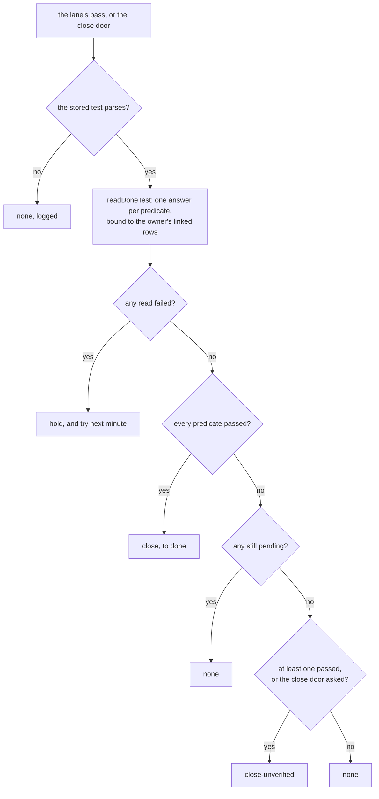
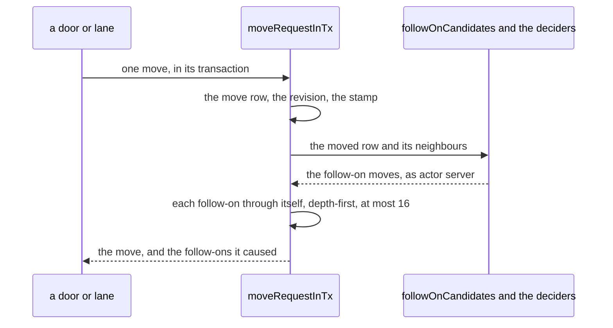
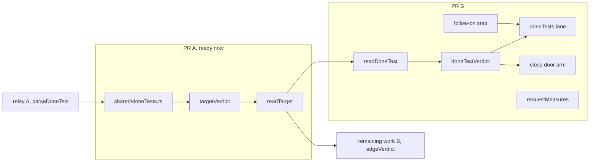
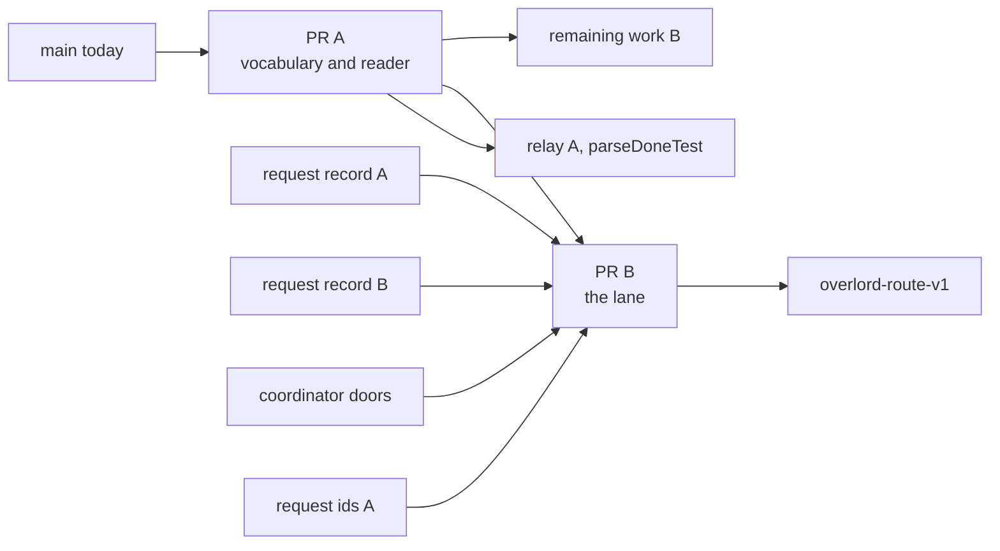

# Overlord W2: done tests, the predicate vocabulary and its one reader Implementation Plan

> **For agentic workers:** REQUIRED SUB-SKILL: Use superpowers:subagent-driven-development (recommended) or
> superpowers:executing-plans to implement this plan task by task. Steps use checkbox (`- [ ]`) syntax for tracking.

## In short

- **What this is.** The plan for the W2 piece "Done tests" (the W2 index, Table W2, lane R). It owns Table 5.5a's
  predicate vocabulary and its one reader (index question 13), the done-test lane that closes a request `done` or
  `done-unverified`, and the server's other moves on a request: start, close and resume a parent, unblock, and the moves
  to `needs-you` those cause. Two pull requests, nine tasks: PR A four, PR B five.
- **PR A, the vocabulary and the reader, is ready to build now.** `shared/doneTests.ts` holds the five predicates and
  the target shapes. One L1 decider answers a bare target (a run, a pull request named by its run, a review of a run, an
  operator item), and one L3 reader gathers its facts from rows already on `main`. Remaining work B clears edges through
  this reader, so it needs PR A only, not the lane.
- **PR B, the lane.** It binds a request's done test to what the request links: the runs and goals modifications that
  carry its `requestId`. A lane on its own `LANE_SCHEDULE` row evaluates it every minute, which covers "on news". The
  Overlord's `close-request` door gains its arm for `in-progress` and `done-unverified` (request record question RQ12).
  The parent and dependency moves run inside the move writer's transaction, so a parent closes in the same transaction
  as its last child. M5's and M20's reads ship here.
- **Two predicates cannot be measured in W2, and the plan says so rather than guessing.** No row records a review
  run's verdict, so `review-passed` answers `unmeasurable`. No item links to a request before W3, so a request's
  `operator-confirms` answers `unmeasurable` too. A test that needs either closes `done-unverified`, and the operator
  confirms it with one tap (DT4, DT5).
- **What changes at merge.** Nothing a running session sees. PR A adds a reader nothing calls until remaining work B.
  PR B's lane has no rows to move until the doors that make requests open under `overlord-route-v1`.
- **No question needs the operator.** Twelve open questions (§2), each with a recommendation for the coordinator.

## 1. Goal, scope and the rulings this plan builds on

This section says what the piece builds, why, and which rulings it builds on.

**Goal:** a request closes only when the server measures, from its own rows, that what the done test names happened.
One vocabulary names what can be measured, and one reader measures it, for a request and for any other caller that
names a target directly.

**Why:** H22 (§5.5): "The done test is fixed at the relay and accepted in the read-back. It is a list of typed
predicates from a closed L0 vocabulary (Table 5.5a). Each binds to something made after the relay and linked by the
server", "No predicate reads prose", and "A lane evaluates the test on each stamped news, and when the Overlord's
`close-request` door asks. It closes the request itself. A predicate that cannot be measured leaves the request
`done-unverified`." §5.5 also gives the parent rules ("A parent waits on its children") and the dependency rule ("The
server unblocks a request whenever it measures that what it waits on is done … If that ends any other way, the request
moves to `needs-you`"). §5.6 has the server clear a programme edge "when it measures the target using Table 5.5a
predicates".

**Architecture.** Context C5 (Coordination) owns the vocabulary, the reader and the lane. The request rows are the
request record's (lane R), and this piece moves them only through its move writer.

| Ring | File | What it holds | PR |
|---|---|---|---|
| L0 | `shared/doneTests.ts` (new) | `DONE_PREDICATES`, `DoneTest`, `DoneTarget`, the answer words, `MEASURED_PREDICATES`, `DONE_TEST_BOUNDS` | A |
| L1 | `server/src/coord/doneTests.ts` (new) | `parseDoneTest`, `targetVerdict`, `doneTestVerdict` | A (the first two), B (the third) |
| L3 | `server/src/coord/doneTestRead.ts` (new) | `readTarget`, the one reader of a bare target; `readDoneTest`, a request's linked targets | A, B |
| L1 | `server/src/coord/requestFollowOn.ts` (new) | `parentMove`, `dependencyMove`, `followOnCandidates` | B |
| L1 | `server/src/coord/requestMeasures.ts` (new) | `requestMeasures`, M5's and M20's figures | B |
| L3 | `server/src/coord/overlordRequestStore.ts` (request record A's) | The follow-on step inside `moveRequestInTx`; the readers the lane needs | B |
| L4 | `server/src/coord/doneTestLane.ts` (new) | The lane's pass and its boot pass | B |
| L4 | `server/src/coord/overlordRoutes.ts` (W1's, request record B's handler) | The close door's arm for `in-progress` and `done-unverified` | B |

*Table 1. Where the code goes.*

No row is added to the architecture spec's path table: `server/src/coord/**` is C5 by its directory row, and
`shared/doneTests.ts` states its ring and context in its header, as `shared/ledgers.ts` does.

**The rulings this plan builds on.** The coordinator accepted every recommendation of the W2 index's questions 2 to 23,
and questions 24 to 28 are settled:

- **Q13:** this piece owns the predicate vocabulary and its one reader. Remaining work B clears edges through that
  reader. The brief adds the remaining-work review's ask: the reader takes a bare target (a run, a pull request or an
  item), not only a request's linked targets. A `pr-merged` target names a run whose `prLineage` lists the pull request,
  and an `operator-confirms` target names an open item of the programme.
- **Q2:** the relay door is the one writer of `doneTest`. This piece gives it the shape check, `parseDoneTest`, and
  writes `doneTest` nowhere.
- **Q5, as amended:** every move raises the request's `revision`. This piece moves requests only through the move
  writer, so its moves raise it there.
- **Q7:** the close door is `POST /api/overlord/requests/:id/close`, act kind `close-request`. Request record B builds it
  with the `received` arm (its RQ12). This piece adds the arm for `in-progress` and `done-unverified` to the same handler.
- **Q14:** no rollback floor. An older build ignores the request tables, and a request left open re-measures when the
  newer build returns.
- **Q23:** PR A is built now. PR B is written against plans not yet built, and takes each interface from the plan that
  defines it.
- **Q28:** nothing raises an item before W3. A move to `needs-you` here is a move and nothing more.

## 2. Open questions

Each question carries a recommendation, which this plan builds unless the coordinator rules otherwise. None needs the
operator: each is an implementation choice under a direction the spec already gives.

- **DT1. The vocabulary lives in a sibling of its own, `shared/doneTests.ts`** (slug `done-test-vocabulary-in-its-own-sibling`).
  The index puts "the done-test vocabulary" in `shared/overlordRequests.ts`, which request record A creates. Request
  record A waits on private store B and sequence A and B, while remaining work B needs only the vocabulary and the reader,
  and both read rows that are on `main` today. **Recommendation:** PR A creates `shared/doneTests.ts`, one concern per
  sibling (the index's slug `wire-types-in-sibling-modules`), and needs nothing first. `shared/overlordRequests.ts`
  imports the `DoneTest` type from it for the request row. Remaining work B's move of `EDGE_PREDICATES` picks from this
  file.
- **DT2. A bare target names a row, and the request form names none** (slug `bare-targets-name-a-row`). The reader serves
  two callers. Remaining work's edges name a row, and a request's done test names only the predicate, bound later to
  what the request links. **Recommendation:** two shapes in `shared/doneTests.ts`.
  - `DoneTarget`, a bare target: `{ predicate: 'run-closed', runId }`, `{ predicate: 'pr-merged', runId, pr }`,
    `{ predicate: 'review-passed', runId }` (the work run a review reads), and `{ predicate: 'operator-confirms',
    itemId }`. These are remaining work A's three shapes, plus the review.
  - `DoneTest`, a request's test: one to five distinct entries `{ predicate }`. The server binds each to the request's
    linked rows (DT6). `goals-modified` has no bare form: its only meaning is "a modification that cites this request".
- **DT3. The reader answers five words, and two of them are kinds of unmeasured** (slug `unmeasured-and-unmeasurable-apart`).
  Remaining work's `edgeVerdict` reads four answers: passed, ended, pending and unmeasured. A request needs one more
  distinction. A read that failed this minute must hold the request, and a predicate that no row in this build can
  answer must let it close `done-unverified`. Folding the two would close a request on a transient read failure, or
  never close one that cannot be measured. **Recommendation:** `TargetAnswer` is `passed`, `ended`, `pending`,
  `unmeasured` (the read failed: a thrown read, a locked database) or `unmeasurable` (the rows cannot answer: a
  predicate this build does not record, or a malformed stored value). Each carries its evidence or its reason.
  `edgeVerdict` reads both unmeasured words as its "unmeasured", as its table already says ("any unmeasured answer of
  the reader"). The request's verdict keeps them apart.
- **DT4. `review-passed` is `unmeasurable` in W2** (slug `review-verdict-not-recorded`). Measured: a review run's close
  (`server/src/coord/close.ts#closeReviewRun`, verified by `server/src/coord/fingerprint.ts#verifyReviewDone`) records
  that a report was delivered at a reviewed tip, and stores neither the verdict nor the tip. The verdict lives only in
  the report file and the coordinator's mail. **Recommendation:** for a run whose review closed `done`, the reader answers
  `unmeasurable`, reason `verdict-not-recorded`. A review still open is `pending`, and a work run that failed is
  `ended`. Recording a review's verdict is a later piece. It goes on the spec-fixes list, and the skill's routing
  reference tells the Overlord that a test with `review-passed` closes `done-unverified` until then.
- **DT5. A request's `operator-confirms` is `unmeasurable` in W2, and a bare one reads the item** (slug
  `operator-confirms-has-no-request-item-before-w3`). Measured: `operator_items` has no request column, and no W2 piece
  raises an item for a request (Q28). **Recommendation:** in a request's test, `operator-confirms` answers
  `unmeasurable`, reason `no-linked-item`, so a test that needs it closes `done-unverified` and the operator's confirm
  door (the operator's request doors piece) is the tap. A bare target reads the item's state through
  `server/src/coord/ledgersStore.ts#itemById`: `checking` or `done` is `passed` (the operator ticked or acted), `dismissed`
  or `withdrawn` is `ended`, and `open` is `pending` (`shared/ledgers.ts#ITEM_TRANSITIONS`). W3, which raises items for
  requests, adds the link and turns the request form measurable.
- **DT6. A request's linked rows are its owner's rows that carry its id** (slug `linked-rows-are-the-owners`). "Each
  binds to something made after the relay and linked by the server". `requestId` on runs and on goals modifications is
  request ids A's. A route elsewhere changes the owner, and the old owner's runs still carry the id.
  **Recommendation:** the linked runs are the runs whose `requestId` is the request's and whose `program` is its current
  owner. The linked modifications are the same on the goals record. A run can carry the id only once the request has an
  owner (request ids A's `request-not-yours`), so "made after the relay" holds by construction.
- **DT7. How each predicate reads its rows** (slug `predicates-read-these-rows`). Measured: no run column says "closed
  and merged". `runs.prLineage` (`server/src/coord/store.ts#PrLineageEntry`) is folded once, at close
  (`server/src/coord/store.ts#foldPrLineage`, from `server/src/coord/close.ts#closeWorkRun`). Its `phase` is
  `.prhistory`'s word, a free string that `shared/api.ts#PrPhase` types. A run abandoned by the operator ends `failed`.
  **Recommendation,** Table 3 below: a run is "closed and merged" when its state is `done` and its lineage holds an entry
  whose phase is `merged`. A `done` run with no such entry is `unmeasurable`, reason `no-merge-record`, so the operator
  confirms it rather than the server guessing.
- **DT8. A request's verdict, first match** (slug `request-verdict-first-match`). **Recommendation:** Table 4 below. The
  lane closes `done` when every predicate passes. It closes `done-unverified` when none is pending or unmeasured, at
  least one is `unmeasurable` and at least one passed. With nothing passed, the lane leaves the request alone, and only
  the Overlord's close door may close it `done-unverified` (DT10). An `unmeasured` answer always holds. A request answer
  never reads `ended`: a linked run that failed leaves the work open, and the coordinator may open another wave, so the
  run answers `pending` with its evidence. The follow-up arm notices a request that stops moving.
- **DT9. The relay must name at least one predicate the server can measure** (slug `done-test-needs-a-measured-predicate`).
  A test of only `review-passed` and `operator-confirms` could never pass in W2. **Recommendation:** `parseDoneTest`
  refuses a test with no entry in `MEASURED_PREDICATES` (`run-closed`, `pr-merged` and `goals-modified` in W2), with the
  reason `no-measured-predicate`. The relay door maps the parse refusal to the generic `bad-request`, so no word is
  added. W3 adds `operator-confirms` to the measured list when it links items.
- **DT10. The close door asks, and a test that has not passed refuses `done-test-unmet`** (slug `done-test-unmet-is-a-new-word`).
  Request record B's close door answers `bad-transition` on any state but `received` until this piece adds its arm
  (RQ12). A close the test does not allow is neither a bad transition nor a missing request: the Overlord handles it by
  waiting, not by fixing its call. **Recommendation:** on `in-progress` and `done-unverified` the door runs the verdict
  of Table 4 in its transaction. `close` and `close-unverified` move the request. Otherwise it refuses with a new word,
  `done-test-unmet` (409), and the answer lists each predicate's answer. A held read refuses the generic `unmeasured`.
  The door may close `done-unverified` with nothing passed when every predicate is `unmeasurable`: that is the
  Overlord's explicit ask, and its act row records it. The word joins `OVERLORD_REFUSALS` with its Table 11.6 row and its
  console sentence in PR B (index question 6's rule for a later word).
- **DT11. The parent and dependency moves run in the move writer's transaction** (slug `follow-on-moves-in-the-writer`).
  §5.5 closes a parent "in the transaction that closes its last child", and unblocks a request "at that event". The
  events are other pieces' moves: a child's route is relay A's, a child's close is this lane's, a block is the
  coordinator doors', a hand back is the operator's. A step each caller must remember would be missed once.
  **Recommendation:** `moveRequestInTx` runs one follow-on step after every move it writes. `followOnCandidates` (L1)
  names the rows to look at (the moved row's parent; the moved row itself when it is a parent or entered `blocked`; the
  rows blocked on it when it ended), and `parentMove` and `dependencyMove` (L1) decide each. The writer applies each
  decided move through itself, as actor `server`, depth-first with a visited set and a cap of 16 moves. A refused
  follow-on is logged and changes nothing else in the transaction.
- **DT12. The lane passes every minute instead of listening for news** (slug `done-test-lane-passes-every-minute`).
  §11.1's lane table runs the done-test lane "On news". But a run's close stamps no news: only mail with a `requestId`
  does (request ids A), so a coordinator that closes its run without mailing would leave the request open. **Recommendation:**
  the lane is a `LANE_SCHEDULE` row, `doneTests`, every minute, clock `mono`, flight `skip`. Each pass evaluates every
  `in-progress` and `done-unverified` request and every request blocked on a programme. News is then seen within a
  minute, with no hook in the mail ingress and no growth in `server/src/coord/routes.ts`. A boot pass re-measures every
  open parent and every blocked request once, as §5.5 asks.

## 3. What exists today

Measured on `main` at `7ab4d41f5` (2026-11-16), each cited by symbol. None of the W1 or W2 pieces PR B builds on is
merged.

| What | Where | What this plan does with it |
|---|---|---|
| Run states, and the terminal two | `shared/api.ts#RunState`, `shared/api.ts#TERMINAL_RUN_STATES` (`done`, `failed`) | A run is open while outside the terminal pair |
| A run's pull requests, folded once at close | `server/src/coord/store.ts#PrLineageEntry`, `server/src/coord/store.ts#foldPrLineage`, called from `server/src/coord/close.ts#closeWorkRun` | `run-closed` and `pr-merged` read the lineage of a closed run |
| The PR phase words | `shared/api.ts#PrPhase` | A lineage phase is read against this list. Any other word is `unmeasurable` |
| The `.prhistory` read at close | `server/src/coord/prhistory.ts#readPrHistory` | Not called: the reader reads the folded column, never the fleet box |
| The landing line's merged mark, per project and pull request | `server/src/coord/landed.ts#closeLandingOf` | Not read: it is keyed per project and PR, not per run |
| One run by id, and the runs that review it | `CoordStore.run` (`server/src/coord/store.ts#RunReadResult`: a row, `null` for no row, or `run-unreadable`), `CoordStore.runsReviewing`; a review run is `runs.kind = 'review'` with `runs.reviews` (`shared/api.ts#RunKind`) | `readTarget` reads runs only through these two, so no new SQL reads `runs` |
| A review's close | `server/src/coord/close.ts#closeReviewRun`, `server/src/coord/fingerprint.ts#verifyReviewDone`: the verdict and the reviewed tip are not stored | DT4 |
| An abandoned run | Closes `failed`, with `abandon:<reason>` in its close detail | `ended` for a bare target, `pending` with evidence in a request (DT8) |
| Item states and moves | `shared/ledgers.ts#ITEM_TRANSITIONS`, `shared/ledgers.ts#OPEN_ITEM_STATES`; one item by id, `server/src/coord/ledgersStore.ts#itemById` | `operator-confirms` on a bare target (DT5) |
| Goals and their modifications | `server/src/coord/ledgersStore.ts#goalsFor`, `server/src/coord/ledgersStore.ts#addModification` (`programme_modifications`). No `goals modify` door and no `requestId` exist yet | `goals-modified` reads request ids A's column on the modifications |
| A programme's state, and its writer | `shared/api.ts#ProgramState`; `server/src/coord/store.ts#setProgramState`, called when `server/src/coord/store.ts#programOpenRunCount` reaches 0; read through `server/src/coord/programmesRead.ts#readProgrammes`, which derives "open" from runs | A request blocked on a programme (`dependencyMove`) |
| The lane table | `server/src/laneSchedule.ts#LANE_SCHEDULE`, 46 rows, every one `mono`; pinned by `server/test/lane-schedule.test.ts` (`toHaveLength(46)`) | One row, `doneTests`; the pin moves to the count on `main` plus one |
| The lane runner and the clock port | `server/src/laneRunner.ts#LaneRunner`, `server/src/time/ports.ts#Clock` (`wall`, `mono`) | The lane's cadence on `mono`, its stamps on `wall` |
| A lane wired from the watcher | `server/src/watch.ts#sweepQuiz` | The model for `sweepDoneTests` |
| Generic words | `shared/refusal.ts#GENERIC_REFUSALS`: `not-found`, `bad-transition`, `bad-request`, `unmeasured` | Reused |
| The Overlord's words | `shared/refusal.ts#OVERLORD_REFUSALS` | Gains `done-test-unmet` (DT10) |
| The registries | `server/test/single-definition/time-ports.test.ts#TIME_PORT_FILES`, `server/test/sim/mutation-floors.test.ts#MUTANT_SETS` with `server/test/sim/mutation-floors.json`, `server/test/single-definition/writers-map.test.ts#TABLES` | Each new file and decider joins |
| The growth check | `server/test/growthCheck.ts#GROWTH_LIMIT` (40) | `server/src/watch.ts` grows by the lane's call only |

*Table 2. What exists today.*

**From the W2 plans, not yet built** (each taken from the plan that defines it, as the index asks):

- **Request record** (`w2-requests.md`, #2928): `overlord_requests` with `doneTest` (opaque, written by the relay's moves),
  `owner`, `parentRequestId`, `dependsOn` (`request:<id>` or `programme:<slug>`), `takenFrom` and `revision`;
  `overlord_request_moves`; `REQUEST_TRANSITIONS`, whose server rows `close`, `close-unverified`, `start-parent`,
  `close-parent`, `resume-parent`, `unblock` and `needs-you` name this piece as their caller; `moveRequestInTx(db, m)`
  with `expectRevision`, `reason` and `actId`; `REQUEST_MOVE_REASONS`, to which "each later piece adds its own words";
  `answeredSinceNeedsYou`; `openRequests`; the close door's `received` arm (RQ12).
- **Request ids A** (`w2-request-ids.md`, being written on run 2274): `requestId` on runs, on mail and on goals
  modifications, and the news stamp. This plan reads the two columns and names them as that plan's.
- **Coordinator doors** (`w2-coordinator-doors.md`, being written on run 2274): the `acknowledge` move that brings a
  request to `in-progress`, and the `block` move that sets `dependsOn`.
- **Remaining work** (`w2-remaining-work.md`, #2921): `EDGE_PREDICATES` and the three target shapes in
  `shared/programmeFacts.ts`, and `edgeVerdict(edge, measured, now)`, which reads this plan's `TargetAnswer`.

## 4. The vocabulary

This section gives the L0 words. Each list is derived from a key map, never kept by hand.

| Predicate | Passes when the server measures | Bare form | In W2 |
|---|---|---|---|
| `run-closed` | A linked work run is `done` with a `merged` entry in its lineage, and no linked work run is open | `{ runId }` | measured |
| `pr-merged` | A linked work run's lineage holds a `merged` entry (bare: the entry for `pr`) | `{ runId, pr }` | measured |
| `review-passed` | A review run passed at the merged tip | `{ runId }`, the work run | `unmeasurable` (DT4) |
| `goals-modified` | A goals modification of the owner carries the request's id | none (DT2) | measured once request ids A lands |
| `operator-confirms` | The operator's tap on a one-tap item | `{ itemId }` | bare: measured; request: `unmeasurable` (DT5) |

*Table 3a. Table 5.5a, as this piece builds it.*

```ts
// shared/doneTests.ts (L0, context C5 Coordination). Imports nothing.
const DONE_PREDICATE_MAP = { 'run-closed': true, 'pr-merged': true, 'review-passed': true,
  'goals-modified': true, 'operator-confirms': true } as const;
export type DonePredicate = keyof typeof DONE_PREDICATE_MAP;
export const DONE_PREDICATES = Object.keys(DONE_PREDICATE_MAP) as DonePredicate[];
const MEASURED_PREDICATE_MAP = { 'run-closed': true, 'pr-merged': true, 'goals-modified': true } as const
  satisfies Partial<Record<DonePredicate, true>>;
export const MEASURED_PREDICATES = Object.keys(MEASURED_PREDICATE_MAP) as DonePredicate[];
export type DoneTestEntry = { readonly predicate: DonePredicate };
export type DoneTest = readonly DoneTestEntry[];                    // 1 to 5 entries, distinct
export const DONE_TEST_BOUNDS = { entries: 5 } as const;
export type DoneTarget =
  | { readonly predicate: 'run-closed'; readonly runId: number }
  | { readonly predicate: 'pr-merged'; readonly runId: number; readonly pr: number }
  | { readonly predicate: 'review-passed'; readonly runId: number }
  | { readonly predicate: 'operator-confirms'; readonly itemId: number };
const TARGET_ANSWER_MAP = { passed: true, ended: true, pending: true, unmeasured: true, unmeasurable: true } as const;
export type TargetAnswerWord = keyof typeof TARGET_ANSWER_MAP;
export const TARGET_ANSWER_WORDS = Object.keys(TARGET_ANSWER_MAP) as TargetAnswerWord[];
export type TargetAnswer =
  | { readonly kind: 'passed' | 'ended' | 'pending'; readonly evidence: string }
  | { readonly kind: 'unmeasured' | 'unmeasurable'; readonly why: string };
const DONE_VERDICT_MAP = { close: true, 'close-unverified': true, hold: true, none: true } as const;
export type DoneVerdict = keyof typeof DONE_VERDICT_MAP;
export const DONE_VERDICTS = Object.keys(DONE_VERDICT_MAP) as DoneVerdict[];
```

## 5. The reader

This section gives the one reader and the decider behind it.

`targetVerdict(target, facts)` is L1, first match and total. `readTarget(db, target)` is its only L3 gatherer: it reads
the rows of Table 3, catches a thrown read as `unmeasured`, and asks `targetVerdict`. No other file reads these rows to
decide a predicate. `server/test/single-definition/done-test-reader.test.ts` holds that: a text scan of `server/src`
finds `targetVerdict` and `doneTestVerdict` called only from `doneTestRead.ts`, `doneTestLane.ts` and the close door,
and finds no reader of a run's `prLineage` outside `server/src/coord/store.ts` and `doneTests.ts`.

| # | Target | Facts | Answer |
|---|---|---|---|
| 1 | any | The read threw | `unmeasured`, the error's class |
| 2 | any naming a run or item | The row is absent | `unmeasurable`, `no-such-row` |
| 3 | `run-closed` | Run open | `pending` |
| 4 | `run-closed` | Run `failed` | `ended`, its close detail's first word |
| 5 | `run-closed` | Run `done`, lineage unparsable | `unmeasurable`, `lineage-unreadable` |
| 6 | `run-closed` | Run `done`, an entry with phase `merged` | `passed`, that entry's PR |
| 7 | `run-closed` | Run `done`, no `merged` entry | `unmeasurable`, `no-merge-record` |
| 8 | `pr-merged` | Run open | `pending` |
| 9 | `pr-merged` | Lineage unparsable | `unmeasurable`, `lineage-unreadable` |
| 10 | `pr-merged` | The entry for `pr` has phase `merged` | `passed` |
| 11 | `pr-merged` | The entry for `pr` has phase `closed` | `ended` |
| 12 | `pr-merged` | The entry for `pr` has another `PrPhase` word, or a word outside it | `unmeasurable`, `phase-<word>` or `phase-unknown` |
| 13 | `pr-merged` | Run terminal, no entry for `pr` | `unmeasurable`, `not-in-lineage` |
| 14 | `review-passed` | The work run `failed` | `ended` |
| 15 | `review-passed` | A review of it is open | `pending` |
| 16 | `review-passed` | A review of it closed `done` | `unmeasurable`, `verdict-not-recorded` (DT4) |
| 17 | `review-passed` | No review of it, or only `failed` ones | `pending` |
| 18 | `operator-confirms` | Item `checking` or `done` | `passed`, the state |
| 19 | `operator-confirms` | Item `dismissed` or `withdrawn` | `ended`, the state |
| 20 | `operator-confirms` | Item `open` | `pending` |
| 21 | any | A state word outside its vocabulary | `unmeasurable`, `state-unknown` |

*Table 3. `targetVerdict`, first match. Evidence is ids and words only, never text a session wrote.*

**The property.** Replacing any fact with an unreadable one never moves an answer to `passed` or `ended`. A test
generates every row's facts, degrades each in turn, and checks it.

## 6. A request's verdict

This section gives how a request's test is bound and judged.

`readDoneTest(coord, request)` (L3) parses the stored `doneTest` with `parseDoneTest`, finds the linked rows (DT6), and
answers one `TargetAnswer` per entry:

- `run-closed`: over the linked work runs. `passed` when one passes Table 3's row 6 and none is open; `pending` while
  one is open or none exists; a run that failed adds its evidence to `pending` (DT8).
- `pr-merged`: `passed` when a linked work run's lineage holds a `merged` entry; otherwise as `run-closed`.
- `review-passed`: Table 3 over each linked work run; `unmeasurable` if any answers so and none is `pending`.
- `goals-modified`: `passed` when a modification of the owner carries the request's id, else `pending`.
- `operator-confirms`: `unmeasurable`, `no-linked-item` (DT5).

`doneTestVerdict(answers, ask)` (L1) then answers first match:

| # | Answers | `ask` | Verdict |
|---|---|---|---|
| 1 | The stored test does not parse | any | `none`, logged as `done-test-unreadable` |
| 2 | Any `unmeasured` | any | `hold` |
| 3 | Every one `passed` | any | `close` |
| 4 | Any `pending` | any | `none` |
| 5 | None pending, at least one `passed`, the rest `unmeasurable` | any | `close-unverified` |
| 6 | Every one `unmeasurable` | `door` | `close-unverified` |
| 7 | Every one `unmeasurable` | `lane` | `none` |

*Table 4. `doneTestVerdict`, first match. An `ended` answer is read as `pending` before this table (DT8). A request in
`done-unverified` can only `close`: rows 5 and 6 leave it where it is.*

**The property.** Turning any answer into `unmeasured` never yields `close` or `close-unverified`, and turning any
`passed` into `pending` never yields `close`.


*Figure 1. One evaluation. The lane and the close door run the same decider, and only the door may close with nothing
passed.*

## 7. The server's other moves

This section gives the follow-on step that keeps parents and dependencies true inside each move's transaction.

**`parentMove(p)`**, first match, for a parent `p` (a request with at least one child):

| # | Facts | Move |
|---|---|---|
| 1 | The parent is terminal, or the operator took it | none |
| 2 | A counting child ended `failed` or `dropped`, and the parent is not `needs-you` | `needs-you`, reason `child-ended` |
| 3 | Every counting child is `done`, at least one counts, and the parent is `in-progress`, or `needs-you` answered since it entered | `close-parent` |
| 4 | The parent is `received` and some child has a `route` move | `start-parent` |
| 5 | The parent is `needs-you`, answered since it entered, and some counting child is open | `resume-parent` |
| 6 | Otherwise | none |

*Table 5. `parentMove`. A child counts unless it ended other than `done` before the operator's latest answer on the
parent. Row 3 asks for one counting child: a parent whose every child failed stays `needs-you` after the answer, for
the Overlord to route a new child (§5.5).*

**`dependencyMove(d)`**, first match, for a request in `blocked`:

| # | `dependsOn` and what it reads | Move |
|---|---|---|
| 1 | The read failed | none (the next pass measures again) |
| 2 | `request:<id>`, that request `done` | `unblock` |
| 3 | `request:<id>`, that request `failed` or `dropped` | `needs-you`, reason `dependency-ended` |
| 4 | `programme:<slug>`, the programme `done` with no open run | `unblock` |
| 5 | `programme:<slug>`, the programme `abandoned` with no open run | `needs-you`, reason `dependency-ended` |
| 6 | Otherwise (still open, `done-unverified`, or a programme with an open run) | none |

*Table 6. `dependencyMove`. A programme's state is read through `server/src/coord/programmesRead.ts#readProgrammes`,
which derives "open" from runs, because a leftover review's abandon can mark the column `abandoned` while work is open.*


*Figure 2. The follow-on step. It runs inside the caller's transaction, so a parent closes in the transaction that
closes its last child, and a refused follow-on leaves the caller's own move standing.*

**The move reasons** this piece adds to `REQUEST_MOVE_REASONS`: `child-ended` and `dependency-ended`. Request record
A's test that every move to `needs-you` carries a reason covers them.

## 8. The lane, the close door and the measures

This section gives the three users of the verdict.

- **The lane** (`server/src/coord/doneTestLane.ts`, L4): the `doneTests` row of `LANE_SCHEDULE` (a minute, `mono`,
  `skip`, `warnKey` `done-tests`). Each pass reads `openRequests`, evaluates each `in-progress` and `done-unverified`
  request with `ask: 'lane'`, and calls `moveRequestInTx` with `close` or `close-unverified` and `expectRevision` set to
  the revision it read, each in its own transaction. A stale revision is skipped until the next pass. It then asks
  `dependencyMove` for each request blocked on a programme. A failure on one request is that request's, never the
  pass's.
- **The boot pass** runs once before the first lane pass: `parentMove` for every open parent and `dependencyMove` for
  every blocked request, through the same writer.
- **The close door's arm** (the handler request record B creates in `overlordRoutes.ts`): on `in-progress` or
  `done-unverified`, after the gate and the revision check, it runs `readDoneTest` and `doneTestVerdict` with
  `ask: 'door'` inside its transaction, then writes its act row and the move, or refuses `done-test-unmet` with each
  predicate's answer, or `unmeasured` (DT10). The `received` arm stays request record B's.
- **The measures** (`requestMeasures(rows, moves, now)`, L1, over the request rows and their move rows):
  - **M5:** the median and 85th percentile time from a request's first `route` move to its first `acknowledge` move,
    over requests routed in the window, and the share of requests closed in the window that closed `done` (straight
    `close` or `close-parent`, against `close-unverified`, `fail` and `drop` endings);
  - **M20:** the `done-unverified` share of closings, the count of `decline` moves, the count of server moves to
    `needs-you` by reason (the follow-up piece's `two-silent-nudges` and `due-unarmed` among them), and reopened
    requests as `unmeasured`, reason `no-reopen-link`, because nothing records which request a new one reopens (§9).

  The read is `requestMeasuresRead(db, now)`, for the board's W2 parts and the digest to call. It adds no route.


*Figure 3. What each pull request ships, and who reads it. Remaining work B reads PR A's reader only. The relay reads
the vocabulary's parse.*

## 9. Global constraints and review focus

This section lists the rules every task keeps and what a reviewer should check first.

**Constraints:**

- **One reader per fact.** `doneTestRead.ts` is the only gatherer of a predicate's rows, and `doneTests.ts` the only
  decider. Remaining work B calls `readTarget` and never reads a run's lineage itself.
- **One writer of a request's state.** Every move here goes through `moveRequestInTx`. The lane and the follow-on step
  write no SQL of their own.
- **Decide in L1, act in L4.** `doneTestLane.ts` reads, asks the deciders and calls the writer. It decides nothing.
- **Rings by imports.** `shared/doneTests.ts` imports nothing. Every exported literal union has its `Record<X, true>`
  map (`rings/wire-totality.test.ts`).
- **No overloaded null.** `unmeasured` and `unmeasurable` are two words (DT3), and an absent row is never read as a
  pending one.
- **No prose read.** No predicate reads a title, a goal's text or `doneWhen`.
- **The migration rule does not apply:** this piece adds no table and no column.
- **Tests run one file at a time**, from `server/`, through `ccrc test -- ./node_modules/.bin/vitest run test/<file>`.

**Review focus:**

1. Table 3 against Table 5.5a, row by row, and the bare shapes against remaining work A's three.
2. That no transient read failure can close a request (Table 4's row 2 and the property).
3. The follow-on step: a parent closes in its last child's transaction, the cap stops a planted loop, and a refused
   follow-on leaves the caller's move standing.
4. The close door: `done-test-unmet` lists each predicate, and the act row exists only when the request moved.

## 10. The PR split

This section gives the two pull requests, their files and their growth against the 40-line cap.

| PR | Tasks | Ships | Needs first |
|---|---|---|---|
| A | A1 to A4 | The vocabulary, `parseDoneTest`, `targetVerdict`, `readTarget`, the reader census | nothing: **ready to build** |
| B | B1 to B5 | `readDoneTest`, `doneTestVerdict`, the follow-on step, the lane and its boot pass, the close door's arm and `done-test-unmet`, `requestMeasures` | PR A, request record A and B, coordinator doors, request ids A |

*Table 7. The pull requests. Request record B joins PR B's needs because the close door's handler is its (RQ12).*

| Growth-checked file | PR A | PR B |
|---|---|---|
| `server/src/watch.ts` | 0 | +6 (the lane's sweep and its tick line, as `sweepQuiz`) |
| `server/src/coord/store.ts`, `routes.ts`, `server.ts`, `schema.ts` | 0 | 0 |
| `shared/api.ts`, `pwa/src/lib/api.ts`, `ccd/ccrc-doctor-checks` | 0 | 0 |

*Table 8. Growth. `overlordRequestStore.ts`, `overlordRoutes.ts`, `laneSchedule.ts` and `server/src/index.ts` are not
growth-checked.*


*Figure 4. The order. PR A needs nothing and unblocks remaining work B and relay A. PR B waits on the request spine.*

## 11. Tasks

Each task is red first, then green, then its mutation step where it adds a guard. Run every command from `server/`.

### Task A1: The vocabulary (L0, PR A)

**Files:**
- Create: `shared/doneTests.ts`
- Create: `server/test/done-tests-vocabulary.test.ts`
- Modify: `server/test/single-definition/time-ports.test.ts` (`TIME_PORT_FILES` gains the new file: it reads no clock
  today, and the entry makes a later raw clock read red)

**Interfaces:** §4's block.

- [ ] **Step 1: Write the failing tests.** Each list equals its map's keys and an independently spelled `EXPECTED`
  list; `MEASURED_PREDICATES` is a subset of `DONE_PREDICATES`; every `DoneTarget` predicate is a `DonePredicate`
  (a type-level check); `goals-modified` has no bare form; `DONE_TEST_BOUNDS.entries` is 5.
- [ ] **Step 2: Run red:** `ccrc test -- ./node_modules/.bin/vitest run test/done-tests-vocabulary.test.ts`.
- [ ] **Step 3: Implement** `shared/doneTests.ts`, with the header naming its ring, its context and this plan.
- [ ] **Step 4: Run green**, then `rings/wire-totality`, `rings/shared-imports` and `single-definition/time-ports`, one
  file at a time.
- [ ] **Step 5: Mutation.** Add `review-passed` to `MEASURED_PREDICATE_MAP`: the subset test still passes, so the
  spelled `EXPECTED` list must red it. Restore from a saved copy.
- [ ] **Step 6: Commit** (no push: PR A pushes once, at A4).

### Task A2: `parseDoneTest` and `targetVerdict` (L1, PR A)

**Files:**
- Create: `server/src/coord/doneTests.ts`, `server/test/done-tests-policy.test.ts`, `server/test/doneTestCases.ts`,
  `server/test/sim/doneTestSets.ts`
- Modify: `server/test/sim/mutation-floors.test.ts` (`MUTANT_SETS` spreads `DONE_TEST_MUTANT_SETS`),
  `server/test/sim/mutation-floors.json`, `server/test/single-definition/time-ports.test.ts`

**Interfaces:**

```ts
// server/src/coord/doneTests.ts (C5, L1). No clock, no I/O.
export type DoneTestParse = { ok: true; test: DoneTest }
  | { ok: false; why: 'not-a-list' | 'empty' | 'too-many' | 'unknown-predicate' | 'duplicate' | 'no-measured-predicate' };
export function parseDoneTest(v: unknown): DoneTestParse;
export type TargetFacts =
  | { kind: 'threw'; why: string }
  | { kind: 'run'; run: { state: string; kind: string; closeDetail: string | null; lineage: unknown } | 'absent';
      reviews?: readonly { state: string }[] }
  | { kind: 'item'; item: { state: string } | 'absent' };
export function targetVerdict(target: DoneTarget, facts: TargetFacts): TargetAnswer;
```

- [ ] **Step 1: Write the failing tests**, the case table in `doneTestCases.ts`:
  - `parseDoneTest` over each refusal and a valid test of each size from 1 to 5;
  - `targetVerdict`, one case per row of Table 3, in its order, and an exhaustive sweep over every target kind, every
    run state of `shared/api.ts#RunState` plus one unknown word, every `PrPhase` plus one unknown word, every item state
    plus one unknown word, and the absent and thrown facts;
  - **the property:** degrading any fact to `threw`, `absent` or an unknown word never yields `passed` or `ended`.
- [ ] **Step 2: Run red:** `ccrc test -- ./node_modules/.bin/vitest run test/done-tests-policy.test.ts`.
- [ ] **Step 3: Implement.** Each decider is first match and total.
- [ ] **Step 4: Run green.** Register `targetVerdict` and `parseDoneTest` in `doneTestSets.ts` and
  `mutation-floors.json` at floor 1, then `ccrc test -- ./node_modules/.bin/vitest run test/sim/mutation-floors.test.ts`.
  Every mutant dies: swap rows 6 and 7, read a `failed` run as `pending`, drop the `merged` phase check, accept a
  duplicate predicate, drop the measured-predicate check.
- [ ] **Step 5: Commit.**

### Task A3: `readTarget`, the one reader (L3, PR A)

**Files:**
- Create: `server/src/coord/doneTestRead.ts`, `server/test/done-test-read.test.ts`
- Modify: `server/test/single-definition/time-ports.test.ts`

**Interfaces:**

```ts
// server/src/coord/doneTestRead.ts (C5, L3). The only gatherer of a predicate's rows.
export type TargetReadPort = Pick<CoordStore, 'run' | 'runsReviewing' | 'itemById'>;   // declared by this consumer
export function readTarget(coord: TargetReadPort, target: DoneTarget): TargetAnswer;
```

- [ ] **Step 1: Write the failing tests** on a fixture `coord.db` (`openCoordDb` on a temp path, as the store tests do):
  a run closed `done` whose lineage holds a `merged` entry passes `run-closed` and `pr-merged`; one with only a `closed`
  entry ends `pr-merged`; an abandoned run (`failed`, `abandon:` detail) ends `run-closed`; a review closed `done` reads
  `unmeasurable` with `verdict-not-recorded`; an item ticked to `checking` passes `operator-confirms` and a dismissed one
  ends it; a missing run reads `unmeasurable`, `no-such-row`; a database closed under the reader reads `unmeasured`,
  never `unmeasurable`.
- [ ] **Step 2: Run red:** `ccrc test -- ./node_modules/.bin/vitest run test/done-test-read.test.ts`.
- [ ] **Step 3: Implement** through the port alone, a `try` around the reads that answers `unmeasured` on a throw,
  `run-unreadable` read as `unmeasurable` (the row exists and cannot be represented), and `targetVerdict` for the
  answer.
- [ ] **Step 4: Run green**, then `typecheck-tests`.
- [ ] **Step 5: Commit.**

### Task A4: The reader census, and the push (PR A)

**Files:**
- Create: `server/test/single-definition/done-test-reader.test.ts`
- Modify: `ccd/overlord-skill/references/routing.md` (one paragraph: the five predicates, which two read
  `unmeasurable` in W2, and that a done test needs one of `run-closed`, `pr-merged` or `goals-modified`)

- [ ] **Step 1: Write the census:** `targetVerdict` is called only from `doneTestRead.ts`, and `parseDoneTest` only from
  `doneTestRead.ts` and, later, relay A's handler; outside `server/src/coord/store.ts` (which folds and hydrates it) and
  `doneTests.ts`, no `server/src` file reads a run's `prLineage` in code (comments and `schema.ts`'s column line aside;
  measured on `main`: none does today). Run it red against a planted reader in a temporary copy of the tree's file list,
  then green.
- [ ] **Step 2: Run** `overlord-skill` (the skill's reference pins), `anchors`, `topology-clean`, one at a time.
- [ ] **Step 3: Mutation.** Delete the census's lineage scan: the planted second reader passes. Restore.
- [ ] **Step 4: Commit, then push once.** Open PR A against `main`, its body naming DT1 to DT5, DT7 and DT9, and ending
  `Refs #2491`.

### Task B1: `readDoneTest` and `doneTestVerdict` (L1, L3, PR B)

**Files:**
- Modify: `server/src/coord/doneTests.ts` (`doneTestVerdict`), `server/src/coord/doneTestRead.ts` (`readDoneTest`),
  `server/test/doneTestCases.ts`, `server/test/sim/doneTestSets.ts`, `server/test/sim/mutation-floors.json`
- Create: `server/test/done-test-request.test.ts`

**Interfaces:**

```ts
export type DoneTestAsk = 'lane' | 'door';
export function doneTestVerdict(test: DoneTestParse, answers: readonly TargetAnswer[], ask: DoneTestAsk): DoneVerdict;
// TargetReadPort, plus request ids A's two reads: the runs of a programme that carry a request id, and the
// goals modifications of a programme that carry it. Their names are that plan's; this port names what it needs.
export type DoneTestReadPort = TargetReadPort & {
  runsForRequest(requestId: number, program: string): readonly RunRow[];
  modificationsForRequest(requestId: number, program: string): number;   // a count
};
export function readDoneTest(coord: DoneTestReadPort, r: { id: number; owner: string | null; doneTest: unknown }):
  { test: DoneTestParse; answers: readonly { predicate: DonePredicate; answer: TargetAnswer }[] };
```

- [ ] **Step 1: Write the failing tests:** Table 4 row by row; the exhaustive sweep over every combination of answer
  words for tests of one to three predicates and both asks; the property of §6; and, on a fixture database, a request
  whose owner's run carries its id and merged passes `run-closed`, while another programme's run carrying the same id
  does not count (DT6).
- [ ] **Step 2: Run red**, **Step 3: Implement**, **Step 4: Run green** with `mutation-floors` (mutants: read
  `unmeasured` as `pending`, let the lane close with nothing passed, count an `ended` run as `passed`).
- [ ] **Step 5: Commit.**

### Task B2: The follow-on step (L1, L3, PR B)

**Files:**
- Create: `server/src/coord/requestFollowOn.ts`, `server/test/request-follow-on.test.ts`
- Modify: `server/src/coord/overlordRequestStore.ts` (`moveRequestInTx` runs the step; two readers, `childrenOf` and
  `blockedOn`), `shared/overlordRequests.ts` (`child-ended`, `dependency-ended` in `REQUEST_MOVE_REASONS`),
  `server/test/sim/doneTestSets.ts`, `server/test/sim/mutation-floors.json`,
  `server/test/single-definition/writers-map.test.ts` (no new writer: the census names the follow-on caller)

**Interfaces:**

```ts
// server/src/coord/requestFollowOn.ts (C5, L1)
export function followOnCandidates(moved: { id: number; to: RequestState; parentRequestId: number | null;
  isParent: boolean }): readonly { id: number; ask: 'parent' | 'dependency' | 'dependents' }[];
export function parentMove(p: { state: RequestState; takenFrom: RequestState | null; answeredAt: number | null;
  enteredNeedsYouAt: number | null; children: readonly { state: RequestState; endedAt: number | null;
  routed: boolean }[] }): { move: 'close-parent' | 'start-parent' | 'resume-parent' | 'needs-you'; reason?: 'child-ended' } | null;
export function dependencyMove(d: { dependsOn: string; target: { kind: 'request'; state: RequestState }
  | { kind: 'programme'; state: string; openRuns: number } | { kind: 'unreadable' } }):
  { move: 'unblock' | 'needs-you'; reason?: 'dependency-ended' } | null;
export const FOLLOW_ON_CAP = 16;
```

- [ ] **Step 1: Write the failing tests:** Tables 5 and 6 row by row and exhaustively; on a fixture database, closing
  the last counting child closes the parent in the same transaction (one `tx`, both rows changed, two sequence lines);
  a child that fails moves the parent to `needs-you` with `child-ended`; the operator's answer on that parent with a
  child still open resumes it; a request that enters `blocked` on a request already `done` is unblocked in the same
  transaction; a dependency that is dropped moves its dependent to `needs-you`; a planted cycle of parents stops at the
  cap and logs; a follow-on the table refuses leaves the caller's move written.
- [ ] **Step 2: Run red**, **Step 3: Implement**, **Step 4: Run green** with `overlord-request-store`,
  `sequence-stamp-census`, `single-definition/writers-map` and `mutation-floors`, one at a time.
- [ ] **Step 5: Mutation.** Remove the follow-on call: the same-transaction parent test reds. Count a child that failed
  before the answer: the resume test reds. Restore each.
- [ ] **Step 6: Commit.**

### Task B3: The lane and its boot pass (L4, PR B)

**Files:**
- Create: `server/src/coord/doneTestLane.ts`, `server/test/done-test-lane.test.ts`
- Modify: `server/src/laneSchedule.ts` (the `doneTests` row and its `LaneName`), `server/src/watch.ts`
  (`sweepDoneTests` and its tick line, as `server/src/watch.ts#sweepQuiz`), `server/src/index.ts` (the lane's port),
  `server/test/lane-schedule.test.ts` (the count: the number on `main` plus one, re-derived after merging `main`),
  `server/test/single-definition/time-ports.test.ts`

- [ ] **Step 1: Write the failing tests:** a request whose linked run closed and merged is `done` after one pass; a
  request whose test has a passed predicate and an `unmeasurable` one is `done-unverified`, and a later pass that
  measures the second closes it `done`; a read that throws holds the request and the next pass closes it; a stale
  revision is skipped and retried; a request blocked on a programme that ends is unblocked by the pass; the boot pass
  closes a parent whose children all closed while the server was down; a second pass changes nothing.
- [ ] **Step 2: Run red**, **Step 3: Implement**, **Step 4: Run green** with `lane-schedule`, `growth-check` and
  `typecheck-tests`.
- [ ] **Step 5: Commit.**

### Task B4: The close door's arm and `done-test-unmet` (L4, PR B)

**Files:**
- Modify: `server/src/coord/overlordRoutes.ts` (the close handler's two states), `shared/refusal.ts`
  (`done-test-unmet` in `OVERLORD_REFUSALS`), `server/test/single-definition/refusal-table.data.json`,
  `docs/superpowers/specs/2026-11-09-overlord-design.md` (Table 11.6's row), `pwa/src/lib/refusalWords.ts` (its
  sentence), `ccd/overlord-skill/references/routing.md` (the word)
- Create: `server/test/overlord-close-done-test.test.ts`

- [ ] **Step 1: Write the failing tests:** an `in-progress` request whose test passed closes `done` with one act row; a
  pending one refuses `done-test-unmet` with each predicate's answer and writes no act row; one whose every predicate is
  `unmeasurable` closes `done-unverified` at the door; a held read refuses `unmeasured`; `done-unverified` closes to
  `done` once measured and refuses otherwise; `received` still runs request record B's arm unchanged.
- [ ] **Step 2: Run red**, then `refusal-table`, `refusal-words` (the PWA sentence pin) and `overlord-skill`.
- [ ] **Step 3: Implement.** **Step 4: Run green**, one file at a time.
- [ ] **Step 5: Mutation.** Let the door close with a pending predicate: the pending test reds. Restore.
- [ ] **Step 6: Commit.**

### Task B5: The measures, and the push (L1, PR B)

**Files:**
- Create: `server/src/coord/requestMeasures.ts`, `server/test/request-measures.test.ts`
- Modify: `server/test/sim/doneTestSets.ts`, `server/test/sim/mutation-floors.json`,
  `server/src/coord/overlordRequestStore.ts` (`requestMeasuresRead`, a read of the rows and moves in the window)

- [ ] **Step 1: Write the failing tests:** M5's median and 85th percentile on a planted set of route and acknowledge
  moves, an empty window answering `no-data`, the `done` share over closings; M20's unverified share, declines, server
  moves to `needs-you` by reason, and reopened as `unmeasured` with `no-reopen-link`.
- [ ] **Step 2: Run red**, **Step 3: Implement**, **Step 4: Run green** with `mutation-floors`.
- [ ] **Step 5: Commit, then push once.** Open PR B against `main`, its body naming DT6, DT8 and DT10 to DT12, and ending
  `Refs #2491`.

## Deviations found

Each entry is a departure from the spec's or the index's text, by slug. The coordinator mints numbers.

- **`done-test-vocabulary-in-its-own-sibling`**: the index puts the vocabulary in `shared/overlordRequests.ts`. It is
  `shared/doneTests.ts`, so PR A needs nothing first (DT1).
- **`bare-targets-name-a-row`**: Table 5.5a has only a request's form. The reader also takes a bare target, at the
  remaining-work review's ask (DT2).
- **`unmeasured-and-unmeasurable-apart`**: §5.5's "a predicate that cannot be measured" is two conditions: a read that
  failed holds, and a predicate no row records closes `done-unverified` (DT3).
- **`review-verdict-not-recorded`**: Table 5.5a's `review-passed` has no row to read. It is `unmeasurable` until a
  review's verdict is recorded (DT4).
- **`operator-confirms-has-no-request-item-before-w3`**: a request's `operator-confirms` is `unmeasurable` until W3
  links items to requests (DT5).
- **`done-test-needs-a-measured-predicate`**: the spec does not require a measured predicate. `parseDoneTest` does (DT9).
- **`done-test-unmet-is-a-new-word`**: Table 11.6 has no word for a close the test does not allow (DT10).
- **`follow-on-moves-in-the-writer`**: the spec names when the server's parent and dependency moves happen, not where.
  The move writer runs them (DT11).
- **`done-test-lane-passes-every-minute`**: §11.1 runs the lane "On news". It passes every minute, because a run's close
  stamps no news (DT12).

## What the index should change

- **The "Done tests" row:** two pull requests, nine tasks (A 4, B 5). A: the vocabulary in `shared/doneTests.ts`,
  `parseDoneTest`, `targetVerdict` and `readTarget`, which takes a bare target; **ready to build**. B: the lane, the
  follow-on step, the close door's arm, `done-test-unmet` and M5's and M20's reads; needs PR A, request record A and B,
  coordinator doors and request ids A.
- **Figure W2:** `DT` splits into `DTA` and `DTB`. `DTA --> RWB` replaces `DT --> RWB`, `DTA --> RLA` is added, and
  `RQB --> DTB` is added. The "Ready to build now" list gains done tests A.
- **"The large-file programme":** the done-test vocabulary moves from `shared/overlordRequests.ts` to a new sibling,
  `shared/doneTests.ts`.
- **"Where lanes meet", `LANE_SCHEDULE`:** the done-test lane's row is `doneTests`, a minute.
- **"Where lanes meet", `shared/refusal.ts`:** done tests B adds `done-test-unmet` with its Table 11.6 row.
- **"Where lanes meet", the request store:** done tests B adds the follow-on step to `moveRequestInTx`, so every later
  mover (relay A, the coordinator doors, the operator's doors, the follow-up) gets the parent and dependency moves without
  a call of its own. The operator's withdraw of a parent moves the parent before its children, so the step reads a
  terminal parent and does nothing.
- **The spec-fixes list gains:** Table 5.5a's `review-passed` has no record to read (DT4); a request's
  `operator-confirms` has no item before W3 (DT5); §11.1's "On news" for the done-test lane (DT12); Table 11.6 gains
  `done-test-unmet`; M20's "reopened" has no column linking a new request to the one it reopens.

## States W3 may read

- **`DONE_PREDICATES`, `DoneTarget`, `TargetAnswer` and `readTarget`:** W3 adds a request's item link, which turns a
  request's `operator-confirms` measurable, and joins it to `MEASURED_PREDICATES`.
- **`doneTestVerdict` and the close door's arm:** unchanged by W3.
- **The follow-on step:** W3's moves get it through the writer.
- **`requestMeasures`:** W3's measures read it.

## Where things stand

**Agreed:**
- The index's rulings on this row, with Q2, Q5 as amended, Q7, Q13, Q14, Q23 and Q28, built as stated.
- The remaining-work review's ask, a reader that takes a bare target, built in PR A.

**Waiting on the coordinator:**
- DT1 to DT12, each with a recommendation. DT1 and DT10 change the index (a new sibling, a new word), and DT11 changes
  request record A's move writer.
- The index changes above.

**Waiting on the operator:** nothing.

**Later:**
- A review run's verdict, recorded, so `review-passed` can be measured.
- W3's item link for requests, so `operator-confirms` can be measured on a request.
- A column linking a reopened request to the one it reopens, for M20.
