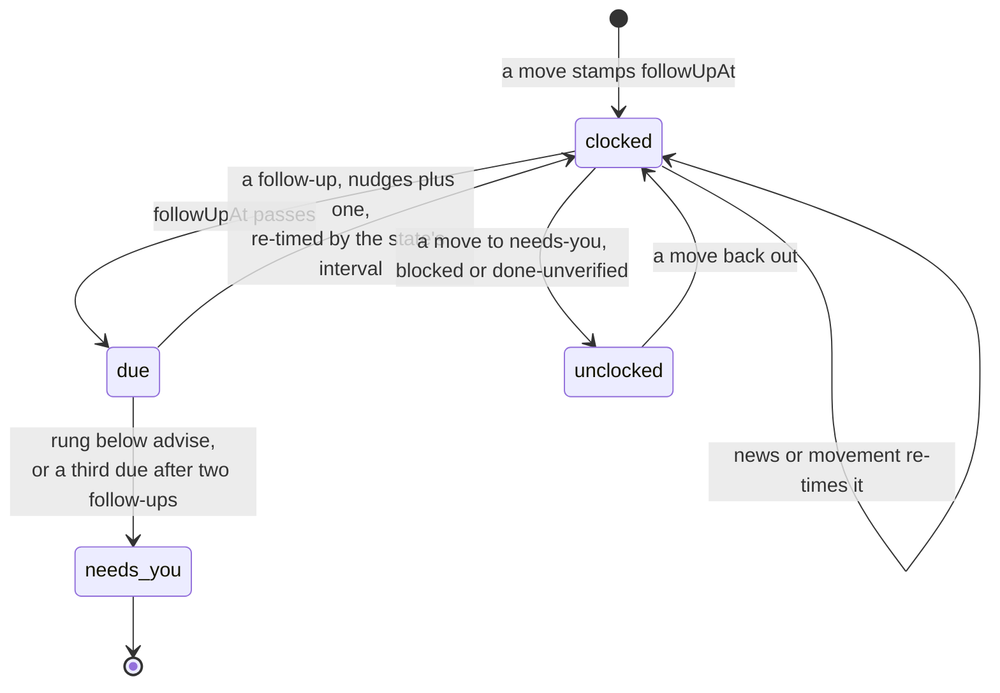
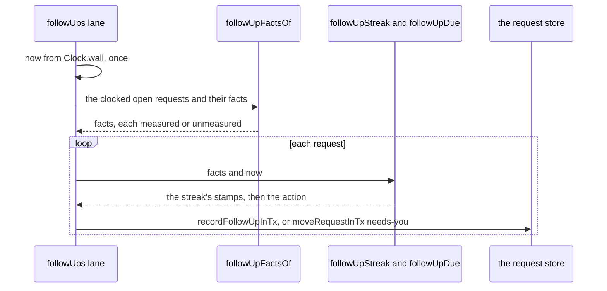
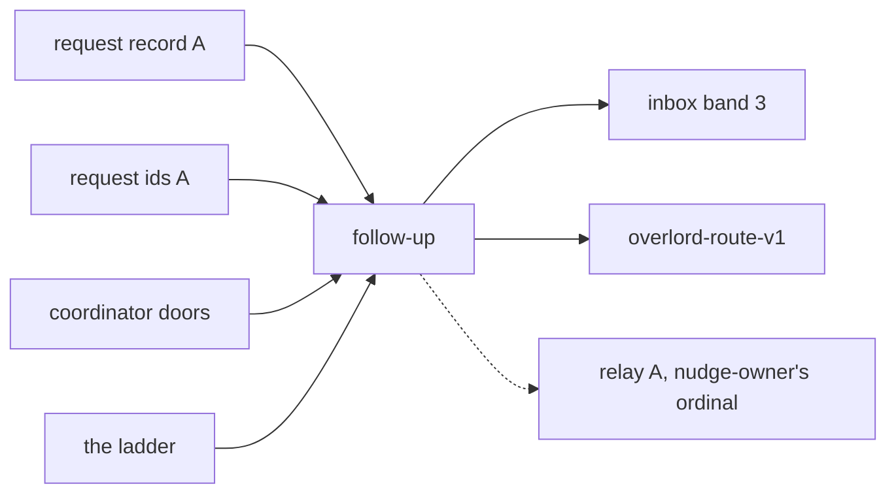

# Overlord W2: follow-up, the server's clock on every open request Implementation Plan

> **For agentic workers:** REQUIRED SUB-SKILL: Use superpowers:subagent-driven-development (recommended) or
> superpowers:executing-plans to implement this plan task by task. Steps use checkbox (`- [ ]`) syntax for tracking.

## In short

- **What this is.** The plan for the W2 piece "Follow-up" (the W2 index, Table W2, lane I). The server keeps a clock on
  every open request, and when one comes due, one L1 decider, `followUpDue`, says what happens: a follow-up for the
  Overlord's inbox, naming its reason, or a move to `needs-you`. One pull request, six tasks.
- **The clock is read, never stamped here.** Request record A's one move writer stamps `followUpAt` at every move
  (its RQ6), so I12 holds from the first row. This piece re-times the clock only after a follow-up, after news and after
  a server gap, through one bookkeeping writer in the request store.
- **Two follow-ups with no measured movement move the request to `needs-you`,** and so does a follow-up that comes due
  while the Overlord's effective rung is below `advise`. Nothing raises an item before W3 (index question 28): the
  request shows in the home's Requests part and on the board.
- **An ownerless request is followed up too.** A `received` or `declined` request has no owner to nudge, so its
  follow-up asks the Overlord to route it, with the reason `not-routed`, and two of them move it to `needs-you`.
- **The arm has its own `LANE_SCHEDULE` row,** `followUps`, a minute, clock `mono`, never the timers row (C65). The lane
  count pinned by `server/test/lane-schedule.test.ts` moves from its value on `main` by one.
- **What changes at merge.** Nothing a running session sees. There are no requests until `overlord-route-v1` opens
  the doors that make them.
- **No question needs the operator.** Ten open questions (§2), each with a recommendation for the coordinator.

## 1. Goal, scope and the rulings this plan builds on

This section says what the piece builds, why, and which rulings it builds on.

**Goal:** a routed request stays alive without the Overlord polling. The server keeps the clocks, decides when a
request is due, and says why, and the Overlord acts once on each follow-up.

**Why:** C15 (§5.4): "`followUpAt` is stamped by the server", "One L1 decider, `followUpDue`, decides a nudge. Its
inputs: no acknowledgement, no news, no linked work, a quiet run, a dead coordinator, a stall rung repeated, and the
nudges so far", "News resets the clock at most twice without measured movement", "After two nudges with no measured
movement, the server itself moves the request to `needs-you`", "the follow-up arm runs on the Overlord's effective rung
… at `advise` and `full`", "After a server gap only a follow-up that came due while the server was down is timed again,
spread after the boot", and "The arm keeps a row of its own (C65)".

**Architecture.** Context C5 (Coordination) owns the arm. The request rows are the request record's, and this piece
writes them only through the request store.

| Ring | File | What it holds |
|---|---|---|
| L0 | `shared/overlordRequests.ts` (request record A's) | `FOLLOW_UP_REASONS`, the move reasons `two-silent-nudges` and `due-unarmed`, `REQUEST_NEWS_EVERY_MS`, the boot spread constants |
| L1 | `server/src/coord/followUp.ts` (new) | `followUpDue`, `followUpStreak`, `spreadAfterBoot`, `nextFollowUpAt` |
| L3 | `server/src/coord/overlordRequestStore.ts` (request record A's) | `recordFollowUpInTx`, the one bookkeeping writer of the follow-up columns, and its migration |
| L3 | `server/src/coord/followUpFacts.ts` (new) | `followUpFactsOf`, the gatherer of the decider's inputs |
| L4 | `server/src/coord/followUpLane.ts` (new) | The lane's pass and its boot pass |

*Table 1. Where the code goes.*

**The rulings this plan builds on.** The coordinator accepted every recommendation of the W2 index's questions 2 to 23,
and questions 24 to 28 are settled:

- **The brief:** `followUpDue` and its `LANE_SCHEDULE` row, clock `mono`, with the count moving from the pinned value;
  the two-nudge arm to `needs-you`, with an ownerless `received` request handled; `followUpAt` read here, stamped by
  request record A's move writer (RQ6).
- **Q5, as amended:** a follow-up's stamps are bookkeeping. They raise no `revision`, so an Overlord act on a request is
  never refused `operator-has-it` because a follow-up came due.
- **Q14:** no rollback floor. A request left open re-measures when the newer build returns, and its follow-up comes due
  after the gap.
- **Q21:** the Overlord's `nudge-owner` passes the relay's checks and ceilings. That act is relay A's. This piece only
  raises the follow-up the Overlord acts on.
- **Q24:** `advise` names `overlord-route-v1`, so the arm can act only once that word ships.
- **Q28:** before W3 nothing raises an item. A move to `needs-you` is the whole act.

## 2. Open questions

Each question carries a recommendation, which this plan builds unless the coordinator rules otherwise. None needs the
operator.

- **FU1. A follow-up is a state of the request row, not a table and not mail** (slug `follow-up-is-request-columns`).
  §5.4 says the nudge "arrives in the inbox as a follow-up row (§6.8), behind one coalesced wake", and is "keyed on its
  subject, as run-less notices are, so a restart never sends a nudge twice". Run-less notices are keyed on their mail
  subject (`server/src/coord/rundefsTx.ts#queueRunlessNotice`, through `server/src/coord/store.ts#hasMailWithSubject`).
  A follow-up is not mail: the band reads it, and nothing types it into a pane. **Recommendation:** five columns on
  `overlord_requests`, in this piece's one migration: `followedUpAt` and `followUpReason` (the latest follow-up),
  `newsResets` and `newsSeenAt` (the news rule), and `movedAt` (the movement mark of the current streak). `nudges`
  (request record A's) counts the follow-ups of the current streak. The one writer re-checks the row's `followUpAt` and
  `nudges` in its `UPDATE … WHERE`, so a pass that a restart repeats finds the row already moved and writes nothing.
  That is the subject key, held by the row itself. Band 3 reads a follow-up from these columns.
- **FU2. The clock's writers** (slug `follow-up-retimes-through-one-bookkeeping-writer`). RQ6 gives every move's clock to
  the move writer and leaves "the re-time after a nudge" to this piece "through a bookkeeping writer of this store".
  **Recommendation:** `recordFollowUpInTx` in `overlordRequestStore.ts` is that writer, and the only other writer of
  `followUpAt`. It refuses to set `followUpAt` to null on a state outside `UNCLOCKED_REQUEST_STATES`, so I12 holds
  across it. The row-revisions census classifies it `bookkeeping`, and `writers-map.test.ts` names it.
- **FU3. The reasons, and their order** (§5.4: "the first that holds, in this order: a dead coordinator, a stall rung
  repeated, no acknowledgement, a quiet run, no linked work, no news"). **Recommendation:** `FOLLOW_UP_REASONS` is those
  six, `coordinator-dead`, `stall-repeated`, `no-ack`, `run-quiet`, `no-linked-work` and `no-news`, plus `not-routed`
  (FU4). An input that cannot be measured is skipped, and the follow-up records which inputs were unmeasured. `no-news`
  is the last reason and always holds for an owned request: if the clock came due, no news that counts arrived in its
  window.
- **FU4. An ownerless request's follow-up asks the Overlord to route it** (slug `ownerless-follow-up-is-not-routed`;
  index question 28). A `received` request has no owner, and a `declined` one has lost its owner. §5.5: "After a decline
  the Overlord routes the request elsewhere or tells the operator. The follow-up arm holds it to that." The six reasons
  are all about an owner. **Recommendation:** for `received` and `declined`, the reason is `not-routed`, and no owner
  input is read. Movement on such a request is a move, which re-stamps its clock anyway. So two follow-ups with no move
  in between move it to `needs-you` with `two-silent-nudges`, and nothing raises an item before W3. The escalate door
  (request record B) is the Overlord's earlier way to the same place, with its own reasons.
- **FU5. How far a follow-up pushes the clock** (slug `in-progress-follow-up-interval`). Table 11.5b gives one hour for a
  request waiting on "its next move (a route, a read-back, a re-relay)", and seven days for the read-back's first news.
  It gives nothing for the news after the first, and an hourly follow-up on work that takes a day would flood the
  inbox. **Recommendation:** `nextFollowUpAt(state, from)` gives `from` plus one hour (`REQUEST_NEXT_MOVE_MS`) for
  `received`, `routed` and `declined`, and `from` plus one day for `in-progress` (`REQUEST_NEWS_EVERY_MS`, a new Table
  11.5b row, wall). `from` is the follow-up's time after a follow-up, and the news's time after news. The read-back's
  promise still sets the first clock of `in-progress`, through the move writer (RQ6).
- **FU6. News and movement** (§5.4: "News resets the clock at most twice without measured movement").
  **Recommendation:** `followUpStreak` (L1) runs before `followUpDue` on each pass:
  - **Movement** is the latest of a linked run's event (`run_events`, for the runs that carry the request's id and
    belong to its owner) and a move of the request by its owner or the server. When it is measured later than
    `movedAt`, the streak resets: `nudges` and `newsResets` go to 0, `movedAt` takes the movement's time, and the clock
    is pushed to `nextFollowUpAt(state, movement)` if that is later.
  - **News** is `lastNewsAt` (request ids A's stamp) later than `newsSeenAt`. While `newsResets` is under 2, the clock
    is pushed to `nextFollowUpAt(state, news)` and `newsResets` rises by one. From the third news on without movement,
    `newsSeenAt` moves and the clock does not.
  - An unmeasured movement is no movement: the streak does not reset.
- **FU7. The effective rung, and an unmeasured ladder** (§5.4, §7.5). The arm reads the ladder through W1's
  `ladderRead`, which answers `measured` with the effective rung or `unmeasured` with a reason (`w1-ladder.md`).
  **Recommendation:** at `advise` and `full` a due request gets a follow-up. At `chat` and `off` it moves to `needs-you`
  with the reason `due-unarmed`, which §5.4 asks for both. An unmeasured ladder is read as below `advise`, as the
  ladder's own rule applies an unmeasured condition's effect: the request moves to `needs-you`, and the move row's
  reason is `due-unarmed` with the evidence `rung: unmeasured`. Engagement is W3's, so every programme reads `full`.
  The `off` rung's one-transaction sweep of unacknowledged requests is `overlord-route-v1`'s, in `setRungInTx`.
- **FU8. When two follow-ups move the request** (§5.4: "After two nudges with no measured movement"). **Recommendation:**
  when a request comes due with `nudges` already 2, the arm moves it to `needs-you` with `two-silent-nudges`. So the
  second follow-up gets its full window before the server acts. The move writer clears the clock (`needs-you` is
  unclocked), and the follow-up columns stay as the record of what led there.
- **FU9. After a gap** (§5.4: "only a follow-up that came due while the server was down is timed again, spread after the
  boot. One that is not yet due keeps its time"). **Recommendation:** the boot pass, before the first lane pass, takes
  every open request whose `followUpAt` is at or before the boot's wall time. `spreadAfterBoot(rows, bootAt)` gives the
  `i`-th, ordered by `followUpAt` then id, the time `bootAt` plus 10 minutes plus `i` times 30 seconds
  (`FOLLOW_UP_BOOT_GRACE_MS`, `FOLLOW_UP_BOOT_STEP_MS`). The re-time is not a follow-up: `nudges` is unchanged. A request
  due later than `bootAt` is not touched. The grace lets the designation and the readiness lane settle first.
- **FU10. The lane's row and its clocks** (C65; the brief: clock `mono`). **Recommendation:** the row `followUps` in
  `server/src/laneSchedule.ts#LANE_SCHEDULE`: a minute, clock `mono`, flight `skip`, `warnKey` `follow-ups`. The row's
  clock governs the pass's cadence, through `server/src/laneRunner.ts#LaneRunner`. `followUpAt` is a stored wall time
  (Table 11.5b reads "wall"), so each pass compares it with `Clock.wall()` (`server/src/time/ports.ts#Clock`), read
  once per pass and handed to the deciders. Every row on `main` is `mono` today, so the test's "no `wall` rows" still
  holds.

## 3. What exists today

Measured on `main` at `7ab4d41f5` (2026-11-16), each cited by symbol.

| What | Where | What this plan does with it |
|---|---|---|
| The lane table, 46 rows, every one `mono` | `server/src/laneSchedule.ts#LANE_SCHEDULE`, pinned by `server/test/lane-schedule.test.ts` (`toHaveLength(46)`, and no `wall` row) | One row, `followUps`; the count re-derived when it lands |
| The lane runner and the clock port | `server/src/laneRunner.ts#LaneRunner` (due when `mono() - stamp >= cadence`), `server/src/time/ports.ts#Clock` | The cadence on `mono`, the due times on `wall` |
| A lane wired from the watcher | `server/src/watch.ts#sweepQuiz` | The model for `sweepFollowUps` |
| The timers' row | The `timers` row of `LANE_SCHEDULE`, a minute | Not used (C65): a follow-up is not a timer |
| Once-only notices | `server/src/coord/rundefsTx.ts#queueRunlessNotice`, `server/src/coord/store.ts#hasMailWithSubject` | The model for FU1's key, held by the row instead of a mail subject |
| A run's events | `server/src/coord/store.ts#runEvents` | Movement on linked work (FU6) |
| The stall watch's rungs | `server/src/coord/stall.ts#STALL_CHECK_PREFIX`, `server/src/coord/stall.ts#STALL_REPORT_PREFIX`, recorded as `run_events` observation rows | `stall-repeated`: one rung recorded twice in the current streak |
| Run states | `shared/api.ts#TERMINAL_RUN_STATES` | An open linked run is outside them |
| The growth check | `server/test/growthCheck.ts#GROWTH_LIMIT` (40); `server/src/coord/schema.ts` and `server/src/watch.ts` are growth-checked | +8 and +6 |
| The registries | `server/test/single-definition/time-ports.test.ts#TIME_PORT_FILES`, `server/test/sim/mutation-floors.test.ts#MUTANT_SETS` with `server/test/sim/mutation-floors.json`, `server/test/single-definition/writers-map.test.ts#TABLES` | Each new file and decider joins |

*Table 2. What exists today.*

**From the W1 and W2 plans, not yet built:**

- **Request record A** (`w2-requests.md`, #2928): `overlord_requests` with `state`, `owner`, `followUpAt`, `nudges`,
  `takenFrom`, `lastNewsAt`; `moveRequestInTx`, whose `followUpAfterMove` stamps the clock at each move (RQ6);
  `UNCLOCKED_REQUEST_STATES` (`needs-you`, `done-unverified`, `blocked`); `REQUEST_NEXT_MOVE_MS`; the move `needs-you`
  (server, from `received`, `routed`, `in-progress`, `blocked` and `declined`), whose callers include this piece;
  `REQUEST_MOVE_REASONS`, to which each piece adds its words; I12's predicate.
- **Request ids A** (`w2-request-ids.md`, being written on run 2274): `requestId` on runs, and the news stamp
  `lastNewsAt`.
- **Coordinator doors** (`w2-coordinator-doors.md`, being written on run 2274): `acknowledge`, which carries the
  read-back's promise into the move writer; `counter` and `decline`, which re-stamp the clock as moves.
- **The ladder** (`w1-ladder.md`): `ladderRead(coord, inputs, witness): LadderRead`, `{ kind: 'measured', effective }`
  or `{ kind: 'unmeasured', why }`, with `effective.rung` one of `off`, `chat`, `advise`, `full`.
- **The coordinator's live word:** the fleet read model's word for a session (`idle`, `busy`, `shell`, `dead`), as the
  board's Identity part reads it (`w1-board-history.md`).

## 4. The decider

This section gives `followUpDue`, first match and total.

| # | Facts | Action |
|---|---|---|
| 1 | The state is unclocked or terminal, or `followUpAt` is null | `none` |
| 2 | `now` is before `followUpAt` | `none` |
| 3 | The effective rung is `chat`, `off` or unmeasured | `needs-you`, reason `due-unarmed` |
| 4 | `nudges` is 2 or more | `needs-you`, reason `two-silent-nudges` |
| 5 | The state is `received` or `declined` | `follow-up`, reason `not-routed` |
| 6 | The owner's coordinator measures `dead` | `follow-up`, reason `coordinator-dead` |
| 7 | One stall rung was recorded twice for a linked run in this streak | `follow-up`, reason `stall-repeated` |
| 8 | The state is `routed` | `follow-up`, reason `no-ack` |
| 9 | A linked run is open and has no event for the state's interval | `follow-up`, reason `run-quiet` |
| 10 | The state is `in-progress` and no linked run exists | `follow-up`, reason `no-linked-work` |
| 11 | Otherwise | `follow-up`, reason `no-news` |

*Table 3. `followUpDue`. Rows 6, 7, 9 and 10 skip when their input is unmeasured, and the follow-up lists the skipped
inputs. A request the operator took is `needs-you`, so row 1 gives it no follow-up, as §5.1 asks.*

**The properties** (Table 11.7b):

- **Unmeasured inputs change only the reason.** Replacing any of the four owner inputs with an unmeasured one never
  changes the action's kind.
- **Monotone in time and count.** A later `now` never turns `follow-up` or `needs-you` into `none`, and more `nudges`
  never turns `needs-you` into `follow-up`.
- **A lower rung never yields a follow-up** where a higher one yields `needs-you`.


*Figure 1. One request's clock. A move always re-stamps it through the move writer. This piece's writer re-times it
after a follow-up, after news, after movement, and after a server gap.*

## 5. One pass

This section gives the order inside a pass.


*Figure 2. One pass of the arm. Each request is one transaction, and a refused or stale write is that request's alone.*

- **Gather.** `followUpFactsOf(coord, fleet, ladder, now)` reads every open request with a clock, and for each: its
  owner's coordinator's live word, its linked runs (the owner's runs carrying its id) with their latest event and their
  stall rungs since `movedAt`, its owner and server moves since `movedAt`, and `lastNewsAt`. The ladder is read once
  per pass. A failed read is that input's `unmeasured`.
- **Decide.** `followUpStreak` gives the streak's new stamps (FU6). `followUpDue` then decides on the stamped facts.
- **Act.** A `follow-up` calls `recordFollowUpInTx` with `nudges` plus one, `followedUpAt` now, the reason, and the
  clock from `nextFollowUpAt`. A `needs-you` calls `moveRequestInTx` with actor `server`, the reason and
  `expectRevision`. A streak change with no action calls `recordFollowUpInTx` with the stamps alone. Every write expects
  the row's `followUpAt` and `nudges` as read, so a row a door moved meanwhile is left for the next pass.
- **What it never does:** send mail, push the operator, write an act row, or raise an item. The Overlord's
  `nudge-owner` is its act, through the relay door (Q21), with the follow-up's `nudges` as its natural key's ordinal
  (act rows A's question 2).

## 6. Global constraints and review focus

This section lists the rules the task keeps and what a reviewer should check first.

**Constraints:**

- **One writer per column.** `followUpAt` has two writers, both in `overlordRequestStore.ts`: the move writer (a move's
  clock) and `recordFollowUpInTx` (every re-time). The lane writes no SQL.
- **Decide in L1, act in L4.** `followUpLane.ts` reads, asks the deciders, and calls the store.
- **No overloaded null.** An unmeasured input is a word of its own, never `false`. An unmeasured ladder is read as below
  `advise` by a stated rule (FU7), not by a default.
- **The migration is numbered when it lands** (the index's order rule). This plan names no number.
- **Tests run one file at a time**, from `server/`, through `ccrc test -- ./node_modules/.bin/vitest run test/<file>`.

**Review focus:**

1. Table 3 against §5.4's order, and the three properties.
2. I12 across the bookkeeping writer: no write leaves a clocked state without a clock.
3. The restart key: a pass run twice over the same row writes once.
4. The gap: only rows due at boot are re-timed, and none is pushed later than the spread gives.

## 7. The PR split

| PR | Tasks | Ships | Needs first |
|---|---|---|---|
| A | 1 to 6 | The reasons and constants, the deciders, the migration and the bookkeeping writer, the gatherer, the lane and its boot pass, the skill's reference | request record A, request ids A, coordinator doors, the ladder |

*Table 4. The pull request. Request ids A joins the index's needs: the linked runs and the news are its columns.*

| Growth-checked file | Growth |
|---|---|
| `server/src/coord/schema.ts` | +8 (one migration, five columns) |
| `server/src/watch.ts` | +6 (the sweep and its tick line, as `sweepQuiz`) |
| `server/src/coord/store.ts`, `routes.ts`, `server.ts`, `shared/api.ts`, `pwa/src/lib/api.ts`, `ccd/ccrc-doctor-checks` | 0 |

*Table 5. Growth. `overlordRequestStore.ts`, `laneSchedule.ts` and `server/src/index.ts` are not growth-checked.*


*Figure 3. The order. Band 3 reads the follow-up columns, and relay A keys `nudge-owner` on `nudges`.*

## 8. Tasks

Each task is red first, then green, then its mutation step where it adds a guard. Run every command from `server/`.

### Task 1: The reasons and the constants (L0)

**Files:**
- Modify: `shared/overlordRequests.ts`
- Create: `server/test/follow-up-vocabulary.test.ts`

**Interfaces:**

```ts
// shared/overlordRequests.ts, beside REQUEST_MOVE_REASONS
const FOLLOW_UP_REASON_MAP = { 'not-routed': true, 'coordinator-dead': true, 'stall-repeated': true, 'no-ack': true,
  'run-quiet': true, 'no-linked-work': true, 'no-news': true } as const;
export type FollowUpReason = keyof typeof FOLLOW_UP_REASON_MAP;
export const FOLLOW_UP_REASONS = Object.keys(FOLLOW_UP_REASON_MAP) as FollowUpReason[];   // Table 3's order
// REQUEST_MOVE_REASONS gains 'two-silent-nudges' and 'due-unarmed'.
export const REQUEST_NEWS_EVERY_MS = 86_400_000;      // one day (FU5), a Table 11.5b row
export const FOLLOW_UP_BOOT_GRACE_MS = 600_000;       // ten minutes (FU9)
export const FOLLOW_UP_BOOT_STEP_MS = 30_000;         // thirty seconds (FU9)
export const FOLLOW_UP_SILENT_LIMIT = 2;              // §5.4's "two nudges"
```

- [ ] **Step 1: Write the failing tests:** the reasons equal an independently spelled list, in Table 3's order; the
  move reasons include the two new words; each constant equals its spelled value.
- [ ] **Step 2: Run red:** `ccrc test -- ./node_modules/.bin/vitest run test/follow-up-vocabulary.test.ts`.
- [ ] **Step 3: Implement.** **Step 4: Run green**, then `rings/wire-totality`, and request record A's
  `overlord-requests-transitions` (every move to `needs-you` carries a reason).
- [ ] **Step 5: Commit** (no push: the pull request pushes once, at Task 6).

### Task 2: The deciders (L1)

**Files:**
- Create: `server/src/coord/followUp.ts`, `server/test/follow-up-policy.test.ts`, `server/test/followUpCases.ts`,
  `server/test/sim/followUpSets.ts`
- Modify: `server/test/sim/mutation-floors.test.ts` (`MUTANT_SETS` spreads `FOLLOW_UP_MUTANT_SETS`),
  `server/test/sim/mutation-floors.json`, `server/test/single-definition/time-ports.test.ts` (`TIME_PORT_FILES`)

**Interfaces:**

```ts
// server/src/coord/followUp.ts (C5, L1). Takes the time as an argument; reads no clock.
type Read<T> = { kind: 'measured'; value: T } | { kind: 'unmeasured'; why: string };
export type FollowUpFacts = {
  state: RequestState; followUpAt: number | null; nudges: number;
  rung: Read<'off' | 'chat' | 'advise' | 'full'>;
  coordinatorDead: Read<boolean>; stallRepeated: Read<boolean>;
  linkedRuns: Read<readonly { open: boolean; lastEventAt: number }[]>;
};
export type FollowUpAction = { kind: 'none' }
  | { kind: 'follow-up'; reason: FollowUpReason; skipped: readonly string[] }
  | { kind: 'needs-you'; reason: 'two-silent-nudges' | 'due-unarmed'; evidence: string };
export function followUpDue(f: FollowUpFacts, now: number): FollowUpAction;
export function nextFollowUpAt(state: RequestState, from: number): number;
export type StreakFacts = { state: RequestState; followUpAt: number | null; movedAt: number | null;
  movement: Read<number | null>; newsAt: number | null; newsSeenAt: number | null; newsResets: number };
export type StreakStamps = { nudgesReset: boolean; movedAt: number | null; newsSeenAt: number | null;
  newsResets: number; followUpAt: number | null };
export function followUpStreak(f: StreakFacts): StreakStamps;
export function spreadAfterBoot(rows: readonly { id: number; followUpAt: number }[], bootAt: number):
  readonly { id: number; followUpAt: number }[];
```

- [ ] **Step 1: Write the failing tests**, the case table in `followUpCases.ts`:
  - `followUpDue`: one case per row of Table 3, in its order; an exhaustive sweep over every request state, every rung
    and its unmeasured arm, `nudges` 0 to 3, each owner input measured true, false or unmeasured, and `now` before, at
    and after `followUpAt`; the three properties of §4;
  - `followUpStreak`: movement resets the streak and pushes the clock, never pulls it in; the first two news push it,
    the third does not; an unmeasured movement resets nothing; an unclocked state keeps a null clock;
  - `nextFollowUpAt` for every clocked state;
  - `spreadAfterBoot`: order by time then id, the grace and the step, and an empty list.
- [ ] **Step 2: Run red:** `ccrc test -- ./node_modules/.bin/vitest run test/follow-up-policy.test.ts`.
- [ ] **Step 3: Implement.** Each decider is first match and total.
- [ ] **Step 4: Run green.** Register the four deciders in `followUpSets.ts` and `mutation-floors.json` at floor 1, then
  `ccrc test -- ./node_modules/.bin/vitest run test/sim/mutation-floors.test.ts`. Every mutant dies: swap rows 3 and 4,
  read an unmeasured rung as `advise`, let a third news push the clock, let movement pull the clock earlier, use one
  hour for `in-progress`.
- [ ] **Step 5: Commit.**

### Task 3: The migration and the one bookkeeping writer (L3)

**Files:**
- Modify: `server/src/coord/schema.ts` (one migration: five `ALTER TABLE overlord_requests ADD COLUMN`),
  `server/src/coord/overlordRequestStore.ts` (`recordFollowUpInTx`), `server/test/coord-db.test.ts` (the version pins),
  `server/test/run-close-switch.test.ts` (its undo step, if it rebuilds the table),
  `server/test/single-definition/writers-map.test.ts`, `server/test/single-definition/row-revisions.test.ts`
  (`recordFollowUpInTx` is `bookkeeping`)
- Create: `server/test/follow-up-store.test.ts`

**Interfaces:**

```ts
export function recordFollowUpInTx(db: DatabaseSync, w: { id: number;
  expect: { followUpAt: number | null; nudges: number };
  set: { followUpAt?: number | null; nudges?: number; followedUpAt?: number; followUpReason?: FollowUpReason;
         newsResets?: number; newsSeenAt?: number; movedAt?: number } }):
  { ok: true } | { ok: false; why: 'not-found' | 'moved' | 'unclocks-a-clocked-state' };
```

- [ ] **Step 1: Measure the slot**, then write the failing tests:
  `git fetch origin main && git show origin/main:server/src/coord/schema.ts | grep -c '^  // ── [0-9]*: user_version'`.
  - A write with the row's `followUpAt` and `nudges` as read applies; a second identical write answers `moved` and
    changes nothing (the restart key, FU1).
  - Setting `followUpAt` to null on `routed` answers `unclocks-a-clocked-state`.
  - The write leaves `revision` and the sequence untouched.
  - The censuses red until the writer is listed: writers-map and row revisions.
- [ ] **Step 2: Run red**, one file at a time: `follow-up-store`, `coord-db`, `run-close-switch`,
  `single-definition/writers-map`, `single-definition/row-revisions`.
- [ ] **Step 3: Implement** the migration (compact, no vocabulary in a CHECK) and the writer.
- [ ] **Step 4: Run green**, the same files, then `growth-check` and `typecheck-tests`.
- [ ] **Step 5: Mutation.** Drop the `nudges` term from the `WHERE`: the restart test reds. Drop the null check: the
  I12 test reds. Restore each from a saved copy.
- [ ] **Step 6: Commit.**

### Task 4: The gatherer (L3)

**Files:**
- Create: `server/src/coord/followUpFacts.ts`, `server/test/follow-up-facts.test.ts`
- Modify: `server/test/single-definition/time-ports.test.ts`

**Interfaces:**

```ts
// server/src/coord/followUpFacts.ts (C5, L3). The ports are declared here, by their consumer.
export type FollowUpReadPort = { clockedOpenRequests(): readonly RequestRow[];
  runsForRequest(requestId: number, program: string): readonly RunRow[];   // request ids A's read
  runEvents(runId: number): readonly RunEventRow[]; movesSince(id: number, at: number): readonly RequestMoveRow[] };
export type LiveWordPort = (sessionId: string) => { kind: 'measured'; word: string } | { kind: 'unmeasured'; why: string };
export function followUpFactsOf(read: FollowUpReadPort, live: LiveWordPort, rung: LadderRead, now: number):
  readonly { row: RequestRow; due: FollowUpFacts; streak: StreakFacts }[];
```

- [ ] **Step 1: Write the failing tests** on a fixture database: the owner's linked runs count and another programme's
  run carrying the same id does not; a run event after `movedAt` is movement; two `stall-check:` observations of one
  run after `movedAt` read `stallRepeated` true; a coordinator with no live row reads unmeasured, never alive; a
  throwing read is that input's `unmeasured`.
- [ ] **Step 2: Run red**, **Step 3: Implement**, **Step 4: Run green** with `typecheck-tests`.
- [ ] **Step 5: Commit.**

### Task 5: The lane and its boot pass (L4)

**Files:**
- Create: `server/src/coord/followUpLane.ts`, `server/test/follow-up-lane.test.ts`
- Modify: `server/src/laneSchedule.ts` (the `followUps` row and its `LaneName`), `server/src/watch.ts`
  (`sweepFollowUps` and its tick line), `server/src/index.ts` (the lane's port), `server/test/lane-schedule.test.ts`
  (the count: the number on `main` plus one, re-derived after merging `main`),
  `server/test/single-definition/time-ports.test.ts`

- [ ] **Step 1: Write the failing tests**, on a fixture database and a fake clock:
  - a `routed` request an hour old gets a follow-up `no-ack`, `nudges` 1, its clock an hour on;
  - a second due gives `nudges` 2, and the third moves it to `needs-you` with `two-silent-nudges`, with no item raised
    and no mail queued;
  - a linked run event between them resets the streak, and the third due is a follow-up again;
  - three news without movement: the first two push the clock, the third does not;
  - a `received` request with no owner gets `not-routed` twice, then `needs-you`;
  - at `chat`, at `off` and with the ladder unmeasured, a due request moves to `needs-you` with `due-unarmed`;
  - a request the operator took gets nothing;
  - the boot pass re-times only the rows due at boot, spread by the step, and leaves `nudges` alone;
  - a pass run twice at one `now` writes once.
- [ ] **Step 2: Run red**, **Step 3: Implement**, **Step 4: Run green** with `lane-schedule`, `growth-check`,
  `typecheck-tests` and request record A's `invariant-i12`, one at a time.
- [ ] **Step 5: Commit.**

### Task 6: The skill's reference, and the push

**Files:**
- Modify: `ccd/overlord-skill/references/routing.md` (one paragraph: what a follow-up row's reasons mean, that the
  Overlord acts once on each with `nudge-owner`, a route elsewhere or a word to the operator, and that a third due after
  two follow-ups goes to the operator without it)
- Modify: `docs/superpowers/specs/2026-11-09-overlord-design.md` (Table 11.5b gains `REQUEST_NEWS_EVERY_MS`, FU5)

- [ ] **Step 1: Run** `overlord-skill`, `anchors`, `topology-clean` and `docs-grammar`, one at a time.
- [ ] **Step 2: Commit, then push once.** Open the pull request against `main`, its body naming FU1 to FU10 and ending
  `Refs #2491`.

## Deviations found

Each entry is a departure from the spec's or the index's text, by slug. The coordinator mints numbers.

- **`follow-up-is-request-columns`**: §5.4 keys a follow-up "on its subject, as run-less notices are". A follow-up is
  not mail, so its key is the row's own clock and count, re-checked by its writer (FU1).
- **`follow-up-retimes-through-one-bookkeeping-writer`**: the index has this piece stamp `followUpAt` at the §5.4 moves.
  The move writer stamps them (RQ6), and this piece re-times through one bookkeeping writer (FU2).
- **`ownerless-follow-up-is-not-routed`**: §5.4's six reasons are about an owner. A `received` or `declined` request's
  follow-up has a seventh, `not-routed` (FU4).
- **`in-progress-follow-up-interval`**: Table 11.5b has no interval for news after the first. It is one day (FU5).
- **`unmeasured-ladder-is-below-advise`**: §5.4 does not say what an unmeasured rung does. It moves a due request to
  `needs-you`, as `chat` does (FU7).

## What the index should change

- **The "Follow-up" row:** six tasks; "needs first" gains request ids A (the linked runs and the news). The row's
  "`followUpAt` stamped at the §5.4 moves, capped at an hour or the read-back's promise" becomes "re-timed after a
  follow-up, news, movement and a gap through the store's one bookkeeping writer; the moves' clocks are request record
  A's". Figure W2 gains `RIA --> FU`.
- **"Where lanes meet", `LANE_SCHEDULE`:** the follow-up's row is `followUps`, a minute, `mono`.
- **"Where lanes meet", the migrations:** the follow-up adds one migration, five columns on `overlord_requests`.
- **The "Inbox band 3" row:** a follow-up is read from `followedUpAt`, `followUpReason` and `nudges` on the request row
  (FU1), not from a table of its own.
- **The spec-fixes list gains:** Table 11.5b's `REQUEST_NEWS_EVERY_MS`; §5.4's reason list gains `not-routed`; §5.4's
  "keyed on its subject" for a follow-up that is not mail; what an unmeasured rung does to a due follow-up.

## States W3 may read

- **`followUpDue` and the arm:** W3 adds `hands-off` (as `chat` does, a due request moves to `needs-you`) and the
  30-minute pause after `operator-at-programme`, each as a row of Table 3 above row 4.
- **The follow-up columns:** W3's item for a request that reached `needs-you` by `two-silent-nudges` reads them.
- **`FOLLOW_UP_REASONS`:** unchanged by W3.

## Where things stand

**Agreed:**
- The index's rulings on this row, with Q5 as amended, Q14, Q21, Q24 and Q28, built as stated.
- The brief's three points: the row on `mono` with the count moved, the two-follow-up move with an ownerless request
  handled, and `followUpAt` stamped by the move writer and read here.

**Waiting on the coordinator:**
- FU1 to FU10, each with a recommendation. FU1 and FU2 shape the request store, and FU5 adds a Table 11.5b row.
- The index changes above.

**Waiting on the operator:** nothing.

**Later:**
- Inbox band 3, which shows a follow-up to the Overlord.
- W3's `hands-off` row and the `operator-at-programme` pause.
