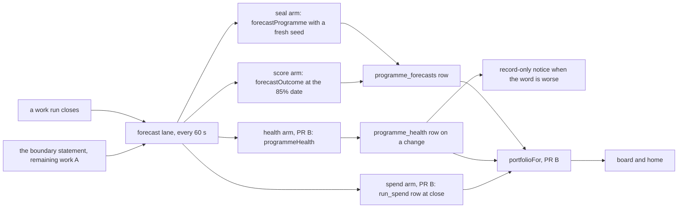

# Overlord W2: forecasts and health, when a programme will land and how it is going Implementation Plan

> **For agentic workers:** REQUIRED SUB-SKILL: Use superpowers:subagent-driven-development (recommended) or
> superpowers:executing-plans to implement this plan task-by-task. Steps use checkbox (`- [ ]`) syntax for tracking.

## In short

- **What it is.** The server forecasts when each programme will land, seals each forecast at a wave boundary, and
  scores it at its date. It names each programme's health in one word with its evidence. `portfolioFor` serves both,
  with the programme's edges, its critical path and what its waves cost. No model and no session ever produces a date.
- **Two pull requests in lane P.** PR A (4 tasks): `forecastProgramme`, the sealed forecasts, their scoring and
  calibration, and the forecast lane. It needs remaining work A and portfolio B (#2904), whose rebuilt-run rule it
  shares (F8). PR B (4 tasks): `programmeHealth`, the health words in the trigger table, health changes as rows, what a
  run cost, and `portfolioFor`'s W2 measures. It needs PR A.
- **Live at merge** (the index's question 20, accepted). The forecast lane starts sealing at PR A's merge. A forecast
  needs remaining work, whose history starts only when coordinators begin stating it, so the seals start as early as
  they can, and are scored before the Overlord reads them.
- **Spend has a writer** (question 10, ruled in fix round 1). The usage sweep holds only each live session's newest
  reading, in memory, so a closed wave's spend is gone once its session ends. The forecast lane records each run's spend
  once, at its close, in `run_spend`, and only from a reading inside the run's window.
- **What the reviewer checks.** Every decider is first match, total over its stated domain and monotonic; one seed gives
  one answer; an unmeasured input never makes a forecast or a health word look better or worse than measured; no
  forecast's own subject can score it; health is computed once, by the lane, and the portfolio shows that row.
- **Revised in fix round 1** (review 2265, ruled by the coordinator). Questions 8 and 10 are ruled; F1 to F4, F7, F8,
  F10, F11 and F16 to F19 are folded in. Nothing waits on the coordinator or the operator.

## 1. Scope and architecture

This section says what the plan builds and where each part sits in the rings.

**Goal:** the operator sees, for each programme, a date range the server can defend and a health word with its reason.

**Why:** §5.6, H38: "Forecasts are pure and seeded … A forecast answers a median date and an 85% date, with its n and
its source. Or it answers `unforecastable`, with a reason … Each 85% date is sealed at a wave boundary and scored. When
the share met stays outside 75 to 90% for four weeks, every date is marked 'uncalibrated' (M30, §12)." And: "Health is
one word, first match wins … Each word comes with its evidence row. There is no composite score. A change to a worse
word is an event." Table 11.7b's rule: "`programmeHealth`, `forecastProgramme` … The plan of the wave that ships each
one writes its table, states its input domain, and shows it total over that domain, ordered where two rows match, and
monotonic."

**Architecture:**

| Part | File | Ring and context | PR |
|---|---|---|---|
| Seeded draws | `server/src/time/seeded.ts` (new) | L1, K | A |
| `forecastProgramme`, `forecastOutcome`, `forecastCalibration` | `server/src/coord/forecast.ts` (new) | L1, C5 | A |
| The forecast wire and limits; B adds the health words and their limits | `shared/programmeFacts.ts` (remaining work A's) | L0, C5 | A, B |
| `programme_forecasts`; B adds `programme_health` and `run_spend` | `server/src/coord/programmeFactsStore.ts` (remaining work A's) | L3, C5 | A, B |
| The forecast lane: seal and score arms; B adds the health and spend arms | `server/src/coord/forecastLane.ts` (new) | L4, C5 | A, B |
| `programmeHealth`, `criticalPath` | `server/src/coord/programmeHealth.ts` (new) | L1, C5 | B |
| The health kind in the trigger table | `shared/practice-triggers.ts` | L0, C5 | B |
| `portfolioFor`'s W2 measures | `shared/portfolio.ts`, `server/src/coord/portfolio.ts`, `portfolioStore.ts` | L0, L1, L3, C5 | B |


*Figure 1. The forecast lane is the one writer of every row here, and the only place `programmeHealth` runs.
`portfolioFor` stores nothing and computes no health: it reads the newest seal, the newest health row and the spend
rows, and computes calibration and the critical path at each read.*

**Tech stack:** TypeScript (ESM), `node:sqlite`, vitest. No new dependency.

**Spec:** `docs/superpowers/specs/2026-11-09-overlord-design.md`: §5.6 (H38) and Table 5.6a; Table 11.1a, row "Sealed
forecasts (85% dates)"; Table 11.1b, rows "`REQUEST_TRANSITIONS`, … `forecastProgramme`, `programmeHealth`" and "The
trigger table (… health words from W2)"; Table 11.1d, row "The forecast lane"; §9.7, the trigger field ("a refusal
word, a stall arm or a health word"); §11.7 and Table 11.7b; §12, M29 and M30; Table 14, row W2.

The index is `docs/superpowers/plans/2026-11-16-overlord-w2.md` (PR #2917, read from its branch until it merges). This
plan builds its row "Forecasts and health" (lane P), its "Health words in the trigger table" mapping, and its questions
20, 22 and 23. The W1 plan it extends is `docs/superpowers/plans/2026-11-14-overlord-w1/w1-portfolio.md`, whose "What
depends on it" names "W2: health, dates, edges and spend, which join `portfolioFor`". The sibling W2 plan it reads is
`w2-remaining-work.md` for the statement and the edges; the interfaces it uses are that plan's Task 1 and Task 2.

## 2. Open questions

The index's questions come first, with their rulings. Each other question is one the spec leaves open or the tree
contradicts. The plan builds every recommendation unless the coordinator rules otherwise. None needs the operator: each
is implementation or tech direction.

| # | Question | State | What this plan builds |
|---|---|---|---|
| 1 | The index's 20, 22 and 23 | Accepted | Live at merge; spend through run ids; built before W1 closes |
| 2 | What a forecast samples | Proposed | Wave lead time, close to close |
| 3 | Own history, fleet history, abandons and rework | Proposed | Own from 20 waves, else the fleet's; two extra draws |
| 4 | Which statement a seal uses | Proposed | It waits up to 30 minutes for the boundary's statement |
| 5 | When a sealed date is met | Ruled | Measured closes alone, by the date |
| 6 | When dates read "uncalibrated" | Proposed | Four weekly cuts, all outside 75 to 90% |
| 7 | Which forecast and which health word the portfolio shows | Ruled | The newest seal and the newest health row |
| 8 | The health thresholds | Ruled | Task 6's table, starting values, revisited after a month |
| 9 | Where a health change is recorded | Proposed | `programme_health` rows; a worse word a record-only notice, once a day |
| 10 | What a closed wave cost | Ruled | `run_spend`, one row per run at its close, from a reading inside its window |
| 11 | The critical path | Proposed | The chain of open `needs-landed` edges |
| 12 | Where the seeded draws live | Proposed | `server/src/time/seeded.ts` |

1. **The index's questions, as ruled.**
   - **Q20.** The forecast lane, `programmeHealth` and `portfolioFor`'s new measures are live at merge, gated only by
     what gates `GET /api/portfolio` today. No capability word.
   - **Q22.** "A request's spend is the window use, by model class, of the sessions of the runs that carry its
     `requestId` … A programme's spend is the same over its runs." This plan builds the programme half; home requests A
     builds the request half on the same reader. The measured gap is question 10.
   - **Q23.** PR A is built once remaining work A and portfolio B (#2904) merge (portfolio B's rebuilt-run rule, F8);
     PR B once PR A merges.
2. **A forecast samples wave lead time, close to close** (slug `forecast-samples-wave-lead`). The spec says "a Monte
   Carlo over past wave cycle times". `portfolioFor`'s cycle time is a wave's dispatch to its close. That leaves out the
   time between waves: review, the coordinator's turn, waits on the operator. A forecast built from it would be early
   by every gap.
   - **Recommendation:** a sample is a work wave's lead time: from the previous work wave's close in the same programme
     to this wave's close, or from the wave's earliest `openedAt` for a programme's first wave. A wave closed before
     any earlier one (two open at once) uses the later of the two starts. The portfolio's cycle time is unchanged and
     still shown.
   - **One wave rule** (review 2265, F8). A wave, the run that stands for it, and whether a run counts, come from the
     tree's one rule: `shared/programmes.ts#waveRepresentative`, `#countsAsWave` and `#WAVE_BUCKET`, as `portfolio.ts`
     uses them. A wave's close is its representative's `closedAt`. A wave with a rebuilt run is left out of the samples
     and counted in `leadsUnmeasured`, through portfolio B's rebuilt-run rule, moved to one shared owner both plans
     read (Task 3).
   - Rejected: dispatch-to-close. It is the measure the operator already sees, and it is the wrong one for a date.
3. **Own history from 20 waves, else the fleet's; abandons and rework as extra draws** (slug
   `abandon-and-rework-as-extra-draws`). The spec says "the programme's own once it has 20 of them, else the fleet's.
   Abandons and rework are modelled apart."
   - **Recommendation:** three sample sets per source: done leads, abandoned leads (a work run that closed `failed` with
     a `closeDetail` starting `abandon:` or equal to `server/src/coord/runCloseSwitch.ts#DISPATCH_ABANDON_CLOSE_DETAIL`,
     never `shared/programmes.ts#NEVER_STARTED_DETAIL`), and rework leads (the second and later work runs of one wave).
     Two rates: the abandon share and the rework share of waves.
   - **Reworked** is one word for one thing (review 2265, F17): a wave with two or more work runs, the shape the tree
     gives a wave whose first run did not finish it. No run reopens (`RUN_TRANSITIONS` gives `done` and `failed` no
     exit), so health's "reopened waves" is this count too.
   - Each wave of a trial draws one done lead. With the abandon share's chance it first loses one abandoned lead, at
     most three times. With the rework share's chance it adds one rework lead. An empty abandoned or rework set reuses
     the done set.
   - The source is the programme's own when it has 20 done leads, else the fleet's (every programme's) when that has 20,
     else `unforecastable` with `too-little-history`.
4. **A seal waits for the boundary's statement** (slug `seal-waits-for-the-boundary-statement`). The coordinator states
   the remaining work at the boundary, usually just after it closes the wave, so a seal taken at the close would use the
   previous statement.
   - **Recommendation:** the seal arm seals a closed work run once a statement naming that run exists, or 30 minutes
     after the close (`SEAL_WAIT_MS`) with the newest statement then standing. With no statement at all it seals
     `unforecastable`, `no-remaining`. Remaining work A's statement carries `runId` for this pairing.
   - **A seal is computed as of its boundary, not as of the pass** (review 2265, F19). Its `asOf` is the later of the
     close and the paired statement's time; its dates are `asOf` plus the trial totals, and its history holds only waves
     closed by `asOf`. A seal taken late (after a restart, or for a close up to 7 days old at deploy) is the same seal it
     would have been on time, so early calibration is not skewed toward `met`.
5. **A sealed date is met when measured closes say so** (slug `forecast-met-on-measured-closes`). The spec says each
   85% date is "scored at the date" and does not say against what.
   - **Ruled** (review 2265, F3): a forecast's own subject never scores it, so no statement counts. At the 85% date the
     score arm answers `met` when, after the seal's `asOf` and at or before `p85At`, the programme closed at least the
     seal's `hi` work waves `done`, or closed its last run `done` with no run of the programme opened between that close
     and `p85At`. Otherwise `missed`. `forecastOutcome` decides it (Task 2). "At or before `p85At`" compares epoch
     milliseconds, so no timezone enters (F17).
6. **Dates read "uncalibrated" on four weekly cuts** (slug `calibration-four-weekly-cuts`). "When the share met stays
   outside 75 to 90% for four weeks."
   - **Recommendation:** `forecastCalibration(scored, now)` takes four cut points, now and 7, 14 and 21 days before. At
     each it measures the share met of the seals scored in the 28 days before it. A cut with fewer than 8 scored seals is
     unmeasured. All four measured and outside 75 to 90% answers `uncalibrated`; any cut unmeasured answers `unmeasured`
     (dates shown, marked "calibration not yet measured"); otherwise `calibrated`. It is fleet-wide, as M30 is, and it
     is computed at each read, never stored.
7. **The portfolio shows the newest seal and the newest health row** (slug `portfolio-shows-the-sealed-forecast`). A
   forecast, and a health word, could be computed again at every read.
   - **Recommendation:** `portfolioFor` shows the programme's newest sealed forecast, with its seal time. The dates the
     operator sees are the dates that are scored, and a read runs no Monte Carlo. A new statement between boundaries
     moves the dates at the next boundary.
   - **Health, the same way** (review 2265, F7, ruled; slug `portfolio-shows-the-recorded-health`). `programmeHealth`
     runs once, in the lane's health arm. `portfolioFor` shows the newest `programme_health` row, with its time, so the
     feed never announces a word the board does not show.
8. **The health thresholds are this plan's** (slug `health-thresholds-in-the-plan`). §5.6 names the eight words and no
   thresholds.
   - **Ruled** (review 2265): Task 6's values are approved as starting values, to be revisited after a month of
     `programme_health` rows. Two changes: `churning` compares with `>`, not `>=`, because a first review plus one
     fix-round review is a common, healthy wave; and `stalled`'s last move counts only state changes of open work runs,
     never a statement, so a coordinator cannot clear a stall by writing one.
9. **A health change is a row, and a worse word a record-only notice** (slug `health-changes-are-rows`). `programmeHealth`
   is pure and stores nothing, so "a change to a worse word is an event" needs the previous word.
   - **Recommendation:** the forecast lane's health arm computes each listed programme's word on its pass and appends a
     `programme_health` row (programme, time, word, evidence) when the word differs from the programme's newest row.
     When the new word is worse, it also records one `record-only` feed notice through the existing notice funnel, as
     the call record's door does for a big call. It pushes nothing. W4b's case lane reads these rows as trigger
     occurrences (`health:<word>`).
   - **No flapping notices** (review 2265, F16). A programme's first row has nothing to be worse than, so it records no
     notice. A notice is recorded at most once per programme and word per day: a word that flaps between passes
     appends rows, which are the record, and its second notice that day is not recorded.
10. **What a closed wave cost: one `run_spend` row per run, at its close** (slug `run-spend-measured-at-close`). Measured
    on `main`: the usage sweep (`server/src/watch.ts`, lane `usage`, every 60 s) keeps each live session's newest
    reading in memory (`FleetWatcher#currentUsage`), from the statusline sidecar; nothing stores a history, and a
    session's reading leaves the map when its row is purged. A wave's worker session is reclaimed after its run closes,
    so its spend cannot be read later. Question 22's "no new writer" cannot be met for closed waves.
    - **Ruled** (review 2265, accepted with F2's fixes). The forecast lane's spend arm, on a pass after a run (work or
      review) closes, reads that run's session (`runs.sessionId`) through a usage port and writes one `run_spend` row,
      with `INSERT … ON CONFLICT DO NOTHING`:
      - **`measured`**, with the reading's `cost`, model `class` and time, only when the reading's time lies inside the
        run's window (from its `dispatchedAt` to its `closedAt` plus `SPEND_READ_GRACE_MS`, 10 minutes), the reading is
        not `stale`, and the session was not dispatched to a later run since;
      - **`absent`** when the session has no reading, or the run has no session;
      - **`outside`** when a reading exists but fails the window, staleness or re-dispatch test.
    - **Boot guard.** The usage port answers `not-ready` until the usage sweep has completed one pass in this process,
      and the arm writes nothing while it does, so a restart never records a permanent `absent`.
    - **No backfill.** The arm records only runs that closed after the arm's first pass in this process, or after the
      newest `run_spend` row, whichever is earlier; nothing is backfilled at deploy. A closed run with no row counts as
      unmeasured in every spend read, never dropped and never 0.
    - **Live readings.** The spend read adds the live readings of open runs' sessions, one per session (deduplicated),
      leaving out a `stale` reading, which counts as unmeasured. All of it is marked "attributed".
    - **Whose spend.** A programme's spend is its runs' sessions' spend, as the spec says ("the sessions of its linked
      runs"). The coordinator session's own spend is outside every programme's total, and the read says so.
    - **Class.** A run's class is its reading's class at close. A run whose model changed mid-run is filed under the
      last one, and the read says so.
    - **What "window use" is** (slug `spend-is-the-statusline-cost`): `SessionUsage.cost`, the statusline's cost figure,
      by model class. Dispatch `/clear`s a worker at each wave from the second, so a worker's reading at its close should
      be that wave's conversation alone. **Task 7's first step measures whether cost restarts at `/clear`, and stops and
      asks the coordinator if it does not** (F11). The schema plans the column that answer would need now: `startCost`,
      NULL until a ruled writer records the session's reading at dispatch.
    - Rejected: live readings only. Every closed wave would read `unmeasured`, so "spend per wave" would never fill.
11. **The critical path follows open `needs-landed` edges** (slug `critical-path-follows-landed-edges`). §5.6 lists "what
    blocks the programme, and the critical path" and defines neither.
    - **Recommendation:** `criticalPath(slug, edgesOf, sealOf)` follows each open `needs-landed` edge whose target is a
      `run-closed` run to that run's programme, then that programme's open `needs-landed` edges, without revisiting a
      programme and at most 10 deep. It answers the chain with the latest 85% date on it, and `unmeasured` for a link
      whose programme has no seal. A `pr-merged` target is a leaf. It follows only `open` edges, and none while
      `EDGE_CLEARING_SHIPPED` is `false` (remaining work's question 5, review 2265 F1).
12. **The seeded draws live in the time kernel** (slug `seeded-draws-in-the-time-kernel`). There is no seeded generator
    in production code: the tests' `mulberry32` (`server/test/fakeTime.ts`) is test-only.
    - **Recommendation:** `server/src/time/seeded.ts#seededDraws(seed)`, K and L1, beside the `Entropy` port
      (`server/src/time/ports.ts#Entropy`). `forecastProgramme` takes its seed as an argument; the lane draws the seed
      with `entropy.below(2 ** 32)` and stores it, so a seal can be replayed exactly. Each trial draws from its own stream,
      seeded from the seed and the trial's index, which makes the forecast exactly monotonic in the remaining range.

## 3. What exists today

Measured on `main` at `9cf263d44` (2026-11-16).

- **No forecast and no health.** `git grep -i -E 'forecastProgramme|programmeHealth|sealed'` finds nothing under
  `server/src` or `shared`. The word `forecast` there is the placement forecast (`server/src/limits.ts`), another
  concept. `health` names `/health` and `/api/fleet/health`, so the new words are `ProgrammeHealthWord` and
  `PROGRAMME_HEALTH_WORDS`.
- **`portfolioFor`** (`server/src/coord/portfolio.ts#portfolioFor`) is pure, `portfolioFor(facts, now)`, composed by the
  portfolio read in `server/src/coord/ledgersRoutes.ts` from `portfolioStore.ts#portfolioFacts`. Its entry
  (`shared/portfolio.ts#PortfolioEntry`) carries the rank and class, work in progress, waves closed in 7 and 28 days,
  cycle time (median and 85th percentile, done waves, all history), the oldest open wave's age, review rounds, how waves
  ended in 28 days, hours waiting on the operator, and what blocks it (`blocking`: items shown to the operator and live
  asks). It has no spend, no abandon rate, no edges, no dates and no health. Percentiles come from
  `server/src/perf/stats.ts#percentile`.
- **Portfolio B (#2904) is not merged** (`gh pr view 2904`: `state` OPEN, `mergedAt` null, measured again in fix round
  1). It adds `PortfolioRun.rebuilt` and `PortfolioEntry.oldestOpenUnmeasured`, edits `portfolio.ts`' entry builder
  around the cycle and oldest-wave lines (a private `rebuiltWave`), and computes the rebuilt-run rule in SQL in
  `portfolioStore.ts` (a private `REBUILT`: no claimant, and `dispatchedAt` equal to `openedAt`). Forecasts A needs that
  rule, so it lands after #2904 and moves the rule to one owner (Task 3).
- **The wave rule.** `shared/programmes.ts#waveRepresentative` picks the run that stands for a wave, `#countsAsWave`
  says which kinds count (work), and `#WAVE_BUCKET` buckets each run state; `portfolio.ts` reads all three.
- **The runs.** `runs` carries `program`, `wave`, `kind`, `state`, `openedAt`, `dispatchedAt`, `closedAt`,
  `closeDetail` and `sessionId` ("null until dispatch mints the workspace"). There is no `abandoned` state: an abandon
  is `failed` with a `closeDetail` starting `abandon:`, or `DISPATCH_ABANDON_CLOSE_DETAIL`. Closes go through
  `server/src/coord/store.ts#closeRun`, and terminal writes also happen in `advanceInner`; both write `run_events`
  rows. No bus event marks a close, so a lane polls `runs.closedAt`.
- **The usage sweep** holds `SessionUsage` (`shared/api.ts#SessionUsage`: `ts`, `model`, `class`, `cost` and the
  context fields) per live session in memory only. No table records usage.
- **The trigger table** (`shared/practice-triggers.ts#TRIGGER_TABLE`) has two kinds, `stall-arm` and `refusal`; its header
  says "W2 adds the health words as one more kind and one more arm of `TriggerSignature`". `parseSignature` is its one
  reader. `server/test/sim/vocabularySets.ts`' trigger cases pin the kinds and rows, with the mutant set
  `shared/practice-triggers.ts#parseSignature`; `server/test/single-definition/vocabularies.test.ts` pins that the table
  is derived.
- **Randomness and time.** `server/src/time/ports.ts#Entropy` (`hex`, `uuid`, `below`) has a crypto adapter
  (`server/src/time/system.ts#systemEntropy`) and a seeded test adapter. `server/test/single-definition/time-ports.test.ts`
  forbids an ambient clock or `Math.random` in its listed files, which include `shared/portfolio.ts`,
  `server/src/coord/portfolio.ts` and `shared/practice-triggers.ts`.
- **Lanes.** `server/src/laneSchedule.ts#LANE_SCHEDULE` rows carry `name`, `cadenceMs`, `clock`, `flight`, `warnKey`
  and `derivedFrom`. A lane is a `sweepX` method in `server/src/watch.ts` that calls `runLane`, dispatched from `tick`,
  with its logic in its own module behind a port its store builds (the quiz lane is the model).
- **Notices.** `server/src/notice.ts` has the mode `record-only`, which records and never pushes.
- **Mutation floors.** `server/test/sim/mutation-floors.test.ts#MUTANT_SETS` spreads `PORTFOLIO_MUTANT_SETS` from
  `server/test/sim/portfolioSets.ts`; `server/test/sim/mutation-floors.json` holds one floor per key.
- **Growth.** `server/test/growthCheck.ts`: 40 net code lines per pull request for `schema.ts`, `store.ts`, `routes.ts`
  and `server.ts`; `shared/api.ts` is capped and takes no line. `watch.ts` is held by its waivers.

## 4. Global constraints

- **Architecture (`CLAUDE.md`).** `forecast.ts`, `programmeHealth.ts` and `seeded.ts` are L1: pure, no store, no clock,
  no `Math.random`; `now` and the seed are arguments. `forecastLane.ts` is L4 and decides nothing: each verdict is a
  decider's. Its ports (`ForecastLanePort`, `UsageRead`) are declared by the lane, built by the store and the watcher.
  The store gains SQL only. No repository and no async wrapper over `CoordStore`.
- **One writer per fact.** `programme_forecasts`, `programme_health` and `run_spend` are each written only by the
  forecast lane's store functions (`sealForecast`, `scoreForecast`, `appendHealth`, `recordRunSpend`), each called only
  by its arm. A census pins each in both directions. `sealForecast` and `recordRunSpend` use `INSERT … ON CONFLICT DO
  NOTHING`, so a repeat is a no-op by the store, not by the lane's `flight: 'skip'` (review 2265, F19).
- **One computation per fact.** `programmeHealth` runs only in the lane's health arm, and `portfolioFor` shows the row
  it wrote (question 7). The wave rule is `shared/programmes.ts`'s, and the rebuilt-run rule has one owner (Task 3).
- **Consolidate.** One lane for lane P (the edge arm of remaining work B joins it). `portfolioFor` stays the one
  programme reader: health, dates, edges, spend and the critical path join its entry, and no second reader is built.
  The trigger table gains a kind, never a second table. Percentiles through `percentile`.
- **Failure contracts.** An unread fact never reads as zero, as met or as healthy.
  - `unforecastable` always carries its reason (`no-remaining`, `nothing-left`, `too-little-history`).
  - A health input the facts could not measure is listed in the evidence's `unmeasured` and never matches a row, so it
    cannot make the word worse; the word it yields is shown with those inputs named, so it cannot pass as fully
    measured.
  - A `run_spend` row with no reading is `absent`, and one with a reading outside the run's window is `outside`; both
    read as unmeasured, never cost 0. A closed run with no row at all counts as unmeasured too.
  - An edge counts in `blocking`, health and the critical path only once `EDGE_CLEARING_SHIPPED` is `true` (remaining
    work B); before then the entry lists it as "clearing not shipped" (review 2265, F1).
  - A lane pass that throws on one programme records nothing for it and goes on; the next pass retries.
- **Wire: additive.** `PortfolioEntry` and `PortfolioView` gain optional fields only. An older console ignores them; an
  older server's entry lacks them, and the console reads absence as "not measured on this server".
- **What a merge arms.** PR A: the forecast lane starts sealing and scoring rows nothing yet serves. PR B: the
  portfolio read gains fields, the health arm records rows and record-only notices (none on a programme's first row,
  at most one per programme and word a day), the spend arm records rows for runs closed from then on. Nothing a running
  session reads changes, and nothing pushes.
- **SAFETY.** No ccd verb, no fleet act, no live `~/.ccrc`. Tests build `coord.db` in memory or under the per-run temp
  root, and every watcher a test builds is quieted (`server/test/laneQuiet.ts`).
- **Public repository.** Fixtures use `prog-a`, `prog-b`, `lane-a-project-a`. Private-name scan over every changed file
  before each push. No D-number is invented.
- **Tests.** From `server/`: `ccrc test -- ./node_modules/.bin/vitest run test/<file>.test.ts`, one file at a time, in
  the foreground; each task's last run adds both server typechecks, and pwa's typecheck when `shared/` changes.
- **Mutation floors.** `seededDraws`, `forecastProgramme`, `forecastOutcome`, `forecastCalibration` (PR A),
  `programmeHealth` and `criticalPath` (PR B) each join `MUTANT_SETS` and `mutation-floors.json` in the pull request that
  creates them.

## 5. Review focus

1. **The deciders.** Each input table is total, ordered and monotonic, with an exhaustive test and a property. One seed
   gives one forecast; a wider remaining range never gives an earlier date.
2. **Honesty about what was not measured.** No unmeasured input reads as zero, as met or as steady-without-saying-so.
3. **One writer, one lane.** The lane is the only writer of its three tables, and no session path reaches them.
4. **Nobody scores their own forecast.** Outcomes come from measured closes alone; no statement scores a seal.
5. **Spend lands on the right run.** A reading counts only inside its run's window, never across a re-dispatch, never
   stale, and never as an `absent` written before the usage sweep's first pass.

## 6. The PR split

| PR | Tasks | What it ships | Needs first | Growth-checked files, estimate (net code lines) |
|---|---|---|---|---|
| A | 1 to 4 | `seededDraws`; `forecastProgramme`; `forecastOutcome` and `forecastCalibration`; the rebuilt-run rule's one owner; `programme_forecasts` and its writers; the forecast lane with its seal and score arms | remaining work A, portfolio B (#2904) | `schema.ts` +20 (one migration); `store.ts` +4 (delegates); `watch.ts` +6 (`sweepForecasts` and its dispatch, under its waiver); `server.ts` 0 |
| B | 5 to 8 | The health words and limits; the trigger kind; `programmeHealth` and `criticalPath`; `programme_health` and `run_spend` with the health and spend arms; `portfolioFor`'s W2 measures and the spend read | PR A | `schema.ts` +24 (one migration); `store.ts` +5; `server.ts` +1 (the usage port into the portfolio read's deps); `shared/api.ts` 0 |

Each pull request merges `main` once before merge and re-measures its migration slot (the index's "Where lanes meet").
For scale, the files that are not growth-checked change by about this much: `seeded.ts` +40; `forecast.ts` +200;
`forecastLane.ts` +150 (A) and +90 (B); `programmeFactsStore.ts` +90 (A) and +80 (B); `programmeHealth.ts` +180;
`shared/programmeFacts.ts` +40 (A) and +70 (B); `shared/portfolio.ts` +40; `portfolio.ts` +60; `portfolioStore.ts` +50;
`shared/practice-triggers.ts` +8.

## 7. Tasks

### Task 1: Seeded draws and `forecastProgramme` (K and C5, L1)

**Files:**
- Create: `server/src/time/seeded.ts` (`seededDraws(seed)`: a mulberry32 stream answering `next(): number` in [0, 1)
  and `below(n)`, and `streamFor(seed, index)`, which mixes the two into one 32-bit seed)
- Create: `server/src/coord/forecast.ts` (`forecastProgramme`)
- Modify: `shared/programmeFacts.ts` (the forecast wire and limits below)
- Create: `server/test/forecast.test.ts`, `server/test/sim/forecastSets.ts`
- Modify: `server/test/sim/mutation-floors.test.ts`, `server/test/sim/mutation-floors.json`,
  `server/test/single-definition/time-ports.test.ts` (both new files)

No path-table step: `coord/**` (C5) and `time/**` (K) already cover both files in the ring and context map (review
2265, F18).

**The wire** (`shared/programmeFacts.ts`): `FORECAST_TRIALS = 10_000`, `FORECAST_OWN_MIN = 20`, `FORECAST_FLEET_MIN =
20`, `ABANDON_REDRAWS_MAX = 3`; `LeadHistory` (`done`, `abandoned`, `rework`: lead times in ms; `waves`, `abandons`,
`reworks`: counts); `Forecast = { kind: 'forecast'; medianAt; p85At; n; source: 'own' | 'fleet'; seed } | { kind:
'unforecastable'; reason: 'no-remaining' | 'nothing-left' | 'too-little-history' }`, each word union with its map.

**The decider.** `forecastProgramme(history: { own: LeadHistory; fleet: LeadHistory }, remaining: { lo; hi } | null,
seed: number, asOf: number): Forecast`, first match (`asOf` is the seal's boundary time, question 4):

| # | Input | Answer |
|---|---|---|
| 1 | `remaining` is null | `unforecastable`, `no-remaining` |
| 2 | `remaining.hi` is 0 | `unforecastable`, `nothing-left` |
| 3 | `own.done` has at least `FORECAST_OWN_MIN` leads | forecast from `own`, `source: 'own'` |
| 4 | `fleet.done` has at least `FORECAST_FLEET_MIN` leads | forecast from `fleet`, `source: 'fleet'` |
| 5 | otherwise | `unforecastable`, `too-little-history` |

A forecast runs `FORECAST_TRIALS` trials. Trial `t` draws from `streamFor(seed, t)`: a wave count `lo +
below(hi - lo + 1)`, then for each wave one done lead, with question 3's abandon and rework draws. The trial's total is
the sum. `medianAt` and `p85At` are `asOf` plus the 50th and 85th percentiles of the totals; `n` is the source's done
leads. A lead that is not a finite number above zero was never a sample: the store leaves it out and counts it (Task 3).

The input domain is `remaining` (null, or `0 <= lo <= hi <= REMAINING_WAVES_MAX`, as the door enforces), each history's
three sample sets (empty to large) and counts, any 32-bit seed. The table is total (row 5 catches the rest), ordered
(own before fleet), and monotonic:
- removing samples never turns an `unforecastable` answer into a forecast;
- for one seed, a larger `lo` or `hi` never gives an earlier `medianAt` or `p85At` (each trial's stream is fixed, so a
  trial with more waves draws a superset);
- for one seed and one input, the answer is identical.

- [ ] **Step 1: Failing tests** (`test/forecast.test.ts`): one case per row; a pinned answer for one fixed history and
  seed (the replay case); the three properties over generated inputs (fixed seeds, 200 runs each); a history of 20
  identical leads of one day with `lo = hi = 3` answers both dates at `asOf + 3 days`; an abandon share of 1 adds
  exactly `ABANDON_REDRAWS_MAX` abandoned leads per wave; `seededDraws` answers the reference mulberry32 sequence for
  seed 1 and never 1.0.
- [ ] **Step 2: Run.** Red. **Step 3: Implement.** **Step 4: Run** the suite, `test/single-definition/time-ports.test.ts`,
  `test/rings/*.test.ts`, both server typechecks and pwa's. Green.
- [ ] **Step 5: Mutation.** Sets keyed `server/src/time/seeded.ts#seededDraws` and
  `server/src/coord/forecast.ts#forecastProgramme` (mutants: own minimum 19, fleet before own, `hi` read as `hi + 1`,
  the 85th percentile read at 80, the abandon cap removed), each with its floor at 1. Every mutant is killed.
- [ ] **Step 6: Commit.** `feat(forecast): forecastProgramme, a seeded Monte Carlo over wave lead times (Overlord W2 forecasts A)`

### Task 2: When a seal is met, and calibration (L1)

**Files:**
- Modify: `server/src/coord/forecast.ts` (`forecastOutcome`, `forecastCalibration`)
- Modify: `shared/programmeFacts.ts` (`CALIBRATION_BAND = [0.75, 0.9]`, `CALIBRATION_MIN_N = 8`, the outcome and
  calibration words with their maps)
- Modify: `server/test/forecast.test.ts`, `server/test/sim/forecastSets.ts`, `server/test/sim/mutation-floors.json`

**`forecastOutcome(seal, since, now)`** takes the seal and the programme's measured runs after its `asOf` (the work
waves closed `done`, by the wave rule, and the times runs opened), never its statements (question 5, ruled), and
answers first match:

| # | Input | Answer |
|---|---|---|
| 1 | The seal is `unforecastable`, or already scored | `none` |
| 2 | `now` is before `p85At` | `none` |
| 3 | At least the seal's `hi` work waves closed `done` after `asOf` and at or before `p85At` | `met` |
| 4 | The programme's last run closed `done` after `asOf` and at or before `p85At`, and no run of the programme opened between that close and `p85At` | `met` |
| 5 | Otherwise | `missed` |

Every comparison is of epoch milliseconds. Monotonic: removing a measured close never turns `missed` into `met`, and no
statement, of any range, changes the answer.

**`forecastCalibration(scored, now)`** answers `{ state: 'calibrated' | 'uncalibrated' | 'unmeasured', cuts }`, where
each of the four cuts carries its `n` and share met, as question 6 states. Monotonic: removing scored seals never turns
`unmeasured` into either other state.

- [ ] **Step 1: Failing tests:** one case per row of each; the band's edges (a share of exactly 0.75 and 0.9 is inside);
  three cuts outside and one inside is `calibrated`; one cut with 7 seals is `unmeasured`; the properties; a statement
  of `0..0` before the date, with no close, scores `missed` (F3); a run opened one millisecond before `p85At` after the
  last close scores `missed` under row 4 (F17).
- [ ] **Step 2: Run.** Red. **Step 3: Implement.** **Step 4: Run** the suite and the typechecks. Green.
- [ ] **Step 5: Mutation.** Keys `#forecastOutcome` and `#forecastCalibration` (mutants: score before the date, count
  a close after `p85At`, drop row 4's opened-run check, a closed band edge, three cuts instead of four,
  `CALIBRATION_MIN_N` read as 0). Every mutant is killed.
- [ ] **Step 6: Commit.** `feat(forecast): when a sealed date is met, and when dates read uncalibrated (Overlord W2 forecasts A)`

### Task 3: The rebuilt-run rule's one owner, `programme_forecasts`, and the facts the lane reads (L3)

This task starts once portfolio B (#2904) is on `main` (F8).

**Files:**
- Modify: `shared/programmes.ts` (`isRebuiltRun({ claimedBy, dispatchedAt, openedAt })`, portfolio B's rule, moved)
- Modify: `server/src/coord/portfolioStore.ts` and `server/src/coord/portfolio.ts` (they read the rule from there: the
  store selects the three columns, the entry builder asks `isRebuiltRun`; behaviour unchanged)
- Modify: `server/src/coord/schema.ts` (one migration)
- Modify: `server/src/coord/programmeFactsStore.ts` (`sealForecast`, `scoreForecast`, `forecastsOf`, `leadHistoryOf`,
  `unsealedClosesOf`, `outcomeFactsOf`)
- Modify: `server/src/coord/store.ts` (delegates)
- Modify: `server/test/coord-db.test.ts`, `server/test/run-close-switch.test.ts`,
  `server/test/single-definition/writers-map.test.ts` (`TABLES` gains the table: `sealForecast` inserts, `scoreForecast`
  writes only the outcome columns), `server/test/reconstruction-drill.test.ts`
- Create: `server/test/programme-forecasts-store.test.ts`

**Schema:**

```sql
CREATE TABLE programme_forecasts (
  id           INTEGER PRIMARY KEY AUTOINCREMENT,
  program      TEXT NOT NULL REFERENCES programs(slug),
  closingRunId INTEGER NOT NULL UNIQUE REFERENCES runs(id),  -- the wave boundary: one seal per closed work run
  sealedAt     INTEGER NOT NULL,       -- when the lane wrote it
  asOf         INTEGER NOT NULL,       -- the boundary it is computed as of (question 4)
  statementId  INTEGER REFERENCES programme_remaining(id),     -- NULL: no statement stood
  lo INTEGER, hi INTEGER,
  kind         TEXT NOT NULL,          -- 'forecast' | 'unforecastable'
  reason       TEXT,                   -- unforecastable's reason
  source       TEXT, n INTEGER, seed INTEGER,
  medianAt     INTEGER, p85At INTEGER,
  outcome      TEXT NOT NULL DEFAULT 'open',  -- 'open' | 'met' | 'missed'
  scoredAt     INTEGER
);
CREATE INDEX programme_forecasts_by_program ON programme_forecasts (program, id);
```

**The rule's move.** First a characterization test pins portfolio B's entries for rebuilt runs (cycle and oldest-wave
measures) on `main`. Then a move commit puts the predicate in `shared/programmes.ts#isRebuiltRun` beside the wave rule;
`portfolioStore.ts` selects `claimedBy`, `dispatchedAt` and `openedAt` and no longer computes `REBUILT` in SQL, and
`portfolio.ts`' `rebuiltWave` asks `isRebuiltRun`. The test's import changes and nothing else. `leadHistoryOf` reads
the same predicate, so both plans share one rule.

**The reads.**
- `unsealedClosesOf(db, now)`: work runs closed `done` or `failed` in the last 7 days with no seal row, with the
  statement that names each run if any, and the newest statement otherwise. A wave closed during a gap of more than 7
  days is never sealed; the count is reported on the lane's pass record.
- `leadHistoryOf(db, program, asOf)`: the programme's and the fleet's `LeadHistory` as of `asOf`, from `runs` alone:
  waves grouped and represented by `waveRepresentative` over the runs `countsAsWave` keeps, closed by `asOf`, with
  question 2's lead rule and question 3's sets. A wave with a run `isRebuiltRun` marks, or a lead that is not finite and
  above zero, is counted in `leadsUnmeasured`, never added.
- `outcomeFactsOf(db, sealId)`: what `forecastOutcome` reads: measured closes and run openings after the seal's `asOf`.

- [ ] **Step 1: Failing tests** (`test/programme-forecasts-store.test.ts`): a seal is written once per closing run (the
  unique index refuses a second); `unsealedClosesOf` lists a close with no seal and leaves out one older than 7 days;
  it pairs a close with the statement naming it over a newer one that does not; `leadHistoryOf` measures close to
  close through `waveRepresentative`, uses the earliest `openedAt` for a first wave, puts a second work run of one wave
  in `rework`, an `abandon:` close in `abandoned`, leaves `abandon:never-started` out, leaves a review run out, counts a
  wave with a rebuilt run in `leadsUnmeasured`, and leaves out a wave closed after `asOf`; `scoreForecast` writes only
  `outcome` and `scoredAt`, and only on an `open` row; a second `sealForecast` for one close is a no-op (`ON CONFLICT DO
  NOTHING`).
- [ ] **Step 2: Run.** Red. **Step 3: Implement**, the rule's move first, as its own commit. **Step 4: Run** the suite,
  `portfolio`, `portfolio-store`, `programmes-read`, `coord-db`, `run-close-switch`, `writers-map`,
  `reconstruction-drill`, `time-ports` and the typechecks. Green.
- [ ] **Step 5: Red check.** A second `INSERT INTO programme_forecasts` elsewhere reds `writers-map`; scoring an
  already scored row reds its case.
- [ ] **Step 6: Commit.** `feat(forecast): programme_forecasts and the facts the forecast lane reads (Overlord W2 forecasts A)`

### Task 4: The forecast lane, its seal and score arms (L4)

**Files:**
- Create: `server/src/coord/forecastLane.ts` (`runForecastLane(port, now, entropy)`; `ForecastLanePort`, declared here)
- Modify: `server/src/laneSchedule.ts` (`LaneName` gains `forecasts`; one row: `cadenceMs: FORECAST_LANE_PERIOD_MS`
  (60 s, so the spend arm of PR B reads a session before its reclaim), `clock: 'mono'` (the operator's ruling recorded
  in `laneSchedule.ts`: no row on the wall clock; review 2265, F4), `flight: 'skip'`, a `warnKey`)
- Modify: `server/src/watch.ts` (`sweepForecasts` through `runLane`, and its dispatch in `tick`)
- Modify: `server/src/deps.ts` (the lane's port in the watcher's deps, as the quiz lane's commit added its own),
  `server/src/index.ts` (the port, built from the store)
- Modify: `server/test/lane-schedule.test.ts` (its pinned count of mono rows and the case's title, 46 to 47, re-measured
  after merging `main`), `server/test/single-definition/time-ports.test.ts` (the lane module)
- Create: `server/test/forecast-lane.test.ts`

**The pass.** One pass, in order:
1. **Seal arm.** For each close `unsealedClosesOf` lists: if no statement names the run and the close is less than
   `SEAL_WAIT_MS` (30 minutes) old, skip it this pass. Otherwise set `asOf` (the later of the close and the statement),
   draw `seed = entropy.below(2 ** 32)`, read `leadHistoryOf(program, asOf)`, ask `forecastProgramme`, and
   `sealForecast` the answer with its statement, `asOf` and seed.
2. **Score arm.** For each `open` seal whose `p85At` has passed, read `outcomeFactsOf`, ask `forecastOutcome`, and on
   `met` or `missed` call `scoreForecast`.

A throw on one programme is caught, recorded on the pass record, and the pass goes on. The lane sends no mail and
pushes nothing.

- [ ] **Step 1: Failing tests** (`test/forecast-lane.test.ts`, an in-memory store, a fake clock and seeded entropy, the
  watcher quieted): a close with a statement naming it is sealed on the first pass; one with none waits 30 minutes,
  then seals with the newest statement; a close with no statement at all seals `no-remaining`; a pass after the 85%
  date scores the seal; a second pass changes nothing; the seed stored replays to the same dates; a close sealed five
  days late has the same dates as one sealed on time (F19); a throw on one programme leaves another's seal written.
- [ ] **Step 2: Run.** Red. **Step 3: Implement.** **Step 4: Run** the suite, `lane-schedule`, `consolidation-census`,
  `watcher-quiet-census`, `time-ports`, `rings/*` and the typechecks. Green.
- [ ] **Step 5: Red check.** Seal without waiting for the statement: the pairing case reds. Compute dates from the
  pass's `now`: the late-seal case reds. Read the clock in the lane module rather than through `now`: `time-ports`
  reds. Put the row on the wall clock: `lane-schedule` reds.
- [ ] **Step 6: Private-name scan**, then commit.
  `feat(forecast): the forecast lane seals at each wave boundary and scores at the date (Overlord W2 forecasts A)`

### Task 5: The health words, their limits and the trigger kind (L0)

PR B starts here. It needs PR A on `main` (portfolio B is already there, since PR A needs it).

**Files:**
- Modify: `shared/programmeFacts.ts` (`PROGRAMME_HEALTH_WORDS`, worst first, with its map and `isProgrammeHealthWord`;
  the limits of Task 6)
- Modify: `shared/practice-triggers.ts` (`TRIGGER_KIND_TABLE` gains `health`; `TriggerSignature` gains `{ kind:
  'health'; key: ProgrammeHealthWord }`; `TRIGGER_TABLE` spreads the words; `parseSignature` gains its branch)
- Modify: `server/test/sim/vocabularySets.ts` (its `TRIGGER_KINDS` pin, `['stall-arm', 'refusal']` today, moves with
  the health kind, and the expected rows; the index review's lens), `server/test/practice-triggers.test.ts`
- Test: `server/test/single-definition/vocabularies.test.ts`

The words, worst first, are §5.6's order: `blocked-on-you`, `slipping`, `stalled`, `aging`, `churning`,
`scope-growing`, `burning`, `steady`. A word's place in the list is its rank: a lower index is worse.

- [ ] **Step 1: Characterization:** `parseSignature` round-trips every row of today's table (it does, on `main`).
- [ ] **Step 2: Failing tests:** the kinds are `['stall-arm', 'refusal', 'health']`; every health word round-trips as
  `health:<word>`; `health:` with an unknown word does not parse; the table is derived from `PROGRAMME_HEALTH_WORDS`.
- [ ] **Step 3: Run.** Red. **Step 4: Implement.** **Step 5: Run** the suites above, `vocabularies.test.ts`,
  `practice-cases.test.ts`, the mutation floors (the existing `parseSignature` set gains a mutant that drops the health
  branch) and the typechecks, pwa's included. Green.
- [ ] **Step 6: Commit.** `feat(health): the programme health words join the trigger table (Overlord W2 forecasts B)`

### Task 6: `programmeHealth` and `criticalPath` (L1)

**Files:**
- Create: `server/src/coord/programmeHealth.ts`
- Create: `server/test/programme-health.test.ts`, `server/test/sim/programmeHealthSets.ts`
- Modify: `server/test/sim/mutation-floors.test.ts`, `server/test/sim/mutation-floors.json`,
  `server/test/single-definition/time-ports.test.ts`

**The inputs.** `HealthFacts`, built by `healthFactsOf(entry, extras)` (L1, in this file) from a `portfolioFor` entry
and the lane's extra facts; the lane alone calls it (question 7). Each field is a measured value or `'unmeasured'`:
- `blocking`: items shown to the operator, live asks, and, only while `EDGE_CLEARING_SHIPPED` is `true`, open
  `needs-decision` edges whose item the operator was shown (F1);
- `cls` and `fixedDate`; the newest seal's `p85At`, the previous seal's `p85At`, and whether the newest scored seal
  was `missed`. A `fixedDate` (`YYYY-MM-DD`) is read as the end of that day in UTC, 23:59:59.999 (F17);
- `wip` and `lastMoveAt`: the newest state change (`run_events` with `fromState` unlike `toState`) of any open work run,
  never a statement (question 8, ruled);
- `oldestOpenMs` and the reference 85th percentile cycle: the programme's own from 5 done waves, else the fleet's;
- review rounds per closed wave and reworked waves (question 3's definition), both over 28 days;
- the oldest statement in 28 days, the newest statement, and the work waves closed `done` between them;
- the median spend per wave over 28 days and over the 28 days before, each from at least 3 measured `run_spend` waves.

**The limits** (question 8, ruled: named constants in `shared/programmeFacts.ts`, approved as starting values and
revisited after a month of `programme_health` rows):

| Constant | Value | Used by |
|---|---|---|
| `HEALTH_SLIP_MS` | 7 days | `slipping`: the 85% date moved this much later between two seals |
| `HEALTH_STALLED_MS` | 48 hours | `stalled`: no move for this long with work in progress |
| `HEALTH_OWN_CYCLE_MIN` | 5 done waves | `aging`: own cycle reference, else the fleet's |
| `HEALTH_CHURN_ROUNDS` | 2.0 rounds per wave | `churning` |
| `HEALTH_CHURN_REOPENS` | 2 reworked waves | `churning` |
| `HEALTH_SCOPE_GROWTH_WAVES` | 2 waves | `scope-growing` |
| `HEALTH_BURN_FACTOR` | 2.0 | `burning`: this many times the earlier median spend per wave |
| `HEALTH_BURN_MIN_WAVES` | 3 | `burning`: measured waves in each window |

**The decider.** `programmeHealth(facts, now)` answers `{ word, evidence: { matched, values, unmeasured } }`, first
match:

| # | Word | Matches when (every input it reads is measured) |
|---|---|---|
| 1 | `blocked-on-you` | `blocking` has any item, live ask or shown `needs-decision` edge |
| 2 | `slipping` | a `fixed-date` programme's 85% date is after its date; or the newest scored seal was `missed`; or the newest 85% date is `HEALTH_SLIP_MS` later than the previous one |
| 3 | `stalled` | `wip > 0` and `now - lastMoveAt >= HEALTH_STALLED_MS` |
| 4 | `aging` | `oldestOpenMs` exceeds the reference 85th percentile cycle |
| 5 | `churning` | rounds per wave `> HEALTH_CHURN_ROUNDS`, or reworked waves `> HEALTH_CHURN_REOPENS` (ruled: `>`) |
| 6 | `scope-growing` | newest `hi` plus waves done since the oldest statement, minus the oldest `hi`, is `>= HEALTH_SCOPE_GROWTH_WAVES` |
| 7 | `burning` | the recent median spend per wave `>= HEALTH_BURN_FACTOR` times the earlier one |
| 8 | `steady` | always |

A row whose inputs include an unmeasured one does not match, and the input joins `evidence.unmeasured`. The domain is
every combination of each input measured (over its range, with the boundary values) or unmeasured. The table is total
(row 8), ordered (§5.6's order), and monotonic:
- adding a fault (another blocking item, a later 85% date, an older last move, a missed seal) never yields a better
  word;
- turning a measured input into `unmeasured` never yields a worse word, and adds the input to `evidence.unmeasured`.

**`criticalPath(slug, edgesOf, sealOf)`** answers `{ chain: string[]; latestP85At: number | null; unmeasured: string[] }`
by question 11's rule, cycle-safe and at most 10 deep.

- [ ] **Step 1: Failing tests** (`test/programme-health.test.ts`): one case per row with inputs only that row matches;
  each limit at its boundary, both sides; the exhaustive table over a generated domain; both monotonicity properties;
  `criticalPath` on a chain, a cycle, a depth of 11 and a link with no seal; with `EDGE_CLEARING_SHIPPED` false, an
  open `needs-decision` edge neither blocks nor enters the chain (F1); churn at exactly 2.0 rounds is not `churning`;
  a statement written after the last state change does not clear `stalled`; a `fixed-date` 85% date at 23:00 UTC of
  the fixed day is not `slipping`.
- [ ] **Step 2: Run.** Red. **Step 3: Implement.** **Step 4: Run** the suite and the typechecks. Green.
- [ ] **Step 5: Mutation.** Keys `server/src/coord/programmeHealth.ts#programmeHealth` (mutants: swap rows 2 and 3,
  read an unmeasured input as 0, a strict `>` for `>=` at the stalled limit, `>=` for `>` at the churn limit, drop the
  `fixed-date` arm, count edges while clearing is not shipped) and
  `#criticalPath` (mutant: no visited set). Every mutant is killed.
- [ ] **Step 6: Commit.** `feat(health): programmeHealth, one word with its evidence, and the critical path (Overlord W2 forecasts B)`

### Task 7: `programme_health`, `run_spend` and their arms (L3, L4)

**Files:**
- Modify: `server/src/coord/schema.ts` (one migration with both tables)
- Modify: `server/src/coord/programmeFactsStore.ts` (`appendHealth`, `newestHealthOf`, `recordRunSpend`,
  `unspentClosesOf`, `spendOf`)
- Modify: `server/src/coord/store.ts` (delegates)
- Modify: `server/src/coord/forecastLane.ts` (the spend and health arms; `UsageRead`, declared here)
- Modify: `server/src/index.ts` and `server/src/deps.ts` (the usage port from `FleetWatcher#currentUsage`, with its
  readiness after the usage sweep's first pass; the live-ask port the portfolio's facts read takes; the notice sink)
- Modify: `server/test/coord-db.test.ts`, `server/test/run-close-switch.test.ts`, `writers-map.test.ts`,
  `reconstruction-drill.test.ts`, `server/test/forecast-lane.test.ts`

**Schema:**

```sql
CREATE TABLE programme_health (
  id       INTEGER PRIMARY KEY AUTOINCREMENT,
  program  TEXT NOT NULL REFERENCES programs(slug),
  at       INTEGER NOT NULL,
  word     TEXT NOT NULL,             -- ProgrammeHealthWord, read through its guard
  evidence TEXT NOT NULL              -- JSON: matched, values, unmeasured
);
CREATE INDEX programme_health_by_program ON programme_health (program, id);
CREATE TABLE run_spend (
  runId   INTEGER PRIMARY KEY REFERENCES runs(id),  -- one row per run, at its close
  at      INTEGER NOT NULL,
  state   TEXT NOT NULL,              -- 'measured' | 'absent' | 'outside'
  cost    REAL,                       -- SessionUsage.cost, NULL unless measured
  class   TEXT,                       -- SessionUsage.class at close
  readAt  INTEGER,                    -- the reading's own time
  startCost REAL                      -- planned now, NULL: written only if Step 1's answer and a ruling call for it
);
```

**The arms**, after the seal and score arms of each pass:
- **Spend** (question 10, ruled). While `usage` answers `not-ready`, the arm does nothing. Otherwise, for each run
  (work or review) closed after the arm's first pass in this process or after the newest `run_spend` row, whichever is
  earlier, with no `run_spend` row: read `usage(sessionId)` and write, with `INSERT … ON CONFLICT DO NOTHING`:
  `measured` when the reading's time lies in `[dispatchedAt, closedAt + SPEND_READ_GRACE_MS]`, it is not `stale`, and no
  later run names the same session with a `dispatchedAt` after this run's; `outside` when a reading exists and fails
  that test; `absent` when there is no reading or no session.
- **Health.** For each listed programme: read the portfolio's facts and its entry (`portfolioFacts`, `portfolioFor`,
  the same functions the read door uses), build `HealthFacts` with `healthFactsOf`, ask `programmeHealth`, and when
  the word differs from `newestHealthOf`, `appendHealth`. When the new word ranks worse and the programme had a row
  before, record one `record-only` notice naming the programme and the word through the notice funnel, unless one for
  that programme and word was recorded in the last 24 hours (F16).

- [ ] **Step 1: Measure, and stop if it fails** (F11). Whether a dispatched worker's `SessionUsage.cost` restarts at
  its wave's `/clear`: from Claude Code's statusline documentation, and from two sidecar readings of one test-box
  worker across a `/clear`. If it restarts, `startCost` stays NULL and the step is recorded in the departures note. If
  it does not, or it cannot be measured, **stop and ask the coordinator** (an AskUserQuestion) before writing the arm:
  the ruled writer of `startCost` (a reading at dispatch) is a new decision.
- [ ] **Step 2: Failing tests:** a closed run with an in-window, fresh reading gets a `measured` row; a reading older
  than `dispatchedAt` gets `outside`; a `stale` reading gets `outside`; a session dispatched to a later run gets
  `outside` for the earlier one; no reading gets `absent`; before the usage sweep's first pass nothing is written, and
  the run is recorded once it has run (the boot guard); a run closed before the arm's first pass and before any
  `run_spend` row gets no row (no backfill); a second pass changes nothing; a health change appends one row, a repeat
  appends none; a programme's first row records no notice; a worse word records one `record-only` notice, and a flap
  back and worse again inside 24 hours records no second; a better word records none; the notice never pushes.
- [ ] **Step 3: Run.** Red. **Step 4: Implement.** **Step 5: Run** the suites above, `notice.test.ts` and the
  typechecks. Green.
- [ ] **Step 6: Red check.** Record `absent` as cost 0: its case reds. Drop the window test: the earlier-wave case reds.
  Drop the boot guard: its case reds. Notify on a better word, or on a first row: its case reds. A second writer of
  `run_spend`: `writers-map` reds.
- [ ] **Step 7: Commit.** `feat(health): health changes and what each run cost, recorded by the forecast lane (Overlord W2 forecasts B)`

### Task 8: `portfolioFor`'s W2 measures and the spend read (L0, L1, L3)

**Files:**
- Modify: `shared/portfolio.ts` (`PortfolioEntry` gains, all optional: `health` with its evidence, `forecast` (the
  newest seal: dates, `n`, source, seal time, or `unforecastable` and its reason), `edges` (open, `target-ended` and
  `target-unmeasurable`, and `clearingShipped`), `spend` (`{ total, perWaveMedian, byClass, attributed: true,
  runsUnmeasured, coordinatorExcluded: true, classAtClose: true }`) and `criticalPath`; `PortfolioView` gains
  `calibration`)
- Modify: `server/src/coord/portfolio.ts` (`portfolioFor` composes them: the newest `programme_health` row as read,
  `criticalPath`, `forecastCalibration`; it never calls `programmeHealth`, question 7)
- Modify: `server/src/coord/portfolioStore.ts` (`portfolioFacts` reads the newest seals, the scored seals of the last 49
  days, the newest health row, the edges, `run_spend`, and the open runs' sessions)
- Modify: `server/src/coord/ledgersRoutes.ts` (the portfolio read passes the usage port), `server/src/server.ts` (its
  dep)
- Modify: `server/test/portfolioCases.ts`, `server/test/portfolio.test.ts`, `server/test/portfolio-store.test.ts`,
  `server/test/sim/portfolioSets.ts`

**The spend read** (the index's question 22, with question 10 as ruled): a programme's spend is the sum of its runs'
`run_spend` `measured` rows plus the live readings of its open runs' sessions, one per session and none `stale`, by
class, all marked `attributed`. A closed run with an `absent` or `outside` row, or with no row, and an open run with no
fresh reading, count in `runsUnmeasured`, never as 0. The coordinator session's own spend is outside the total, and the
entry says so (`coordinatorExcluded`). Spend per wave is the median over its work waves closed in 28 days, each wave's
spend being its work runs' and review runs' rows; a wave with any unmeasured run is left out of the median and counted.
Home requests A reads the same rows for a request's runs.

- [ ] **Step 1: Characterization:** every existing portfolio case stays green with the new facts empty, and the entry
  for empty facts gains no field but `edges: []` and no `health` (no row yet).
- [ ] **Step 2: Failing tests** (`portfolioCases.ts`): an entry carries the newest seal's dates; an unforecastable seal
  carries its reason; the view's calibration reads `unmeasured` with fewer than 8 scored seals per cut; the entry's
  health is the newest `programme_health` row, even when the facts would now give another word (F7); a `target-ended`
  or `target-unmeasurable` edge is listed and does not block; with `EDGE_CLEARING_SHIPPED` false, every edge is listed
  as "clearing not shipped" and none blocks or enters the critical path (F1); spend sums measured rows, counts an
  `absent`, an `outside` and a missing row in `runsUnmeasured`, never as 0, counts a session shared by two open runs
  once, and leaves a `stale` live reading out; the critical path through another programme's run.
- [ ] **Step 3: Run.** Red. **Step 4: Implement.** **Step 5: Run** the portfolio suites, `portfolio-routes.test.ts`,
  the mutation floors and the typechecks, pwa's included. Green.
- [ ] **Step 6: Red check.** Count edges while clearing is not shipped: the F1 case reds. Call `programmeHealth` in
  `portfolioFor`: the F7 case reds. Fold `absent` into 0, or count a shared session twice: the spend cases red.
- [ ] **Step 7: Private-name scan**, then commit.
  `feat(portfolio): health, sealed dates, edges, spend and the critical path in portfolioFor (Overlord W2 forecasts B)`

## 8. Deviations found

These are the departures from the spec's text and from the index that this plan makes, by slug. The coordinator mints
the numbers.

- **`forecast-samples-wave-lead`**: the spec says "wave cycle times"; a forecast samples wave lead time, close to close
  (question 2).
- **`abandon-and-rework-as-extra-draws`**: how abandons and rework are "modelled apart" (question 3).
- **`seal-waits-for-the-boundary-statement`**: a seal waits up to 30 minutes for the boundary's statement (question 4).
- **`forecast-met-on-measured-closes`**: what a sealed date is scored against, which the spec leaves open: measured
  closes alone, never a statement (question 5, ruled).
- **`seal-computed-as-of-its-boundary`**: a seal's dates and history are as of its boundary, not of the pass that writes
  it (question 4; review 2265, F19).
- **`rebuilt-run-rule-has-one-owner`**: portfolio B's rebuilt-run rule moves to `shared/programmes.ts#isRebuiltRun`, so
  the forecast and the portfolio read one rule (review 2265, F8).
- **`calibration-four-weekly-cuts`**: how "outside 75 to 90% for four weeks" is measured (question 6).
- **`portfolio-shows-the-sealed-forecast`**: the portfolio shows the newest seal and computes no forecast at a read
  (question 7).
- **`portfolio-shows-the-recorded-health`**: the portfolio shows the newest health row; health is computed only by the
  lane (question 7; review 2265, F7).
- **`health-thresholds-in-the-plan`**: the health limits, which §5.6 does not give (question 8, ruled as starting
  values).
- **`health-changes-are-rows`**: a new append-only table, `programme_health`, written by the forecast lane, which Table
  11.1a does not list; a worse word is a record-only notice, none on a first row, at most one per programme and word a
  day (question 9).
- **`run-spend-measured-at-close`**: a new table, `run_spend`, with one writer, against the index's question 22 ("no new
  writer"), because the usage sweep keeps no history; a reading counts only inside its run's window (question 10,
  ruled).
- **`coordinator-spend-outside-the-programme`**: a programme's spend is its runs' sessions'; the coordinator's own is
  outside it (question 10, ruled).
- **`spend-is-the-statusline-cost`**: "window use by model class" is the statusline's cost figure by class (question
  10).
- **`critical-path-follows-landed-edges`**: the critical path's definition (question 11).
- **`seeded-draws-in-the-time-kernel`**: the first production seeded generator, in the time kernel (question 12).
- **`spend-arm-and-health-arm-on-the-forecast-lane`**: Table 11.1d's forecast lane writes sealed forecasts only; it also
  writes health rows and run spend (questions 9 and 10).

## 9. What the index should change

- **The "Forecasts and health" row:** A ships "`forecastProgramme` with its seeded draws, `forecastOutcome` and
  `forecastCalibration`, `programme_forecasts`, and the forecast lane's seal and score arms"; B ships "the health words
  in the trigger table, `programmeHealth` and `criticalPath`, `programme_health` and `run_spend` with the lane's health
  and spend arms, and `portfolioFor`'s measures with the spend read".
- **Question 22** reads: "A request's and a programme's spend roll up `run_spend`, recorded once per run at its close by
  the forecast lane from a reading inside the run's window, plus the deduplicated, fresh live readings of open runs,
  marked attributed. A closed run with no measured row counts as unmeasured. The coordinator's own spend is outside."
  Home requests A reads `run_spend` for a request's runs, so Figure W2 gains `FCB --> HRA`, and home requests A's
  "needs first" gains forecasts B (review 2265, F10).
- **The "Forecasts and health" row's "needs first":** A: remaining work A and portfolio B (#2904), whose rebuilt-run
  rule it moves to one owner (F8); Figure W2 gains `PFB --> FCA`. B: PR A only; its edges count once
  `EDGE_CLEARING_SHIPPED` is true (remaining work B sets it), and are listed as "clearing not shipped" until then (F1,
  ruled).
- **"Where lanes meet":** `LANE_SCHEDULE` gains one row, `forecasts`, on the monotonic clock (F4), carrying the seal,
  score, spend, health and (remaining work B's) edge arms; W2's migrations gain `programme_health` with `run_spend`
  (one migration, forecasts B). The portfolio module gains a third meeting: forecasts A moves the rebuilt-run rule into
  `shared/programmes.ts`.
- **Lane P's file list** gains `server/src/time/seeded.ts`, `server/src/coord/forecast.ts`, `forecastLane.ts` and
  `programmeHealth.ts`, `shared/programmes.ts` (the rebuilt-run rule), `server/src/deps.ts`, and
  `server/src/coord/ledgersRoutes.ts` (the usage port into the portfolio read).
- **"States W3 may read":** `programme_health` rows (W4b's case lane reads them as `health:<word>` occurrences) and
  `run_spend` (M29's spend read).
- **The spec-fixes list gains:** §5.6's "wave cycle times" for a forecast (question 2); Table 11.1a lacks
  `programme_health` and `run_spend`; Table 11.1d's forecast lane writes them too; §5.6's "adds no writer" for spend.

## 10. Where things stand

**Agreed:**
- From the brief: lane P, two pull requests; the index's questions 20, 22 and 23 accepted as written.
- The health words, their order and "first match wins" (§5.6).
- From fix round 1 (review 2265, ruled by the coordinator):
  - question 10: `run_spend`, accepted with F2's fixes (window, boot guard, no backfill, dedupe, no stale readings,
    `ON CONFLICT DO NOTHING`, the `/clear` measurement as a stop-and-ask, the coordinator's spend outside);
  - question 8: the limits as starting values, revisited after a month; churn with `>`; `stalled` on state changes only;
  - question 5: scoring on measured closes alone (F3);
  - F1: no edge counts before remaining work B; F7: health computed once, by the lane;
  - F4, F8, F10, F11 and F16 to F19 folded in as the report directed.

**Waiting on the coordinator:** nothing. Questions 2 to 4, 6, 7, 9, 11 and 12 stand as recommendations, and the
coordinator lands this plan from fix round 1's wave-done. **Waiting on the operator:** nothing.

**Needs before it starts:** PR A needs remaining work A and portfolio B (#2904). PR B needs PR A.

**What depends on it:**
- remaining work B: its edge arm runs on this plan's lane;
- the board's W2 parts and home requests B: health, dates and the critical path from `portfolioFor`;
- home requests A: the request's spend, from `run_spend` (`FCB --> HRA`);
- W4b: the health words as triggers, and `programme_health` as occurrences;
- W5 and W6: `portfolioFor` for `portfolioFocus` and the order where work waits.

**Later:**
- M30's lead time against work in progress and operator-wait hours by rank, from `portfolioFor`'s measures (W6's packet).
- A ruling on whether the fleet sample should weight recent waves more, once calibration has a month of scores.
