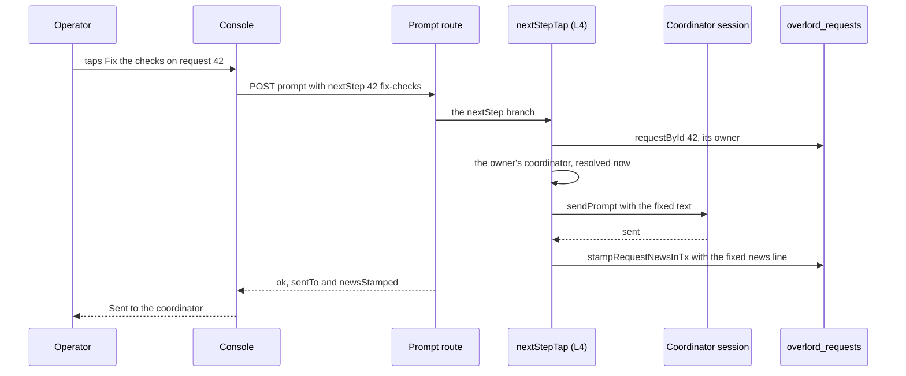
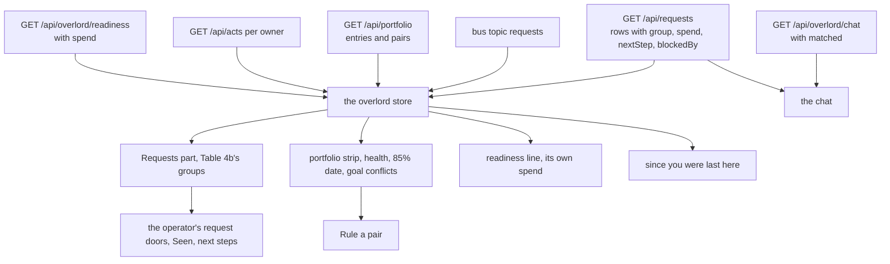

# Overlord W2: the home's requests and next steps Implementation Plan

> **For agentic workers:** REQUIRED SUB-SKILL: Use superpowers:subagent-driven-development (recommended) or
> superpowers:executing-plans to implement this plan task by task. Steps use checkbox (`- [ ]`) syntax for tracking.

**Goal:** on the Overlord place the operator sees every request grouped by what they must do next, acts on it in one
tap, rules a goal conflict where it blocks work, and sees what each request and programme cost.

- **PR A, on the server: next steps, the tap and spend.**
  - The three fixed texts of the next-step controls live in `shared/nextSteps.ts`. One L1 decider offers a control from
    the linked pull request's state, through the existing PR reader.
  - A tap goes through the console's prompt route to the coordinator that owns the request. The server stamps it on the
    request as news and writes no `operator_messages` row.
  - What a request cost is read from `run_spend` over the runs that carry its `requestId`. The Overlord's own spend
    rides the readiness read.
- **PR B, in the console, with one server task.**
  - The Requests part (Table 4a's row 6) in Table 4b's groups. Each row shows its owner, last news, age and spend, its
    next-step control, the operator's request doors and the Seen control on its acts.
  - Standing goal conflicts on the portfolio strip and on the rows they block, ruled from the pair's row.
  - The request ids and the matched names under each operator message in the chat.
  - Request changes in "since you were last here", the strip's health word and 85% date, and the readiness line's own
    spend.

**Why:** spec §4 (Table 4a's rows 1, 4 and 6, and Table 4b), §5.1 ("The chat shows what each message became"), §5.4
("Standard next steps are one tap"), §5.6 ("What it cost", the strip, goal conflicts and the ruling door), §3.8 (a tap is
the operator's own prompt to a coordinator, never a message to the Overlord) and §10.3 (H18: an operator's tap is never
refused for a stale revision). W1's home plan left these parts to W2: "W2: the Overlord's own spend, the requests, and
the portfolio's health words and 85% dates" (`w1-home.md`, Where things stand).

**Architecture:** two pull requests in lane F.

| Part | File | Ring and context | PR |
|---|---|---|---|
| The three fixed texts and the prompt line | `shared/nextSteps.ts` (new) | L0, C5 | A |
| `nextStepFor` | `server/src/coord/nextStep.ts` (new) | L1, C5 | A |
| `spendOfRuns` and `overlordSpendOf` | `server/src/coord/spend.ts` (new, or forecasts B's summation moved here) | L1, C5 | A |
| The facts: a request's linked runs, their PR states and their spend rows | `server/src/coord/requestFacts.ts` (new) | L3, C5 | A |
| The tap | `server/src/coord/nextStepTap.ts` (new), one branch in `server/src/server.ts`'s prompt route | L4, C5 | A |
| The Overlord's own spend on the readiness read | `server/src/coord/overlordRoutes.ts` (readiness piece's handler) | L4, C5 | A |
| `spend` and `nextStep` on the requests read; `matched` on the chat read | `server/src/coord/requestRoutes.ts`, `server/src/coord/overlordRoutes.ts` (chat A's read) | L4, C5 | B |
| The console's deciders and words | `pwa/src/overlord/requestsWords.ts`, `requestControls.ts`, `portfolioWords.ts` (home B's), `sinceWords.ts` (home B's), `chatWords.ts` (chat A's) | L1 | B |
| The parts | `pwa/src/overlord/RequestsPart.tsx`, `RequestRow.tsx`, `GoalConflictSheet.tsx`, `PortfolioStrip.tsx` (home B's), `ReadinessPart.tsx` (home B's), `OverlordChat.tsx` (chat A's) | L4 | B |
| The store | `pwa/src/stores/overlord.ts` (home A's) | L4 | B |

**Tech Stack:** TypeScript (ESM), React, Fastify, `node:sqlite`, vitest and its browser runner. No new dependency, no
migration and no ccd verb.

**Spec:** `docs/superpowers/specs/2026-11-09-overlord-design.md`: §4 and Tables 4a and 4b; §4.1 and Table 4.1b; §5.1;
§5.3 (C12, the name match); §5.4 (C16, "Standard next steps are one tap"); §5.5; §5.6 (H38, "What it cost", the strip,
goal conflicts); §3.8 ("A tap on a next-step control is the operator's own prompt to a coordinator"); §7.5 (the
`operator-at-programme` mark); §10.2 and §10.3 (H18); Table 11.1e's prompt-route row.

**The index:** `docs/superpowers/plans/2026-11-16-overlord-w2.md`: its row "Home: requests and next steps" (lane F, 2
PRs, 9 tasks, A 3 and B 6), its questions 5, 17 and 22, and "Where lanes meet" for `server/src/server.ts`,
`pwa/src/lib/api.ts` and the portfolio module. Forecasts B's plan amends question 22 to read `run_spend` and adds the
edge `FCB --> HRA` (`w2-forecasts-health.md`, "What the index should change"); this plan builds that amendment.

**The plans this one reads** (each piece's plan is the authority for its interface; each task's first step re-measures
the names it takes on `main`):

| Plan | What this plan takes from it |
|---|---|
| `w1-home.md` (home A, B, C) | `pwa/src/stores/overlord.ts`, `OverlordPlace.tsx` (one column, Table 4a's order), `PortfolioStrip.tsx` and `portfolioWords.ts`, `ReadinessPart.tsx`, `sinceWords.ts#sinceLines` with `lastHere.ts`, the one `useStepUp` for the place, `server/test/sim/homeSets.ts`, `serverCaps()` |
| `w1-chat.md` (chat A) | `shared/overlordChat.ts#ChatEntry` (W2 adds a field to its message arm), `server/src/coord/overlordChat.ts#composeChat`, `OverlordChat.tsx`, `chatWords.ts`, `overlordSend` |
| `w1-readiness.md` | `ReadinessWire` and `GET /api/overlord/readiness` |
| `w2-request-ids.md` (request ids A, run 2274's branch) | `runs.requestId`, `stampRequestNewsInTx` (bookkeeping, never raises the revision) |
| `w2-requests.md` (request record A, #2928) | `requestById`, `RequestRow`, the ten states, `REQUEST_TRANSITIONS` |
| `w2-forecasts-health.md` (forecasts B, #2921) | `run_spend` (`measured`, `absent`, `outside`), the spend read's rules, `PortfolioEntry`'s `health`, `forecast` and `spend`, `PortfolioView.calibration` |
| `w2-operator-request-doors.md` (run 2278's branch) | `GET /api/requests` and `RequestListRow` (id, state, group, owner, news, `lastNewsAt`, `openedAt`, `closedAt`, `takenFrom`, `revision`, parent id, cited message ids); the five doors with `{ revision }`, their answers (`applied`, `outcomes`, `mailed`), hand back behind the step-up; `REQUEST_GROUP_MAP`; the `requests` bus topic; their client functions and sentences |
| `w2-act-reads.md` (run 2278's branch) | `GET /api/acts?programme=` (the console's `ActView`), `POST /api/acts/:id/seen`, their client functions |
| `w2-overlaps.md` (overlaps B, #2923) | `GET /api/portfolio`'s `pairs` and `pairRate`, `StandingPairWire`, `GOAL_CONFLICT_CHOICES`, `POST /api/programme-pairs/:key/rule` with `{ episode, choice }` (works dark, no step-up), `pair-changed`, and each requests-read row's `blockedBy` |
| `w2-relay.md` (relay A, run 2277's branch) | `server/src/coord/citedNames.ts#citedNamesOf(texts, names)` (RL8: "Home requests B shows the names they matched through the same function") |

Written against `main` at `fe887521f` (2026-11-16). None of those pieces is on `main` yet.

## In short

- **Two pull requests, nine tasks:** A has three (the server's next steps, spend and the tap), B has six (one server
  task, then the console).
- **A next-step control is offered only from measured facts.** "Fix the checks" when the linked pull request's checks
  fail; "Land it" when it is open, green, not queued, and its run waits for review; "Address the comments" never in W2,
  because the PR reader does not measure review comments (HQ2).
- **A tap is the operator's own prompt.** The server composes the fixed text, sends it to the owning coordinator's
  session through the prompt route, stamps a fixed news line on the request, and the prompt route's W1a code writes the
  `operator-at-programme` mark. No `operator_messages` row, no inbox row.
- **No tap is refused for what changed since the read** (H18). A request door tap carries the revision the operator saw
  and is applied; the console shows each raced act's outcome. A next-step tap goes to the request's owner as it stands
  at the tap.
- **Spend is attributed, never zero.** A request's spend sums `run_spend`'s measured rows and the fresh live readings of
  its open runs, and counts every unmeasured run. The Overlord's own spend is its bound session's live reading.
- **Goal conflicts are ruled on the home.** A standing pair shows on the portfolio strip, with Table 1's choices from
  `GOAL_CONFLICT_CHOICES`, and on every Requests row whose `blockedBy` names it.
- **Phone first:** every new part at 360 px with no horizontal scroll, every control at least 44 px, browser runs at 360,
  390, 1280 and 1920 in both skins and both themes.

## 1. Open questions

The coordinator accepted the index's questions 2 to 23 as written; this plan builds on 5, 17 and 22 (as amended by
forecasts B), and on the settled 24 to 29. Item 357 answered question 1; the ruling control renders whatever
`GOAL_CONFLICT_CHOICES` holds and hard-codes no choice. Question 19 (the act ceilings) does not touch this piece: a
next-step tap is the operator's prompt, not an Overlord act, and the doors this piece draws are other pieces'. Every
question below carries a recommendation, which this plan builds unless the coordinator rules otherwise. None needs the
operator.

- **HQ1. The decider's inputs and its table** (slug `next-step-from-measured-pr-facts`). §5.4 names three controls and
  their conditions in words. The existing PR reader is `shared/api.ts#PrState` (phase, `checks`, `checkNames`), filled
  per workspace session by the watcher's PR sweep (`server/src/prstate.ts#prView`), with the merge-queue word from
  `prstate.ts#queueFor`.
  **Recommendation:** `nextStepFor(input)` (L1, first match), where `input` is the request's state and its linked runs,
  each with its run state and its session's `PrState` and queue word, or `unmeasured`:

  | # | When | Answer |
  |---|---|---|
  | 1 | The request is not `in-progress` | none, `not-in-progress` |
  | 2 | No linked run's PR is `open` or `draft` | none, `no-pr` |
  | 3 | More than one linked run has an `open` or `draft` PR | none, `several-prs` |
  | 4 | The one PR's read is `unknown` or `unchecked`, its checks `unmeasured`, or its run's session has no reading | none, `pr-unmeasured` |
  | 5 | Its checks are `fail` | `fix-checks` |
  | 6 | Review comments are measured as waiting | `address-comments` (never in W2: HQ2) |
  | 7 | It is `open`, not a draft, its checks `pass`, its queue word is `none`, `dequeued` or `absent`, and its run is `awaiting-review` | `land-it` |
  | 8 | Otherwise | none, `none-obvious` |

  *Table 1. `nextStepFor`. "Several pull requests" is no obvious step, so it offers none.* `null` checks mean "no checks
  configured" (`PrChecks`' own comment), which is not green, so row 7 does not fire on it. `in-progress` covers Table
  4b's Working, Ready for review and Landing groups; a request in `needs-you` (the operator's, by a take or otherwise)
  has no owner step to prompt, so it gets none.
- **HQ2. "Address the comments" waits for a reader** (slug `address-comments-waits-for-a-reader`). `PrState` carries no
  review state, and the only reads of `reviewDecision` in the tree are the admin-merge door's inside `ccd/ccd`. The index
  rules that W2 leaves `ccd/ccd` untouched.
  **Recommendation:** `shared/nextSteps.ts` carries all three texts, and the decider's row 6 reads an input that W2
  always passes as `unmeasured`, so the control is never offered in W2. A later piece that adds review state to
  `ccd pr-state`'s line fills the input; the decider and its tests already cover it. Inventing the step from a run's
  state (a ccrc review run's fix round) would be guessing, because a review run's findings are not the pull request's
  comments.
- **HQ3. No step is operator-only today** (slug `no-next-step-is-operator-only-in-w2`). §5.4: "No control is offered for a
  step that is operator-only." Fixing checks and addressing comments are the worker's, and landing is the coordinator's
  through the merge queue (the coordinator skill enqueues; `CLAUDE.md`'s admin-merge rule refuses the bypass).
  **Recommendation:** the decider takes no operator-only input in W2. A later rule that makes a step the operator's
  adds the input and a row above row 5.
- **HQ4. The tap's body and its text** (slug `next-step-tap-text-is-the-servers`). §3.8: "A tap sends that text, with the
  request id, to the session of the coordinator that owns the request, through its prompt route."
  **Recommendation:** the console posts `POST /api/sessions/:id/prompt` with `{ nextStep: { requestId, step } }` and no
  `text`. The server composes the text from `shared/nextSteps.ts#nextStepPrompt(step, requestId)` (for example "Fix the
  checks (request 42)."), so a tap can only ever send one of the three fixed texts. A body with both `text` and
  `nextStep` is `bad-request`. Every other body takes the route's existing path unchanged.
- **HQ5. Where a tap goes, and what it never refuses** (slug `next-step-tap-goes-to-the-owner-at-the-tap`). The console's
  `:id` is the coordinator it read; the request may have been routed elsewhere, or its programme's coordinator replaced,
  since. H18 says the operator's tap is never refused for a stale revision.
  **Recommendation:** the branch resolves the request's owner and that programme's coordinator at the tap
  (`requestById`, then `CoordStore#programmeCoordinator`, as the operator's doors resolve it) and sends there, whatever
  `:id` says. It answers `{ ok: true, sentTo, step, newsStamped }`, and the console shows "Sent to <sentTo>". It does not
  re-run the decider: the operator chose the step, and a step that is no longer obvious is still the operator's own
  prompt. It refuses only when nothing can be addressed:
  - `not-found`: no such request;
  - `no-owner`: the request is terminal, or has no owner (a parent, or one not routed);
  - `no-coordinator`: the owner's coordinator cannot be resolved, with the reason.

  The prompt route's own answers (`renewing` while the coordinator renews, the draft refusal, `unknown-session` for a
  coordinator whose row is gone) pass through unchanged, and the console shows each with its sentence.
- **HQ6. The news line** (slug `next-step-news-is-a-fixed-line`). §5.4: "The server stamps it on the request as news."
  **Recommendation:** after a sent prompt, the branch stamps `NEXT_STEP_NEWS[step]` (for example "The operator asked
  the owner to fix the checks.") through request ids A's `stampRequestNewsInTx`, which is bookkeeping and raises no
  revision. Send first, stamp second: the news says what happened. A stamp that fails after a send answers
  `newsStamped: false`, and the prompt is not sent again. A request that left the open states between the resolve and
  the stamp answers `newsStamped: false` (`not-open`) too.
- **HQ7. The mark comes with the route** (slug `next-step-mark-rides-the-prompt-route`). W1a's renewal hand-offs (Task 3)
  write `operator-at-programme` after any prompt is typed into a session that coordinates or serves a programme.
  **Recommendation:** the tap writes nothing of its own for the mark: it is a typed prompt into the coordinator's
  session, so W1a's code writes it. Task 3's test pins that a tap leaves the mark, so a later change to the route cannot
  drop it silently.
- **HQ8. A request's spend** (slug `request-spend-reads-run-spend`). Question 22 as amended: "A request's and a
  programme's spend roll up `run_spend`, recorded once per run at its close by the forecast lane from a reading inside
  the run's window, plus the deduplicated, fresh live readings of open runs, marked attributed. A closed run with no
  measured row counts as unmeasured. The coordinator's own spend is outside."
  **Recommendation:** one summation for both. If forecasts B exports its summation as a function, `requestSpendOf`
  calls it with a request's runs; if it is inline in `portfolioFor`, Task 2 first moves it to
  `server/src/coord/spend.ts#spendOfRuns` in a move commit, with a characterization of `portfolioFor`'s spend cases green
  before and after, then calls it twice. The request's answer is forecasts B's spend shape without `perWaveMedian`:
  `{ total, byClass, attributed: true, runsUnmeasured, coordinatorExcluded: true, classAtClose: true }`.
- **HQ9. The Overlord's own spend** (slug `overlord-spend-is-the-live-reading`). Table 4a's row 1 and §5.6 say the
  readiness line shows it, "a read of what the usage sweep already measures", and no plan produces it.
  **Recommendation:** `overlordSpendOf(reading)` (L1) answers the bound session's live usage reading (`cost` by class,
  and its time) as `{ kind: 'measured', … }`, or `{ kind: 'unmeasured', why }` with `why` one of `unbound`, `absent` and
  `stale`. It is the current generation's figure only, marked so: across generations it would need a stored history,
  which "adds no writer" rules out. `GET /api/overlord/readiness` answers it as an optional `spend` beside
  `ReadinessWire`'s fields; `servedReadiness` and the composition W3's `mayHold` reads are untouched.
- **HQ10. Where the requests' spend and next step are served** (slug `requests-read-carries-spend-and-next-step`). The
  operator's request doors piece owns `GET /api/requests` and says "Spend is home requests A's, so the read carries
  none". Home requests A and that piece have no order between them.
  **Recommendation:** PR A ships the deciders and the facts reader with no door. PR B, which needs the doors piece,
  adds two optional fields to each `RequestListRow`: `spend` and `nextStep` (`{ step, coordinator } | { step: null,
  why }`). The read's handler calls the facts reader once for every listed request. No second read and no new door.
- **HQ11. The request ids and names under each message** (slug `chat-shows-ids-from-requests-and-names-from-the-chat`).
  The index, as ruled: "under each operator message in the chat, the request ids it founded and the names they matched
  (§5.1, §5.3), drawn from the requests read". The requests read carries each row's cited message ids. It carries no
  text, so it cannot carry the names the words matched.
  **Recommendation:**
  - **The ids** come from the requests read: `requestIdsByMessage(rows)` (L1) maps each cited message id to the
    requests that cite it, root requests first. A message whose requests have all left the read (closed more than seven
    days ago) shows none. Keeping a full history would need a second read, which W2 does not need.
  - **The names** come from the chat read, which already holds each message's text. Chat A's `composeChat` gains
    `matched: readonly string[]` on the message arm, from the relay's `citedNamesOf([text], programmeSlugs)`. The chat's
    route gathers the programme slugs once per read. This is chat A's own "W2 adds a field to `ChatEntry`'s message
    arm". In W2 a name is a programme slug, as the relay matches; W5's start door adds project names to the same call.
- **HQ12. "Since you were last here" in W2** (slug `since-request-lines-from-row-times`). Table 4.1b's line 2 holds
  "Requests that changed state, with their evidence". W1's block is composed in the console over server rows, per
  device (`w1-home.md`, question 8). The requests read carries `openedAt`, `closedAt` and `lastNewsAt`, and no time of
  the last move.
  **Recommendation:** `sinceLines` gains request counts from those three times: requests opened, requests that ended
  (with the group each ended in), and requests with news since the device's stamp. Line 1, "Needs you", counts the
  Needs you group. A request whose state moved without news, an opening or an ending is not counted, and the line says
  "news, openings and endings" rather than "changes". A counter that weakened a done test, and a goals version resting
  on a relayed request, need server rows the read does not carry, and stay with W3's server composition of the block.
- **HQ13. Which controls a row draws** (slug `request-controls-from-the-transition-table`). The operator's doors decide
  every tap (`operatorTapPlan`), and a control the table cannot allow would only answer `bad-transition`.
  **Recommendation:** `requestControls(row)` (L1) answers the operator moves `REQUEST_TRANSITIONS` allows from the
  row's state, and hand back only when `takenFrom` is set. It never lists the moves by hand: a test derives the expected
  set from the table for every state. Answer is drawn only on `needs-you`. Answer opens a sheet: the operator writes
  what they want, the sheet sends it as an ordinary chat message through chat A's send, and on a recorded answer taps
  the answer door with the row's revision (the doors piece's OD1). A refusal of the message keeps the draft, as the
  composer does, and taps nothing.
- **HQ14. What a stale tap shows** (slug `request-tap-shows-raced-outcomes`). The doors answer `applied`, `outcomes` and
  `mailed`.
  **Recommendation:** the row's result line says what happened, from an L1 table: "Done" on an applied tap; "Already so"
  on `applied: false`; and, for each raced act, "The Overlord's <kind> came first; yours stands" (`superseded`) or
  "The Overlord had done the same" (`concurred`). `bad-transition` shows the doors piece's sentence with the raced act
  ids. The console never refuses or delays a tap for a revision it read, and re-reads the requests after every answer.
- **HQ15. Seen on an act, and which acts a row shows** (slug `request-row-lists-its-acts`). The act read is per
  programme. §10.2 puts the whole Log on a page of the place, which W2 does not build.
  **Recommendation:** an expanded request row lists the acts on that request from its owner's act read, filtered by
  `requestId` (`actsOfRequest`, L1), newest first, each with its kind, state, outcome and masked summary, and a Seen
  control while `seenAt` is empty. A row with no owner lists none in W2, because the act read takes a programme. The Log
  page, which lists every act, is a later piece.
- **HQ16. The ruling control** (slug `goal-conflict-ruled-from-the-strip`). Index question 17: the operator sees a
  standing pair "on the home's portfolio strip and on the Requests rows it blocks, and rules it from the pair's row
  there."
  **Recommendation:** the strip lists each standing goal conflict under the strip, unruled first, as the read orders
  them, with Rule. A Requests row whose `blockedBy` names a pair says "Waits on a goal conflict: <a> and <b>" and links
  to that pair's row. Rule opens one sheet that renders `GOAL_CONFLICT_CHOICES`' rows (label with `{a}` and `{b}`
  filled from the pair, and the sentence) and posts `{ episode, choice }`. The door works while sign-in is dark and asks
  no step-up, so the sheet adds none. `pair-changed` re-reads the portfolio and says "This conflict changed. Look again
  before ruling." A `blockedBy: 'unreadable'` row says "Goal conflicts: unmeasured", never nothing. An overlap pair is
  shown only as a count on the strip: it is the Overlord's to route, and it has no ruling.
- **HQ17. Gates on what is drawn** (slug `requests-part-under-route-v1`). The doors piece's OD13: "The console draws the
  Requests part only under the word." The ruling door and the portfolio's W2 fields are live at their merge (index
  question 20).
  **Recommendation:** the Requests part, the next-step controls and Seen are drawn only while the server advertises
  `overlord-route-v1` (home A's `serverCaps()`); the strip's health, dates and goal conflicts, and the readiness line's
  spend, are drawn whenever their fields are present, under `overlord-v1` as the place itself is. An absent field draws
  nothing; it never draws as "none" or zero.
- **HQ18. The opening of a request-backed goals version** (slug `goals-opened-is-not-home-requests`). Request ids A
  (its RI10) suggests home requests B record the operator's opening of a goals version that rests on a request, to
  replace its `not-opened`.
  **Recommendation:** not here. It needs a server writer of an "opened" fact, and W2's "since" block is per device and
  composed in the console. W3's server composition of the block (Table 4.1b's line 2) is its home. The index names it
  there.

## 2. What exists today

Measured on `main` at `fe887521f`.

| What | Where | What this plan does with it |
|---|---|---|
| The prompt route: `knownId`, the attachment checks, `sendPrompt` with `onDraft`, a 409 on a refused send | `server/src/server.ts` (`app.post('/api/sessions/:id/prompt', …)`) | One branch before `knownId` (Task 3) |
| A pull request's state as the console and the server read it: `PrPhase`, `PrChecks` (`null` means no checks configured, `unmeasured` a failed read), `checkNames` | `shared/api.ts#PrState`, `#PrChecks` | `nextStepFor`'s input |
| The PR sweep's line readers: `phaseFor`, `checksFor`, the merge-queue word | `server/src/prstate.ts#phaseFor`, `#queueFor`, `#PrQueueRead` | The facts reader reads the watcher's per-session `PrState` and queue word, never ccd |
| The portfolio reader and its wire, with no spend, health or forecast yet | `server/src/coord/portfolio.ts#portfolioFor`, `shared/portfolio.ts#PortfolioEntry` | Forecasts B widens both; this plan reads them |
| The step-up hook and its one-instance rule | `pwa/src/accounts/useStepUp.ts#useStepUp`, `pwa/src/accounts/ConfirmItsYou.tsx` | Hand back, through the place's one instance (home B) |
| Refusal sentences | `pwa/src/lib/refusalWords.ts#refusalText` | Sentences for `no-owner` and `no-coordinator` |
| The 44 px census: a CSS scrape plus a render per control class | `pwa/test/tap-targets.test.tsx` | Each new control class gains a case |
| The contrast gate | `pwa/test/contrast.test.ts`, over `ui/`'s one auditor | Run; no new colour is written |
| A browser test across widths, skins and themes | `pwa/browser/account-knob.browser.test.ts` (`WIDTHS` 360, 390, 1280, 1920; `SKINS`; `THEMES`) | The model for this plan's browser tests |
| The growth check | `server/test/growthCheck.ts#GROWTH_FILES`, `#GROWTH_LIMIT` (40) | §5 |
| The mutation floors | `server/test/sim/mutation-floors.test.ts#MUTANT_SETS`, `server/test/sim/faceSets.ts` (a console decider's set, by `modulePath`) | The server deciders join directly; the console's through `homeSets.ts` |

**Not on `main`, taken from the plans that build them:** everything named in "The plans this one reads". The pieces
PR A needs are request ids A, home B and forecasts B; PR B also needs PR A, the operator's request doors, act reads A,
overlaps B, home C and chat A.


*Figure 1. One next-step tap. The text and the news line are the server's fixed lines. The prompt route's W1a code
writes the `operator-at-programme` mark after the send. No `operator_messages` row is made.*


*Figure 2. What the home reads in W2. Every control is drawn from a server row.*

## 3. Global constraints

- **Architecture (`CLAUDE.md`).**
  - **Decide in L1, act in L4.** `nextStepFor`, `spendOfRuns` and `overlordSpendOf` are pure. `nextStepTap.ts` and the
    route branch parse, resolve, send and stamp. In the console, `requestsWords.ts`, `requestControls.ts`, the words
    modules and `chatWords.ts` decide; the parts and the store only draw and call.
  - **One writer per fact.** The tap writes the request's news only through `stampRequestNewsInTx`. It writes no mark of
    its own (HQ7) and no message row. The console writes nothing but through the doors.
  - **Consolidate.** One spend summation for programmes and requests (HQ8). One name matcher, the relay's (HQ11). One
    requests read, the doors piece's, widened (HQ10). The prompt route is the tap's door, with no new route.
  - **No overloaded null.** `nextStepFor` answers none with its reason. Spend is `measured` or `unmeasured` with its
    reason, never 0 for unread. `blockedBy` is a list or `'unreadable'`. An absent wire field draws nothing.
  - **Rings.** `shared/nextSteps.ts` imports nothing. `nextStep.ts` and `spend.ts` import `shared/` only. The console's
    L1 modules import no hook, store or `lib/api.ts`.
- **Authority.** A next-step tap is the operator typing to a coordinator, so it takes no step-up (the prompt route takes
  none). Hand back takes the step-up its door asks (the doors piece's OD4); the console runs every door tap through the
  place's one `useStepUp` and shows the step only when a door answers `step-up-required`, never deciding the direction
  itself (W1 home C's rule). The ruling door asks none.
- **H18.** The console sends the revision it read, never refuses or delays its own tap for a revision, and re-reads after
  every answer.
- **Wire: additive.** `RequestListRow` gains `spend?` and `nextStep?`; the readiness answer gains `spend?`;
  `ChatEntry`'s message arm gains `matched?`. An older console ignores them, and an older server's absence draws nothing.
- **What a merge arms.** PR A: the prompt route accepts a `nextStep` body, which nothing sends yet; the readiness answer
  carries the Overlord's spend. PR B: under `overlord-route-v1` the Requests part and its controls; under `overlord-v1`
  the strip's health, dates and goal conflicts, the readiness spend and the chat's ids and names. Nothing a running
  session reads changes, except a coordinator that receives the operator's tap as a typed prompt.
- **Phone first.** Every new part laid out for 360 px with no horizontal scroll. Every control at least 44 px
  (`--tap-min`), each class pinned by a scrape and a render case in `pwa/test/tap-targets.test.tsx`. Long request news
  and summaries wrap; ids and slugs break anywhere.
- **Design system.** Colours, spacing and type from `@ccrc/ui`'s tokens. Health words and group headings use the design
  system's status label. No hex value is written and no generated palette is edited, so the contrast gate
  (`pwa/test/contrast.test.ts`) rules on the result unchanged.
- **Untrusted text.** A request's news and summary, an act's summary and a coordinator's session name are drawn as plain
  text, never as Markdown or HTML, and never as a control's label.
- **SAFETY.** No ccd verb, no fleet act, no live `~/.ccrc`. Server tests build `coord.db` in memory and stub
  `sendPrompt`; no test types into a real pane.
- **Tests.**
  - From `server/`: `ccrc test -- ./node_modules/.bin/vitest run test/<file>.test.ts`, one file at a time, in the
    foreground.
  - From `pwa/`: `ccrc test -- ./node_modules/.bin/vitest run test/<file>.test.ts` and
    `ccrc test -- ./node_modules/.bin/vitest run --config vitest.browser.config.ts browser/<file>.browser.test.ts`.
  - Each task ends with the typechecks it touches: in `server/`, `ccrc test -- npx tsc --noEmit -p tsconfig.json` and
    `-p test/tsconfig.tests.json`; in `pwa/`, `ccrc test -- npx tsc --noEmit`.
  - PR B's last task runs the whole pwa suite and the whole browser suite before the push, and the server's
    `single-definition` and `topology-clean`, because a console change can red a server scan.
- **Growth check.** Every growth-checked file stays within 40 net lines in each pull request, with no waiver (§5).
- **Mutation floors.** Server deciders join `MUTANT_SETS` with their floors in the pull request that creates them. The
  console's deciders join `server/test/sim/homeSets.ts`, home A's set file, by `modulePath`. Tables get a totality
  test instead.
- **Public repository.** Fixtures use `prog-a`, `prog-b`, `lane-a-coordinator`, `lane-b-coordinator` and
  `lane-a-overlord`. No private name. No D-number is invented. The seven-day Done window is the read's, and no
  seven-day millisecond literal is written here (`token-shared.test.ts` allows one in the shipped roots).

## 4. Review focus

1. A next-step control appears only from measured facts, never for several PRs or an unmeasured read, and "Address the
   comments" never in W2.
2. A tap sends only a fixed text, to the owner's coordinator as resolved at the tap, stamps one fixed news line, writes
   no message row, and leaves the W1a mark.
3. Spend never reads an unmeasured run as 0, and programmes and requests use one summation.
4. No console tap is refused or delayed for a revision; every answer, outcome and refusal is shown.
5. Every control is drawn from a server row or table (`REQUEST_TRANSITIONS`, `GOAL_CONFLICT_CHOICES`), never from a list
   in the console.
6. 360 px with no horizontal scroll, 44 px targets, and the contrast gate unchanged.

## 5. The PR split

| PR | Tasks | What it ships | Needs first | Growth-checked files, estimate (net lines) |
|---|---|---|---|---|
| A, next steps, the tap and spend | 1 to 3 | `shared/nextSteps.ts`; `nextStepFor`; `spendOfRuns` and `overlordSpendOf`; the facts reader; the tap's branch and its module; the Overlord's spend on the readiness read | request ids A, home B, forecasts B | `server/src/server.ts` +5 (the branch and an import); `server/src/coord/store.ts` +3 (one delegate, only if the facts reader needs a store reader forecasts B does not ship); `server/src/coord/routes.ts` 0; `shared/api.ts` 0; `pwa/src/lib/api.ts` 0 |
| B, the console | 4 to 9 | The requests read's `spend` and `nextStep`; the chat read's `matched`; the Requests part with its controls and Seen; goal conflicts on the strip and rows with the ruling sheet; the strip's health and 85% date; the readiness spend; the chat's ids and names; "since you were last here" | PR A, the operator's request doors, act reads A, overlaps B, forecasts B, home C, chat A | `pwa/src/lib/api.ts` +12 (`tapNextStep` about 4, `rulePair` about 4, the widened answer types about 4); `server/src/server.ts` 0; `server/src/coord/store.ts` 0; `shared/api.ts` 0 |

**If a PR cannot fit.** PR B's `pwa/src/lib/api.ts` estimate leaves room under 40 because the doors piece and act reads
A ship their own client calls. If it passes 40 at build time (for example because another lane F piece landed first in
the same file), the ruling sheet and `rulePair` move to a further pull request, B2, after B, with Task 7. No waiver is
planned.

For scale, the files that are not growth-checked change by about this much:

| File | PR A | PR B |
|---|---|---|
| `shared/nextSteps.ts` | +60, new | |
| `server/src/coord/nextStep.ts`, `spend.ts`, `requestFacts.ts`, `nextStepTap.ts` | +260, new | |
| `server/src/coord/overlordRoutes.ts` | +10 | +12 |
| `server/src/coord/requestRoutes.ts`, `shared/overlordRequests.ts`, `shared/overlordChat.ts` | | +30 |
| `pwa/src/overlord/` new L1 modules and parts | | +700, new |
| `pwa/src/overlord/` home B's and chat A's modules | | +160 |
| `pwa/src/stores/overlord.ts` | | +70 |
| `pwa/src/overlord/overlord.css` | | +120 |
| `pwa/src/lib/refusalWords.ts` | | +8 |
| Server tests | +450 | +120 |
| Console tests and browser tests | | +900 |
| `server/test/sim/homeSets.ts` and the server sets | +80 | +160 |

## 6. Tasks

### Task 1: The three texts and `nextStepFor` (PR A; L0, L1)

**Files:**
- Create: `shared/nextSteps.ts` (`NEXT_STEP_MAP` with `fix-checks`, `address-comments`, `land-it`, each `{ label, prompt,
  news }`; `NEXT_STEPS` derived; `isNextStep`; `nextStepPrompt(step, requestId)`; `NEXT_STEP_NONE_MAP` with the five
  reasons of Table 1, and its derived list)
- Create: `server/src/coord/nextStep.ts` (`nextStepFor`)
- Create: `server/test/next-step.test.ts`, `server/test/next-step-cases.ts`
- Modify: `server/test/sim/mutation-floors.test.ts` (`MUTANT_SETS` gains `nextStepFor`), `mutation-floors.json`
- Modify: the architecture spec's path table (`docs/superpowers/specs/2026-08-10-architecture-ddd-clean-solid.md`): C5
  gains `shared/nextSteps.ts` and `server/src/coord/nextStep.ts`

**Interfaces:**

```ts
// shared/nextSteps.ts (L0, C5). Imports nothing.
export const NEXT_STEP_MAP = {
  'fix-checks': { label: 'Fix the checks', prompt: 'Fix the checks', news: 'The operator asked the owner to fix the checks.' },
  'address-comments': { label: 'Address the comments', prompt: 'Address the comments', news: 'The operator asked the owner to address the comments.' },
  'land-it': { label: 'Land it', prompt: 'Land it', news: 'The operator asked the owner to land it.' },
} as const;
export type NextStep = keyof typeof NEXT_STEP_MAP;
export const NEXT_STEPS: readonly NextStep[];
export function isNextStep(v: unknown): v is NextStep;
/** The one text a tap sends: the step's prompt and the request id. */
export function nextStepPrompt(step: NextStep, requestId: number): string;
export type NextStepNone = 'not-in-progress' | 'no-pr' | 'several-prs' | 'pr-unmeasured' | 'none-obvious';

// server/src/coord/nextStep.ts (L1, C5). Imports shared/ only.
export interface NextStepInput {
  readonly requestState: RequestState;
  readonly runs: readonly { readonly runState: RunState;
    readonly pr: { readonly state: PrState; readonly queue: PrQueue | 'absent' } | 'unmeasured' }[];
  /** Review comments waiting on the one PR. W2 always passes 'unmeasured' (HQ2). */
  readonly comments: 'waiting' | 'none' | 'unmeasured';
}
export function nextStepFor(input: NextStepInput):
  { readonly step: NextStep } | { readonly step: null; readonly why: NextStepNone };
```

- [ ] **Step 1: Failing tests** (`next-step.test.ts`, cases in `next-step-cases.ts`):
  - each row of Table 1, with the row above it just failing, so the first match is pinned;
  - exhaustiveness: every `RequestState` × every `PrPhase` × every `PrChecks` × each queue word × three run states
    answers a step or a reason, and never throws;
  - monotonicity: adding a second open PR to any input that offered a step answers `several-prs`; changing a `pass` to
    `unmeasured` never offers `land-it`;
  - `comments: 'waiting'` offers `address-comments` only below row 5, and `comments: 'unmeasured'` never offers it;
  - `null` checks never offer `land-it`;
  - `nextStepPrompt('fix-checks', 42)` is exactly `Fix the checks (request 42).`, and each step's prompt starts with its
    label;
  - the texts are exactly §5.4's three labels (a pin against the spec's words).
- [ ] **Step 2: Run.** `ccrc test -- ./node_modules/.bin/vitest run test/next-step.test.ts`. Red.
- [ ] **Step 3: Implement.** **Step 4: Run.** Green, and the three typechecks.
- [ ] **Step 5: Mutation.** Join `MUTANT_SETS` and run the floors test. Named mutants that must be killed: N1 offer
  `land-it` on `null` checks; N2 take the first of several PRs; N3 offer a step on `needs-you`; N4 read `unmeasured`
  checks as `pass`; N5 offer `land-it` while queued. Record the floor.
- [ ] **Step 6: Commit.** `feat(overlord): the next-step texts and the decider that offers one (Overlord W2 home requests A)`

### Task 2: Spend and the facts reader (PR A; L1, L3)

**Files:**
- Create: `server/src/coord/spend.ts` (`spendOfRuns`, or forecasts B's summation moved here; `overlordSpendOf`)
- Create: `server/src/coord/requestFacts.ts` (`requestFacts(deps, requestIds)`: each request's linked runs from
  `runs.requestId`, each run's state, its session's `PrState` and queue word from the watcher's listing, the `run_spend`
  rows through forecasts B's store read, and the live usage readings through forecasts B's usage port)
- Modify: `server/src/coord/portfolio.ts` (only if the summation moves: `portfolioFor` calls `spendOfRuns`), with a
  characterization first
- Modify: `server/src/coord/overlordRoutes.ts` (`GET /api/overlord/readiness` answers `spend` beside `ReadinessWire`),
  `shared/overlordRequests.ts` (`RequestSpend`), the readiness piece's shared file (`OverlordSpendWire`)
- Create: `server/test/request-spend.test.ts`, `server/test/request-facts.test.ts`
- Modify: `MUTANT_SETS` and `mutation-floors.json` (`spendOfRuns` if new here, `overlordSpendOf`),
  `server/test/single-definition/time-ports.test.ts` only if `requestFacts.ts` reads a clock (it should take `now`)

**Interfaces:**

```ts
// server/src/coord/spend.ts (L1, C5)
export function spendOfRuns(runs: readonly SpendRun[], rows: readonly RunSpendRow[],
  live: readonly LiveReading[]): RequestSpend;   // forecasts B's rules, one place
export function overlordSpendOf(reading: LiveReading | 'absent' | 'stale', bound: boolean):
  { kind: 'measured'; cost: number; byClass: Readonly<Record<string, number>>; at: number; scope: 'generation' }
  | { kind: 'unmeasured'; why: 'unbound' | 'absent' | 'stale' };

// server/src/coord/requestFacts.ts (L3, C5)
export function requestFacts(deps: RequestFactsDeps, requestIds: readonly number[]):
  { ok: true; byRequest: ReadonlyMap<number, { nextStepInput: NextStepInput; spend: RequestSpend }> }
  | { ok: false; reason: string };
```

- [ ] **Step 1: Characterize** (only if the summation moves): `portfolioFor`'s spend cases from forecasts B, green on
  `main` against its code. The move commit changes only that test's imports.
- [ ] **Step 2: Failing tests:**
  - `request-spend.test.ts`: a request with two closed runs (one `measured`, one `absent`) and one open run with a fresh
    reading sums the measured row and the live reading, and counts one unmeasured; an `outside` row and a closed run
    with no row each count as unmeasured, never 0; a session shared by two open runs counts once; a `stale` live reading
    counts as unmeasured; the coordinator's session is never summed; the same inputs grouped by programme answer exactly
    what `portfolioFor`'s spend answers (one summation);
  - `overlordSpendOf`: an unbound designation answers `unbound`; no reading `absent`; a stale one `stale`; a reading
    answers `measured` with `scope: 'generation'`;
  - `request-facts.test.ts`, over an in-memory `coord.db` and stub watcher reads: a request's runs come only from
    `runs.requestId`; a run whose session has no PR reading gives `pr: 'unmeasured'`; `comments` is always
    `'unmeasured'`; a store read that throws answers `{ ok: false }`, never an empty map;
  - the readiness read answers `spend` beside an unchanged `ReadinessWire` (each W1 field equal to the readiness piece's
    own case), and `servedReadiness` is not called twice.
- [ ] **Step 3: Run.** Red. **Step 4: Implement.** **Step 5: Run.** Green; then forecasts B's portfolio suites, the
  readiness suites and the typechecks.
- [ ] **Step 6: Mutation.** S1 read `absent` as 0; S2 count a shared session twice; S3 sum the coordinator's session;
  S4 answer `measured` for a stale reading. Each killed. Record the floors.
- [ ] **Step 7: Commit.** `feat(overlord): what each request cost, and the Overlord's own spend on the readiness read (Overlord W2 home requests A)`

### Task 3: The tap (PR A; L4)

**Files:**
- Create: `server/src/coord/nextStepTap.ts` (`tapNextStep(deps, pathId, body)`: parse, resolve, send, stamp; the deps
  are `sendPrompt`, `requestById`, `programmeCoordinator`, `stampRequestNewsInTx` inside a coordination transaction, and
  `now`)
- Modify: `server/src/server.ts` (the prompt route: `if (body.nextStep !== undefined) return …tapNextStep(…)`, before
  `knownId`, about five lines with the import)
- Modify: `shared/refusal.ts` (`no-owner` and `no-coordinator` in the prompt route's refusal group, with their
  statuses), `pwa/src/lib/refusalWords.ts` (their sentences), `server/test/single-definition/refusal-table.data.json`
- Create: `server/test/next-step-tap.test.ts`

- [ ] **Step 1: Failing tests** (`next-step-tap.test.ts`, the prompt route on a real Fastify instance with `sendPrompt`
  stubbed and an in-memory `coord.db`):
  - a tap for request 42 owned by `prog-a` sends exactly `Fix the checks (request 42).` to `prog-a`'s coordinator,
    stamps `lastNewsAt` and the fixed news line, leaves the request's `revision` unchanged, and answers `sentTo`;
  - with `:id` naming `lane-b-coordinator` while the owner is `prog-a`, the tap goes to `prog-a`'s coordinator and
    `sentTo` says so (HQ5);
  - the tap sends even when `nextStepFor` would now offer nothing (the decider is not re-run);
  - `not-found`, `no-owner` (terminal, parent and unrouted rows) and `no-coordinator` each send nothing and stamp
    nothing;
  - a body with both `text` and `nextStep`, an unknown step, or a non-integer id is `bad-request`;
  - the route's `renewing` and draft refusals pass through with their own words, and nothing is stamped;
  - a stamp that throws after a send answers `newsStamped: false` and sends once;
  - no row is written to `operator_messages` (the private store is checked, when present) and no inbox row appears;
  - after a tap into a coordinator of `prog-a`, `operator_marks` holds `prog-a`'s mark (W1a's code, HQ7);
  - a body without `nextStep` takes today's path, byte for byte (the existing prompt route suite runs unchanged).
- [ ] **Step 2: Run.** Red. **Step 3: Implement.** **Step 4: Run.** Green; then the existing prompt route suites, the
  refusal-table suite, `growth-check` and the typechecks.
- [ ] **Step 5: Red check.** Re-run the decider at the tap: the "sends anyway" case reds. Send to `:id`: the moved-owner
  case reds. Take the text from the body: the `bad-request` case reds. Each reverted.
- [ ] **Step 6: The last runs for PR A:** the docs guards (`anchors`, `citations`, `dtbd`, `docs-grammar`,
  `topology-clean`, and `deviation-refs` after `git fetch origin main`), `growth-check`, `single-definition/*.test.ts`,
  `rings/*.test.ts`, the mutation floors, the typechecks in `server/` and `pwa/`.
- [ ] **Step 7: Commit, then push once.** `feat(overlord): a next-step tap is the operator's prompt to the owning coordinator (Overlord W2 home requests A)`

### Task 4: The requests read carries spend and the next step; the chat read carries names (PR B; L4)

**Files:**
- Modify: `server/src/coord/requestRoutes.ts` (the requests read calls `requestFacts` once for the listed ids, then
  `nextStepFor` per row, and adds `spend` and `nextStep` with the owner's coordinator)
- Modify: `shared/overlordRequests.ts` (`RequestListRow` gains `spend?` and `nextStep?`)
- Modify: `server/src/coord/overlordChat.ts` (`composeChat` passes `matched`), `server/src/coord/overlordRoutes.ts` (the
  chat read gathers the programme slugs once), `shared/overlordChat.ts` (`ChatEntry`'s message arm gains `matched?`)
- Modify: `server/test/operator-requests-read.test.ts` (the doors piece's), the chat read suite (chat A's)

- [ ] **Step 1: Failing tests:**
  - each listed row carries `spend` from `requestFacts` and `nextStep` from `nextStepFor` with its coordinator; a facts
    read that fails gives every row `spend: { kind: 'unmeasured', why: 'read-failed' }` and `nextStep: { step: null,
    why: 'pr-unmeasured' }`, and the read still answers;
  - `requestFacts` is called once per read, not once per row;
  - a chat message naming `prog-a` and an everyday word carries `matched: ['prog-a']`; a name under four characters and
    `overlord` never match (the relay's own cases, through the same function);
  - the chat read gathers the programme slugs once per read.
- [ ] **Step 2: Run.** Red. **Step 3: Implement.** **Step 4: Run.** Green, and the typechecks in `server/` and `pwa/`.
- [ ] **Step 5: Commit.** `feat(overlord): the requests read carries spend and the next step, the chat read the matched names (Overlord W2 home requests B)`

### Task 5: The Requests part (PR B; L1, L4)

**Files:**
- Create: `pwa/src/overlord/requestsWords.ts` (L1: group headings from `REQUEST_GROUP_MAP`, `requestRowLine` (owner,
  news, age, spend), `ageWords`, `spendWords` with "attributed" and the unmeasured count, `nextStepWords` from
  `NEXT_STEP_MAP`)
- Create: `pwa/src/overlord/RequestsPart.tsx`, `pwa/src/overlord/RequestRow.tsx`
- Modify: `pwa/src/overlord/OverlordPlace.tsx` (mount part 6 between the capacity line and the chat, under
  `overlord-route-v1`), `pwa/src/stores/overlord.ts` (a `ReadState` of the requests read, re-read on the `requests`
  topic and after every tap), `pwa/src/lib/api.ts` (`tapNextStep(sessionId, requestId, step)`)
- Modify: `pwa/src/overlord/overlord.css`
- Create: `pwa/test/overlord-requests-part.test.tsx`, `pwa/test/requests-words.test.ts`
- Modify: `server/test/sim/homeSets.ts` (`requestRowLine`, `spendWords`), `pwa/test/tap-targets.test.tsx`

- [ ] **Step 1: Failing tests:**
  - the groups appear in `REQUEST_GROUP_MAP`'s order with their headings, and an empty group is not drawn;
  - a row shows its owner, its news line as plain text (a fixture's news holding `<b>` and `**x**` is drawn verbatim),
    its age, and its spend; unmeasured spend says how many runs were not measured, never `0`;
  - a row with `nextStep.step` draws one button with the step's label; tapping it calls `tapNextStep` once with the
    coordinator from the row and shows "Sent to <sentTo>"; a refusal shows its sentence;
  - without `overlord-route-v1` nothing of the part is drawn; a failed read says "Requests: unmeasured", never an empty
    list;
  - the store re-reads on the `requests` topic and after a tap, and keeps the last good read beside a failure;
  - the button's class has a scrape and a render case in `tap-targets.test.tsx`.
- [ ] **Step 2: Run.** Red. **Step 3: Implement.** **Step 4: Run.** Green, and pwa's `tsc`.
- [ ] **Step 5: Mutation.** The new deciders join `homeSets.ts` by `modulePath`; mutants R1 read unmeasured spend as 0,
  R2 drop the attributed mark, R3 draw an empty group. Each killed; the floors recorded.
- [ ] **Step 6: Commit.** `feat(pwa): the Requests part in Table 4b's groups, with next steps (Overlord W2 home requests B)`

### Task 6: The operator's request doors and Seen on the rows (PR B; L1, L4)

**Files:**
- Create: `pwa/src/overlord/requestControls.ts` (L1: `requestControls(row)` from `REQUEST_TRANSITIONS`;
  `tapResultWords(answer)` (HQ14); `actsOfRequest(acts, requestId)`)
- Create: `pwa/src/overlord/AnswerSheet.tsx`
- Modify: `pwa/src/overlord/RequestRow.tsx` (the door controls, the result line, the expanded acts with Seen),
  `pwa/src/stores/overlord.ts` (the owner's act read, on expanding a row)
- Create: `pwa/test/overlord-request-controls.test.tsx`, `pwa/test/request-controls.test.ts`
- Modify: `server/test/sim/homeSets.ts` (`requestControls`, `tapResultWords`, `actsOfRequest`),
  `pwa/test/tap-targets.test.tsx`

- [ ] **Step 1: Failing tests:**
  - for every request state, `requestControls` answers exactly the operator moves `REQUEST_TRANSITIONS` allows from it,
    hand back only with `takenFrom` set, answer only on `needs-you` (the expected set derived from the table in the
    test, never listed by hand);
  - each control calls its door once with the row's `revision`; hand back goes through the place's `useStepUp` and acts
    once after the step; the others never show the step;
  - an answer with `applied: false` says "Already so"; each `superseded` and `concurred` outcome shows its line; a
    `bad-transition` shows the doors' sentence with the raced act ids; after every answer the requests are re-read;
  - a tap is never held back because the store's revision is older than the server's (a fixture serves a newer revision
    on the re-read: the first tap was still sent with the older one);
  - the answer sheet sends the message through chat A's send first; on a recorded answer it taps the answer door; on a
    refusal it keeps the draft and taps nothing;
  - expanding a row with an owner lists that request's acts, newest first, each with Seen while `seenAt` is empty;
    Seen calls the door once and draws the act as seen; a row with no owner lists no acts and says why;
  - an act's summary is drawn as plain text.
- [ ] **Step 2: Run.** Red. **Step 3: Implement.** **Step 4: Run.** Green, and pwa's `tsc`.
- [ ] **Step 5: Mutation.** C1 list hand back without `takenFrom`; C2 draw answer outside `needs-you`; C3 read
  `superseded` as `concurred`; C4 skip the re-read. Each killed; floors recorded.
- [ ] **Step 6: Commit.** `feat(pwa): the operator's request doors and Seen on each request (Overlord W2 home requests B)`

### Task 7: Goal conflicts on the strip and the rows, and the ruling sheet (PR B; L1, L4)

**Files:**
- Modify: `pwa/src/overlord/portfolioWords.ts` (home B's: `healthLine` with the word as a status label and its evidence
  on demand, `dateLine` with the 85% date, its `unforecastable` reason and the "uncalibrated" mark, `pairLine`)
- Modify: `pwa/src/overlord/PortfolioStrip.tsx` (health, the 85% date, the standing goal conflicts with Rule, an
  overlap count)
- Create: `pwa/src/overlord/GoalConflictSheet.tsx`
- Modify: `pwa/src/overlord/RequestRow.tsx` (`blockedBy`'s line and its link to the pair's row)
- Modify: `pwa/src/lib/api.ts` (`rulePair(key, body)`, reading a 404 as "this server rules no pairs"; the portfolio
  call's answer type widened with `pairs` and `pairRate`)
- Create: `pwa/test/overlord-goal-conflicts.test.tsx`
- Modify: `pwa/test/overlord-portfolio-strip.test.tsx` (home B's), `server/test/sim/homeSets.ts` (`healthLine`,
  `dateLine`), `pwa/test/tap-targets.test.tsx`

- [ ] **Step 1: Failing tests:**
  - the strip shows each programme's health word and its 85% date when present, the `unforecastable` reason when that is
    the answer, "uncalibrated" when the view says so, and nothing for an absent field (never "none" or a dash that reads
    as a value);
  - each standing goal conflict appears once, unruled before ruled as the read orders them, with Rule; overlaps show as
    a count only;
  - the sheet renders every row of `GOAL_CONFLICT_CHOICES` with `{a}` and `{b}` filled, in the table's order, and the
    test passes a fixture table with a fourth row to prove nothing is hard-coded;
  - a choice posts `{ episode, choice }` once; `pair-changed` re-reads and says the conflict changed; a 404 says the
    server rules no pairs; the sheet asks no step-up, signed in or dark;
  - a Requests row whose `blockedBy` names a pair says so and links to that pair's row; `'unreadable'` says "Goal
    conflicts: unmeasured";
  - `pairs: 'unreadable'` on the portfolio read says so on the strip, beside a good strip.
- [ ] **Step 2: Run.** Red. **Step 3: Implement.** **Step 4: Run.** Green, and pwa's `tsc`.
- [ ] **Step 5: Mutation.** P1 draw an absent date as a dash value; P2 drop the uncalibrated mark; P3 hard-code the
  choices (the fourth-row case reds). Each killed; floors recorded.
- [ ] **Step 6: Commit.** `feat(pwa): goal conflicts on the portfolio strip and the rows they block, and the ruling sheet (Overlord W2 home requests B)`

### Task 8: The chat's ids and names, the readiness spend, and "since you were last here" (PR B; L1, L4)

**Files:**
- Modify: `pwa/src/overlord/chatWords.ts` (chat A's: `requestIdsByMessage(rows)`), `pwa/src/overlord/OverlordChat.tsx`
  (under each operator message, its request ids as links to their rows, and its `matched` names)
- Modify: `pwa/src/overlord/readinessWords.ts` and `ReadinessPart.tsx` (home B's: the spend line, "this generation",
  or its unmeasured reason)
- Modify: `pwa/src/overlord/sinceWords.ts` (home B's `sinceLines`: the request counts of HQ12)
- Modify: the chat, readiness and since suites (chat A's and home B's), `server/test/sim/homeSets.ts`
  (`requestIdsByMessage`, the widened `sinceLines`)

- [ ] **Step 1: Failing tests:**
  - a message cited by a root and a child request shows both ids, root first; a message no listed request cites shows
    none; a request id links to its row on the place;
  - `matched` names are drawn under the message as plain text; an absent `matched` draws nothing;
  - the readiness part shows the spend with "this generation", or "spend unmeasured: <why>", and nothing when the field
    is absent;
  - `sinceLines` counts requests opened, ended (by group) and with news since the device's stamp, keeps Table 4.1b's
    order and its seven-line cap, and says "unmeasured" when the requests read failed, never "quiet";
  - every existing W1 case of the three suites stays green.
- [ ] **Step 2: Run.** Red. **Step 3: Implement.** **Step 4: Run.** Green, and pwa's `tsc`.
- [ ] **Step 5: Mutation.** M1 put a child before its root; M2 read a failed requests read as "quiet"; M3 count a
  closed request as opened. Each killed; floors recorded.
- [ ] **Step 6: Commit.** `feat(pwa): what each message became, the Overlord's own spend and request changes since you were last here (Overlord W2 home requests B)`

### Task 9: The browser runs and the last checks (PR B)

**Files:**
- Create: `pwa/browser/overlord-requests.browser.test.ts` (modelled on `account-knob.browser.test.ts`: `WIDTHS` 360,
  390, 1280, 1920 × both skins × both themes)
- Modify: `pwa/browser/overlord-place.browser.test.ts` (home B's)

- [ ] **Step 1: Failing browser tests:** at each width, skin and theme, the place with every group full, a long news
  line, a goal conflict, an open ruling sheet and an open answer sheet has no horizontal scroll; every control (the
  next step, each door, Seen, Rule, each choice) measures at least 44 px; the strip's health label and date stay on the
  strip's row at 360 px or wrap without overflow.
- [ ] **Step 2: Run.** `ccrc test -- ./node_modules/.bin/vitest run --config vitest.browser.config.ts browser/overlord-requests.browser.test.ts`.
  Red where a layout overflows; fix the CSS through tokens; green.
- [ ] **Step 3: The whole suites** (in the foreground): the whole pwa suite, the whole browser suite, and from
  `server/`: `growth-check` (with `pwa/src/lib/api.ts`), `single-definition/*.test.ts`, `topology-clean`, `rings/*`,
  `box-token-census`, `auth-gate`, the mutation floors, the docs guards (`anchors`, `citations`, `dtbd`,
  `docs-grammar`, `deviation-refs` after `git fetch origin main`), and the typechecks. Expected: PASS.
- [ ] **Step 4: Commit.** `test(pwa): the home's requests at every width and skin (Overlord W2 home requests B)`
- [ ] **Step 5: Before the push.** Merge `main` once if another lane F or lane R piece landed in a shared file first
  (worker clause 16), re-run what it touched, run the private-name scan over every changed file, then push once
  (clause 20).

## 7. Deviations found

By slug; the coordinator mints the numbers (cross-plan ruling X9).

- **`next-step-from-measured-pr-facts`**: Table 1, the decider's inputs and rows; several pull requests offer none
  (HQ1).
- **`address-comments-waits-for-a-reader`**: the PR reader measures no review comments and W2 leaves `ccd/ccd` alone, so
  the control is never offered in W2 (HQ2).
- **`no-next-step-is-operator-only-in-w2`** (HQ3).
- **`next-step-tap-text-is-the-servers`**: the tap carries a step word, and the server composes the text (HQ4).
- **`next-step-tap-goes-to-the-owner-at-the-tap`**: the tap goes to the owner's coordinator as resolved at the tap, and
  is refused only when nothing can be addressed (HQ5).
- **`next-step-news-is-a-fixed-line`** and **`next-step-mark-rides-the-prompt-route`** (HQ6, HQ7).
- **`request-spend-reads-run-spend`**: one summation for programmes and requests, moved out of `portfolioFor` if it was
  inline (HQ8).
- **`overlord-spend-is-the-live-reading`**: the Overlord's own spend is its bound session's live reading for the current
  generation, on the readiness read; no plan produced it (HQ9).
- **`requests-read-carries-spend-and-next-step`**: two optional fields on the doors piece's read (HQ10).
- **`chat-shows-ids-from-requests-and-names-from-the-chat`**: the names come from the chat read, through the relay's
  matcher; ids leave with their requests after seven days (HQ11).
- **`since-request-lines-from-row-times`**: W2's "since" counts openings, endings and news, not every move (HQ12).
- **`request-controls-from-the-transition-table`**, **`request-tap-shows-raced-outcomes`** and
  **`request-row-lists-its-acts`** (HQ13 to HQ15; acts on an unowned request are not shown in W2).
- **`goal-conflict-ruled-from-the-strip`** and **`requests-part-under-route-v1`** (HQ16, HQ17).
- **`goals-opened-is-not-home-requests`**: request ids A's RI10 is not built here (HQ18).

## 8. What the index should change

- **Table W2, the row "Home: requests and next steps":**
  - A: "`shared/nextSteps.ts`'s three fixed texts and prompt line; `nextStepFor` (L1, Table 1 of the plan, over the
    linked runs' `PrState` and queue word; 'Address the comments' never offered in W2); `spendOfRuns`, one summation
    with `portfolioFor`'s, and `overlordSpendOf`; the request facts reader; the prompt route's `nextStep` branch
    (`nextStepTap.ts`), which sends the server's fixed text to the owner's coordinator as resolved at the tap and stamps
    a fixed news line, with the W1a mark from the route and no `operator_messages` row; the Overlord's own spend on the
    readiness read".
  - B: "the requests read's `spend` and `nextStep` and the chat read's `matched` (one server task); the Requests part in
    Table 4b's groups; the operator's request doors' controls from `REQUEST_TRANSITIONS`, each sending the revision it
    read and showing raced outcomes; Seen on a request's acts; goal conflicts on the strip and the rows they block, with
    the ruling sheet from `GOAL_CONFLICT_CHOICES`; the strip's health word and 85% date; the readiness spend; request ids
    and matched names under each operator message; request counts in 'since you were last here'".
  - "Needs first", A: "request ids A, home B, forecasts B" (forecasts B's amendment, `FCB --> HRA`).
  - Size unchanged: 2 PRs, 9 tasks (A 3, B 6).
- **Question 22, as amended by forecasts B:** add "A request's spend uses the same summation as a programme's
  (`spendOfRuns`). The Overlord's own spend is its bound session's live reading, current generation only."
- **"Where lanes meet":**
  - `server/src/coord/requestRoutes.ts` and `shared/overlordRequests.ts`: home requests B adds `spend` and `nextStep` to
    the requests read's rows, after the operator's request doors.
  - `server/src/coord/overlordChat.ts`, `shared/overlordChat.ts` and the chat's read: home requests B adds `matched`
    through the relay's `citedNamesOf`, after relay A.
  - The readiness read (`server/src/coord/overlordRoutes.ts`): home requests A adds `spend` beside `ReadinessWire`.
  - The portfolio module: home requests A moves forecasts B's spend summation to `server/src/coord/spend.ts` if it is
    inline, a move commit with its characterization.
  - `shared/refusal.ts`: home requests A adds `no-owner` and `no-coordinator` to the prompt route's group.
- **Figure W2:** an edge `RLA --> HRB` (the matcher).
- **The W3 since-block piece:** it records the operator's opening of a request-backed goals version (request ids A's
  RI10), and composes the "changed that matters" lines a server row must carry (a weakened done test, a goals version
  on a relayed request, every request move).

## 9. Where things stand

**Agreed:**
- From the brief and the index: lane F; A is server-side next steps, the tap and spend; B is the console; question 17
  (goal conflicts on the home), question 22 as amended (`run_spend`, `FCB --> HRA`), H18 (no tap refused for a stale
  revision), F15 (ids and names under each message, from the requests read).
- From the producing plans: the doors' bodies and answers, hand back's step-up, the `requests` topic; the act read and
  Seen; `GOAL_CONFLICT_CHOICES` and the ruling door's body, dark and with no step-up; `blockedBy` on the read;
  `citedNamesOf`.

**Waiting on the coordinator** (at this plan's review): HQ1 to HQ18 stand as recommendations. The ones that change what
the operator sees are HQ2 ("Address the comments" not offered in W2), HQ5 (a tap goes to the owner as it stands), HQ9
(the Overlord's spend is the current generation's) and HQ12 (the "since" counts).

**Waiting on the operator:** nothing. Item 357 answered the goal-conflict choices, and the sheet renders the table.

**Later:**
- A piece that adds review state to `ccd pr-state`'s line fills `nextStepFor`'s `comments` input.
- The Log page lists every act, unowned requests' included.
- W3's server composition of "since you were last here".
