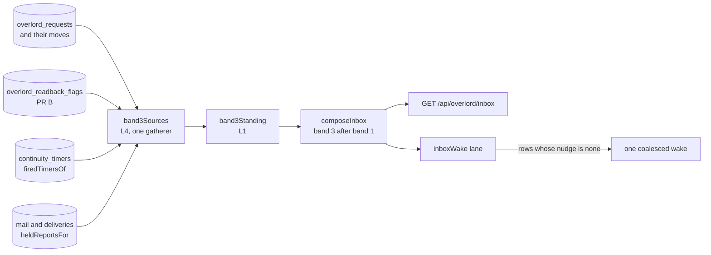
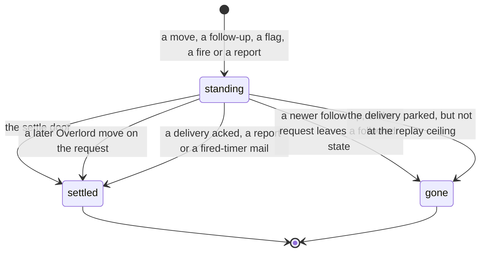
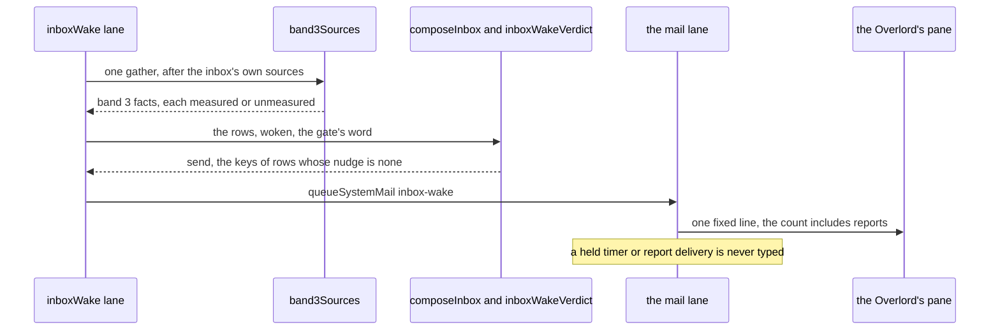
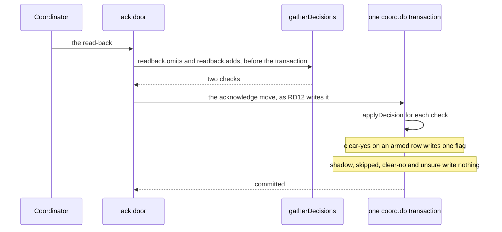
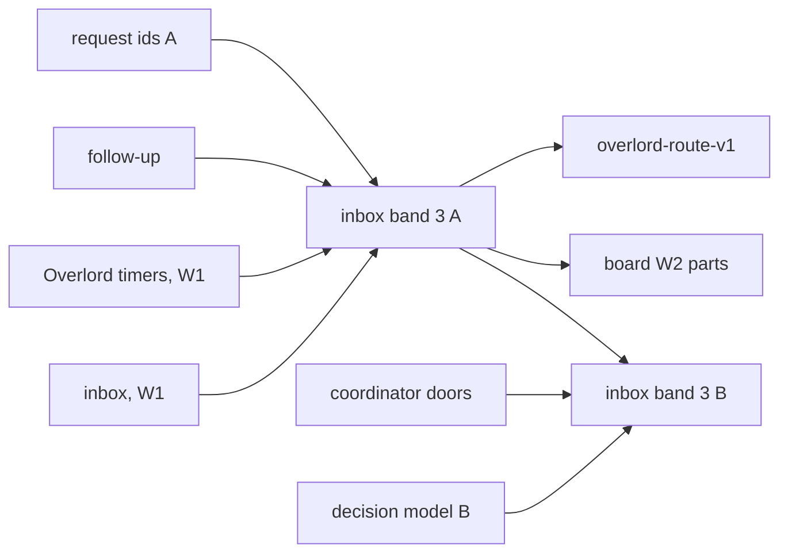

# Overlord W2: inbox band 3, the Overlord's moves, follow-ups, flags, fired timers and reports Implementation Plan

> **For agentic workers:** REQUIRED SUB-SKILL: Use superpowers:subagent-driven-development (recommended) or
> superpowers:executing-plans to implement this plan task by task. Steps use checkbox (`- [ ]`) syntax for tracking.

## In short

- **What this is.** The plan for the W2 piece "Inbox band 3" (the W2 index, Table W2, lane I). Band 3 is the inbox's
  third band (§6.8): request moves, follow-ups, read-back flags and the Overlord's own fired timers, oldest first. This
  plan adds a fifth kind the request ids plan hands it: coordinator reports, which are news and wake nothing. Two pull
  requests, five tasks: A (Tasks 1 to 4) ships four kinds and the settle door; B (Task 5) adds the read-back flag.
- **The inbox's contract is W1's.** Band 3 adds row kinds to `INBOX_KIND_MAP`, a source to `composeInbox` and `moves` to
  `INBOX_SERVED_BANDS`. It changes nothing a W1 caller reads, keeps the read ceilings and `READ_DOOR_MAP` as they are,
  and adds no read door. A row still carries ids and server words, never words a person or a session wrote.
- **One fire, one wake (question 12).** A fired timer's mail still sends under W1's contract. Its band-3 row is that
  mail, read through `firedTimersOf('overlord', stamp, since)`: one row per timer mail, carrying the ids of the timers
  it packs, and it leaves the inbox when the mail is acked. The row declares no nudge of its own, so the coalesced wake
  covers it, and the mail's own fixed line is held untyped, so the fire wakes the Overlord once, not twice (IB2). Once
  is within one server run: the wake's memory is W1's, in memory, so a row still standing after a restart wakes once
  more.
- **Reports are held and acked here (RI6).** A coordinator's report to `overlord` is a held delivery that is never
  typed. Band 3 serves it as a row that waits (no wake), the card lists it, the board can count it, and the Overlord acks
  it through band 3's one write door.
- **One write door, `settle`.** `POST /api/overlord/inbox/settle` settles one band-3 row: it acks the delivery of a
  report or a fired-timer mail, or marks a request's rows seen up to that row. It goes through the gate with the fence,
  as W1's `acknowledge` does, under `overlord-v1`, and it is an `acknowledge` act, whose targets widen to deliveries and
  requests.
- **Read-back flags (question 11).** A flag is written only when a `readback.*` row is armed on an admitted line and
  answers a clear yes, inside the coordinator's `ack` transaction. In shadow nothing is written, and no row appears.
- **What changes at merge.** PR A: the Overlord's inbox can show fired-timer rows at once, under `overlord-v1`, and the
  Overlord can settle them. The request kinds and reports need requests, which exist only once `overlord-route-v1`
  opens the doors that make them. PR B: flags appear only once the operator arms a `readback.*` row.
- **No question needs the operator.** Eleven open questions (§2), each with the coordinator's ruling of review 2289
  folded in.

## 1. Goal, scope and the rulings this plan builds on

This section says what the piece builds, why, and which rulings it builds on.

**Goal:** everything the Overlord must act on that is not the operator's words or a deadline reaches it through the one
inbox, in one order, behind one wake, and leaves the inbox when it has been dealt with.

**Why:** §6.8 H19: band 3 is "request moves, follow-ups, read-back flags and its own fired timers, oldest first", and
"A move wakes the Overlord, and a report never does. A move by the request doors or the server is a row of band 3. A
report is news and waits." §3.3.12 C62: "For the Overlord, a fired timer is also a row of band 3 of its inbox from W2,
when that band ships, behind the one coalesced wake." §5.4 C15: "The nudge arrives in the inbox as a follow-up row
(§6.8), behind one coalesced wake." Table 3.7b: `readback.omits` and `readback.adds` fail open as "a flag in the inbox".

**Architecture.** One context, C5 Coordination. Band 3 reads no operator words, so it adds no reader to the private
store (C11). Decide in L1, act in L4.

| Ring | File | What it holds |
|---|---|---|
| L0 | `shared/overlordInbox.ts` (W1 inbox's) | The five band-3 kinds in `INBOX_KIND_MAP`, their row shapes, `BAND3_NUDGE`, `BAND3_RANK`, `waits` in `RowNudge`, `moves` in `INBOX_SERVED_BANDS`, `parseInboxKey` |
| L1 | `server/src/coord/overlordInbox.ts` (W1 inbox's) | `band3Ord`, `band3Standing` (which rows stand), the band-3 source in `composeInbox`, `rowNudgeOf` for the new kinds, `band3SettleVerdict` |
| L1 | `server/src/coord/envelope.ts` (W1 inbox's `FIXED_LINE_MAIL`) | The `timer` row held untyped for the designated session (IB2) |
| L3 | `server/src/coord/overlordRequestStore.ts` (request record A's) | The seen mark (`inboxSeenAt`, `inboxSeenOrd`), `markRequestSeenInTx` (bookkeeping) and `inboxRequestFacts` |
| L3 | `server/src/coord/overlordInboxStore.ts` (new, PR B) | `overlord_readback_flags`: `recordReadbackFlagInTx`, its one writer, and `readbackFlagsForInbox` |
| L3 | `server/src/coord/store.ts` | `heldReportsFor`, the held report deliveries, text-free |
| L4 | `server/src/coord/overlordBand3.ts` (new) | `band3Sources`, the one gatherer the inbox handler and the wake lane both call |
| L4 | `server/src/coord/overlordRoutes.ts` (designation A's) | The `settle` handler |
| L4 | `server/src/coord/requestRoutes.ts` (the request doors' file: request record B or the coordinator doors creates it) | The `ack` handler's armed branch: `applyDecision`, then `recordReadbackFlagInTx` (PR B) |

*Table 1. Where the code goes.*


*Figure 1. One gatherer, one decider. The inbox read and the wake lane both call `band3Sources`, so the rows the
Overlord reads are the rows it was woken for. Reports reach the inbox and are counted in the wake's line, but only
rows whose nudge is `none` trigger it.*


*Figure 2. The life of a band-3 row. A row is never stored as a row: it stands while its source says so, and leaves
when the fact behind it changes.*

**Tech Stack:** TypeScript (ESM), `node:sqlite`, Fastify, bash (`ccd/ccrc-api`), Node (`ccd/door-process.mjs`), vitest.
No new dependency.

**Spec:** `docs/superpowers/specs/2026-11-09-overlord-design.md`:

- §6.8 H19: "The inbox", "One wake", "What ships when" ("W2 adds band 3"), "The read's contract is fixed in W1", "The
  inbox's order" (band 3), "A move wakes the Overlord, and a report never does".
- §3.3.12 C62: "For the Overlord, a fired timer is also a row of band 3", "Renewals … it also waits until that
  generation has read its card".
- §5.4 C14 ("Progress and the end follow as mail `toId:'overlord'`") and C15 ("The nudge arrives in the inbox as a
  follow-up row").
- §3.7 H6 and Table 3.7b: the `readback.*` rows, "Fail open: a flag in the inbox".
- §11.1: Table 11.1e's row "The Overlord's reads" (W2: band 3 joins the inbox); §11.2's gate order for the Overlord's
  doors.

**The index:** `docs/superpowers/plans/2026-11-16-overlord-w2.md`, row "Inbox band 3", lane I, one pull request, four
tasks, needing follow-up, the inbox and the Overlord's timers. This plan has two pull requests and five tasks, and its
needs grow (What the index should change).

**The rulings this plan builds on.** The coordinator accepted every recommendation of the W2 index's questions 2 to 23,
and questions 24 to 28 are settled. This plan builds on:

- **Q11, `shadow-flags-record-only`:** while a `readback.*` row is `off` it is not asked; in `shadow` its answer is a
  record only, and no inbox row is written. The band-3 row kind ships in PR B and fills once the operator arms the row
  on an admitted line.
- **Q12, `timer-row-and-mail-are-one-fire`:** the mail still sends under W1's contract; the band-3 row is the same fire,
  read through `firedTimersOf('overlord', stamp, since)`; it leaves the inbox when the mail is acked; it declares no
  nudge of its own, so the coalesced wake counts it once (IB2 says how).
- **Q18:** the timer doors keep `act: null`. Band 3 adds no timer door.
- **Q19:** act ceilings are proposed by each plan. This piece adds no act kind; it widens `acknowledge`'s targets
  (IB10).
- **Q29:** a decision-model row is `off`, `shadow` or `armed`, and arming is the operator's, on an admitted line.
- **The request ids plan's RI6** (`report-is-a-held-delivery`, in review on #2931): a report is a held delivery, never
  typed, and "the inbox band 3 piece serves it as an unread report and its `acknowledge` acks it".
- **The follow-up plan's FU1** (`follow-up-is-request-columns`, in review on #2932): band 3 reads a follow-up from
  `followedUpAt`, `followUpReason` and `nudges` on the request row.
- **The coordinator doors' RD12** (in review on #2931): "the inbox band 3 piece serves the flag once it is armed".
- **W1's inbox plan:** questions 5 (`inbox-carries-ids-not-words`), 7 (`wake-covers-unnudged-rows`), 8
  (`fixed-line-mail-is-one-table`), 14 (`inbox-fails-whole`) and 15 (the privacy boundary) bind band 3 as they bind
  band 1.
- **Review 2289's rulings (fix round 1):** one row per timer mail (F3); the seen mark ordered by `(at, ord)` with a tie
  rule (F1); the follow-up keyed on `followedUpAt` (F2); `acknowledge` widened, never a new kind, its row written
  `done` in the settle's transaction (F5); a delivery parked other than at the replay ceiling leaves the inbox (F7); the
  plain `mail ack` stays open (F4); a settle by a request's newest row clears its older rows (F9); two pull requests
  (F15).

## 2. Open questions

Each question carries a recommendation, which this plan builds unless the coordinator rules otherwise. None needs the
operator. Where review 2289 ruled, the ruling is folded into the recommendation.

- **IB1. Five kinds, each carrying ids and server words** (slug `band3-rows-carry-ids`). §6.8 names four kinds. The
  request ids plan hands band 3 a fifth, the report. **Recommendation:** five kinds, all in band `moves`, with the door
  that serves each one's content:

  | Kind | Key | `at` | Rank | Door | Nudge | Carries |
  |---|---|---|---|---|---|---|
  | `request-move` | `request-move:<moveId>` | the move's `at` | 0 | `board` | `none` | request id, move id, move word, actor kind, the state it reached, the reason word or `none` |
  | `readback-flag` | `readback-flag:<flagId>` | the flag's `at` | 1 | `board` | `none` | request id, the `ack` move's id, the row (`readback.omits` or `readback.adds`), the band |
  | `follow-up` | `follow-up:<requestId>-<followedUpAt>` | `followedUpAt` | 2 | `board` | `none` | request id, the streak count (`nudges`), the reason word |
  | `fired-timer` | `fired-timer:<mailId>` | the mail's `firedAt` | 3 | `timer_list` | `none` | mail id, delivery id, and each timer the mail packs with its restore fact's word |
  | `report` | `report:<deliveryId>` | the mail's `at` | 4 | `board` | `waits` | delivery id, mail id, request id, the sender's session id |

  No row carries a subject, a body, a note, an outcome line or a summary. The board's Requests and Unread reports
  parts (the board's W2 piece) and the timer list door serve the words, each behind its own read ledger line or its own
  door. So the inbox read stays the narrowest read the Overlord makes. The rank feeds the row's order number (IB5).
- **IB2. One fire, one wake** (slug `timer-row-and-mail-are-one-fire`, building the index's question 12). W1's timers
  plan types a fired timer's mail into the Overlord's pane as a fixed line ("3 of your timers came due"), acked on first
  delivery. If band 3's row also declares no nudge, the coalesced wake fires for the same fire: two lines for one fire,
  and the row would leave the inbox the moment the first line was typed, before the Overlord read it. Two readings fit
  question 12's words:

  | Option | What the pane gets | When the row leaves | Fits Q12? |
  |---|---|---|---|
  | **A (recommended).** The `timer` row of `FIXED_LINE_MAIL` holds the designated session's delivery untyped until it is acked (`holdUntilAcked`, line `null`, as RI6's report row does). The band-3 row declares no nudge, so the coalesced wake is the one line | One wake line, naming every waiting row | When the Overlord settles it, which acks the delivery | Yes: the mail sends (row, delivery, list door), the wake counts the fire once, and it leaves when the mail is acked |
  | B. Keep W1's typed line, and declare the row's nudge as that line | The timer line, and the wake for other rows | At first delivery, before the Overlord acts | No: the row declares a nudge of its own, and it leaves before it is read |

  **Recommendation:** option A. W1's contract stays whole: the mail row, `toId: 'overlord'`, `deliverTo`, the list
  door's `fired` view (while unacked and `TIMER_FIRED_SHOWN_MS` after the ack), the cleanup, the restore line and the
  card hold. What changes is the line: the coalesced wake replaces the timer line for the designated session, and the
  wake already holds while the card is unread (gate step 8), so C62's card hold is kept by the wake. A held delivery
  counts no attempt and never parks, by RI6's column. The census that only `overlord-report` sets `holdUntilAcked`
  (request ids A, Task A4) becomes "only `overlord-report` and `timer`". A session-keyed timer mail and every
  coordinator's timer mail keep the generic nudge, as W1 built them.
  - **One row per mail (review 2289, F3).** `packTimerMail` packs every due timer of one setter and run into one mail,
    and the timer lane marks them fired in one transaction (`markTimersFired(ids, mailId)`). The settle door acks a
    delivery, so the row is the mail, keyed `fired-timer:<mailId>`, carrying its timers' ids. A page cut can never fall
    between two timers of one mail, and settling the row acks exactly what it showed.
  - **Once per server run (F8).** W1's `woken` set is in memory, so a fire still standing after a restart wakes the
    Overlord once more (W1's "a restart wakes once"). That is the only second line a fire can cause.
  - **The card's mail list.** A held timer delivery is outstanding mail to the bound session, so it takes a place in the
    card's outstanding-mail list (`CARD_MAIL_MAX`) beside held reports, as an unread mail does today.
- **IB3. A report waits** (slug `report-waits`). §6.8: "A report is news and waits." The request ids plan's F3: "no
  wake, no nudge, and acked by the inbox lane". **Recommendation:** `RowNudge` gains `waits`, and a report row declares
  it. W1's wake verdict sends only when a row whose nudge is `none` is new, so a report never wakes the Overlord, and
  the wake's line still counts it, as W1 counts every waiting row. While no Overlord is `ready`, a report stays a held
  delivery (it never parks), so it is kept:
  - **Listed on the next card:** measured on `main`, the card lists the session's outstanding mail
    (`server/src/continuity/cardFacts.ts#gatherCardFacts`, through `outstandingMailFor`). A held report is an
    outstanding delivery to the bound session, so it is listed with no new code. Task 3 pins it with a test.
  - **Counted for the board:** `heldReportsFor` is the one reader, and the board's W2 piece calls it for its Unread
    reports part.
- **IB4. One write door, `settle`** (slug `band3-settle-door`). RI6 says band 3's `acknowledge` acks a report. W1's
  `acknowledge` is `POST /api/overlord/messages/:id/acknowledge`, for the operator's messages only. `ccrc-api` takes one
  `SAFE_RE` path id (`^[A-Za-z0-9_-]+$`), so a key such as `request-move:12` cannot ride a path. **Recommendation:** one
  door, `POST /api/overlord/inbox/settle`, body `{ byId, byUuid, key }`, where `key` is a band-3 row's key as the inbox
  served it. Its `OVERLORD_DOORS` row is `settle`, verb class `operate`, `write: yes` (the fence and the witness),
  others `refuse`, act kind `acknowledge`, word `overlord-v1`. It is the one band-3 writer the Overlord calls:
  - **A report or a fired-timer mail:** it acks the delivery through `CoordStore.markAcked`, the delivery's one writer;
  - **A request move, a follow-up or a flag:** it raises the request's seen mark to that row's `(at, ord)` (IB5);
  - **Already settled, or a delivery parked other than at the replay ceiling:** 200 with `changed: false`, so a retry
    is harmless (IB8's parks, review 2289 F7);
  - **A key that is not a band-3 row of its kind** (a delivery that is not a report or the role's timer mail, a mail
    with no timer of the current term, a move by the Overlord itself): 404 `not-found`;
  - **A malformed key:** 400 `bad-request`, after the gate.

  Its word is `overlord-v1`, not `overlord-route-v1`: band 3's fired-timer rows are served from merge under
  `overlord-v1` (the index, "What a merge arms"), and under IB2 they leave only through this door, so the door must be
  live under the same word. It authorises nothing: its act kind is `acknowledge`, class none ("Keep its own records").
  The request kinds and reports cannot exist before `overlord-route-v1`, so settling them is unreachable until then.

  **The plain ack stays open (review 2289, F4).** `POST /api/mail/:id/ack` checks the box token, the sender's registry
  pair and `toId === fromId`, and nothing about kind or hold. So the Overlord's own `ccrc-api mail ack`, or any holder
  of the box token presenting the bound id and uuid, can ack a held report or timer mail with no fence and no act row.
  W2 leaves that door as it is: it writes no act row, and like every other box-token door it is attribution, not
  authentication. `markAcked` stays the delivery's one writer either way.
- **IB5. Request rows settle by a seen mark** (slug `request-rows-settle-by-seen-mark`). Band 3's request rows (moves,
  flags, follow-ups) have no delivery to ack. **Recommendation:** a seen mark on the request row, two columns,
  `overlord_requests.inboxSeenAt` and `inboxSeenOrd`, written only by `markRequestSeenInTx`, a bookkeeping writer of
  the request store that only raises the mark, never lowers it, and raises no `revision`.
  - **The order (review 2289, F1).** Every band-3 row has an order number, `band3Ord(row) = 5 × id + rank`, from IB1's
    id and rank. It is unique per row across the five kinds, so ids from two tables never compare equal. Rows compare
    by the pair `(at, ord)`, first `at`, then `ord`. `composeInbox` orders band 3 by the same pair.
  - **The rule.** A request row stands while its `(at, ord)` is above both the seen mark and the pair of the newest move
    of that request made by the Overlord itself (read from `overlord_request_moves`, never written).
  - **The tie rule.** A read-back flag is written in the `ack` move's transaction, and one `ack` can write several
    moves, so rows of one request can share an `at`. Because the inbox serves band 3 in `(at, ord)` order and cuts the
    page at the end of that order, every row of a request the page left out is above every row it served. Settling a
    served row of a tie raises the mark to that row's pair, which is below each unserved sibling, so it never hides
    one.

  So:
  - settling the newest row of a request settles its older rows too, which is what an Overlord that has read the
    request on the board has done;
  - an Overlord move on the request (a relay, a route elsewhere, an escalate, a drop) settles what came before it
    without a second call;
  - `nudge-owner` is an act, not a move, so after a nudge the Overlord settles the follow-up with the door.

  **A settle by the newest row clears the older rows, by design (review 2289, F9).** The door does not check that the
  key was served: a key naming a request's newest move, even one past the page cut, settles every older row of that
  request. That is accepted. The Overlord reads a request whole on the board, through its own read ledger line, so a
  key it knows is a request it can read; the fence and the gate limit the door to the designated Overlord; and the
  older rows' facts stay on the board, so nothing is lost but the inbox row.

  Rejected: a table of settled keys. It would need a purge and a second fact beside the request row, for nothing the
  seen mark cannot say. Rejected: a seen time alone (the first draft). Two rows with one `at` would settle together, and
  a page cut between them would hide one the Overlord never read.
- **IB6. Which follow-up stands** (slug `latest-follow-up-stands`). FU1 keeps the latest follow-up on the request row,
  and `nudges` counts the streak. **Recommendation:** the follow-up row is the latest one, and it stands only while the
  request is in a state the arm follows up (`received`, `routed`, `declined` or `in-progress`). A move to `needs-you`,
  `blocked`, `done-unverified` or a terminal state is itself a `request-move` row, and it ends the follow-up row.
  - **The key is `follow-up:<requestId>-<followedUpAt>` (review 2289, F2).** The follow-up plan resets `nudges` to 0
    when it measures movement, so a key on `nudges` repeats (`follow-up:5-1` twice), and W1's wake, which remembers the
    keys it last woke for, would answer `nothing-new` for a new follow-up. `followedUpAt` is the follow-up's own write
    time, set on every follow-up and never reset, so each follow-up has its own key. `nudges` stays a carried field.
- **IB7. A read-back flag is a row of its own** (slug `readback-flag-is-a-row-of-its-own`). RD12 gathers the `readback.*`
  checks before the `ack` transaction and writes nothing in shadow. Nothing on the plans stores an armed flag.
  **Recommendation:** one table, `overlord_readback_flags` (`id`, `requestId`, `moveId`, `row`, `recordId`, `band`,
  `at`), with one writer, `recordReadbackFlagInTx`, in PR B. Inside the `ack` transaction, for each `readback.*` check,
  the handler asks decision model B's `applyDecision`; on `clear-yes`, an advice row's mark, it writes one flag naming
  the `acknowledge` move it rode. `shadow`, `skipped`, `clear-no` and `unsure` write nothing. So question 11 holds by
  construction: no flag exists unless the row is armed on an admitted line and answered a clear yes under it. A flag
  changes no move: the read-back is accepted as RD12 says, and the flag tells the Overlord to read it.
- **IB8. The inbox still fails whole, and a dead delivery leaves it** (slug `inbox-still-fails-whole`). W1's question
  14: an unmeasured source refuses the whole inbox, never a partial one. **Recommendation:** keep it. Band 3's sources
  (`requests`, `timers`, `reports`, and `flags` from PR B) widen `InboxComposed`'s `source` union, and any of them
  unmeasured answers 502 `unmeasured` naming it, with its ledger line. A partial inbox would read as "nothing waiting"
  in the bands it dropped, and an unreadable request table is a fault to fix, not a reason to serve less. The wake
  holds `rows-unmeasured` the same way.
  - **Parked deliveries (review 2289, F7).** `markAcked` accepts a delivery that is not terminal, or one parked at the
    replay ceiling (`MAIL_REPLAY_CEILING_ERROR`), and refuses every other park: run closed, `MAIL_MAX_ATTEMPTS`,
    recipient absent, session dead. A held report whose run closed is parked by `cancelOutstandingDeliveries`. Such a
    row could never be settled, so it leaves the inbox: `heldReportsFor` and `firedTimersOf`'s unacked-only form
    (`since` past now, which only band 3 asks; the list door's `fired` view is unchanged) leave out a delivery parked
    other than at the replay ceiling. A settle of its key answers `already`, never 503: `band3SettleVerdict` sees the
    delivery's state through `SettleFacts`.
- **IB9. Which moves are rows** (slug `band3-moves-are-others-moves`). **Recommendation:** every move whose actor kind
  is `owner`, `server` or `operator`. The Overlord's own moves (`open`, `route`, `re-relay`, `route-elsewhere`, `drop`,
  `escalate`) are not rows: it made them. Each move is its own row, oldest first, so two counters and the move to
  `needs-you` they cause are three rows the Overlord reads in order.
- **IB10. Act ceilings (index question 19)** (slug `band3-widens-acknowledge`). **Recommendation (review 2289, F5):** no
  new act kind. The settle door is an `acknowledge` act, and `acknowledge` widens:
  - **Its targets** gain two kinds beside `message`: `delivery:<id>` (a report or a fired-timer mail) and
    `request:<id>` (a request's band-3 rows).
  - **Its natural keys** (act rows' question 10) gain `acknowledge, delivery, <deliveryId>, 0` and
    `acknowledge, request, <requestId>, <ord>`, where `<ord>` is the settled row's order number (IB5), so each settle
    of a request has its own key and a repeat of one row is the same key.
  - **Its ceiling** stays the act catalogue's `held-by` cell for `acknowledge` (its question 2), widened in words: one
    acknowledgement for each operator message, each held delivery to the role and each band-3 request row. A settle is
    an acknowledgement, so it counts under that ceiling, and a repeat writes nothing.
  - **Its row is written `done`, in the settle's own transaction.** The settle's effect lives in `coord.db` (the
    delivery or the seen mark), as the act row does, so band 3 writes the act row with state `done` in the same
    transaction as the effect. It never leaves a row `pending`, so the act rows plan's `ACT_SETTLE_MAP`, which settles
    rows left `pending` across two steps, never sees it.

  The read ceilings stay W1's: band 3 adds no read door, so `READ_CEILINGS` and `READ_DOOR_MAP` are unchanged, and the
  inbox's 240 reads an hour cover the extra rows, which cost no extra read.
- **IB11. One page, counted** (slug `band3-reads-are-bounded`). Band 3 can hold many rows after a gap. **Recommendation:**
  each band-3 reader answers its oldest `INBOX_PAGE_ROWS` candidates and their total, and `composeInbox` cuts the merged
  inbox at `INBOX_PAGE_ROWS` with W1's `behind: { kind: 'page', count }`. The readers narrow by the seen mark as a read
  bound only; `band3Standing` applies the whole rule again, so a reader that over-reads changes nothing.

## 3. What exists today

Measured on `main` at `b99bc6390` (2026-11-16). None of the W1 or W2 pieces this plan builds on is built; each is cited
by its plan's contract. The W2 plans merged as plans are `w2-requests.md`, `w2-act-rows.md`, `w2-act-catalogue.md` and
`w2-decision-model.md`; `w2-follow-up.md`, `w2-request-ids.md` and `w2-coordinator-doors.md` are in review.

| What | Where | What this piece does with it |
|---|---|---|
| The inbox, its bands, kinds, wake and fixed-line table | `docs/superpowers/plans/2026-11-14-overlord-w1/w1-inbox.md` (merged as a plan; not built): `shared/overlordInbox.ts`, `server/src/coord/overlordInbox.ts`, `server/src/coord/envelope.ts#FIXED_LINE_MAIL`, `overlordInboxWake.ts` | Adds kinds, a source and `moves`; changes no W1 reader |
| The timers' fired list and fixed line | `docs/superpowers/plans/2026-11-14-overlord-w1/w1-overlord-timers.md` (merged as a plan): `firedTimersOf(db, setter, stamp, since)`, the list door's `since` of now less `TIMER_FIRED_SHOWN_MS`, the `timer` row with `waitsForCard` | Reads the list in its unacked-only form; holds the line (IB2) |
| The timer mail's packing | `server/src/continuity/timers.ts#packTimerMail` (one mail per setter and run), `server/src/continuity/timerLane.ts` (`markTimersFired(ids, mailId)` in one transaction) | One row per mail (IB2) |
| The report's hold | `w2-request-ids.md` (in review, #2931): the `overlord-report` row with `holdUntilAcked` | Serves it and acks it |
| The request record and its moves | `docs/superpowers/plans/2026-11-16-overlord-w2/w2-requests.md` (merged as a plan): `overlord_requests`, `overlord_request_moves` (`actorKind`, `toState`, `reason`), `server/src/coord/overlordRequestStore.ts` | Adds two columns and two functions to the store |
| The follow-up columns | `w2-follow-up.md` (in review, #2932): `followedUpAt`, `followUpReason`, `nudges` | Reads them |
| The read-back checks | `w2-coordinator-doors.md` (in review, #2931): the `ack` door gathers `readback.*` before its transaction | Adds the armed branch (PR B) |
| `applyDecision` | `docs/superpowers/plans/2026-11-16-overlord-w2/w2-decision-model.md` (merged as a plan), Task 8: `skipped`, `shadow`, `clear-yes`, … | Called inside `ack`'s transaction (PR B) |
| `acknowledge`'s act row | `docs/superpowers/plans/2026-11-16-overlord-w2/w2-act-rows.md` (merged as a plan): its question 10's natural key, `ActTarget`, `writeActInTx` (state `pending` or `done`), `ACT_SETTLE_MAP` and its `settleVerdict` in `overlordActSettle.ts`; `w2-act-catalogue.md` (merged as a plan): `acknowledge`'s ceiling cell | Widens its targets; writes the row `done` (IB10) |
| The delivery writer | `server/src/coord/store.ts`: `CoordStore.markAcked(id, at)`, through the private `writeDelivery`; it answers `absent`, `already-acked` or `parked` with the park's `lastError` | The settle door acks through it |
| The replay-ceiling park | `server/src/coord/delivery.ts#MAIL_REPLAY_CEILING_ERROR`, the one park `markAcked` still accepts | IB8's exclusion keeps it |
| The card's outstanding mail | `server/src/continuity/cardFacts.ts#gatherCardFacts` reads `outstandingMailFor(id, CARD_MAIL_MAX + 1)` | Lists held reports and held timer mail with no new code (IB2, IB3) |
| The refusal words | `shared/refusal.ts#GENERIC_REFUSALS` holds `not-found` and `unmeasured`; `bad-request` (400) and `write-failed` (503) are route words in `shared/refusal.ts#REFUSAL_STATUS` | Used; no new word |
| The stall watch's mail-stuck arm | `server/src/coord/stall.ts` (its `mail-stuck` rung) | A held timer delivery joins the report's exception (Task 3) |
| The migrations | `server/src/coord/schema.ts#MIGRATIONS`: 82 on `main`; `server/test/coord-db.test.ts` pins 82 three times | One migration in each pull request, its slot taken when it lands |
| Growth | `server/src/coord/schema.ts` 3,378 lines, `server/src/coord/store.ts` 11,372, `server/src/server.ts` 4,411, `server/src/watch.ts` 12,465, `server/src/coord/routes.ts` 4,944 | Each within 40 net lines (§8) |

*Table 2. What exists today, and what this piece does with each.*

## 4. The rows, and when they stand

This section gives `band3Standing`, the one decider of which band-3 rows stand. "Above" compares `(at, ord)` pairs
(IB5).

| Kind | It stands when | It leaves when |
|---|---|---|
| `request-move` | The move's actor kind is not `overlord`, and its `(at, ord)` is above the request's seen mark and above the Overlord's newest move on the request | The settle door, or the Overlord moves the request |
| `readback-flag` | Its `(at, ord)` is above the seen mark and the Overlord's newest move, and the request is open | The settle door, an Overlord move, or the request closing |
| `follow-up` | `followedUpAt` is set, its `(at, ord)` is above the seen mark and the Overlord's newest move, and the request is `received`, `routed`, `declined` or `in-progress` | The settle door; an Overlord move; a newer follow-up (a new key); a move out of the followed states |
| `fired-timer` | `firedTimersOf('overlord', overlordTimerStamp(term), now + 1)` lists a timer of the mail: the current term's fired-timer mail whose delivery is neither acked nor parked other than at the replay ceiling | Its delivery is acked (the settle door), or parked other than at the replay ceiling; a new term (a new designation never sees its predecessor's notes) |
| `report` | A delivery of mail to `overlord` carrying a `requestId`, from a sender that is not a role, neither acked nor parked other than at the replay ceiling | Its delivery is acked (the settle door), or parked other than at the replay ceiling |

*Table 3. `band3Standing`. `now + 1` as `since` asks `firedTimersOf` for unacked deliveries only, which is question 12's
"it leaves the inbox when the mail is acked".*

**The properties:**

- **Monotone in the seen mark.** Raising the mark never adds a request row, and never removes a timer or report row.
- **A tie never hides an unserved row.** For any page cut, raising the mark to a served row's pair leaves every unserved
  row of that request standing.
- **The Overlord's own moves are never rows,** at any seen mark.
- **Each row's key names one fact.** A key is never reused for a different fact: moves, flags and deliveries by their
  own ids, a fired-timer row by its mail, a follow-up by its write time. So the wake's memory (`woken`, W1) names the
  same key twice only for the same fact. That memory lives in the server's process, so the property holds within one
  run, and a row standing across a restart wakes the Overlord once more (IB2).


*Figure 3. One wake for band 3. A held timer delivery and a held report sit untyped. A new move, follow-up, flag or
fired-timer mail triggers the wake, and the wake's line counts every waiting row, reports included.*

## 5. The settle door

This section gives the one write the Overlord makes on band 3.

- **The row:**

  | Key | Method and path | File | Group | Verb class | Write | Word | Others | Ladder class | Act |
  |---|---|---|---|---|---|---|---|---|---|
  | `settle` | `POST /api/overlord/inbox/settle` | `coord/overlordRoutes.ts` | overlord | operate | yes | `overlord-v1` | refuse | other | acknowledge |

- **The handler.** Registered with the `onRequest` `checkMailToken` form. It parses `byId` and `byUuid` from the body,
  then, before any store access: `const g = await deps.gate(req, reply, 'settle', { sessionId, uuid, uuidField:
  'byUuid' }); if (g.kind === 'refused') return;`. Then:
  1. `parseInboxKey(body.key)`: a refusal is 400 `bad-request`, and a W1 kind (`probe-round`, `operator-message`) is
     400 too, naming the door that settles it.
  2. The target's `SettleFacts`, through the store readers: for a delivery, the mail row's `fromId`, `toId` and
     `requestId`, its timers of the current term, and the delivery's state word; for a request, its state, its seen
     mark and the row's `(at, ord)`.
  3. `band3SettleVerdict(key, facts)`: `ack-delivery`, `seen`, `already` or `absent`.
  4. In one `coord.db` transaction: `ack-delivery` calls `markAcked`, `seen` calls `markRequestSeenInTx`, and each
     writes its `acknowledge` act row with state `done` beside the effect (IB10). `already` answers 200
     `{ ok: true, changed: false }`, and `absent` answers 404 `not-found`. A refused write re-reads, as W1's
     `acknowledge` does: settled or parked answers `changed: false`, and a write that throws answers 503
     `write-failed`.
- **Its act row.** Act rows B makes `acknowledge` write its act row (Table W2). If act rows B has merged when PR A
  builds, the settle writes through the same writer, `writeActInTx`, with state `done`, in the settle's transaction;
  otherwise act rows B adds the settle door beside `acknowledge` (What the index should change).
- **No ledger line and no sequence line.** It is a write, not a read, and it moves no request.

## 6. The read-back flag

This section gives the armed branch of the coordinator's `ack` door, PR B.


*Figure 4. The flag rides the acknowledge move's transaction. `applyDecision` re-reads the row's arming and line inside
the transaction, so a row disarmed between the gather and the transaction writes no flag.*

## 7. Global constraints and review focus

This section lists the rules every task keeps, and what the reviewer reads first.

- **Architecture (`CLAUDE.md`).** `band3Ord`, `band3Standing`, `band3SettleVerdict`, `parseInboxKey` and the L0 tables
  are pure. `band3Sources`, the handlers and the wake lane read facts, ask a decider and act. Every port is declared by
  its consumer (`Pick<…>`).
- **One writer per fact.** A delivery's ack: `CoordStore.markAcked`. The seen mark: `markRequestSeenInTx`. A flag:
  `recordReadbackFlagInTx`. A request's state: the request store's move writer, which band 3 never calls. An act row:
  `writeActInTx`.
- **One name per decider.** Band 3's settle decider is `band3SettleVerdict`, never `settleVerdict`, which is the act rows
  plan's settling decider in `overlordActSettle.ts`.
- **No words.** No band-3 row, log line, refusal detail or flag holds a subject, a body, a note, an outcome or a
  summary. A test plants marker strings in each source and finds none in the answer.
- **The contract.** W1's answer shape and order are unchanged; a W1 reader that does not know a band-3 kind still
  orders it by its band. `READ_CEILINGS` and `READ_DOOR_MAP` are unchanged.
- **Time through ports.** Every handler, gatherer and lane reads time from its injected clock. `overlordBand3.ts` and
  `overlordInboxStore.ts` are in the `overlord*` time-port family already.
- **Mutation floors.** `band3Ord`, `band3Standing`, `band3SettleVerdict` and `parseInboxKey` join
  `server/test/sim/overlordInboxSets.ts` (W1's) and `server/test/sim/mutation-floors.json` in the task that creates
  them.
- **Tests.** From `server/`: `ccrc test -- ./node_modules/.bin/vitest run test/<file>.test.ts`, one file at a time, in
  the foreground. Each task's last run adds `ccrc test -- npx tsc --noEmit -p tsconfig.json` and
  `-p test/tsconfig.tests.json`, `test/typecheck-tests.test.ts`, `test/rings/*.test.ts` and `test/mail-routes.test.ts`,
  and pwa's `tsc` when `shared/` changed. Fixture HOMEs only, neutral names (`lane-a`, `project-a`, `prog-a`).
- **Public repository.** No private names. Cite by symbol, and a sibling's unbuilt symbol by its plan's contract. No
  D-number: the builder's departures go in `docs/superpowers/plans/2026-11-16-overlord-w2/w2-inbox-band-3/departures.md`.

**Review focus:**

1. **One fire, one wake.** A fired-timer mail types no line of its own for the designated session; the wake covers it
   once per server run; it is one row however many timers it packs; it leaves only when its delivery is acked or
   parked other than at the replay ceiling; a coordinator's timer mail is untouched.
2. **Reports wait.** A report row never triggers the wake, is counted in its line, never parks while held, and leaves
   only when acked through the settle door, or when its run's close parks it.
3. **Ties.** Settling one row of a tie never hides an unserved sibling.
4. **Flags only when armed.** No flag is written in shadow, for a disarmed row, or on anything but `clear-yes`.
5. **Ids, never words.** No band-3 row carries text a person or a session wrote.
6. **The contract.** No W1 caller's answer changes; the read ceilings stand.

## 8. The PR split

This section gives the two pull requests and their growth (review 2289, F15: the fired-timer fix, live under
`overlord-v1`, does not wait on the read-back chain).

| PR | Tasks | What it ships | Needs first | Growth-checked files, estimate |
|---|---|---|---|---|
| A | 1 to 4 | Four kinds (`request-move`, `follow-up`, `fired-timer`, `report`), `band3Ord`, `band3Standing`, `band3SettleVerdict`; the seen mark and the readers; the timer row's hold and the card test; the settle door with every census, its client row, its tool and the skill's paragraph | The inbox; the Overlord's timers; follow-up (and through it the request record A); request ids A (the report's row and `holdUntilAcked`, whose census Task 3 widens) | `schema.ts` +6 (one migration: two columns); `store.ts` +14 (`heldReportsFor` and its delegate); `server.ts` +4 (the routes' new deps); `watch.ts` +2 (the wake lane's band-3 port); `routes.ts` 0; `shared/api.ts` 0 |
| B | 5 | The `readback-flag` kind; `overlord_readback_flags`, its writer and reader; the flags source; the `ack` handler's armed branch | PR A; decision model B (`applyDecision`); the coordinator doors (the `ack` handler) | `schema.ts` +14 (one migration: the table); `store.ts` 0; `server.ts` +1; `watch.ts` 0 |

*Table 4. The two pull requests.*

**Order:** PR A: Task 1, then Task 2, then Tasks 3 and 4 in either order. PR B: Task 5. Each pull request pushes once,
at its end (worker clause 20).

**Not growth-checked:** PR A: `shared/overlordInbox.ts` about +60; `server/src/coord/overlordInbox.ts` about +95;
`overlordBand3.ts` about +75, new; `overlordRequestStore.ts` about +45; `overlordRoutes.ts` about +65; `envelope.ts`
about +6; `ccd/ccrc-api` about +2; `ccd/door-process.mjs` about +8. PR B: `shared/overlordInbox.ts` about +12;
`server/src/coord/overlordInbox.ts` about +15; `overlordBand3.ts` about +10; `overlordInboxStore.ts` about +55, new;
`requestRoutes.ts` about +15.


*Figure 5. What band 3 needs and what needs it. Request ids A is PR A's addition to the index's edges; the coordinator
doors and decision model B are PR B's.*

## 9. Tasks

This section gives the five tasks: Tasks 1 to 4 are PR A, and Task 5 is PR B.

### Task 1: The kinds and the deciders (L0, L1)

**Files:**
- Modify: `shared/overlordInbox.ts` (four kinds, their rows, `BAND3_NUDGE`, `BAND3_RANK`, `waits`, `moves` served,
  `parseInboxKey`; type-only imports from `./overlordRequests.js` and `./continuity-timers.js`)
- Modify: `server/src/coord/overlordInbox.ts` (`band3Ord`, `band3Standing`, the band-3 source in `composeInbox`,
  `rowNudgeOf`, `band3SettleVerdict`, and the new kebab words in `isOverlordInboxKebab`)
- Modify: `server/test/overlord-inbox-vocab.test.ts`, `server/test/overlord-inbox-deciders.test.ts` (W1's suites)
- Modify: `server/test/sim/overlordInboxSets.ts`, `server/test/sim/mutation-floors.json`

**Interfaces** (`shared/overlordInbox.ts`, added beside W1's; PR B adds `readback-flag` to each):

```ts
// INBOX_KIND_MAP gains, each { band: 'moves', door }:
//   'request-move' and 'follow-up' and 'report': door 'board'; 'fired-timer': door 'timer_list'
export type RowNudge = 'message-nudge' | 'renewal-feed' | 'spot-probe-notice' | 'none' | 'waits';
export type Band3Kind = 'request-move' | 'follow-up' | 'fired-timer' | 'report';   // PR B adds 'readback-flag'
/** Each band-3 kind's nudge (IB1): a report waits, every other kind is covered by the wake. */
export const BAND3_NUDGE: Readonly<Record<Band3Kind, RowNudge>>;
/** Each band-3 kind's rank in the order number (IB1, IB5): move 0, flag 1, follow-up 2, fired timer 3, report 4. */
export const BAND3_RANK: Readonly<Record<Band3Kind, 0 | 1 | 2 | 3 | 4>>;
// INBOX_SERVED_BANDS becomes ['probe', 'operator', 'moves']

export interface RequestMoveInboxRow extends InboxRowBase { readonly kind: 'request-move'; readonly requestId: number;
  readonly moveId: number; readonly move: RequestMove; readonly actorKind: 'owner' | 'server' | 'operator';
  readonly toState: RequestState; readonly reason: RequestMoveReason | 'none' }
export interface FollowUpInboxRow extends InboxRowBase { readonly kind: 'follow-up'; readonly requestId: number;
  readonly followedUpAt: number; readonly nudges: number; readonly reason: FollowUpReason }
export interface FiredTimerInboxRow extends InboxRowBase { readonly kind: 'fired-timer'; readonly mailId: number;
  readonly deliveryId: number;
  readonly timers: readonly { readonly timerId: number; readonly restore: TimerRestoreFactWord }[] }
export interface ReportInboxRow extends InboxRowBase { readonly kind: 'report'; readonly deliveryId: number;
  readonly mailId: number; readonly requestId: number; readonly fromId: string }
// InboxRow gains the four.

/** A band-3 key as the inbox served it: `<kind>:<id>`, each id a positive safe integer; a follow-up's id is
 *  `<requestId>-<followedUpAt>`. A W1 kind is refused, naming the door that settles it. */
export function parseInboxKey(raw: unknown):
  | { ok: true; kind: Band3Kind; id: number; at: number | null }
  | { ok: false; detail: string };
```

**Interfaces** (`server/src/coord/overlordInbox.ts`):

```ts
export interface Band3Facts {
  readonly requests: Source<{ readonly rows: readonly RequestInboxFact[]; readonly total: number }>;
  readonly timers: Source<{ readonly rows: readonly FiredTimerMailFact[]; readonly total: number }>;
  readonly reports: Source<{ readonly rows: readonly HeldReportFact[]; readonly total: number }>;
  // PR B adds: readonly flags: Source<{ readonly rows: readonly FlagFact[]; readonly total: number }>;
}
/** A row's place in band 3's order (IB5): compare `at`, then `ord`. */
export interface Band3Mark { readonly at: number; readonly ord: number }
/** `5 × id + BAND3_RANK[kind]`, from IB1's id: unique per row across the kinds. */
export function band3Ord(kind: Band3Kind, id: number): number;
/** One request's band-3 inputs: its state, the seen mark, the newest Overlord move's mark, the moves above the seen
 *  mark, and the latest follow-up. */
export interface RequestInboxFact { readonly requestId: number; readonly state: RequestState;
  readonly seen: Band3Mark | null; readonly overlordMoved: Band3Mark | null;
  readonly moves: readonly { moveId: number; move: RequestMove; actorKind: RequestActor; toState: RequestState;
    reason: RequestMoveReason | null; at: number }[];
  readonly followUp: { at: number; nudges: number; reason: FollowUpReason } | null }
/** One fired-timer mail of the current term (IB2): its delivery, the timers it packs, and `firedAt`. */
export interface FiredTimerMailFact { readonly mailId: number; readonly deliveryId: number; readonly firedAt: number;
  readonly timers: readonly { timerId: number; restore: TimerRestoreFactWord }[] }
/** Table 3, first match per row; band 3 sorted by `(at, ord)`. */
export function band3Standing(f: { requests: readonly RequestInboxFact[]; timers: readonly FiredTimerMailFact[];
  reports: readonly HeldReportFact[] }): readonly InboxRow[];
// InboxSources gains `band3: Band3Facts`; InboxComposed's unmeasured `source` gains 'requests' | 'timers' | 'reports'.

/** What the settle door read about its target (IB8): the delivery's state, never only "not acked". */
export type SettleDeliveryState = 'outstanding' | 'acked' | 'parked-at-replay-ceiling' | 'parked' | 'absent';
export type SettleFacts =
  | { readonly target: 'delivery'; readonly state: SettleDeliveryState; readonly isRoleTimerMail: boolean;
      readonly timersOfTerm: number; readonly isReport: boolean }
  | { readonly target: 'request'; readonly found: boolean; readonly state: RequestState | null;
      readonly seen: Band3Mark | null; readonly row: Band3Mark | null; readonly rowIsOverlordMove: boolean };
export type Band3SettleVerdict = { kind: 'ack-delivery'; deliveryId: number }
  | { kind: 'seen'; requestId: number; mark: Band3Mark } | { kind: 'already' } | { kind: 'absent' };
export function band3SettleVerdict(key: { kind: Band3Kind; id: number; at: number | null }, facts: SettleFacts):
  Band3SettleVerdict;
```

- [ ] **Step 1: Failing tests.**
  - `overlord-inbox-vocab.test.ts`: the four kinds are in band `moves`, each with the door IB1's table names, and every
    door is one the skill's table names; `BAND3_NUDGE` is total over `Band3Kind` and answers `waits` for `report` alone;
    `BAND3_RANK` is total and injective; `INBOX_SERVED_BANDS` is `['probe', 'operator', 'moves']`; `parseInboxKey` on
    `request-move:3`, `follow-up:3-1731700000000`, `fired-timer:12` and `report:9` (allowed), and on `follow-up:3`,
    `request-move:3-2`, `request-move:07`, `operator-message:1`, `probe-round:x`, a key past `Number.MAX_SAFE_INTEGER`,
    an empty string and a non-string (refused); the key list test holds that no field of the four rows is named `text`,
    `subject`, `body`, `note`, `outcome` or `summary`.
  - `overlord-inbox-deciders.test.ts`:
    - `band3Ord`: distinct for every pair of kinds and ids in a sweep of ids 1 to 200;
    - `band3Standing`, each row of Table 3: a move by the owner above the seen mark stands, one by the Overlord never
      does; an Overlord move after a move settles it; raising the seen mark past a move settles it; the latest
      follow-up stands only in the four followed states; a fired-timer mail and a held report stand as their facts
      say;
    - **the tie (F1):** two moves of one request with one `at`, the page cut between them: settling the served one
      leaves the other standing; and the same with the cut after both, where settling the later one settles both;
    - **one row per mail (F3):** two timers in one mail are one row carrying both ids; with `INBOX_PAGE_ROWS - 1` older
      rows the mail's row is served whole, and with `INBOX_PAGE_ROWS` older rows it is wholly behind the page;
    - **a follow-up after a reset (F2):** two follow-ups of one request with equal `nudges` and different
      `followedUpAt` have different keys, and the wake verdict sends for the second;
    - the properties: monotone in the seen mark, a tie never hides an unserved row, never an Overlord move, each key
      one fact across two calls;
    - `composeInbox` with band 3: band 1 before band 3; band 3 by `(at, ord)`; an open round still served alone with
      `probe-first` counting band 3; over `INBOX_PAGE_ROWS` cut with `behind: page` and the totals; each band-3 source
      `unmeasured` refuses naming it (IB8);
    - `rowNudgeOf`: each kind; `inboxWakeVerdict`: a new move, follow-up or fired-timer mail sends; a new report alone
      holds `nothing-new`, and a send's `waiting` counts it;
    - `band3SettleVerdict`: each kind's `ack-delivery` or `seen`; `already` for an acked delivery and for one parked
      other than at the replay ceiling (F7); `ack-delivery` for one parked at the replay ceiling; `absent` for a mail
      with no timer of the current term, a delivery that is not a report, and a move by the Overlord.
- [ ] **Step 2: Run red.** `ccrc test -- ./node_modules/.bin/vitest run test/overlord-inbox-vocab.test.ts`, then the
  deciders suite.
- [ ] **Step 3: Implement.** Register `band3Ord`, `band3Standing`, `band3SettleVerdict` and `parseInboxKey` in
  `overlordInboxSets.ts` with floors.
- [ ] **Step 4: Run green**, both suites, `mail-routes`, `sim/mutation-floors`, `rings/wire-totality`,
  `rings/shared-imports`, `single-definition/time-ports`, and both `tsc` runs.
- [ ] **Step 5: Mutation, by hand.** Each reds a case, then restore: let an Overlord move be a row; compare `(at, ord)`
  with "at or above" where Table 3 says above; compare `at` alone, dropping `ord` (the tie case reds); key a follow-up
  on `nudges` (the reset case reds); key a fired-timer row by its timer (the one-row-per-mail case reds); let a report's
  nudge be `none`; serve band 3 ahead of band 1; answer `ack-delivery` for a delivery parked other than at the replay
  ceiling; drop a source's `unmeasured` arm.
- [ ] **Step 6: Commit.** `feat(overlord): inbox band 3's kinds, its order and which rows stand (H19)`

### Task 2: The seen mark and the readers (L3)

**Files:**
- Modify: `server/src/coord/schema.ts` (one migration: `ALTER TABLE overlord_requests ADD COLUMN inboxSeenAt INTEGER`
  and `ADD COLUMN inboxSeenOrd INTEGER`)
- Modify: `server/src/coord/overlordRequestStore.ts` (`markRequestSeenInTx`, `inboxRequestFacts`)
- Modify: `server/src/coord/store.ts` (`heldReportsFor`, text-free, with its delegate)
- Modify: `server/src/continuity/continuityStore.ts` (`firedTimersOf`'s unacked-only form leaves out a delivery parked
  other than at the replay ceiling, and answers each row's mail id and delivery id)
- Modify: `server/test/single-definition/writers-map.test.ts` (the request table's writers gain
  `markRequestSeenInTx`), `server/test/single-definition/row-revisions.test.ts` (`markRequestSeenInTx` is
  `bookkeeping`), `server/test/coord-db.test.ts` (the version pins), `server/test/run-close-switch.test.ts` (the undo
  step and its count), `server/test/continuity-timers-store.test.ts` (W1's `firedTimersOf` cases)
- Create: `server/test/overlord-band3-store.test.ts`

**The migration** (its slot taken when it lands, as the index's order rule says):

```sql
ALTER TABLE overlord_requests ADD COLUMN inboxSeenAt INTEGER;    -- NULL: nothing seen yet
ALTER TABLE overlord_requests ADD COLUMN inboxSeenOrd INTEGER;   -- the seen row's band3Ord, set with inboxSeenAt
```

**Interfaces:**

```ts
// server/src/coord/overlordRequestStore.ts (C5, L3). Bookkeeping: raises no revision and stamps no sequence line.
export function markRequestSeenInTx(db: DatabaseSync, id: number, mark: Band3Mark): 'raised' | 'already' | 'absent';
/** The requests with band-3 candidates, oldest first: moves above the seen mark, the newest Overlord move's mark, the
 *  latest follow-up. At most `limit` requests, and the total. */
export function inboxRequestFacts(db: DatabaseSync, limit: number): { rows: readonly RequestInboxFact[]; total: number };

// server/src/coord/store.ts (CoordStore). Ids and times only: no subject, no body. Leaves out a delivery that is
// acked, or parked other than at the replay ceiling (IB8).
heldReportsFor(limit: number): { rows: readonly HeldReportFact[]; total: number };
```

Each writer refuses outside a transaction, as the request store's writers do. `markRequestSeenInTx` writes the larger
of the stored pair and `mark`, comparing `at` then `ord`, and answers `already` when that changes nothing.

- [ ] **Step 1: Measure the slot**, then write the failing tests:
  `git fetch origin main && git show origin/main:server/src/coord/schema.ts | grep -c '^  // ── [0-9]*: user_version'`.
  - `markRequestSeenInTx` raises, never lowers (a lower `at`, and an equal `at` with a lower `ord`), answers `already`
    and `absent`, leaves `revision` and the sequence untouched, and throws outside a transaction;
  - `inboxRequestFacts` lists moves above the seen mark with their actor kinds, the newest Overlord move's mark, and
    the latest follow-up; a dropped column fails the read with a detail, never an empty list;
  - `heldReportsFor` lists only deliveries of mail to `overlord` with a `requestId` from a sender that is not a role,
    neither acked nor parked other than at the replay ceiling; a report parked by a run's close is left out, and one
    parked at the replay ceiling is listed; a marker string in the subject and body appears in no field;
  - `firedTimersOf` with `since` past now leaves out a delivery parked other than at the replay ceiling, and with the
    list door's `since` still shows it, as W1 pins;
  - an older build's read of `overlord_requests` through its own column list reads every row;
  - the censuses red until each writer is listed: `writers-map` and `row-revisions`.
- [ ] **Step 2: Run red**, one file at a time: `overlord-band3-store`, `continuity-timers-store`, `coord-db`,
  `run-close-switch`, `single-definition/writers-map`, `single-definition/row-revisions`.
- [ ] **Step 3: Implement** the migration (no vocabulary in a CHECK) and the functions.
- [ ] **Step 4: Run green**, the same files, then `growth-check` armed for `schema.ts` and `store.ts`, and
  `typecheck-tests`.
- [ ] **Step 5: Mutation.** Let the seen writer lower the mark; compare `at` alone in the writer; drop the actor kind
  from the read; select the subject into `heldReportsFor`; drop the park filter from `heldReportsFor`. Each reds a
  case. Restore each.
- [ ] **Step 6: Commit.** `feat(overlord): the request's seen mark and band 3's readers`

### Task 3: One fire, one wake (L1, L4)

**Files:**
- Modify: `server/src/coord/envelope.ts` (the `timer` row: `holdUntilAcked: true`, `line: null`)
- Create: `server/src/coord/overlordBand3.ts` (C5, L4: `band3Sources(ports, now)`, called by the inbox handler's compose
  and by `createInboxWakeLane`; it groups `firedTimersOf`'s rows by mail into `FiredTimerMailFact`)
- Modify: `server/src/coord/overlordInboxWake.ts` (the lane's gather calls `band3Sources`),
  `server/src/coord/overlordRoutes.ts` (the inbox handler's compose calls it), `server/src/deps.ts` and
  `server/src/index.ts` (the band-3 port)
- Modify: `server/test/fixed-line-mail.test.ts`, `server/test/overlord-report-hold.test.ts` (request ids A's census:
  "only `overlord-report` and `timer` set `holdUntilAcked`"), `server/test/overlord-inbox-wake.test.ts`,
  `server/test/overlord-inbox-routes.test.ts`, `server/test/continuity-timer-lane.test.ts` (W1's suites),
  `server/test/continuity-card-facts.test.ts`

- [ ] **Step 1: Failing tests.**
  - `fixed-line-mail.test.ts`: a delivery of the role's timer mail to the designated session is matched by `timer`, is
    never typed, counts no attempt and never parks over many sweeps; once acked it is gone; a coordinator's timer mail
    and a session-keyed timer mail keep the generic nudge; under an unmeasured designation nothing is typed, as W1 pins.
  - `overlord-inbox-wake.test.ts`: a fired-timer mail packing two timers under a read card queues one `inbox-wake` mail
    naming its one key, and no timer line is typed; under an unread card the wake holds `card-unread` and nothing is
    typed (C62's hold, kept by the wake); a new report alone queues nothing; a new move with a report waiting queues
    one wake whose `waiting` is 2; a lane rebuilt over the same standing row (a restart) wakes once more, as W1 pins.
  - `overlord-inbox-routes.test.ts`: the inbox answers band 3 after band 1, with `servedBands` naming `moves`; the
    answer holds no marker string planted in a request's summary, a move's news, a timer's note, a report's subject or
    body; an unreadable request table answers 502 naming `requests`.
  - `continuity-card-facts.test.ts`: the bound session's card lists a held report and a held timer mail among its
    outstanding mail (IB2, IB3).
  - The stall watch: a held timer delivery is not read as mail stuck, through the exception the report's hold has
    (request ids A, Task A4).
- [ ] **Step 2: Run red**, one file at a time.
- [ ] **Step 3: Implement.** If W1's timers piece has already moved the card hold's mapping into one L1 function, the
  wake's gate reads it and nothing else changes.
- [ ] **Step 4: Run green**, the same files, the mail-lane suites, `lane-schedule`, `watcher-quiet-census`,
  `growth-check` armed for `watch.ts`, `rings/*` and both `tsc` runs.
- [ ] **Step 5: Mutation.** Give the `timer` row back its line: the "never typed" case reds. Call a second gatherer in
  the lane: the census of `band3Sources` callers reds. Drop the hold: the "never parks" case reds. Group timers by
  timer id: the two-timer wake case reds.
- [ ] **Step 6: Commit.** `feat(overlord): a fired timer wakes the Overlord once, through the coalesced wake (C62, Q12)`

### Task 4: The settle door, its client, and every census

**Files:**
- Modify: `server/src/coord/overlordRoutes.ts` (the handler), `server/src/coord/overlordDoors.ts` (`OVERLORD_DOORS`
  gains `settle`)
- Modify: `server/src/server.ts` (the routes' new deps: `markAcked`, `markRequestSeen`, the settle facts, and the act
  row's writer when act rows B has merged)
- Modify (censuses): `server/src/auth/gate.ts#EXEMPT` (one entry: "the Overlord settles one band-3 row: the box token
  and attribution, then the gate order with the fence and the witness") and its count sentence;
  `server/test/auth-gate.test.ts`; `server/test/box-token-census.test.ts` (the door in `OVERLORD_SRC`'s lanes, and the
  number words re-derived from `word(ALL_LANES.length)`); `server/test/secret-mask.test.ts` (a `POST` by the
  write-answer rule); `server/test/rings/fastify-l4.data.ts` if its set names doors; README's auth paragraph and
  `CLAUDE.md`'s box-token paragraph (the door and the count words)
- Modify (client): `ccd/ccrc-api` (`ROUTES` gains `[overlord.settle]='POST|/api/overlord/inbox/settle|no|-'`, the body
  by `--json`), `ccd/door-process.mjs` (`DOOR_TOOLS` gains `settle`: class `operate`, fenced, not a reader; input
  `{ key: string }`, checked against the key grammar before anything runs)
- Modify: `ccd/overlord-skill/references/starting.md` or the reference that holds the inbox's door table (one
  paragraph: band 3's kinds, that a report waits, and that `settle` clears a row), keeping `overlord-skill.test.ts` green
- Modify: `server/test/ccrc-api.test.ts` (its row count, `WORDS`' number word, the new row),
  `server/test/door-tools-argv.test.ts`
- Create: `server/test/overlord-settle-route.test.ts`

- [ ] **Step 1: Failing tests** (`buildServer` with `testDeps`, gates B's runner with fake ports, the witness bound to
  `witnessed`, a test `CoordStore`):
  - **Gate and fence first:** a session that is not the designated one gets `not-the-overlord`; the designated id
    without the act key gets `stale-generation` and one fence-refusal row, with no store method called; without
    `overlord-v1`, `capability-missing`; a malformed key is reached only after the gate.
  - **Each kind:** a report's delivery is acked (`ackedAt` set, the row gone from the next inbox); a fired-timer mail's
    delivery is acked, both of its timers leave together, and the timer list door's `fired` keeps them for
    `TIMER_FIRED_SHOWN_MS` after the ack, as W1 pins; a move raises that request's seen mark to its `(at, ord)`, settling
    its older rows and not a later one; a follow-up the same way.
  - **Repeats and refusals:** a second settle answers 200 `changed: false`; a report parked by its run's close answers
    200 `changed: false`, never 503 (F7); a move by the Overlord, a mail with no timer of the current term and a
    delivery that is not a report answer 404 `not-found`; `probe-round:1` and `operator-message:1` answer 400 naming
    their doors; a write that throws answers 503 `write-failed`.
  - **The act row (F5), when act rows B has merged:** one `acknowledge` row in state `done`, target `delivery` or
    `request`, in the same transaction as the effect; none for an `already` or an `absent`.
  - **The client:** `ccrc-api.test.ts`: the row, the count and its word; the call sends the method, the path and the
    body with `byId` and `byUuid`, and never a token on argv. `door-tools-argv.test.ts`: the tool's argv through the
    real `ccrc-api` against the recording stub reaches its route; it is fenced, `operate` and never a reader; a key that
    fails the grammar runs nothing.
  - **Censuses:** `auth-gate`, `box-token-census`, `secret-mask`, gates B's `overlord-doors-census`,
    `overlord-gate-census` and `overlord-gate-doors`.
- [ ] **Step 2: Run red.** **Step 3: Implement** the handler, the row, the client rows and every census entry.
- [ ] **Step 4: Run green**, the new suite, gates B's three suites, the censuses above, `ccrc-api-closed`,
  `door-process`, `overlord-skill`, `mail-routes`, `growth-check` armed for `server.ts`, `rings/*.test.ts` and both
  `tsc` runs.
- [ ] **Step 5: Mutation, by hand.** Mark the row `write: no`; parse the key before the gate; answer 200 for an absent
  target; let the settle lower the seen mark; answer 503 for a parked delivery; mark the tool unfenced. Each reds a
  case. Restore each.
- [ ] **Step 6: Commit.** `feat(overlord): the settle door, the one write the Overlord makes on band 3 (H19, RI6)`

**Last, PR A,** from `server/`, one file at a time: `deviation-refs` (after `git fetch origin main`), `anchors`,
`citations`, `dtbd`, `docs-grammar`, `topology-clean`, and the private-name scan over every changed file. Then push
once and measure the fast run.

### Task 5: The read-back flag (PR B)

**Files:**
- Modify: `server/src/coord/schema.ts` (one migration: `overlord_readback_flags`)
- Create: `server/src/coord/overlordInboxStore.ts` (C5, L3: `recordReadbackFlagInTx`, `readbackFlagsForInbox`)
- Modify: `shared/overlordInbox.ts` (the `readback-flag` kind, its row, its nudge and rank; a type-only import from
  `./decisionModel.js`), `server/src/coord/overlordInbox.ts` (`band3Standing`'s flag arm, the `flags` source),
  `server/src/coord/overlordBand3.ts` (the flags port)
- Modify: `server/src/coord/requestRoutes.ts` (the `ack` handler: inside its transaction, `applyDecision` for each
  `readback.*` check and, on `clear-yes`, `recordReadbackFlagInTx`)
- Modify: `server/test/single-definition/writers-map.test.ts` (`TABLES` gains `overlord_readback_flags`),
  `server/test/coord-db.test.ts`, `server/test/run-close-switch.test.ts`, `server/test/request-ack-door.test.ts` (the
  coordinator doors' suite), the two inbox suites of Task 1, `server/test/overlord-band3-store.test.ts`,
  `server/test/overlord-settle-route.test.ts`

**The migration:**

```sql
CREATE TABLE overlord_readback_flags (
  id        INTEGER PRIMARY KEY,
  requestId INTEGER NOT NULL,
  moveId    INTEGER NOT NULL,      -- the acknowledge move the read-back rode
  row       TEXT NOT NULL,         -- 'readback.omits' | 'readback.adds'
  recordId  INTEGER,               -- decision_records.id, or NULL when the answer was not recorded
  band      TEXT NOT NULL,
  at        INTEGER NOT NULL,
  UNIQUE (moveId, row)
);
```

**Interfaces:**

```ts
// shared/overlordInbox.ts
export interface ReadbackFlagInboxRow extends InboxRowBase { readonly kind: 'readback-flag'; readonly requestId: number;
  readonly flagId: number; readonly moveId: number; readonly row: 'readback.omits' | 'readback.adds';
  readonly band: DecisionBand }

// server/src/coord/overlordInboxStore.ts (C5, L3)
export function recordReadbackFlagInTx(db: DatabaseSync, f: { requestId: number; moveId: number;
  row: 'readback.omits' | 'readback.adds'; recordId: number | null; band: DecisionBand; at: number }): 'recorded' | 'already';
export function readbackFlagsForInbox(db: DatabaseSync, limit: number): { rows: readonly FlagFact[]; total: number };
```

- [ ] **Step 1: Failing tests.**
  - The `ack` door: with both `readback.*` rows `off`, no flag; in `shadow`, no flag and no inbox row (question 11); armed
    on an admitted line with a clear yes on `readback.omits`, one flag in the same transaction as the move, and the next
    inbox serves a `readback-flag` row; armed with `clear-no` or `unsure`, no flag; a row disarmed between the gather and
    the transaction writes no flag.
  - The tie: a flag and its `ack` move share `at`; with the page cut between them, settling the served one leaves the
    other standing.
  - `recordReadbackFlagInTx` twice for one move and row answers `already`; an unreadable flags table answers the inbox
    502 naming `flags`; a settle of `readback-flag:<id>` raises the seen mark to the flag's pair.
  - The census reds until the table's writer is listed: `writers-map`.
- [ ] **Step 2: Run red.** **Step 3: Implement.**
- [ ] **Step 4: Run green**, these suites, `coord-db`, `run-close-switch`, `growth-check` armed for `schema.ts`, and both
  `tsc` runs.
- [ ] **Step 5: Mutation.** Write the flag on `shadow`; write it on `clear-no`; drop the flags source's `unmeasured`
  arm. Each reds a case. Restore each.
- [ ] **Step 6: Commit.** `feat(overlord): read-back flags once armed, a row of band 3 (Q11)`

**Last, PR B,** the same six doc suites and the private-name scan, then push once and measure the fast run.

## Rollback and older builds

- **An older server** has no settle door and no band 3: `ccrc-api` answers its 404, and the door process passes it on.
  Its timer row types W1's line for the role's held timer delivery and acks it, so a held fire reaches the pane as W1
  built it. A held report under a build without request ids A's row is RI6's case, argued there.
- **The new columns and table** are ignored by an older build, which names its columns in every `SELECT`.
- **A held delivery whose body is no longer designated** takes the generic path, because every `designatedOnly` row
  answers `generic` for any other recipient: it is nudged, never acked, replayed, and parked at the replay ceiling
  (`MAIL_REPLAY_CEILING_ERROR`), as W1's undeliverable mail is. `markAcked` still accepts that park, so band 3 still
  lists a report or a current-term timer mail by its role, and the settle door acks it. A delivery parked any other way
  (`MAIL_MAX_ATTEMPTS`, a run's close, a recipient absent or dead) leaves band 3 (IB8).
- **No persisted word is new** except the five kinds, which live only in answers, never in a table.

## Deviations found

Each entry is a departure from the spec's text, or from a sibling plan, by slug. The coordinator mints numbers
(cross-plan ruling X9).

- **`band3-rows-carry-ids`:** §6.8 names four band-3 kinds. A fifth, `report`, comes from the request ids plan, and
  every row carries ids only (IB1).
- **`timer-row-and-mail-are-one-fire`:** W1's timers plan types a fired timer's line. From band 3 the designated
  session's line is the coalesced wake, the delivery is held until settled, and the row is the mail, not each timer
  (IB2).
- **`report-waits`:** `RowNudge` gains `waits`, so a report is counted and wakes nothing (IB3).
- **`band3-settle-door`:** the spec names no door that settles a band-3 row. One door, `settle`, under `overlord-v1`
  (IB4).
- **`request-rows-settle-by-seen-mark`:** a request's rows settle by a seen mark on the request row, ordered by
  `(at, ord)`, or by the Overlord's own move (IB5).
- **`latest-follow-up-stands`:** only the latest follow-up is a row, while the request is followed up, keyed by its
  write time (IB6).
- **`readback-flag-is-a-row-of-its-own`:** Table 3.7b's "a flag in the inbox" has no record. It is
  `overlord_readback_flags`, written only on an armed clear yes (IB7).
- **`band3-moves-are-others-moves`:** the Overlord's own moves are not rows (IB9).
- **`band3-widens-acknowledge`:** the act catalogue scopes `acknowledge` to the operator's messages, and act rows key it
  on a message. It gains `delivery` and `request` targets (IB10).
- **`parked-delivery-leaves-band-3`:** a held delivery parked other than at the replay ceiling leaves the inbox, and its
  settle answers `already` (IB8).

## What the index should change

- **The "Inbox band 3" row:** two pull requests and five tasks, not one and four. A: Tasks 1 to 4, "Needs first" the
  inbox, the Overlord's timers, follow-up and request ids A (the report's hold and `holdUntilAcked`). B: Task 5, "Needs
  first" PR A, decision model B (`applyDecision`) and the coordinator doors (the `ack` handler). "What it ships" gains
  the report kind, the settle door, the armed flag branch and the timer row's hold. Figure W2 gains `RIA --> B3A`,
  `B3A --> B3B`, `CD --> B3B` and `DMB --> B3B`.
- **The follow-up row:** band 3 keys a follow-up on `followedUpAt` (IB6). The coupling to record: the follow-up plan
  resets `nudges` to 0 when it measures movement, so band 3 never keys on `nudges`; it needs `followedUpAt` written on
  every follow-up and never reset or rewritten to an older time. A change to that in the follow-up build is a change to
  band 3's key.
- **The act catalogue row (review 2289, F5), for the act catalogue build's brief:** `acknowledge`'s ceiling cell reads
  "one acknowledgement for each operator message, each held delivery to the role and each band-3 request row", and its
  door column names the settle door beside the inbox's `acknowledge` door. No new kind.
- **The act rows row (F5), for the act rows build's brief:**
  - `ActTarget` gains the target kinds `delivery` and `request`;
  - question 10 gains the keys `acknowledge, delivery, <deliveryId>, 0` and `acknowledge, request, <requestId>, <ord>`,
    `<ord>` being the settled row's order number;
  - the settle door writes its `acknowledge` row `done` in the settle's own transaction, so `ACT_SETTLE_MAP` never sees
    it;
  - band 3's decider is `band3SettleVerdict`, so act rows' `settleVerdict` keeps its name alone;
  - if band 3 lands first, act rows B adds the settle door beside `acknowledge`.
- **"Where lanes meet":**
  - `server/src/coord/envelope.ts#FIXED_LINE_MAIL`: band 3 holds the `timer` row (IB2), after request ids A's
    `holdUntilAcked`.
  - `server/src/coord/overlordRequestStore.ts`: band 3 adds the seen mark, `markRequestSeenInTx` and
    `inboxRequestFacts`; follow-up adds its columns; different functions.
  - `server/src/continuity/continuityStore.ts#firedTimersOf`: band 3 narrows its unacked-only form (IB8); the timers
    piece owns it.
  - `server/src/coord/requestRoutes.ts`: band 3 B adds the `ack` handler's armed branch, after the coordinator doors.
  - The migrations: band 3 A adds one (two columns), band 3 B one (a table).
  - `ccd/ccrc-api` and `ccd/door-process.mjs`: band 3 A adds the `settle` row.
- **"What a merge arms":** band 3 A: the Overlord's fired-timer rows arrive through the coalesced wake, and the timer line
  is no longer typed to the designated session. Band 3 B: nothing until a `readback.*` row is armed.
- **The spec-fixes list gains:** C62's timer line for the Overlord, replaced by the wake; §6.8's band 3 gains the report
  kind and the settle door; Table 3.7b's "a flag in the inbox" names `overlord_readback_flags`.

## States W3 may read

- **Band 3's kinds and order:** W3 adds band 2 ahead of it and changes nothing band 3 serves.
- **The settle door:** W3's band-2 rows settle through their own doors (an answer, a brief), not this one.
- **The seen mark:** W3's item for a request that reached `needs-you` reads whether the Overlord had seen it.
- **`overlord_readback_flags`:** W3's audit rows may read them.

## Where things stand

**Agreed:**
- The index's rulings on this row: Q11, Q12, Q18, Q19 and Q29, as built above.
- The request ids plan's RI6 (reports are held, never typed, acked here) and the follow-up plan's FU1 (a follow-up is
  request columns).
- W1's inbox contract, its read ceilings and `READ_DOOR_MAP` are kept whole.
- Review 2289's rulings, folded in: F1 (the `(at, ord)` mark and its tie rule), F2 (the follow-up key), F3 (one row per
  timer mail), F4 (the plain ack stays open), F5 (`acknowledge` widened), F7 (parked deliveries leave), F9 (a newest-row
  settle clears older rows) and F15 (two pull requests).

**Waiting on the coordinator:**
- Carrying the act catalogue and act rows changes (F5) into those builds' briefs, and the follow-up coupling (F2) into
  the follow-up build's.

**Waiting on the operator:** nothing.

**Later:**
- The board's W2 piece reads `heldReportsFor` for its Unread reports part.
- `overlord-route-v1` opens the doors that make requests, so the request kinds and reports can appear.
- W3's band 2, ahead of band 3.
