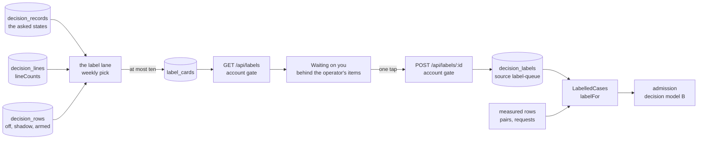
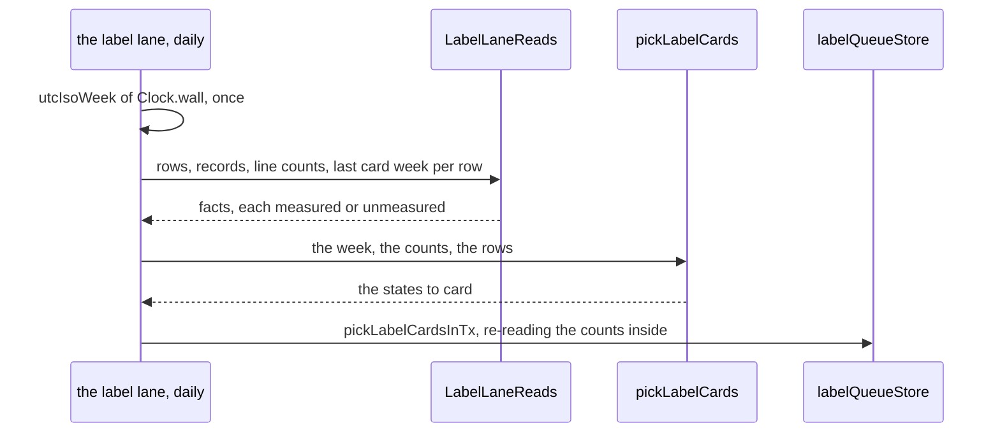
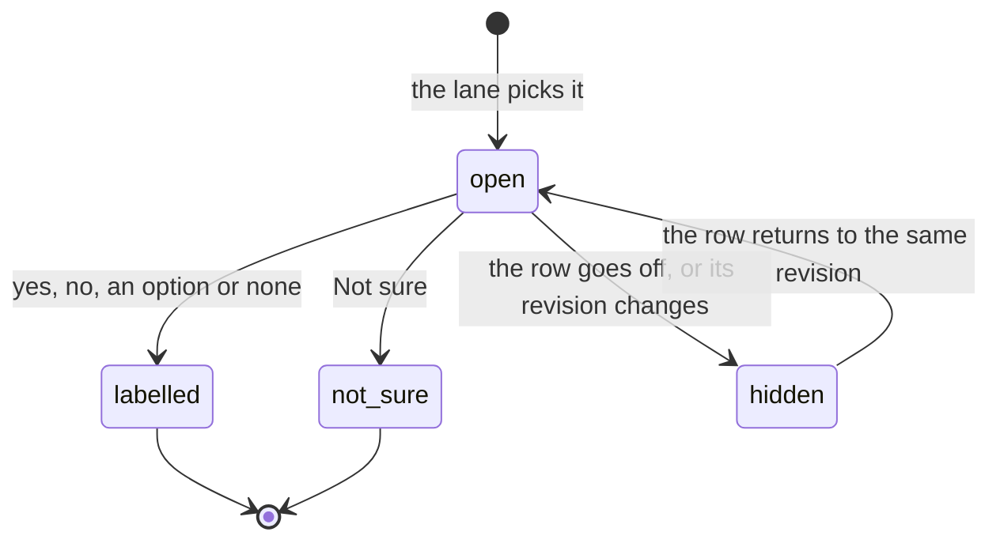
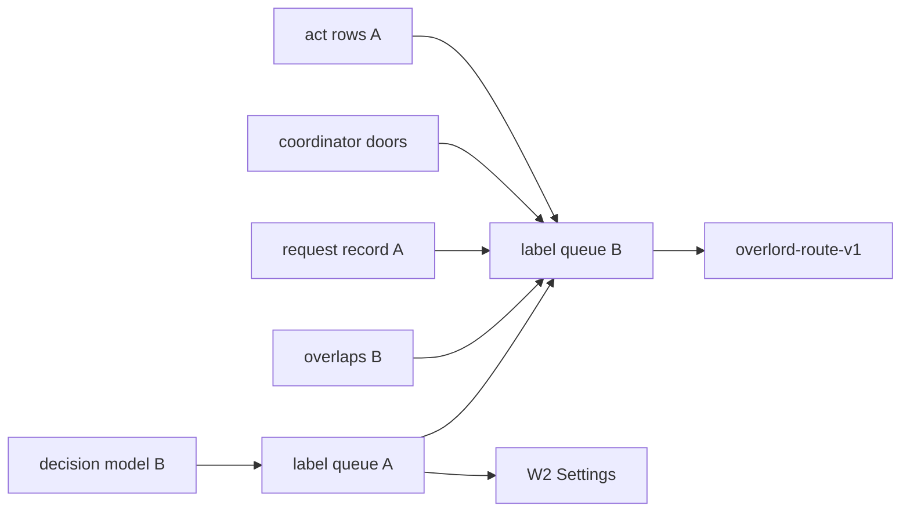

# Overlord W2: the label queue, its weekly pick and the operator's label cards Implementation Plan

> **For agentic workers:** REQUIRED SUB-SKILL: Use superpowers:subagent-driven-development (recommended) or
> superpowers:executing-plans to implement this plan task by task. Steps use checkbox (`- [ ]`) syntax for tracking.

## In short

- **What this is.** The plan for the W2 piece "Label queue" (the W2 index, Table W2, lane J). A decision-model row is
  armed only once its line is admitted, and a line is admitted only on labelled answers. This piece gathers the
  labels: one-tap cards the operator answers, and the labels measured rows already hold. It fills the decision model's
  `LabelledCases` port, which admission reads.
- **A weekly pick, at most ten cards (question 16).** One lane picks the week's cards: a row due by the fourth-week rule
  first, then a gate row before an advice row, then the row nearest its line. A week never picks more than ten, and no
  more than ten stand open at once.
- **The cards sit behind the operator's own items.** In W2 the daily view is Waiting on you (the decision queue is W3's),
  so the cards are a section after the operator's items there. They are the operator's own cards, never rows of the
  Overlord's inbox, and nothing is pushed.
- **Labels come from an event under the sign-in cookie, or from a measured row.** The card door goes through the account
  gate and refuses `auth-off` (index F14). The measured sources (`operator-answer`, `overturn`, `routed-to`, `outcome`)
  are read from their own rows, never copied, and an `outcome` label outranks and retires an answer or overturn label on
  the same state.
- **Admission stays the decision model's.** Fixed-sequence, strictest first, stopping at the first failure (ruling F10).
  This piece hands it labelled cases and reads its counts to say how near a row is to its next line.
- **Two pull requests.** A (six tasks) needs only decision model B: the store, the lane, the port, the doors and the
  cards. B (two tasks) needs overlaps B, the request record, act rows A and the coordinator doors: the measured sources.
- **What changes at merge.** Nothing a session sees. No row is asked until the operator switches it to shadow, so no
  card exists until then; every W2 row whose labels a card gathers is asked only through doors that `overlord-route-v1`
  opens.
- **No question needs the operator.** Fourteen open questions (§2), each with a recommendation for the coordinator.

## 1. Goal, scope and the rulings this plan builds on

This section says what the piece builds, why, and which rulings it builds on.

**Goal:** each decision-model row gathers the labels its line needs, from the operator in a few taps a week and from
what the fleet already measures, so that a row can leave shadow on evidence.

**Why:** §3.7 H6: "A line is admitted by a bound … Until then the row stays in shadow." "Labels come only from the
operator or from measured rows. A label comes from an event under the sign-in cookie, or from a measured row:
`operator-answer`, `overturn`, `routed-to`, `label-queue` or `outcome`. A label never comes from a model." "The label
queue. Up to ten one-tap cards a week across all rows, with the model's answer hidden, behind the operator's own items.
They are the operator's own one-tap cards, never rows of the Overlord's inbox. The server shares the ten: a gate row
before an advice row, then the row nearest its line, and each row with a case waiting gets a card at least every fourth
week. It ships in W2, with the first rows, so they gather labels from the start." §4.1 Table 4.1a: "Daily … The label
cards sit behind it, ten a week at most."

**Architecture.** Two contexts, as Table 11.1d and the index place them: the label lane and the labels are C5
Coordination; the cards, their doors and the console's section are C6 Attention & Notification.

| Ring | File | What it holds | PR |
|---|---|---|---|
| L0 | `shared/labelQueue.ts` (new) | `LABEL_CARDS_PER_WEEK` (10), `LABEL_ROW_MAX_GAP_WEEKS` (4), the card answers, the card and answer wire shapes | A |
| K, L1 | `server/src/time/rules.ts` | `utcIsoWeek`, moved from `server/src/continuity/quiz.ts#quizWeek` | A |
| L1 | `server/src/coord/labelQueue.ts` (new, C5) | `labelsNeeded`, `pickLabelCards`, `labelFor`, `cardRowsOf` | A |
| L1 | `server/src/coord/labelCards.ts` (new, C6) | `cardAnswerVerdict`, `cardView` | A |
| L1 | `server/src/coord/decisionLines.ts` (decision model B's) | `lineCounts`, extracted from `admitLine` in a move commit | A |
| L2 | `server/src/coord/labelQueuePorts.ts` (new, C5) | `MeasuredLabels`, `LabelLaneReads`, declared by this consumer | A |
| L3 | `server/src/coord/labelQueueStore.ts` (new, C5) | `label_cards` and `decision_labels`: their writers and readers, and the `LabelledCases` adapter | A |
| L4 | `server/src/coord/labelQueueLane.ts` (new, C5) | The weekly lane's pass | A |
| L4 | `server/src/coord/labelCardRoutes.ts` (new, C6) | `GET /api/labels` and `POST /api/labels/:id`, through the account gate | A |
| L1, L4 | `pwa/src/labels/` (new, C6) | `labelWords.ts`, `LabelCards.tsx`, `labels.css` | A |
| L3 | `server/src/coord/labelSources.ts` (new, C5) | The `MeasuredLabels` adapters: `operator-answer` from `programme_pairs`, `routed-to` from requests | B |

*Table 1. Where the code goes.*


*Figure 1. The loop. The lane picks states the model was asked, the operator labels them under the sign-in cookie, and
`LabelledCases` hands the labels, with the measured ones, to admission. The model's answer is never shown on a card.*

**Tech Stack:** TypeScript (ESM), `node:sqlite`, Fastify, React, vitest. No new dependency.

**Spec:** `docs/superpowers/specs/2026-11-09-overlord-design.md`:

- §3.7 H6: "A line is admitted by a bound", "The line's key" ("A change of host or model id keeps the row's labels …
  A change of the row's revision or request shape drops them"), "Labels come only from the operator or from measured
  rows", "The label queue", "Never asked twice", "Checked before arming"; Table 3.7b (each row's label source).
- §3.8: "Checked on the way out" (the hosted screen).
- §4.1 H36, Table 4.1a (the daily cadence and the label cards); §6.8 ("Labelling cards are not the Overlord's").
- §11.1: Table 11.1a ("Decision-model records, the label queue": C5, L3), Table 11.1c ("The anchor-set lane, the label
  queue": daily, weekly), Table 11.1d (the label cards, C6); §11.2 (the account gate).

**The index:** `docs/superpowers/plans/2026-11-16-overlord-w2.md`, row "Label queue", lane J, one pull request, five
tasks, needing decision model B. This plan has two pull requests and eight tasks (What the index should change).

**The rulings this plan builds on.** The coordinator accepted every recommendation of the W2 index's questions 2 to 23,
and questions 24 to 28 are settled. This plan builds on:

- **Q16, `label-queue-picks-weekly-shows-daily`:** a weekly lane picks at most ten cards; a gate row before an advice
  row, then the row nearest its line, with each row that has a waiting case getting a card at least every fourth week;
  the cards show on the daily view behind the operator's own items until answered; they are never rows of the
  Overlord's inbox.
- **Q10:** a private-state row is never asked of a hosted adapter, so it has no record there, and no card.
- **Q19:** act ceilings are proposed by each plan. This piece adds no act kind (LQ14).
- **Q29:** a row is `off`, `shadow` or `armed`; an `off` row is never asked.
- **Index F14 (review 2253):** the label door calls the account gate and refuses `auth-off`, because a label must come
  from an event under the sign-in cookie.
- **Decision model plan, rulings F10 and F11 (review 2262):** admission is fixed-sequence (strictest first, stop at the
  first failure), and arming needs a full canary. Its question 8: this piece implements `LabelledCases`. Its question
  9: the hosted screen runs on every hosted call, rebuilt labelled cases included.
- **The overlaps plan:** the `goals.conflict` row's `operator-answer` label is the operator's ruling, read from
  `programme_pairs` through the choice table's `conflict` column ("The label queue piece reads it").

## 2. Open questions

Each question carries a recommendation, which this plan builds unless the coordinator rules otherwise. None needs the
operator.

- **LQ1. A daily lane with a weekly budget** (slug `label-lane-daily-keyed-weekly`). Table 11.1c calls the lane weekly.
  The one weekly lane on `main`, the replay quiz, runs daily and keys "once a week" on the UTC ISO week
  (`server/src/continuity/quiz.ts#quizWeek`, `server/src/laneSchedule.ts#QUIZ_LANE_PERIOD_MS`). **Recommendation:** the
  same. The lane runs daily (`LABEL_LANE_PERIOD_MS`, derived from `QUIZ_LANE_PERIOD_MS`, `startsDue` so a restart never
  skips a week) and picks within the week's budget. A case that appears mid-week can still be carded that week, and a
  week never picks more than ten. `quizWeek` moves to the clock kernel as `utcIsoWeek` in a move commit, so two lanes
  read one week, never two copies.
- **LQ2. At most ten picked a week, and at most ten open** (slug `label-cards-top-up-to-ten`). "Up to ten one-tap cards a
  week" and "until answered" together would let unanswered cards pile up ten a week. **Recommendation:** each pass picks
  `min(10 − picked this week, 10 − open)`. An operator who answers none sees the same ten until they do, never forty.
- **LQ3. Which rows get cards** (slug `cards-only-for-label-queue-rows`). Table 3.7b gives each row its label sources,
  and a card writes the `label-queue` source. **Recommendation:** a row gets cards only when its `labelSources` names
  `label-queue`, its labels cannot all come from outcomes, and it is not `off`. In W2 that is `scope.widens`,
  `relay.method`, `readback.omits` and `readback.adds`. `programme.pick` and `programme.any` gather `routed-to`, and
  `goals.conflict` gathers `operator-answer`: measured, never carded. A test derives the card rows from
  `DECISION_QUESTIONS`, so a W3 row joins by its own columns.
- **LQ4. The order, and how the ten are shared** (Q16; slug `label-cards-shared-by-order`). **Recommendation:**
  `pickLabelCards` orders the card rows by four keys: due first (a row with a waiting case and no card picked in the
  last `LABEL_ROW_MAX_GAP_WEEKS` weeks); then a gate row before an advice row; then `labelsNeeded`, fewest first; then
  the row id. It gives each due row one card first, then fills what is left in that order, taking from each row at most
  as many cases as its `labelsNeeded` before it moves on. So a gate that needs 59 clean labels can take a whole week,
  and an advice row still gets its card by its fourth week. With W2's four card rows the fourth-week promise always
  fits in ten; when more than ten rows are due, the order decides, and the read says which rows waited.
- **LQ5. "Nearest its line" is how many clean labels the next candidate needs** (slug `nearest-is-labels-needed`).
  Admission is fixed-sequence, so the next candidate is the first one that has not passed: the strictest when no line
  is admitted, else the one after the admitted line. **Recommendation:** `labelsNeeded(row, cases)` is the least `k`
  with `upperBound95(errors, n + k)` at or under the row's `target`, where `n` and `errors` are the next candidate's
  counts by decision model B's per-kind rule. Those counts come from one function, `lineCounts`, which this piece
  extracts from `admitLine` in a move commit, so the rule is written once. A row with no next candidate ranks last.
  `k` is searched up to `LABELS_NEEDED_CAP` (1,000); a row that needs more ranks just before those with none.
- **LQ6. Which case is carded** (slug `which-case-is-carded`). A label counts toward `n` only on a case the model marked
  at the candidate (question 17's table). **Recommendation:** a waiting case is a state (row, revision, state hash) with
  a record, no label from any source and never a card. Within a row, a case the newest record marks at the next
  candidate comes first, then the newest. A state is carded at most once (`UNIQUE` on the card), and a case whose state
  no longer resolves through `DecisionStateReads` is skipped, never carded.
- **LQ7. Labels are keyed by state** (slug `labels-keyed-by-state`). H6: "A change of host or model id keeps the row's
  labels … A change of the row's revision or request shape drops them." **Recommendation:** `decision_labels` is keyed
  by row, revision and state hash, never by host or model. `casesFor(row, revision)` answers only that revision's
  labels, so a revision change drops them by the key alone. The request shape is part of the revision (decision model
  Task 6).
- **LQ8. Measured labels are read, never copied** (slug `measured-labels-derived-on-read`). **Recommendation:** only the
  card's label is stored. `operator-answer`, `overturn`, `routed-to` and `outcome` are read from the rows that hold
  them, through the `MeasuredLabels` port, at each `casesFor` call: the overlaps ruling from `programme_pairs`, the
  owner that accepted a request from the request record. `labelFor` (L1) then applies H6's rule on one state:
  - an `outcome` label outranks an `operator-answer` or `overturn` label, which is retired (ignored, never deleted);
  - otherwise the newest label stands.

  So there is one writer per fact: the ruling door writes the ruling, the request doors write the moves, and this piece
  writes only what the operator tapped. In W2 no row has an `outcome` or `overturn` source, and `labelFor` is built
  whole for W3's rows.
- **LQ9. Both doors go through the account gate** (slug `label-doors-through-the-account-gate`; index F14).
  **Recommendation:** `GET /api/labels` and `POST /api/labels/:id` each call the account gate
  (`server/src/accounts/gate.ts#createAccountGate`) with `{ cap: null }` and no step-up, so both refuse `auth-off`,
  `insecure-origin` and `unauthenticated` in that order. The read refuses too, so a dark console says "Sign-in is off:
  label cards need it" and never shows a card it cannot answer. No step-up: a label narrows nothing and arms nothing,
  and arming keeps its own step-up. The label records the gate's `actor`.
- **LQ10. A card's text is rebuilt from the record, and the model's answer is hidden** (slug `card-text-from-the-record`).
  Records hold refs, never the operator's words (decision model question 7). **Recommendation:** `GET /api/labels`
  rebuilds each card's fields through decision model B's `DecisionStateReads`, and `cardView` (L1) answers the row's
  fixed question, the fields with each `quoted` field marked as quoted, and the answers the row allows. It never answers
  the verdict, `p`, the band or the line. A private-state row's card may show the operator's own cited words, to the
  operator alone, so the route is masked (`MASKED_GET_ROUTES`) and is listed in the inbox piece's
  `operator-message-readers.test.ts` operator list.
- **LQ11. Labels and the private-name screen** (slug `labels-pass-the-hosted-screen`). **Recommendation:** this piece
  sends nothing out. Its cases reach a model only when decision model B's lane re-asks them for admission and the
  canary, through `gatherDecisions`, whose hosted screen runs on every rebuilt case (decision model question 9). A case
  the screen stops is `not-asked` and does not count; a private-state row is never asked of a hosted host, so it has no
  record and no card. A test pins that the label store holds no text: labels are words of a closed set.
- **LQ12. "Not sure" is no label** (slug `not-sure-is-no-label`). The operator may not know. **Recommendation:** each card
  offers its row's answers and "Not sure". "Not sure" closes the card with no label, and the state is never carded
  again. An answer the operator is unsure of is no yardstick, as the answer marks rule (R21).
- **LQ13. A stale card refuses `row-changed`** (slug `stale-card-is-row-changed`). A row can go `off`, or its revision
  change, while a card waits. **Recommendation:** the read leaves out every card whose row is `off` or whose revision is
  not the row's current one, and the open count does not include them. Answering one refuses `row-changed` (409, from
  decision model B's group). A card already closed answers 200 `changed: false`. No new refusal word.
- **LQ14. Act ceilings (index question 19)** (slug `label-queue-adds-no-act-kind`). **Recommendation:** none. A label is
  the operator's act, not the Overlord's, and the lane's own bound is the ten a week. The label doors read nothing from
  the Overlord's read ledger.

## 3. What exists today

Measured on `main` at `dfb86c7d8` (2026-11-16). Decision model B is a plan on `main`, not built; each of its symbols is
cited by that plan's contract.

| What | Where | What this piece does with it |
|---|---|---|
| The account gate | `server/src/accounts/gate.ts#createAccountGate`: refuses `auth-off`, `insecure-origin`, `unauthenticated`, `unsupported` (skipped when `cap` is `null`) and `step-up-required`, in that order; `AccountGateAsk` `{ cap, stepUp? }` | Both doors call it with `{ cap: null }` |
| Its words in the console | `shared/api.ts#ACCOUNT_GATE_REFUSALS`; `pwa/src/lib/refusalWords.ts` holds per-door texts for `auth-off` | `labelWords.ts` adds the card door's text |
| The weekly key | `server/src/continuity/quiz.ts#quizWeek` (UTC ISO week, `YYYY-Www`, and its Monday) | Moved to `server/src/time/rules.ts` |
| The lane table | `server/src/laneSchedule.ts#LANE_SCHEDULE`; `QUIZ_LANE_PERIOD_MS` is one day; `server/test/lane-schedule.test.ts` counts 46 `mono` rows | One row, `labelQueue` |
| The daily view | `pwa/src/ledgers/WaitingScreen.tsx` (Waiting on you), the operator's own items; the decision queue is W3's (§4 Table 4a) | The cards are a section after the items |
| The context map | The architecture spec's C6 row: `push*.ts`, `coord/pushOutbox*.ts`, `coord/question*.ts`, … | Two rows: `coord/labelCard*.ts` and `pwa/src/labels/**` |
| The session-gated census | `server/test/box-token-census.test.ts` keeps a session-only routes file's doors in a hand-kept list (`LEDGER_OPERATOR_DOORS`, `CONTINUITY_SESSION_DOORS`), checked against the file both ways | `LABEL_DOORS` |
| The masked reads | `server/src/server.ts#MASKED_GET_ROUTES` | Gains `/api/labels` |
| Decision model B | `w2-decision-model.md`: `decision_rows` (`decisionRowOf`), `decision_records`, `decision_lines`, `admitLine`, `LabelledCases`, `DecisionStateReads`, the empty labels source wired in `index.ts` | Reads them; replaces the empty source |
| The migrations | `server/src/coord/schema.ts#MIGRATIONS`: 82 on `main` | One migration in PR A |
| Growth | `schema.ts` 3,378 lines, `server.ts` 4,411, `watch.ts` 12,465, `pwa/src/lib/api.ts` 1,197 | Each within 40 net lines (§8) |

*Table 2. What exists today, and what this piece does with each.*

## 4. The weekly pick

This section gives `pickLabelCards`, the one decider of which states are carded.

| Step | What it does |
|---|---|
| 1 | The budget: `min(LABEL_CARDS_PER_WEEK − picked this week, LABEL_CARDS_PER_WEEK − open)`. Zero picks nothing |
| 2 | The card rows: `cardRowsOf(DECISION_QUESTIONS)`, less every row that is `off` (LQ3) |
| 3 | Each row's waiting cases (LQ6), its `labelsNeeded` (LQ5), and whether it is due (LQ4) |
| 4 | The order: due, then gate before advice, then `labelsNeeded`, then the row id |
| 5 | One card to each due row, in the order, while the budget lasts |
| 6 | The rest of the budget, in the order, at most `labelsNeeded` cases a row |

*Table 3. `pickLabelCards`, total and pure. Its input is the week, the counts and each row's facts; its output is the
states to card.*

**The properties:**

- **Never over budget.** The output is never longer than step 1's budget, for any input.
- **No starvation within ten rows.** For any sequence of weeks with at most ten card rows, a row with a waiting case
  every week is picked at least once in every `LABEL_ROW_MAX_GAP_WEEKS` weeks.
- **Never an off row,** and never a state already carded.


*Figure 2. One pass. The counts are read again inside the insert's transaction, so two passes can never pick more than
the budget. An unmeasured row is left out of the pass and logged once.*

## 5. The doors and the card

This section gives the two doors and what a card shows.

| Door | Gate | Answers |
|---|---|---|
| `GET /api/labels` | the session gate, then the account gate `{ cap: null }` | `{ ok, cards: CardView[], open, pickedThisWeek, week }`; each card its id, row, the row's fixed question, the fields (quoted marked), the allowed answers, `pickedAt` |
| `POST /api/labels/:id` | the same | Body `{ answer }`. 200 `{ ok, changed }`; 404 `not-found`; 400 `bad-request` for an answer the row does not allow; 409 `row-changed` (LQ13); 503 `write-failed` |

*Table 4. The two doors. Both are session-gated and carry no box token.*

**The answer's transaction.** `closeLabelCardInTx` re-reads the card and its row's state, asks `cardAnswerVerdict`, and
in one transaction closes the card (`closedAt`, `closedBy`, `outcome`) and, for an answer that is a label, writes one
`decision_labels` row with source `label-queue` and the gate's actor. "Not sure" closes the card and writes no label.


*Figure 3. A card's life. A hidden card is not closed: it is left out of the read and the open count while its row is
off or changed, and a revision change leaves it hidden for good.*

## 6. Global constraints and review focus

This section lists the rules every task keeps, and what the reviewer reads first.

- **Architecture (`CLAUDE.md`).** `labelsNeeded`, `pickLabelCards`, `labelFor`, `cardRowsOf`, `cardAnswerVerdict`,
  `cardView` and `utcIsoWeek` are pure. The lane and the doors read facts through ports their own files declare, ask a
  decider and act. The C6 doors reach the C5 store through a port.
- **One writer per fact.** A card's pick: `pickLabelCardsInTx`. A card's close and its label: `closeLabelCardInTx`. A
  measured label: its own owner, never this piece (LQ8).
- **No text in the label store.** A label is a word of a closed set; a card holds ids and a state hash. The card's
  fields are rebuilt at each read and never stored.
- **The model's answer never reaches the console** on a card (LQ10).
- **Time through ports.** The lane and the doors read time from their injected clock; `labelQueue*.ts` and
  `labelCard*.ts` join `server/test/single-definition/time-ports.test.ts#TIME_PORT_FILES` by name.
- **Mutation floors.** Each L1 decider joins a new `server/test/sim/labelQueueSets.ts`, registered in
  `server/test/sim/mutation-floors.test.ts#MUTANT_SETS`, with floors in `server/test/sim/mutation-floors.json`.
- **Tests.** From `server/`: `ccrc test -- ./node_modules/.bin/vitest run test/<file>.test.ts`, one file at a time, in
  the foreground; pwa's from `pwa/` the same way. Each task's last run adds both server `tsc` runs,
  `test/typecheck-tests.test.ts`, `test/rings/*.test.ts` and `test/mail-routes.test.ts` (the new kebab words, through
  one recognizer, `isLabelQueueKebab`), and pwa's `tsc` when `shared/` or `pwa/` changed. Neutral names only.
- **Public repository.** No private names. Cite by symbol, and an unbuilt symbol by its plan's contract. No D-number:
  the builder's departures go in `docs/superpowers/plans/2026-11-16-overlord-w2/w2-label-queue/departures.md`.

**Review focus:**

1. **Under the cookie.** Neither door answers while sign-in is dark, and a label records the gate's actor.
2. **Ten, and fair.** No week picks more than ten, no more than ten stand open, and a due row is picked first.
3. **Hidden answer.** No card carries the verdict, `p`, the band or the line.
4. **One writer per fact.** Measured labels are read, never stored; an outcome retires an answer or overturn label.
5. **Admission is not touched.** `lineCounts` is a move; `admitLine`'s answers are unchanged.

## 7. The PR split

This section gives the two pull requests and their growth.

| PR | Tasks | What it ships | Needs first | Growth-checked files, estimate |
|---|---|---|---|---|
| A | 1 to 6 | `utcIsoWeek` and `lineCounts` moved; the vocabulary and the deciders; one migration with its store and the `LabelledCases` adapter; the lane; the two doors with every census; the cards on Waiting on you | Decision model B | `schema.ts` +26 (one migration: two tables); `server.ts` +5 (one import, one registration, one masked route); `watch.ts` +6 (`sweepLabelQueue` and its line); `pwa/src/lib/api.ts` +14 (two calls); `shared/api.ts` 0 |
| B | 7 to 8 | The `operator-answer` and `routed-to` adapters of `MeasuredLabels`, wired in `index.ts` | PR A; overlaps B (`programme_pairs` and its ruling); request record A and the coordinator doors (the owner that accepted); act rows A (the open act's checks) | none |

*Table 5. The pull requests.*

**Not growth-checked:** `shared/labelQueue.ts` about +60; `labelQueue.ts` about +140; `labelCards.ts` about +60;
`labelQueuePorts.ts` about +40; `labelQueueStore.ts` about +150; `labelQueueLane.ts` about +70; `labelCardRoutes.ts`
about +90; `pwa/src/labels/` about +220; `labelSources.ts` about +110.


*Figure 4. The order. PR A needs only decision model B, so it can be built before W1 closes. PR B waits for the rows
its two sources read.*

## 8. Tasks

This section gives the eight tasks.

### Task 1: The week, the counts, and the vocabulary (K, L0, L1)

**Files:**
- Modify: `server/src/time/rules.ts` (`utcIsoWeek`), `server/src/continuity/quiz.ts` (`quizWeek` reads it),
  `server/test/continuity-quiz-lane.test.ts` (imports only)
- Modify: `server/src/coord/decisionLines.ts` (`lineCounts`, exported; `admitLine` calls it),
  `server/test/decision-model-lines.test.ts` (imports only)
- Create: `shared/labelQueue.ts`, `server/test/label-queue-vocab.test.ts`
- Modify: `server/test/single-definition/core-vocab.test.ts` (the vocabulary is defined once)

**Step 0, two moves** (`CLAUDE.md`: characterization first). Each is its own commit, green on `main`'s tests with only
their imports changed: `refactor(time): the UTC ISO week moves to the clock kernel` and
`refactor(overlord): admitLine's per-candidate counts are one function`.

**Interfaces:**

```ts
// server/src/time/rules.ts (K, L1). The ISO week a wall time falls in, in UTC: `YYYY-Www` and its Monday 00:00 UTC.
export function utcIsoWeek(now: number): { readonly key: string; readonly start: number };

// server/src/coord/decisionLines.ts (L1, decision model B's): the counts admitLine reads at one candidate.
export function lineCounts(row: DecisionQuestionRow, cases: readonly LabelledAnswer[], t: number):
  { n: number; errors: number };

// shared/labelQueue.ts (L0, imports types only)
export const LABEL_CARDS_PER_WEEK = 10;
export const LABEL_ROW_MAX_GAP_WEEKS = 4;
export const LABELS_NEEDED_CAP = 1000;
export const LABEL_ANSWER_WORDS = ['yes', 'no', 'none', 'not-sure'] as const;   // an option rides as { option }
export type LabelAnswer = 'yes' | 'no' | 'none' | 'not-sure' | { readonly option: string };
export const LABEL_CARD_OUTCOMES = ['labelled', 'not-sure'] as const;
export interface CardView { readonly id: number; readonly row: DecisionRowId; readonly question: string;
  readonly fields: readonly { name: string; quoted: boolean; text: string | readonly string[] }[];
  readonly answers: readonly LabelAnswer[]; readonly pickedAt: number; readonly week: string }
export interface LabelCardsAnswer { readonly ok: true; readonly cards: readonly CardView[]; readonly open: number;
  readonly pickedThisWeek: number; readonly week: string }
```

- [ ] **Step 1: Failing tests** (`label-queue-vocab.test.ts`): the constants; `LABEL_ANSWER_WORDS` written out; no field
  of `CardView` is named `verdict`, `p`, `band`, `line` or `probability` (a key list the compiler makes exhaustive).
- [ ] **Step 2: Run red**, then implement, then run green: the new suite, `continuity-quiz-lane`,
  `decision-model-lines`, `single-definition/core-vocab`, `rings/shared-imports`, both `tsc` runs and pwa's `tsc`.
- [ ] **Step 3: Commit.** `feat(overlord): the label queue's vocabulary`

### Task 2: The deciders (L1)

**Files:**
- Create: `server/src/coord/labelQueue.ts` (C5), `server/src/coord/labelCards.ts` (C6)
- Create: `server/test/label-queue-deciders.test.ts`, `server/test/sim/labelQueueSets.ts`
- Modify: `server/test/sim/mutation-floors.test.ts`, `server/test/sim/mutation-floors.json`

**Interfaces:**

```ts
// server/src/coord/labelQueue.ts (C5, L1)
/** LQ3: the rows a card may serve, from the catalogue's own columns. */
export function cardRowsOf(q: typeof DECISION_QUESTIONS): readonly DecisionRowId[];
/** LQ5: the least k clean marked labels that bring the next candidate's bound to the target; 'none' past the last
 *  candidate; 'far' past LABELS_NEEDED_CAP. */
export function labelsNeeded(row: DecisionQuestionRow, cases: readonly LabelledAnswer[]): number | 'none' | 'far';
export interface PickRowFacts { readonly row: DecisionQuestionRow; readonly mode: 'off' | 'shadow' | 'armed';
  readonly needed: number | 'none' | 'far'; readonly lastCardWeekStart: number | 'never';
  readonly waiting: readonly { stateHash: string; recordId: number; at: number; markedAtNext: boolean }[] }
/** Table 3. */
export function pickLabelCards(f: { week: { key: string; start: number }; pickedThisWeek: number; open: number;
  rows: readonly PickRowFacts[] }): readonly { row: DecisionRowId; stateHash: string; recordId: number }[];
export type LabelSource = (typeof DECISION_LABEL_SOURCES)[number];
/** LQ8: one state's label from all its sources: an outcome outranks and retires operator-answer and overturn;
 *  otherwise the newest stands. */
export function labelFor(labels: readonly { source: LabelSource; label: LabelledAnswer['label']; at: number }[]):
  { label: LabelledAnswer['label']; source: LabelSource; retired: readonly LabelSource[] } | 'none';

// server/src/coord/labelCards.ts (C6, L1)
export function cardAnswerVerdict(card: { closedAt: number | null; row: DecisionRowId; revision: string },
  now: { mode: 'off' | 'shadow' | 'armed'; revision: string; row: DecisionQuestionRow }, answer: unknown):
  { kind: 'label'; label: LabelledAnswer['label'] } | { kind: 'not-sure' } | { kind: 'already' }
  | { kind: 'refuse'; word: 'row-changed' | 'bad-request' };
export function cardView(card: LabelCardRow, row: DecisionQuestionRow,
  fields: Record<string, string | readonly string[]>): CardView;
```

- [ ] **Step 1: Failing tests** (`label-queue-deciders.test.ts`):
  - `cardRowsOf` on `DECISION_QUESTIONS` answers the four W2 rows of LQ3, and a fixture row whose sources are all
    `outcome` is left out.
  - `labelsNeeded`: no line and no labels at a 10% target needs 29, at 5% needs 59 (H6's own counts, through
    `upperBound95`); one error raises it; a row admitted at the loosest candidate answers `none`.
  - `pickLabelCards`, every step of Table 3: the budget with `pickedThisWeek` and `open` at each edge; an `off` row
    never picked; due rows first, one each; a gate before an advice row; fewer needed before more; marked cases before
    unmarked, then newest; at most `needed` from a row before the next.
  - The properties, as seeded sweeps: never over budget; never an off row or a carded state; a 52-week run with four
    rows always waiting gives each row a card in every window of `LABEL_ROW_MAX_GAP_WEEKS` weeks, and so does one with
    ten rows.
  - `labelFor`: an outcome with an operator answer retires the answer; an outcome with an overturn retires it; two
    label-queue labels, the newest stands; no labels answer `none`.
  - `cardAnswerVerdict`: a closed card is `already`; an off row and a changed revision are `row-changed`; `yes` on a
    choice row and an unknown option are `bad-request`; `not-sure` is `not-sure`.
  - `cardView`: no field carries the verdict, `p`, the band or the line; a `quoted` field is marked.
- [ ] **Step 2: Run red**, then implement, then run green. Register the six deciders in `labelQueueSets.ts` with floors.
- [ ] **Step 3: Mutation.** Read `>` for `>=` in the budget; drop the due step; order advice before gate; let `labelFor`
  keep the answer beside an outcome. Each reds a case. Run `sim/mutation-floors`.
- [ ] **Step 4: Commit.** `feat(overlord): the label queue's pick, its order and one state's label (H6, Q16)`

### Task 3: The tables, the store and `LabelledCases` (L2, L3)

**Files:**
- Modify: `server/src/coord/schema.ts` (one migration)
- Create: `server/src/coord/labelQueuePorts.ts` (L2: `MeasuredLabels`, `LabelLaneReads`, `LabelCardStore`)
- Create: `server/src/coord/labelQueueStore.ts` (L3)
- Modify: `server/test/single-definition/writers-map.test.ts` (`TABLES` gains both tables and their writers),
  `server/test/coord-db.test.ts` (the version pins), `server/test/run-close-switch.test.ts` (the undo step and count)
- Create: `server/test/label-queue-store.test.ts`

**The migration** (its slot taken when it lands):

```sql
CREATE TABLE label_cards (
  id        INTEGER PRIMARY KEY,
  week      TEXT NOT NULL,            -- the UTC ISO week it was picked in
  row       TEXT NOT NULL,
  revision  TEXT NOT NULL,
  stateHash TEXT NOT NULL,
  recordId  INTEGER NOT NULL,         -- decision_records.id; the card's fields are rebuilt from it
  pickedAt  INTEGER NOT NULL,
  closedAt  INTEGER,                  -- NULL while open
  closedBy  TEXT,                     -- the account gate's actor
  outcome   TEXT,                     -- 'labelled' | 'not-sure'; NULL while open
  UNIQUE (row, revision, stateHash)   -- a state is carded at most once (LQ6)
);
CREATE TABLE decision_labels (
  id        INTEGER PRIMARY KEY,
  row       TEXT NOT NULL,
  revision  TEXT NOT NULL,
  stateHash TEXT NOT NULL,
  label     TEXT NOT NULL,            -- 'yes' | 'no' | 'none' | 'option:<slug>'
  source    TEXT NOT NULL,            -- 'label-queue'; measured sources are read, never stored (LQ8)
  cardId    INTEGER,
  actor     TEXT NOT NULL,
  at        INTEGER NOT NULL,
  UNIQUE (row, revision, stateHash, source)
);
```

**Interfaces:**

```ts
// server/src/coord/labelQueuePorts.ts (C5, L2), declared by this consumer
export interface MeasuredLabels { labelsFor(row: DecisionRowId, revision: string): readonly { stateHash: string;
  source: Exclude<LabelSource, 'label-queue'>; label: LabelledAnswer['label']; at: number }[] }

// server/src/coord/labelQueueStore.ts (C5, L3)
export function pickLabelCardsInTx(db: DatabaseSync, week: string, picks: readonly { row: DecisionRowId;
  revision: string; stateHash: string; recordId: number }[], at: number, budget: () => number): { picked: number };
export function closeLabelCardInTx(db: DatabaseSync, id: number, close: { outcome: 'labelled' | 'not-sure';
  label: LabelledAnswer['label'] | null; actor: string; at: number }): 'closed' | 'already' | 'absent';
export function openLabelCards(db: DatabaseSync): readonly LabelCardRow[];
export function labelCardCounts(db: DatabaseSync, week: string): { open: number; pickedThisWeek: number;
  lastCardWeekStart: ReadonlyMap<DecisionRowId, number> };
/** The decision model's LabelledCases: stored labels and measured ones, through labelFor, each with its newest
 *  record's refs and inline. */
export function labelledCasesOf(db: DatabaseSync, measured: MeasuredLabels): LabelledCases;
```

`pickLabelCardsInTx` reads the budget again inside its transaction, and `INSERT OR IGNORE` keeps a state to one card.
`closeLabelCardInTx` writes the card's close and, for `labelled`, the label, in one transaction.

- [ ] **Step 1: Measure the slot**, then write the failing tests:
  `git fetch origin main && git show origin/main:server/src/coord/schema.ts | grep -c '^  // ── [0-9]*: user_version'`.
  - two picks of one state insert one card; a budget of 3 read inside the transaction inserts 3 of 5;
  - a close writes the card and the label together, a second close answers `already`, `not-sure` writes no label;
  - `labelledCasesOf`: a stored label and a measured one on two states both answer; an outcome on the same state
    retires a measured answer; a label of another revision is not answered; the case carries its newest record's refs
    and inline, never text from the card;
  - the store holds no text column but ids, words and hashes (a schema scan);
  - the censuses red until both tables and writers are listed.
- [ ] **Step 2: Run red**, one file at a time: `label-queue-store`, `coord-db`, `run-close-switch`,
  `single-definition/writers-map`.
- [ ] **Step 3: Implement.** **Step 4: Run green**, the same files, `growth-check` armed for `schema.ts`, and
  `typecheck-tests`.
- [ ] **Step 5: Mutation.** Drop the budget's re-read; write the label on `not-sure`; key the label by model id. Each
  reds a case. Restore each.
- [ ] **Step 6: Commit.** `feat(overlord): label cards and labels, keyed by state, and LabelledCases`

### Task 4: The lane, and the wiring

**Files:**
- Create: `server/src/coord/labelQueueLane.ts` (C5, L4)
- Modify: `server/src/laneSchedule.ts` (`labelQueue` in `LaneName`; its row: `LABEL_LANE_PERIOD_MS`, `derivedFrom`
  `QUIZ_LANE_PERIOD_MS` with the reason "the pick is keyed on the week, and a daily look keeps a restart from skipping
  one", clock `mono`, flight `skip`, `startsDue`, warnKey `ccrc-server: the label lane failed`)
- Modify: `server/src/watch.ts` (`sweepLabelQueue` and its `runLane` line), `server/src/deps.ts`,
  `server/src/index.ts` (the lane's port; `deps.decisions`' labels source becomes `labelledCasesOf(db, emptyMeasured)`
  until PR B)
- Modify: `server/test/lane-schedule.test.ts` (the row, and the `mono` count re-derived), `server/test/laneQuiet.ts` if
  its row list is hand-kept, `server/test/single-definition/time-ports.test.ts`
- Create: `server/test/label-queue-lane.test.ts`

**The pass:** read the week from `Clock.wall` once; read every card row's facts through `LabelLaneReads` (its mode
through `decisionRowOf`, its records of the current revision, its labelled cases, `lineCounts` at the next candidate,
its last card week), skipping and logging once a row whose read fails; ask `pickLabelCards`; call
`pickLabelCardsInTx` with the budget re-read inside. It sends no mail and pushes nothing.

- [ ] **Step 1: Failing tests** (`label-queue-lane.test.ts`, fake time, a fixture `coord.db` with decision model B's
  tables):
  - a week's first pass picks up to ten, and a second pass that day picks nothing new;
  - a case recorded mid-week is picked that week while the budget lasts, and never past ten;
  - an operator who answers nothing sees the same ten the next week, and no eleventh;
  - an `off` row gets no card; a row back in shadow resumes;
  - a row whose read throws is skipped and logged once, and the others are still picked;
  - a restart within the week picks nothing twice; across a week boundary it picks the new week's budget.
  - `lane-schedule`: the row and its derivation.
- [ ] **Step 2: Run red.** **Step 3: Implement.** **Step 4: Run green**, the suite, `lane-schedule`,
  `watcher-quiet-census`, `growth-check` armed for `watch.ts`, `rings/*` and both `tsc` runs.
- [ ] **Step 5: Commit.** `feat(overlord): the weekly label lane (Q16)`

### Task 5: The two doors, and every census (C6)

**Files:**
- Create: `server/src/coord/labelCardRoutes.ts` (C6, L4: `registerLabelCardRoutes(app, { gate, store, reads, now })`)
- Modify: `server/src/server.ts` (one import, one registration with `gate: accountGate`, and `/api/labels` in
  `MASKED_GET_ROUTES`)
- Modify (censuses): `server/test/box-token-census.test.ts` (`LABEL_SRC`, its lanes, the hand-kept `LABEL_DOORS`
  checked against the file both ways, and its term in `SESSION_ONLY_ALL`); `server/test/auth-gate.test.ts`
  (`scanRoutes('coord/labelCardRoutes.ts')`, the count and its sentence); `server/test/secret-mask.test.ts`;
  `server/test/rings/fastify-l4.data.ts`; the inbox piece's `operator-message-readers.test.ts` (`GET /api/labels` in its
  operator list, LQ10); the architecture spec's path table (`coord/labelCard*.ts` and `pwa/src/labels/**` in C6);
  README's auth paragraph; `CLAUDE.md`'s paragraph of session-gated coordination writes ("the label doors … `LABEL_DOORS`")
- Create: `server/test/label-card-routes.test.ts`

- [ ] **Step 1: Failing tests** (`buildServer` with `testDeps`, the account gate's real deps with fake sessions):
  - **The gate:** dark (`authEnabled` false), both doors answer 501 `auth-off` and read nothing; a plain-HTTP origin off
    loopback answers `insecure-origin`; no session answers 401 `unauthenticated`; the box token alone is refused.
  - **The read:** open cards in the order picked, each with its row's fixed question, its fields rebuilt, quoted fields
    marked, and the allowed answers; no verdict, `p`, band or line (a marker in the record's answer appears nowhere);
    a card whose row is off or changed is left out; a state that no longer resolves is left out.
  - **The answer:** `yes` writes one label with the gate's actor; a second answer is `changed: false`; `not-sure` writes
    none; an off row answers 409 `row-changed`; an unknown id 404; an answer the row does not allow 400.
  - **Censuses:** `box-token-census` (red until `LABEL_DOORS` and `CLAUDE.md` agree), `auth-gate`, `secret-mask`,
    `rings/fastify-l4`, `operator-message-readers`, `coord-pause-route`.
- [ ] **Step 2: Run red.** **Step 3: Implement.** **Step 4: Run green**, the suites above, `growth-check` armed for
  `server.ts`, `rings/*` and both `tsc` runs.
- [ ] **Step 5: Mutation.** Drop the account gate from the read; return the verdict in `cardView`; skip the revision
  check. Each reds a case. Restore each.
- [ ] **Step 6: Commit.** `feat(overlord): the label doors, under the sign-in cookie (index F14)`

### Task 6: The cards on Waiting on you (PWA, C6)

**Files:**
- Create: `pwa/src/labels/labelWords.ts` (L1: the section's title, each answer's word, "Not sure", the gate-dark and
  failure texts), `pwa/src/labels/LabelCards.tsx` (L4), `pwa/src/labels/labels.css` (design-system tokens only, 360 px
  first)
- Modify: `pwa/src/lib/api.ts` (`fetchLabelCards`, `answerLabelCard`), `pwa/src/ledgers/WaitingScreen.tsx` (one mount,
  after the operator's items)
- Create: `pwa/test/label-cards.test.tsx`, `pwa/test/label-words.test.ts`

**The section:** "Help the Overlord learn (n)", collapsed when the operator's own items are open, after them, never
above them. Each card shows the row's question, the fields (quoted text set apart as quoted) and one button per allowed
answer, plus "Not sure". One tap answers. A refusal keeps the card and says why; `auth-off` says sign-in is off and
label cards need it. No push, no badge, no count in the Fleet header.

- [ ] **Step 1: Failing tests:** the section renders after the items and never before them; a tap posts the answer and
  removes the card; `row-changed` removes the card with a line; `auth-off` shows the dark text and no buttons; nothing on
  the card names a probability, a band or the model's answer (a marker test); the words module answers every refusal
  word the door can send.
- [ ] **Step 2: Run red**, from `pwa/`: `ccrc test -- ./node_modules/.bin/vitest run test/label-cards.test.tsx`.
- [ ] **Step 3: Implement.** **Step 4: Run green**, the two suites, pwa's `tsc`, the theme and contrast gates, and
  server's `growth-check` armed for `pwa/src/lib/api.ts` and the single-definition scans a pwa change can red.
- [ ] **Step 5: Commit, then push once** (worker clause 20). Open PR A against `main`. Its body names LQ1 to LQ14, that
  no row is asked until the operator switches it to shadow, and that PR B follows.

**PR A ends here.**

### Task 7: `operator-answer` from the overlaps ruling (PR B)

**Files:**
- Create: `server/src/coord/labelSources.ts` (C5, L3: the `MeasuredLabels` adapter, composed of one reader per source)
- Create: `server/test/label-sources.test.ts`

The `goals.conflict` row's label is the operator's ruling on the pair's episode (the overlaps plan, Task 6): read from
`programme_pairs` through `GOAL_CONFLICT_CHOICES`' `conflict` column, `both-stand` labelling `no` and `a-first` and
`b-first` labelling `yes`, a choice whose column is null giving none. A record maps to its pair by its `programme` refs
and to the ruling of the episode it was asked under; the exact join is measured against overlaps B's columns at build.

- [ ] **Step 1: Failing tests:** a ruled episode labels the record asked under it; an unruled one gives none; a later
  episode's ruling never labels an earlier record; the reader writes nothing (a write spy).
- [ ] **Step 2: Run red**, **Step 3: Implement**, **Step 4: Run green** with `typecheck-tests`.
- [ ] **Step 5: Commit.** `feat(overlord): goals.conflict labels from the operator's ruling`

### Task 8: `routed-to` from the request record, and the wiring (PR B)

**Files:**
- Modify: `server/src/coord/labelSources.ts`, `server/src/index.ts` (`labelledCasesOf(db, measuredLabels)`)
- Modify: `server/test/label-sources.test.ts`

H6: "`routed-to` is the owner that accepted the read-back and did not decline, or the owner after the operator's own
re-route. It is never the Overlord's first choice alone." The request's `open` act row carries the `programme.pick` and
`programme.any` checks with their `recordId` (act rows A); the request's moves (request record A) say which owner
acknowledged and whether it later declined. `programme.pick` labels `{ option: <owner> }` when the owner was on the
shortlist, else `none`; `programme.any` labels `yes` when an owner accepted.

- [ ] **Step 1: Failing tests:** an owner that acknowledged and never declined labels both rows; one that declined
  gives none; a request still `routed` gives none; the Overlord's route alone gives none.
- [ ] **Step 2: Run red**, **Step 3: Implement**, **Step 4: Run green**, then `label-queue-store` (the composed adapter)
  and both `tsc` runs.
- [ ] **Step 5: Commit, then push once.** Open PR B. **PR B ends here.**

**Last, each pull request,** from `server/`, one file at a time: `deviation-refs` (after `git fetch origin main`),
`anchors`, `citations`, `dtbd`, `docs-grammar`, `topology-clean`, and the private-name scan over every changed file.

## Rollback and older builds

- **An older server** has neither table nor door: the console's `fetchLabelCards` reads a 404 as "this server has no
  label cards" and draws no section.
- **The tables** are ignored by an older build, which never names them.
- **A row's labels survive** a host or model change and are dropped by a revision change, by their key (LQ7).
- **A restore** of `coord.db` alone can lose labels taken since the snapshot. They are the operator's answers on
  states, so the states may be carded again; a lost label costs one tap, never a wrong line.

## Deviations found

Each entry is a departure from the spec's text, or from a sibling plan, by slug. The coordinator mints numbers
(cross-plan ruling X9).

- **`label-lane-daily-keyed-weekly`:** Table 11.1c calls the lane weekly. It runs daily and keys its budget on the
  UTC ISO week, as the replay quiz's lane does (LQ1).
- **`label-cards-top-up-to-ten`:** "up to ten a week" is also at most ten open (LQ2).
- **`cards-only-for-label-queue-rows`:** H6 shares the ten "across all rows". Only rows whose sources name
  `label-queue` get cards (LQ3).
- **`label-cards-shared-by-order`:** the spec gives the order, not the split. Due rows get one card each, then the
  order fills, a row at a time, up to its need (LQ4).
- **`nearest-is-labels-needed`:** "nearest its line" is the clean labels the next fixed-sequence candidate needs
  (LQ5).
- **`measured-labels-derived-on-read`:** measured labels are read from their rows, never copied (LQ8).
- **`label-doors-through-the-account-gate`:** the read is behind the account gate too (LQ9).
- **`cards-on-waiting-on-you`:** §4.1 puts the cards behind the decision queue, which is W3's. In W2 they sit behind the
  operator's items on Waiting on you.
- **`not-sure-is-no-label`:** a card may be answered "Not sure", which is no label (LQ12).

## What the index should change

- **The "Label queue" row:** two pull requests, eight tasks (A 6, B 2). A needs decision model B, unchanged. B needs PR
  A, overlaps B, request record A, the coordinator doors and act rows A. "What it ships" gains the move of `quizWeek`
  to `server/src/time/rules.ts`, the `lineCounts` extraction, `label_cards` and `decision_labels`, and the two doors'
  census list `LABEL_DOORS`. Figure W2 gains `OVB --> LQB`, `RQA --> LQB`, `CD --> LQB` and `ARA --> LQB`.
- **"Where lanes meet":**
  - The migrations: the label queue adds one (two tables).
  - `LANE_SCHEDULE`: the label lane's row is `labelQueue`, daily, `mono`, keyed on the week.
  - `server/src/coord/decisionLines.ts`: the label queue extracts `lineCounts`, a move.
  - `server/src/time/rules.ts`: `utcIsoWeek`, a move from the quiz.
  - The door censuses: `coord/labelCardRoutes.ts` is a session-only routes file with `LABEL_DOORS`; `GET /api/labels`
    joins the operator-message readers' operator list.
  - The architecture spec's path table: `coord/labelCard*.ts` and `pwa/src/labels/**` in C6.
  - `pwa/src/ledgers/WaitingScreen.tsx`: one mount, lane J.
- **The W2 Settings row:** it may show each row's labels gathered and needed, from `GET /api/decision-model`; the label
  queue adds no Settings door.
- **The spec-fixes list gains:** Table 11.1c's "weekly" as daily keyed on the week (LQ1); §3.7's split of the ten
  (LQ4) and "nearest its line" (LQ5); §4.1's place of the cards before W3's decision queue.

## States W3 may read

- **`decision_labels` and `labelFor`:** W3's rows with `overturn` and `outcome` sources add their readers to
  `MeasuredLabels`, and `labelFor` already ranks them.
- **`pickLabelCards` and the ten:** W3's rows join through `cardRowsOf` and share the ten.
- **The card's answers:** a W3 choice row (`precedent.same`, `answer.maps`) is carded with its options, which
  `cardView` already answers.

## Where things stand

**Agreed:**
- The index's rulings on this row: Q16 (the weekly pick, the order, the daily view, not the Overlord's inbox), Q10,
  Q19 and Q29, as built above.
- Index F14: the label door uses the account gate and refuses `auth-off`.
- Decision model rulings F10 (fixed-sequence admission) and its question 8 (this piece fills `LabelledCases`).

**Waiting on the coordinator:**
- LQ1 to LQ14, each with a recommendation. LQ4's split of the ten and LQ8's read-not-copied rule shape the most.
- The index changes above, the second pull request among them.

**Waiting on the operator:** nothing. Later, answering the cards is theirs, a few taps a week.

**Later:**
- PR B, once overlaps B, the request record, the coordinator doors and act rows A land.
- W3's rows join the queue and its ten.
