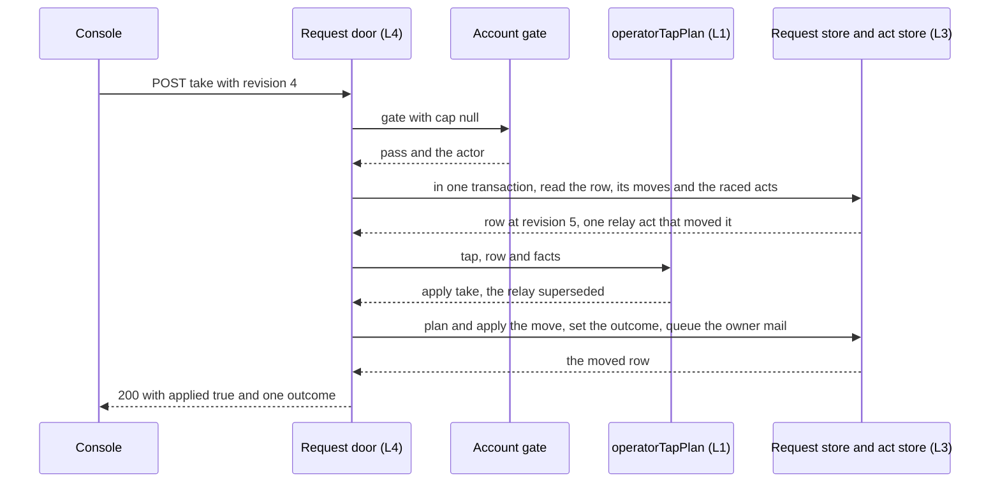
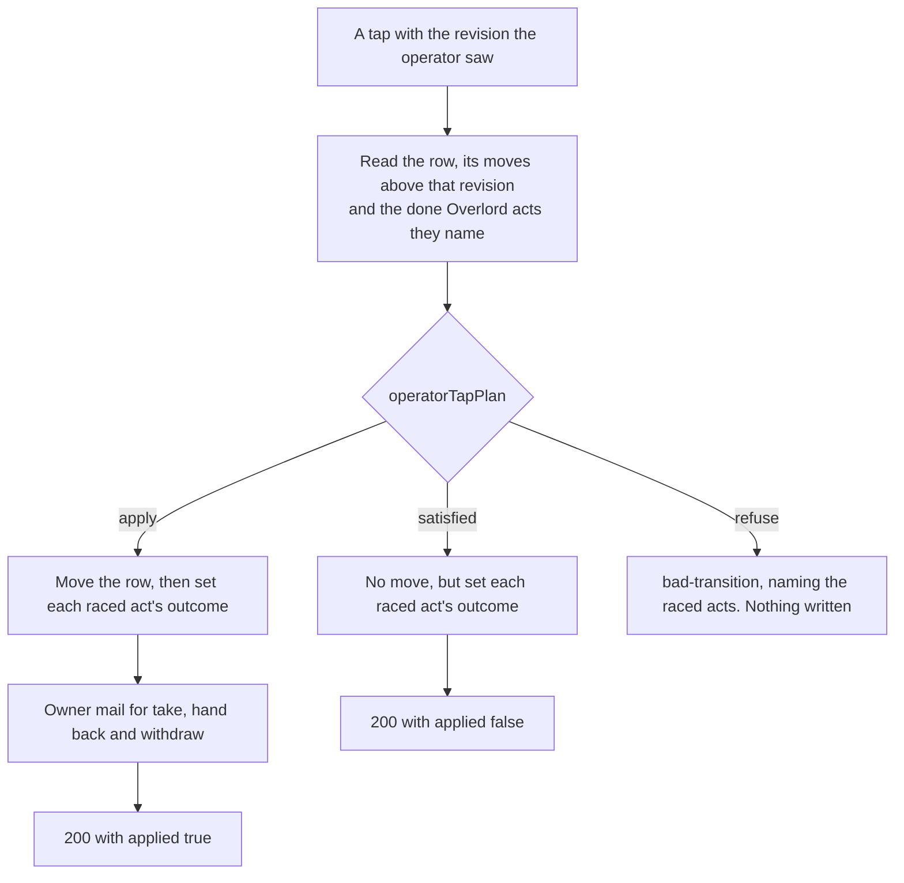

# Overlord W2: the operator's request doors Implementation Plan

> **For agentic workers:** REQUIRED SUB-SKILL: Use superpowers:subagent-driven-development (recommended) or
> superpowers:executing-plans to implement this plan task by task. Steps use checkbox (`- [ ]`) syntax for tracking.

**Goal:** the operator can act on a request from the console: answer it, confirm one the server could not verify,
withdraw it, take it over and hand it back. The operator can also read every request, grouped by what they must do
next. Each tap is one move of `REQUEST_TRANSITIONS`, written by the request record's one move writer, with the operator
as its actor.

**Why:** spec §5.1, "The operator can take a request over", Table 5.1b's operator row and Figure 3. Spec §4, Table 4b,
gives the Requests groups. Spec §10.3, "Three outcomes, kept apart" (H18), says an operator's tap is never refused for
a stale revision: it is applied, and an Overlord act it raced gets an outcome. Table 11.1e's row "The operator's
request doors" lists the five doors (W2, C5, L4).

**Architecture:** one pull request in lane R.

- Five session-gated write doors and one session-gated read, registered from `server/src/coord/requestRoutes.ts`. Every
  write door goes through the account gate, so it refuses `auth-off` while sign-in is dark. The actor is
  `CallerIdentity.operator(pass.actor)` at `operator` strength.
- One L1 decider, `operatorTapPlan`, turns a tap and the row into one move, a no-op, or a refusal. A second decider,
  `racedActOutcomes`, names the outcome of each Overlord act the tap raced. A third, `requestGroupOf`, is Table 4b.
- The doors decide nothing. Each reads the row, its moves and its acts in one transaction, asks the deciders, and then
  calls `planRequestMoveInTx`, `applyRequestMoveInTx` and the act reads piece's `setActOutcomeInTx`, all in that same
  transaction.
- A census list, `OVERLORD_REQUEST_DOORS`, sits beside W1's `OVERLORD_OPERATOR_DOORS` and is checked in both
  directions against the file's session-gated registrations.

**Tech Stack:** TypeScript (ESM), Fastify, `node:sqlite`, vitest. No new dependency, no migration and no ccd verb.

**Spec:** `docs/superpowers/specs/2026-11-09-overlord-design.md`:
- §4: Table 4a's row 6 and Table 4b.
- §5.1: Table 5.1a's `takenFrom`, Table 5.1b and Figure 3.
- §5.4: no nudge while the operator holds a request.
- §10.3: "Three outcomes, kept apart".
- Table 11.1e: the operator's request doors' row, and "The operator's doors" row of the authority table, the step-up rule.
- Table 11.1a's `overlord_requests` row.
- §11.4.

**The index:** `docs/superpowers/plans/2026-11-16-overlord-w2.md`, read from PR #2917's branch. This plan builds:
- its row "The operator's request doors" (lane R, 1 PR, 5 tasks);
- question 5 as amended in fix round 1;
- question 7's door table, the gate rule "every operator door goes through the account gate and refuses `auth-off` while
  sign-in is dark", and the `requestRoutes.ts` sentence;
- the "Where lanes meet" bullet on the door censuses.

**The plans this one reads:**
- The request record, `w2-requests.md` (PR #2928, in the merge queue). This plan uses its `REQUEST_TRANSITIONS` (its
  Table 4), the guards in its Table 5, the move writer of its Task A3, RQ1, RQ7, RQ8 and RQ14.
- Request ids, `w2-request-ids.md` (PR #2931): `runs.requestId` and the news stamp.
- The coordinator request doors, `w2-coordinator-doors.md` (PR #2931), which share `requestRoutes.ts`.
- Act rows, `w2-act-rows.md` (PR #2930): `overlord_acts`, `actById`, and `naturalRevision`.
- The act reads piece, `w2-act-reads.md` (this pull request): `ACT_OUTCOMES` and `setActOutcomeInTx`.
- The relay, `w2-relay.md` (PR #2933): RL5's `relay-held` and RL6's answer.
- W1's gates plan, `docs/superpowers/plans/2026-11-14-overlord-w1/w1-gates.md`: `CallerIdentity` and `OVERLORD_DOORS`.
- W1's designation plan: `OVERLORD_OPERATOR_DOORS`.

Written against `main` at `1834eb8cd` (2026-11-16). None of the W2 pieces above is on `main` yet, so every name this plan
takes from them is the name their plans give, and Task 1 re-measures each one before it builds.

## In short

- **One pull request, five tasks.** First the deciders, then the store reads and the owner's mail, then the five doors,
  then the requests read, then the client and the censuses.
- **Each door is one move:**
  - answer (`answer` or `answer-recorded`);
  - confirm (`confirm`);
  - withdraw (`withdraw`);
  - take (`take`, which sets `takenFrom` and carries the reason `operator-took-it`);
  - hand back (one of three `hand-back-*` moves, picked from `takenFrom`).
- **A stale tap is applied, never refused** (H18). Every write body carries the revision the operator saw. Any Overlord
  act that moved the row since then raced the tap.
  - Each raced act gets `concurred` if it reached the state the tap aims at, and `superseded` otherwise.
  - `overturned` is never written here: it is the correction door's word, in the act reads piece.
- **A tap the row already satisfies** answers 200 with `applied: false` and makes no move.
- **A tap the table can no longer allow** answers `bad-transition`, naming the acts that raced it.
- **Step-up:** only hand back asks for one, because it gives the request back to the Overlord and its owner. Answer,
  confirm, withdraw and take never ask, because they only narrow what anyone else may do.
- **The read, `GET /api/requests`,** groups every open request, and every request that ended in the last seven days,
  by Table 4b. It carries ids, states, the owner, the latest news, the age and the revision, and never the operator's
  words.
- **Nothing a running session sees changes at merge.** No request exists until the Overlord's open door ships, which
  refuses `capability-missing` until `overlord-route-v1`. Until then each door answers `not-found` and the read answers
  an empty list.

## 1. Open questions

The coordinator accepted the index's questions 2 to 23 as written. This plan builds on 5, 7 and 22, and the coordinator
settled 24 to 29. Every question below carries a recommendation, which this plan builds unless the coordinator rules
otherwise. None needs the operator: each is an implementation detail inside a direction the spec already fixes.

- **OD1. The answer carries no words** (slug `operator-request-answer-carries-no-words`). The spec has the operator
  "answer" a request but gives the answer no body. The operator's words never sit in `coord.db` (§5.1, H7, H31), and a
  request has no column for an answer's text.
  **Recommendation:** the answer door's body is `{ revision }`, and nothing else. The answer is a recorded move: the
  Overlord's guards read it (the request record's `answeredSinceNeedsYou`, its Table 5 row 2), and so does the relay's
  RL6.
  The operator says what they want in the chat, an ordinary operator message in the private store, which the Overlord
  reads through its `messages` read. The console's answer control sends that message first, then taps this door. It
  cites nothing, because W2 has no column for a citation made at an answer. W3's item answer carries an option, and that
  is where a chosen option first lives.
- **OD2. Which acts a tap raced, and the outcome each one gets** (slug `operator-tap-outcome-by-target-state`). Index
  question 5 says the raced act's outcome becomes `superseded`, `concurred` or `overturned`, and does not say which act
  raced or which word it gets.
  **Recommendation:**
  - **What raced the tap.** An act raced a tap when it is an Overlord act on this request, settled `done`, with no
    outcome yet, and its move raised the row's revision past the revision the tap carries. The doors read these from
    the request's move rows: a move with an `actId` whose revision is above the tap's (the request record's RQ1, whose
    move row records the revision after it). They are never read from the acts table's text.
  - **`concurred`:** the act's move reached the state the tap aims at. An Overlord `drop` racing an operator `withdraw`
    is the plain case: both end in `dropped`.
  - **`superseded`:** any other raced act. The operator's tap was made against a revision from before the act, and the
    operator's tap stands.
  - **`overturned`:** never written by these doors. Spec §10.3 defines it as "a tap made with the Overlord's answer in
    view". A request door tap has the act in view only when its revision is not below the act's, and then the act did
    not race it. A deliberate undo goes through the one correction door, `POST /api/digest/correct` with the kind
    `overlord-act` (the act reads piece, PR B).
  - Moves by the owner or the server raise the revision too. They are not acts, so they raced nothing, and the tap is
    simply applied, or refused by the table.
- **OD3. A satisfied tap and an impossible tap** (slug `satisfied-tap-answers-without-a-move`). A raced act can leave the
  row already where the tap aims, or somewhere the table no longer allows the tap from.
  **Recommendation:** the decider gives three plans.
  - **Satisfied.** The tap's move is not a self-loop, and the row is already in its target state. Examples: a withdraw
    on a row the Overlord dropped, a take on a row the server moved to `needs-you`, a confirm on a row the done-test lane
    closed. The door answers 200 with `applied: false` and the row. It writes no move, and it writes each raced act's
    outcome.
  - **Applied.** The move is allowed from the row's state. The door moves the row and writes the outcomes.
  - **Refused.** Anything else answers `bad-transition`, with the row, its last move and the raced act ids, and writes
    nothing. This is a refusal for the state, which the table forbids. It is not a refusal for the revision: the same
    tap on the same state with a current revision answers the same.
- **OD4. The step-up, door by door** (slug `hand-back-takes-the-step-up`). The spec's rule is that raising authority
  keeps the step-up and lowering never needs one (§7.5, Table 11.1e's authority row; I11).
  **Recommendation:** hand back is the one door that raises. It returns the request to the Overlord's relaying, the
  follow-up arm's nudges and the owner's moves, so it takes the step-up. The others only narrow what the Overlord or the
  owner may do, or record the operator's own ruling, so none asks:

  | Door | What it does to anyone else's authority | Step-up |
  |---|---|---|
  | Answer | None. It is the operator's ruling on one request, as a tick is on an item. The Overlord relays it under the request's existing authority (§5.1) | no |
  | Confirm | Ends the request (`done-unverified` to `done`) | no |
  | Withdraw | Ends the request (to `dropped`) | no |
  | Take | Takes the request from the Overlord and the follow-up arm | no |
  | Hand back | Gives it back to them | **yes** |

- **OD5. Which gate a door uses** (slug `request-reads-stay-on-the-auth-gate`). Index question 7, as ruled, says every
  operator door goes through the account gate and refuses `auth-off` while sign-in is dark. W1 has dark doors too: the
  rank, Pause and the answer marks.
  **Recommendation:**
  - **The five write doors** call `deps.gate(req, reply, { cap: null, stepUp })`, using
    `server/src/accounts/gate.ts#createAccountGate`. `cap` is `null` because no ccd verb runs. So each refuses `auth-off`
    while dark. Each records its actor through `deps.identity.operator(pass.actor)`, at `operator` strength, as the move
    row's actor id. None is a brake the operator needs while dark: Pause and the coordinator pause are those.
  - **The read** sits behind the auth gate only, like `GET /api/portfolio` and `GET /api/waiting`, so it is session-gated
    when sign-in is armed and open on a dark loopback box, as every console read is today.
- **OD6. Withdraw's note is a server line** (slug `withdraw-note-is-a-server-line`). Every move to a terminal state may
  set `closeNote`, and a drop requires one. The operator's words never sit in `coord.db`.
  **Recommendation:** withdraw writes the fixed line `Withdrawn by the operator.`, and confirm writes
  `Confirmed by the operator.`. Both lines are in an L0 map, `OPERATOR_REQUEST_NOTES`. Neither door takes a note in its
  body.
- **OD7. The owner hears about a take, a hand back and a withdraw** (slug `operator-moves-tell-the-owner`). The spec stops
  the follow-up arm and the Overlord's relays while a request is the operator's (§5.1), but does not say how the owning
  coordinator learns that it should stop or carry on.
  **Recommendation:**
  - A take, a hand back and a withdraw of a request that has an owner each queue one system mail to the owning
    coordinator. The mail goes through `insertSystemMailTx`, inside the move's own transaction, with `fromId: 'operator'`,
    kind `status` and the request's `requestId`.
  - Its subject and body are fixed server text from an L0 map, `OPERATOR_REQUEST_MAIL`, keyed by the door. Each names the
    request id and nothing the operator typed.
  - An answer and a confirm send none: the Overlord relays an answer, and a confirmed request is done.
  - A request with no owner (never routed) sends none.
  - The coordinator is resolved by `CoordStore#programmeCoordinator`, as the relay resolves it. An owner whose coordinator
    cannot be resolved still takes the move, and the answer says `mailed: false`.
- **OD8. An answer on a request the operator took is recorded** (slug `answer-on-a-taken-request-is-recorded`). Table
  5.1b says the answer moves a request to `in-progress` only when it "reached `needs-you` any other way than a take".
  **Recommendation:** on a row with `takenFrom` set, the answer door always makes `answer-recorded`. The request stays
  the operator's until they hand it back, which then restores `takenFrom`'s state.
  On a row without `takenFrom`, the door makes `answer` when the request record's guard 6 (`ownerAcknowledged`) holds,
  and `answer-recorded` otherwise. The decider picks the move from facts it is given. It never tries one move and falls
  back to another on a refusal.
- **OD9. The reason words this piece adds.** The request record leaves `operator-took-it` to "the operator's request
  doors". **Recommendation:** add `operator-took-it` to `REQUEST_MOVE_REASONS`, carried by `take`. The other four doors
  carry no reason, because only moves into `needs-you` require one (the request record's test).
- **OD10. The requests read needs `runs.requestId`** (slug `requests-read-needs-request-ids`). Table 4b groups by "its
  linked runs' states", and a run links to a request only through request ids A's `runs.requestId`.
  **Recommendation:**
  - The read takes one `CoordStore` reader, `runStatesByRequest(requestIds)`, from request ids A if it ships one, and
    otherwise adds it here: one `SELECT requestId, state FROM runs WHERE requestId IN (...)`.
  - `requestGroupOf(row, runStates, now)` (L1) is Table 4b, first match.
  - A request in the Done group is listed for seven days after `closedAt` (`REQUEST_DONE_SHOWN_MS`).
  - Spend is home requests A's (index question 22), so the read carries none.
  - Request ids A joins this piece's "Needs first" (§8).
- **OD11. One census list beside `OVERLORD_OPERATOR_DOORS`** (the index row: "a census list of these doors beside
  `OVERLORD_OPERATOR_DOORS`"). W1's list reaches only `coord/overlordRoutes.ts`.
  **Recommendation:**
  - `OVERLORD_REQUEST_DOORS`, a hand-kept array in `server/test/box-token-census.test.ts`, lists the six paths. Its own
    describe checks it in both directions against the session-gated registrations in `requestRoutes.ts`: the file's
    registrations, minus its box-token lane (the coordinator doors' `ack`, `decline`, `blocked` and `failed`).
  - It is spread into `SESSION_ONLY_ALL`.
  - `requestRoutes.ts` is created by whichever of the coordinator doors, request record B or this piece lands first, with
    every census site (the request record's RQ14).
- **OD12. One live topic for requests** (slug `requests-bus-topic`). Home requests B shows the Requests part live, and
  nothing on the bus says a request moved.
  **Recommendation:** this piece adds the topic `requests` (no payload) to `server/src/bus.ts`. Each door emits it after
  an applied move or a written outcome. Home requests B subscribes to it. The Overlord's and the coordinators' doors may
  emit it too, each in its own piece. Until they do, the console still re-reads on its own taps.
- **OD13. Not gated on `overlord-route-v1`** (§11.4 names only `request ack` and the act read). **Recommendation:** these
  doors carry no capability check. Before the word ships no request exists, so each door answers `not-found` and the
  read answers an empty list. The console draws the Requests part only under the word (home requests B).

The brief named "the request record's RQ8 and RQ9" for the answer door's move and the `needs-you` rules. In the request
record those rules are its Table 5, rows 1, 2 and 6, together with RQ8 (the refusal words). Its RQ9 is the child-depth
rule, which this piece does not touch.

## 2. What exists today

Measured on `main` at `1834eb8cd`.

| What | Where | What this plan does with it |
|---|---|---|
| The account gate: `auth-off`, `insecure-origin`, `unauthenticated`, `unsupported`, `step-up-required`; `{ cap, stepUp }` per route, `cap: null` for a route that runs no ccd verb | `server/src/accounts/gate.ts#createAccountGate`, `#AccountGateAsk` | Every write door calls it (OD5) |
| The step-up guard, five minutes per session | `server/src/auth/stepup.ts#createStepUp` | Hand back asks for it (OD4) |
| A conditional step-up inside one handler | `server/src/accounts/routes.ts` (`factsChangeWidens`, then a second gate call with `stepUp: true`) | Hand back asks unconditionally, so no condition |
| The operator's item moves and their mail in one transaction | `server/src/coord/ledgersStore.ts#moveItemInTx`; `CoordStore#moveItemWithMail` | The shape of a move plus its owner mail (OD7) |
| System mail inside a caller's transaction | `server/src/coord/rundefsTx.ts#insertSystemMailTx` | The owner's mail (OD7) |
| Session-gated operator doors and their census | `server/test/box-token-census.test.ts` (`LEDGER_OPERATOR_DOORS`, `CONTINUITY_SESSION_DOORS`, `SESSION_ONLY_ALL`) | `OVERLORD_REQUEST_DOORS` joins them (OD11) |
| The auth gate's exempt table | `server/src/auth/gate.ts#EXEMPT` | No row: every door here is session-gated |
| The event bus's typed topics | `server/src/bus.ts` (`'waiting'` among them) | Gains `requests` (OD12) |
| Generic refusal words | `shared/refusal.ts#GENERIC_REFUSALS` (`not-found`, `bad-transition`, `bad-request`) | Reused; no word added |
| A route's refusal answer | `server/src/refuse.ts#refuseRoute` | Every refusal goes through it |
| The rings allowlist for Fastify in L4 | `server/test/rings/fastify-l4.data.ts` | `requestRoutes.ts`'s row, if this piece creates the file |
| The mutation floors | `server/test/sim/mutation-floors.test.ts#MUTANT_SETS`, `server/test/sim/mutation-floors.json` | The three deciders join |
| Growth checks | `server/test/growthCheck.ts#GROWTH_FILES`, `#GROWTH_LIMIT` (40) | §8 |

**Not on `main`, taken from the plans that build them:**

| What | Plan | What this plan uses |
|---|---|---|
| `REQUEST_TRANSITIONS`, `RequestMove`, `REQUEST_MOVE_FIELDS`, `REQUEST_MOVE_REASONS`, `OPEN_REQUEST_STATES` in `shared/overlordRequests.ts` | request record A | Every move and its target state |
| `planRequestMoveInTx`, `applyRequestMoveInTx`, `requestById`, `movesOf` in `server/src/coord/overlordRequestStore.ts` | request record A | The one move writer, with `expectRevision: null` (a tap is never refused for its revision) |
| `server/test/single-definition/request-move-callers.test.ts` | request record A | This file's row, actor `'operator'` only |
| `runs.requestId` | request ids A | Table 4b's linked runs |
| `overlord_acts`, `actById` in `server/src/coord/overlordActsStore.ts` | act rows A | The raced acts' state and outcome |
| `ACT_OUTCOMES`, `setActOutcomeInTx` | the act reads piece, PR A | The outcome write (OD2) |
| `CallerIdentity`, `deps.identity.operator` | W1 gates A | The actor |
| `OVERLORD_OPERATOR_DOORS` | W1 designation A | The list this one sits beside |

## 3. The doors

| Door | Path | Body | Moves | Gate | Owner mail |
|---|---|---|---|---|---|
| Answer | `POST /api/requests/:id/answer` | `{ revision }` | `answer`, or `answer-recorded` (OD8) | account gate | none |
| Confirm | `POST /api/requests/:id/confirm` | `{ revision }` | `confirm` | account gate | none |
| Withdraw | `POST /api/requests/:id/withdraw` | `{ revision }` | `withdraw`, with `Withdrawn by the operator.` | account gate | yes |
| Take | `POST /api/requests/:id/take` | `{ revision }` | `take`, with `takenFrom` and `operator-took-it` | account gate | yes |
| Hand back | `POST /api/requests/:id/hand-back` | `{ revision }` | `hand-back-routed`, `-in-progress` or `-blocked`, by `takenFrom` | account gate, **step-up** | yes |
| Requests read | `GET /api/requests` | none | none | auth gate | none |

*Table 1. The doors. Each write answers `{ ok: true, applied, request, outcomes, mailed }`. `outcomes` lists
`{ actId, outcome }` for each raced act. A refusal answers through `refuseRoute`, with the row and its last move where
the word allows them.*

*Figure 1. A take that raced a relay. The operator saw revision 4. The Overlord's re-relay moved the row to 5 before the
tap arrived. The tap is applied, the relay act's outcome becomes `superseded`, and the owner is told. Every read and
write after the gate is one transaction.*

## 4. The tap's plan

`operatorTapPlan(tap, row, facts)` lives in `server/src/coord/operatorRequestTaps.ts` (C5, L1). `tap` is
`{ door, revision }`. `row` is the request row. `facts` is
`{ ownerAcknowledged, raced: { actId, toState }[] }`. It answers one of three plans:
- `{ kind: 'apply', move, set, reason, note }`;
- `{ kind: 'satisfied' }`;
- `{ kind: 'refuse', word: 'bad-transition' }`.

The door then asks `racedActOutcomes(plan, target, facts.raced)` for the outcomes. It answers them only on `apply` and
`satisfied`.

| Order | Condition | Plan |
|---|---|---|
| 1 | The row is terminal and the door's target is the row's state | `satisfied` |
| 2 | The row is terminal | `refuse` |
| 3 | Door answer, and `takenFrom` is set | `apply answer-recorded` (OD8) |
| 4 | Door answer, the row is `needs-you`, and the owner acknowledged | `apply answer` |
| 5 | Door answer, and the row is `needs-you` | `apply answer-recorded` |
| 6 | Door answer | `refuse`: an answer is recorded only on a `needs-you` row |
| 7 | Door hand back, and `takenFrom` is empty | `refuse` |
| 8 | Door hand back, and the row is `needs-you` | `apply hand-back-<takenFrom>`, which clears `takenFrom` |
| 9 | The door's move is not a self-loop, and the row is already in its target state | `satisfied` |
| 10 | The door's move allows the row's state (`REQUEST_TRANSITIONS[move].from`) | `apply` (take sets `takenFrom` to the row's state and carries `operator-took-it`; withdraw and confirm carry their `OPERATOR_REQUEST_NOTES` line) |
| 11 | Anything else | `refuse` |

*Table 2. `operatorTapPlan`'s input table, first match. The revision decides nothing here: it only selects `raced`.
Row 1 comes before row 2, so a withdraw on a row the Overlord dropped is `satisfied`, not refused. Row 6 comes before
row 9, so an answer on a row a server move took out of `needs-you` is refused rather than read as satisfied.*

`racedActOutcomes` answers `concurred` for an act whose `toState` is the tap's target state, and `superseded` for each
other act. For `answer-recorded` the target state is `needs-you`. It answers an empty list when `raced` is empty.

*Figure 2. One tap. The revision chooses which acts raced the tap and never refuses it.*

**The facts, and where they are read.**
- **`raced`:** the request's move rows whose revision is above the tap's, that carry an `actId` and whose actor kind is
  `overlord` (the request record's `movesOf`). Each such act is read with `actById`. It counts only while it is `done`
  and its outcome is empty, because an act with an outcome has already been ruled.
- **`ownerAcknowledged`:** the row's moves hold an `acknowledge`, the request record's guard 6.

Both are read in the door's transaction, before the plan.

**Ordering inside the transaction.** The steps run in this order:
1. Read the row, its moves and the raced acts.
2. Ask the deciders.
3. `planRequestMoveInTx` with `expectRevision: null` and `actor: 'operator'`.
4. `applyRequestMoveInTx` with `actId: null`, because an operator move is no act.
5. `setActOutcomeInTx` once per raced act, which is a compare-and-set, so a second writer that got there first leaves it
   as it found it.
6. `insertSystemMailTx` for the owner's mail.

The request record's RQ18 holds: nothing refuses after the plan. A plan refusal at step 3 means the row moved between
the read and the plan. That cannot happen inside one synchronous transaction, so it answers 409 `bad-transition` and
writes nothing.

## 5. The requests read and Table 4b

`GET /api/requests` answers `{ ok: true, requests: RequestListRow[], at }`. Each row carries:
- the id, the state, the group and the owner;
- the latest news line and `lastNewsAt` (request ids A's stamp, masked on the way out as on the way in);
- `openedAt`, `closedAt`, `takenFrom` and `revision`;
- the parent id, and the cited message ids.

It never carries the operator's words. Home requests B renders a quote from the private store under the request record's
hash rule. The rows are the open requests, then the requests closed in the last seven days, each sorted by group in
Table 4b's order, then newest `lastNewsAt` first.

`requestGroupOf(row, runStates, now)` (L1, in `operatorRequestTaps.ts`) is Table 4b, first match:

| Order | Group | When |
|---|---|---|
| 1 | `needs-you` | The state is `needs-you`, `done-unverified` or `declined` |
| 2 | `review` | A linked run is `awaiting-review` |
| 3 | `landing` | A linked run is `merging` or `closing` |
| 4 | `working` | The state is `in-progress`, with a linked run in `shared/api.ts#ACTIVE_RUN_STATES` |
| 5 | `idle` | The state is `received`, `routed` or `blocked`, or `in-progress` with no active run |
| 6 | `done` | The state is `done`, `failed` or `dropped`, and `closedAt` is less than seven days ago |
| 7 | none | Any other terminal row: left off the list |

*Table 3. `requestGroupOf`. The group words live in an L0 map, `REQUEST_GROUP_MAP`, in `shared/overlordRequests.ts`.
Its order is the order the home shows them.*

The read's wire types go in `shared/overlordRequests.ts`, beside the request record's own, never in `shared/api.ts`
(the index's "where new code goes").

## 6. The censuses

- `server/test/box-token-census.test.ts`:
  - `OVERLORD_REQUEST_DOORS` lists `/api/requests`, `/api/requests/:id/answer`, `/confirm`, `/withdraw`, `/take` and
    `/hand-back`.
  - It has its own describe in both directions, as for `CONTINUITY_SESSION_DOORS`: each door absent from `ALL_LANES`,
    and absent from `auth/gate.ts#EXEMPT`.
  - It is spread into `SESSION_ONLY_ALL`.
- `server/test/single-definition/request-move-callers.test.ts`: `requestRoutes.ts`'s operator handlers call the move
  writer with actor `'operator'` only.
- `server/test/single-definition/writers-map.test.ts`: no new writer. The outcome writer is the act reads piece's.
- `CLAUDE.md`'s list of session-gated coordination writes gains the five doors in one sentence, beside the programme
  ledgers' operator doors. The census reads that sentence back.
- If this piece creates `requestRoutes.ts`, it also adds the file's rows:
  - `server/test/auth-gate.test.ts`'s `scanRoutes` list;
  - `server/test/rings/fastify-l4.data.ts`;
  - `server/test/secret-mask.test.ts`;
  - `server/test/routeRegistrations.ts`, once W1's other-lanes piece has created it;
  - the README's auth paragraph.

## 7. Global constraints and review focus

- **Architecture (`CLAUDE.md`).**
  - **Decide in L1, act in L4.** The handler parses, gates, reads, asks the three deciders and writes. It holds no `if`
    on a state word, apart from mapping a decider's answer to a status.
  - **One writer per fact.** Moves go only through the request record's writer. Outcomes go only through
    `setActOutcomeInTx`. Owner mail goes only through `insertSystemMailTx`.
  - **No overloaded null.** `mailed` is `true`, `false` (the owner's coordinator could not be resolved) or absent (the
    door sends no mail).
  - **Wire discipline.** Every field is new and additive, and `FLEET_PROTO` is unchanged.
- **What a merge arms.** Nothing: no request exists before `overlord-route-v1`.
- **Public repository.** Fixtures use `project-a`-style programmes and `lane-a`-style sessions. Run the private-name scan
  over every changed file.
- **Mutation.** Each decider joins `MUTANT_SETS` and `mutation-floors.json` with a measured floor. Task 1's mutation step
  runs `../ccrc-coordinator/references/mutation-run.py` over the three deciders.
- **Tests.** From `server/`, in the foreground, one file at a time, through
  `ccrc test -- ./node_modules/.bin/vitest run test/<file>`. Each task ends with
  `ccrc test -- npx tsc --noEmit -p tsconfig.json` and `-p test/tsconfig.tests.json`. Task 5 also runs `pwa/`'s
  `ccrc test -- ./node_modules/.bin/tsc --noEmit`.

**Review focus.**
1. A stale revision never refuses a tap: the same tap on the same state answers the same at any revision.
2. Only Overlord acts that moved the row past the tap's revision get an outcome, and never `overturned`.
3. Only hand back asks for the step-up, and every write refuses `auth-off`.
4. No operator words reach `coord.db`: no body field carries text, and the notes and mail are fixed server lines.
5. The move writer is called with `expectRevision: null` and actor `'operator'`, and nothing refuses after its plan.
6. `OVERLORD_REQUEST_DOORS` is checked in both directions.

## 8. The PR split

| PR | Tasks | What it ships | Needs first | Growth-checked files, estimate |
|---|---|---|---|---|
| The operator's request doors | 1 to 5 | Three deciders; `runStatesByRequest` if request ids A has none; the five doors and the read; the `requests` topic; the client functions and refusal sentences; the census list | request record A, request ids A, gates A, act rows A, act reads A | `server/src/coord/store.ts` about +3 (one reader, if needed); `server/src/coord/routes.ts` +1 (registration, if this piece creates `requestRoutes.ts`); `pwa/src/lib/api.ts` about +8; `shared/api.ts` 0; `server/src/server.ts` 0; `server/src/watch.ts` 0; `server/src/coord/schema.ts` 0 |

*Table 4. The pull request. `server/src/bus.ts`, `requestRoutes.ts`, `operatorRequestTaps.ts` and
`shared/overlordRequests.ts` are not growth-checked.*

## 9. Tasks

### Task 1: The deciders, red then green (L1)

**Files:**
- Create: `server/src/coord/operatorRequestTaps.ts`, `server/test/operator-request-taps.test.ts`
- Modify: `shared/overlordRequests.ts` (`OPERATOR_REQUEST_NOTES`, `OPERATOR_REQUEST_MAIL`, `REQUEST_GROUP_MAP`,
  `REQUEST_DONE_SHOWN_MS`, the reason `operator-took-it`, and the read's wire types),
  `server/test/sim/mutation-floors.test.ts`, `server/test/sim/mutation-floors.json`

- [ ] **Step 1: Re-measure the names.** Read `shared/overlordRequests.ts`, `overlordRequestStore.ts` and
  `overlordActsStore.ts` on `main` as they landed. If a name differs from this plan, use the landed one and note it in the
  task's commit message.
- [ ] **Step 2: Write the failing tests.** Use one table-driven case per row of Table 2 and Table 3, and for each row one
  case that misses it and falls to the next.
  - **`racedActOutcomes`:** a drop raced by a withdraw is `concurred`; a re-relay raced by a take is `superseded`; an
    empty `raced` gives an empty list.
  - **Exhaustive property:** for every request state, every door, `takenFrom` set or empty, and `ownerAcknowledged`, the
    plan is defined, and an `apply` plan's move allows the row's state.
  - **Monotonicity (Table 11.7b):** raising the tap's revision never turns a `refuse` into an `apply`, and never changes
    the plan's kind or move. Only `raced` shrinks.
  - **Group property:** every terminal row older than seven days is off the list.
- [ ] **Step 3: Run them red.** `cd server && ccrc test -- ./node_modules/.bin/vitest run test/operator-request-taps.test.ts`.
  Expected: FAIL, the module does not exist.
- [ ] **Step 4: Write the three deciders and the L0 additions.** No import beyond `shared/` and the request record's L1
  module.
- [ ] **Step 5: Run them green**, the same command. Expected: PASS.
- [ ] **Step 6: Mutation.** Run `mutation-run.py` over `operatorTapPlan`, `racedActOutcomes` and `requestGroupOf`. Swap
  rows 1 and 2, drop row 3, drop row 6, invert row 9's self-loop test, and swap `concurred` and `superseded`. Each must go red. Add
  the three to `MUTANT_SETS` with their measured floors.
- [ ] **Step 7: Commit:** `feat(coord): the operator's request taps, decided in L1`.

### Task 2: The facts and the owner's mail (L3)

**Files:**
- Create: `server/src/coord/operatorRequestFacts.ts` (C5, L3), `server/test/operator-request-facts.test.ts`
- Modify: `server/src/coord/store.ts` (`runStatesByRequest`, only if request ids A did not add a reader of the same rows)

- [ ] **Step 1: Write the failing tests.** Use a fresh `CoordStore` with request record A's migration, and seed a request
  through its insert and move writers.
  - `racedFactsOf(db, id, revision)` returns the done Overlord acts above that revision, and leaves out an act with an
    outcome, an act still `pending` and an owner move. It composes the two stores' own readers, `movesOf` and
    `actById`, and names neither table in SQL of its own, so each table keeps its one SQL owner.
  - `runStatesByRequest([ids])` returns each linked run's state. An unknown id is absent from the answer, never null.
- [ ] **Step 2: Run red**, then write the readers, then run green, with
  `ccrc test -- ./node_modules/.bin/vitest run test/operator-request-facts.test.ts`.
- [ ] **Step 3: Commit:** `feat(coord): the facts a request tap reads`.

### Task 3: The five write doors (L4)

**Files:**
- Create or modify: `server/src/coord/requestRoutes.ts` (create it with every census site if neither the coordinator
  doors nor request record B has, RQ14)
- Modify: `server/src/bus.ts` (`requests`), `server/src/coord/routes.ts` (the registration line, only if created here)
- Create: `server/test/operator-request-doors.test.ts`

- [ ] **Step 1: Write the failing route tests**, using Fastify `inject` with an armed fake account gate and a dark one.
  - Each door's 200 answer, move row, actor kind and actor id.
  - The `auth-off` refusal while dark.
  - Hand back without a fresh step-up answers `step-up-required`, and the other four doors never ask.
  - A stale-revision take with a raced relay writes `superseded`.
  - A withdraw on a row the Overlord dropped answers `applied: false` and writes `concurred`.
  - A confirm on a `routed` row answers `bad-transition` and writes nothing.
  - The owner mail's subject, body and `requestId`, and `mailed: false` when the coordinator cannot be resolved.
  - A body with a field other than `revision` answers `bad-request`.
  - The `requests` topic fires once per applied move.
- [ ] **Step 2: Run red.** `ccrc test -- ./node_modules/.bin/vitest run test/operator-request-doors.test.ts`.
- [ ] **Step 3: Write the handlers.** For each one, parse the body, call the gate, open one `tx`, read the facts, then
  plan, write and mail as §4 orders it, then emit. Map refusals with `refuseRoute`.
- [ ] **Step 4: Run green**, and run `request-move-callers.test.ts`.
- [ ] **Step 5: Mutation.** Delete the `stepUp: true` on hand back, the gate call on one door, and the outcome write. Each
  must go red.
- [ ] **Step 6: Commit:** `feat(coord): the operator's request doors`.

### Task 4: The requests read (L4)

**Files:**
- Modify: `server/src/coord/requestRoutes.ts`
- Create: `server/test/operator-requests-read.test.ts`

- [ ] **Step 1: Write the failing tests.**
  - A seeded request in each Table 3 group lands in that group.
  - A request closed eight days ago is absent.
  - The order is as §5 states.
  - The news line is masked, using a news stamp that holds a secret-shaped token.
  - No field carries text from `operator_messages`: the test seeds the private store with a known sentence and asserts
    it appears nowhere in the answer.
  - The read is open on a dark loopback box and session-gated when armed.
- [ ] **Step 2: Run red**, write the handler, then run green. Use
  `ccrc test -- ./node_modules/.bin/vitest run test/operator-requests-read.test.ts`.
- [ ] **Step 3: Commit:** `feat(coord): the operator's requests read, grouped by Table 4b`.

### Task 5: The client, the words and the censuses

**Files:**
- Modify: `pwa/src/lib/api.ts` (the read and the five doors), `pwa/src/lib/refusalWords.ts` (a sentence for each word
  the doors answer that has none), `server/test/box-token-census.test.ts`, `CLAUDE.md` (the session-gated writes
  sentence), and the census files of §6 if this piece created `requestRoutes.ts`

- [ ] **Step 1: The census list.** Add `OVERLORD_REQUEST_DOORS` and its describe. Run it red with one door commented out
  of the list, then green. Use `ccrc test -- ./node_modules/.bin/vitest run test/box-token-census.test.ts`.
- [ ] **Step 2: The client.** Add one function per door, each returning the door's typed answer.
- [ ] **Step 3: The whole check.** Run `auth-gate`, `secret-mask`, `rings/*`, `request-move-callers` and `writers-map`.
  Then run the docs guards from `server/`: `anchors`, `citations`, `dtbd`, `docs-grammar` and `topology-clean`, and
  `deviation-refs` after `git fetch origin main`. Then run both typechecks in `server/` and `pwa/`'s. Expected: PASS.
- [ ] **Step 4: Commit:** `feat(pwa): the operator's request doors on the client, and their census`.

## Deviations found

By slug. The coordinator mints the numbers (cross-plan ruling X9).

- **`operator-request-answer-carries-no-words`:** the answer door takes only the revision. The operator's words stay in
  the chat (OD1).
- **`operator-tap-outcome-by-target-state`:** a raced act is `concurred` when it reached the tap's target state, and
  `superseded` otherwise. `overturned` comes only from the correction door (OD2).
- **`satisfied-tap-answers-without-a-move`:** a tap the row already satisfies answers 200 with `applied: false` (OD3).
- **`hand-back-takes-the-step-up`:** hand back is the one request door that raises authority (OD4).
- **`request-reads-stay-on-the-auth-gate`:** the write doors take the account gate, and the read stays on the auth gate
  like every console read (OD5). This refines index question 7's "every operator door".
- **`withdraw-note-is-a-server-line`:** withdraw and confirm write fixed notes, never the operator's words (OD6).
- **`operator-moves-tell-the-owner`:** a take, a hand back and a withdraw mail the owning coordinator a fixed line (OD7).
- **`answer-on-a-taken-request-is-recorded`:** an answer on a request the operator took is `answer-recorded` (OD8).
- **`requests-read-needs-request-ids`:** Table 4b's linked runs come from `runs.requestId`, so request ids A is a "Needs
  first" (OD10).
- **`requests-bus-topic`:** a `requests` topic on the bus for the home's live Requests part (OD12).

## What the index should change

- **Table W2, the row "The operator's request doors":**
  - **What it ships:** "Answer (`answer`, or `answer-recorded` on a request the operator took or whose owner has not
    acknowledged), confirm `done-unverified`, withdraw, take (storing `takenFrom`, with `operator-took-it` on the move
    row) and hand back (three moves, picked from `takenFrom`, behind the step-up). The five writes go through the account
    gate, refusing `auth-off`, with the actor through `CallerIdentity` at `operator` strength. The read is on the auth
    gate. A tap is never refused for a stale revision: each Overlord act that moved the row past it gets `concurred` or
    `superseded`, and a tap the row already satisfies answers without a move. Fixed-text owner mail on take, hand back
    and withdraw. The operator's requests read with Table 4b's groups (L1). A `requests` bus topic. A census list,
    `OVERLORD_REQUEST_DOORS`, beside `OVERLORD_OPERATOR_DOORS`."
  - **Size:** 1 PR, 5 tasks.
  - **Needs first:** request record A, request ids A, gates A, act rows A, act reads A.
- **Question 7's door table:** the operator's request doors' gate column reads "session, through the account gate; hand
  back behind the step-up". The operator's requests read reads "session (the auth gate)".
- **Question 5:** "An operator's tap is never refused for a stale revision: it is applied, and each Overlord act that
  moved the row past the tap's revision becomes `concurred` (it reached the tap's target state) or `superseded`.
  `overturned` is the correction door's alone."
- **The door censuses bullet:** name `OVERLORD_REQUEST_DOORS` and `server/src/bus.ts`'s `requests` topic.
- **Figure W2:** an edge from act reads A to the operator's request doors.

## Where things stand

**Agreed:**
- The five doors and the read, with the paths of index question 7 (accepted by the coordinator).
- The account gate and `auth-off` for every operator write (index question 7, ruled in fix round 1).
- A tap is never refused for a stale revision (index question 5, ruled in fix round 1).

**Waiting on the coordinator** (at this plan's review):
- OD2's outcome rule, and that `overturned` is the correction door's alone.
- OD4's step-up on hand back only.
- OD5's read on the auth gate.
- OD7's owner mail.
- The "Needs first" additions: request ids A and act reads A.

**Waiting on the operator:** nothing.

**Later:**
- Home requests B draws the controls, Table 4b's groups and the `requests` topic.
- W3's item answer carries an option, and raises an item for a `needs-you` request.
- W4's wipe moves a request whose cited messages are all wiped to `needs-you`, with a reason of its own.
