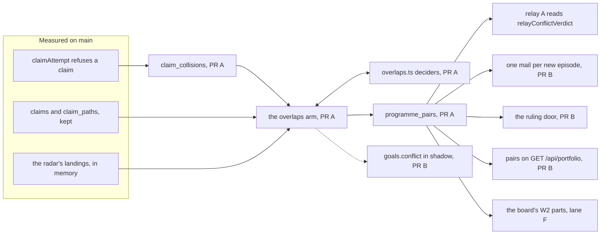
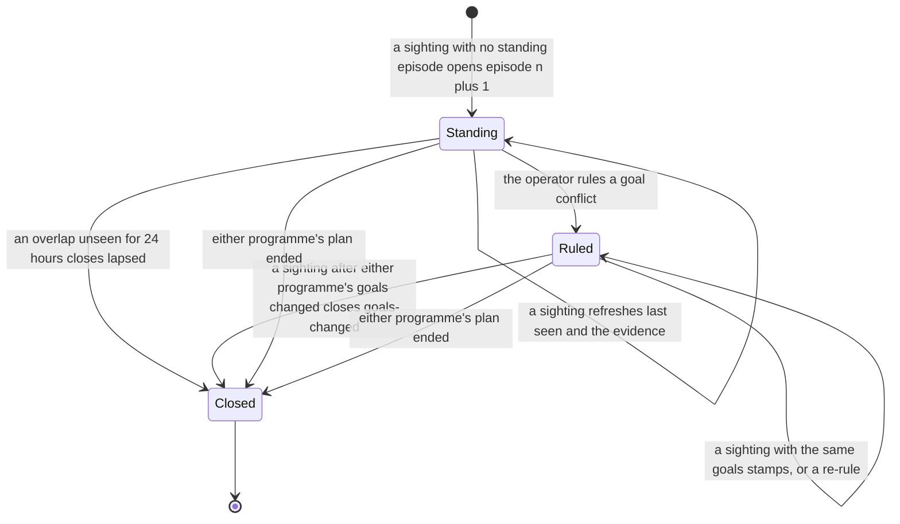
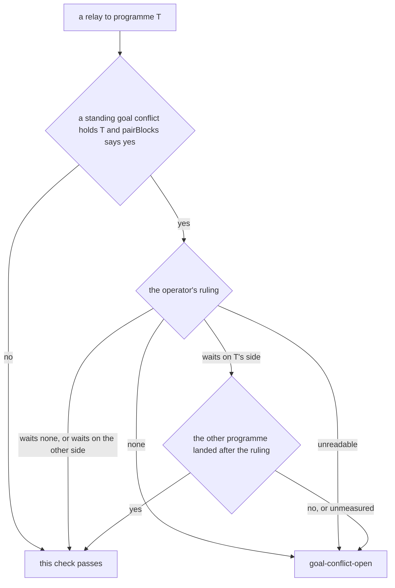

# Overlord W2: overlaps and goal conflicts between programmes Implementation Plan

> **For agentic workers:** REQUIRED SUB-SKILL: Use superpowers:subagent-driven-development (recommended) or
> superpowers:executing-plans to implement this plan task by task. Steps use checkbox (`- [ ]`) syntax for tracking.

**Goal:** the server finds where two programmes step on each other, and the operator rules on the ones whose goals
conflict.

- One table, `programme_pairs`, records each pair of programmes that overlaps or whose goals conflict. One lane, the
  overlaps arm, writes it from what the tree already measures. A pair is new while the table holds no standing row
  for it.
- An **overlap** is two programmes reaching for the same paths at once: a claim one programme's session was refused
  because another programme's session held the path, or two open pull requests the landing radar measured as
  conflicting.
- A **goal conflict** is a code signal first: one programme changed some paths, then another programme, then the first
  again, within 14 days.
- The Overlord gets one mail per new pair. The decision model's `goals.conflict` row is asked behind each new goal
  conflict, in shadow, and its answer changes nothing.
- The relay refuses `goal-conflict-open` while a goal conflict it would deepen stands unruled. The operator rules on the
  pair from the home, through one session-gated door, `POST /api/programme-pairs/:key/rule`.

**Why:** H23 (§5.5): "No coordinator sees across programmes. The Overlord does, so cross-programme overlap is put where
it routes." H38 (§5.6): goal conflicts are "found by code first", and "until the operator rules, the Overlord relays
nothing that deepens it". Duplicated and conflicting work is a failure that builders of agent fleets often report, and
today ccrc measures overlap only inside one project and tells nobody across programmes.

**Architecture:** two pull requests in lane P.

- **PR A, the record (Tasks 1 to 4), ready to build.** It reads only what is on `main`.
  - `shared/programmeFacts.ts` (L0) gains the pair vocabulary, the evidence wire and the goal-conflict choice table.
  - `server/src/coord/overlaps.ts` (C5, L1) holds five pure deciders: the overlap sightings, the goal-conflict
    sightings, the episode moves, the relay's verdict and the one "does this pair block this request" predicate.
  - One migration adds `claim_collisions` (the refused claims' record, which nothing keeps today) and
    `programme_pairs`.
  - `server/src/coord/claimCollisions.ts` and `server/src/coord/programmePairsStore.ts` (C5, L3) hold their writers
    and readers.
  - `server/src/coord/overlapsLane.ts` (C5, L4) is the overlaps arm, on a `LANE_SCHEDULE` row of its own. It records and
    sends nothing.
- **PR B, telling and ruling (Tasks 5 to 7), after PR A, designation A, the Overlord's timers, request ids B,
  decision model A and the operator's answer to question 1.**
  - The arm sends one mail per new pair to the role `overlord`, from a new system sender, `server`.
  - The arm asks `goals.conflict` in shadow through decision model A's one caller.
  - The ruling door joins the programme ledgers' operator registration, and `GET /api/portfolio` gains the standing
    pairs, so the home can show and rule them (question 17).

**Tech Stack:** TypeScript (ESM), `node:sqlite`, Fastify, vitest. No new dependency, no ccd change, no PWA screen.

**Spec:** `docs/superpowers/specs/2026-11-09-overlord-design.md`:

- §5.5, H23: "Overlaps go on the board", "One mail per new pair", "Routing checks overlaps before a relay", and Table
  5.5b's `goal-conflict-open` row.
- §5.6, H38: "Goal conflicts are found by code first", "A new conflict pair raises one O3 item, from W3", "A pair is new
  while `programme_pairs` (§11.1) holds no `goal-conflict` row for it", and "The operator rules on a pair from the
  board's Goal conflicts row … It ships in W2, with `goal-conflict-open`".
- §3.3's decision table, its row "Do two programmes' goals conflict?", and Table 3.7b's `goals.conflict` row.
- §4.1: "A standing goal conflict shows on its requests."
- §5.3: "While a goal conflict stands unruled, the Overlord relays nothing that deepens it."
- Table 11.1a, row `programme_pairs`. Table 11.1c, row "The done-test lane, the follow-up arm, the overlaps arm".
  Table 11.1e, row "The goal-conflict ruling". Table 11.6, row `goal-conflict-open`.
- Table 14, row W2: "overlaps and goal conflicts, with the operator's door that rules a goal-conflict pair".

The index is `docs/superpowers/plans/2026-11-16-overlord-w2.md` (#2917, read from `origin/ws/overlord-plan-w2-index`
until it merges). This plan builds its row "Overlaps and goal conflicts" (lane P, two pull requests, 4 and 3 tasks), and
the index's questions 1, 6, 7, 17, 20 and 23, restated below with their rulings. The W1 plans whose states it reads are
under `docs/superpowers/plans/2026-11-14-overlord-w1/`: the designation (`w1-designation.md`), the Overlord's timers
(`w1-overlord-timers.md`, which makes `overlord` a mail recipient) and the portfolio (`w1-portfolio.md`, whose operator
doors this plan's door sits beside).

Written against `main` at `9cf263d44` (2026-11-16). This plan defines no D-numbers: its departures are slugs under
"Deviations found", and the coordinator mints numbers (cross-plan ruling X9).

## In short

- **Two pull requests, seven tasks.** PR A records pairs and is ready to build now. PR B tells the Overlord, asks the
  decision model in shadow, and opens the operator's ruling door.
- **Two measured sources of overlap, one of them new.** The landing radar's conflict pairs are in memory today. A
  refused claim is not recorded anywhere, so PR A records each refused claim's collisions in the claim's own
  transaction, without changing the 409.
- **"Files changed" is read from the claims history.** The server has no record of which files a merged pull request
  changed, but every claim a session takes is kept, with its paths and its run. A goal conflict is programme A claiming
  some paths, then programme B, then A again, within 14 days.
- **The revert signal waits.** Detecting "a revert of another programme's commit" needs a read of git on the fleet box,
  and W2 changes no ccd code. Question 6 recommends a follow-up piece.
- **A pair has episodes.** An overlap stands while it is seen and lapses after 24 hours unseen. A goal conflict stands
  until either programme ends, and a ruled one opens a new episode only when either programme's goals change and the
  signal comes back. Each new episode is one new pair: one mail, one `goals.conflict` ask.
- **The relay's check ships in PR A,** with the choice table built from question 1's recommended three choices, so relay
  A needs only overlaps A. No ruling can exist before PR B's door, so the ruled arms wait unreachable until then.
- **Question 1 is the operator's.** The door's choice list is one table, `GOAL_CONFLICT_CHOICES`. The operator's answer
  fills its rows, and every other part of this plan is the same under any answer.
- **Nothing a running session sees changes at PR A's merge.** The arm records pairs and sends nothing. At PR B's merge
  the operator can rule pairs on the home, and a designated Overlord gets the pair mail.

## Open questions

The index's questions this plan builds on come first, with the coordinator's rulings. The rest are questions the spec
leaves open or the tree contradicts. The plan builds every recommendation unless the coordinator or the operator rules
otherwise.

1. **What the operator can rule on a goal conflict** (the index's question 1, operator item 357; slug
   `goal-conflict-choices`). **Waiting on the operator.** The plan builds the index's recommended three choices as the
   default:

   | Choice | Label | What relays do | Conflict? |
   |---|---|---|---|
   | `both-stand` | Both stand | Not a real conflict: relays to either programme proceed | no |
   | `a-first` | `<A>` goes first | A relay that deepens the conflict on B's side waits for A's next landing after the ruling | yes |
   | `b-first` | `<B>` goes first | The same, the other way round | yes |

   *Table 1. The default rows of `GOAL_CONFLICT_CHOICES`. A and B are the pair's programmes in key order.*

   Every choice lifts `goal-conflict-open` for the relays it lets through, and the relay quotes the choice to the owning
   coordinator (the relay piece's text). A later signal on the same pair raises nothing new until either programme's
   goals change. The last column is the `goals.conflict` row's `operator-answer` label (Task 6).

   The answer reaches only these sites, each tagged "(question 1)" where it appears:
   - the table's rows and their `waits` column (Task 1);
   - `relayConflictVerdict`'s ruled arms and their tests (Task 2), which read only the `waits` column;
   - the door's body check and its tests (Task 7), which read only the table's keys.

   An answer whose choice has an effect outside `waits` (`none`, `a`, `b`), such as "stop one programme", adds its effect
   word and its decider arm in PR B. The columns, writers, mail, ask and read are the same under any answer.
2. **The index's questions 6, 7, 20 and 23** (accepted by the coordinator).
   - Question 6: `goal-conflict-open` lands with the W2 vocabulary piece in `shared/refusal.ts#OVERLORD_REFUSALS`. This
     plan reads it from there. If PR A builds first, Task 2 adds the word with its Table 11.6 row, and the vocabulary
     piece finds it present.
   - Question 7: the ruling door is `POST /api/programme-pairs/:key/rule`, session-gated (question 11 below sets its
     gate).
   - Question 20: the overlaps arm and the ruling door describe programmes, not the Overlord's authority, so neither
     waits for `overlord-route-v1`. The arm records from PR A's merge, and the door works from PR B's.
   - Question 23: PR A reads nothing W1 has not merged, so it is built now.
   - Question 19 (the act ceilings) does not touch this piece: the ruling door is the operator's, and the arm writes no
     act row.
3. **Where the operator sees and rules a goal conflict** (the index's question 17, accepted; slug
   `goal-conflict-shown-on-the-home`). The board is served only to the Overlord. The operator sees a standing pair on
   the home's portfolio strip and on the Requests rows it blocks, and rules from the pair's row there. This plan ships
   the server half: the standing pairs on `GET /api/portfolio` (question 12) and the one predicate `pairBlocks` that
   says which requests a pair blocks (Task 2). The controls are home requests B's (lane F).
4. **A refused claim is recorded** (slug `claim-collisions-recorded`). §5.5 says "the tree already measures overlap:
   path claims and their conflicts (`ClaimConflict`)". The tree computes them only to answer a refused `POST
   /api/claims` with 409, and keeps nothing (What exists today). Live claims never overlap each other, because the
   claim decider refuses any overlap, so the arm cannot find one by reading the claims afterwards.
   **Recommendation:** `claimAttempt`'s conflict arm records each collision, one row per conflicting path and holder,
   in `claim_collisions`, inside the claim's own transaction. The record can never change the claim's answer: a throw
   from it is caught, warned once a process, and the 409 is sent as today. The rows are pruned on write after 48 hours.
   The fact is the claims' own ("this attempt was refused because of that claim"), so its one writer sits beside the
   claim decider, and the overlaps arm only reads it.
5. **"Files changed" is the claims history** (slug `goal-signal-reads-claim-history`). §5.6's signal is "files changed by
   one programme, then another, then the first again, within 14 days". The server keeps no record of the files a pull
   request changed (What exists today). It does keep every claim: its paths, its run, and when it was taken, and the
   worker and coordinator skills require a claim before an edit. **Recommendation:** a goal-conflict sighting is three
   claims in one project, by programmes A, B and A, in that order of `createdAt`, whose paths overlap pairwise
   (`claims.ts#pathsOverlap`), with the third no more than 14 days after the first. A claim's programme is its run's
   (`claims.runId` to `runs.program`). A claim with no run is `unattributed`: counted, never guessed. A re-chained row
   (`chainedFrom` set) continues an earlier claim and is not a new change. The evidence names the three claim ids.
6. **The revert signal needs a read on the fleet box** (slug `revert-signal-waits-for-a-fleet-read`). The spec's second
   signal is "a revert of another programme's commit". The server sees no commit message, and a pull request's title is
   text from GitHub that a session wrote, which the spec never matches against (§5.3). Only git on the fleet box can say
   that a landed commit reverts another's, and W2 changes no ccd code. **Recommendation:** W2 ships the claims signal
   alone. A follow-up piece in lane P, after overlaps A, adds the revert signal: the landing radar, which already runs
   git on the fleet box each minute (`ccd/ccd-land-probe`'s `git_ro`), reports the reverts it finds on the base since its
   last pass, and the arm matches each reverted commit to a landed entry of another programme (`landing_entries`). Until
   then the arm finds fewer goal conflicts, never false ones, and the relay refuses less. That piece breaks the index's
   "W2 changes no ccd code", so the coordinator decides whether it is a W2 piece or a W3 one.
7. **What "deepens" means** (slug `deepens-is-a-path-overlap`). The spec never defines it. **Recommendation:** a relay
   to programme T deepens a goal-conflict pair when T is one of the pair, and the request's `expectedPaths` are empty,
   or meet one of the pair's evidence paths, or the pair's evidence paths were cut. Empty paths deepen because the
   relay cannot show they do not: the Overlord narrows a request by naming its paths. The same predicate,
   `pairBlocks`, marks the Requests rows a pair blocks, so the home and the relay always agree.
8. **Episodes, and when a pair stops standing** (slug `pairs-have-episodes`). The spec gives a pair one row and says a
   pair is new while the table holds none. Two programmes that overlap in March and again in June would then never be
   told about June. **Recommendation:** a pair key (`<kind>:<a>:<b>`) has numbered episodes, and at most one stands.
   - An overlap episode stands while it is seen, and closes `lapsed` after 24 hours unseen.
   - A goal-conflict episode never lapses on time. It closes `programme-ended` when either programme's plan has ended
     (`CoordStore#programmeLive` reads false). A ruled episode closes `goals-changed` when a new sighting arrives and
     either programme's goals stamp differs from the one recorded when it opened, and the sighting opens the next
     episode.
   - A sighting with no standing episode opens episode n + 1. A new episode is a new pair: one mail, one ask.
   - A fact the arm cannot read (a goals stamp, a programme's plan end) moves nothing for that pair this pass.
9. **The pair mail's sender** (slug `pair-notice-sender-server`). The Overlord's pair mail carries measured facts and no
   one's words. Today's system senders are `coordinator`, `operator` and `timer`. The stall watch and the landing
   notices send as `operator` ("raised by the watcher on their behalf"), but to the Overlord a mail from `operator`
   would sit beside the operator's own mail, whose words carry authority (§3.8). The timers piece gave the Overlord's
   timer mail its own sender for the same reason. **Recommendation:** a fourth role sender, `server`, glossed as "the
   server's own measured notice: facts only, no one's words". Like `timer`, no session can send as it, and it starts no
   park notice and tags no push. Request ids B adds `overlord` to the same map, so PR B lands after it and merges `main`
   once.
10. **Pairs that stood before an Overlord was designated** (slug `pair-mail-once-per-episode`). **Recommendation:** each
    standing episode is mailed once, `mailedAt` stamped in the mail's transaction. The arm mails only while a
    designation is measured and bound, and never while `mail-disabled` stands. When an Overlord is designated, the
    episodes that still stand are mailed, oldest first, at most five a pass. An episode that closed before it was mailed
    is never mailed. A rebind moves the outstanding mail with the role (designation B).
11. **The ruling door's gate** (slug `ruling-door-refuses-dark`). A ruling lets relays through, so it confers what the
    Overlord may then do. **Recommendation:** the door calls the account gate (`deps.gate`, no capability, no step-up),
    which refuses `auth-off` while sign-in is dark, as the ratify door does, and records the gate's actor. It is not the
    Overlord's door, so it needs no `OVERLORD_DOORS` row and no capability word. Adopting the `CallerIdentity` port is
    gates A's work, as for the portfolio's doors.
12. **The operator's read of the pairs** (slug `pairs-ride-the-portfolio-read`). **Recommendation:** `GET
    /api/portfolio`, which the home's portfolio strip already reads, answers `pairs` beside `portfolio`: every standing
    episode, goal conflicts first and unruled first, each with its evidence and ruling. An older console ignores the
    field. No new read door and no census row.
13. **The ruling names its episode** (slug `ruling-names-its-episode`). **Recommendation:** the door's body is `{
    episode, choice }`. An episode that is no longer the standing one is refused `pair-changed` with the current
    episode, so the operator never rules a pair they were not shown, as the ratify door refuses `goals-changed`. A
    re-rule of the same episode overwrites the choice and answers the previous one.
14. **"A's next landing"** (slug `next-landing-is-a-closed-work-run`). The `a-first` and `b-first` rows wait for the first
    programme's next landing. **Recommendation:** a work run of that programme reaching `done` after `ruledAt`, read
    by one store read, `programmeLandedSince(program, at)`. The done-tests piece's `run-closed` predicate asks a
    narrower question (the runs a request links), so the two stay apart, and that piece may reuse this read.
15. **Which programmes a session belongs to, for the radar** (slug `radar-sides-read-bindings`). A radar conflict names
    two sessions, not runs. **Recommendation:** a session's programmes are those of its open runs as worker and as
    coordinator (`CoordStore#bindingsOf`'s `worker()` and `claimant()`). Two sides whose sets share a programme are one
    programme's own overlap and make no pair. A side with no open run is `unattributed`. A side whose bindings cannot be
    read is `unread`, and makes no pair that pass.

## What exists today

Measured on `main` at `9cf263d44` (2026-11-16).

- **No pair, no goal conflict, no decision model.** `git grep -i 'programme_pairs\|DecisionModel'` finds nothing under
  `server/src`, `shared` or `pwa/src`. `shared/programmeFacts.ts` does not exist. The remaining-work piece (lane P,
  same builder) also creates it, so whichever lands first creates the file and the second adds a section.
- **Claim conflicts are computed, never kept.**
  - `server/src/coord/claims.ts#decideClaim` (L1) answers `{ conflict: ClaimConflict[] }`, one entry per conflicting
    path and claim, by exact match or directory containment both ways (`claims.ts#pathsOverlap`), within one project.
  - `CoordStore#claimAttempt` runs it inside one transaction and returns `{ ok: false, why: 'conflict' }` without
    writing. Its input carries the requester's `sessionId` and `runId`.
  - `POST /api/claims` in `server/src/coord/routes.ts` re-measures each holder's deliverability and answers 409
    `claim-conflict`. Nothing records the conflict: `git grep claim-conflict -- server/src` finds only that reply.
  - Live claims never overlap: the decider refuses any overlap, and `claim_one_owner` (a unique index on
    `claim_paths(project, path) WHERE live = 1`) is the backstop.
- **The claims history is kept.** `claims` rows are never deleted ("LAPSE, DO NOT DELETE"), and `claim_paths` keeps
  every path, flipping `live` to 0 when a claim ends. Each row carries `project`, `heldBy`, `runId` (nullable),
  `createdAt` and, since migration 62's ALTER, `chainedFrom` (D-8395), the row a re-chained claim continues. The peer
  protocol's claim body carries `runId` (`ccd/coordinator-skill/references/peer-protocol.md`).
- **The landing radar's conflict pairs are in memory.** `server/src/coord/radar.ts#sessionLandingsOf` turns a project's
  probe doc into one `SessionLanding` per bound session, whose `conflicts` list each other open pull request it
  conflicts with (`pr`, `paths` cut to 300 characters, `pathsCut`). `FleetWatcher#sweepRadar` keeps them in a private
  map, read through `FleetWatcher#currentLandings`, once a minute (`LANDING_RADAR_SWEEP_MS`). A `SessionLanding`
  carries its own `pr` but no project, and the probe head's session id is not kept, so the other side is found by its
  `pr` among the same project's landings.
- **A session's programmes.** `CoordStore#bindingsOf(sessionId)` answers `server/src/coord/bindingReads.ts`'s
  `SessionBindings`: `worker()` and `claimant()` list the open runs (with `program`) that name the session as worker or
  coordinator, or `ok: false` with why.
- **A programme's end.** `CoordStore#programmeLive(slug)` is true while the programme's row stands with no `planEnd`.
  Its comment says why not `programs.state`: the close sets `done` whenever the open-run count reaches 0, so a
  programme between waves reads `done`. The timers lane's `programme-ended` reads the same fact
  (`server/src/continuity/timerLane.ts`).
- **Goals.** `shared/ledgers.ts#GoalsView` has `inShortAt` (the pin's stamp) and `modifications` with ids, read by
  `CoordStore#goalsFor`. Portfolio B (#2904, in the merge queue) adds the sources and `doneWhenBy`, and this plan reads
  neither.
- **No record of a changed file or a revert.** The server's PR facts are `shared/api.ts#PrState` (a GitHub-sourced
  `title`, phase, checks) and `server/src/prstate.ts#mergedFactsOf` (`mergeCommit`, `head`, `base`, `mergedAt`). No
  server file reads a commit's message or a pull request's files. `ccd/ccd-land-probe` runs git on the fleet box for the
  radar, through one hardened function, `git_ro`.
- **System mail.** `server/src/coord/rundefs.ts`'s `SYSTEM_MAIL_SENDER_MAP` holds `coordinator`, `operator` and `timer`,
  and derives `MAIL_ROLE_IDS`. `server/src/coord/rundefsTx.ts#insertSystemMailTx` writes the mail and its delivery in
  the caller's transaction. `overlord` is not yet a recipient: W1's Overlord timers plan (its question 4) makes it one,
  with the timer lane as its one writer, and gives `insertSystemMailTx` a `deliverTo` that names the bound session. The
  timer lane (`server/src/continuity/timerLane.ts`) is the precedent for mail in one transaction with its row's move,
  held while `mail-disabled` stands (`shared/switches.ts#MAIL_DISABLED_MARKER`).
- **A read-and-record lane.** `server/src/coord/casesLane.ts#casesPass` (L4) gathers rows, asks its L1 decider and
  records, sending nothing. `FleetWatcher#sweepCases` runs it through `runLane('cases', …)`, on its
  `server/src/laneSchedule.ts#LANE_SCHEDULE` row. Its store members are declared in `server/src/coord/ports.ts`'s
  `WatcherCoordPort`.
- **The operator's doors beside which the ruling door goes.** `registerLedgerOperatorRoutes`
  (`server/src/coord/ledgersRoutes.ts`) holds `GET /api/portfolio` (answering `{ ok, portfolio }`) and `POST
  /api/portfolio/rank`. The ratify door's refusal of a dark console is portfolio B's (`w1-portfolio.md`, question 4).
  Their census is `LEDGER_OPERATOR_DOORS` in `server/test/box-token-census.test.ts`, checked against the file in both
  directions and, through `SESSION_ONLY_ALL`, against `CLAUDE.md`'s box-token bullet. Their refusal words are
  `shared/refusal.ts#LEDGER_ROUTE_REFUSALS`.
- **Programme slugs** pass `shared/api.ts#shapeProgramSlug` (`[A-Za-z0-9_-]+`), so a `:` separates a pair key's parts
  without ambiguity.
- **The store.** `server/src/coord/schema.ts` holds 82 migrations, pinned by `server/test/coord-db.test.ts`.
  `server/test/run-close-switch.test.ts` drops every table from migration 55 by hand.
- **Growth.** `server/test/growthCheck.ts#GROWTH_FILES` lists `schema.ts`, `store.ts`, `watch.ts`, `routes.ts`,
  `server.ts`, `pwa/src/lib/api.ts` and `shared/api.ts` among others, at `GROWTH_LIMIT` (40) net code lines a pull
  request. TypeScript comments do not count, and SQL inside a migration's template string does. `shared/api.ts` has a
  cap file. `ledgersRoutes.ts` and `rundefs.ts` are not listed. This plan touches neither `routes.ts` nor `shared/api.ts`.

## Global Constraints

- **Architecture (`CLAUDE.md`).**
  - `shared/programmeFacts.ts` is L0: no import but types from `./api.js`. Each literal union carries its
    `Record<X, true>` map (`rings/wire-totality.test.ts`).
  - `server/src/coord/overlaps.ts` is L1: pure, no `fs`, no store, no clock (`now` is an argument). It imports L0 and
    `claims.ts#pathsOverlap` (L1) only.
  - `claimCollisions.ts` and `programmePairsStore.ts` are L3: SQL only, synchronous over the store's database. They keep
    every distinction they read (below).
  - `overlapsLane.ts` is L4: it gathers, asks the deciders, and applies their answers. It decides nothing.
  - The ruling door is L4 in `ledgersRoutes.ts`: parse, gate, one store call, answer.
  - No repository and no async wrapper over `CoordStore`. `CoordStore` gains one-line delegates only.
- **One writer each.**
  - `claim_collisions`: `claimCollisions.ts#recordCollisionsInTx`, called only from `CoordStore#claimAttempt`'s conflict
    arm. Its prune is the same function's.
  - `programme_pairs`' rows and their sighting columns: `programmePairsStore.ts#applyPairMoves`, called only by the
    overlaps arm.
  - `programme_pairs.mailedAt`: `markPairMailedInTx`, called only by the arm's mail step, in the mail's transaction.
  - `programme_pairs.ruled`, `ruledAt` and `ruledBy`: `rulePair`, called only by the ruling door.
  - The episode moves are `pairMoves`' only. The store applies them and decides nothing.
- **Consolidate, don't duplicate.** Paths overlap by `claims.ts#pathsOverlap`, never a second rule. A programme ends by
  `CoordStore#programmeLive`. A session's programmes come from `CoordStore#bindingsOf`. Mail goes through
  `insertSystemMailTx`. The relay and the home ask one predicate, `pairBlocks`.
- **Failure contracts. Unread is never "no pair".**
  - A read the arm cannot make (collisions, history, standing pairs) records nothing that pass, warns once with the
    reader's detail, and answers `unread` with its name.
  - A side it cannot attribute is counted `unattributed`. A side whose bindings fail is counted `unread`. Neither makes a
    pair, and neither closes one.
  - A `programmeLive` or goals read that throws moves no episode of that programme this pass.
  - A history read past `CLAIM_HISTORY_ROWS_MAX` answers `cut: true`, and the pass warns: a cut can only miss pairs.
  - A stored `kind`, `closedWhy` or `ruled` word outside its vocabulary reads as unreadable, never as a known word. An
    unreadable ruling refuses the relay (fail closed), and the read shows it as `ruled: 'unreadable'`.
  - The collision record never changes a claim's answer (question 4).
- **Wire: additive.** `GET /api/portfolio` gains an optional `pairs`. `FLEET_PROTO` is not bumped. An older console
  ignores the field, and the newer console reads a missing field as "this server measures no pairs".
- **What a merge arms.**
  - PR A: the arm records pairs from the first pass and sends nothing. The relay's check exists for relay A to call. No
    session sees anything new.
  - PR B: the operator can rule pairs (the home's controls come with home requests B). A designated Overlord gets one mail
    per standing episode. `goals.conflict` is asked only once the operator arms its row (decision model B), and its answer
    changes nothing.
- **SAFETY (`CLAUDE.md`).** No ccd verb, no fleet act and no live `~/.ccrc`. Tests build `coord.db` in memory or in a
  fixture directory under the per-run temp root. A watcher a test builds goes through
  `quietAtTestEnd(new FleetWatcher(...))` (`server/test/laneQuiet.ts`).
- **Tests.** Run from `server/` as `ccrc test -- ./node_modules/.bin/vitest run test/<file>.test.ts`, one file at a time,
  in the foreground. Each task's last run adds both server `tsc` runs (`ccrc test -- npx tsc --noEmit -p tsconfig.json`
  and `-p test/tsconfig.tests.json`), and pwa's `tsc` when `shared/` changed (`cd pwa && ccrc test -- npx tsc
  --noEmit`).
- **Hidden pins** (measured in earlier waves): a new table reds `run-close-switch.test.ts` until its drop list names it,
  and a new duration literal can red `token-shared.test.ts`'s seven-day census. Write durations as days and hours times
  the shared constants, and run both suites in every task that adds a table or a duration.
- **Growth check.** Every growth-checked file stays within 40 net lines in each pull request, with no waiver (the PR
  split has the estimates). Re-measure each file's cap on `main` before the pull request.
- **Mutation floors.** `overlapSightings`, `goalConflictSightings`, `pairMoves`, `relayConflictVerdict`, `pairBlocks` and
  `pairNoticeBody` each join `MUTANT_SETS` (`server/test/sim/mutation-floors.test.ts`) and
  `server/test/sim/mutation-floors.json` in the pull request that creates them. Each first-match decider ships with
  exhaustive tests and a monotonicity property (Table 11.7b).
- **Censuses** are named in each task. Every guard ships with the test that goes red without it.
- **Public repository.** No private names: fixtures use `prog-a`, `prog-b`, `prog-c`, `project-a`, `lane-a-project-a`
  and the actor label `op-a`. Cite by symbol or `@anchor`. No D-number is invented.

## Review Focus

1. **An overlap is measured, never guessed.** Each pair comes from a recorded refusal or a radar conflict whose two sides
   belong to different programmes. A side the arm cannot attribute makes no pair, and nothing folds "unread" into
   "no overlap".
2. **The claim path is untouched.** The collision record runs in the claim's transaction and cannot change its answer,
   its timing or its 409 body. A characterization test pins today's answer first.
3. **One predicate, two readers.** The relay and the home ask `pairBlocks`, so a request the home shows as blocked is one
   the relay refuses, and the other way round.
4. **The operator's ruling is the only thing that lifts `goal-conflict-open`.** No flag, no model answer and no session
   write moves `ruled`. The door refuses a dark console and a pair the operator was not shown.
5. **One mail per episode, and only facts in it.** The mail carries slugs, paths, claim ids and pull request numbers, and
   never a claim's `intent`, a title or anyone's words.

## The PR split


*Figure 1. Where pairs come from and who reads them. The three sources on the left are measured today. PR A adds the
collision record, the deciders, the table and the arm. PR B adds the mail, the shadow ask, the door and the read. The
dashed edge changes no row.*

| PR | Tasks | What it ships | Needs first | Growth-checked files, estimate (net lines) |
|---|---|---|---|---|
| A | 1 to 4 | The pair vocabulary and choice table; the five deciders; `claim_collisions` and `programme_pairs` in one migration; the collision record in `claimAttempt`; the pairs store; the overlaps arm and its lane row | nothing: **ready to build** | `schema.ts` +34 (one migration, two tables and three indexes in SQL); `store.ts` +10 (the record call and its catch, six delegates, one import); `watch.ts` +9 (`sweepOverlaps`, its tick dispatch, one import) |
| B | 5 to 7 | The `server` sender; one mail per new episode; `goals.conflict` in shadow; the ruling door; `pairs` on the portfolio read; the two refusal words | PR A; designation A; the Overlord's timers (W1); request ids B; decision model A; question 1 | `store.ts` +4 (delegates); `watch.ts` +4 (the mail step's and the ask's deps) |

Each pull request merges `main` once before merge and re-measures its migration slot (the index's "Where lanes meet").

For scale, the files that are not growth-checked change by about this much:

| File | PR A | PR B |
|---|---|---|
| `shared/programmeFacts.ts` | +170, new or a new section | +15 |
| `server/src/coord/overlaps.ts` | +280, new | +40 (`pairNoticeBody`) |
| `server/src/coord/claimCollisions.ts` | +80, new | |
| `server/src/coord/programmePairsStore.ts` | +220, new | +80 |
| `server/src/coord/overlapsLane.ts` | +180, new | +110 |
| `server/src/coord/ports.ts` | +3 | +2 |
| `server/src/laneSchedule.ts` | +6 | |
| `server/src/coord/rundefs.ts` | | +10 |
| `server/src/coord/ledgersRoutes.ts` | | +70 |
| `shared/refusal.ts` | +2 (only if the W2 vocabulary has not landed) | +4 |
| `pwa/src/lib/refusalWords.ts` | | +4 |

## What the index should change

The index (#2917) should carry these. The coordinator passes them to the index's own fix round.

- **The "Overlaps and goal conflicts" row:**
  - A ships "`claim_collisions` (the refused claims' record, question 4) and `programme_pairs` with episodes, in one
    migration; the overlap and goal-conflict deciders; the episode moves; the relay's check `relayConflictVerdict` with
    `pairBlocks` and the choice table's default rows (question 1); the overlaps arm, recording only";
  - B ships "the `server` sender and one mail per new episode; `goals.conflict` in shadow; the ruling door; the standing
    pairs on `GET /api/portfolio` (question 17)";
  - the goal-conflict signal is "the claims history, A then B then A within 14 days"; the revert signal moves to a
    follow-up (question 6);
  - B's "needs first" gains "the Overlord's timers (W1)", which makes `overlord` a mail recipient. Request ids B stays:
    both edit `SYSTEM_MAIL_SENDER_MAP`.
- **Figure W2:** an edge `OT --> OVB`. The edge `OVA --> RLA` now carries the relay's whole check, not only the table.
- **The relay row:** relay A calls `relayConflictVerdict` and passes `programmeLandedSince` as its landing fact. It does
  not read `programme_pairs` itself.
- **Home requests B:** the Requests rows ask `pairBlocks` for each standing pair, and the strip's ruling control reads
  `GET /api/portfolio`'s `pairs` and writes `POST /api/programme-pairs/:key/rule` with `{ episode, choice }`, rendering
  the choices from `GOAL_CONFLICT_CHOICES`. Its `pwa/src/lib/api.ts` call reads a 404 as "this server rules no pairs".
- **The board's W2 parts:** Overlaps and Goal conflicts read `programmePairsStore.ts#standingPairs`.
- **The label queue:** the `goals.conflict` row's `operator-answer` label is a ruling, read through the choice table's
  `conflict` column (Task 6). A choice whose column is null gives no label.
- **A follow-up piece, "Revert signal"** (lane P, after overlaps A), or a W3 item: the radar's revert read and the arm's
  match (question 6). It is W2's one ccd change if it stays in W2.
- **Lane P's file list** gains `server/src/coord/overlaps.ts`, `claimCollisions.ts`, `programmePairsStore.ts`,
  `overlapsLane.ts`, and the ruling door in `ledgersRoutes.ts`' operator registration.
- **"Where lanes meet":**
  - `server/src/coord/store.ts`: lane P adds the collision record's call in `claimAttempt` and its delegates, beside
    lane C's ask writers. Different functions.
  - `server/src/coord/ledgersRoutes.ts`: lane P adds the ruling door and the portfolio read's `pairs`, beside lane R's
    `goals modify` check. The bullet "Lane R only" becomes "lanes R and P".
  - `server/src/coord/rundefs.ts`: lane R (request ids B, `overlord`) and lane P (overlaps B, `server`). The second to
    land merges `main` once.
  - `LANE_SCHEDULE`: the overlaps arm's row is named `overlaps`.
  - `toId: 'overlord'` writers: the timer lane (W1) and the overlaps arm (overlaps B). The timers piece's census of that
    writer widens to two.
- **Question 7's table:** the ruling door's gate is "session, the account gate, refuses `auth-off`; no step-up".
- **The spec-fixes list gains:**
  - §5.5's "path claims and their conflicts" are not recorded on `main`; PR A records them (question 4);
  - §5.6's "files changed" is measured as claimed paths (question 5), and its revert signal needs a fleet read
    (question 6);
  - Table 11.1a's `programme_pairs` row gains its columns (episode, evidence, last seen, closed, mailed, ruled at and
    by), and a new row for `claim_collisions` (writer: the claim attempt's conflict arm);
  - §5.3 never defines "deepens" (question 7);
  - §5.5 names no sender for the pair mail (question 9);
  - Table 11.6 lacks `pair-changed` and `pair-not-rulable`;
  - Table 3.7b's starred label source for `goals.conflict`, `operator-answer`, is confirmed as the ruling (Task 6).

---

### Task 1: The pair vocabulary, the choice table and the two sighting deciders (L0, L1)

**Files:**
- Create: `shared/programmeFacts.ts` (L0), or add a section to it if remaining work A created it
- Create: `server/src/coord/overlaps.ts` (C5, L1: `overlapSightings`, `goalConflictSightings`)
- Create: `server/test/overlaps-sightings.test.ts`
- Create: `server/test/sim/overlapsSets.ts`
- Modify: `server/test/sim/mutation-floors.test.ts` (`MUTANT_SETS`) and `server/test/sim/mutation-floors.json`
- Modify: `server/test/single-definition/time-ports.test.ts` (`TIME_PORT_FILES` gains `server/src/coord/overlaps.ts`)
- Modify: the architecture spec's path table, if it lists `shared/*.ts` siblings and remaining work A has not added
  `shared/programmeFacts.ts`
- Test: `server/test/rings/*.test.ts`, `server/test/token-shared.test.ts`

**Interfaces** (`shared/programmeFacts.ts`):

```ts
export const PAIR_KIND_MAP = { overlap: true, 'goal-conflict': true } as const satisfies Record<string, true>;
export type PairKind = keyof typeof PAIR_KIND_MAP;
export const PAIR_KINDS = Object.keys(PAIR_KIND_MAP) as readonly PairKind[];
export const isPairKind = (v: unknown): v is PairKind => typeof v === 'string' && v in PAIR_KIND_MAP;

/** `<kind>:<a>:<b>` with a < b by code unit. Slugs pass `shapeProgramSlug`, so they hold no `:`. */
export function pairKeyOf(kind: PairKind, x: string, y: string): string;
export function parsePairKey(key: string): { kind: PairKind; a: string; b: string } | null; // null: not the grammar, or a >= b

export const GOAL_CONFLICT_WINDOW_DAYS = 14;  // §5.6
export const OVERLAP_LAPSE_HOURS = 24;        // question 8
export const COLLISION_KEEP_HOURS = 48;       // question 4
export const PAIR_PATHS_MAX = 20;             // evidence paths kept on a row
export const PAIR_MAILS_PER_PASS = 5;         // question 10
export const CLAIM_HISTORY_ROWS_MAX = 5000;   // one pass's history read

export const PAIR_SOURCE_MAP = { 'claim-collision': true, radar: true, 'claim-history': true } as const;
export type PairSource = keyof typeof PAIR_SOURCE_MAP;
export interface PairEvidence {
  readonly sources: readonly PairSource[];   // sorted, distinct
  readonly paths: readonly string[];         // sorted, distinct, at most PAIR_PATHS_MAX
  readonly pathsCut: boolean;                // more paths were seen, or a radar path was cut
  readonly claimIds: readonly number[];      // sorted, distinct, at most PAIR_PATHS_MAX
  readonly prs: readonly number[];           // sorted, distinct
}

export const PAIR_CLOSED_MAP = { lapsed: true, 'programme-ended': true, 'goals-changed': true } as const;
export type PairClosedWhy = keyof typeof PAIR_CLOSED_MAP;

/** Question 1: the operator's answer fills these rows. `waits`: whose deepening relays wait for the other's landing. */
export const GOAL_CONFLICT_WAITS_MAP = { none: true, a: true, b: true } as const;
export type GoalConflictWaits = keyof typeof GOAL_CONFLICT_WAITS_MAP;
export interface GoalConflictChoiceRow {
  readonly label: string;          // `{a}` and `{b}` stand for the pair's slugs
  readonly sentence: string;       // what relays do, one line
  readonly waits: GoalConflictWaits;
  readonly conflict: boolean | null; // the goals.conflict label this ruling gives; null gives none
}
export const GOAL_CONFLICT_CHOICES = {
  'both-stand': { label: 'Both stand', sentence: 'Not a real conflict: relays to either programme proceed.',
    waits: 'none', conflict: false },
  'a-first': { label: '{a} goes first', sentence: 'Relays that deepen the conflict on {b}\'s side wait for {a} to land.',
    waits: 'b', conflict: true },
  'b-first': { label: '{b} goes first', sentence: 'Relays that deepen the conflict on {a}\'s side wait for {b} to land.',
    waits: 'a', conflict: true },
} as const satisfies Record<string, GoalConflictChoiceRow>;
export type GoalConflictChoice = keyof typeof GOAL_CONFLICT_CHOICES;
export const isGoalConflictChoice = (v: unknown): v is GoalConflictChoice =>
  typeof v === 'string' && Object.hasOwn(GOAL_CONFLICT_CHOICES, v);

/** One standing episode, as the portfolio read and the board serve it. */
export interface StandingPairWire {
  readonly key: string; readonly kind: PairKind; readonly a: string; readonly b: string;
  readonly episode: number; readonly firstSeenAt: number; readonly lastSeenAt: number;
  readonly evidence: PairEvidence | 'unreadable';
  readonly ruled: { readonly choice: GoalConflictChoice; readonly at: number; readonly by: string } | 'unreadable' | null;
}
```

Durations are written as days or hours times the shared millisecond constants where they are used, never as a literal
millisecond count (the hidden-pins constraint).

**Interfaces** (`server/src/coord/overlaps.ts`):

```ts
/** A side's programmes, as the arm attributed them. */
export type SideProgrammes = { readonly kind: 'programmes'; readonly slugs: readonly string[] }
  | { readonly kind: 'unattributed' } | { readonly kind: 'unread' };

export interface CollisionFact { project: string; path: string; claimedPath: string; holderClaimId: number;
  requester: SideProgrammes; holder: SideProgrammes; at: number }
export interface RadarConflictFact { project: string; prA: number; prB: number; paths: readonly string[];
  pathsCut: boolean; sideA: SideProgrammes; sideB: SideProgrammes }
export interface ClaimHistoryRow { claimId: number; project: string; program: string | null; createdAt: number;
  paths: readonly string[] }

export interface PairSighting { key: string; kind: PairKind; a: string; b: string; evidence: PairEvidence }
export interface SightingCounts { unattributed: number; unread: number }

export function overlapSightings(collisions: readonly CollisionFact[], radar: readonly RadarConflictFact[]):
  { sightings: readonly PairSighting[]; counts: SightingCounts };
export function goalConflictSightings(history: readonly ClaimHistoryRow[], now: number):
  { sightings: readonly PairSighting[]; counts: SightingCounts };
```

**The rules.**
- `overlapSightings`: for each fact, in order:
  1. a side `unread` counts `unread`, and a side `unattributed` counts `unattributed`; the fact makes no sighting;
  2. two sides whose programme sets share a slug make no sighting (one programme's own overlap);
  3. otherwise each pair (x from one side, y from the other, x ≠ y) is sighted under `pairKeyOf('overlap', x, y)`.

  Sightings of one key merge their evidence: sources, paths (sorted, at most `PAIR_PATHS_MAX`, `pathsCut` when more were
  seen or a radar fact says cut), claim ids and pull request numbers. A collision adds `path` and `claimedPath`, the
  holder's claim id and the source `claim-collision`. A radar fact adds its paths, both pull request numbers and the
  source `radar`.
- `goalConflictSightings` (question 5): a row whose `program` is null counts `unattributed`. Within one project, a
  sighting of `pairKeyOf('goal-conflict', A, B)` is any three rows r1, r2, r3 with `r1.createdAt < r2.createdAt <
  r3.createdAt`, `r1.program = r3.program = A`, `r2.program = B ≠ A`, `r3.createdAt − r1.createdAt` at most
  `GOAL_CONFLICT_WINDOW_DAYS` days, and every two of the three sharing a pair of overlapping paths. Only rows with
  `createdAt` in the window before `now` count. The evidence keeps the overlapping paths (bounded as above), the claim
  ids of every triple found, and the source `claim-history`.

- [ ] **Step 1: Failing tests** (`test/overlaps-sightings.test.ts`):
  - `pairKeyOf` orders the slugs, and `parsePairKey` reads back every key it makes, refusing a bad kind, a missing part,
    an extra part and `a >= b`;
  - every map's keys equal its list (`PAIR_KINDS`, `PAIR_SOURCE_MAP`, `PAIR_CLOSED_MAP`, `GOAL_CONFLICT_WAITS_MAP`);
  - every `GOAL_CONFLICT_CHOICES` row's `waits` is in its map, and its label names `{a}` or `{b}` exactly when it waits
    (question 1);
  - a collision between `prog-a` and `prog-b` sights `overlap:prog-a:prog-b` with both paths, the claim id and the source;
  - sides `{prog-a}` and `{prog-a, prog-b}` sight nothing; sides `{prog-a, prog-c}` and `{prog-b}` sight two keys;
  - an `unattributed` side and an `unread` side each sight nothing and count once;
  - a radar fact sights its pair with both pull requests, and a cut path list sets `pathsCut`;
  - 25 colliding paths keep 20, sorted, with `pathsCut`;
  - claims history: A, B, A on `server/src/x.ts` within 14 days sights `goal-conflict:prog-a:prog-b`;
  - A, B, A with the third 14 days and one millisecond after the first sights nothing;
  - A, A, B sights nothing (A never returns), and B, A, B sights the same key, `goal-conflict:prog-a:prog-b`;
  - directory containment counts (`server/src` against `server/src/x.ts`), and `server/src-old` does not;
  - rows in two projects never combine;
  - a row with no programme counts `unattributed`.
- [ ] **Step 2: Property tests.** The tree has no property library, so each is a seeded loop over generated inputs (a
  fixed seed, a few hundred cases), failing with the case it found:
  - adding a history row never removes a sighting;
  - shuffling the input order changes no sighting;
  - every sighting's key parses, and its `a` and `b` are its two programmes.
- [ ] **Step 3: Run.** Red.
- [ ] **Step 4: Implement** both files.
- [ ] **Step 5: Run** this suite, `test/rings/*.test.ts`, `test/single-definition/*.test.ts`,
  `test/token-shared.test.ts`, both server `tsc` runs and pwa's `tsc`. Green.
- [ ] **Step 6: Mutation step.** Add `overlapSightings` and `goalConflictSightings` to `MUTANT_SETS` with
  `server/test/sim/overlapsSets.ts`, run `../ccrc-coordinator/references/mutation-run.py` on `overlaps.ts`, and record
  the kill rate as the floor in `mutation-floors.json`. A surviving mutant gets a case or a written reason.
- [ ] **Step 7: Red check.** Each change below reds a case. Revert each.
  - Drop the "programme sets share a slug" rule.
  - Compare `createdAt` with `<=` in the window test.
  - Replace `pathsOverlap` with string equality.
- [ ] **Step 8: Commit.** `feat(overlaps): the pair vocabulary, the goal-conflict choice table and the two sighting deciders (Overlord W2)`

### Task 2: The episode moves, the relay's verdict and `pairBlocks` (L1)

**Files:**
- Modify: `server/src/coord/overlaps.ts` (`pairMoves`, `relayConflictVerdict`, `pairBlocks`)
- Modify: `shared/refusal.ts` and `pwa/src/lib/refusalWords.ts`, only if the W2 vocabulary piece has not added
  `goal-conflict-open` (question 2), with `server/test/single-definition/refusal-table.data.json`'s row
- Create: `server/test/overlaps-moves.test.ts`, `server/test/overlaps-relay.test.ts`
- Modify: `server/test/sim/overlapsSets.ts`, `MUTANT_SETS` and `mutation-floors.json`
- Test: `server/test/single-definition/refusal-table.test.ts`

**Interfaces:**

```ts
/** A standing row as the store reads it: every word re-read through its guard. */
export interface StandingPairRow {
  id: number; key: string; kind: PairKind; a: string; b: string; episode: number;
  firstSeenAt: number; lastSeenAt: number; evidence: PairEvidence | 'unreadable';
  goalsA: string | null; goalsB: string | null;   // goal-conflict: the stamps when the episode opened
  ruled: { choice: GoalConflictChoice; at: number; by: string } | 'unreadable' | null;
}
export type Fact<T> = T | 'unmeasured';
export interface MoveFacts {
  now: number;
  live: (slug: string) => Fact<boolean>;         // CoordStore#programmeLive
  goalsStamp: (slug: string) => Fact<string>;    // `${inShortAt ?? 'none'}:${newest modification id ?? 0}`
  /** False when a source of overlap sightings (collisions or radar sides) failed this pass: no overlap lapses then. */
  overlapSourcesRead: boolean;
}
export interface PairMoves {
  open: readonly { sighting: PairSighting; episode: number; goalsA: string | null; goalsB: string | null }[];
  refresh: readonly { id: number; lastSeenAt: number; evidence: PairEvidence }[];
  close: readonly { id: number; why: PairClosedWhy }[];
}
export function pairMoves(standing: readonly StandingPairRow[], sightings: readonly PairSighting[],
  newestEpisode: ReadonlyMap<string, number>, facts: MoveFacts): PairMoves;

export interface RelayFacts { target: string; expectedPaths: readonly string[] }
export function pairBlocks(pair: StandingPairRow, relay: RelayFacts): boolean;

export type RelayConflictVerdict = { ok: true }
  | { ok: false; word: 'goal-conflict-open'; key: string; episode: number;
      why: 'unruled' | 'ruling-unreadable' | 'waits-for-landing' | 'landing-unmeasured' };
export function relayConflictVerdict(standing: readonly StandingPairRow[], relay: RelayFacts,
  landedSince: (program: string, at: number) => Fact<boolean>): RelayConflictVerdict;
```

**`pairMoves`, first match per key** (question 8). `newestEpisode` is the highest episode the table holds for each key,
closed ones included.

| # | The key's standing row | This pass | Move |
|---|---|---|---|
| 1 | any, goal-conflict | `live` of either programme is `unmeasured` | nothing |
| 2 | any, goal-conflict | either programme reads not live | close `programme-ended` (no open) |
| 3 | none | a sighting; goal-conflict with either stamp `unmeasured` | nothing |
| 4 | none | a sighting | open `newestEpisode + 1` (1 when none), stamps for a goal conflict, null for an overlap |
| 5 | ruled goal-conflict | a sighting; either stamp `unmeasured` | nothing |
| 6 | ruled goal-conflict | a sighting; a stamp differs from the row's | close `goals-changed`, and open the next episode |
| 7 | standing (any other) | a sighting | refresh `lastSeenAt` to `now` and the evidence (merged, bounded) |
| 8 | overlap | no sighting; `overlapSourcesRead`; `now − lastSeenAt` at least `OVERLAP_LAPSE_HOURS` | close `lapsed` |
| 9 | any | anything else | nothing |

*Table 2. The episode moves. A goal-conflict episode never lapses on time. Rule 6 is "raises nothing new until either
programme's goals change" (question 1's recommendation).*

**`pairBlocks`** (question 7): the pair is a `goal-conflict`, the relay's target is `a` or `b`, and either
`expectedPaths` is empty, or the evidence is `unreadable` or `pathsCut`, or some expected path overlaps some evidence path
(`pathsOverlap`).

**`relayConflictVerdict`, over the standing goal-conflict rows the relay deepens (`pairBlocks`), in key order, first
refusal wins:**

| The row's ruling | Answer |
|---|---|
| null | refuse `unruled` |
| `unreadable` | refuse `ruling-unreadable` (fail closed) |
| a choice whose `waits` is `none` | pass this row |
| a choice whose `waits` names the side that is not the target | pass this row |
| a choice whose `waits` names the target's side | `landedSince(other, ruledAt)`: `true` passes, `false` refuses `waits-for-landing`, `unmeasured` refuses `landing-unmeasured` |

*Table 3. The relay's verdict. A pair the relay does not deepen is never consulted. Only the `waits` column of the choice
table is read here (question 1).*

- [ ] **Step 1: Failing tests** (`test/overlaps-moves.test.ts`), one or more per row of Table 2:
  - a first sighting opens episode 1; a sighting after a closed episode 2 opens episode 3;
  - an overlap seen again refreshes, keeping `firstSeenAt`;
  - an overlap unseen for 24 hours closes `lapsed`, one unseen for 23 hours 59 minutes does not, and none closes when
    `overlapSourcesRead` is false;
  - a goal conflict unseen for 30 days stays;
  - a ruled goal conflict seen again with the same stamps refreshes and stays ruled;
  - a ruled goal conflict seen with a changed stamp closes `goals-changed` and opens the next, unruled;
  - an unruled goal conflict seen with a changed stamp refreshes (rule 7, not rule 6);
  - an ended programme closes its goal conflicts `programme-ended` and opens none for them;
  - an `unmeasured` live or stamp read moves nothing for that key, and moves the other keys.
- [ ] **Step 2: Failing tests** (`test/overlaps-relay.test.ts`):
  - `pairBlocks`: an overlap never blocks; a target outside the pair never blocks; empty paths block; a disjoint path
    list does not; a contained path does; a cut or unreadable evidence blocks;
  - `relayConflictVerdict`, one case per row of Table 3, for `a-first` and `b-first` from each side (question 1);
  - two blocking rows, the first passing and the second unruled, refuse with the second's key;
  - no standing pair passes.
- [ ] **Step 3: Property tests,** seeded loops as in Task 1.
  - `pairMoves`: adding a sighting never adds a close; advancing `now` with no sighting never adds an open.
  - `relayConflictVerdict`: adding an unruled blocking row never turns a refusal into a pass; ruling a row `both-stand`
    never turns a pass into a refusal; narrowing `expectedPaths` from empty to disjoint never adds a refusal.
- [ ] **Step 4: Run.** Red.
- [ ] **Step 5: Implement.** If `goal-conflict-open` is absent from `OVERLORD_REFUSALS`, add it with status 409, its
  sentence and its refusal-table row (question 2).
- [ ] **Step 6: Run** both suites, `test/single-definition/*.test.ts`, `test/rings/*.test.ts`, both server `tsc` runs
  and pwa's `tsc`. Green.
- [ ] **Step 7: Mutation step.** Add `pairMoves`, `relayConflictVerdict` and `pairBlocks` to `MUTANT_SETS`, run the
  mutation tool on `overlaps.ts`, and record the floors.
- [ ] **Step 8: Red check.** Each reds a case. Revert each.
  - Let an overlap lapse at 23 hours.
  - Make an unreadable ruling pass.
  - Make empty `expectedPaths` not block.
  - Skip rule 2 for a ruled pair.
- [ ] **Step 9: Commit.** `feat(overlaps): the episode moves, the relay's goal-conflict verdict and pairBlocks (Overlord W2)`

### Task 3: One migration, the collision record and the pairs store (L3)

**Files:**
- Modify: `server/src/coord/schema.ts` (one migration: `claim_collisions` and `programme_pairs`)
- Create: `server/src/coord/claimCollisions.ts` (`recordCollisionsInTx`, `collisionsSince`)
- Create: `server/src/coord/programmePairsStore.ts` (`applyPairMoves`, `standingPairs`, `newestEpisodes`,
  `claimHistory`, `goalsStamp`)
- Modify: `server/src/coord/store.ts` (`claimAttempt`'s conflict arm calls the record; one-line delegates
  `collisionsSince`, `applyPairMoves`, `standingPairs`, `newestEpisodes`, `claimHistory`, `goalsStamp`; one import)
- Modify: `server/test/coord-db.test.ts` (82 to the new count), `server/test/run-close-switch.test.ts` (its drop list
  gains both tables, and its count word moves by one)
- Modify: `server/test/single-definition/writers-map.test.ts` (`TABLES` gains `claim_collisions`, written only by
  `claimCollisions.ts#recordCollisionsInTx`, and `programme_pairs`, written only by `programmePairsStore.ts`; a column case
  for `mailedAt` and `ruled` is added in Tasks 5 and 7)
- Modify: `server/test/single-definition/time-ports.test.ts` (`TIME_PORT_FILES` gains both new store files)
- Create: `server/test/claim-collisions.test.ts`, `server/test/programme-pairs-store.test.ts`
- Test: `server/test/claims-store.test.ts`, `server/test/claims-routes.test.ts`, `server/test/claims-rechain.test.ts`

**Schema:**

```sql
CREATE TABLE claim_collisions (
  id            INTEGER PRIMARY KEY,
  at            INTEGER NOT NULL,      -- wall ms of the refused attempt
  project       TEXT NOT NULL,
  path          TEXT NOT NULL,         -- the requested path, normalized
  claimedPath   TEXT NOT NULL,         -- the standing claim's path it met
  requesterId   TEXT NOT NULL,         -- the refused session
  requesterRun  INTEGER,               -- its runId, or NULL
  holderClaimId INTEGER NOT NULL       -- claims.id of the holder; its runId is read from there
);
CREATE INDEX claim_collisions_at ON claim_collisions (at);
CREATE TABLE programme_pairs (
  id          INTEGER PRIMARY KEY,
  pairKey     TEXT NOT NULL,           -- `<kind>:<a>:<b>`, parsePairKey's grammar
  kind        TEXT NOT NULL,           -- PairKind; read through isPairKind, never a cast
  progA       TEXT NOT NULL,
  progB       TEXT NOT NULL,
  episode     INTEGER NOT NULL,        -- 1 first
  firstSeenAt INTEGER NOT NULL,
  lastSeenAt  INTEGER NOT NULL,
  evidence    TEXT NOT NULL,           -- PairEvidence as JSON
  goalsA      TEXT,                    -- goal-conflict: the stamps when the episode opened
  goalsB      TEXT,
  closedAt    INTEGER,                 -- NULL while it stands
  closedWhy   TEXT,                    -- PairClosedWhy
  mailedAt    INTEGER,                 -- PR B: the one mail to the Overlord
  ruled       TEXT,                    -- PR B: a GoalConflictChoice
  ruledAt     INTEGER,
  ruledBy     TEXT,                    -- the account gate's actor
  UNIQUE (pairKey, episode)
);
CREATE UNIQUE INDEX programme_pairs_standing ON programme_pairs (pairKey) WHERE closedAt IS NULL;
```

The migration's comment states the slot to re-measure, as every migration does. It adds two tables and nothing on an
existing table, so an older build takes rule 3 and ignores them (Table 11.1a: "Ignores it"). Every column PR B writes is
in this migration, so PR B adds none.

**The collision record** (question 4). `recordCollisionsInTx(db, input, conflicts, now)` runs inside `claimAttempt`'s
transaction, in its conflict arm, before the arm returns:
1. it deletes rows with `at` older than `COLLISION_KEEP_HOURS` (prune on write);
2. it inserts one row per conflict (`path`, `claimedPath`, `claimId` as `holderClaimId`), with the requester's
   `sessionId` and `runId`.

The call is wrapped: a throw is caught, `console.warn('ccrc-server: claims: a collision record failed: …')` once a
process, and the arm returns its answer unchanged. `collisionsSince(db, since)` answers `{ ok: true, rows }` with each
row's holder `heldBy` and `runId` joined from `claims`, and both runs' `program` joined from `runs`, or `{ ok: false,
detail }`.

**The pairs store.**
- `applyPairMoves(db, moves, now)` runs one transaction: each close sets `closedAt` and `closedWhy` on a standing row;
  each refresh sets `lastSeenAt` and `evidence`; each open inserts its row with `firstSeenAt = lastSeenAt = now`. A
  close of a row that no longer stands, or an open that the standing index refuses, throws and rolls the pass back.
  Closes run before opens, so rule 6's close and open land together. It answers the ids it opened.
- `standingPairs(db)` answers `{ ok: true, rows: StandingPairRow[] }` in `pairKey` order, every word re-read through its
  guard (`isPairKind`, `isGoalConflictChoice`, a JSON parse and shape check of `evidence`), or `{ ok: false, detail }`.
- `newestEpisodes(db)` answers the highest episode per key.
- `claimHistory(db, since, cap)` answers the claims created at or after `since` that are not re-chained (`chainedFrom
  IS NULL`), each with its paths and its run's `program` (NULL with no run), oldest first, at most `cap`, with `cut`.
- `goalsStamp(db, slug)` answers `${inShortAt ?? 'none'}:${newest modification id ?? 0}` from `programs` and
  `programme_modifications`, or throws.

- [ ] **Step 1: Characterize the claim path** before touching it (`test/claim-collisions.test.ts`, first block, green on
  `main`): a refused `claimAttempt` answers exactly `{ ok: false, why: 'conflict', conflicts }`, with every conflicting
  path named, and writes no row of `claims` or `claim_paths`; a granted one is unchanged.
- [ ] **Step 2: Failing tests.**
  - `claim-collisions.test.ts`: a refused attempt writes one collision row per conflict, with the requester's run; a
    granted or renewing attempt writes none; a row 49 hours old is pruned by the next refused attempt; a record whose
    insert throws (the table dropped by the test) leaves the answer equal to the characterized one and warns once;
    `collisionsSince` joins both programmes, and NULL for a claim with no run.
  - `programme-pairs-store.test.ts`: a fresh database has both tables and no row; an open, a refresh and a close each
    land; two standing rows for one key are refused by the index; a close and an open of the same key in one call land
    together; `standingPairs` reads back every field, and a hand-written `kind` of `merge` or `ruled` of `stop-both` reads
    `unreadable` (standing in for a newer build); `claimHistory` leaves out re-chained rows and rows before `since`, and
    says `cut` past the cap; `goalsStamp` changes when a modification is added.
- [ ] **Step 3: Run.** Red (Step 1's block green).
- [ ] **Step 4: Implement** the migration, both store files, the call in `claimAttempt` and the delegates.
- [ ] **Step 5: Run** both suites, `test/claims-store.test.ts`, `test/claims-routes.test.ts`,
  `test/claims-rechain.test.ts`, `test/coord-db.test.ts`, `test/run-close-switch.test.ts`,
  `test/single-definition/*.test.ts`, `test/rings/*.test.ts` and both server `tsc` runs. Green.
- [ ] **Step 6: Red check.** Each reds a case. Revert each.
  - Let the record's throw escape the conflict arm.
  - Drop the prune.
  - Add a second `INSERT INTO programme_pairs` in another file: `writers-map.test.ts` reds.
  - Read `kind` with a cast instead of `isPairKind`.
- [ ] **Step 7: Commit.** `feat(overlaps): claim_collisions and programme_pairs, the collision record and the pairs store (Overlord W2)`

### Task 4: The overlaps arm and its lane row (L4)

**Files:**
- Create: `server/src/coord/overlapsLane.ts` (`overlapsPass`)
- Modify: `server/src/laneSchedule.ts` (`LaneName` and `LANE_SCHEDULE` gain `overlaps`)
- Modify: `server/src/watch.ts` (`FleetWatcher#sweepOverlaps` and its dispatch in the tick, beside `sweepCases`)
- Modify: `server/src/coord/ports.ts` (`WatcherCoordMember` gains the store members the pass reaches)
- Create: `server/test/overlaps-lane.test.ts`
- Modify: the lane schedule census in `server/test/consolidationCensus.ts` if it lists rows by name
- Test: `server/test/watcher-quiet-census.test.ts`, `server/test/rings/watcher-store-port.test.ts`

**Interfaces:**

```ts
export type OverlapsCoord = Pick<WatcherCoordPort, 'collisionsSince' | 'claimHistory' | 'standingPairs'
  | 'newestEpisodes' | 'applyPairMoves' | 'programmeLive' | 'goalsStamp' | 'bindingsOf'>;
export interface OverlapsPassDeps {
  readonly coord: OverlapsCoord;
  readonly now: () => number;
  /** The radar's map and the tick's registry rows (id to project). */
  readonly landings: () => ReadonlyMap<string, SessionLanding>;
  readonly projectOf: (id: string) => string | null;
}
export interface OverlapsPassResult {
  readonly opened: number; readonly refreshed: number; readonly closed: number;
  readonly unattributed: number; readonly unread: 'collisions' | 'history' | 'pairs' | 'sides' | null;
  readonly historyCut: boolean;
}
export async function overlapsPass(deps: OverlapsPassDeps): Promise<OverlapsPassResult>;
```

**One pass, in this order:**
1. Read the standing pairs and the newest episodes. A failure records nothing and answers `unread: 'pairs'`.
2. Read the collisions of the last `OVERLAP_LAPSE_HOURS`. Each side's programmes: its run's `program` when it has one,
   else `unattributed` (question 5's rule for claims). A failure leaves them out and answers `unread: 'collisions'`.
3. Build the radar facts from `landings()`. For each session S with landing L and each `c` in `L.conflicts`, the other
   side is the one session T of the same project (`projectOf`) whose landing's `pr` is `c.pr`. None or several leave the
   conflict out, counted `unattributed`. Each pair of pull requests is taken once. Each side's programmes come from
   `bindingsOf(id)`'s `worker()` and `claimant()` (question 15): a failure is `unread`, and no open run is
   `unattributed`.
4. Read the claims history of the last `GOAL_CONFLICT_WINDOW_DAYS` days, at most `CLAIM_HISTORY_ROWS_MAX` rows. A
   failure answers `unread: 'history'` and skips the goal-conflict sightings, so rule 8 never closes on a pass that did
   not look.
5. Ask `overlapSightings` and `goalConflictSightings`.
6. Ask `pairMoves`, with `programmeLive` and `goalsStamp` wrapped so that a throw answers `unmeasured`.
7. Apply the moves with `applyPairMoves`. Warn once per pass on any `unread` or `historyCut`, with its detail
   (`ccrc-server: overlaps: …`).

A pass whose collisions read failed, or whose radar sides counted any `unread`, sets `overlapSourcesRead` false, so rule
8 closes nothing that pass: an unseen pair is only unseen when every source was read.

**The lane row:** `{ name: 'overlaps', cadenceMs: LANDING_RADAR_SWEEP_MS, clock: 'mono', flight: 'skip', staleAfterMs:
5 * 60_000, warnKey: 'ccrc-server: the overlaps arm failed', derivedFrom: { name: 'landingRadar', reason: 'the arm reads
the radar\'s map, which changes no faster than the radar lane writes it' } }`. It records and sends nothing in PR A.

**`FleetWatcher#sweepOverlaps`:** a no-op without a coordination database; else `this.runLane('overlaps', () =>
overlapsPass({ coord, now: () => this.deps.time.clock.wall(), landings: () => this.currentLandings(), projectOf }))`,
where `projectOf` reads the tick's registry listing the radar lane used. The tick dispatches it with `void`, after
`sweepRadar`, as `sweepCases` is dispatched.

- [ ] **Step 1: Failing tests** (`test/overlaps-lane.test.ts`, a fake `OverlapsCoord` and fake landings):
  - a collision between `prog-a` and `prog-b` runs opens `overlap:prog-a:prog-b` episode 1; the next pass refreshes it;
  - two landings in `project-a` that conflict, one bound to a `prog-a` worker and one to a `prog-b` coordinator, open
    one overlap with both pull requests;
  - the same pull request number in `project-a` and `project-b` never pairs across projects;
  - a session with no open run is counted `unattributed`, and a failing `bindingsOf` answers `unread: 'sides'`;
  - claims history A, B, A opens `goal-conflict:prog-a:prog-b` with the two goals stamps;
  - a pass whose collisions read fails closes no overlap that would otherwise lapse;
  - a failing history read answers `unread: 'history'` and closes no goal conflict;
  - a throwing `goalsStamp` moves nothing for that key and still opens an overlap elsewhere;
  - the pass sends no mail and writes nothing but `applyPairMoves`.
- [ ] **Step 2: Failing test** of the wiring: a `FleetWatcher` built through `quietAtTestEnd` with an in-memory store
  runs `sweepOverlaps` once and records the pair that a seeded refused claim made.
- [ ] **Step 3: Run.** Red.
- [ ] **Step 4: Implement** the pass, the lane row, the watcher method, its dispatch and the port members.
- [ ] **Step 5: Run** this suite, `test/watcher-quiet-census.test.ts`, `test/rings/*.test.ts`,
  `test/single-definition/*.test.ts`, the lane schedule census, both server `tsc` runs, and the growth check armed
  (`GROWTH_CHECK=1`) for `watch.ts`, `store.ts` and `schema.ts`. Green.
- [ ] **Step 6: Red check.** Each reds a case. Revert each.
  - Let a pass with a failed collisions read close a lapsed overlap.
  - Match the other radar side by pull request number alone, across projects.
  - Count a failing `bindingsOf` as `unattributed`.
- [ ] **Step 7: Commit.** `feat(overlaps): the overlaps arm records pairs from claims and the radar (Overlord W2)`

**PR A ends here.** Merge `main` once, re-measure the migration slot, push once, and open the pull request.

### Task 5: The `server` sender and one mail per new episode (PR B)

**Files:**
- Modify: `server/src/coord/rundefs.ts` (`SYSTEM_MAIL_SENDER_MAP` gains `server`, question 9)
- Modify: `server/src/coord/overlaps.ts` (`pairNoticeBody`, `pairNoticeSubject`)
- Modify: `server/src/coord/programmePairsStore.ts` (`markPairMailedInTx`, `unmailedPairs`)
- Modify: `server/src/coord/overlapsLane.ts` (the mail step)
- Modify: `server/src/coord/store.ts` and `server/src/coord/ports.ts` (delegates and members)
- Modify: `server/src/watch.ts` (the pass's designation read and switches read)
- Modify: the census that the Overlord's timers piece adds for `toId: 'overlord'` writers (it gains the overlaps arm),
  and `server/test/single-definition/writers-map.test.ts` (a column case: `mailedAt` written only by
  `markPairMailedInTx`)
- Modify: each test that pins `SYSTEM_MAIL_SENDER_MAP`'s keys or its readers
- Create: `server/test/overlaps-mail.test.ts`

**The sender.** `server: 'the server\'s own measured notice: facts only, no one\'s words'`. Like `timer`: no session can
send as it (`POST /api/mail` finds no registry row), the mail starts no park notice and tags no push, and
`runLastMoves` never counts it. Each reader of `MAIL_ROLE_IDS` is checked against the `timer` row's treatment, and a test
pins each.

**The mail step**, after the moves, in the same pass:
1. It runs only when the designation reads bound to a live session (designation A's one reader) and the switches read
   shows no `mail-disabled` (`MAIL_DISABLED_MARKER`). An unmeasured designation or switches read holds the step this pass.
2. It reads the standing episodes with no `mailedAt`, oldest `firstSeenAt` first, at most `PAIR_MAILS_PER_PASS`.
3. For each, one transaction: `insertSystemMailTx(coord, null, { fromId: 'server', toId: 'overlord', deliverTo, runId:
   null, kind: 'finding', subject: pairNoticeSubject(row), body: pairNoticeBody(row) })`, then
   `markPairMailedInTx(id, now)`, which throws if the row was already mailed or no longer stands. A throw rolls back
   that mail alone.

**The body** (`pairNoticeBody`, L1, pure): the kind, the two programmes, the episode, when first seen, the sources, up to
`PAIR_PATHS_MAX` paths with "and more" when cut, the claim ids and the pull request numbers, and one closing line: for a
goal conflict, "Relays that deepen it are refused until the operator rules"; for an overlap, "Check it before a relay to
either programme". It quotes no claim `intent`, no title and no operator word. The subject is `pair: <key>#<episode>`.

- [ ] **Step 1: Failing tests** (`test/overlaps-mail.test.ts`):
  - with a bound designation, a new episode sends one mail to `overlord` from `server`, delivered to the bound session,
    and stamps `mailedAt`; the next pass sends nothing for it;
  - seven unmailed episodes send five, oldest first, then two on the next pass;
  - no designation, an unmeasured one, or `mail-disabled` sends nothing and stamps nothing;
  - an episode closed before the step is never mailed;
  - a throw from `markPairMailedInTx` leaves no mail row for that episode;
  - the body holds both slugs, the paths and the ids, and no field of a claim's `intent` (seeded with a marker string);
  - `POST /api/mail` with `fromId: 'server'` is refused `unknown-sender`.
- [ ] **Step 2: Run.** Red.
- [ ] **Step 3: Implement.**
- [ ] **Step 4: Run** this suite, the mail suites that read the sender map (`test/mail-routes.test.ts`,
  `test/mail-hardening.test.ts`), the timers piece's census, `test/single-definition/*.test.ts`, `test/rings/*.test.ts`
  and both server `tsc` runs. Green.
- [ ] **Step 5: Mutation step.** `pairNoticeBody` joins `MUTANT_SETS` and its floor.
- [ ] **Step 6: Red check.** Each reds a case. Revert each.
  - Stamp `mailedAt` outside the mail's transaction.
  - Send while `mail-disabled` stands.
  - Put the claim's intent in the body.
- [ ] **Step 7: Commit.** `feat(overlaps): one mail to the Overlord per new pair, from the server sender (Overlord W2)`

### Task 6: `goals.conflict` in shadow (PR B)

**Files:**
- Modify: `server/src/coord/overlapsLane.ts` (the ask step)
- Modify: `server/src/watch.ts` (the pass's dep on decision model A's one caller)
- Create: `server/test/overlaps-goals-ask.test.ts`

**The ask step.** For each goal-conflict episode `applyPairMoves` opened this pass, the arm calls decision model A's one
caller (its plan, `w2-decision-model.md`, names it) for the row `goals.conflict`, with:
- the state: both programmes' goals (`inShort` and `doneWhen` from `goalsFor`), each under an opaque id, which the caller
  presents in both orders;
- the key `pair:<key>#<episode>`, so the same episode is never asked twice.

The caller owns everything else: a row that is off is not asked and writes no record, the 2 s deadline and its one retry,
the records, and the hosted rule (`goals.conflict` holds no private state, Table 3.7b). The arm awaits the call, and its
answer changes no row: a pair stands on its code signal whatever the model says ("No flag proves nothing", fail open).
A rejected or timed-out call is warned once a pass and changes nothing.

**The label.** Table 3.7b's `operator-answer` label for this row is the operator's ruling (Task 7), read through the
choice table's `conflict` column: `both-stand` labels "no", `a-first` and `b-first` label "yes". The label queue piece
reads it from `programme_pairs` (What the index should change).

- [ ] **Step 1: Failing tests** (a fake caller):
  - a new goal-conflict episode is asked once, under `pair:<key>#<episode>`, with both programmes' goals;
  - a refreshed episode, an overlap and a ruled episode seen again are never asked;
  - answers `yes`, `no`, `unsure` and a timeout each leave the pair row unchanged;
  - a rejected call warns once and the pass still applies its moves.
- [ ] **Step 2: Run.** Red.
- [ ] **Step 3: Implement.**
- [ ] **Step 4: Run** this suite, `test/overlaps-lane.test.ts`, decision model A's suites, `test/rings/*.test.ts` and both
  server `tsc` runs. Green.
- [ ] **Step 5: Red check.** Let a `yes` answer write the row: a case reds. Revert.
- [ ] **Step 6: Commit.** `feat(overlaps): ask goals.conflict in shadow behind each new goal conflict (Overlord W2)`

### Task 7: The ruling door and the pairs on the portfolio read (PR B)

**Files:**
- Modify: `server/src/coord/ledgersRoutes.ts` (`registerLedgerOperatorRoutes` gains `POST
  /api/programme-pairs/:key/rule`; `GET /api/portfolio` answers `pairs`)
- Modify: `server/src/coord/programmePairsStore.ts` (`rulePair`), `server/src/coord/store.ts` (its delegate)
- Modify: `shared/programmeFacts.ts` (`RulePairBody`, `parseRulePairBody`, `standingPairWire`)
- Modify: `shared/refusal.ts` (`LEDGER_ROUTE_REFUSALS` gains `pairChanged: 'pair-changed'` and `pairNotRulable:
  'pair-not-rulable'`, each 409 in `REFUSAL_STATUS`), `pwa/src/lib/refusalWords.ts` (their sentences),
  `server/test/single-definition/refusal-table.data.json` (their rows, as code-only until the spec-fixes run adds Table
  11.6's)
- Modify: `server/test/box-token-census.test.ts` (`LEDGER_OPERATOR_DOORS` gains `/api/programme-pairs/:key/rule`),
  `CLAUDE.md`'s box-token bullet (the programme ledgers' operator doors' sentence names it),
  `server/test/auth-gate.test.ts` (`scanRoutes('coord/ledgersRoutes.ts')`'s count, the prose counts, and `FLAG_AWARE`,
  because the door refuses dark), `server/src/auth/gate.ts`' header count, the README's auth paragraph if it counts these
  doors
- Modify: `server/test/single-definition/writers-map.test.ts` (a column case: `ruled`, `ruledAt` and `ruledBy` written
  only by `rulePair`)
- Create: `server/test/programme-pairs-rule.test.ts`
- Test: `server/test/ledgers-operator-routes.test.ts`, `server/test/mail-routes.test.ts` (its kebab-token census)

**The door.** `POST /api/programme-pairs/:key/rule`, body `{ episode, choice }`:
1. No coordination database: `not-configured`.
2. The account gate, `deps.gate(req, reply, { cap: null, stepUp: false })` (question 11). Dark, it refuses `auth-off`.
3. `parsePairKey(key)` fails, `episode` is not a positive safe integer, or `choice` is not `isGoalConflictChoice`:
   `bad-request` with its detail (question 1).
4. `rulePair(db, key, episode, choice, actor, now)`, one transaction:
   - no row for the key: `not-found`;
   - the standing episode is not `episode`, or none stands: `pair-changed`, with the standing episode or null
     (question 13);
   - the standing row is an overlap: `pair-not-rulable`;
   - else it writes `ruled`, `ruledAt` and `ruledBy`, and answers the previous ruling or null.
5. It answers `{ ok: true, pair: StandingPairWire, previous }`.

It needs no `OVERLORD_DOORS` row, no capability word and no `ccrc-api` row: it is the operator's door, and no session
has a path to it while sign-in is armed (question 11).

**The read.** `GET /api/portfolio` answers `{ ok: true, portfolio, pairs }`, `pairs` being `standingPairs` through
`standingPairWire`, goal conflicts before overlaps, unruled before ruled, then by `firstSeenAt`. A failing pairs read
answers `pairs: 'unreadable'` beside a good portfolio, never an empty list and never a failed portfolio.

- [ ] **Step 1: Failing tests** (`test/programme-pairs-rule.test.ts`, the routes built as `ledgers-operator-routes.test.ts`
  builds them):
  - signed in, a ruling of the standing episode with `a-first` stores the choice, the actor and the time, and answers the
    pair (question 1);
  - a second ruling of the same episode with `both-stand` overwrites it and answers the first as `previous`;
  - dark, the door answers `auth-off` and writes nothing;
  - an old episode answers `pair-changed` with the standing one; a closed pair answers `pair-changed` with null;
  - an overlap answers `pair-not-rulable`; an unknown key `not-found`; a bad key, episode or choice `bad-request`;
  - `GET /api/portfolio` lists an unruled goal conflict before a ruled one and both before an overlap, and a failing
    pairs read answers `pairs: 'unreadable'` with the portfolio intact;
  - after the ruling, `relayConflictVerdict` over the stored rows passes a relay it refused before (an end-to-end case
    over Tasks 2 and 3).
- [ ] **Step 2: Run.** Red.
- [ ] **Step 3: Implement** the door, the store writer, the read's field, the words and every census site above.
- [ ] **Step 4: Run** this suite, `test/ledgers-operator-routes.test.ts`, `test/box-token-census.test.ts`,
  `test/auth-gate.test.ts`, `test/mail-routes.test.ts`, `test/single-definition/*.test.ts`, `test/rings/*.test.ts`, both
  server `tsc` runs and pwa's `tsc`. Green.
- [ ] **Step 5: Red check.** Each reds a case. Revert each.
  - Skip the episode check.
  - Let the door work dark.
  - Remove the door from `LEDGER_OPERATOR_DOORS`: the census reds.
  - Spell `pair-changed` as a literal in `ledgersRoutes.ts`: the kebab-token census reds.
- [ ] **Step 6: Commit.** `feat(overlaps): the operator's goal-conflict ruling door and the pairs on the portfolio read (Overlord W2)`

**PR B ends here.** Merge `main` once, re-measure the counts the census words carry, push once, and open the pull
request.

## The life of a pair


*Figure 2. One episode of a pair key. A closed episode is never reopened: the next sighting opens the next episode, which
is a new pair and gets its own mail. Only goal conflicts are ruled, and only the operator's door rules one.*


*Figure 3. The relay's goal-conflict check, `relayConflictVerdict`. Every standing pair the relay deepens is checked, and
the first refusal wins. The choice's `waits` column is all the check reads of question 1's answer.*

## Deviations found

Each entry is a departure from the spec's text, by slug. The coordinator mints numbers.

- **`claim-collisions-recorded`**: §5.5 says the tree measures claim conflicts. It answers them in a 409 and keeps none.
  PR A records each refused claim's collisions in the claim's transaction (question 4).
- **`goal-signal-reads-claim-history`**: §5.6's "files changed" is read as claimed paths, the one durable record of what
  each programme set out to change (question 5).
- **`revert-signal-waits-for-a-fleet-read`**: §5.6's revert signal needs git on the fleet box. W2 ships without it, and a
  follow-up piece adds it (question 6).
- **`deepens-is-a-path-overlap`**: §5.3 does not define "deepens". It is `pairBlocks` (question 7).
- **`pairs-have-episodes`**: Table 11.1a gives a pair one row. A pair key holds numbered episodes, and a new episode is a
  new pair (question 8).
- **`pair-notice-sender-server`**: §5.5 names no sender for the pair mail. It is a new role, `server` (question 9).
- **`pair-mail-once-per-episode`**: an episode that stood before an Overlord was designated is mailed once, at most five a
  pass (question 10).
- **`ruling-door-refuses-dark`**: the ruling door calls the account gate and refuses `auth-off` (question 11).
- **`pairs-ride-the-portfolio-read`**: the operator reads pairs on `GET /api/portfolio`, not on the board (questions 3 and
  12).
- **`ruling-names-its-episode`**: the door's body names the episode, and a stale one is refused `pair-changed` (question
  13).
- **`next-landing-is-a-closed-work-run`**: "A's next landing" is a work run of A reaching `done` after the ruling
  (question 14).
- **`relay-check-ships-in-overlaps-a`**: the index puts the relay's `goal-conflict-open` read in PR B. It ships in PR A
  with the default choice rows, so relay A needs only overlaps A (question 1).

## Where things stand

**Agreed:**
- The index's questions 6, 7, 17, 20 and 23, as the coordinator accepted them.
- PR A is ready to build now: it reads only `main`.
- The door's choice list is one table, and the plan builds the recommended three choices as its default.

**Waiting on the operator:**
- Question 1 (item 357): what the operator can rule on a goal conflict. Only the choice table's rows, the relay's ruled
  arms and the door's body check change with the answer.

**Waiting on the coordinator:**
- Questions 4 to 15 above, each with a recommendation. Question 6 (where the revert signal goes) changes the index's
  "W2 changes no ccd code".
- The index changes listed under "What the index should change".

**Later:**
- The revert signal (question 6), as a follow-up piece or in W3.
- From W3, a new goal-conflict pair raises one O3 item (§5.6), reading `programme_pairs` and its episodes.
- The board's Overlaps and Goal conflicts parts (lane F), and the home's controls (home requests B).
