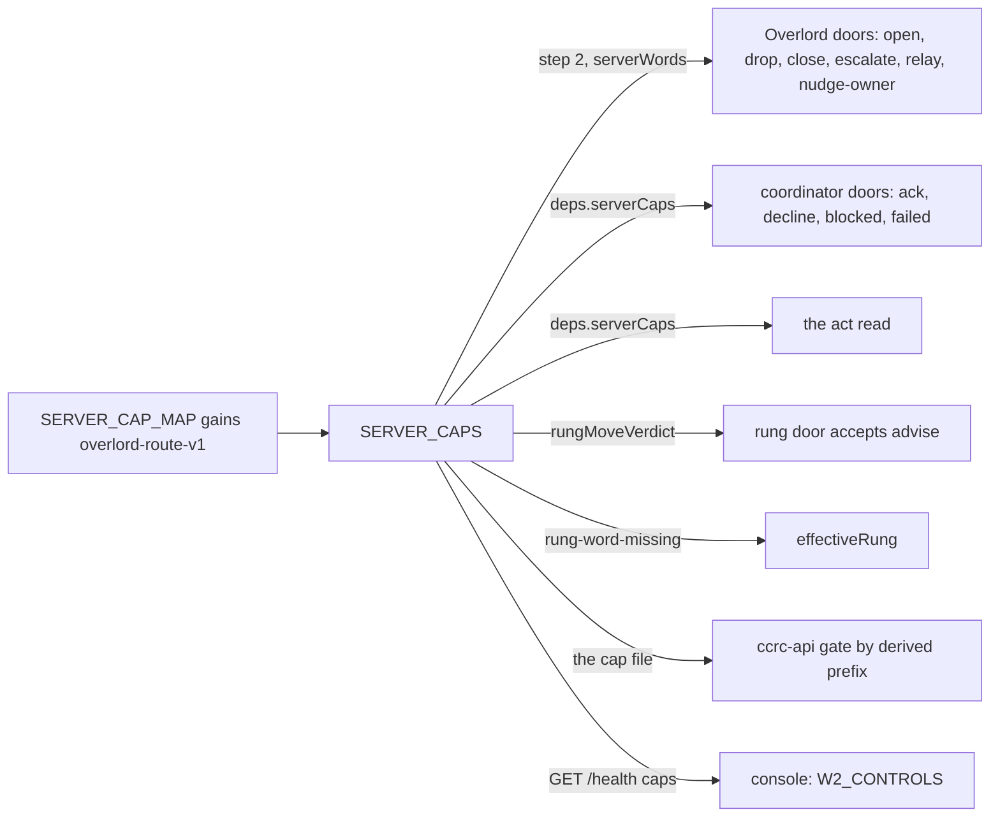
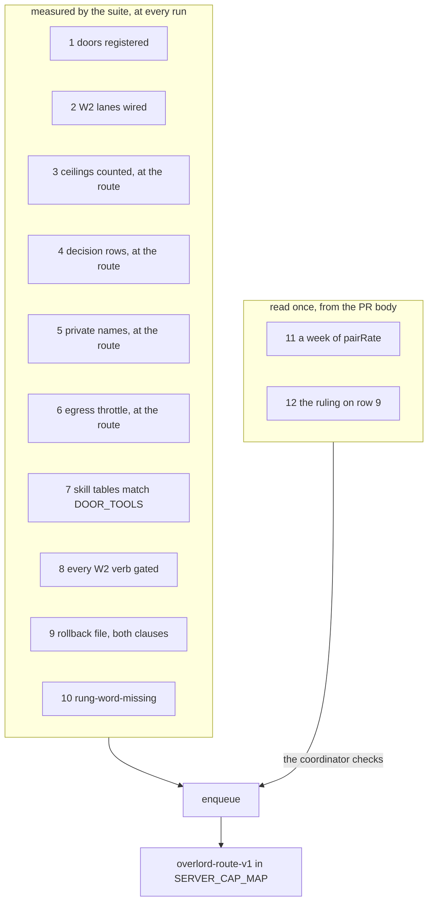
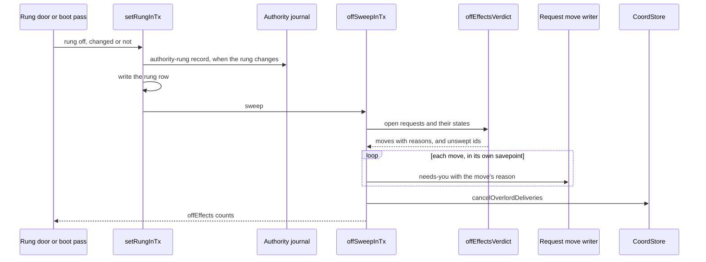

# Overlord W2: `overlord-route-v1`, the word that opens `advise` Implementation Plan

> **For agentic workers:** REQUIRED SUB-SKILL: Use superpowers:subagent-driven-development (recommended) or
> superpowers:executing-plans to implement this plan task by task. Steps use checkbox (`- [ ]`) syntax for tracking.

**Goal:** the server capability word `overlord-route-v1` moves from the ladder's `RUNG_WORDS_NOT_YET_SHIPPED` into
`shared/api.ts#SERVER_CAP_MAP`, so the rung door accepts `advise` and every W2 door that names the word stops refusing
`capability-missing`. The same pull request adds W2's part of `off`, as an idempotent sweep, and makes Pause cancel the
Overlord's queued mail. It makes the client and the console follow the word, and checks the skill's door tables against
the doors W2 built. A test holds the word back until W2 is ready.

**Why:** spec §14 (Table 14's W2 row: "the ladder at `advise`; the capability word `overlord-route-v1`"), §7.5 (H25,
the `advise` rung and "`off` is one transaction") and §11.4 ("`ccrc-api request ack` and the act read land in W2. Until
then each refuses `capability-missing`, naming `overlord-route-v1`"). Every other W2 piece lands dark behind this word.
This piece is the one switch that turns W2 on, so it carries the proof that W2 is ready to be on.

**Architecture:** one pull request in lane C, last of all. It adds one row to `SERVER_CAP_MAP` and removes one from
`RUNG_WORDS_NOT_YET_SHIPPED`. It adds one L0 table, one L1 decider, one sweep and one store method. It edits four
existing writers or readers:
- `setRungInTx`'s transaction and Pause;
- the composition root's boot passes;
- `ccd/ccrc-api`'s gate;
- the console's capability reader.

It adds no route, no table, no migration, no lane and no capability-floor row.

- `shared/overlordRequests.ts` (K, L0) gains `OFF_SWEEP`, keyed by request state: what `off` does to a request in it.
- `server/src/coord/overlordOff.ts` (C5, L1, new) holds `offEffectsVerdict`, which decides which requests move and with
  which reason. It makes no I/O.
- `offSweepInTx` (C5, L3, beside `setRungInTx` in the ladder's store) applies the verdict, one savepoint per move, and
  cancels the Overlord's queued mail. It is idempotent. It runs on every `off` that reaches `setRungInTx`, including
  one that answers `changed: false`, and once at boot while the stored rung reads `off` (ruled, fix round 1, F2).
- `CoordStore.cancelOverlordDeliveries` (`server/src/coord/store.ts`) is one scoped bulk write through the private
  `writeDeliveries`, beside `cancelOutstandingDeliveries`. Both `off` and Pause call it (ruled, fix round 1, F7).
- `server/test/overlord-route-readiness.test.ts` (new) is red while the word stands in `SERVER_CAP_MAP` and a readiness
  condition the tree can measure does not hold. Task 1 writes it. It passes on `main` until Task 2 moves the word.

**Tech Stack:** TypeScript (ESM), `node:sqlite`, vitest, bash (`ccd/ccrc-api`), React (the console's one reader). No
new dependency.

**Spec:** `docs/superpowers/specs/2026-11-09-overlord-design.md`:
- §7.5: H25, Table 7.5a, "`off` is one transaction", Pause, and "The ladder needs `overlord-v1`";
- §7.1: Table 7.1a's `advise` column;
- §11.1: Table 11.1d's capability-word row;
- §11.4: clause 22 and the doors it names;
- §11.5: Table 11.5, and "An older server reads the newer database";
- §14: Table 14, W2.

**The index:** `docs/superpowers/plans/2026-11-16-overlord-w2.md` (on `main`). This plan builds its row
`overlord-route-v1` (lane C, last of all) and the settled questions 14, 20 and 24. It reads these W1 plans, under
`2026-11-14-overlord-w1/`:
- `w1-ladder.md`: `RUNG_MAP`, `RUNG_WORDS_NOT_YET_SHIPPED`, `rungMoveVerdict`, `setRungInTx`, `LADDER_CAUSE_MAP`, the
  rung door and Pause;
- `w1-gates.md`: `OVERLORD_DOORS`' `word`, and the gate's step 2;
- `w1-home.md`: the console's one reader of the server's capability words;
- `w1-overlord-skill.md`: the door tables;
- `w1-sequence-monitor.md`: `sequence-stamp-census.test.ts`.

It also reads the W1 index's row `overlord-v1`. `w1-overlord-v1.md` is not written yet, so this plan takes
`overlord-v1`'s states from that row, and says so where it does.

**The W2 pieces this plan reads:**
- On `main`: the act catalogue, decision model, forecasts and health, overlaps, private names, remaining work, request
  record, revisions and vocabulary plans.
- In review: act rows and act journal (#2930), request ids and coordinator doors (#2931), relay (#2933), and done tests
  and follow-up (#2932).
- Not written yet: act reads, the operator's request doors, inbox band 3, the label queue, the board's W2 parts, home
  requests and W2 Settings. For those, this plan takes each interface from the index's Table W2 and question 7.

Written against `main` at `fe887521f` (2026-11-16), and revised in fix round 1 (review 2290). The coordinator's rulings
in that round are marked "(ruled, fix round 1)".

## In short

- **One pull request, five tasks, last of all in W2.** The word moves into `SERVER_CAP_MAP`. The rung door then accepts
  `advise` with no ladder edit, because the ladder already checks `RUNG_MAP.advise.needs` against `SERVER_CAPS`.
- **A suite decides whether the word may ship.** `overlord-route-readiness.test.ts` is red while the word stands and any
  of ten conditions the tree can measure fails (Table R1). Among them:
  - W2's lanes are wired;
  - the relay's egress checks, decision rows and ceilings answer at the route, not just exist as symbols;
  - the rollback measurement is on file;
  - the two clauses are in the coordinator's skill;
  - the ladder carries `rung-word-missing`.

  Only a week of the goal-conflict firing rate, and the coordinator's rulings on what it and the rollback measurement
  show, stay as evidence in the pull request body.
- **`off` is an idempotent sweep in W2** (ruled, fix round 1, F2). Every `off` that reaches `setRungInTx` runs it, a
  repeat that answers `changed: false` included, and a boot pass runs it while the stored rung reads `off`.
  - It moves every open request no owner has acknowledged to `needs-you`, and it cancels queued `overlord` mail.
  - Each move has its own savepoint, so a failing move is counted and never undoes the `off`.
  - Pending acts are settled by the settling lane, as they are at any rung.
- **Pause cancels the Overlord's queued mail** (ruled, fix round 1, F7). It leaves every request as it is, and the
  follow-up arm moves a due one to `needs-you`.
- **Every W2 door in the client and the console follows the word, through the reader each already has.** In the client,
  one `ccrc-api` gate covers prefixes derived from the doors. In the console, home A's capability reader checks
  `W2_CONTROLS`. The portfolio facts of question 20, and band 3's settle door under `overlord-v1`, stay live without the
  word.
- **No capability floor** (question 14). A rollback below the word sends nothing new. The ladder's `rung-word-missing`
  reads a stored `advise` as `chat` on a build without the word.
- **Nothing waits on the operator.** Raising the rung to `advise` stays the operator's own act, behind the step-up.

## 1. Open questions

The index's questions this plan builds on, each as ruled:

- **Q14 (settled):** no row in `ccd/ccrc#CAP_FLOOR_ROWS` for `overlord-route-v1` (slug `route-v1-has-no-floor`).
- **Q20 (ruled, fix round 1 of the index):** the remaining-work door, the forecast lane and `programmeHealth` are live
  at their merge. Of the coordinator doors, the four request doors (`ack`, `decline`, `blocked`, `failed`) and the act
  read refuse until the word ships. The Overlord's W2 doors refuse too.
- **Q24 (settled):** `advise` names `overlord-route-v1`. This piece moves the word.
- **Q28 (settled):** a request that needs a start or a proposal goes to `needs-you` through the escalate door. Nothing
  raises an item before W3, and neither `off` nor Pause raises one.

This plan's own questions, with each recommendation or ruling. None needs the operator: each is implementation detail
under a direction the spec already gives, or a spec delta the coordinator carries to the ledger fold.

- **RV1. Readiness is a suite, not a list** (slug `route-v1-readiness-is-a-suite`). The index asks for a checklist. A
  list in a plan is a request: the word could still ship while a condition fails. **Recommendation, amended (fix round 1,
  F1 and F5):**
  - Every condition the tree can measure is one case of `server/test/overlord-route-readiness.test.ts`, with one rule:
    while `SERVER_CAPS` holds `overlord-route-v1`, the condition must hold.
  - Each case is green on `main` today because the word is absent. It goes red the moment Task 2 moves the word, unless
    the condition holds by then.
  - A case measures wiring, not the presence of a symbol. A lane is a row of `LANE_SCHEDULE` that the composition root
    starts. A check is a refusal at the route, through the fixture harness. It never pins a tunable value, such as a
    ceiling's number (F10d).
  - The suite stays after the merge, so a later change that undoes a condition is red too: a stand-in rebound, a lane
    unwired, a door removed.
  - Only what needs a person stays as pull request body evidence: the week of `pairRate` (a time fact a hermetic test
    cannot hold), and the coordinator's rulings on what that week and the rollback measurement show (Table R1, rows
    11 and 12). The coordinator checks them before enqueueing, as it checks a wave-done.
- **RV2. Which requests `off` moves, and with which reason** (slugs `off-moves-every-unacknowledged-request` and
  `off-reason-for-a-declined-request`). §7.5 says "Open requests whose owner has not acknowledged move to `needs-you`".
  `REQUEST_TRANSITIONS`' server move `needs-you` takes `received`, `routed`, `in-progress`, `blocked` and `declined`
  (`w2-requests.md`, §5).
  **Recommendation, amended (fix round 1, F10b and F10e):** `OFF_SWEEP`, total over the ten request states, as below.
  - `received` has no owner yet, and `declined` has lost its owner, so neither has an acknowledgement. At `off` no
    Overlord will route either, so both reach the operator.
  - A `declined` request carries its own reason, `off-after-decline`. That tells the operator the owner declined it,
    not that nobody answered.
  - `in-progress` and `blocked` have been acknowledged by their owner and stay with it. The follow-up arm already moves
    a due one to `needs-you` at `off` (`w2-follow-up.md`, FU7, reason `due-unarmed`).

  | State | At `off` | Why |
  |---|---|---|
  | `received` | `needs-you`, reason `off-before-ack` | No owner has acknowledged it, and nobody will route it |
  | `routed` | `needs-you`, reason `off-before-ack` | Relayed, not acknowledged |
  | `declined` | `needs-you`, reason `off-after-decline` | Its owner declined it, and nobody will route it elsewhere |
  | `in-progress`, `blocked` | stays | Its owner acknowledged it |
  | `needs-you` | stays | Already with the operator |
  | `done-unverified` | stays | Waiting on the operator's confirm, which the operator's request doors make |
  | `done`, `failed`, `dropped` | stays | Closed |

  *Table RV2. `OFF_SWEEP`, by request state. The request record plan lists `off-before-ack` for this piece
  (`w2-requests.md`, "Move reasons"). `off-after-decline` is this piece's second word, added to `REQUEST_MOVE_REASONS`
  in this pull request.*

- **RV3. Which mail `off` cancels** (slug `off-cancels-queued-overlord-mail`). §7.5: "Undelivered `overlord` mail and
  kickoffs are cancelled." **Recommendation:**
  - Every `queued` delivery of a mail whose `fromId` is the Overlord's role id moves to `rejected`, with `rejectCode`
    `undeliverable` and a new `lastError`, `MAIL_OVERLORD_OFF_ERROR` (`'overlord off'`).
    - It goes through the one delivery writer, as `server/src/coord/store.ts#cancelOutstandingDeliveries` does for a
      closed run.
    - The role id is read from request ids' `OVERLORD_ID` constant (or whichever constant the role's id lands as),
      never a second literal (F10c).
    - The new error joins the deliberate cancels (`DELIBERATE_CANCEL_ERRORS_SQL`), so it is never read as abandonment.
  - A `delivered` but unacked delivery stays. Its nudge has already reached the coordinator, so the mail is no longer
    "undelivered", and cancelling it would hide a mail the coordinator may already be reading.
  - There are no kickoffs to cancel in W2. The Overlord sends none before W5's start door (index question 15), so the
    kickoff arm is W5's, and the sweep's comment says so.
- **RV4. Pending acts at `off`** (slug `off-settles-through-the-lane`). §7.5: "Pending acts are settled by measuring
  (§7.1)." Measuring an act is the settling lane's job (`w2-act-rows.md`, PR B, the `actSettle` row). In W2 its one
  measurer reads the private store (`ACT_SETTLE_MAP`'s `acknowledge` row), which a `coord.db` transaction cannot read.
  **Recommendation:** the sweep writes nothing for acts.
  - The settling lane re-measures every `pending` row at every rung, on its own `LANE_SCHEDULE` row and at boot. It does
    so on a coherent guard only. An incoherent guard leaves them to Confirm's reconciliation pass. So "settled by
    measuring" holds after `off`, without the sweep.
  - Readiness row 2 holds that the lane is wired.
  - A test pins that a `pending` act standing at `off` is settled by the lane's next pass, and that `off` changes no act
    row.
- **RV5. Pause cancels the Overlord's queued mail** (slug `pause-cancels-queued-overlord-mail`; ruled, fix round 1, F7).
  In W1 Pause always answers `changed: false`. From W2 it lowers `advise` to `chat`. The spec gives Pause only the rung
  move and the hold release (W3's). The mail lane checks no rung, so the Overlord's queued relays and nudges would still
  deliver after the operator's tap. **Ruled:**
  - Pause calls `CoordStore.cancelOverlordDeliveries`, the same writer `off` uses, in its own transaction.
  - It leaves every request's state as it is. At `chat`, the relay's and the request doors' cells refuse, and the
    follow-up arm moves a due request to `needs-you` (`due-unarmed`).
  - Pause stops the Overlord speaking at once, and that is what the operator taps it for.
  - It runs only when Pause lowers the rung (`changed: true`). A Pause from `chat` or `off` changes nothing, as in W1.
    At `off` the sweep has already cancelled the mail.

  This is a spec delta, which the coordinator carries to the ledger fold (Section 12).
- **RV6. One gate in `ccrc-api` for every W2 verb, by derived prefix** (slug `route-v1-gate-by-route-prefix`).
  - The coordinator doors plan gives its four `request` verbs a cap-file gate. The request record and relay plans give
    their six Overlord verbs none. One gate per piece would be a parallel mechanism per verb.
  - **Recommendation, amended (fix round 1, F4):** one gate block in `ccd/ccrc-api`, in the idiom of the timers' gate.
    It refuses `capability-missing` unsent when a current cap file omits the word, and it matches by the route's path
    prefix (the row's template, `$tmpl`, is in scope where the gates sit).
  - The prefix list is not a hand list the test trusts. It holds `/api/overlord/requests`, `/api/overlord/relay`,
    `/api/requests/` and `/api/acts` today, and Task 4's test derives the expected set. That set is the paths of every
    `OVERLORD_DOORS` row whose word is `overlord-route-v1`, with every Table R2 door that refuses without the word. The
    test reds a door whose `ROUTES` row is not under a gated prefix, and a gated prefix that no such door is under.
  - This piece folds the coordinator doors' block into the one gate.
  - Two rows are outside the prefixes and live, as they should be:
    - the remaining-work row, under `/api/coord/programmes/` (question 20);
    - band 3's settle door, `POST /api/overlord/inbox/settle`, whose word is `overlord-v1`.
  - Every client gate here fails open: an absent, stale or torn cap file sends. So the server's refusal stays the
    authority, and the gate only saves a round trip.
  - If `overlord-v1` ships a table from verb to word for the Overlord's W1 verbs, the gate becomes one row of that table
    per prefix instead, and the test is the same.
- **RV7. Which console controls follow the word** (slug `console-follows-the-door`). The index says "the console shows
  no W2 door" without the word, yet the ruling door, the list upload and the decision-model rows refuse nothing without
  it. **Recommendation, amended (fix round 1, F9):**
  - A console control follows the word when its door refuses without it, or when what it acts on cannot exist without
    the word.
  - Home A's one capability reader decides it, from one table in the console, `W2_CONTROLS`. Each W2 control has a row
    with its word or `null`.
  - **These follow the word:**
    - the Requests part and its rows' controls (answer, confirm, withdraw, take, hand back);
    - Seen and overturn on an act row;
    - the act head line.

    The operator's request doors carry no capability check of their own (`w2-operator-request-doors.md`, OD13). Their
    controls follow the word because no request exists before it: a request is made only by the open door, which
    refuses without the word. Seen and overturn act on act rows, which no door writes before the word either, except
    `acknowledge`'s under `overlord-v1`.
  - **These are live without the word (`null`):**
    - the goal-conflict ruling control;
    - the private-name upload;
    - the decision-model rows, their key and their ceiling;
    - the label cards;
    - the portfolio strip's health and dates.

    The overlaps plan needs the ruling control live before the word, so that a `goal-conflict-open` refusal always has
    a door that lifts it (`w2-overlaps.md`, question 2). The decision model must gather labels in shadow before
    anything arms.
  - Each `null` row is cross-checked against the door it calls: a `null` row whose door refuses `capability-missing`
    without the word is red, because its control would answer 501.
  - The pieces that build those controls take their row when they land. This piece adds the table and its test if no
    earlier console piece has, and fills every missing row.
- **RV8. A stored `advise` after a rollback** (slug `rung-capped-by-server-words`). With no floor, the operator can roll
  the server back below the word while the ladder row reads `advise`. W1's ladder reads every rung word, so on that
  build `effectiveRung` answers `advise` though no W2 door exists there. Nothing then acts:
  - W1's doors are allowed at `chat` and `advise` alike;
  - the follow-up, relay and request doors are absent.

  But the console would show a rung the server cannot keep.
  **Recommendation, amended (fix round 1, F6):**
  - The ladder gains one condition row, `rung-word-missing`. It caps the rung at the highest rung whose `needs` word is
    in `SERVER_CAPS`, and it lifts by itself when the word returns.
  - It must be in the build a box rolls back TO, so it belongs to the ladder's builder. The coordinator carries it into
    the ladder's build brief.
  - Readiness row 10 measures it, as a row of `LADDER_CAUSE_MAP` that `effectiveRung` reads. So the word cannot ship
    while the ladder lacks it.
  - It is a Table 7.5a row that the spec does not have, so it is recorded in the index as a spec delta.
- **RV9. `CLAUDE.md`'s bullet** (slug `claude-md-route-v1-bullet`). The index's W1 row `overlord-v1` adds a
  `ccrc-overlord` bullet. **Recommendation, amended (fix round 1, F10f):**
  - One bullet, under "Coordination (Build 7) invariants a coder must NOT break", written in Task 5.
  - It says what the word opens and how the readers follow it, that only the operator raises `advise`, what `off` and
    Pause do, that the word has no floor, and what holds it back.
  - It is worded as what the word opens, never as a present-tense absence this same pull request ends.
  - It has no count word, so `overlord-skill.test.ts`'s count-word scan has nothing to read in it.
- **RV10. Measuring the goal-conflict signal** (slug `goal-signal-read-a-week-before-route-v1`). The overlaps plan
  records goal-conflict pairs from overlaps A's merge, and refuses on them only after the firing rate is measured
  (`w2-overlaps.md`, the coordinator's ruling on F3). It gives no length or threshold. **Recommendation:**
  - The word ships only after `pairRate` on `GET /api/portfolio` shows at least one full week since overlaps B's merge,
    which is when the ruling door exists, and so does the refusal's way out.
  - The pull request body quotes that week's goal-conflict episodes, and the coordinator reads them before enqueueing.
  - No number is set here. If the coordinator reads the rate as noise, it rules on that before the word ships, as the
    overlaps plan asks, by tightening `GOAL_CONFLICT_TRIPLES_MIN` in a pull request of its own.
- **RV11. `off` is an idempotent sweep** (slug `off-sweep-is-idempotent`; ruled, fix round 1, F2). Three paths reach a
  stored `off` without the transaction that would run W2's effects:
  - a repeat `off`, which answers `changed: false` and appends nothing;
  - Confirm the restore folding the rung down to `off`, whose reconciliation pass moves requests only from journal facts
    and touches no mail;
  - `off` taken on an older build after a rollback, which has no W2 effects.

  **Ruled:**
  - `offSweepInTx` runs on every `off` that reaches `setRungInTx`, `changed: false` included, and on `row-only`
    (`journalled: false`).
  - A boot pass runs it once while the stored rung reads `off`.
  - It uses the same decider and the same writers on every path, and adds no second mechanism.
  - It is idempotent: a request it moved is in `needs-you` and stays, and a delivery it cancelled is `rejected` and no
    longer `queued`, so a second run finds nothing.
  - A Confirm fold to `off` reaches the sweep through the boot pass or the next `off`. Confirm itself still runs none of
    `off`'s effects, as the ladder's F6 rules.

## 2. What exists today

Measured on `main` at `fe887521f`.

- **The capability words.** `shared/api.ts#SERVER_CAP_MAP` holds ten words: `dispatch-live-gate-v1`,
  `hook-main-state-v1`, `ask-pairing-v1`, `questions-v1`, `review-rounds-v1`, `goals-read-v1`, `calls-v1`, `plan-v1`,
  `timers-v1` and `push-outbox-v1`.
  - `shared/api.ts#SERVER_CAPS` derives from its keys.
  - `ServerCap` is a union written out beside it, so a word added to the union and not to the map is a compile error.
  - Neither `overlord-v1` nor `overlord-route-v1` is there.
- **The cap on `shared/api.ts`.** `server/test/growth-caps/shared-api-ts.json` caps the file at 5,140 code lines, and it
  holds 5,106 (`codeLines`, measured with `server/test/growthCheck.ts`). W1's `overlord-v1` takes one or two of the 34
  lines left, and this piece takes one or two (Section 7).
- **The ladder is not built.** `w1-ladder.md` plans `RUNG_WORDS_NOT_YET_SHIPPED`, `RUNG_MAP`, `LADDER_CAUSE_MAP`,
  `rungMoveVerdict` and `setRungInTx` (questions 1, 9 and 23, and Task 4). None of them is in `server/src` or `shared`.
  This plan reads them as that plan defines them:
  - `RUNG_MAP.advise.needs` is `'overlord-route-v1'`. The rung door refuses a raise to `advise` with
    `capability-missing` naming that word, before the account gate is asked.
  - `deps.serverCaps` is wired to `SERVER_CAPS`, so a test can widen it.
  - `RUNG_WORDS_NOT_YET_SHIPPED` is `{ 'overlord-route-v1': 'W2', 'overlord-answer-v1': 'W3' }`, shrink-only.
    `ladder-rung-words.test.ts` reds a `needs` word that is in both the list and `SERVER_CAPS`, or in neither.
  - `setRungInTx` is one of the two writers of `operatorRung`; the other is `applyRestoreInTx`. A move to `off` runs in
    its one transaction, and its comment lists W2's effects for W2 to add.
  - A repeat `off` answers `changed: false` and appends nothing.
  - Pause sets the rung to the lower of itself and `chat`.
- **The Overlord's doors refuse at the gate.** `w1-gates.md` gives each `OVERLORD_DOORS` row a `word`. The gate's
  step 2 refuses `capability-missing` naming it when the word is not in `serverWords` (`SERVER_CAPS`).
  - The request record and relay plans give their six doors `word: 'overlord-route-v1'`.
  - The coordinator doors plan checks the word through `deps.serverCaps` before reading the body (its RD2).
- **The client's gates.** `ccd/ccrc-api#ROUTES` has 84 rows.
  - Each word-gated family has one block that refuses unsent, through `_api_server_cap <word>`, when a current,
    well-formed cap file omits the word. The blocks are `questions-v1`, `review-rounds-v1`, `goals-read-v1`,
    `calls-v1`, `plan-v1` and `timers-v1`.
  - An absent, stale, torn or future cap file sends, and the server answers.
- **The skill's door tables.** `ccd/overlord-skill/references/starting.md`'s door table and `routing.md`'s doors line
  name `relay`, `close-request`, `drop-request` and `nudge-owner` under `overlord-route-v1`.
  - The request record plan adds `open-request` and `escalate-request` (its Task B5).
  - The relay plan names its second tool `relay nudge` and its door row `relay-nudge` (its Task A6).
  - The coordinator ruled that `nudge-owner` wins (fix round 1, F8): the spec, the act kind, the ceiling group, the act
    journal and the merged skill tables all read `nudge-owner`.
  - `server/test/overlord-skill.test.ts` checks each door's word against its wave in Table 11.1e, but not against
    `ccd/door-process.mjs`'s `DOOR_TOOLS`.
- **The W2 lanes** (planned, not built). The `LANE_SCHEDULE` row names are fixed by their plans:
  - `actSettle` (act rows B);
  - `followUps` (follow-up);
  - `doneTests` (done tests B);
  - `overlaps` (overlaps A).

  The act journal's boot coherence is a boot step, not a lane (act journal B).
- **Mail cancels.** `server/src/coord/store.ts#cancelOutstandingDeliveries` parks a closed run's outstanding
  deliveries as `rejected('undeliverable')`, with `server/src/coord/store.ts#MAIL_RUN_CLOSED_ERROR`.
  - It writes through the private `writeDeliveries`, which owns the terminality guard.
  - Each deliberate cancel's error joins `DELIBERATE_CANCEL_ERRORS_SQL`.
  - No writer cancels by sender today.
- **The request move censuses** (planned). `request-move-callers.test.ts` (request record A) holds each
  `planRequestMoveInTx` call's actor to its file's door group. `sequence-stamp-census.test.ts` (sequence and monitor)
  maps each stamped kind to its writers.
- **The capability floor.** `ccd/ccrc#CAP_FLOOR_ROWS` names ccd facts only, and no server word has a row (question 14).
- **The clauses.**
  - Clause 22 (the Overlord clause, §11.4) is not written: `w1-coordinator-clause.md` waits on the operator's wording.
    It names `ccrc-api request ack` and the act read, which are W2's.
  - The recall clause is open as #2919.
  - Both land in `ccd/coordinator-skill/SKILL.md`, whose clauses `coordinator-skill.test.ts` pins verbatim.

*Figure R1. One row in `SERVER_CAP_MAP` reaches every reader through `SERVER_CAPS`. No reader keeps a copy of the
word's state.*

## 3. Readiness: what must be true before the word ships

The pull request is enqueued only when every row of Table R1 holds. Rows 1 to 10 are cases of the readiness suite
(RV1). Each one measures wiring through the route, the lane table or the composition root. Rows 11 and 12 need a person:
they are evidence in the pull request body, and the coordinator checks them.

| # | Condition | Owner piece | How it is measured |
|---|---|---|---|
| 1 | Every W2 door is registered, and W1's `overlord-v1` is shipped | all of Table W2; W1 | The suite finds every Table R2 door registered (its route found by `server/test/scan/parse.js`). Each Overlord door has its `OVERLORD_DOORS` row with word `overlord-route-v1`, and `SERVER_CAPS` holds `overlord-v1`. A missing door is red, named |
| 2 | Every W2 lane is wired | act rows B, follow-up, done tests B, overlaps A, act journal B | A closed list in the suite, `W2_LANES` (`actSettle`, `followUps`, `doneTests`, `overlaps`), is checked both ways against `server/src/laneSchedule.ts#LANE_SCHEDULE`, and each is started by the composition root's lane wiring. The act journal's boot coherence is a step of the composition root's boot passes, found the same way |
| 3 | The act ceilings' counts are wired | act rows A | The composition root's gate-runner deps bind `actCountReaderInTx`, and no `server/src` file but the catalogue's own test seam constructs the `not-wired` default (`{ kind: 'unmeasured', why: 'not-wired' }`). Route-level: with the count at the catalogue's own ceiling for the `relay` group, read from the catalogue and not written in the test, a relay through the fixture harness refuses `act-ceiling` |
| 4 | The decision-model rows the relay needs answer at the route | decision model A and B, relay B | Route-level, through the fixture harness and a fake `DecisionModel` that records its calls. With every row as shipped (`off`), a relay asks the model nothing. With `scope.widens` set to `shadow`, a widening relay records the check and keeps the code verdict. With `relay.method` set to `armed` and the fake answering yes, the relay refuses `relay-carries-method` |
| 5 | Private names B is shipped, and the relay calls it | private names B, relay B | Route-level: with an uploaded list that cannot be read, a relay answers `egress-refused`, with no mail queued and no act row written. With no list ever uploaded, the relay passes and its act row records `skipped: no-list` |
| 6 | The relay's egress throttle is live | relay B | Route-level: after the throttle's count of `egress-refused` answers in its window, read from the relay's own constants, the next relay is refused `egress-refused` (`throttled`) without running the checks |
| 7 | The skill's door tables match the doors | every door piece | Task 4's check: every `DOOR_TOOLS` tool whose door's word is `overlord-route-v1` is a row of `starting.md`'s door table with that word, and every such row names a tool. `nudge-owner` is the door's one name |
| 8 | Every W2 client verb is gated | every verb piece | Task 4's check: every `ROUTES` row whose door refuses without the word is under a gated prefix, and is refused unsent under a current cap file without the word |
| 9 | Request ids B's rollback measurement is on file, and both clauses are in the coordinator's skill | request ids B; W1a recall clause; W1 Overlord clause | `docs/superpowers/plans/2026-11-16-overlord-w2/w2-request-ids/rollback-measurement.md` exists. `ccd/coordinator-skill/SKILL.md`'s contract holds the recall clause and clause 22, found by phrases each pins verbatim ("check what you recall against" and "An Overlord may stand above you"). Clause 22 names `ccrc-api request ack` and the act read, which this piece opens |
| 10 | The ladder caps a rung its server cannot keep | the ladder (W1) | `LADDER_CAUSE_MAP` has the condition `rung-word-missing`. With `operatorRung` `advise` and `SERVER_CAPS` narrowed by the seam to lack the word, `effectiveRung` reads `chat` (RV8) |
| 11 | The goal-conflict signal is measured | overlaps A and B | The body shows a full week of `pairRate` since overlaps B merged, with its goal-conflict episodes quoted, and the coordinator's reading (RV10) |
| 12 | The coordinator has ruled on row 9's measurement | request ids B | The body shows the coordinator's ruling on a guard, if the measurement shows more than one notice and one push per parked `overlord` mail (request ids RI14) |

*Table R1. The readiness conditions. Rows 1 to 10 are measured by the suite at every run, and none pins a tunable
value. Rows 11 and 12 are read once, before the enqueue.*

| Door | Gate | Piece |
|---|---|---|
| `POST /api/overlord/requests`, `.../:id/drop`, `.../:id/close`, `.../:id/escalate` | Overlord door, word `overlord-route-v1` | request record B |
| `POST /api/overlord/relay`, and `nudge-owner` at `POST /api/overlord/relay/nudge` | Overlord door, word `overlord-route-v1` | relay A |
| `POST /api/requests/:id/ack`, `decline`, `blocked`, `failed` | box token, attribution, owner; `deps.serverCaps` | coordinator doors |
| `GET /api/acts` | box token or session; refuses without the word | act reads |
| `POST /api/requests/:id/answer`, `confirm`, `withdraw`, `take`, `hand-back`; `GET /api/requests` | session; no word of its own (OD13) | the operator's request doors |
| `POST /api/acts/:id/seen`; `POST /api/digest/correct` kind `overlord-act` | session | act reads |

*Table R2. The doors row 1 checks are registered. The first four groups refuse without the word, and row 8 holds the
client's gate over them. The act read's and the operator's paths are the index's question 7: their pieces may refine a
path, and the suite reads whichever path the piece registered.*

*Figure R2. The two halves of readiness. The suite keeps holding after the merge, and the body's evidence is read
once.*

## 4. What a merge arms, and the rollback below the word

**At merge, on the server that carries the build:**

- The rung door accepts a raise to `advise`. The raise needs the step-up, goes through the account gate, and is
  journalled. The operator makes it. Nothing raises the rung on its own, and a box whose rung is `chat` stays at
  `chat`.
- Every door of Table R2 stops refusing `capability-missing`. Until the operator raises the rung, the Overlord's write
  doors still refuse `rung-below` at `chat`, by the catalogue's cells.
  - `open-request` is allowed at `chat` by its cell (Table 7.1a), so the Overlord can open a request at `chat`.
  - Escalate and relay are refused there. So the request waits as `received` until the follow-up arm, which is unarmed
    at `chat`, moves it to `needs-you` once due (FU7, `due-unarmed`).
- Table 7.5a's caps at `advise` start to bite, because the operator's rung can now be above them. On a one-box install
  `server-isolation` reads `shared-user`, so its condition caps the rung at `advise`. That is also the ceiling until a
  split install exists.
- `ccrc-api`'s W2 verbs send, once the fleet box's cap file is refreshed. The console shows the controls of
  `W2_CONTROLS` that follow the word.
- The `off` sweep is live (RV2, RV3, RV11). Pause from `advise` lowers to `chat` and cancels queued `overlord` mail
  (RV5).
- Clause 22's two doors answer: `ccrc-api request ack` and the act read.

**What does not change at merge:**
- The decision model stays `off` row by row, and only the operator switches a row.
- The private-name check runs only once a list is uploaded.
- The follow-up arm acts only at `advise` or `full`.
- The portfolio facts were live already (question 20), and so was band 3's settle door under `overlord-v1`.
- No hold exists before W3, and nothing raises an item.

**The rollback below the word** (question 14, RV8, RV11):

- **The server is rolled back to a build without the word,** at W1, or at W2 before this piece:
  - W2's tables and columns are ignored (Table 11.5: "Ignored").
  - The Overlord's W2 doors refuse `capability-missing` again (on a W2 build), or have no route (on a W1 build).
  - Open requests stay as they are. When the newer build returns, its boot pass runs the sweep if the stored rung
    reads `off`, so an `off` taken on the older build is completed. Each request is re-measured, and a follow-up that
    came due in the gap is timed again (§11.5).
  - Queued `overlord` mail meets the older mail lane, which request ids B measured (Table R1, rows 9 and 12).
  - A stored `advise` reads as `chat`, by `rung-word-missing`, on any build that carries the ladder (row 10).
- **The fleet box's `ccrc-api` is older than the server:** it has no W2 rows. A W2 verb is refused locally as an
  unknown verb, and the Overlord's door tools fail on the missing row. Nothing is sent.
- **The fleet box's `ccrc-api` is newer than the server:** its gate reads a current cap file without the word and
  refuses unsent. A cap file that is not current sends, and the older server answers 404.
- **No floor stops the rollback,** and `ccrc update`, `rollout` and `rollback` need no `--below-cap` for it. W3's floor,
  below `push-outbox-v1`, is the first server-word floor.

## 5. `off` and Pause in W2

`setRungInTx`'s one transaction keeps W1's order: the authority record first (`appendInTx`), then the rung row. The W2
sweep, `offSweepInTx`, follows inside the same transaction whenever the target is `off`, whether or not the rung
changed, and whether or not the journal append landed (`row-only`).

A lowering never fails because of what it moves. A move whose writer throws is rolled back to its own savepoint and
counted as `failed`, and the rung write and the other moves stand (fix round 1, F3). The decider is total. A row whose
state word this build cannot read is skipped and counted as `unswept`, never a refusal (the ladder's brakes over bad
rows, its question 21).

*Figure R3. The `off` sweep in W2. The boot pass calls the sweep alone, in its own transaction, while the stored rung
reads `off`. The settling lane measures pending acts afterwards, as at any rung (RV4).*

- **The decider.** `offEffectsVerdict(rows)` (L1) takes the open requests' ids and stored state words. It answers
  `{ moves, unswept }`.
  - `moves` holds each id whose state's `OFF_SWEEP` row is `needs-you`, with the row's reason.
  - `unswept` holds each id whose stored state word this build cannot read.
  - It never answers a refusal.
- **The moves.** Each move goes through the request record's one move writer (`planRequestMoveInTx`, then
  `applyRequestMoveInTx`), as a server move to `needs-you` with its reason, inside its own savepoint.
  - The writer stamps the `request` row of `SEQUENCE_KIND_MAP` and writes the move's news row.
  - A moved request then shows in the "needs you" group of the operator's Requests rows.
  - The call's actor is `'server'`, so the ladder's store joins `request-move-callers.test.ts`'s list of `server`
    callers. The writer is already in `sequence-stamp-census.test.ts`'s map, and that census runs in Task 3.
- **The mail.** `CoordStore.cancelOverlordDeliveries()` parks every `queued` delivery of a mail from the Overlord's
  role id as `rejected('undeliverable')`, with `MAIL_OVERLORD_OFF_ERROR` (RV3). It returns `{ changed }`, as every
  scoped bulk write does (`DeliveryBulkWrite`).
- **The boot pass.** One call among the composition root's boot passes. If the ladder reads a stored `off`, it runs
  `offSweepInTx` in its own transaction. An unmeasured ladder runs nothing, and the next pass or the next `off` runs it.
  It appends nothing to the authority journal, because it changes no authority.
- **The answer.** The rung door's answer gains `offEffects: { requests, mail, unswept, failed }`. The field is additive:
  an older console ignores it. It is present on every call whose target is `off`.
- **Pause** (RV5). When Pause lowers the rung, its transaction also calls `cancelOverlordDeliveries`. It moves no
  request, and its answer gains `offEffects` with `requests: 0`.
- **What the sweep does not do:**
  - settle acts (RV4);
  - stop follow-ups, because the arm reads the rung itself (FU7);
  - cancel kickoffs, which are W5's.

  The sweep's comment lists each of these, with where it happens.
- **Confirm the restore** folding a rung down to `off` still runs no effect itself, as the ladder rules (F6). The boot
  pass, or the operator's next `off`, completes it (RV11).

## 6. Global constraints

- **Architecture (`CLAUDE.md`).**
  - One writer per fact. `SERVER_CAP_MAP` stays the only place the word's state is written. The ladder, the gate, the
    coordinator doors, the act read and the console all read `SERVER_CAPS`, and `ccrc-api` reads the cap file the
    server writes from it.
  - `OFF_SWEEP` is a row per state in the request vocabulary's own L0 file, so a new request state is a compile error
    until it is placed.
  - The `off` decider is L1 and makes no I/O. The sweep acts on its verdict, and the rung door and the boot pass only
    call it.
  - The mail cancel goes through the one delivery writer, and both `off` and Pause call that one method. Request moves
    go through the one move writer.
  - No second mechanism is added: the client's gate joins the existing gate blocks and absorbs the coordinator doors'
    block (RV6), and the console reads home A's reader (RV7).
- **Wire.** Additive only: `offEffects` on the rung door's and Pause's answers, and the word in `GET /health`'s
  `caps`. No `FLEET_PROTO` change.
- **What a merge arms:** Section 4.
- **Growth.** Two growth-checked files change:
  - `shared/api.ts`, +1 or +2, under its total cap;
  - `server/src/coord/store.ts`, +8.

  `server/src/index.ts` is not listed and gains one boot call. Neither is `ccd/ccrc-api`, `pwa/src/**` (other than
  `pwa/src/lib/api.ts`, which is untouched) nor the ladder's store. Section 7 has the estimates.
- **Mutation.** `offEffectsVerdict` joins `MUTANT_SETS` (`server/test/sim/mutation-floors.test.ts`) and
  `server/test/sim/mutation-floors.json` in this pull request. The readiness suite is itself a guard, and Task 1's
  mutation step proves each case red with the word present and its condition removed.
- **Time.** The new L1 module reads no clock. `setRungInTx` already takes `at` from its caller, and the boot pass takes
  it from the composition root's `Clock`. The module joins `server/test/single-definition/time-ports.test.ts`'s module
  list, which holds that it reads no ambient clock.
- **Public repository.** No name, host or ticket. The plan cites by symbol and file, and the private-name scan runs over
  every changed file.
- **Tests.** From `server/`, in the foreground, one file at a time, through `ccrc test --
  ./node_modules/.bin/vitest run test/<file>`. Each task that changes `shared/` also runs these typechecks:
  - `ccrc test -- npx tsc --noEmit -p tsconfig.json` and `-p test/tsconfig.tests.json`, in `server/`;
  - `ccrc test -- ./node_modules/.bin/tsc --noEmit`, in `pwa/`.

## 7. The PR split

| PR | Tasks | What it ships | Needs first | Growth-checked files, estimate |
|---|---|---|---|---|
| `overlord-route-v1` | 1 to 5 | The readiness suite; the word moved; the rung door at `advise` and Table 7.5a's caps reached; the `off` sweep and its boot pass; Pause's mail cancel; the client gate by derived prefix; `W2_CONTROLS`; the skill tables checked; `CLAUDE.md`'s bullet | Every other W2 piece and W1's `overlord-v1` (Table R1, row 1); the ladder with `rung-word-missing` (row 10); rows 11 and 12's evidence | `shared/api.ts` +1 to +2 (one map row; the union line edited in place, or one new line), under its total cap; `server/src/coord/store.ts` +8 (the cancel writer and its error constant). Not listed: `shared/overlordRequests.ts` +14, `server/src/coord/overlordOff.ts` +45 (new), the ladder's store +30, `server/src/index.ts` +1, `ccd/ccrc-api` +6 net (one block in, the coordinator doors' block out) |

The index's row says four tasks. This plan has five, because readiness is its own red-first task (RV1). Nine is the
limit.

## 8. Review focus

1. No reader keeps its own copy of the word's state: every reader goes through `SERVER_CAPS`, or the cap file the
   server writes from it.
2. The readiness suite measures wiring, and pins no tunable value. Each case is red with the word present and its
   condition broken (Task 1's mutation step), and passes with the word absent.
3. The `off` sweep runs on a repeat `off`, on `row-only` and at boot. It is idempotent, and a throwing move is counted,
   never a refusal.
4. Pause cancels queued `overlord` mail and moves no request. Confirm's fold to `off` runs no effect itself.
5. The client's gate prefixes are derived from the doors. The remaining-work verb and band 3's settle door stay live.
6. `W2_CONTROLS`' `null` rows are cross-checked against their doors.

## 9. Tasks

### Task 1: The readiness suite, red as soon as the word is present

**Files:**
- Create: `server/test/overlord-route-readiness.test.ts`

- [ ] **Step 1: The rule.** Write one helper, `whileShipped(name, check)`.
  - When `SERVER_CAPS` holds `overlord-route-v1`, it runs `check` and expects it to hold.
  - Otherwise it asserts that the word is still in `RUNG_WORDS_NOT_YET_SHIPPED`, so the suite never passes vacuously
    with the word in neither place.
  - The suite's header states what it cannot measure: Table R1's rows 11 and 12, read from the pull request body.
- [ ] **Step 2: The cases**, one per row 1 to 10 of Table R1, each reading the tree as its row says:
  - Row 1 reads the routes through `server/test/scan/parse.js`, as the door censuses do, and reads `OVERLORD_DOORS`.
  - Row 2 holds `W2_LANES` as a closed list. It checks the list against `LANE_SCHEDULE` both ways (a W2 row not in the
    list is red too). It checks that the composition root's lane wiring starts each one, and that the act journal's
    boot coherence is among its boot passes.
  - Rows 3 to 6 run through the fixture harness: an in-memory `coord.db`, a temp private store, the fake clock, a fake
    `DecisionModel`, and the relay route registered as production registers it. Each reads every value it compares
    from the module that owns it, never a literal. So a later tune of a ceiling or the throttle reds nothing (fix round
    1, F10d).
  - Rows 7 and 8 import Task 4's checks, not copies of them.
  - Row 9 reads the measurement file and `ccd/coordinator-skill/SKILL.md`'s contract.
  - Row 10 reads `LADDER_CAUSE_MAP` and calls `effectiveRung` with `SERVER_CAPS` narrowed through the seam.
- [ ] **Step 3: Run it.** Run `cd server && ccrc test -- ./node_modules/.bin/vitest run
  test/overlord-route-readiness.test.ts`.

  Expected: PASS on a tree without the word, every case reporting "not shipped".
- [ ] **Step 4: Mutation.** With `SERVER_CAPS` widened by the test's seam, break each condition in memory, one mutant
  per case, with `mutation-run.py` (the coordinator skill's `references/`). The mutants:
  - drop one Table R2 door row;
  - unwire `actSettle` from the composition root;
  - bind the `not-wired` default;
  - make the relay skip its `relay.method` check;
  - make the relay pass on an unreadable list;
  - drop the throttle's check;
  - drop one skill table row;
  - drop the gate block;
  - delete the rollback measurement file;
  - drop `rung-word-missing` from `LADDER_CAUSE_MAP`.

  Expected: every mutant killed. Record the counts in the commit body.
- [ ] **Step 5: Commit** the suite alone: `test(overlord): the readiness suite that holds overlord-route-v1 back`.

### Task 2: The word moves, and the rung door reaches `advise`

**Files:**
- Modify: `shared/api.ts` (`ServerCap` and `SERVER_CAP_MAP`: one row, with its promise in the comment)
- Modify: `shared/overlord-ladder.ts` (`RUNG_WORDS_NOT_YET_SHIPPED` loses `overlord-route-v1`)
- Modify: the ladder's door test and `server/test/single-definition/ladder-rung-words.test.ts`, only if a run asks
- Test: `server/test/overlord-route-advise.test.ts` (new)

- [ ] **Step 1: Failing tests.** Use an in-memory `coord.db`, a fake account gate, a fake `AuthorityAppender` and the
  fake clock, with the production `SERVER_CAPS`, not a widened seam:
  - A raise from `chat` to `advise` asks the gate with `stepUp: true`. Refused, it writes nothing. Passed, it appends
    `authority-rung {from: 'chat', to: 'advise'}` and writes the row.
  - With `operatorRung` `advise`, `effectiveRung` is `advise` when no cap stands.
    - Each Table 7.5a row whose effect caps at `advise` leaves it at `advise`.
    - Each row that caps at `chat` (a restore, a degraded generation, the load line, probes failed twice) lowers it to
      `chat`.
    - The off-model row lowers it one rung, to `chat`.
  - A `shared-user` isolation reading caps `full` at `advise` and leaves `advise` at `advise`. So `advise` is reachable
    on a one-box install.
  - A raise to `full` still refuses `capability-missing`, naming `overlord-answer-v1`.
  - In `GET /api/overlord/ladder`, the `rungs` row for `advise` reads `available: true`.
- [ ] **Step 2: Run** `overlord-route-advise.test.ts`. Expected: FAIL on the raise and on `available`.
- [ ] **Step 3: Implement.**
  - Add `'overlord-route-v1'` to the union and the map. Its comment names the doors it opens (Table R2), says "Added by
    the change that opens `advise`, cut after every W2 piece merged", and names the readiness suite.
  - Remove the word from `RUNG_WORDS_NOT_YET_SHIPPED`.
- [ ] **Step 4: Run** these suites:
  - `overlord-route-advise.test.ts`;
  - `ladder-rung-words.test.ts`;
  - the ladder's door suite;
  - the readiness suite;
  - `server-caps.test.ts` and `ccd-update-sync.test.ts`, which hold the bash spellings of the cap file.

  Expected: PASS. If the readiness suite is red, stop: a condition of Table R1 fails, and the task waits for its piece.
  The word does not ship around it.
- [ ] **Step 5: Growth.** Run `ccrc test -- ./node_modules/.bin/vitest run test/growth-caps.test.ts` and the growth
  check. Expected: `shared/api.ts` within its cap.
- [ ] **Step 6: Commit:** `feat(overlord): overlord-route-v1 ships, and the rung door accepts advise`.

### Task 3: The `off` sweep, its boot pass, and Pause's mail cancel

**Files:**
- Modify: `shared/overlordRequests.ts`:
  - `OFF_SWEEP`, total over the ten request states;
  - `off-after-decline` in `REQUEST_MOVE_REASONS`, and `off-before-ack` too if the request record has not added it.
- Create: `server/src/coord/overlordOff.ts` (`offEffectsVerdict`, L1)
- Modify: `server/src/coord/store.ts`:
  - `MAIL_OVERLORD_OFF_ERROR`, joining `DELIBERATE_CANCEL_ERRORS_SQL`;
  - `cancelOverlordDeliveries`.
- Modify: `server/src/coord/overlordLadderStore.ts`:
  - `offSweepInTx`, called from `setRungInTx` whenever the target is `off`;
  - Pause's call to `cancelOverlordDeliveries`;
  - the comment's list of later effects, each now with where it runs.
- Modify: `server/src/index.ts` (the boot pass: one call among the boot passes)
- Modify:
  - `server/test/single-definition/request-move-callers.test.ts`: the ladder's store as a `server` caller;
  - `server/test/sim/mutation-floors.json` and `server/test/sim/mutation-floors.test.ts`: `MUTANT_SETS`;
  - `server/test/single-definition/time-ports.test.ts`: the module list;
  - `server/test/single-definition/writers-map.test.ts`: only if its census of `mail_deliveries` writers names methods.
- Test: `server/test/overlord-off.test.ts` (new)

- [ ] **Step 1: Failing tests.**
  - `offEffectsVerdict`, exhaustive over the ten request states:
    - `received` and `routed` move with `off-before-ack`, and `declined` with `off-after-decline`;
    - every other state stays;
    - an unknown state word is `unswept`.

    Monotonicity: adding rows never removes a move.
  - A census test. `OFF_SWEEP` has one row per request state: it is a `Record` over the state type, so a new state fails
    to compile. Every `needs-you` row's state is a `from` of the server move `needs-you` in `REQUEST_TRANSITIONS`.
  - Through the rung door's `off`, on an in-memory `coord.db`:
    - Put one request in each state. The three movable states move to `needs-you` with their reasons, one news row
      each, and the sequence is stamped. The others are unchanged.
    - Queue three deliveries: a `queued` one of `overlord` mail, a `delivered` one of `overlord` mail, and a `queued` one
      of another sender's mail. Only the first becomes `rejected('undeliverable')`, with `MAIL_OVERLORD_OFF_ERROR`.
    - The answer's `offEffects` counts all of them, with `unswept` and `failed` at 0.
  - The three ruled paths (fix round 1, F2):
    - **A repeat `off`.** A request and a queued `overlord` mail are made after the first `off`, by a hand-written row,
      since no door writes at `off`. The second `off` answers `changed: false`, appends nothing, and moves and cancels
      them. A third `off` finds nothing: all counts are 0.
    - **A Confirm fold.** `applyRestoreInTx` folds the rung to `off` and moves no request itself. The boot pass then
      runs the sweep and moves them.
    - **A rung stored `off` by an older build.** The ladder row is hand-written `off` with no W2 effects run. The boot
      pass moves the requests and cancels the mail, and appends nothing to the authority journal.
  - **A throwing move** (fix round 1, F3). A move writer stub throws for one request. The rung reads `off`, the answer
    is `changed: true`, the other requests moved, and `failed` is 1.
  - **`row-only`.** With the journal in a `row-only` state, `off` answers `journalled: false`, and the sweep still runs.
  - **A bad row.** A hand-written request row with an unknown state word: `off` still lands, journalled, and `unswept`
    is 1.
  - **Pause from `advise`** (fix round 1, F7). It lowers to `chat` with `changed: true`. It cancels the queued
    `overlord` delivery and moves no request. Pause from `chat` changes nothing and cancels nothing.
  - **A `pending` act standing at `off`.** `off` leaves its row unchanged, and the settling lane's next pass settles it.
  - The ladder's pin that only `setRungInTx` and `applyRestoreInTx` write `operatorRung` stays green: the sweep and the
    boot pass write no rung.
- [ ] **Step 2: Run** `overlord-off.test.ts`. Expected: FAIL.
- [ ] **Step 3: Implement**, in this order:
  - `OFF_SWEEP` and `offEffectsVerdict`.
  - The store method, beside `cancelOutstandingDeliveries`. It goes through `writeDeliveries` with the `outstanding`
    guard, and its `where` is `state = 'queued' AND mailId IN (SELECT id FROM mail WHERE fromId = ?)`, bound to the
    role id's constant.
  - `offSweepInTx`. It reads the open requests through the request store's reader and asks the decider. It moves each
    id inside its own savepoint, counting `failed` on a throw. Then it cancels the mail and returns the counts.
  - The call in `setRungInTx` whenever the target is `off`, after the rung write or after the `changed: false` answer is
    decided.
  - The boot pass in `server/src/index.ts`.
  - Pause's call.
- [ ] **Step 4: Run** these suites:
  - `overlord-off.test.ts` and the ladder's door suite;
  - `request-move-callers.test.ts` and `sequence-stamp-census.test.ts` (fix round 1, F10a);
  - `mail-hardening.test.ts` (the one-writer census) and `mail-deliveries-writer.test.ts`;
  - `time-ports.test.ts` and `writers-map.test.ts`.

  Expected: PASS.
- [ ] **Step 5: Mutation.** Add `offEffectsVerdict` to `MUTANT_SETS`, and run `mutation-run.py` over `overlordOff.ts`
  against `overlord-off.test.ts`.
  - Set its floor in `mutation-floors.json` at the measured kill rate, and run `mutation-floors.test.ts`.
  - Run three mutants of the store by hand, each with its test named in the commit body:
    - drop the sweep's call on `changed: false`;
    - drop the savepoint;
    - drop Pause's cancel.

  Expected: every mutant of the state choice, the reasons and the `unswept` arm killed, and the three hand mutants red.
- [ ] **Step 6: Commit:** `feat(overlord): off sweeps unacknowledged requests to needs-you and cancels queued Overlord
  mail, and Pause cancels the mail`.

### Task 4: The client, the console and the skill follow the word

**Files:**
- Modify: `ccd/ccrc-api`. Add one gate block by route prefix, in the timers' idiom, and remove the coordinator doors'
  block. Update the header comment's list of gated families.
- Modify: `server/test/ccrc-api.test.ts` (the gate's cases)
- Modify: the console's capability reader from home A, and `W2_CONTROLS` beside it (`pwa/src/overlord/`), with its
  test under `pwa/test/`
- Modify: `server/test/overlord-skill.test.ts` (the `DOOR_TOOLS` cross-check)
- Modify: `ccd/overlord-skill/references/starting.md` and `routing.md`, only where the cross-check is red

- [ ] **Step 1: Failing tests.**
  - **`ccrc-api.test.ts`** (fix round 1, F4).
    - The expected set of gated doors is derived: every `OVERLORD_DOORS` row whose word is `overlord-route-v1`, plus the
      Table R2 doors that refuse without the word (the coordinator doors and the act read).
    - For each such door, its `ROUTES` row must sit under one of the block's prefixes, read from `ccd/ccrc-api` and not
      copied. A door outside every prefix is red. So is a prefix that no gated door is under.
    - Under a current cap file that omits the word, each gated row refuses `capability-missing` unsent, and the fake
      server sees nothing. With the word present, each row sends. With an absent or stale cap file, each row sends.
    - `programme remaining` and band 3's `inbox settle` send either way.
  - **`overlord-skill.test.ts`.**
    - Read `DOOR_TOOLS` from `ccd/door-process.mjs`, and the door rows of `OVERLORD_DOORS`.
    - For every tool whose door's word is `overlord-route-v1`, `starting.md`'s door table must have a row naming the
      tool's door name (reading its `_` as a space) with that word. Every such row must name a tool.
    - The door's one name is `nudge-owner` (fix round 1, F8). Relay A's pull request renames its tool and door row from
      `relay nudge` and `relay-nudge`, and keeps the route path.
  - **The console test** (fix round 1, F9).
    - Every control in `W2_CONTROLS` with the word is hidden when the server's caps lack it, and shown when they hold
      it. Every `null` control is shown either way.
    - A W2 control under `pwa/src/overlord/` that renders a door from Table R2 and has no row is red. It is found by the
      door path it calls.
    - A `null` row whose door is one of Table R2's first four groups, which refuse without the word, is red.
- [ ] **Step 2: Run** the three. Expected: FAIL on the missing block, any table mismatch and any missing row.
- [ ] **Step 3: Implement.**
  - The gate block in `ccd/ccrc-api` replaces the coordinator doors' own.
  - The skill tables name the door `nudge-owner`, which is also the tool's name once relay A's rename has landed. The
    `move` field's three words stay in `routing.md`'s procedure, as the relay plan wrote them.
  - Fill `W2_CONTROLS` as RV7 lists.
- [ ] **Step 4: Run** these suites:
  - the three;
  - `ccrc-api.test.ts` whole;
  - the door process's `DOOR_TOOLS` census, which W1's door process plan names;
  - `install-overlord-skill.test.ts`;
  - pwa's suite for `pwa/src/overlord/`.

  Expected: PASS. Then run the readiness suite, whose rows 7 and 8 now read the real checks. Expected: PASS.
- [ ] **Step 5: Commit:** `feat(overlord): the client, the console and the skill's door tables follow overlord-route-v1`.

### Task 5: `CLAUDE.md`, the census sentences and the docs guards

**Files:**
- Modify: `CLAUDE.md` (one bullet, RV9)
- Modify: `README.md`'s capability-word lines, if it lists the server's words

- [ ] **Step 1: The bullet**, under "Coordination (Build 7) invariants a coder must NOT break":
  > **`overlord-route-v1` opens W2** (the Overlord programme's W2, spec §7.5 and §11.4): the word in `SERVER_CAP_MAP` opens the
  > rung `advise`, the Overlord's W2 doors, the coordinator's four request doors and the act read, and every reader follows it
  > through `SERVER_CAPS` (the gate's step 2, `deps.serverCaps`, `ccrc-api`'s one gate by route prefix, and the console's
  > `W2_CONTROLS`); the remaining-work door, the forecasts, health and band 3's settle door do not wait for it. Only the operator
  > raises the rung to `advise`, behind the step-up. `off` is an idempotent sweep (`offSweepInTx`): on every `off`, at boot while
  > the rung reads `off`, it moves each request no owner has acknowledged to `needs-you` and cancels queued `overlord` mail, a
  > failing move counted and never undoing the `off`; Pause cancels that mail and moves no request. The word has no capability
  > floor: a rollback below it sends nothing new, and the ladder's `rung-word-missing` reads a stored `advise` as `chat` there.
  > `overlord-route-readiness.test.ts` holds the word back while a W2 lane, door or check is unwired.
- [ ] **Step 2: The census sentences.** `box-token-census.test.ts` checks `CLAUDE.md`'s box-token paragraph against its
  lists. This piece adds no door, so the paragraph is unchanged. Run the census to show it.
- [ ] **Step 3: The docs and tree guards.** Run these from `server/`:
  - `anchors`, `citations`, `dtbd`, `docs-grammar` and `topology-clean`;
  - `growth-caps` and the growth check;
  - `deviation-refs`, after `git fetch origin main`.

  Then run the private-name scan over every changed file. Expected: PASS.
- [ ] **Step 4: The full gates.** Run both `tsc` runs in `server/`, `tsc` in `pwa/`, `typecheck-tests`, and the
  readiness suite last. Expected: PASS.
- [ ] **Step 5: Commit:** `docs(claude-md): overlord-route-v1 opens W2`.

The pull request body:
- lists Table R1's rows 11 and 12, with their evidence;
- names the readiness suite and its ten rows;
- says that `advise` is the operator's raise;
- ends `Refs #2491`.

## 10. States W3 may read

- **`overlord-route-v1` in `SERVER_CAPS`, and the readiness suite's shape.**
  - W3's words, `overlord-brief-v1` and `overlord-answer-v1`, each add a suite of the same shape, or a table of cases in
    this one keyed by word, with its own `W*_LANES` list.
  - W3 moves `overlord-answer-v1` out of `RUNG_WORDS_NOT_YET_SHIPPED` the same way, and the list is then empty.
- **`OFF_SWEEP`, `offEffectsVerdict` and `offSweepInTx`, with its boot pass.**
  - W3 adds the hold release (`released:rung`, one grouped push) inside the same sweep, beside these effects, so a
    repeat `off`, a Confirm fold and a boot after a rollback release holds too.
  - W3 adds Pause's hold release beside Pause's mail cancel.
  - W5 adds the kickoff arm to the mail cancel.
- **`MAIL_OVERLORD_OFF_ERROR`,** a deliberate cancel. W3's and W5's sends as the Overlord fall under it unchanged.
- **The client gate by derived prefix.** W3's doors under the same prefixes are gated by the W2 word, unless the
  derivation puts them under their own word's block. A W3 door under a new prefix adds a block or a row for its word.
- **`W2_CONTROLS`.** W3 adds its controls as rows, with their own words.
- **The rung at `advise`, the caps at `advise` (Table 7.5a), and `rung-word-missing`.** W3's latch and condition rows
  read the same `effectiveRung`. `rung-word-missing` caps `full` the same way when `overlord-answer-v1` is missing.

## 11. Deviations found

By slug; the coordinator mints numbers (cross-plan ruling X9).

- **`route-v1-readiness-is-a-suite`**: the index asks for a checklist. This plan makes the conditions the tree can
  measure a suite that holds the word back. Only the week of `pairRate` and the coordinator's rulings are evidence in
  the pull request body (RV1).
- **`off-moves-every-unacknowledged-request`**: §7.5's "open requests whose owner has not acknowledged" reads here as
  `received`, `routed` and `declined`. Two of those states have no owner (RV2).
- **`off-reason-for-a-declined-request`**: a `declined` request moves with `off-after-decline`, not `off-before-ack`
  (RV2).
- **`off-cancels-queued-overlord-mail`**: §7.5's "undelivered" mail is read as `queued` deliveries. A delivered,
  unacked mail stays (RV3).
- **`off-settles-through-the-lane`**: §7.5 puts settling pending acts inside `off`. The settling lane does it, after the
  transaction (RV4).
- **`pause-cancels-queued-overlord-mail`** (ruled, fix round 1, F7): §7.5 gives Pause the rung move and the hold release
  only. Pause also cancels queued `overlord` mail, through `off`'s writer, and moves no request (RV5). This is a spec
  delta.
- **`off-sweep-is-idempotent`** (ruled, fix round 1, F2): §7.5's "`off` is one transaction" runs its effects only on a
  rung change. W2's sweep also runs on a repeat `off`, on `row-only`, and once at boot while the rung reads `off`
  (RV11).
- **`route-v1-gate-by-route-prefix`**: one client gate for every W2 verb, by prefixes derived from the doors. It absorbs
  the coordinator doors' own gate (RV6).
- **`console-follows-the-door`**: the index's "the console shows no W2 door" without the word is narrowed. A control
  follows the word when its door refuses without it, or when what it acts on cannot exist before the word (RV7).
- **`rung-capped-by-server-words`**: §7.5 has no condition for a stored rung the server cannot keep after a rollback.
  The ladder gains `rung-word-missing`, a Table 7.5a row the spec does not have (RV8).
- **`goal-signal-read-a-week-before-route-v1`**: the overlaps plan sets no window for the firing rate. This plan asks
  for one full week since overlaps B, read by the coordinator (RV10).
- **`nudge-owner-is-the-door-name`** (ruled, fix round 1, F8): the relay plan names the nudge door `relay-nudge` and its
  tool `relay nudge`. The spec, the catalogue and the skill name it `nudge-owner`. Relay A renames the row and the tool,
  and keeps the route path.

## 12. What the index should change

- **Table W2, the row `overlord-route-v1`:**
  > The word moved from `RUNG_WORDS_NOT_YET_SHIPPED` into `SERVER_CAP_MAP`, held back by `overlord-route-readiness.test.ts`.
  > Its ten rows measure wiring, not symbols: the W2 doors registered; `W2_LANES` against `LANE_SCHEDULE` and the
  > composition root; route-level cases for the ceilings, the decision rows, the private-name check and the egress
  > throttle; the skill tables against `DOOR_TOOLS`; every W2 verb gated; request ids B's rollback measurement file and
  > both clauses in the coordinator's skill; the ladder's `rung-word-missing`. The goal-conflict week and the
  > coordinator's rulings are read from the pull request body. Also: the rung door accepts `advise`; Table 7.5a's caps
  > at `advise` are reached. `off`'s W2 part is an idempotent sweep, run on every `off` (`changed: false` and `row-only`
  > included) and at boot while the rung reads `off`: `received` and `routed` requests go to `needs-you` with
  > `off-before-ack` and `declined` ones with `off-after-decline`, one savepoint per move; queued `overlord` mail is
  > cancelled; pending acts are left to the settling lane. Pause cancels the queued mail and moves no request. One
  > `ccrc-api` gate by prefixes derived from the doors; `W2_CONTROLS` in the console; the skill's door tables checked
  > against `DOOR_TOOLS`; `CLAUDE.md`'s bullet.

  Size: 1 PR, 5 tasks.
- **Its "Needs first":** add these three:
  - the ladder's `rung-word-missing`;
  - "overlaps B merged a week before" (the goal-conflict signal's week);
  - "request ids B's rollback measurement read, and ruled on if it calls for a guard".
- **Question 20:** "only `request ack` and the act read" becomes "the coordinator's four request doors and the act
  read", since `decline`, `blocked` and `failed` ship beside `ack` under the same word.
- **"What a merge arms", the bullet "After `overlord-route-v1`":** add three things:
  - `off` then sweeps: unacknowledged requests go to `needs-you`, queued `overlord` mail is cancelled, and the sweep is
    idempotent and also runs at boot;
  - Pause cancels the queued mail;
  - the console's controls follow the word by `W2_CONTROLS`. The ruling control, the list upload, the decision-model
    rows and the label cards are live before it, and so is band 3's settle door, under `overlord-v1`.
- **"Where lanes meet", `ccd/ccrc-api`:** "A W2 verb is gated by the one block `overlord-route-v1` adds, by prefixes
  derived from the doors. A piece adds no gate of its own, and the coordinator doors' block is folded into it."
- **"Where lanes meet", the skill's door tables:** "The door is `nudge-owner` everywhere. Relay A renames its door row
  and tool from `relay-nudge` and `relay nudge`, keeping the route path. `overlord-route-v1` adds the cross-check
  against `DOOR_TOOLS`." (Ruled, fix round 1, F8; the coordinator carries it into relay A's brief.)
- **For W1, the ladder's row** (`w1-ladder.md`, not built): add the condition `rung-word-missing` to `LADDER_CAUSE_MAP`.
  It caps the rung at the highest rung whose `needs` word is in `SERVER_CAPS` (RV8), and it is a Table 7.5a row the spec
  does not have. The coordinator carries it into the ladder's build brief (ruled, fix round 1, F6).
- **Spec deltas for the ledger fold** (the coordinator carries them):
  - §7.5's Pause also cancels queued `overlord` mail (F7).
  - §7.5's `off` effects run as an idempotent sweep, also on a repeat `off` and at boot (F2).
  - Table 7.5a gains `rung-word-missing` (F6).
  - `REQUEST_MOVE_REASONS` gains `off-after-decline`.
- **"States W3 may read":** add Section 10's items: the readiness suite's shape, `OFF_SWEEP` with the sweep and its boot
  pass, `MAIL_OVERLORD_OFF_ERROR`, the client gate by derived prefix, `W2_CONTROLS` and `rung-word-missing`.

## 13. Where things stand

**Agreed:**
- The word moves last of all in W2, after every other W2 piece and W1's `overlord-v1` (index question 24).
- No capability floor (question 14).
- The portfolio facts are live without the word (question 20).
- Fix round 1's rulings (review 2290):
  - F2: `off` is an idempotent sweep, on every `off` and at boot (RV11).
  - F7: Pause cancels queued `overlord` mail (RV5).
  - F8: `nudge-owner` wins, and relay A renames.
  - F1, F3 to F6, F9 and F10 are folded as the report asked.

**Waiting on the coordinator** (approved at this plan's review):
- RV1 to RV4 and RV6 to RV10, each with its recommendation as amended.
- Carrying `rung-word-missing` into the ladder's build brief, and the `nudge-owner` rename into relay A's brief.
- The two body rows of Table R1 (11 and 12), checked before the enqueue.

**Waiting on the operator:** nothing.

**Later operator acts:**
- Raising the rung to `advise`, behind the step-up, once the word is live.
- Uploading the private-name list, so the relay's name check runs.
- Setting the decision model's key and switching rows to `shadow`, then arming them on admitted lines.

**Later:**
- W3's `overlord-answer-v1` empties `RUNG_WORDS_NOT_YET_SHIPPED` the same way, with its own readiness cases.
- W3 adds the hold release to the sweep and to Pause, and W5 adds the kickoff arm to the mail cancel.
