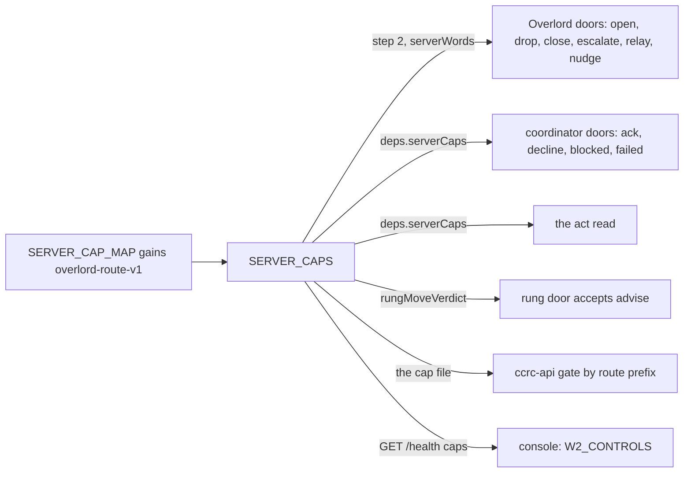
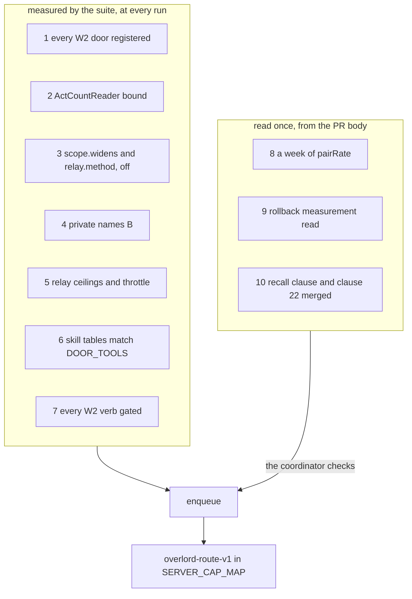
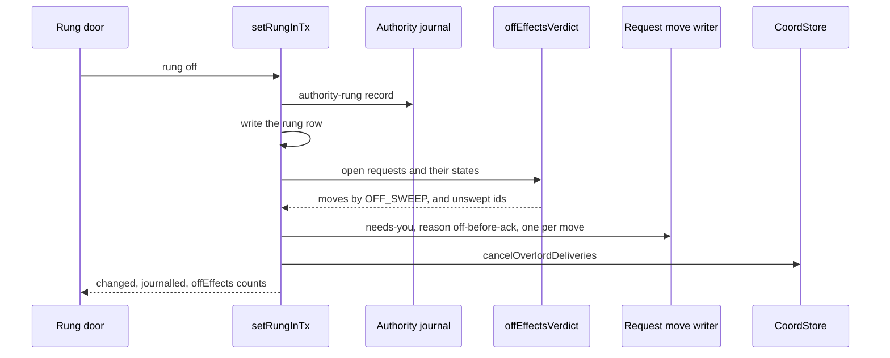

# Overlord W2: `overlord-route-v1`, the word that opens `advise` Implementation Plan

> **For agentic workers:** REQUIRED SUB-SKILL: Use superpowers:subagent-driven-development (recommended) or
> superpowers:executing-plans to implement this plan task by task. Steps use checkbox (`- [ ]`) syntax for tracking.

**Goal:** the server capability word `overlord-route-v1` moves from the ladder's `RUNG_WORDS_NOT_YET_SHIPPED` into
`shared/api.ts#SERVER_CAP_MAP`, so the rung door accepts `advise` and every W2 door that names the word stops refusing
`capability-missing`. The same pull request adds W2's part of `off`, makes the client and the console follow the word,
checks the skill's door tables against the doors W2 built, and holds the word back by a test until W2 is ready.

**Why:** spec §14 (Table 14's W2 row: "the ladder at `advise`; the capability word `overlord-route-v1`"), §7.5 (H25,
the `advise` rung and "`off` is one transaction") and §11.4 ("`ccrc-api request ack` and the act read land in W2. Until
then each refuses `capability-missing`, naming `overlord-route-v1`"). Every other W2 piece lands dark behind this word.
This piece is the one switch that turns W2 on, so it carries the proof that W2 is ready to be on.

**Architecture:** one pull request in lane C, last of all. It adds one row to `SERVER_CAP_MAP` and removes one from
`RUNG_WORDS_NOT_YET_SHIPPED`. It adds one L0 table, one L1 decider and one store method, and edits three existing writers
or readers: `setRungInTx`'s transaction, `ccd/ccrc-api`'s gate and the console's capability reader. It adds no route,
no table, no migration, no lane and no capability-floor row.

- `shared/overlordRequests.ts` (K, L0) gains `OFF_SWEEP`, keyed by request state: what `off` does to a request in it.
- `server/src/coord/overlordOff.ts` (C5, L1, new) holds `offEffectsVerdict`, which `off` uses to decide which requests
  move and which mail is cancelled. It makes no I/O.
- `setRungInTx` (`server/src/coord/overlordLadderStore.ts`, the ladder's) runs W2's part of `off` inside its one
  transaction, after the rung write.
- `CoordStore.cancelOverlordDeliveries` (`server/src/coord/store.ts`) is one scoped bulk write through the private
  `writeDeliveries`, beside `cancelOutstandingDeliveries`.
- `server/test/overlord-route-readiness.test.ts` (new) is red while the word stands in `SERVER_CAP_MAP` and a readiness
  condition the tree can measure does not hold. Task 1 writes it, and it passes on `main` until Task 2 moves the word.

**Tech Stack:** TypeScript (ESM), `node:sqlite`, vitest, bash (`ccd/ccrc-api`), React (the console's one reader). No
new dependency.

**Spec:** `docs/superpowers/specs/2026-11-09-overlord-design.md`: §7.5 (H25, Table 7.5a, "`off` is one
transaction", Pause, "The ladder needs `overlord-v1`"), §7.1 (Table 7.1a's `advise` column), §11.1 (Table 11.1d's
capability-word row), §11.4 (clause 22 and the doors it names), §11.5 (Table 11.5 and "An older server reads the newer
database"), §14 (Table 14, W2).

**The index:** `docs/superpowers/plans/2026-11-16-overlord-w2.md` (on `main`). This plan builds its row
`overlord-route-v1` (lane C, last of all) and the settled questions 14, 20 and 24. The W1 plans whose states it reads
are `2026-11-14-overlord-w1/w1-ladder.md` (`RUNG_MAP`, `RUNG_WORDS_NOT_YET_SHIPPED`, `rungMoveVerdict`, `setRungInTx`,
the rung door, Pause), `w1-gates.md` (`OVERLORD_DOORS`' `word` and the gate's step 2), `w1-home.md` (the console's one
reader of the server's capability words), `w1-overlord-skill.md` (the door tables) and the W1 index's row `overlord-v1`.
`w1-overlord-v1.md` is not written yet, so this plan takes `overlord-v1`'s states from the W1 index's row and says so
where it does.

**The W2 pieces this plan reads:** on `main`: the act catalogue, decision model, forecasts and health, overlaps,
private names, remaining work, request record, revisions and vocabulary plans. In review: act rows and act journal
(#2930), request ids and coordinator doors (#2931), relay (#2933), done tests and follow-up (#2932). Not written yet: act
reads, the operator's request doors, inbox band 3, the label queue, the board's W2 parts, home requests and W2
Settings. For those, this plan takes each interface from the index's Table W2 and question 7.

Written against `main` at `fe887521f` (2026-11-16).

## In short

- **One pull request, five tasks, last of all in W2.** The word moves into `SERVER_CAP_MAP`. The rung door then accepts
  `advise` with no ladder edit, because the ladder already checks `RUNG_MAP.advise.needs` against `SERVER_CAPS`.
- **A suite decides whether the word may ship.** `overlord-route-readiness.test.ts` is red while the word stands and any
  readiness condition the tree can measure fails. It checks seven conditions; Table R1 lists them. Three conditions
  live outside the tree: the goal-conflict signal's week of firing rate, request ids B's rollback measurement, and the
  state of the clauses. The pull request body records each of them, and the coordinator checks them before
  the pull request is enqueued.
- **W2's part of `off` runs in `setRungInTx`'s one transaction.** It moves every open request whose owner has not
  acknowledged it to `needs-you`, with the reason `off-before-ack`, and it cancels queued `overlord` mail. Pending acts
  are settled by the settling lane, as they are at any rung. Pause runs none of these effects.
- **Every W2 door in the client and the console follows the word, through the reader each already has.** The client is
  `ccrc-api`'s one cap-file gate; the console is home A's capability reader. The portfolio facts of question 20 stay
  live without the word.
- **No capability floor** (question 14). After a rollback below the word, nothing new is sent. A stored `advise` on an
  older server is the case question RV8 settles.
- **Nothing waits on the operator.** Every question here is implementation detail with a recommendation for the
  coordinator. Raising the rung to `advise` stays the operator's own act, behind the step-up.

## 1. Open questions

The index's questions this plan builds on, each as ruled:

- **Q14 (settled):** no row in `ccd/ccrc#CAP_FLOOR_ROWS` for `overlord-route-v1` (slug `route-v1-has-no-floor`).
- **Q20 (ruled, fix round 1):** the remaining-work door, the forecast lane and `programmeHealth` are live at their merge.
  Of the coordinator doors, only `request ack` and the act read (with `decline`, `blocked` and `failed`, which ship beside
  `ack`) refuse until the word ships. The Overlord's doors refuse too.
- **Q24 (settled):** `advise` names `overlord-route-v1`. This piece moves the word.
- **Q28 (settled):** a request that needs a start or a proposal goes to `needs-you` through the escalate door. Nothing
  raises an item before W3, and `off`'s move to `needs-you` raises none either.

This plan's own questions. Each carries a recommendation, which this plan builds unless the coordinator rules
otherwise. None needs the operator: each is implementation detail under a direction the spec already gives.

- **RV1. Readiness is a suite, not a list** (slug `route-v1-readiness-is-a-suite`). The index asks for a checklist.
  A list in a plan is a request; the word can still ship while a condition fails. **Recommendation:**
  `server/test/overlord-route-readiness.test.ts`. Each condition the tree can measure is one case, with this rule:
  while `SERVER_CAPS` holds `overlord-route-v1`, the condition must hold. Each case is green on `main` today because
  the word is absent, and it goes red the moment Task 2 moves the word, unless every condition holds by then. The suite
  stays after the merge, so a later change that undoes a condition, such as a stand-in rebound, is red too. The three
  conditions the tree cannot measure are listed in the pull request body with their evidence (Table R1's last three
  rows). The coordinator checks them before enqueueing, as it checks a wave-done.
- **RV2. Which requests `off` moves** (slug `off-moves-every-unacknowledged-request`). §7.5 says "Open requests whose
  owner has not acknowledged move to `needs-you`". `REQUEST_TRANSITIONS`' server move `needs-you` takes `received`,
  `routed`, `in-progress`, `blocked` and `declined` (`w2-requests.md`, §5). **Recommendation:** `OFF_SWEEP`, total over
  the request states, as below. `received` has no owner yet and `declined` has lost one, so neither has an
  acknowledgement. At `off` no Overlord will route either, so both reach the operator. `in-progress` and `blocked`
  have been acknowledged by their owner and stay with it. The follow-up arm already moves a due one to `needs-you` at
  `off` (`w2-follow-up.md`, FU7, reason `due-unarmed`).

  | State | At `off` | Why |
  |---|---|---|
  | `received` | `needs-you`, reason `off-before-ack` | No owner has acknowledged it, and nobody will route it |
  | `routed` | `needs-you`, reason `off-before-ack` | Relayed, not acknowledged |
  | `declined` | `needs-you`, reason `off-before-ack` | Its owner declined it, and nobody will route it elsewhere |
  | `in-progress`, `blocked` | stays | Its owner acknowledged it |
  | `needs-you`, and every terminal state | stays | Already with the operator, or closed |

  *Table RV2. `OFF_SWEEP`, by request state. The reason word `off-before-ack` is the one the request record plan lists
  for this piece (`w2-requests.md`, "Move reasons").*

- **RV3. Which mail `off` cancels** (slug `off-cancels-queued-overlord-mail`). §7.5: "Undelivered `overlord` mail and
  kickoffs are cancelled." **Recommendation:**
  - Every `queued` delivery of a mail whose `fromId` is `overlord` moves to `rejected`, with `rejectCode`
    `undeliverable` and a new `lastError`, `MAIL_OVERLORD_OFF_ERROR` (`'overlord off'`). It does so through the one
    delivery writer, as `server/src/coord/store.ts#cancelOutstandingDeliveries` does for a closed run. The new error joins the
    deliberate cancels (`DELIBERATE_CANCEL_ERRORS_SQL`), so it is never read as abandonment.
  - A `delivered` but unacked delivery stays. Its nudge has already reached the coordinator, so the mail is no longer
    "undelivered", and cancelling it would hide a mail the coordinator may already be reading.
  - There are no kickoffs to cancel in W2. The Overlord sends none before W5's start door (index question 15), so the
    kickoff arm is W5's. `setRungInTx`'s comment says so.
- **RV4. Pending acts at `off`** (slug `off-settles-through-the-lane`). §7.5: "Pending acts are settled by measuring
  (§7.1)." Measuring an act is the settling lane's job (`w2-act-rows.md`, PR B). In W2 its one measurer reads the private
  store (`ACT_SETTLE_MAP`'s `acknowledge` row), which a `coord.db` transaction cannot read.
  **Recommendation:** the transaction writes nothing for acts. The settling lane re-measures every `pending` row at
  every rung, on its own `LANE_SCHEDULE` row and at boot, so "settled by measuring" already holds after `off`. A test
  pins that a `pending` act standing at `off` is settled by the lane's next pass, and that `off` changes no act row.
- **RV5. Pause from `advise`** (slug `pause-runs-no-off-effect`). In W1 Pause always answers `changed: false`. From W2
  it lowers `advise` to `chat`. **Recommendation:** Pause runs none of `off`'s W2 effects. The spec gives Pause only
  the hold release, which is W3's. At `chat`, the relay's and the request doors' cells refuse, and the follow-up arm
  moves a due request to `needs-you` (`due-unarmed`). Requests already relayed stay with their owners, and their mail
  stays queued.
- **RV6. One gate in `ccrc-api` for every W2 verb** (slug `route-v1-gate-by-route-prefix`). The coordinator doors plan
  gives its four `request` verbs a cap-file gate. The request record and relay plans give their six Overlord verbs none.
  Writing one gate per piece would be a parallel mechanism per verb. **Recommendation:** one gate block in `ccd/ccrc-api`,
  in the idiom of the timers' gate, that refuses `capability-missing` unsent when a current cap file omits the word. It
  matches by the ROUTE's path prefix, not by a hand list of verb names: `/api/overlord/requests`, `/api/overlord/relay`,
  `/api/requests/` and `/api/acts`. So a W2 row added later is gated by where it points. This piece folds the coordinator
  doors' block into it. The remaining-work row, under `/api/coord/programmes/`, is outside these prefixes, so it stays
  live (question 20). If `overlord-v1` ships a table from verb to word for the Overlord's W1 verbs, the gate becomes one
  row of that table per prefix instead, and the test is the same.
- **RV7. Which console controls follow the word** (slug `console-follows-the-door`). The index says "the console shows
  no W2 door" without the word. Yet the ruling door, the list upload and the decision-model rows refuse nothing without
  it. **Recommendation:** a console control follows the word exactly when its server door refuses without it. Home A's
  one capability reader decides that, from one table in the console, `W2_CONTROLS`, which names each W2 control with its
  word or `null`:
  - **Follow the word:** the Requests part and its rows' controls (answer, confirm, withdraw, take, hand back), Seen
    and overturn on an act row, and the act head line. No request or act exists before the word.
  - **Live without it (`null`):** the goal-conflict ruling control, the private-name upload, the decision-model rows,
    their key and ceiling, the label cards, and the portfolio strip's health and dates. The overlaps plan needs the
    ruling control live before the word, so that a `goal-conflict-open` refusal always has a door that lifts it
    (`w2-overlaps.md`, question 2). The decision model must gather labels in shadow before anything arms.
  - The pieces that build those controls take their row in `W2_CONTROLS` when they land. This piece adds the table
    and its test if no earlier console piece has, and fills every row that is missing.
- **RV8. A stored `advise` after a rollback** (slug `rung-capped-by-server-words`). With no floor, the operator can roll
  the server back below the word while the ladder row reads `advise`. W1's ladder reads every rung word, so on that
  build `effectiveRung` answers `advise` though no W2 door exists there. Nothing then acts: W1's doors are allowed at
  `chat` and `advise` alike, and the follow-up, relay and request doors are absent. But the console would show a rung
  the server cannot keep.
  **Recommendation:** the ladder gains one condition row, `rung-word-missing`. It caps the rung at the highest rung
  whose `needs` word is in `SERVER_CAPS`. The condition must be in the build a box rolls back TO, so it belongs in
  W1's ladder, which is not built yet. That makes it an index change for W1 (below), and the coordinator tells the
  ladder's builder. If the ladder lands without it, this piece adds the row, which then protects a rollback only to a
  build that carries it. Either way it lifts by itself when the word returns.
- **RV9. `CLAUDE.md`'s bullet** (slug `claude-md-route-v1-bullet`). The index's W1 row `overlord-v1` adds a
  `ccrc-overlord` bullet. **Recommendation:** one bullet, under "Coordination (Build 7) invariants a coder must NOT
  break", written in Task 5. It says what the word opens, that it has no floor, what a rollback below it does, and that
  `advise` stays the operator's raise. It has no count word, so `overlord-skill.test.ts`'s count-word scan has nothing
  to read in it.
- **RV10. Measuring the goal-conflict signal** (slug `goal-signal-read-a-week-before-route-v1`). The overlaps plan
  records goal-conflict pairs from overlaps A's merge, and refuses on them only after the firing rate is measured
  (`w2-overlaps.md`, the coordinator's ruling on F3). It gives no length or threshold. **Recommendation:**
  - The word ships only after `pairRate` on `GET /api/portfolio` shows at least one full week since overlaps B's merge,
    which is when the ruling door, and so the refusal's way out, exist.
  - The pull request body quotes that week's goal-conflict episodes. The coordinator reads them before enqueueing.
  - No number is set here. A rate the coordinator reads as noise is ruled on before the word ships, as the overlaps plan
    asks, by tightening `GOAL_CONFLICT_TRIPLES_MIN` in a pull request of its own.

## 2. What exists today

Measured on `main` at `fe887521f`.

- **The capability words.** `shared/api.ts#SERVER_CAP_MAP` holds ten words: `dispatch-live-gate-v1`,
  `hook-main-state-v1`, `ask-pairing-v1`, `questions-v1`, `review-rounds-v1`, `goals-read-v1`, `calls-v1`, `plan-v1`,
  `timers-v1` and `push-outbox-v1`. `shared/api.ts#SERVER_CAPS` derives from its keys. `ServerCap` is a union written
  out beside it, so a word added to the union and not to the map is a compile error. Neither `overlord-v1` nor
  `overlord-route-v1` is there.
- **The cap on `shared/api.ts`.** `server/test/growth-caps/shared-api-ts.json` caps the file at 5,140 code lines, and it
  holds 5,106 (`codeLines`, measured with `server/test/growthCheck.ts`). W1's `overlord-v1` takes one or two of the 34
  lines left, and this piece takes one or two (Section 7).
- **The ladder is not built.** `RUNG_WORDS_NOT_YET_SHIPPED`, `RUNG_MAP`, `rungMoveVerdict` and `setRungInTx` are planned
  by `w1-ladder.md` (questions 1, 9 and 23, and Task 4) and appear nowhere in `server/src` or `shared`. This plan reads
  them as that plan defines them:
  - `RUNG_MAP.advise.needs` is `'overlord-route-v1'`. The rung door refuses a raise to `advise` with
    `capability-missing` naming that word, before the account gate is asked. `deps.serverCaps` is wired to
    `SERVER_CAPS`, so a test can widen it.
  - `RUNG_WORDS_NOT_YET_SHIPPED` is `{ 'overlord-route-v1': 'W2', 'overlord-answer-v1': 'W3' }`, shrink-only.
    `ladder-rung-words.test.ts` reds a `needs` word that is in both the list and `SERVER_CAPS`, or in neither.
  - `setRungInTx` is one of the two writers of `operatorRung`; the other is `applyRestoreInTx`. A move to `off` runs in
    its one transaction. Its comment lists W2's effects for W2 to add beside the rung write.
- **The Overlord's doors refuse at the gate.** `w1-gates.md` gives each `OVERLORD_DOORS` row a `word`, and the gate's
  step 2 refuses `capability-missing` naming it when the word is not in `serverWords` (`SERVER_CAPS`). The request
  record and relay plans give their six doors `word: 'overlord-route-v1'`. The coordinator doors plan checks the word
  through `deps.serverCaps` before reading the body (its RD2).
- **The client's gates.** `ccd/ccrc-api#ROUTES` has 84 rows. Each word-gated family has one block that refuses unsent,
  through `_api_server_cap <word>`, when a current, well-formed cap file omits the word. The blocks are `questions-v1`,
  `review-rounds-v1`, `goals-read-v1`, `calls-v1`, `plan-v1` and `timers-v1`. An absent, stale, torn or future cap
  file sends, and the server answers.
- **The skill's door tables.** `ccd/overlord-skill/references/starting.md`'s door table and `routing.md`'s doors line
  name `relay`, `close-request`, `drop-request` and `nudge-owner` under `overlord-route-v1`. The request record plan
  adds `open-request` and `escalate-request` (its Task B5). The relay plan names its tools `relay` and `relay nudge`
  (its Task A6). So `nudge-owner` and `relay nudge` name the same door two ways, and that has to be settled before
  the word ships (Task 4). `server/test/overlord-skill.test.ts` checks each door's word against its wave in Table 11.1e,
  but not against `ccd/door-process.mjs`'s `DOOR_TOOLS`.
- **Mail cancels.** `server/src/coord/store.ts#cancelOutstandingDeliveries` parks a closed run's outstanding
  deliveries as `rejected('undeliverable')` with `server/src/coord/store.ts#MAIL_RUN_CLOSED_ERROR`, through the private
  `writeDeliveries`, which owns the terminality guard. Each deliberate cancel's error joins
  `DELIBERATE_CANCEL_ERRORS_SQL`. No writer cancels by sender today.
- **The capability floor.** `ccd/ccrc#CAP_FLOOR_ROWS` names ccd facts only, and no server word has a row (question 14).
- **The clauses.** Clause 22 (the Overlord clause, §11.4) is not written: `w1-coordinator-clause.md` waits on the
  operator's wording. The recall clause is open as #2919. Clause 22 names `ccrc-api request ack` and the act read,
  which are W2's.

*Figure R1. One row in `SERVER_CAP_MAP` reaches every reader through `SERVER_CAPS`. No reader keeps a copy of the
word's state.*

## 3. Readiness: what must be true before the word ships

The pull request is enqueued only when every row of Table R1 holds. Rows 1 to 7 are cases of the readiness suite
(RV1); rows 8 to 10 are evidence in the pull request body, which the coordinator checks.

| # | Condition | Owner piece | How it is measured |
|---|---|---|---|
| 1 | Every W2 piece merged, and W1's `overlord-v1` | all of Table W2; W1 | The suite: every door Table R2 names is registered (its route found by `server/test/scan/parse.js`) and, for an Overlord door, has its `OVERLORD_DOORS` row with word `overlord-route-v1`; `SERVER_CAPS` holds `overlord-v1`. A missing door is red, named |
| 2 | The act ceilings' counts are wired: act catalogue A's `ActCountReader` default no longer stands | act rows A | The suite: the gate runner's production deps (the composition root's builder) bind `actCountReaderInTx`, and no `server/src` file but the catalogue's own test seam constructs the `not-wired` default (`{ kind: 'unmeasured', why: 'not-wired' }`) |
| 3 | The decision-model rows the relay needs are present, and ship `off` | decision model A, relay B | The suite: `DECISION_QUESTIONS` has `scope.widens` (direction `gate`) and `relay.method` (direction `advice`); every row's shipped state is `off`; the relay reads `scope.widens` through `gateOutcome` and reads a `shadow` row as the code verdict (relay RL11, the decision model's `gateOutcome` for `shadow`) |
| 4 | Private names B shipped | private names B | The suite: `readPrivateNameList` exists with its three answers `none`, `list` and `unreadable`, and the relay's egress decider refuses `egress-refused` on `unreadable` (one case through the decider) |
| 5 | The relay's ceilings and egress throttle are live | act catalogue A, relay B | The suite: the catalogue's `relay` group reads 6 an hour per programme and 30 in all, and covers `relay` and `nudge-owner`; `EGRESS_THROTTLE_COUNT` and `EGRESS_THROTTLE_WINDOW_MS` exist with `overlord_relay_refusals` in `writers-map.test.ts`'s `TABLES` |
| 6 | The skill's door tables match the doors | every door piece | The suite (Task 4): every `DOOR_TOOLS` tool whose door's word is `overlord-route-v1` is a row of `starting.md`'s door table with that word, and every such row names a tool |
| 7 | Every W2 client verb is gated | every verb piece | The suite: every `ROUTES` row under the four prefixes of RV6 is refused unsent under a current cap file without the word |
| 8 | The goal-conflict signal measured | overlaps A and B | The body: a full week of `pairRate` since overlaps B merged, its goal-conflict episodes quoted, and the coordinator's reading (RV10) |
| 9 | Request ids B's rollback measurement read | request ids B | The body: `w2-request-ids/rollback-measurement.md` exists, and the coordinator's ruling on a guard if it shows more than one notice and one push per parked `overlord` mail (request ids RI14) |
| 10 | The clauses' state | W1a recall clause, W1 Overlord clause | The body: the recall clause merged (#2919 today) and clause 22 merged, with its text naming `ccrc-api request ack` and the act read, the verbs this piece opens |

*Table R1. The readiness conditions. Rows 1 to 7 are measured by the suite at every run; rows 8 to 10 are read once,
before the enqueue.*

| Door | Gate | Piece |
|---|---|---|
| `POST /api/overlord/requests`, `.../:id/drop`, `.../:id/close`, `.../:id/escalate` | Overlord door, word `overlord-route-v1` | request record B |
| `POST /api/overlord/relay`, `POST /api/overlord/relay/nudge` | Overlord door, word `overlord-route-v1` | relay A |
| `POST /api/requests/:id/ack`, `decline`, `blocked`, `failed` | box token, attribution, owner; `deps.serverCaps` | coordinator doors |
| `GET /api/acts` | box token or session; refuses without the word | act reads |
| `POST /api/requests/:id/answer`, `confirm`, `withdraw`, `take`, `hand-back`; `GET /api/requests` | session | the operator's request doors |
| `POST /api/acts/:id/seen`; `POST /api/digest/correct` kind `overlord-act` | session | act reads |

*Table R2. The doors the word opens, which row 1 checks are registered. The act read's and the operator's paths are the
index's question 7; their pieces may refine a path, and the suite reads whichever path the piece registered.*

*Figure R2. The two halves of readiness. The suite keeps holding after the merge; the body's evidence is read once.*

## 4. What a merge arms, and the rollback below the word

**At merge, on the server that carries the build:**

- The rung door accepts a raise to `advise`, behind the step-up, through the account gate, and journalled. The operator
  makes it. Nothing raises the rung on its own, and a box whose rung is `chat` stays at `chat`.
- Every door of Table R2 stops refusing `capability-missing`. Until the operator raises the rung, the Overlord's write
  doors still refuse `rung-below` at `chat`, by the catalogue's cells. `open-request` is allowed at `chat` by its cell
  (Table 7.1a), so the Overlord can open a request at `chat`. Escalate and relay are refused there, so the request waits
  as `received` until the follow-up arm, which is unarmed at `chat`, moves it to `needs-you` once due (FU7,
  `due-unarmed`).
- Table 7.5a's caps at `advise` start to bite, because the operator's rung can now be above them. On a one-box install,
  `server-isolation` reads `shared-user`, so its condition caps the rung at `advise`, which is also the ceiling until a
  split install exists.
- `ccrc-api`'s W2 verbs send, once the fleet box's cap file is refreshed. The console shows the controls of
  `W2_CONTROLS` that follow the word.
- `off` gains its W2 effects (RV2, RV3), and Pause from `advise` lowers to `chat` (RV5).
- Clause 22's two doors answer: `ccrc-api request ack` and the act read.

**What does not change at merge:** the decision model stays `off` row by row, and only the operator switches a row.
The private-name check runs only once a list is uploaded. The follow-up arm acts only at `advise` or `full`. The portfolio
facts were live already (question 20). No hold exists before W3, and nothing raises an item.

**The rollback below the word** (question 14, RV8):

- **The server rolled back to a build without the word,** at W1 or W2 before this piece:
  - W2's tables and columns are ignored (Table 11.5: "Ignored").
  - The Overlord's W2 doors refuse `capability-missing` again (a W2 build), or have no route (a W1 build).
  - Open requests stay as they are. When the newer build returns, each is re-measured, and a follow-up that came due
    in the gap is timed again (§11.5).
  - Queued `overlord` mail meets the older mail lane, which request ids B measured (Table R1, row 9).
  - A stored `advise` reads as the cap of RV8's condition, `chat`, on a build that carries it. On a build without it,
    the rung reads `advise` with no door that acts at `advise` (RV8).
- **The fleet box's `ccrc-api` older than the server:** it has no W2 rows, so a W2 verb is refused locally as an
  unknown verb, and the Overlord's door tools fail on the missing row. Nothing is sent.
- **The fleet box's `ccrc-api` newer than the server:** its gate reads a current cap file without the word and refuses
  unsent. A cap file that is not current sends, and the older server answers 404.
- **No floor stops the rollback,** and `ccrc update`, `rollout` and `rollback` need no `--below-cap` for it. W3's floor,
  below `push-outbox-v1`, is the first server-word floor.

## 5. `off` in W2

`setRungInTx`'s one transaction keeps W1's order: the authority record first (`appendInTx`), then the rung row. W2's
part follows, inside the same transaction, after the rung write. Nothing in it may refuse once the journal record is
written (the request record plan's F1 rule): its decider is total, and a row it cannot read is skipped and counted,
never a refusal. A lowering never fails because of what it moves (the ladder's brakes over bad rows, its question 21).

*Figure R3. `off`'s one transaction in W2. The settling lane measures pending acts afterwards, as at any rung (RV4).*

- **The decider.** `offEffectsVerdict(rows)` (L1) takes the open requests' ids and stored state words, and answers
  `{ moves, unswept }`. `moves` holds the ids whose state's `OFF_SWEEP` row is `needs-you`. `unswept` holds the ids
  whose stored state word this build cannot read (not a member of the request states). Those ids stay as they are and
  are counted. The decider never answers a refusal.
- **The moves.** Each move goes through the request record's one move writer, as a server move to `needs-you` with the
  reason `off-before-ack`. The writer stamps the `request` row of `SEQUENCE_KIND_MAP` and writes the move's news row.
  A request moved here then shows on the operator's Requests rows, in the "needs you" group.
- **The mail.** `CoordStore.cancelOverlordDeliveries()` parks every `queued` delivery of a mail with `fromId`
  `overlord` as `rejected('undeliverable')`, with `MAIL_OVERLORD_OFF_ERROR` (RV3). It returns `{ changed }`, as every
  scoped bulk write does (`DeliveryBulkWrite`).
- **The answer.** The rung door's answer gains `offEffects: { requests, mail, unswept }`. The field is additive: an
  older console ignores it, and it is present only on a move to `off`.
- **What does not run here:** settling acts (RV4), stopping follow-ups (the arm reads the rung, FU7), and kickoffs (W5).
  `setRungInTx`'s comment lists these, each with where it happens.
- **Confirm the restore** folding a rung down to `off` still runs none of these effects. That is the ladder's rule (F6),
  and §7.6's reconciliation pass owns what a restored state needs.

## 6. Global constraints

- **Architecture (`CLAUDE.md`).** One writer per fact. `SERVER_CAP_MAP` stays the only place the word's state is
  written: the ladder, the gate, the coordinator doors, the act read and the console all read `SERVER_CAPS`, and
  `ccrc-api` reads the cap file the server writes from it. `OFF_SWEEP` is a row per state in the request vocabulary's
  own L0 file, so a new request state is a compile error until it is placed. The `off` decider is L1 and makes no I/O.
  `setRungInTx` acts on its verdict and decides nothing itself. The mail cancel goes through the one delivery writer,
  and request moves go through the one move writer. No second mechanism is added: the client's gate joins the existing
  gate blocks and absorbs the coordinator doors' block (RV6), and the console reads home A's reader (RV7).
- **Wire.** Additive only: `offEffects` on the rung door's answer, and the word in `GET /health`'s `caps`. No
  `FLEET_PROTO` change.
- **What a merge arms:** Section 4.
- **Growth.** The growth-checked files are `shared/api.ts` (under its total cap, +1 or +2) and
  `server/src/coord/store.ts` (+8). `ccd/ccrc-api`, `pwa/src/**` (other than `pwa/src/lib/api.ts`, which is untouched)
  and the ladder's store are not listed. Section 7 has the estimates.
- **Mutation.** `offEffectsVerdict` joins `MUTANT_SETS` (`server/test/sim/mutation-floors.test.ts`) and
  `server/test/sim/mutation-floors.json` in this pull request. The readiness suite is itself a guard, and Task 1's
  mutation step proves each case red with the word present and its condition removed.
- **Time.** The new L1 module reads no clock. `setRungInTx` already takes `at` from its caller. The module joins
  `server/test/single-definition/time-ports.test.ts`'s module list, which holds that it reads no ambient clock.
- **Public repository.** No name, host or ticket. The plan cites by symbol and file, and the private-name scan runs over
  every changed file.
- **Tests.** From `server/`, in the foreground, one file at a time, through `ccrc test -- ./node_modules/.bin/vitest
  run test/<file>`. Each task that changes `shared/` also runs `ccrc test -- npx tsc --noEmit -p tsconfig.json` and
  `-p test/tsconfig.tests.json` in `server/`, and `ccrc test -- ./node_modules/.bin/tsc --noEmit` in `pwa/`.

## 7. The PR split

| PR | Tasks | What it ships | Needs first | Growth-checked files, estimate |
|---|---|---|---|---|
| `overlord-route-v1` | 1 to 5 | The readiness suite; the word moved; the rung door at `advise` and Table 7.5a's caps reached; `off`'s W2 part; the client gate by route prefix; `W2_CONTROLS`; the skill tables checked; `CLAUDE.md`'s bullet | every other W2 piece and W1's `overlord-v1` (Table R1, row 1), and rows 8 to 10's evidence | `shared/api.ts` +1 to +2 (one map row; the union line edited in place or one new line), under its total cap; `server/src/coord/store.ts` +8 (the cancel writer and its error constant). Not listed: `shared/overlordRequests.ts` +12, `server/src/coord/overlordOff.ts` +40 (new), the ladder's store +12, `ccd/ccrc-api` +6 net (one block in, the coordinator doors' block out) |

The index's row says four tasks. This plan has five, because readiness is its own red-first task (RV1). Nine is the
limit.

## 8. Review focus

1. No reader keeps its own copy of the word's state: every reader goes through `SERVER_CAPS` or the cap file it writes.
2. The readiness suite is red with the word present and any one condition broken (Task 1's mutation step), and it
   passes with the word absent.
3. `off` never refuses after the journal record, and a row it cannot read is counted, never a refusal.
4. Pause runs no `off` effect, and Confirm's fold to `off` runs none either.
5. The client's gate matches by route prefix, and the remaining-work verb stays live (question 20).
6. The rollback below the word sends nothing new, and RV8's condition is in the ladder, or filed against it.

## 9. Tasks

### Task 1: The readiness suite, red as soon as the word is present

**Files:**
- Create: `server/test/overlord-route-readiness.test.ts`

- [ ] **Step 1: The rule.** One helper, `whileShipped(name, check)`. When `SERVER_CAPS` holds `overlord-route-v1`, it
  runs `check` and expects it to hold. Otherwise it asserts that the word is still in `RUNG_WORDS_NOT_YET_SHIPPED`, so the
  suite never passes vacuously with the word nowhere. The suite's header states what it cannot measure: Table R1's rows
  8 to 10, read from the pull request body.
- [ ] **Step 2: The cases**, one per row 1 to 7 of Table R1, each reading the tree as its row says:
  - Row 1 reads the routes through `server/test/scan/parse.js`, as the door censuses do, and `OVERLORD_DOORS`.
  - Row 2 reads the composition root's deps builder and scans `server/src` for the `not-wired` default.
  - Rows 3 to 5 import the L0 and L1 symbols their pieces export.
  - Row 6 is Task 4's check, imported, not copied.
  - Row 7 runs `ccd/ccrc-api` under a fixture HOME with a current cap file that omits the word. It uses
    `server/test/ccrc-api.test.ts`'s harness, so it never touches the live `$HOME`.
- [ ] **Step 3: Run it.** Run `cd server && ccrc test -- ./node_modules/.bin/vitest run
  test/overlord-route-readiness.test.ts`. Expected: PASS on a tree without the word, every case reporting "not
  shipped".
- [ ] **Step 4: Mutation.** With `SERVER_CAPS` widened by the test's seam, break each condition in memory, one mutant
  per case, with `mutation-run.py` (the coordinator skill's `references/`):
  - drop one Table R2 door row;
  - bind the `not-wired` default;
  - set `scope.widens` to ship `shadow`;
  - remove the `unreadable` arm;
  - set the relay group's 30 to 31;
  - drop one skill table row;
  - drop the gate block.
  Expected: every mutant killed. Record the counts in the commit body.
- [ ] **Step 5: Commit** the suite alone: `test(overlord): the readiness suite that holds overlord-route-v1 back`.

### Task 2: The word moves, and the rung door reaches `advise`

**Files:**
- Modify: `shared/api.ts` (`ServerCap` and `SERVER_CAP_MAP`: one row with its promise in the comment)
- Modify: `shared/overlord-ladder.ts` (`RUNG_WORDS_NOT_YET_SHIPPED` loses `overlord-route-v1`)
- Modify: the ladder's door test and `server/test/single-definition/ladder-rung-words.test.ts` only if a run asks
- Test: `server/test/overlord-route-advise.test.ts` (new)

- [ ] **Step 1: Failing tests** (an in-memory `coord.db`, a fake account gate, a fake `AuthorityAppender`, the fake clock),
  with production `SERVER_CAPS`, not a widened seam:
  - a raise from `chat` to `advise` asks the gate with `stepUp: true`. Refused, it writes nothing. Passed, it appends
    `authority-rung {from: 'chat', to: 'advise'}` and writes the row;
  - with `operatorRung` `advise`, `effectiveRung` is `advise` with no standing cap. Each Table 7.5a row whose effect caps
    `advise` leaves it at `advise`. Each row that caps `chat` (a restore, a degraded generation, the load line, probes
    failed twice) lowers it to `chat`, and the off-model row lowers it one rung, to `chat`;
  - a `shared-user` isolation reading caps `full` at `advise` and leaves `advise` at `advise`, so `advise` is reachable on
    a one-box install;
  - a raise to `full` still refuses `capability-missing` naming `overlord-answer-v1`;
  - `GET /api/overlord/ladder`'s `rungs` row for `advise` reads `available: true`.
- [ ] **Step 2: Run** `overlord-route-advise.test.ts`. Expected: FAIL on the raise and on `available`.
- [ ] **Step 3: Implement.** Add `'overlord-route-v1'` to the union and the map, with a comment that names the doors it
  opens (Table R2), "Added by the change that opens `advise`, cut after every W2 piece merged", and the readiness suite.
  Remove the word from `RUNG_WORDS_NOT_YET_SHIPPED`.
- [ ] **Step 4: Run** `overlord-route-advise.test.ts`, `ladder-rung-words.test.ts`, the ladder's door suite, the
  readiness suite, and `server-caps.test.ts` with `ccd-update-sync.test.ts`, which hold the bash spellings of the cap
  file. Expected: PASS. If the readiness suite is red, stop: a condition of Table R1 fails, and the task waits for its
  piece. The word does not ship around it.
- [ ] **Step 5: Growth.** Run `ccrc test -- ./node_modules/.bin/vitest run test/growth-caps.test.ts` and the growth
  check. Expected: `shared/api.ts` within its cap.
- [ ] **Step 6: Commit:** `feat(overlord): overlord-route-v1 ships, and the rung door accepts advise`.

### Task 3: `off`'s W2 part

**Files:**
- Modify: `shared/overlordRequests.ts` (`OFF_SWEEP`, total over the request states; `off-before-ack` in
  `REQUEST_MOVE_REASONS` if the request record has not added it)
- Create: `server/src/coord/overlordOff.ts` (`offEffectsVerdict`, L1)
- Modify: `server/src/coord/store.ts` (`MAIL_OVERLORD_OFF_ERROR`, joining `DELIBERATE_CANCEL_ERRORS_SQL`;
  `cancelOverlordDeliveries`)
- Modify: `server/src/coord/overlordLadderStore.ts` (`setRungInTx`: W2's part after the rung write; its comment's list
  of later effects, each now with where it runs)
- Modify: `server/test/sim/mutation-floors.json`, `server/test/sim/mutation-floors.test.ts` (`MUTANT_SETS`),
  `server/test/single-definition/time-ports.test.ts` (the module list), `server/test/single-definition/writers-map.test.ts`
  only if its census of `mail_deliveries` writers names methods
- Test: `server/test/overlord-off.test.ts` (new)

- [ ] **Step 1: Failing tests.**
  - `offEffectsVerdict`, exhaustive over every request state. `received`, `routed` and `declined` move; every other state
    stays; an unknown state word is `unswept`. Monotonicity: adding rows never removes a move.
  - A census test: `OFF_SWEEP` has one row per request state (a TypeScript `Record` over the state type, so a new state
    fails to compile), and every `needs-you` row's state is a `from` of the server move `needs-you` in
    `REQUEST_TRANSITIONS`.
  - Through the rung door's `off`, on an in-memory `coord.db`:
    - one request in each state: the three move to `needs-you` with `off-before-ack`, one news row each, and the
      sequence stamped; the others are unchanged;
    - a `queued` and a `delivered` delivery of `overlord` mail, and a `queued` delivery of another sender's mail: only
      the first becomes `rejected('undeliverable')`, with `MAIL_OVERLORD_OFF_ERROR`;
    - the answer's `offEffects` counts all three, and `unswept` is 0.
  - A hand-written request row with an unknown state word: `off` still lands, journalled, and `unswept` is 1.
  - Pause from `advise`: lowers to `chat`, `changed: true`, and moves no request and cancels no mail.
  - Confirm folding to `off` (`applyRestoreInTx`) moves no request and cancels no mail.
  - A `pending` act standing at `off`: `off` leaves its row unchanged, and the settling lane's next pass settles it.
  - The ladder's pin that only `setRungInTx` and `applyRestoreInTx` write `operatorRung` stays green.
- [ ] **Step 2: Run** `overlord-off.test.ts`. Expected: FAIL.
- [ ] **Step 3: Implement** `OFF_SWEEP` and `offEffectsVerdict`, then the store method beside
  `cancelOutstandingDeliveries`, through `writeDeliveries` with the `outstanding` guard and the `where`
  `state = 'queued' AND mailId IN (SELECT id FROM mail WHERE fromId = 'overlord')`. Then add `setRungInTx`'s W2 part:
  after the rung write, only when the target is `off`, read the open requests through the request store's reader, ask
  the decider, move each id through the move writer, cancel the mail, and return the counts.
- [ ] **Step 4: Run** `overlord-off.test.ts`, the ladder's door suite, `mail-hardening.test.ts` (the one-writer census),
  `mail-deliveries-writer.test.ts`, `time-ports.test.ts` and `writers-map.test.ts`. Expected: PASS.
- [ ] **Step 5: Mutation.** Add `offEffectsVerdict` to `MUTANT_SETS` and run `mutation-run.py` over `overlordOff.ts`
  against `overlord-off.test.ts`. Set its floor in `mutation-floors.json` at the measured kill rate, and run
  `mutation-floors.test.ts`. Expected: every mutant of the state choice and of the `unswept` arm killed.
- [ ] **Step 6: Commit:** `feat(overlord): off moves unacknowledged requests to needs-you and cancels queued Overlord
  mail`.

### Task 4: The client, the console and the skill follow the word

**Files:**
- Modify: `ccd/ccrc-api` (one gate block by route prefix, in the timers' idiom; the coordinator doors' block removed;
  the header comment's list of gated families)
- Modify: `server/test/ccrc-api.test.ts` (the gate's cases)
- Modify: the console's capability reader from home A, and `W2_CONTROLS` beside it (`pwa/src/overlord/`), with its
  test under `pwa/test/`
- Modify: `server/test/overlord-skill.test.ts` (the `DOOR_TOOLS` cross-check)
- Modify: `ccd/overlord-skill/references/starting.md` and `routing.md`, only where the cross-check is red

- [ ] **Step 1: Failing tests.**
  - `ccrc-api.test.ts`. With a current cap file that omits the word, every `ROUTES` row whose path starts with one of
    RV6's four prefixes refuses `capability-missing` unsent, and the fake server sees nothing. With the word present,
    each sends. With an absent or stale cap file, each sends. `programme remaining` sends either way. The prefixes come
    from the script, not a copy in the test: the test greps the block's prefix list from `ccd/ccrc-api`, and reds if it
    is not one list.
  - `overlord-skill.test.ts`. Read `DOOR_TOOLS` from `ccd/door-process.mjs` and the door rows of `OVERLORD_DOORS`.
    For every tool whose door's word is `overlord-route-v1`, `starting.md`'s door table has a row naming the tool's door
    name (its `_` read as a space) with that word. Every such row names a tool. Run it with the tree as it stands: it is
    red if `nudge-owner` and `relay nudge` still differ (Section 2).
  - The console test. Every control in `W2_CONTROLS` with the word is hidden when the server's caps lack it and shown
    when they hold it. Every control with `null` is shown either way. A W2 control under `pwa/src/overlord/` that
    renders a door from Table R2 and has no row is red, found by the door path it calls.
- [ ] **Step 2: Run** the three. Expected: FAIL on the missing block, the table mismatch and any missing row.
- [ ] **Step 3: Implement.**
  - The gate block in `ccd/ccrc-api` replaces the coordinator doors' own.
  - The skill tables take the names `DOOR_TOOLS` has. The table follows the tool, and a tool rename is its piece's to
    make. The `move` field's three words stay in `routing.md`'s procedure, as the relay plan wrote them.
  - Fill `W2_CONTROLS` as RV7 lists.
- [ ] **Step 4: Run** the three, `ccrc-api.test.ts` whole, the door process's `DOOR_TOOLS` census (W1's door process plan
  names it), `install-overlord-skill.test.ts`,
  and pwa's suite for `pwa/src/overlord/`. Expected: PASS. Then run the readiness suite (rows 6 and 7 now read the real
  checks). Expected: PASS.
- [ ] **Step 5: Commit:** `feat(overlord): the client, the console and the skill's door tables follow overlord-route-v1`.

### Task 5: `CLAUDE.md`, the census sentences and the docs guards

**Files:**
- Modify: `CLAUDE.md` (one bullet, RV9)
- Modify: `README.md`'s capability-word lines, if it lists the server's words

- [ ] **Step 1: The bullet**, under "Coordination (Build 7) invariants a coder must NOT break":
  > **`overlord-route-v1` opens W2** (the Overlord programme's W2, spec §7.5 and §11.4): while `SERVER_CAP_MAP` lacks it, every
  > W2 Overlord door, the coordinator's request doors and the act read refuse `capability-missing` naming it, the rung door
  > refuses `advise`, and `ccrc-api` refuses those verbs unsent under a current cap file; the remaining-work door, the
  > forecasts and health are live without it. With it, only the operator raises the rung to `advise`, behind the step-up.
  > `off` moves every request no owner has acknowledged to `needs-you` and cancels queued `overlord` mail in
  > `setRungInTx`'s one transaction. It has no capability floor: a rollback below it sends nothing new.
  > `overlord-route-readiness.test.ts` is red while the word stands and a readiness condition fails, so a stand-in
  > rebound or a door removed reds the suite.
- [ ] **Step 2: The census sentences.** `box-token-census.test.ts` checks `CLAUDE.md`'s box-token paragraph against its
  lists. This piece adds no door, so the paragraph is unchanged. Run the census to show it.
- [ ] **Step 3: The docs and tree guards.** Run `anchors`, `citations`, `dtbd`, `topology-clean`, `growth-caps` and the
  growth check, and `deviation-refs` after `git fetch origin main`. Then run the private-name scan over every changed
  file. Expected: PASS.
- [ ] **Step 4: The full gates.** Both `tsc` runs in `server/`, `tsc` in `pwa/`, `typecheck-tests`, and the readiness
  suite last. Expected: PASS.
- [ ] **Step 5: Commit:** `docs(claude-md): overlord-route-v1 opens W2`.

The pull request body lists Table R1's rows 8 to 10 with their evidence, names the readiness suite, says that
`advise` is the operator's raise, and ends `Refs #2491`.

## 10. States W3 may read

- **`overlord-route-v1` in `SERVER_CAPS`,** and the readiness suite's shape. W3's words (`overlord-brief-v1`,
  `overlord-answer-v1`) each add a suite of the same shape, or a case table in this one keyed by word. W3 moves
  `overlord-answer-v1` out of `RUNG_WORDS_NOT_YET_SHIPPED` the same way, and the list is then empty.
- **`OFF_SWEEP` and `offEffectsVerdict`.** W3 adds the hold release (`released:rung`, one grouped push) inside the same
  transaction, beside these effects, and Pause's hold release. W5 adds the kickoff arm to the mail cancel.
- **`MAIL_OVERLORD_OFF_ERROR`,** a deliberate cancel. W3's and W5's sends as the Overlord fall under it unchanged.
- **The client gate by route prefix.** W3's doors under the same prefixes are gated by the W2 word. A W3 door under a
  new prefix adds a block or a row for its own word.
- **`W2_CONTROLS`.** W3 adds its controls as rows with their own words.
- **The rung at `advise`** and the caps at `advise` (Table 7.5a). W3's latch and condition rows read the same
  `effectiveRung`.

## 11. Deviations found

By slug; the coordinator mints numbers (cross-plan ruling X9).

- **`route-v1-readiness-is-a-suite`**: the index asks for a checklist. This plan makes the conditions the tree can
  measure a suite that holds the word back, and the rest evidence in the pull request body (RV1).
- **`off-moves-every-unacknowledged-request`**: §7.5's "open requests whose owner has not acknowledged" reads here as
  `received`, `routed` and `declined`. Two of those states have no owner (RV2).
- **`off-cancels-queued-overlord-mail`**: §7.5's "undelivered" mail is read as `queued` deliveries. A delivered,
  unacked mail stays (RV3).
- **`off-settles-through-the-lane`**: §7.5 puts settling pending acts inside `off`. The settling lane does it, after the
  transaction (RV4).
- **`pause-runs-no-off-effect`**: §7.5 gives Pause the hold release only. In W2 Pause runs none of `off`'s effects
  (RV5).
- **`route-v1-gate-by-route-prefix`**: one client gate for every W2 verb, by route prefix, absorbs the coordinator
  doors' own gate (RV6).
- **`console-follows-the-door`**: the index's "the console shows no W2 door" without the word is narrowed. A control
  follows the word only when its door refuses without it (RV7).
- **`rung-capped-by-server-words`**: §7.5 has no condition for a stored rung the server cannot keep after a rollback.
  The ladder gains `rung-word-missing` (RV8).
- **`goal-signal-read-a-week-before-route-v1`**: the overlaps plan sets no window for the firing rate. This plan asks
  for one full week since overlaps B, read by the coordinator (RV10).
- **`skill-tables-follow-door-tools`**: the skill names `nudge-owner` where the relay plan's tool is `relay nudge`. The
  table follows the tool, and a cross-check holds them together (Task 4).

## 12. What the index should change

- **Table W2, the row `overlord-route-v1`:**
  > The word moved from `RUNG_WORDS_NOT_YET_SHIPPED` into `SERVER_CAP_MAP`, held back by `overlord-route-readiness.test.ts`
  > (Table R1 of the plan) with the goal-conflict week, request ids B's rollback measurement and the clauses read from the
  > pull request body; the rung door accepts `advise`; Table 7.5a's caps at `advise` reached; `off`'s W2 part in
  > `setRungInTx`'s transaction (`received`, `routed` and `declined` requests to `needs-you` with `off-before-ack`;
  > queued `overlord` mail cancelled; pending acts left to the settling lane; Pause runs none); one `ccrc-api` gate by
  > route prefix; `W2_CONTROLS` in the console; the skill's door tables checked against `DOOR_TOOLS`; `CLAUDE.md`'s
  > bullet.

  Size: 1 PR, 5 tasks.
- **Its "Needs first":** add "overlaps B merged a week before (the goal-conflict signal's week)", and "request ids B's
  rollback measurement read".
- **Question 20:** "only `request ack` and the act read" becomes "the coordinator's four request doors and the act
  read", since `decline`, `blocked` and `failed` ship beside `ack` under the same word.
- **"What a merge arms", the bullet "After `overlord-route-v1`":** add that `off` then moves unacknowledged requests to
  `needs-you` and cancels queued `overlord` mail, and that the console's controls follow the word by `W2_CONTROLS`, with
  the ruling control, the list upload, the decision-model rows and the label cards live before it.
- **"Where lanes meet", `ccd/ccrc-api`:** "A W2 verb is gated by the one block `overlord-route-v1` adds, by route
  prefix. A piece adds no gate of its own, and the coordinator doors' block is folded into it."
- **"Where lanes meet", the skill's door tables:** "The table follows `DOOR_TOOLS`. `overlord-route-v1` adds the
  cross-check, which reds a door named two ways (`nudge-owner` against `relay nudge` today)." The relay piece settles the
  name in its own pull request if it lands first.
- **For W1, the ladder's row** (`w1-ladder.md`, not built): add the condition `rung-word-missing`, which caps the rung at
  the highest rung whose `needs` word is in `SERVER_CAPS` (RV8). The coordinator tells the ladder's builder.
- **"States W3 may read":** the readiness suite's shape, `OFF_SWEEP`, `MAIL_OVERLORD_OFF_ERROR`, the client gate by
  prefix and `W2_CONTROLS` (Section 10).

## 13. Where things stand

**Agreed:**
- The word moves last of all in W2, after every other W2 piece and W1's `overlord-v1` (index question 24).
- No capability floor (question 14).
- The portfolio facts are live without the word (question 20).

**Waiting on the coordinator** (approved at this plan's review):
- RV1 to RV10, each with its recommendation; RV8 also needs the ladder's builder told.
- The three body rows of Table R1 (8 to 10), checked before the enqueue.

**Waiting on the operator:** nothing.

**Later operator acts:**
- Raising the rung to `advise`, behind the step-up, once the word is live.
- Uploading the private-name list, so the relay's name check runs.
- Setting the decision model's key and switching rows to `shadow`, then arming them on admitted lines.

**Later:**
- W3's `overlord-answer-v1` empties `RUNG_WORDS_NOT_YET_SHIPPED` the same way, with its own readiness cases.
- W3 adds the hold release to `off` and to Pause, and W5 adds the kickoff arm to the mail cancel.
