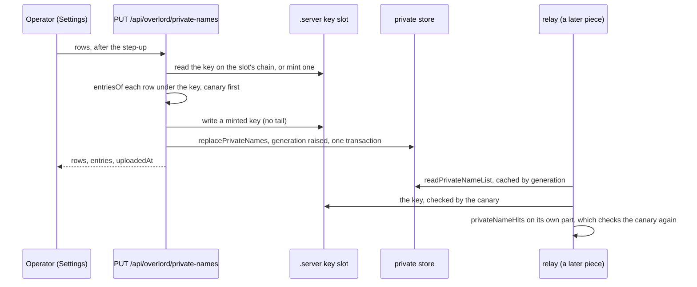

# Overlord W2: the private-name check and its uploaded list Implementation Plan

> **For agentic workers:** REQUIRED SUB-SKILL: Use superpowers:subagent-driven-development (recommended) or
> superpowers:executing-plans to implement this plan task by task. Steps use checkbox (`- [ ]`) syntax for tracking.

**Goal:** the server can check any outgoing text against the operator's own private-name list, which the operator
uploads once through a step-up door and which is stored only as keyed hashes.

- **PR A, the matcher's key and its one check** (K, L0). The key threads through every hash the matcher takes, with
  the public salt as the default, so every scan of this tree answers as it does today. `privateNameHits(text, list)` is
  the one check the egress doors call. It answers the ids of the entries a text hits, never the text, and it throws on
  a list with no key or whose canary is not under that key.
- **PR B, the uploaded list** (C11). The list lives in the private store as keyed hashes, under a key the server mints
  and keeps in a server-level slot of the operator-secrets store. `PUT /api/overlord/private-names`, behind the session
  and the step-up, replaces it. `GET /api/overlord/private-names` says whether a list is stored, never what is in it.
  One reader, `readPrivateNameList`, answers never uploaded, a list, or why it cannot be read.

**Why:** §9.4, rule 7, and decision C35: "The private-name check runs on the server, at the doors that send text out."
The Overlord's mail goes to coordinators, and coordinators publish: pull requests, issues, commits. GitHub keeps every
revision of a public text (§13's risk table, "Private content leaks into a public repository"). The relay, answer,
kickoff and brief doors therefore run one check on what the Overlord adds, and refuse `egress-refused` with no detail.
The relay piece wires the check into its door; this piece builds the check and the list it reads.

**Architecture:**

- `shared/private-names.mjs` (K, L0 `.mjs`, `node:crypto` only): the key on every hash; `privateNameHits`.
- `shared/privateNames.ts` (K, L0): the door's wire and caps, `NAME_LIST_MAX_ROWS`, `NAME_LIST_MAX_CHARS` and
  `NAME_LIST_BODY_MAX`, and the status read's words. It imports `private-names.mjs` by type only, so the console can
  bundle it without `node:crypto` (2264 F17).
- The private store (`server/src/operatorModel/`, private store A, #2896): one migration with two tables, and one
  writer, `replacePrivateNames`, on `OperatorModelStore`.
- `server/src/operatorModel/nameListState.ts` (C11, L1): the pure decider `nameListState`, importing L0 only.
- `server/src/operatorModel/nameListRead.ts` (C11, L3): `readPrivateNameList`, which reads the store and the key slot,
  asks the decider, and keeps the built list cached by the list's generation; and `mintNameListKey`.
- `server/src/operatorModel/nameListRoutes.ts` (C11, L4): the two doors, registered from `server/src/server.ts`.
- The key slot uses the `.server` slot API of `server/src/coord/ledgersSecrets.ts` that the decision-model plan defines
  (`writeServerSecret`, `readServerSecretValue`, `removeServerSecret`); whichever of the two lands first adds it.

**Tech Stack:** TypeScript (ESM) and JavaScript ESM with JSDoc types, `node:crypto` (`createHmac`, `randomBytes`),
`node:sqlite`, Fastify, vitest. No new dependency.

**Spec:** `docs/superpowers/specs/2026-11-09-overlord-design.md`:

- §9.4, rules 6 and 7 (the `overlord-only` quote check, and the private-name check, its move, its key argument, its
  step-up upload, its one word and "A paraphrase passes");
- §3.8's "Checked on the way out" (the three checks at the relay, answer, kickoff and brief doors, the quote the server
  renders "less the recipient's own project and programme names", and the hosted decision model's fields);
- §11.1's private store paragraph ("W2 adds the hashed private-name list") and Table 11.1a's row "The hashed
  private-name list | OM, L3 | the private store | The name-list upload door, behind the step-up | … | W2 | yes |
  Ignores it: no egress check runs";
- Table 11.1b's row "`DECISION_QUESTIONS`; `privateNameHits` in `shared/private-names.mjs` | … K, L0 | … W2";
- Table 11.2's row "The operator's doors" (the name list adds the account gate's step-up); decision C35; Table 11.6's
  `egress-refused`.

**The index:** `docs/superpowers/plans/2026-11-16-overlord-w2.md`, read from PR #2917's branch: its row "Private names"
(lane X; 2 PRs, 6 tasks, A 3 and B 3; A ready to build; B after PR A and private store A, #2896), its questions 7 (the
upload door's path), 9 (never uploaded, empty and unreadable) and 26 (the matcher is already in `shared/`, settled), and
the "Where lanes meet" bullets for `shared/private-names.mjs` and the private store. The W1 plan whose state B reads is
`docs/superpowers/plans/2026-11-14-overlord-w1/w1-private-store.md` (PR A: `operator-model.db`, its migrations and
`OperatorModelStore`). The sibling plan whose interface B shares is the decision-model plan,
`docs/superpowers/plans/2026-11-16-overlord-w2/w2-decision-model.md` (its question 6, the `.server` slot).

The coordinator's rulings on the index's review (run 2253: F9, F10) and on this plan's review (run 2264: F1, F2, F4 to
F11, F15, F17, F18 and nits c and d) bind; the 2264 findings are marked "(2264 F<n>)".

Written against `main` at `9cf263d44` (2026-11-16). Private store A (#2896) is not on `main` yet: PR B takes its
interface from the W1 private-store plan, and its builder re-measures it once #2896 lands.

## In short

- **Two pull requests, six tasks:** A (three tasks) is ready now; B (three tasks) follows A and private store A.
- **Nothing scanned today changes.** Every existing export answers as before with the public salt, pinned by a
  characterization test first.
- **`privateNameHits` answers ids, never text,** and throws on a list with no key or a canary under another key, so a
  wiring bug can never pass a known name as clean (2264 F1).
- **The uploaded list is keyed hashes in the private store,** under a key the server mints, in a `.server` slot of the
  operator-secrets store. The plain names exist only in the request's memory, and keyed tokens are never cached.
- **Only a list never uploaded skips the check** (ruled, F9). An empty list runs it and finds nothing. A list that was
  uploaded and cannot be read now, or whose key is lost, answers `unreadable`, and the relay refuses `egress-refused`.
  The list's row and its key slot, kept in two different stores, witness each other that an upload happened.
- **Nothing a session sees changes at merge.** No door runs the check until the relay piece wires it.

## 1. Open questions

Each carries a recommendation, which this plan builds unless the coordinator rules otherwise. None needs the operator:
uploading the list is the operator's act, but how it is stored is implementation detail.

- **Q1. Where the key threads** (slug `the-key-threads-through-every-hash`; ruled, F10 and 2264 F2). The matcher hashes
  in more places than `hashEntry`: each token of the text as it scans, and each entry as a list is built. A function the
  key skips silently hashes with the salt, so a list built under one key is scanned under another and never matches.
  **Built:** every function on both paths takes the key as a last argument defaulting to `PRIVATE_NAME_SALT`, and passes
  it on:
  - building: `hashEntry`, `entryFrom`, `entryFromStream`, `entryOf` and `entriesOf`;
  - scanning: `indexOf(entries, key)` (one index per array and key), `lookup` and `windows` (through the index's key),
    `hitsAt`, `hitsIn` and `pairHits`, whose `words` sub-index is built by `indexOf(words, key)`;
  - the pair path's module cache (`lastLine`, `lastEntries`, `lastStarts`) gains `lastKey`, so a keyed call never reads
    a salt call's state or another key's.

  `matchLine` and `maskText` keep the salt (their only lists are the committed ones). The exported signatures change
  only by the trailing optional argument, so every existing caller is untouched.
- **Q2. What `privateNameHits` answers** (slug `private-name-hits-answers-ids`). **Recommendation:**
  `privateNameHits(text, list)`, where `list` is `{ key, entries }`, answers the distinct 8-hex ids (`h8`) of the
  entries the text hits, in the order of first hit, and `[]` when it hits none. It scans each line through `hitsAt` and
  each pair of adjacent lines through `pairHits`, under `list.key`, so a `words` phrase broken across a line is found.
  It applies no file exemption: `EXEMPTIONS` are for this tree's history documents, and an egress text has no file. It
  never returns text, positions or a count of characters. The caller counts and throttles (§9.4: "a detailed refusal
  is an oracle"). Taking out the recipient's own names from the hits on a rendered quote is the relay's, which hashes
  those names under the same key with `entriesOf`.
- **Q3. It refuses a list it cannot trust** (slug `private-name-hits-checks-its-list`; ruled, 2264 F1). With the salt as
  every default, `{ key: undefined, entries }` would hash with the salt, match nothing and answer `[]`, so a known name
  would pass. **Built:** `privateNameHits` throws `PrivateNameListInvalid` (no detail, no text) unless `list.key` is a
  non-empty string and `list.entries[0]` equals `entryOf(CANARY, 'part', list.key)` in all four fields. The relay maps a
  throw to `egress-refused`, as it maps the reader's `unreadable`.
- **Q4. The list's tables** (slug `name-list-in-the-private-store`). **Recommendation:** two tables in the private
  store's next migration: `private_name_list`, one row (`id = 1`) with `uploadedAt`, `rows` (how many rows the
  operator sent) and `generation` (raised by each upload), and `private_name_entries` (`pos`, `h`, `f`, `n`, `mode`),
  the entries `entriesOf` made under the server's key, with the canary first. One writer,
  `OperatorModelStore.replacePrivateNames`, replaces both and raises `generation` in one transaction.
- **Q5. Where the key lives** (slug `name-list-key-in-a-server-slot`; ruled, 2264 F4). §9.4 says the list is "stored
  hashed under a key that stays on the server". Kept beside the hashes, the key would let anyone who reads the store
  test guesses against them, which is all a keyed hash prevents. **Built:**
  - a 32-byte random key, minted by the server (`randomBytes`, in L3), in the server-level slot `private-names-key` of
    the decision-model plan's `.server` slot API: `<ccrcDir>/operator-secrets/.server/<slot>.secret`, written by
    `writeServerSecret`, read by `readServerSecretValue` (absent, unreadable or the value, never folded), removed by
    `removeServerSecret`. The name `.server` fails the programme-slug shape, so no programme can share it. The deny
    rules already cover the directory (`shared/api.ts#ACCOUNT_SECRET_PATHS`);
  - whichever of the two plans lands first adds the three functions and the `operatorSecretRows` extension that re-keys
    the masker for `.server` slots; the second widens the first's "only caller of `readServerSecretValue`" sentence to
    name both callers;
  - **no tail is kept.** The key is never shown, so its metadata records no `secretTailOf` tail: the writer takes an
    option that keeps none (`{ tail: 'none' }`), added with the API by whichever lands first. The masker is still told
    the value, so a key that leaked into outgoing text would be masked;
  - **nothing removes the slot.** No caller passes `private-names-key` to `removeServerSecret`; a red test holds it
    (Task 5). Table P1's witness rests on that.
- **Q6. The canary checks the key twice** (slug `the-canary-checks-the-key`). A list matched under another key finds
  nothing, silently. **Recommendation:** the door stores `entryOf(CANARY, 'part', key)` as the list's first entry, as
  the committed list does with the salt. The reader checks it against the slot's key and answers `unreadable` with the
  reason `key-mismatch` when it differs; `privateNameHits` checks it again on every call (question 3).
- **Q7. The upload door** (index question 7; slug `name-list-upload-door`; ruled, 2264 F6, F7, F8).
  - **Route:** `PUT /api/overlord/private-names`, behind the session gate and the step-up (the account gate's
    `{ cap: null, stepUp: true }`), with `credentialBodyRoute(NAME_LIST_BODY_MAX)` (256 KiB), as
    `PUT /api/items/:id/secret` uses it: `Cache-Control: no-store`, an explicit body cap (`oversize` past it), and a
    malformed body answered `bad-request` by the route's own error handler, never echoed.
  - **Body:** `{ rows: [{ text, mode }] }`, at most `NAME_LIST_MAX_ROWS` (1,000) rows, each `text` at most
    `NAME_LIST_MAX_CHARS` (120) characters, `mode` one of `MODES`, no other key. A row answers `bad-request` exactly when
    it folds to no `[a-z0-9]` token (`tokens(text)` is empty), the one case `entryFrom` throws on, with a detail naming
    the row's index, never its text. **Residual:** a name written only in a non-Latin script cannot be listed, and the
    check cannot catch it; the committed list has the same limit.
  - **One at a time, in a stated order.** The door runs on one serialiser chain, the `.server` slot's own (the
    `underSlot` idiom, keyed on the slot), so two uploads never interleave. In order: (1) read the slot: unreadable
    answers `write-failed` and writes nothing, never minting over it; absent means mint a key in memory. (2) Build every
    entry under the key, the canary first. (3) If a key was minted, write it with `writeServerSecret`; a failure answers
    `write-failed` and the store is untouched. (4) `replacePrivateNames` in one transaction; a failure answers
    `write-failed`. Every failure leaves a state that refuses rather than passes: a minted key with no list reads
    `list-missing`, and a new key over an old list reads `key-mismatch`, until the next upload, which reuses the slot's
    key and cures both.
  - **Answer:** `{ ok: true, rows, entries, uploadedAt }`. The plain text lives only in the handler's memory: no log
    line, no journal record, no file, no error detail and no response carries it.
- **Q8. A status read for Settings** (slug `name-list-status-read`). The W2 Settings piece shows whether a list is
  stored, and the index names no read. **Recommendation:** `GET /api/overlord/private-names`, session-gated, with
  `no-store` (`noStoreRoute`), answering `{ state: 'none' }`, `{ state: 'list', rows, uploadedAt }` or
  `{ state: 'unreadable', reason }`. It never answers an entry or a hash.
- **Q9. Never uploaded, empty, and unreadable** (index question 9; slug `only-never-uploaded-skips`; ruled, F9 and
  2264 F9). "No list" must not absorb "a list we cannot read now". A durable fact that a list was uploaded is kept
  twice: the key slot, written at the first upload and removed by nothing (question 5), and the list's row in the
  private store. Each is the other's witness. Table P1 is `nameListState`'s whole domain.

  | The store's read | The key slot | Answer |
  |---|---|---|
  | no list row | absent | `none`: never uploaded |
  | no list row | present | `unreadable: list-missing` |
  | no list row | unreadable | `unreadable: key-unreadable` |
  | a list | absent | `unreadable: key-missing` |
  | a list | unreadable | `unreadable: key-unreadable` |
  | a list | present, the canary differs | `unreadable: key-mismatch` |
  | a list | present, the canary matches | `list` (with zero rows after the canary for an empty upload) |
  | failed | anything | `unreadable: store` |

  *Table P1. The reader's answers. Only the first row skips the check.*

  The relay (its piece B) skips the check on `none` and records `skipped: no-list` on its act row; runs it on `list`,
  where an empty list finds nothing; and refuses `egress-refused` on `unreadable`, recording the reason on its act row.
  The residual: losing both the private store's row and the key slot together (a whole state directory restored from
  before the first upload) reads as never uploaded. W2 offers no door back to `none`: an empty upload is the way to turn
  the check into a no-op.
- **Q10. The list is cached by its generation** (slug `name-list-cached-by-generation`; ruled, 2264 F11). The matcher's
  index is keyed on the entries array's identity: a fresh array per check rebuilds the index's slot tables (about
  2 MB) on every call, and a kept array goes stale after a re-upload. **Built:** `readPrivateNameList` reads the list
  row's `generation` on each call (one row) and rebuilds the entries array only when it or the key changed. Each
  upload raises `generation` in `replacePrivateNames`' transaction, which invalidates the cache.
- **Q11. Keyed tokens are not cached** (slug `keyed-tokens-are-not-cached`; ruled, 2264 F10). `HASHES` keeps every
  token's text for the life of the process. That serves the bounded tree scan, but under the server it would keep the
  plain tokens of every outgoing text in memory without bound. **Built:** `hashOf` caches under the salt only; a keyed
  hash is computed each time. The index's own slot table holds two 32-bit hashes and a length per token, never text,
  and is already bounded (`MAX_SLOTS`).
- **Q12. No journal record** (slug `name-list-not-journalled`). The privacy journal records message ids (W1), and the
  authority journal records authority. **Recommendation:** an upload writes neither. The list narrows what may leave,
  and the step-up is its guard. The status read and `uploadedAt` say when it last changed.

## 2. What exists today

Measured on `main` at `9cf263d44`.

- **The matcher is in `shared/` already** (index question 26). `shared/private-names.mjs` imports only `node:crypto`.
  `PRIVATE_NAME_SALT` is a committed constant, and `hashEntry(text)` is an HMAC-SHA256 under it, cut to 32 hex
  characters. `entryOf` and `entriesOf` make `{ h, f, n, mode }` entries through `entryFromStream` and `entryFrom`,
  which calls `hashEntry`. The scan hashes tokens in two more places: `lookup` (a token's own hash, to find the entries
  it can start) and `windows` (through `hashOf`, a per-process cache keyed on the text alone, checked against an
  entry's `h`). `INDEXES` is a `WeakMap` from an entries array to its index. `pairHits` scans the index's `words`
  sub-array through `hitsIn`, which builds that array's own index, and keeps `lastLine`, `lastEntries` and `lastStarts`
  across calls. The exports that scan are `hitsAt`, `matchLine`, `hitsIn` (less `EXEMPTIONS`), `pairHits` and
  `maskText`. `PRIVATE_NAMES` is the committed list, the canary first (`entryOf(CANARY, 'part')`), and
  `PRIVATE_NAMES_DIGEST` its digest. There is no `privateNameHits`, no key argument and no `.d.mts` (the file is typed
  by JSDoc).
- **Its consumers.** `server/test/private-names.mjs` re-exports the module and adds the CLI (`hash --list`,
  `scan --list`) and `entryKey`, `entriesDigest` and `readList`. `server/src/linking/publicTextClasses.ts` calls
  `hitsIn`, `pairHits` and `maskText` with `PRIVATE_NAMES` (the class `private name (hashed)`, whose `match` and pair
  hook are read by `server/src/linking/policy.ts`; `publicTextClassesFor(keys)` takes tracker keys). The tests
  `topology-clean.test.ts`, `private-names.test.ts`, `license.test.ts` and `public-text.test.ts` import it. Nothing
  under `agent/`, `pwa/src`, `ccd/` or `.github/` does.
- **Its tests.** `server/test/private-names.test.ts` pins the modes, the folding, the joiners, the exemptions, the
  committed digest and the CLI. Of `hashEntry` it pins only the shape (32 hex) and that two names differ: no output is
  characterized.
- **The private store** is not on `main`. Private store A (#2896, in review) adds `server/src/operatorModel/`, the
  second SQLite file `operator-model.db` with its own migrations that refuse to open empty, `operator_messages`, the
  read ledger, the privacy journal and `OperatorModelStore` (`w1-private-store.md`, PR A).
- **The step-up and the body route.** `server/src/auth/stepup.ts#createStepUp`, reached through the account gate
  (`server/src/accounts/gate.ts`, `AccountGateAsk`'s `stepUp`). `server/src/accounts/gate.ts#credentialBodyRoute` gives
  a route its body cap, `noStoreRoute`'s `no-store`, and an error handler that answers `oversize` or `bad-request`.
  `PUT /api/items/:id/secret` in `server/src/coord/ledgersRoutes.ts` uses both. Its words are
  `shared/api.ts#STEP_UP_REFUSALS`, and `auth-off` answers while sign-in is dark.
- **The operator-secrets store.** `server/src/coord/ledgersSecrets.ts` is the one reader and writer of
  `<ccrcDir>/operator-secrets/<programme>/<slot>.secret` (mode 0600): `writeOperatorSecret`, `removeOperatorSecret`,
  `readOperatorSecretMeta`, `operatorSecretPath` (which refuses a programme outside the slug shape), and the
  per-programme chain key `programmeChainKey` that the routes' `underSlot` serialises on. A masked save records
  `secretTailOf`'s tail. No server-level slot and no value reader exist on `main`; the decision-model plan (its
  question 6, on its own branch) defines the `.server` API this plan uses.
- **No egress door runs a name check yet.** The relay, answer, kickoff and brief doors are W2's and W3's.

*Figure P1. The upload and the check. The plain rows exist only inside the door's handler. The relay's part is the
relay piece's.*

## 3. Global constraints

- **Architecture (`CLAUDE.md`).**
  - **One matcher.** `privateNameHits` is built on the existing tokenizer and index, not beside them. The public-text
    check keeps `hitsIn` with its file exemptions, a legitimately different rule (this tree's history documents).
  - **One writer per fact.** The list has one writer, `replacePrivateNames`; the key has one, the door, through
    `writeServerSecret`; the reader `readPrivateNameList` is the one way any door reads either.
  - **Decide in L1, act in L4.** `nameListState.ts` imports L0 only and decides the reader's answer with no I/O. The
    reader in `nameListRead.ts` (L3) reads and caches; the route handler parses, calls the writers and answers.
  - **No overloaded null.** The reader answers `none`, `list` or `unreadable` with a reason (`store`, `list-missing`,
    `key-missing`, `key-unreadable`, `key-mismatch`), and the relay reads each differently: only `none` skips.
  - **Rings.** `shared/private-names.mjs` keeps to `node:crypto` (the `.mjs` carve-out); `shared/privateNames.ts`
    imports it by type only.
- **Privacy.** The plain names never reach a log, a journal, a file, a response or an error detail, and no keyed token
  stays in memory past its call. Tests use synthetic names only (`zz-alpha`, `zq-bravo-x9` and the like, and `CANARY`),
  never a real one, and the private-name scan runs over every changed file before each push. No committed list entry is
  printed in a test name or failure message.
- **What a merge arms.** A: nothing; every existing scan answers as before. B: the operator can upload a list, and the
  status read shows it. Nothing checks text against it until the relay piece lands. An older server ignores the tables.
- **The private store's migrations** (2264 F18). B's migration takes the next free slot of the private store's own
  `MIGRATIONS` when B lands. If another private-store migration lands first, B merges `main` once, renumbers, and moves
  the private store's version pins and its undo, as private store A defines them.
- **Growth.** A: no growth-checked file. B: `server/src/server.ts` about +2 (the import and the registration);
  `shared/api.ts` 0. `shared/private-names.mjs` grows by about 60 lines and is not listed.
- **Mutation.** A: a new set in `server/test/sim/privateNamesSets.ts` over the key's threading and `privateNameHits`.
  B: `nameListState` joins `MUTANT_SETS` through the same file. Each takes its floor in
  `server/test/sim/mutation-floors.json` at its measured score, in the pull request that adds it.
- **Tests.** From `server/`, in the foreground, one file at a time, through
  `ccrc test -- ./node_modules/.bin/vitest run test/<file>`. Each task's last step runs
  `ccrc test -- npx tsc --noEmit -p tsconfig.json` and `-p test/tsconfig.tests.json` in `server/`, and, for a
  `shared/` change, `ccrc test -- ./node_modules/.bin/tsc --noEmit` in `pwa/`.

## 4. Review focus

1. With the salt, every existing export answers exactly as on `main` (Task 1's pins, unchanged through A).
2. Under a key, every hash on both the build and the scan path uses it, the `words` sub-index and the pair cache
   included; no keyed token is cached.
3. `privateNameHits` never returns text, throws on a list it cannot trust, and finds a phrase across a line break under
   a non-salt key.
4. The plain rows never leave the handler, by any path, an error included; the door is serialised, and an unreadable
   slot is never minted over.
5. A list under a lost or replaced key, or a key whose list is gone, reads `unreadable`, never clean and never `none`.
6. Nothing passes `private-names-key` to `removeServerSecret`.

## 5. The PR split

| PR | Tasks | What it ships | Needs first | Growth-checked files, estimate |
|---|---|---|---|---|
| A, the key and the check | 1 to 3 | The characterization of today's matcher; the key through every hash; `privateNameHits` with its list check; their mutation set | nothing: **ready to build** | none |
| B, the uploaded list | 4 to 6 | The two tables and `replacePrivateNames`; the `.server` key slot; `nameListState` and `readPrivateNameList` with its cache; the upload and status doors with every census | PR A; private store A (#2896) | `server/src/server.ts` about +2; `shared/api.ts` 0; `server/src/coord/store.ts` 0; `server/src/coord/schema.ts` 0; `server/src/coord/routes.ts` 0; `server/src/watch.ts` 0; `pwa/src/lib/api.ts` 0 |

## 6. Tasks

### Task 1: Characterize the matcher, green on `main` (PR A)

**Files:**
- Create: `server/test/private-names-characterization.test.ts`

- [ ] **Step 1: Pin today's answers** on a synthetic corpus: `hashEntry` of three synthetic strings and of `CANARY`,
  as literals; `entryOf` and `entriesOf` of a synthetic name in each of the four modes; and `hitsAt`, `matchLine`,
  `hitsIn`, `pairHits` and `maskText` over twenty synthetic lines (each mode, camelCase, a hyphen variant, an invisible
  character, a phrase across a line break) against a synthetic list built by `entriesOf`. Pin the committed list's
  answer too: `matchLine` on a line that spells `CANARY` hits its `h8`, and `PRIVATE_NAMES_DIGEST` is unchanged.
- [ ] **Step 2: Pin the consumer.** From `publicTextClassesFor([])` (`server/src/linking/publicTextClasses.ts`), take
  the class named `private name (hashed)` and call its `match` on a synthetic line that spells `CANARY`: it answers the
  canary's `h8`, as today.
- [ ] **Step 3: Run it green on `main`.**

  Run: `cd server && ccrc test -- ./node_modules/.bin/vitest run test/private-names-characterization.test.ts`

  Expected: PASS.

- [ ] **Step 4: Commit:** `test(private-names): characterize the matcher before the key argument`.

### Task 2: The key through every hash (PR A)

**Files:**
- Modify: `shared/private-names.mjs` (`hashEntry`, `entryFrom`, `entryFromStream`, `entryOf`, `entriesOf`, `hashOf`,
  `indexOf`, `lookup`, `windows`, `hitsAt`, `hitsIn`, `pairHits` and its cache)
- Create: `server/test/private-names-key.test.ts`
- Create: `server/test/sim/privateNamesSets.ts`
- Modify: `server/test/sim/mutation-floors.test.ts` (`MUTANT_SETS`), `server/test/sim/mutation-floors.json`

- [ ] **Step 1: Red.** In `private-names-key.test.ts`, with two non-salt keys `k1` and `k2`:
  - `hashEntry(t)` equals `hashEntry(t, PRIVATE_NAME_SALT)`, and `k1` and `k2` give two other hashes;
  - `entryOf(name, mode, k1)` and `entriesOf(name, mode, k1)` hash every field under `k1` (each entry's `h` and `f`
    differ from the salt's), for each mode, so `entryFromStream` forwards the key;
  - `hitsAt(line, entries, k1)` hits a list built under `k1` on a line that spells one of its synthetic names, for each
    mode, and the same call under `k2` or the salt finds nothing;
  - `pairHits(prev, line, file, entriesOf(name, 'words', k1), k1)` finds a `words` phrase split across the two lines;
    under the salt it finds nothing;
  - interleaving: a salt call, then a `k1` call, then a `k2` call on the same lines and arrays answers each right (the
    index and the pair cache are per key);
  - no keyed token is cached: after a `k1` scan, `HASHES`' size (through a test-only reader) is what it was.

  Run: `cd server && ccrc test -- ./node_modules/.bin/vitest run test/private-names-key.test.ts`. Expected: FAIL.
- [ ] **Step 2: Green.** Thread the key as question 1 says. `hashOf` caches under the salt only (question 11). Run, one
  file at a time: `test/private-names-key.test.ts`, `test/private-names-characterization.test.ts` (unchanged, so every
  existing answer is the same), `test/private-names.test.ts`, `test/topology-clean.test.ts`,
  `test/public-text.test.ts`, `test/license.test.ts` and `test/rings/mjs-node.test.ts`. Expected: PASS.
- [ ] **Step 3: Mutation.** `privateNamesSets.ts` holds mutants of `shared/private-names.mjs`: `entryFromStream`
  dropping the key; `lookup` hashing with the salt; `windows` checking with the salt's cache; the index shared across
  keys; the `words` sub-index built with the salt; the pair cache ignoring `lastKey` (a stale pair cache); `hashOf`
  caching keyed tokens. Register the set and run its case alone:
  `ccrc test -- ./node_modules/.bin/vitest run test/sim/mutation-floors.test.ts -t 'private-names'`. Expected: every
  mutant killed; record the score as the set's floor in `mutation-floors.json`.
- [ ] **Step 4: Commit:** `feat(private-names): the key threads through every hash of the matcher`.

### Task 3: `privateNameHits` and its list check (PR A)

**Files:**
- Modify: `shared/private-names.mjs` (`privateNameHits`, `PrivateNameListInvalid`, its JSDoc `NameList` type)
- Modify: `server/test/private-names-key.test.ts`, `server/test/sim/privateNamesSets.ts`,
  `server/test/sim/mutation-floors.json`

- [ ] **Step 1: Red.**
  - a keyed list with a real hit (F10): `{ key: k1, entries: [entryOf(CANARY, 'part', k1), ...entriesOf(name, mode,
    k1)] }` is hit on a line that spells a synthetic name, for each mode, and the answer is that entry's `h8`;
  - every answer is a list of distinct `/^[0-9a-f]{8}$/` strings in first-hit order, and `[]` for clean text and for a
    list holding only its canary;
  - a `words` phrase split across two lines is a hit under `k1`, and the same phrase split across three is not;
  - no `EXEMPTIONS` apply: a hit that `hitsIn` would exempt for a history document is still a hit;
  - the list check (2264 F1): a missing key, an empty key, a non-string key, an empty entries array, entries whose first
    is not the canary, and a canary built under `k2` with `key: k1`, each throw `PrivateNameListInvalid`, whose message
    names no entry and no text.

  Run the file: FAIL.
- [ ] **Step 2: Green.** Add `privateNameHits(text, list)`: check the list as question 3 says; split the text into
  lines; collect the `h8` of every hit of each line (`hitsAt` under `list.key`) and of each pair of adjacent lines
  (`pairHits` under `list.key`); keep each once in first-hit order; return them. Run the Task 2 files again: PASS.
- [ ] **Step 3: Mutation.** Add mutants: the list check dropped; the canary compared on `h` alone; pairs not scanned; a
  duplicate returned; the folded text returned instead of the id. Run `-t 'private-names'` again. Expected: every mutant
  killed; raise the floor to the measured score.
- [ ] **Step 4: Typecheck** (`server/` both configs, `pwa/`), then the docs guards (`anchors`, `citations`, `dtbd`,
  `topology-clean`, `deviation-refs` after `git fetch origin main`). Expected: PASS.
- [ ] **Step 5: Commit:** `feat(private-names): privateNameHits, which answers ids and refuses a list it cannot trust`.

### Task 4: The list's tables and its one writer (PR B)

**Files:**
- Modify: `server/src/operatorModel/schema.ts` (the private store's migrations: one new entry at the next free slot)
- Modify: `server/src/operatorModel/store.ts` (`OperatorModelStore.replacePrivateNames`, `privateNamesRead`,
  `privateNamesGeneration`)
- Create: `server/test/private-names-store.test.ts`
- Modify: the private store's writers census, version pins and undo, as private store A defines them

- [ ] **Step 1: Red.** A fresh store reads `none`, generation 0; after `replacePrivateNames(entries, rows, at)` it reads
  the `uploadedAt`, the `rows`, generation 1 and the entries in their order; a second call replaces all of them and
  reads generation 2; a call that throws midway leaves the first list and its generation whole; the store's migrations
  refuse to open a database from a newer build (private store A's rule, unchanged). Run: FAIL.
- [ ] **Step 2: Green.** The migration adds `private_name_list` (`id INTEGER PRIMARY KEY CHECK (id = 1)`, `uploadedAt`,
  `rows`, `generation`) and `private_name_entries` (`pos`, `h`, `f`, `n`, `mode`). `replacePrivateNames` deletes the
  entries, inserts the new ones in order, and upserts the list row with `generation` raised, in one transaction.
  `privateNamesRead()` answers `{ kind: 'none' }` or `{ kind: 'list', uploadedAt, rows, generation, entries }`, and
  `privateNamesGeneration()` the generation alone (or `'none'`); both throw on a read they cannot make. Add the writer to
  the private store's writers census, and move its version pins and undo. Run: PASS.
- [ ] **Step 3: Commit:** `feat(operator-model): the private-name list's tables and its one writer`.

### Task 5: The key slot, the decider and the reader (PR B)

**Files:**
- Modify: `server/src/coord/ledgersSecrets.ts` (the `.server` slot API, `writeServerSecret`'s no-tail option and the
  `operatorSecretRows` extension, unless the decision-model plan landed them first; else only its "only caller"
  sentence, widened)
- Create: `shared/privateNames.ts` (the caps, the body and status wire, `NAME_LIST_STATES`, `NAME_LIST_UNREADABLE`,
  `NAME_LIST_KEY_SLOT`; a type-only import of `private-names.mjs`)
- Create: `server/src/operatorModel/nameListState.ts` (`nameListState`, C11, L1, L0 imports only)
- Create: `server/src/operatorModel/nameListRead.ts` (`readPrivateNameList` with its generation cache, and
  `mintNameListKey`, C11, L3)
- Create: `server/test/private-names-list.test.ts`, `server/test/single-definition/name-list-key.test.ts`
- Modify: `server/test/sim/privateNamesSets.ts`, `server/test/sim/mutation-floors.json`

- [ ] **Step 1: Red.**
  - `nameListState(storeRead, keyRead)` over Table P1's eight rows as a table test, with a monotonicity property: making
    any input worse (a value to `unreadable`, a matching canary to a differing one, a store read to `failed`) never moves
    the answer from `unreadable` to `list` or to `none`;
  - `readPrivateNameList` over a fixture HOME and a fresh store gives the same answers; asked twice with no upload
    between, it returns the same entries array (one index build); after an upload it returns a new one;
  - the `.server` slot round-trips at mode 0600, records no tail, is told to the masker, and is not listed by any
    programme's secrets read;
  - `name-list-key.test.ts`, built on `server/test/scan`: no call of `removeServerSecret` in `server/src` passes
    `NAME_LIST_KEY_SLOT` or its literal, and its control plants such a call and is red;
  - `shared/privateNames.ts` has no value import (its control: a planted value import is red).

  Run each file: FAIL.
- [ ] **Step 2: Green.** Add, or reuse, the `.server` API (question 5). `mintNameListKey` writes 32 random bytes as hex
  through `writeServerSecret` with no tail. `nameListState` decides; `readPrivateNameList` reads the generation and the
  key slot, rebuilds the entries only when either changed, and asks the decider. Run: PASS.
- [ ] **Step 3: Mutation.** Add `nameListState`'s mutants (each `unreadable` reason answered as `list` or as `none`,
  `list-missing` above all; an unreadable slot read as absent; the canary check skipped), register it, run its case
  alone (`-t 'nameListState'`), and set its floor at the measured score. Expected: every mutant killed.
- [ ] **Step 4: Commit:** `feat(operator-model): the name list's key slot, its decider and its one reader`.

### Task 6: The upload door, the status read and every census (PR B)

**Files:**
- Create: `server/src/operatorModel/nameListRoutes.ts` (`registerNameListRoutes`)
- Modify: `server/src/server.ts` (the import and the registration)
- Create: `server/test/private-names-routes.test.ts`
- Modify: the censuses: `server/test/auth-gate.test.ts` (`scanRoutes`' list and its counts),
  `server/test/box-token-census.test.ts` (the new file as a lane source, its doors in a hand-kept `NAME_LIST_DOORS`,
  and its number words), `server/test/rings/fastify-l4.data.ts`, `server/test/secret-mask.test.ts` (the `GET`),
  `server/test/routeRegistrations.ts` (once W1's other-lanes piece has created it, re-measured at build),
  `README.md`'s auth paragraph, `CLAUDE.md`'s sentence listing the session-gated coordination writes, and the
  architecture spec's path table (C11 gains `nameListState.ts`, `nameListRead.ts` and `nameListRoutes.ts`; K gains
  `shared/privateNames.ts`)

- [ ] **Step 1: Red.** Over a real server with the auth gate armed (the step-up test helpers):
  - `PUT` without a session answers the gate's refusal; without a recent step-up `step-up-required`; while sign-in is
    dark `auth-off`; every answer carries `Cache-Control: no-store`;
  - malformed JSON answers `bad-request`, and a body over `NAME_LIST_BODY_MAX` answers `oversize`, neither echoing the
    body;
  - a body over 1,000 rows, a row over 120 characters, a row that folds to no `[a-z0-9]` token (a name in a non-Latin
    script among them), an unknown mode or an extra key answers `bad-request`, whose detail names the row's index and
    never contains any row's text (asserted by searching the whole response for each synthetic name);
  - a good body answers `{ ok: true, rows, entries, uploadedAt }`, and the store then holds the canary first and the
    rows' entries under the slot's key;
  - the first upload mints the key; a second keeps it; an upload with the slot removed and a list stored mints a new
    key and replaces the list; with the slot unreadable it answers `write-failed`, mints nothing and leaves the store as
    it was;
  - two uploads started together finish one after the other: the slot holds one key, the store one list under it;
  - a key write that fails answers `write-failed` with the store untouched; a store write that fails answers
    `write-failed`, and the reader then answers `unreadable` (never `none`);
  - `GET` carries `no-store` and answers `none` before any upload, `list` with `rows` and `uploadedAt` after one,
    `unreadable: key-missing` after the slot is removed, `unreadable: list-missing` after the list row is removed with
    the slot kept, and never an entry or a hash;
  - no line written to the console during the test names any synthetic row (a spy on `console.warn` and `console.log`).

  Run: FAIL.
- [ ] **Step 2: Green.** The handler, on the `.server` slot's chain: the gate (`{ cap: null, stepUp: true }` with
  `credentialBodyRoute(NAME_LIST_BODY_MAX)` for `PUT`; `{ cap: null }` with `noStoreRoute` for `GET`), the body checked
  against `shared/privateNames.ts`' caps and `tokens`, then question 7's four steps in order, and the answer. Register
  it from `server/src/server.ts`. Run: PASS.
- [ ] **Step 3: The censuses.** Run each red, one file at a time, and read what it asks for: `test/auth-gate.test.ts`,
  `test/box-token-census.test.ts`, `test/rings/fastify-l4.test.ts`, `test/secret-mask.test.ts`,
  `test/rings/totality.test.ts`. Add each row with the reason it asks for. `CLAUDE.md` and `README.md` are shared
  files: claim them first, and mail the holder through the claim's `mailHint` if another wave holds them. Run each
  green.
- [ ] **Step 4: The last runs:** the docs guards (`anchors`, `citations`, `dtbd`, `topology-clean`, `deviation-refs`
  after `git fetch origin main`), `test/growth-check.test.ts`, and the typecheck in `server/` and `pwa/`. Expected:
  PASS, and `server/src/server.ts` within its 40 lines.
- [ ] **Step 5: Commit:** `feat(operator-model): the step-up door that uploads the private-name list, and its status`.

## 7. Deviations found

By slug; the coordinator mints numbers (cross-plan ruling X9).

- **`the-key-threads-through-every-hash`**: §9.4 gives `hashEntry` a key argument; the matcher hashes on the build and
  scan paths in eleven functions, and the key reaches each (question 1).
- **`private-name-hits-answers-ids`**: the spec names `privateNameHits` and not its answer. It answers entry ids,
  never text (question 2).
- **`private-name-hits-checks-its-list`**: `privateNameHits` refuses a list with no key or a canary under another key
  (question 3).
- **`name-list-key-in-a-server-slot`**: the spec says the key stays on the server. It is the `.server` slot
  `private-names-key`, on the decision-model plan's API, with no tail, removed by nothing (question 5).
- **`the-canary-checks-the-key`**: a list under a lost key reads `unreadable: key-mismatch`, never clean (question 6).
- **`name-list-upload-door`**: the door's body route, serialiser and write order (question 7).
- **`name-list-status-read`**: a status read the index does not name, for the Settings row (question 8).
- **`only-never-uploaded-skips`**: never uploaded, empty and unreadable are three answers, and only the first skips
  (question 9).
- **`name-list-cached-by-generation`** and **`keyed-tokens-are-not-cached`**: how the list and its tokens are held in
  memory (questions 10 and 11).
- **`name-list-not-journalled`**: an upload writes no journal record (question 12).

## 8. What the index should change

- **Table W2, the row "Private names":** "A: the key threaded through every hash of the matcher, on the build path
  (`hashEntry`, `entryFrom`, `entryFromStream`, `entryOf`, `entriesOf`) and the scan path (`indexOf` with the `words`
  sub-index, `lookup`, `windows`, `hitsAt`, `hitsIn`, `pairHits` and its cache), the committed entries keeping the
  public salt, keyed tokens never cached; `privateNameHits(text, list)` (K, L0) in `shared/private-names.mjs`, answering
  entry ids, never text, and throwing on a list with no key or a canary under another (question 26); characterization
  first. B: the hashed list in the private store (two tables, one writer, a generation), under a server-minted key in
  the `.server` slot `private-names-key`, kept with no tail and removed by nothing, checked by the list's canary; the
  pure decider `nameListState` and the reader `readPrivateNameList`, cached by generation, answering `none` (never
  uploaded, the only answer that skips the check), `list`, or `unreadable` with its reason (question 9, refined by F9);
  `PUT /api/overlord/private-names` behind the step-up, serialised, on `credentialBodyRoute` (question 7), and the
  status read `GET /api/overlord/private-names`, in `server/src/operatorModel/nameListRoutes.ts`, a new lane source."
  Size unchanged: 2 PRs, 6 tasks (A 3, B 3).
- **Question 9:** as refined by F9: the list's row and its key slot witness that an upload happened; only "never
  uploaded" skips; an uploaded list that cannot be read, or whose key is lost, refuses `egress-refused` at the relay with
  the reason on the act row, and so does a `privateNameHits` throw. The relay's row (B) gains both refusals.
- **Question 7's table:** add "The name list's status | `GET /api/overlord/private-names` | session".
- **"Where lanes meet":**
  - the private store bullet: private names B adds `private_name_list` and `private_name_entries` with the store's next
    migration, under the same order rule as `coord.db` (renumber at landing, move the store's version pins and undo),
    and `replacePrivateNames`;
  - a new bullet, `server/src/coord/ledgersSecrets.ts`: decision model B and private names B share ONE `.server` slot
    API (`writeServerSecret`, with a no-tail option; `readServerSecretValue`; `removeServerSecret`) and the
    `operatorSecretRows` extension, added by whichever lands first; the second widens the "only caller" sentence; no
    door passes the name-list slot to `removeServerSecret`;
  - the door censuses: `server/src/operatorModel/nameListRoutes.ts` is a new lane source, and its two doors join
    `CLAUDE.md`'s session-gated list in private names B. `server/test/routeRegistrations.ts` stays on the list (W1's
    other-lanes piece creates it; re-measured at build).
- **"States W3 may read"** and the relay's inputs: `privateNameHits(text, { key, entries })`, its throw, and
  `readPrivateNameList()`'s three answers. The relay, the decision model's hosted fields and W3's answer, kickoff and
  brief doors all read the list through that one reader, and take out a recipient's own names by hashing them with
  `entriesOf` under the same key.

## 9. Where things stand

**Agreed:**
- The matcher is already in `shared/` (index question 26, settled); the list is the private store's (§11.1); the
  upload is behind the step-up (§9.4, C35).
- Only a list never uploaded skips the check; an unreadable list or a lost key refuses (question 9, ruled F9).
- The key threads through every hash, with a keyed-list test that has a real hit (ruled, F10 and 2264 F2), and keyed
  tokens are not cached (2264 F10).
- `privateNameHits` refuses a list it cannot trust (2264 F1); the key uses the shared `.server` API with no tail
  (2264 F4); the decider and the reader are two files (2264 F5); the door's body route, serialiser and write order
  (2264 F6, F7, F8); `key-unreadable` for an unreadable slot (2264 F9); the generation cache (2264 F11); the type-only
  import (2264 F17); the private store's migration order (2264 F18).

**Waiting on the coordinator** (at this plan's review):
- The status read (question 8) and no journal record (question 12).

**Later operator acts:**
- Uploading the list, from Settings once the W2 Settings piece lands, so the relay's name check runs.

**Later:**
- The relay piece wires `privateNameHits` and the reader into its door, with `egress-refused` counted and throttled.
- The W2 Settings piece draws the upload and the status.
