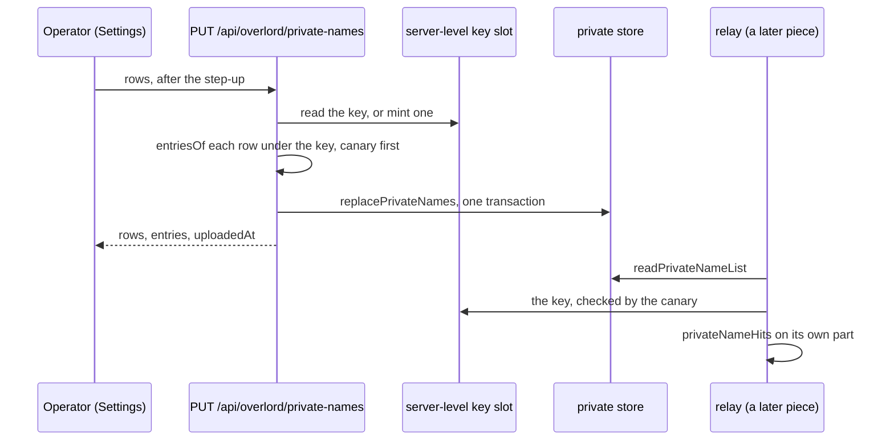

# Overlord W2: the private-name check and its uploaded list Implementation Plan

> **For agentic workers:** REQUIRED SUB-SKILL: Use superpowers:subagent-driven-development (recommended) or
> superpowers:executing-plans to implement this plan task by task. Steps use checkbox (`- [ ]`) syntax for tracking.

**Goal:** the server can check any outgoing text against the operator's own private-name list, which the operator
uploads once through a step-up door and which is stored only as keyed hashes.

- **PR A, the matcher's key and its one check** (K, L0). `hashEntry` in `shared/private-names.mjs` gains a key
  argument. The committed entries keep the public salt, so every scan of this tree answers as it does today.
  `privateNameHits(text, list)` is the one check the egress doors call: it answers the ids of the entries a text hits,
  never the text.
- **PR B, the uploaded list** (C11). The list lives in the private store as keyed hashes, under a key the server mints
  and keeps in a server-level slot of the operator-secrets store. `PUT /api/overlord/private-names`, behind the session
  and the step-up, replaces it. `GET /api/overlord/private-names` says whether a list is stored, never what is in it.
  One reader, `readPrivateNameList`, answers no list, a list, or why it cannot be read.

**Why:** §9.4, rule 7, and decision C35: "The private-name check runs on the server, at the doors that send text out."
The Overlord's mail goes to coordinators, and coordinators publish: pull requests, issues, commits. GitHub keeps every
revision of a public text (§13's risk table, "Private content leaks into a public repository"). The relay, answer,
kickoff and brief doors therefore run one check on what the Overlord adds, and refuse `egress-refused` with no detail.
The relay piece wires the check into its door; this piece builds the check and the list it reads.

**Architecture:**

- `shared/private-names.mjs` (K, L0 `.mjs`, `node:crypto` only): `hashEntry(text, key)`, `entryOf` and `entriesOf`
  with the same key argument, and `privateNameHits`. The matcher binds a key to each entries array's index, so the
  existing exports keep their signatures and their answers.
- `shared/privateNames.ts` (K, L0): the door's wire and caps, `NAME_LIST_MAX_ROWS` and `NAME_LIST_MAX_CHARS`, and the
  status read's words.
- The private store (`server/src/operatorModel/`, private store A, #2896): one migration with two tables, and one
  writer, `replacePrivateNames`, on `OperatorModelStore`.
- `server/src/operatorModel/nameList.ts`: the pure decider `nameListState` (C11, L1) and the reader
  `readPrivateNameList` (C11, L3), which reads the store and the key slot and checks the key by the list's canary.
- `server/src/operatorModel/nameListRoutes.ts` (C11, L4): the two doors, registered from `server/src/server.ts`.

**Tech Stack:** TypeScript (ESM) and JavaScript ESM with JSDoc types, `node:crypto` (`createHmac`, `randomBytes`),
`node:sqlite`, Fastify, vitest. No new dependency.

**Spec:** `docs/superpowers/specs/2026-11-09-overlord-design.md`:

- §9.4, rules 6 and 7 (the `overlord-only` quote check, and the private-name check, its move, its key argument, its
  step-up upload, its one word and "A paraphrase passes");
- §3.8's "Checked on the way out" (the three checks at the relay, answer, kickoff and brief doors, the quote the server
  renders "less the recipient's own project and programme names", and the hosted decision model's fields);
- §11.1's private store paragraph ("W2 adds the hashed private-name list") and Table 11.1a's row "The hashed
  private-name list | OM, L3 | the private store | The name-list upload door, behind the step-up | … | W2 | yes |
  Ignores it: no egress check runs";
- Table 11.1b's row "`DECISION_QUESTIONS`; `privateNameHits` in `shared/private-names.mjs` | … K, L0 | … W2";
- Table 11.2's row "The operator's doors" (the name list adds the account gate's step-up); decision C35; Table 11.6's
  `egress-refused`.

**The index:** `docs/superpowers/plans/2026-11-16-overlord-w2.md`, read from PR #2917's branch: its row "Private names"
(lane X; A ready to build; B after PR A and private store A, #2896), its questions 7 (the upload door's path), 9 (no
list versus an empty list) and 26 (the matcher is already in `shared/`, settled), and the "Where lanes meet" bullets for
`shared/private-names.mjs` and the private store. The W1 plan whose state B reads is
`docs/superpowers/plans/2026-11-14-overlord-w1/w1-private-store.md` (PR A: `operator-model.db`, its migrations and
`OperatorModelStore`).

Written against `main` at `9cf263d44` (2026-11-16). Private store A (#2896) is not on `main` yet: PR B takes its
interface from the W1 private-store plan, and its builder re-measures it once #2896 lands.

## In short

- **Two pull requests, six tasks.** A (two tasks) is ready now. B (four tasks) follows A and private store A.
- **Nothing scanned today changes.** Every existing export answers as before with the public salt, pinned by a
  characterization test first.
- **`privateNameHits` answers ids, never text,** so a refusal built on it can say one word and count.
- **The uploaded list is keyed hashes in the private store,** under a key the server mints, in a server-level slot of
  the operator-secrets store. The plain names exist only in the request's memory.
- **No list, an empty list and an unreadable list are three answers.** With no list the check is skipped (index
  question 9); with an empty list it runs and finds nothing; an unreadable list is never read as either.
- **Nothing a session sees changes at merge.** No door runs the check until the relay piece wires it.

## 1. Open questions

Each carries a recommendation, which this plan builds unless the coordinator rules otherwise. None needs the operator:
uploading the list is the operator's act, but how it is stored is implementation detail.

- **Q1. Where the key binds** (slug `the-key-binds-at-the-index`). The matcher hashes each token of the text as it scans,
  so the key must reach the per-token hash (`lookup`, and `windows`' check against an entry's `h`), not only
  `hashEntry`. **Recommendation:** each entries array's index (`INDEXES`) records the key it was built with, and the
  token-hash cache (`HASHES`) is kept per key. `hashEntry(text, key = PRIVATE_NAME_SALT)`, `entryOf(text, mode, key)`
  and `entriesOf(text, mode, key)` take the key with the salt as default. `hitsAt`, `matchLine`, `hitsIn`, `pairHits`
  and `maskText` keep their signatures and use the salt, because their only lists are the committed ones. An entries
  array met with another key gets an index of its own.
- **Q2. What `privateNameHits` answers** (slug `private-name-hits-answers-ids`). **Recommendation:**
  `privateNameHits(text, list)`, where `list` is `{ key, entries }`, answers the distinct 8-hex ids (`h8`) of the
  entries the text hits, in the order of first hit, and `[]` when it hits none. It scans each line and each pair of
  adjacent lines, so a `words` phrase broken across a line is found, as `pairHits` does. It applies no file exemption:
  `EXEMPTIONS` are for this tree's history documents, and an egress text has no file. It never returns text, positions
  or a count of characters. The caller counts and throttles (§9.4: "a detailed refusal is an oracle"). Taking out the
  recipient's own names from the hits on a rendered quote is the relay's, which hashes those names under the same key
  with `entriesOf`.
- **Q3. The list's tables** (slug `name-list-in-the-private-store`). **Recommendation:** two tables in the private
  store's next migration: `private_name_list`, one row (`id = 1`) with `uploadedAt` and `rows` (how many rows the
  operator sent), and `private_name_entries` (`h`, `f`, `n`, `mode`), the entries `entriesOf` made under the server's
  key, with the canary first. One writer, `OperatorModelStore.replacePrivateNames`, replaces both in one transaction.
- **Q4. Where the key lives** (slug `name-list-key-in-a-server-slot`). §9.4 says the list is "stored hashed under a key
  that stays on the server". Kept beside the hashes, the key would let anyone who reads the store test guesses against
  them, which is all a keyed hash prevents. **Recommendation:** a 32-byte random key, minted by the server on the first
  upload (`randomBytes`, in L3), stored in a server-level slot of the operator-secrets store, `private-names-key`. The
  operator never sees it. The slot is behind the same deny rules as every operator secret (`ACCOUNT_DENY_RULES`'
  `~/.ccrc/operator-secrets/` arm). The decision-model piece B keeps its model key in a server-level slot of the same
  store (index Table W2). Whichever pull request lands first adds the server-level slot to
  `server/src/coord/ledgersSecrets.ts`, through its existing writer, and the other reuses it.
- **Q5. A list read under the wrong key** (slug `the-canary-checks-the-key`). A list matched under another key finds
  nothing, silently. That would read as "clean". **Recommendation:** the door stores `entryOf(CANARY, 'part', key)` as
  the list's first entry, as the committed list does with the salt. The reader checks it against the slot's key and
  answers `unreadable` with the reason `key-mismatch` when it differs, so a lost or replaced key never reads as a clean
  list. A lost key is cured by uploading again: the door mints a new key when the slot is absent and no list is stored,
  and when the slot is absent and a list is stored it replaces both.
- **Q6. The upload door** (index question 7; slug `name-list-upload-door`). **Recommendation:**
  `PUT /api/overlord/private-names`, behind the session gate and the step-up (the account gate's
  `{ cap: null, stepUp: true }`, as `PUT /api/items/:id/secret` asks). Its body is
  `{ rows: [{ text, mode }] }`, at most `NAME_LIST_MAX_ROWS` (1,000) rows, each `text` at most `NAME_LIST_MAX_CHARS`
  (120) characters with at least one letter or digit, and `mode` one of `MODES`. It replaces the whole list. It answers
  `{ ok: true, rows, entries, uploadedAt }`. A bad body answers `bad-request` whose detail names a row's index, never
  its text. A store or slot it cannot write answers `write-failed` (503). The plain text lives only in the handler's
  memory: no log line, no journal record, no file, no error detail and no response carries it.
- **Q7. A status read for Settings** (slug `name-list-status-read`). The W2 Settings piece shows whether a list is
  stored, and the index names no read. **Recommendation:** `GET /api/overlord/private-names`, session-gated, answering
  `{ state: 'none' }`, `{ state: 'list', rows, uploadedAt }` or `{ state: 'unreadable', reason }`. It never answers an
  entry or a hash.
- **Q8. No list, an empty list, and back** (index question 9; slug `no-list-is-not-an-empty-list`).
  **Recommendation:** the reader answers `none` when the store has no `private_name_list` row, and `list` with zero
  entries after the canary when the operator uploaded no rows. The relay skips the check on `none` and records
  `skipped: no-list` (its own act row); on an empty list the check runs and finds nothing. An older build has no table
  and runs no check (Table 11.1a, "Ignores it"). W2 offers no door back to `none`: an empty upload is the way to turn the
  check into a no-op.
- **Q9. No journal record** (slug `name-list-not-journalled`). The privacy journal records message ids (W1), and the
  authority journal records authority. **Recommendation:** an upload writes neither. The list narrows what may leave,
  and the step-up is its guard. The status read and `uploadedAt` say when it last changed.

## 2. What exists today

Measured on `main` at `9cf263d44`.

- **The matcher is in `shared/` already** (index question 26). `shared/private-names.mjs` imports only `node:crypto`.
  `PRIVATE_NAME_SALT` is a committed constant, and `hashEntry(text)` is an HMAC-SHA256 under it, cut to 32 hex
  characters. `entryOf` and `entriesOf` make `{ h, f, n, mode }` entries through `entryFrom`, which calls `hashEntry`.
  The scan hashes tokens in two more places: `lookup` (a token's own hash, to find the entries it can start) and
  `windows` (through `hashOf`, a per-process cache, checked against an entry's `h`). `INDEXES` is a `WeakMap` from an
  entries array to its index. The exports that scan are `hitsAt`, `matchLine`, `hitsIn` (less `EXEMPTIONS`),
  `pairHits` and `maskText`. `PRIVATE_NAMES` is the committed list, the canary first, and `PRIVATE_NAMES_DIGEST` its
  digest. There is no `privateNameHits`, no key argument and no `.d.mts` (the file is typed by JSDoc).
- **Its consumers.** `server/test/private-names.mjs` re-exports the module and adds the CLI (`hash --list`,
  `scan --list`) and `entryKey`, `entriesDigest` and `readList`. `server/src/linking/publicTextClasses.ts` calls
  `hitsIn`, `pairHits` and `maskText` with `PRIVATE_NAMES` (the class `private name (hashed)`, read by
  `server/src/linking/policy.ts`). The tests `topology-clean.test.ts`, `private-names.test.ts`, `license.test.ts` and
  `public-text.test.ts` import it. Nothing under `agent/`, `pwa/src`, `ccd/` or `.github/` does.
- **Its tests.** `server/test/private-names.test.ts` pins the modes, the folding, the joiners, the exemptions, the
  committed digest and the CLI. Of `hashEntry` it pins only the shape (32 hex) and that two names differ: no output is
  characterized.
- **The private store** is not on `main`. Private store A (#2896, in review) adds `server/src/operatorModel/`, the
  second SQLite file `operator-model.db` with its own migrations that refuse to open empty, `operator_messages`, the
  read ledger, the privacy journal and `OperatorModelStore` (`w1-private-store.md`, PR A).
- **The step-up.** `server/src/auth/stepup.ts#createStepUp`, reached through the account gate
  (`server/src/accounts/gate.ts`, `AccountGateAsk`'s `stepUp`). `PUT /api/items/:id/secret` in
  `server/src/coord/ledgersRoutes.ts` is the precedent: `deps.gate(req, reply, { cap: null, stepUp: true })` first. Its
  words are `shared/api.ts#STEP_UP_REFUSALS`, and `auth-off` answers while sign-in is dark.
- **The operator-secrets store.** `server/src/coord/ledgersSecrets.ts` is the one reader and writer of
  `<ccrcDir>/operator-secrets/<programme>/<slot>.secret` (mode 0600): `writeOperatorSecret`, `removeOperatorSecret`,
  `readOperatorSecretMeta`, `operatorSecretPath`. Slots are keyed by programme and slot name. No server-level slot
  exists.
- **No egress door runs a name check yet.** The relay, answer, kickoff and brief doors are W2's and W3's.

*Figure P1. The upload and the check. The plain rows exist only inside the door's handler. The relay's part is the
relay piece's.*

## 3. Global constraints

- **Architecture (`CLAUDE.md`).**
  - **One matcher.** `privateNameHits` is built on the existing tokenizer and index, not beside them. The public-text
    check keeps `hitsIn` because its file exemptions are a legitimately different rule (this tree's history documents).
  - **One writer per fact.** The list has one writer, `replacePrivateNames`; the key has one, the door, through
    `ledgersSecrets.ts`' writer; the reader `readPrivateNameList` is the one way any door reads either.
  - **Decide in L1, act in L4.** `nameListState` decides the reader's answer from what the store and the slot gave,
    with no I/O. The route handler parses, calls the writer and answers, and decides nothing beyond its body shape.
  - **No overloaded null.** The reader answers `none`, `list` or `unreadable` with a reason (`store`, `key-missing`,
    `key-unreadable`, `key-mismatch`), and the relay reads each differently.
  - **Rings.** `shared/private-names.mjs` keeps to `node:crypto` (the `.mjs` carve-out); `shared/privateNames.ts`
    imports nothing.
- **Privacy.** The plain names never reach a log, a journal, a file, a response or an error detail. Tests use synthetic
  names only (`zz-alpha`, `zq-bravo-x9` and the like, and `CANARY`), never a real one, and the private-name scan runs
  over every changed file before each push. No committed list entry is printed in a test name or failure message.
- **What a merge arms.** A: nothing; every existing scan answers as before. B: the operator can upload a list, and the
  status read shows it. Nothing checks text against it until the relay piece lands. An older server ignores the tables.
- **Growth.** A: no growth-checked file. B: `server/src/server.ts` about +2 (the import and the registration);
  `shared/api.ts` 0. `shared/private-names.mjs` grows by about 40 lines and is not listed.
- **Mutation.** A: a new set in `server/test/sim/privateNamesSets.ts` over the key's threading and `privateNameHits`.
  B: `nameListState` joins `MUTANT_SETS` through the same file. Each takes its floor in
  `server/test/sim/mutation-floors.json` at its measured score, in the pull request that adds it.
- **Tests.** From `server/`, in the foreground, one file at a time, through
  `ccrc test -- ./node_modules/.bin/vitest run test/<file>`. Each task's last step runs
  `ccrc test -- npx tsc --noEmit -p tsconfig.json` and `-p test/tsconfig.tests.json` in `server/`, and, for a
  `shared/` change, `ccrc test -- ./node_modules/.bin/tsc --noEmit` in `pwa/`.

## 4. Review focus

1. With the salt, every existing export answers exactly as on `main` (Task 1's pins, unchanged through A).
2. Under a key, the scan uses that key at every hash: an index and a token cache never answer for another key.
3. `privateNameHits` never returns text, and finds a phrase across a line break.
4. The plain rows never leave the handler, by any path, an error included.
5. A list under a lost or replaced key reads `unreadable: key-mismatch`, never clean.
6. No list, an empty list and an unreadable list are three answers.

## 5. The PR split

| PR | Tasks | What it ships | Needs first | Growth-checked files, estimate |
|---|---|---|---|---|
| A, the key and the check | 1 to 2 | The characterization of today's matcher; the key argument; `privateNameHits`; their mutation set | nothing: **ready to build** | none |
| B, the uploaded list | 3 to 6 | The two tables and `replacePrivateNames`; the server-level key slot; `nameListState` and `readPrivateNameList`; the upload and status doors with every census | PR A; private store A (#2896) | `server/src/server.ts` about +2; `shared/api.ts` 0; `server/src/coord/store.ts` 0; `server/src/coord/schema.ts` 0; `server/src/coord/routes.ts` 0; `server/src/watch.ts` 0; `pwa/src/lib/api.ts` 0 |

## 6. Tasks

### Task 1: Characterize the matcher, green on `main` (PR A)

**Files:**
- Create: `server/test/private-names-characterization.test.ts`

- [ ] **Step 1: Pin today's answers** on a synthetic corpus: `hashEntry` of three synthetic strings and of `CANARY`,
  as literals; `entryOf` and `entriesOf` of a synthetic name in each of the four modes; and `hitsAt`, `matchLine`,
  `hitsIn`, `pairHits` and `maskText` over twenty synthetic lines (each mode, camelCase, a hyphen variant, an invisible
  character, a phrase across a line break) against a synthetic list built by `entriesOf`. Pin the committed list's
  answer too: `matchLine` on a line that spells `CANARY` hits its `h8`, and `PRIVATE_NAMES_DIGEST` is unchanged.
- [ ] **Step 2: Pin the consumer.** `publicTextClassesFor` (`server/src/linking/publicTextClasses.ts`) on a synthetic
  text that spells `CANARY` answers the `private name (hashed)` class, as today.
- [ ] **Step 3: Run it green on `main`.**

  Run: `cd server && ccrc test -- ./node_modules/.bin/vitest run test/private-names-characterization.test.ts`

  Expected: PASS.

- [ ] **Step 4: Commit:** `test(private-names): characterize the matcher before the key argument`.

### Task 2: The key argument and `privateNameHits` (PR A)

**Files:**
- Modify: `shared/private-names.mjs` (`hashEntry`, `entryFrom`, `entryOf`, `entriesOf`, `hashOf`, `indexOf`,
  `lookup`, `windows`; a new `privateNameHits` with its JSDoc `NameList` type)
- Create: `server/test/private-names-key.test.ts`
- Create: `server/test/sim/privateNamesSets.ts`
- Modify: `server/test/sim/mutation-floors.test.ts` (`MUTANT_SETS`), `server/test/sim/mutation-floors.json`

- [ ] **Step 1: Red.** In `private-names-key.test.ts`:
  - `hashEntry(t)` equals `hashEntry(t, PRIVATE_NAME_SALT)`, and two other keys give two other hashes;
  - a list made by `entriesOf(name, mode, k1)` is hit by `privateNameHits` under `k1`, for each mode, and not under
    `k2` or the salt;
  - one entries array asked under `k1`, then `k2`, then `k1` again answers right each time (the index is per key), and
    tokens hashed under one key are never answered from another's cache (interleaved calls);
  - every answer is a list of distinct `/^[0-9a-f]{8}$/` strings in first-hit order, and `[]` for clean text and for an
    empty list;
  - a `words` phrase split across two lines is a hit, and the same phrase split across three is not;
  - no `EXEMPTIONS` apply: a hit that `hitsIn` would exempt for a history document is still a hit.

  Run: `cd server && ccrc test -- ./node_modules/.bin/vitest run test/private-names-key.test.ts`. Expected: FAIL
  (no key argument, no `privateNameHits`).
- [ ] **Step 2: Green.** Thread the key as question 1 says: `hashEntry(text, key = PRIVATE_NAME_SALT)`; `entryFrom`,
  `entryOf` and `entriesOf` pass it on; `indexOf(entries, key)` keeps one index per key for each array; `HASHES`
  becomes a map per key; `lookup` and `windows` hash with the index's key. Add `privateNameHits(text, list)`: split the
  text into lines, collect the `h8` of every hit of each line and of each pair of adjacent lines through the existing
  scan with `list.key`, keep each once in first-hit order, and return them. The existing exports call through with the
  salt and keep their signatures.
- [ ] **Step 3: Run green,** one file at a time: `test/private-names-key.test.ts`,
  `test/private-names-characterization.test.ts` (unchanged, so every existing answer is the same),
  `test/private-names.test.ts`, `test/topology-clean.test.ts`, `test/public-text.test.ts`, `test/license.test.ts`, and
  `test/rings/mjs-node.test.ts`. Expected: PASS.
- [ ] **Step 4: Mutation.** `privateNamesSets.ts` holds mutants of `shared/private-names.mjs`: `lookup` hashing with
  the salt; `windows` checking with the salt's cache; the index shared across keys; `privateNameHits` scanning lines
  only (no pairs); returning a duplicate; returning the folded text instead of the id. Register the set in
  `MUTANT_SETS` and run its case alone:
  `ccrc test -- ./node_modules/.bin/vitest run test/sim/mutation-floors.test.ts -t 'privateNameHits'`. Expected: every
  mutant killed; record the score as the floor of `shared/private-names.mjs#privateNameHits` in `mutation-floors.json`.
- [ ] **Step 5: Typecheck** (`server/` both configs, `pwa/`), then the docs guards. Expected: PASS.
- [ ] **Step 6: Commit:** `feat(private-names): a key argument for the matcher, and privateNameHits`.

### Task 3: The list's tables and its one writer (PR B)

**Files:**
- Modify: `server/src/operatorModel/schema.ts` (the private store's migrations: one new entry)
- Modify: `server/src/operatorModel/store.ts` (`OperatorModelStore.replacePrivateNames`, `privateNamesRead`)
- Create: `server/test/private-names-store.test.ts`
- Modify: the private store's writers census, as private store A defines it

- [ ] **Step 1: Red.** A fresh store reads `none`; after `replacePrivateNames(entries, rows, at)` it reads the
  `uploadedAt`, the `rows` and the entries in their order; a second call replaces all of them; a call that throws midway
  leaves the first list whole; the store's migrations refuse to open a database from a newer build (private store A's
  rule, unchanged). Run: FAIL.
- [ ] **Step 2: Green.** The migration adds `private_name_list` (`id INTEGER PRIMARY KEY CHECK (id = 1)`, `uploadedAt`,
  `rows`) and `private_name_entries` (`pos`, `h`, `f`, `n`, `mode`). `replacePrivateNames` deletes the entries, inserts
  the new ones in order and upserts the list row in one transaction. `privateNamesRead()` answers
  `{ kind: 'none' }` or `{ kind: 'list', uploadedAt, rows, entries }`, and throws on a read it cannot make. Add the
  writer to the private store's writers census. Run: PASS.
- [ ] **Step 3: Commit:** `feat(operator-model): the private-name list's tables and its one writer`.

### Task 4: The key slot, the decider and the reader (PR B)

**Files:**
- Modify: `server/src/coord/ledgersSecrets.ts` (a server-level slot, unless the decision-model piece added it first)
- Create: `shared/privateNames.ts` (the caps, the body and status wire, `NAME_LIST_STATES`, `NAME_LIST_UNREADABLE`)
- Create: `server/src/operatorModel/nameList.ts` (`nameListState`, L1; `readPrivateNameList` and `mintNameListKey`, L3)
- Create: `server/test/private-names-list.test.ts`
- Modify: `server/test/sim/privateNamesSets.ts`, `server/test/sim/mutation-floors.json`

- [ ] **Step 1: Red.** `nameListState(storeRead, keyRead)` over its whole domain, as a table test with a monotonicity
  property: a store `none` answers `none` whatever the key; a stored list with the key absent answers
  `unreadable: key-missing`, with the key unreadable `unreadable: key-unreadable`, with a key whose canary entry differs
  from the list's first `unreadable: key-mismatch`; a store read that failed answers `unreadable: store`; only a stored
  list with a matching key answers `list`. Making any input worse never moves the answer from `unreadable` to `list`.
  `readPrivateNameList` over a fixture HOME and a fresh store gives the same answers. The server-level slot is written
  mode 0600, under `operator-secrets/`, and is not listed by any programme's secrets read. Run: FAIL.
- [ ] **Step 2: Green.** Add the server-level slot to `ledgersSecrets.ts` through its existing writer and reader (a
  fixed directory beside the programme directories that no programme slug can name). `mintNameListKey` writes 32
  random bytes as hex. `nameListState` decides; `readPrivateNameList` reads both and asks it. Run: PASS.
- [ ] **Step 3: Mutation.** Add `nameListState`'s mutants to `privateNamesSets.ts` (each `unreadable` reason answered as
  `list` or as `none`; the canary check skipped), register it, run its case alone (`-t 'nameListState'`), and set its
  floor at the measured score. Expected: every mutant
  killed.
- [ ] **Step 4: Commit:** `feat(operator-model): the name list's key slot and its one reader`.

### Task 5: The upload door and the status read (PR B)

**Files:**
- Create: `server/src/operatorModel/nameListRoutes.ts` (`registerNameListRoutes`)
- Modify: `server/src/server.ts` (the import and the registration)
- Create: `server/test/private-names-routes.test.ts`

- [ ] **Step 1: Red.** Over a real server with the auth gate armed (the step-up test helpers):
  - `PUT` without a session answers the gate's refusal; without a recent step-up `step-up-required`; while sign-in is
    dark `auth-off`;
  - a body over 1,000 rows, a row over 120 characters, a row with no letter or digit, an unknown mode or an extra key
    answers `bad-request`, whose detail names the row's index and never contains any row's text (asserted by searching
    the whole response for each synthetic name);
  - a good body answers `{ ok: true, rows, entries, uploadedAt }`, and the store then holds the canary first and the
    rows' entries under the slot's key;
  - the first upload mints the key; a second keeps it; an upload with the slot removed and a list stored mints a new key
    and replaces the list;
  - a store or slot that cannot be written answers `write-failed`;
  - `GET` answers `none` before any upload, `list` with `rows` and `uploadedAt` after one, `unreadable` with its reason
    after the slot is removed, and never an entry or a hash;
  - no line written to the console during the test names any synthetic row (a spy on `console.warn` and `console.log`).

  Run: FAIL.
- [ ] **Step 2: Green.** The handler: the gate (`{ cap: null, stepUp: true }` for `PUT`, `{ cap: null }` for `GET`),
  the body checked against `shared/privateNames.ts`' caps, the key read or minted, `entriesOf` under it for each row,
  the canary entry first, `replacePrivateNames`, and the answer. Register it from `server/src/server.ts`. Run: PASS.
- [ ] **Step 3: Commit:** `feat(operator-model): the step-up door that uploads the private-name list, and its status`.

### Task 6: Every census the two doors meet (PR B)

**Files:**
- Modify: `server/src/auth/gate.ts` (only if a census asks), `server/test/auth-gate.test.ts` (`scanRoutes`' list and
  its counts), `server/test/box-token-census.test.ts` (the new file as a lane source, its doors in a hand-kept
  `NAME_LIST_DOORS`, and its number words), `server/test/rings/fastify-l4.data.ts`,
  `server/test/secret-mask.test.ts` (the `GET`), `README.md`'s auth paragraph,
  `CLAUDE.md`'s sentence listing the session-gated coordination writes, and the architecture spec's path table (C11
  gains `nameList.ts` and `nameListRoutes.ts`; K gains `shared/privateNames.ts`)

- [ ] **Step 1: Run each census red,** one file at a time, and read what it asks for:
  `test/auth-gate.test.ts`, `test/box-token-census.test.ts`, `test/rings/fastify-l4.test.ts`,
  `test/secret-mask.test.ts`, `test/rings/totality.test.ts`, `test/single-definition/writers-map.test.ts` (it does
  not list the private store's tables unless private store A added them).
- [ ] **Step 2: Add each row,** with the reason the census asks for. `CLAUDE.md` and `README.md` are shared files:
  claim them first, and mail the holder through the claim's `mailHint` if another wave holds them.
- [ ] **Step 3: Run each census green,** then the docs guards (`anchors`, `citations`, `dtbd`, `topology-clean`,
  `deviation-refs` after `git fetch origin main`), `test/growth-check.test.ts`, and the typecheck in `server/` and
  `pwa/`. Expected: PASS, and `server/src/server.ts` within its 40 lines.
- [ ] **Step 4: Commit:** `test(census): the name-list doors in every route census`.

## 7. Deviations found

By slug; the coordinator mints numbers (cross-plan ruling X9).

- **`the-key-binds-at-the-index`**: §9.4 gives `hashEntry` a key argument; the scan hashes tokens in two more places, so
  the key binds to each list's index (question 1).
- **`private-name-hits-answers-ids`**: the spec names `privateNameHits` and not its answer. It answers entry ids,
  never text (question 2).
- **`name-list-key-in-a-server-slot`**: the spec says the key stays on the server. It is a server-level slot of the
  operator-secrets store, shared in kind with the decision model's key (question 4).
- **`the-canary-checks-the-key`**: a list under a lost key reads `unreadable: key-mismatch`, never clean (question 5).
- **`name-list-status-read`**: a status read the index does not name, for the Settings row (question 7).
- **`name-list-not-journalled`**: an upload writes no journal record (question 9).

## 8. What the index should change

- **Table W2, the row "Private names":** "A: `hashEntry`, `entryOf` and `entriesOf` gain a key argument, the committed
  entries keeping the public salt, the key bound to each list's index; `privateNameHits(text, list)` (K, L0) in
  `shared/private-names.mjs`, answering entry ids, never text (question 26); characterization first. B: the hashed list
  in the private store (two tables, one writer), under a server-minted key in a server-level slot of the
  operator-secrets store, checked by the list's canary; one reader, `readPrivateNameList`, answering `none`, `list` or
  `unreadable` with its reason (question 9); `PUT /api/overlord/private-names` behind the step-up (question 7) and the
  status read `GET /api/overlord/private-names`, in `server/src/operatorModel/nameListRoutes.ts`, a new lane source."
  Size: **2 PRs, 6 tasks (A 2, B 4)**, up from 5: B's census sites are a task of their own.
- **Question 7's table:** add "The name list's status | `GET /api/overlord/private-names` | session".
- **"Where lanes meet":**
  - the private store bullet: private names B adds `private_name_list` and `private_name_entries` with the store's next
    migration, and `replacePrivateNames`;
  - a new bullet, `server/src/coord/ledgersSecrets.ts`: decision model B and private names B each need a server-level
    slot; the first to land adds it, the second reuses it;
  - the door censuses: `server/src/operatorModel/nameListRoutes.ts` is a new lane source, and its two doors join
    `CLAUDE.md`'s session-gated list in private names B.
  - the door censuses' list names `server/test/routeRegistrations.ts`, which does not exist on `main`; drop it.
- **"States W3 may read"** and the relay's inputs: `privateNameHits(text, { key, entries })` and
  `readPrivateNameList()`'s three answers. The relay, the decision model's hosted fields and W3's answer, kickoff and
  brief doors all read the list through that one reader, and take out a recipient's own names by hashing them with
  `entriesOf` under the same key.

## 9. Where things stand

**Agreed:**
- The matcher is already in `shared/` (index question 26, settled); the list is the private store's (§11.1); the
  upload is behind the step-up (§9.4, C35).

**Waiting on the coordinator** (at this plan's review):
- Questions 1 to 9's recommendations, chiefly the key's home (question 4) and the status read (question 7).

**Later operator acts:**
- Uploading the list, from Settings once the W2 Settings piece lands, so the relay's name check runs.

**Later:**
- The relay piece wires `privateNameHits` and the reader into its door, with `egress-refused` counted and throttled.
- The W2 Settings piece draws the upload and the status.
