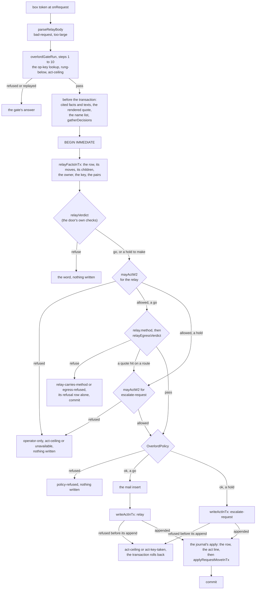
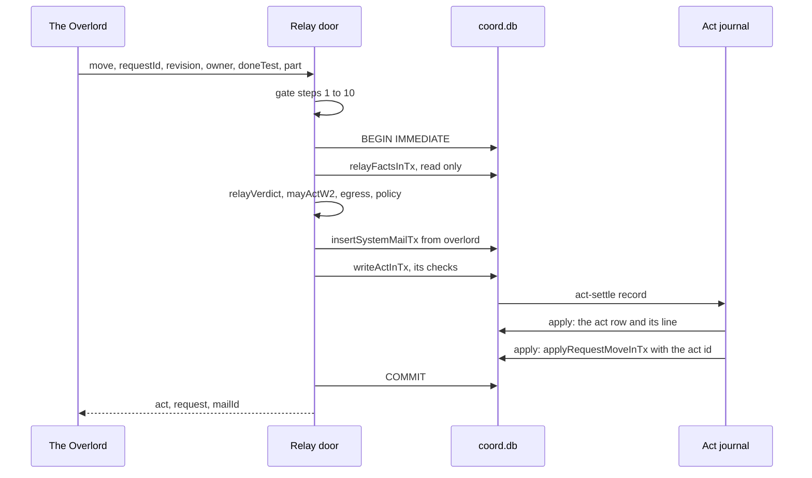
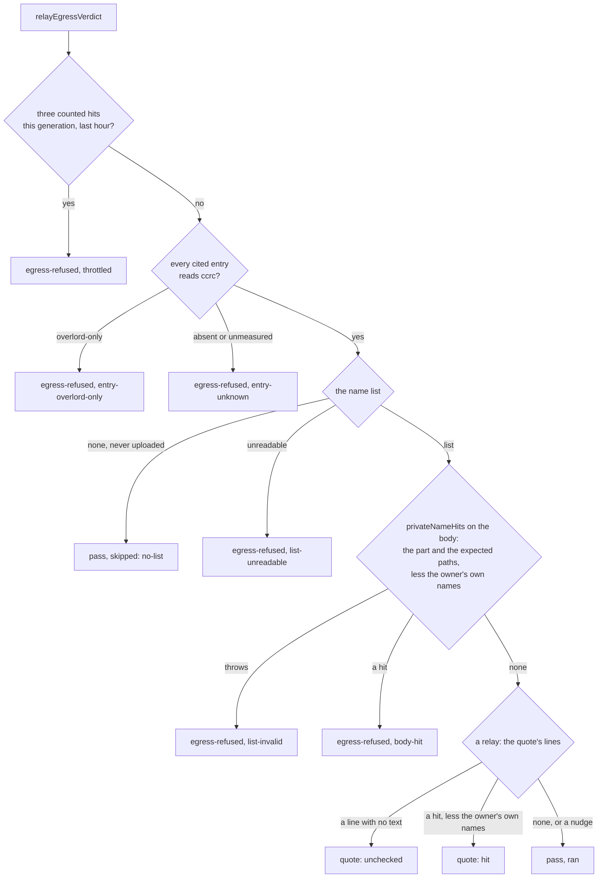
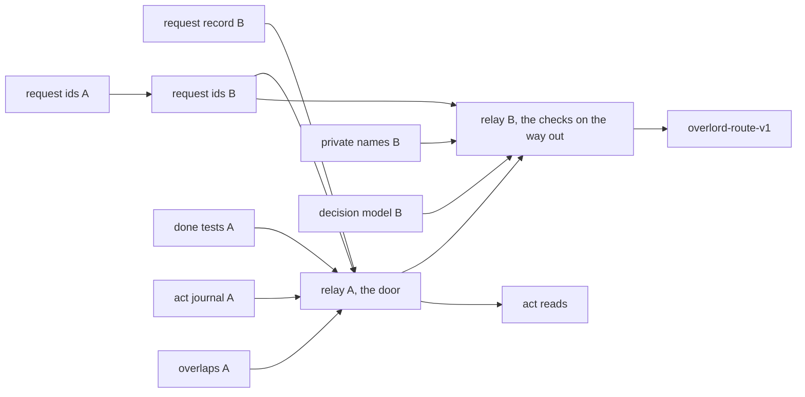

# Overlord W2: the relay door, its moves, its egress checks and the nudge Implementation Plan

> **For agentic workers:** REQUIRED SUB-SKILL: Use superpowers:subagent-driven-development (recommended) or
> superpowers:executing-plans to implement this plan task by task. Steps use checkbox (`- [ ]`) syntax for tracking.

## In short

- **What this is.** The plan for the W2 piece "Relay" (the W2 index, Table W2, lane X). The relay is the door that sends
  a request to its owner with a done test. It carries more authority than any other W2 door: it is the one writer of
  `doneTest`, it spends a root request's authority, and it is the only W2 act that may carry an O3 effect (a widening).
  Two pull requests, nine tasks: PR A six, PR B three.
- **PR A, the door.** `POST /api/overlord/relay` makes three moves, named by a `move` field: `route`, `re-relay` and
  `route-elsewhere` (index question 2). The mail, the act row and the request move commit in one transaction, and the
  mail is sent as the `overlord` sender. A route spends the root request's one relay to that owner: act rows A's natural
  key holds it (a taken key answers `act-key-taken`), and a re-relay spends nothing and carries no widening (act
  catalogue F10). A parent request is never relayed (`has-children`), and a cited message whose stored hash no longer
  matches refuses `said-not-operator`. A relay that would deepen an unruled goal conflict is refused
  `goal-conflict-open`, through overlaps A's `relayConflictVerdict`. A widening is carried only when the cited words
  name the programme. The relay writes `widens` on its act row, and the goals door reads it (index question 8, F4). The
  done test is parsed by done tests A's `parseDoneTest`. The nudge, `nudge-owner`, is a second row of the same handler;
  it reads `nudges`, which the follow-up piece alone writes.
- **A hold is an escalation.** A relay the server sends to the operator instead writes an `escalate-request` act row,
  counted in the `request` ceiling group, and moves the request `relay-held` to `needs-you`. It is decided only after
  `mayActW2` has allowed the relay, so a relay the decider refuses never reaches the operator, and never for free.
- **PR B, the checks on the way out.** Everything the Overlord puts in the mail body (the part, the expected paths), and
  every nudge, passes the private-name check less the owner's own names, the `overlord-only` entry check and the
  decision model's `relay.method` row (questions 9 and 21). An uploaded list that cannot be read refuses
  `egress-refused`, and only a list never uploaded skips. The quote is checked at both ends: at send, a hit on the quote
  the server renders, or a cited line the server cannot render (withdrawn, no longer on record or unmeasured), holds the
  relay for the operator; at fetch, request ids B re-runs the name check and withholds a line that hits. Before W3 no
  answer clears a quote hold. The `scope.widens` row is applied before `overlordMayAct` is asked: anything short of a
  clear yes from an armed row sends the widening to the operator, and a row in shadow reads as skipped.
- **No refusal after the journal append.** Every check that can refuse runs read-only inside the transaction, before
  the act writer appends its record (the request record's F1). The request move runs inside the journal port's `apply`,
  so a throw after the append is reported `trailing` at once.
- **The ceilings are the catalogue's.** The `relay` group (relay and nudge) allows 6 an hour to one programme and 30
  in all. A carried widening also counts in the `o3-effect` group (1 and 3), and a hold in the `request` group (6 and
  30). Gate step 10 refuses early, and the act writer checks again inside its write. This plan adds one value: a
  throttle on egress refusals that are hits, three an hour per generation, ending an hour after the oldest counted one.
- **What changes at merge.** Nothing a running session sees. Both doors refuse `capability-missing` naming
  `overlord-route-v1` until the index's last piece, and the goals door's new check fires only on a `requestId`, which
  nothing sends before then.
- **What the reader must check.** Nineteen open questions (§2), each with a recommendation. None is for the operator.
  Fix round 1 (review 2284) folds the coordinator's rulings: the quote checked at both ends, the egress check over the
  whole body, the hold as an escalation, no quote hold cleared before W3, the throttle counting hits only, and RL11
  accepted (a `shadow` gate reads as skipped, fixed in the decision-model plan's `gateOutcome`).

## 1. Goal, scope and the rulings this plan builds on

This section says what the piece builds, why, where its files go, and which rulings bind it.

**Goal:** the Overlord hands a request to exactly one owner, with a done test the server can evaluate, through one door
that cannot put words in the operator's mouth, cannot spend a request's authority twice, and cannot send a private name
out of ccrc.

**Why:** C13 (§5.3): "A relay carries the operator's words as the server rendered them. It is system mail
`fromId:'overlord'`, sent through the relay door (E3), which writes the mail and the act row in one transaction." H22
(§5.5): "The done test is fixed at the relay and accepted in the read-back", and "The relay door stays the one writer
of `doneTest`". H7 (§5.1): "A root request authorises one relay per owner and at most one start. A re-relay that
answers a counter spends none." H9 (§3.8): "the relay, answer, kickoff and brief doors each run three checks". H25
(§7.5): "Relays have a ceiling across the fleet and per target". H39 (§5.3): "While a goal conflict stands unruled, the
Overlord relays nothing that deepens it." §5.4: "`nudge-owner` … is served by the relay door, under the relay's egress
checks and ceilings."

**Architecture.** Context C5 (Coordination) owns the door, the deciders and the refusal counts. Decide in L1, act in
L4, one writer per fact.

| Ring | File | What | PR |
|---|---|---|---|
| L0, K | `shared/overlordRequests.ts` (request record A's) | `RELAY_MOVE_MAP`, the body caps, the `relay-held` move and its reasons, `RelayAnswer` | A |
| L1 | `server/src/coord/relayBody.ts` (new) | `parseRelayBody` (the done test through `parseDoneTest`), `parseNudgeBody`: shape and bounds, no I/O | A |
| L1 | `server/src/coord/relay.ts` (new) | `relayVerdict` (the door's own checks, first match), `relayNaturalKey`, `nudgeNaturalKey`, `renderRelayBody`, `relayPriority` | A |
| L1 | `server/src/coord/overlaps.ts` (overlaps A's) | `relayFactsOf`: the one helper that drops the project from a request's paths, for the relay and the requests read's `blockedBy` | A |
| L1 | `server/src/coord/citedNames.ts` (new) | `citedNamesOf`: which names the cited words name, on the private-name matcher | A |
| L3 | `server/src/coord/relayFacts.ts` (new) | `relayFactsInTx`: the reads `relayVerdict` takes, inside the door's transaction | A |
| L3 | `server/src/coord/overlordActsStore.ts` (act rows A's) | `relayWidening`: the goals door's one reader of a carried widening | A |
| L4 | `server/src/coord/overlordRoutes.ts` (W1's) | The relay and nudge handlers | A, B |
| L4 | `server/src/coord/ledgersRoutes.ts` | The `widens` half of `goals modify`'s check | A |
| L1 | `server/src/coord/relayEgress.ts` (new) | `relayEgressVerdict` and `quoteHoldVerdict` | B |
| L2 | `server/src/coord/relayEgressPorts.ts` (new) | `EntryShareRead`, declared by its consumer, with its W2 adapter | B |
| L3 | `server/src/coord/relayRefusalStore.ts` (new) | `overlord_relay_refusals`: its one writer and its counts | B |

No row is added to the architecture spec's path table: every new file is under `server/src/coord/`, which is C5 by its
directory row, and no new `shared/` file is created.

**The plans this one reads,** at the commits read for this plan (fix round 1 re-read each one):

| Plan | Commit read | What this plan takes |
|---|---|---|
| The W2 index (#2917, merged) | `main` at `7ab4d41f5` | Table W2's relay row, questions 2, 8, 9, 19 and 21 |
| Act catalogue (#2924, merged) | `fa4c99a6c` | `relay`, `nudge-owner` and `escalate-request` rows, the `relay`, `request` and `o3-effect` ceiling groups, `overlordMayAct`, `mayActW2`, `MayActAllow`, the `OverlordPolicy` port, F4, F9 and F10 |
| Act rows and act journal (#2930, merged) | `ae3451eda` (fix round 1) | `writeActInTx`, `ActWrite.widens`, the natural key, its unique index and `act-key-taken` (F8), the operation key, the journal port's `apply` callback (F12), the act journal's record order |
| Request record (#2928, merged) | `b21194e74` (fix round 1) | `REQUEST_TRANSITIONS` and its guards, `planRequestMoveInTx` and `applyRequestMoveInTx`, `REQUEST_MOVE_FIELDS`, the reasons map, RQ3's expected paths, `citedMessageFacts`, the escalate door |
| Request ids and coordinator doors (#2931) | `b26d2765f` (fix round 1) | `insertMail`'s `requestId`, the goals door's ownership check, `attestedQuoteOf` and its line kinds, the `overlord` sender and its recipient rule, the read-back's `counters` |
| Done tests and follow-up (#2932) | `082ce04b6` | `parseDoneTest` and `DoneTest` (done tests A); `nudges` and its one writer, `recordFollowUpInTx` (the follow-up) |
| Overlaps (#2923, merged) | `2e18e5c4c` | `standingPairs`, `relayConflictVerdict`, `RelayFacts`, `blockingPairs`, `programmeLandedSince`, `GOAL_CONFLICT_CHOICES` |
| Private names (#2925, merged) | `b7866d764` | `privateNameHits`, `PrivateNameListInvalid`, `readPrivateNameList` and its answers, `entriesOf` under a key |
| Decision model (#2922, merged) | `bb222b354` | `gatherDecisions`, `applyDecision`, `gateOutcome`, the `scope.widens` and `relay.method` rows |

**The rulings this plan builds on.** The coordinator accepted every recommendation of the index's questions 2 to 23,
and questions 24 to 28 are settled. Item 357 answered question 1.

| Ruling | What it says | Where it is built |
|---|---|---|
| Q2 | The relay door makes `route`, `re-relay` and `route-elsewhere`, by a `move` field. It is the one writer of `doneTest`. A re-relay spends no authority | §4, Tasks A1, A4 |
| Act catalogue F10 | One relay per owner per root request is relay A's, and I4 checks it. A re-relay carries no `widens`. Relay B consumes `scope.widens` before the decider is called | §6, Tasks A2, A6, B2 |
| Act catalogue, the `relay` row | `relay` may carry `widen-scope` or nothing. Covers are per class member, and an operator request covers O3 only. The cell is bound into the allow | §6, Task A4 |
| Q8, F4 | `widens` and the widened programme are act-row columns in act rows A's migration. The relay writes them, and the goals door reads them | §6, Task A6 |
| Q1, item 357 | Three choices: both stand, A goes first, B goes first. The relay quotes the choice to the owner | §5, Task A3 |
| Overlaps F3 | The relay reads only goal-conflict pairs with two triples, hot paths set aside, and its refusal is reachable only after `overlord-route-v1` | §5 |
| Q9, F9 | Never uploaded skips the name check. An empty list runs it. An uploaded list that cannot be read, or a lost key, refuses `egress-refused` | §7, Task B1 |
| Q21 | A `nudge-owner` passes every check and counts against the relay's ceilings | §9, Task B3 |
| Q19 | This wave's plans propose the ceilings, and the coordinator approves them at review | §10 |
| Request record F1 | No refusal after the journal append: a read-only check inside the transaction, before the act writer | §5, Task A4 |
| Request ids B | The relay sends as the `overlord` mail sender | §4 |
| Q27 | `overlordMayAct` gets no grants and no commands in W2, through `mayActW2` | §6 |
| Q28 | Nothing raises an item before W3 | RL5, RL6 |
| Fix round 1, F1 | The quote is checked at both ends. The relay owns the check at send, where a cited line that is withdrawn, no longer on record or unmeasured holds and never passes as "no text". Request ids B's fetch-time render re-runs `privateNameHits` against the current list and withholds a line that hits | §7, Task B1 |
| Fix round 1, F2 | The egress check covers the whole Overlord-supplied body (Table 11.6), less the owner's names. The done test is a closed key set, the expected paths are checked, and the other programme in the choice sentence is rendered by id | §4, §7, Tasks A3, B1 |
| Fix round 1, F4 | A held relay writes an `escalate-request` act row, counted in the `request` group, after `mayActW2` has allowed the relay. A held call stores its operation key | RL5, §5, Task A4 |
| Fix round 1, F6 | Before W3, no quote hold clears through a plain answer. It stands until W3's explicit approval, and the operator can still withdraw the request or route it elsewhere | RL6 |
| Fix round 1, F7 | The throttle counts only hits (a private-name hit or an `overlord-only` entry), never its own rows, never an unreadable list, never an entry while no entry store exists. The lockout ends an hour after the oldest counted row | RL10, §7 |
| RL11, accepted | A `shadow` gate reads as skipped. The fix is in the decision-model plan's `gateOutcome`, carried into decision model B's brief | §8 |
| Done tests review (run 2282) | Relay A needs done tests A and validates `doneTest` with `parseDoneTest`. `nudge-owner` reads `nudges` and never writes it: the follow-up is its one writer | RL14, RL19, Tasks A1, A5 |

## 2. Open questions

Each question carries a recommendation, which this plan builds unless the coordinator rules otherwise. None needs the
operator: each is an implementation choice under a direction the spec, the index or a ruling already gives.

- **RL1. The nudge is its own door row on the relay's handler** (slug `nudge-is-its-own-door-row`). §5.4 says
  `nudge-owner` "is served by the relay door", and gates A's `OverlordDoorRow.act` names one act kind per row.
  **Recommendation:** a second route, `POST /api/overlord/relay/nudge`, with its own `OVERLORD_DOORS` row (act
  `nudge-owner`), registered by the same handler module and running the same checks. One row per act kind keeps step
  10's cell and the allow's binding exact. Both rows read the same ceiling group.
- **RL2. One relay per owner per root request is a natural key** (slug `relay-spent-by-its-natural-key`). A pure
  decider cannot hold "spent once" against two concurrent calls (F10). Act rows A's unique index on the natural key
  can, and it already holds "one start per request" this way. **Recommendation:**
  - a `route` or `route-elsewhere` is keyed `relay`, `root-owner`, `<root request id>:<owner slug>`, revision 0, through
    `relayNaturalKey`, which names the discriminator act rows A's question 2 leaves to this piece;
  - a `re-relay` is keyed `relay`, `request`, `<request id>`, `<revision>`, so it never collides with a route and two
    re-relays at one revision collide;
  - the door also checks the key read-only in the transaction, before the act writer, and answers `act-key-taken`
    (409) naming the act that spent it: the word act rows A's writer answers for its own `natural-key-taken` (its fix
    round 1, F8), so the pre-check and the backstop say one word. The unique index is the backstop.

  A relay row is written `done` (its effect, the mail, commits with it), so it is never settled `refused`, and its key
  stays taken. An overturned relay does not free it: a correction does not give back the authority (§10.3).
- **RL3. A re-relay answers a counter, to the same owner, with no widening** (slug `re-relay-answers-a-counter`). §5.5:
  "The Overlord answers a counter by relaying again on the same request with the revised done test." **Recommendation:**
  a re-relay needs a `counter` move after the request's latest `route`, `route-elsewhere` or `re-relay` move, names no
  other owner, and carries no `widens` (F10). Otherwise it answers `bad-transition` with the detail
  `no-counter-to-answer`, `owner-changed` or `re-relay-widens`. A re-relay spends nothing but still counts against the
  ceilings, so this keeps it from becoming a free resend.
- **RL4. The paths the relay gives `pairBlocks` drop their project** (slug `relay-paths-drop-their-project`). Overlaps
  A's `RelayFacts.expectedPaths` is `string[]`, and its evidence paths carry no project, while the request record's
  `expectedPaths` is `{ project, path }[]` (RQ3). **Recommendation:** the relay passes the paths alone. Two projects
  that share a path can then match by accident, which can only add a refusal, never remove one. Overlaps keeps its
  shape, and a later piece that adds projects to the evidence narrows it. One helper does the dropping, so the relay
  and the operator's requests read (`blockedBy`) cannot disagree (overlaps' question 3): `relayFactsOf(owner,
  expectedPaths)` in `server/src/coord/overlaps.ts`, beside `RelayFacts`, which both callers use to build the facts
  `blockingPairs` and `relayConflictVerdict` take.
- **RL5. A hold is an escalation: an act row and a server move, `relay-held`** (slugs `relay-hold-is-a-move` and
  `relay-hold-is-an-escalation`; the move ruled by review 2284's F4 and F5). Four cases send a relay to the operator
  instead of refusing it: a widening the cited words do not name, a widening the `scope.widens` gate did not clear, a
  hit on the rendered quote, and a quote line the server cannot render. The request must reach `needs-you` even when
  it is there already (a `route-elsewhere` after the operator's answer), so that the operator's next answer is visibly
  after the hold. **Recommendation, as ruled:**
  - one move row in `REQUEST_TRANSITIONS`, `relay-held`, actor `server`, from `received`, `declined` or `needs-you`
    (never `routed`: F5), to `needs-you`, with four reason words: `unnamed-widening` (already the escalate door's),
    `widening-unclear`, `quote-private-name` and `quote-unchecked`;
  - a hold writes an act row of kind `escalate-request`, as the escalate door does, counted in the `request` ceiling
    group (6 an hour to one programme, 30 in all), keyed on the request at the revision acted on, carrying the
    operation key, so a retried call replays the hold. It sends no mail;
  - a hold is decided only after `mayActW2` has allowed the relay itself (without the widening, for a widening hold),
    and then asks `mayActW2` for the `escalate-request` act, whose allow the act row consumes. So a relay the decider
    refuses `operator-only` or `act-ceiling` is refused, never held, and a hold is never free;
  - the door answers `{ held: { reason }, act, request }` with status 200, where `act` is the `escalate-request` row;
  - a re-relay (from `routed`) is never held. Its quote check refuses instead (§7): a hit `egress-refused`, uncounted
    by the throttle, and a line it cannot render `unavailable` with the detail `quote-unchecked`. A re-relay carries no
    widening, so no widening hold can reach it. The owner already holds the quote the route sent, and the fetch-time
    check (F1) withholds any line that hits today.
- **RL6. What the operator's answer covers** (slugs `quote-hold-stands-until-w3` and `answer-is-no-widening-cover`;
  ruled by review 2284's F6). Before W3 there is no item to tap (question 28). **Recommendation, as ruled:**
  - **A quote hold.** No answer clears it before W3. A later relay of the request runs the quote check again, and a
    hit holds again. The request record's guard 2 means each later relay first needs a new operator answer, and each
    hold is an `escalate-request` row in the `request` group, so the holds cannot loop. The operator can still withdraw
    the request or route it elsewhere through their own doors; a `route-elsewhere` to an owner whose own names cover
    the hit passes, because those names are subtracted afresh. W3's explicit approval is the cover the spec names (H9,
    "the operator's one tap").
  - **A widening hold.** The answer does not cover a widening in W2. The Overlord may relay without the widening, and
    the operator widens a programme through their own console or by a message that names it. W3's one-tap proposal is
    the cover the spec names (§5.3, Figure 4). The question for W3 is whether its proposal tap replaces this rule.
- **RL7. A child for an owner the cited words do not name is the widening rule** (slug
  `unnamed-child-is-the-widening-rule`). §5.1: such a child "carries no O3 authority. The operator confirms such a split
  with one tap." The only O3 effect a W2 relay can carry is a widening. **Recommendation:** a relay of a child carries a
  widening only when the child's cited words name the programme, as for a root. Otherwise it is held
  `unnamed-widening` (RL5). A child relay without a widening is class none and needs no confirmation. The index's "a
  child for an unnamed owner to `needs-you`" is this arm.
- **RL8. One name matcher, on the private-name matcher** (slug `name-match-on-the-name-matcher`). C12: "Code checks
  this by a whole-token match against a project's name or a programme's slug … A name under four characters and the
  `overlord` project never match." No plan owns this check. **Recommendation:** `citedNamesOf(texts, names)` (L1) builds
  each name's entry with `shared/private-names.mjs#entryOf` in `exact` mode under the public salt, and finds it with
  `hitsAt` and `pairHits`, so folding, joiners and whole tokens are the same as every other scan. A name shorter than
  four characters after folding, and the project `overlord`, are dropped before matching. A widening matches the
  widened programme's slug only. The texts it is given are only those whose stored hash still matches
  (`citedMessageFacts.hashMatches`, review 2284's F3): a changed text refuses `said-not-operator` before the match is
  read (Table 6). W5's start door adds project names. Home requests B shows "the names they matched" through the same
  function.
- **RL9. A cited entry this build cannot vouch for refuses** (slug `cited-entry-unknown-refuses`). §9.4, rule 6: "The
  relay … doors refuse a body that quotes an `overlord-only` entry. Each call lists the entries it cites." The entries
  are W4's, and nothing stores them in W2. **Recommendation:** the body takes `entries`, at most 16 ids. A port,
  `EntryShareRead.shareOf(ids)`, answers `ccrc`, `overlord-only`, `absent` or `unmeasured` per id. The W2 adapter,
  `noEntryStoreYet`, answers `absent` for every id. Anything but `ccrc` refuses `egress-refused`, so a relay that cites
  an entry refuses until W4 wires the store, and a relay that cites none passes. The two arms are recorded apart: an
  `overlord-only` entry is a hit (why `entry-overlord-only`), while `absent` and `unmeasured` are an entry the build
  cannot vouch for (why `entry-unknown`), which the throttle never counts (RL10).
- **RL10. Egress refusals are counted, and the reason is kept there** (slugs `egress-reason-on-the-refusal-row` and
  `egress-throttle-counts-hits`; the throttle ruled by review 2284's F7). The index's question 9 says "the act row
  records the reason" of an unreadable list, but a refused call writes no act row (act rows A: "a refusal at the gate
  stores none"). §9.4: refusals "are counted and throttled". **Recommendation, as ruled:**
  - a table `overlord_relay_refusals` (`id`, `at`, `door`, `word`, `why`, `generationId`): one row per `egress-refused`
    and per `relay-carries-method`. `why` is a closed word (`body-hit`, `quote-hit`, `entry-overlord-only`,
    `entry-unknown`, `list-unreadable:<reason>`, `list-invalid`, `throttled`, `method`), never text. One writer,
    `recordRelayRefusalInTx`;
  - the throttle counts only the hits the Overlord itself sent: `body-hit` and `entry-overlord-only`. Never its own
    `throttled` rows, never `list-unreadable` or `list-invalid` (an outage must not lock out clean relays), never
    `entry-unknown` (every citing call refuses so while no entry store exists), and never `quote-hit` (the operator's
    own words). `EGRESS_THROTTLE_COUNTED` is that closed list, in one place;
  - when the current generation has three or more counted rows in the last rolling hour, both doors refuse
    `egress-refused` (why `throttled`) without running the checks, and record that row too, uncounted. While throttled
    no new hit can be recorded, so the lockout ends exactly an hour after the oldest counted row. A prober learns
    nothing more for that hour;
  - the counts by word over a window are M12's and M21's door-refusal figures for these two words.

  It is legitimately different from gates B's `overlord_fence_refusals`, which records a caller the fence says is not
  the current generation. These are refusals of the current generation's own text, and they feed a throttle.
- **RL11. A `scope.widens` row in shadow is a record** (slug `shadow-gate-is-a-record`; **accepted** at review 2284,
  and the fix is the decision-model plan's, carried into decision model B's brief). The decision-model plan's
  `gateOutcome` returns the code verdict only for `clear-yes` and `skipped`, and `to-operator` for every other effect,
  `shadow` among them. Read that way, switching the row to shadow would send every widening to the operator. Question
  29 and the index's question 11 say a shadow row's answers are records. **Recommendation:** the relay reads `shadow`
  as `skipped`: the code rule stands, and the check is recorded on the act row. The decision-model plan's
  `gateOutcome` should say so, which is in "What the index should change". This keeps H6's "never wider than the row
  disarmed": a shadow row is exactly the row disarmed.
- **RL12. Relay B needs decision model B** (slug `relay-b-needs-decision-model-b`). The index gives relay B "decision
  model A". The relay must apply the gate (`applyDecision` and `gateOutcome`) and the advice row's armed answer, and
  both are decision model B's (its Task 8). **Recommendation:** relay B's "Needs first" names decision model B.
  Decision model B reads only decision model A and a merged W1 piece, so this delays nothing.
- **RL13. The mail** (slug `relay-mail-shape`). **Recommendation:**
  - `toId` is the owner's coordinator, read by `CoordStore#programmeCoordinator` in the transaction. A programme with no
    claimed open run has no coordinator, and the relay answers `unknown-recipient` (404) with the detail
    `no-coordinator`. A programme that is not live answers `not-found`;
  - `fromId` is `overlord` (request ids B's sender row), `runId` null, `kind` `status`, and the subject is
    `relay: request <id>` or `nudge: request <id>`;
  - the body is `renderRelayBody`'s typed lines: the request id, the move, the priority, the done test (its predicate
    words only, from the parsed value), the expected paths, the widening when carried, the goal-conflict choice when
    one let the relay through, and the Overlord's part, each under a fixed label. The choice sentence names the pair's
    other programme by its id (`programme #<id>`), never by its slug, so no other programme's name leaves in the body
    (review 2284's F2). It holds no operator words. Request ids B renders the attested quote at fetch, beside the
    envelope, from the request's cited messages, and withholds a line that hits the list then (F1);
  - the mail carries `requestId`, through request ids A's `insertMail` column. `insertSystemMailTx` gains an optional
    `requestId`, additive, which it passes on.
- **RL14. The done test is done tests A's** (ruled by the done tests review, run 2282). The predicates, their one parser
  and their one reader are the done tests piece's (index question 13). **Recommendation, as ruled:** relay A needs done
  tests A. A `route`, `re-relay` or `route-elsewhere` requires `doneTest`, parsed by `parseDoneTest`; any refusal
  answers `bad-request` with the detail `done-test:<why>`. The stored and rendered value is the parsed `DoneTest`, whose
  entries are a closed key set (`{ predicate }`, one of `DONE_PREDICATES`), so no free text rides in it (review 2284's
  F2). If `parseDoneTest` admits a key beyond `predicate`, it should refuse one ("What the index should change"). No
  shape function of this piece's own.
- **RL15. The values for review** (index question 19). **Recommendation:** the catalogue's values stand (§10), and this
  plan adds the throttle (RL10), the part's 1,500 characters (Table 11.5b), a `why` of 1 to 600 characters, at most 32
  expected paths of 512 bytes each (the request record's RQ16), and at most 16 cited entries. The done test's bound is
  done tests A's (`DONE_TEST_BOUNDS.entries`, 5).
- **RL16. The order inside the door** (request record F1). **Recommendation:** §5's order. Every check that can refuse
  or hold reads only, inside the transaction, before the mail insert and the act writer. The act writer refuses only
  before its own append. The request move runs inside the journal port's `apply` callback, after the act row and its
  line, through a new `ActWrite.thenApply` (review 2284's F10). So a throw from the move after the append is caught by
  the journal and reported `trailing` at once, as a throw from the row's own insert is, and the door answers
  `journal-append` (503). Nothing after `writeActInTx` returns can refuse or throw but the commit.
- **RL17. What the relay's act row carries** (slug `egress-check-on-the-checks-column`). **Recommendation:** the target
  is `request:<id>` at the revision the relay acted on, and `targets` adds the owner programme and the mail id. The
  summary is composed by the server from ids and words (`route request 12 to project-a`). The `why` is the body's own,
  masked and cut whole at 600. `widens` is `{ programme }` when carried. `checks` holds the decision-model checks and
  one egress entry, `{ check: 'private-names', outcome: 'ran' | 'skipped', why }`, so "`skipped: no-list`" (question 9)
  is on the row. Act rows A's `checks` column widens to take that entry (What the index should change).
- **RL18. The priority is the class and the place** (slug `priority-is-class-and-place`). C13: "The server renders it
  from `portfolio_rank`." **Recommendation:** `relayPriority` (L1) answers the owner's class of service and its place
  in `server/src/coord/portfolio.ts#portfolioOrder`, such as `standard, 4 of 9`, read inside the transaction. An
  unranked programme reads as the bottom of `standard`, as the portfolio does. The Overlord never sends a priority.
- **RL19. A nudge reads `nudges`, and is keyed by it** (ruled by the done tests review, run 2282, and review 2284's
  F17). §5.1 gives `nudges` to the server, and the follow-up piece is its one writer (`recordFollowUpInTx` raises it
  when a request comes due). **Recommendation, as ruled:** the nudge door reads `nudges` and never writes it. Its
  natural key is `nudge-owner`, `request`, `<id>`, `<nudges as read>`, the follow-up's ordinal that act rows A's
  question 2 names, so the Overlord sends at most one nudge per follow-up, and a second nudge before the next follow-up
  answers `act-key-taken`. So the two-nudge move to `needs-you` (spec §5.4, the follow-up's FU8) counts once. A nudge
  needs the request in `routed`, `in-progress` or `blocked`, with an owner, and not taken.

## 3. What exists today

Measured on `main` at `7ab4d41f5` (2026-11-16) with `git grep` and by reading the files named.

| Thing | State on `main` | Cited |
|---|---|---|
| A relay door, `overlord_requests`, `overlord_acts`, `programme_pairs` | **absent**; each is a W2 piece's | the plans in §1 |
| The system mail insert | present: opens no transaction, takes `fromId`, `toId`, `runId`, `kind`, `subject`, `body` and `wake`; never dedupes | `server/src/coord/rundefsTx.ts#insertSystemMailTx` |
| The role senders | `coordinator`, `operator` and the timer sender; `MAIL_ROLE_IDS` is derived from them | `server/src/coord/rundefs.ts#SYSTEM_MAIL_SENDER_MAP`, `#MAIL_ROLE_IDS` |
| A programme's coordinator | the `claimedBy` of its lowest open claimed run, or null | `server/src/coord/store.ts#CoordStore` (`programmeCoordinator`) |
| A programme's liveness | present | `server/src/coord/store.ts#CoordStore` (`programmeLive`) |
| The portfolio order | classes in band order, then position; unranked at the end of `standard` | `server/src/coord/portfolio.ts#portfolioOrder` |
| The goals door | `POST /api/programmes/:slug/modifications`: box token, attribution, `owns`, an optional `itemId`; no `requestId` | `server/src/coord/ledgersRoutes.ts` (the coordinator routes) |
| The private-name matcher | `tokens`, `entryOf`, `entriesOf`, `hitsAt`, `pairHits`, under one public salt; no key argument and no `privateNameHits` | `shared/private-names.mjs` |
| Claim paths | normalised and matched exactly or by directory prefix | `server/src/coord/claims.ts#normalizeClaimPath`, `#pathsOverlap` |
| Text masking | the account masker | `server/src/accounts/mask.ts` |
| The command redactor | present | `server/src/coord/redact.ts#redactCommand` |
| The refusal words | `not-found`, `bad-transition`, `too-large` and `unmeasured` in the generic group; `bad-request` and `unavailable` only in the status map; `unknown-recipient` in the status map and the mail rejection codes; `reference-unknown` in the note group | `shared/refusal.ts#GENERIC_REFUSALS`, `shared/refusal.ts#REFUSAL_STATUS`, `shared/api.ts#MAIL_REJECT_CODES`, `shared/refusal.ts#NOTE_REFUSALS` |
| `egress-refused`, `relay-carries-method`, `goal-conflict-open`, `act-ceiling`, `operator-has-it`, `operator-only`, `said-not-operator` | on the wave map, `W2`; the W2 vocabulary moves them into `OVERLORD_REFUSALS`. `act-key-taken` is act rows A's new word (409) | `server/test/single-definition/refusal-table.data.json` |
| The Overlord's door client | **absent**; W1's door-process piece ships `ccd/door-process.mjs` and its `DOOR_TOOLS`, which every W2 door piece extends | `docs/superpowers/plans/2026-11-14-overlord-w1/w1-door-process.md` |
| The skill's door names | `relay`, `close-request`, `drop-request`, `nudge-owner` under `overlord-route-v1` | `ccd/overlord-skill/references/routing.md` |
| Growth-checked files | `schema.ts`, `store.ts`, `routes.ts`, `server.ts`, `watch.ts`, `pwa/src/lib/api.ts`, `shared/api.ts` among them; `ledgersRoutes.ts` and `overlordRoutes.ts` are not | `server/test/growthCheck.ts#GROWTH_FILES` |

*Table 1. What exists today.*

So both pull requests are written against the W2 plans in §1 and the W1 plans they read. Each task's first step
measures the named symbols on `main` and stops if one differs from its plan.

## 4. The door, its body and its answer

This section gives what PR A ships at the edge: the two routes, their bodies, the moves and the answers.

**The routes.** Both register in `server/src/coord/overlordRoutes.ts` and run `overlordGateRun` first.

| Key | Method and path | Act kind | Moves | Word |
|---|---|---|---|---|
| `relay` | `POST /api/overlord/relay` | `relay` | `route`, `re-relay`, `route-elsewhere` | `overlord-route-v1` |
| `relay-nudge` | `POST /api/overlord/relay/nudge` | `nudge-owner` | none: it reads `nudges` (RL19) | `overlord-route-v1` |

*Table 2. The two door rows. Each is `group: 'overlord'`, `verbClass: 'operate'`, `write: true`, `others: 'refuse'`, with
the ladder class the catalogue gives its kind.*

**The relay's body.** Attribution is the client's: no body names `fromId` or `fromUuid` (the door-process plan).

| Field | Shape | Required |
|---|---|---|
| `move` | `route`, `re-relay` or `route-elsewhere` (`RELAY_MOVE_MAP`) | yes |
| `requestId` | a positive safe integer | yes |
| `revision` | the request's revision the Overlord read | yes |
| `owner` | a programme slug | for `route` and `route-elsewhere`; for `re-relay`, absent or the row's owner |
| `doneTest` | done tests A's `DoneTest`, through `parseDoneTest` (RL14) | yes |
| `expectedPaths` | at most 32 `{ project, path }`, each path normalised by `normalizeClaimPath` (a null refuses `bad-request`); both strings pass the egress check (§7) | no: absent keeps the row's |
| `part` | the Overlord's part: 1 to 1,500 characters (Table 11.5b) | yes |
| `why` | 1 to 600 characters, for the act row | yes |
| `widens` | `true` to carry a widening of `owner`'s scope | no; refused on `re-relay` |
| `entries` | at most 16 entry ids the part cites (RL9) | no |

*Table 3. The relay's body. A field the table does not name refuses `bad-request`, and so does a part over its cap, as
§3.8 says ("fails the door's body shape like any malformed body").*

**The nudge's body:** `requestId`, `revision`, `part` (1 to 1,500), `why` (1 to 600) and `entries`. It carries no done
test, no owner, no paths and no widening.

**The moves.** `RELAY_MOVE_MAP` maps each body word to the request record's move of the same name, so the door never
spells a move twice:

| `move` | From | To | Spends | May set |
|---|---|---|---|---|
| `route` | `received` | `routed` | the root's one relay to `owner` | `owner`, `doneTest`, `expectedPaths` |
| `re-relay` | `routed` | `routed` | nothing (RL3) | `doneTest`, `expectedPaths` |
| `route-elsewhere` | `declined`, or `needs-you` after the operator's answer | `routed` | the root's one relay to `owner` | `owner`, `doneTest`, `expectedPaths` |

*Table 4. The three moves. The from-states and the guards are `REQUEST_TRANSITIONS`' (the request record's Table 4 and
Table 5), read through `planRequestMoveInTx`, never restated here.*

**The answers.**

| Outcome | Status | Body |
|---|---|---|
| Relayed | 200 | `{ ok: true, act, request, mailId, held: null }`: `act` is act rows A's `ActAnswer` |
| Held | 200 | `{ ok: true, act, request, mailId: null, held: { reason } }`: `act` is the `escalate-request` row (RL5) |
| Replayed | 200 | the stored `act` with `replayed: true`, from the gate runner (act rows A's question 3); a held call's stored act is its `escalate-request` row, so a retry replays the hold |
| Refused | the word's | `{ ok: false, error, detail }`. `egress-refused` carries no detail (§3.8) |

*Table 5. The door's answers.*

## 5. The order inside the door

This section gives the order every check runs in, which is what keeps a refusal from landing after the act journal's
append (request record F1), and the decider that holds the door's own checks.


*Figure 1. One relay through the door. Every refusal and every hold is decided before the act writer's append. A refusal
of `relayVerdict`, `mayActW2` or the policy writes nothing. PR B's two counted refusals commit their refusal row alone.
A hold writes an `escalate-request` act row, so it spends the `request` group like the escalate door. After the append,
the request move runs inside the journal's apply, so a throw there is reported `trailing` at once.*

**Before the transaction** (the slow reads, as `gatherDecisions` requires): for each cited message, the request
record's `citedMessageFacts` under the read door `relay` (`hashMatches`, or `absent`, or a failed read) and its read
(request ids B's `CitedRead`, which carries the text); the rendered quote through request ids B's `attestedQuoteOf`;
the name list through `readPrivateNameList`; the cited entries through `EntryShareRead`; and `gatherDecisions` for
`relay.method`, and for `scope.widens` when the body carries a widening. `citedNamesOf` runs here too, over the cited
texts whose hash matches only (review 2284's F3). PR A gathers the cited facts, the texts and the names.

**Inside the transaction, first match.** `relayVerdict(facts, body)` is L1, exhaustive, and holds the door's own
checks (gate order step 11's first half). Its facts come from `relayFactsInTx` (L3), which reads every row it needs
inside the same `BEGIN IMMEDIATE`, so nothing can move between the check and the write. A hold here is a hold to make:
it is written only after `mayActW2` has allowed the relay (review 2284's F4).

| # | When | Answer |
|---|---|---|
| 1 | No such request | refuse `not-found` |
| 2 | `planRequestMoveInTx` refuses: a stale revision, a taken row, or `needs-you` before the operator's answer | refuse `operator-has-it`, with the row and its last move |
| 3 | `planRequestMoveInTx` refuses any other way: the move is not one of the table's from this state | refuse `bad-transition` |
| 4 | The request has children: a parent has no owner (spec §5.1) | refuse `bad-transition`, detail `has-children` (F11) |
| 5 | `re-relay` with no counter since the latest relay, another owner, or `widens` (RL3) | refuse `bad-transition`, its detail |
| 6 | The owner is not a live programme | refuse `not-found`, detail `programme` |
| 7 | The owner has no coordinator (RL13) | refuse `unknown-recipient`, detail `no-coordinator` |
| 8 | `route` or `route-elsewhere`, and `relayNaturalKey` is taken (RL2) | refuse `act-key-taken`, naming the act (F9) |
| 9 | A cited message's `hashMatches` is false | refuse `said-not-operator`, detail `changed` (F3) |
| 10 | The pairs read failed | refuse `unavailable`, detail `pairs-unreadable` |
| 11 | `relayConflictVerdict` refuses | refuse `goal-conflict-open`, with the pair's key, episode and why |
| 12 | A cited message is absent (withdrawn or no longer on record) or its facts are unmeasured | a route or route-elsewhere: hold `quote-unchecked` (F1); a re-relay: refuse `unavailable`, detail `quote-unchecked` (RL5) |
| 13 | `widens`, and `citedNamesOf` does not name the owner, or the request's origin is `overlord` (RL7, RL8) | hold `unnamed-widening` |
| 14 | `widens`, and `gateOutcome` over `scope.widens` is `to-operator` (PR B, RL11) | hold `widening-unclear` |
| 15 | Otherwise | go, with the effect `widen-scope` when `widens`, else none |

*Table 6. `relayVerdict`. A hold is a `relay-held` move and an `escalate-request` act row (RL5). Row 14 is PR B's: in
PR A the decider takes its input as `not-asked` and it never fires. Row 11 reads only pairs with two triples and the
hot paths set aside, because `pairBlocks` reads only those (overlaps F3). Row 12 comes before row 13, so a store outage
is never read as "the words do not name the programme" (F14): `names.owner` is `'unmeasured'` exactly when a cited
message's facts are. `relay.method` is not a row here: it runs after `mayActW2` (F13).*

**The goal-conflict check (row 11).** `relayFactsInTx` reads `standingPairs` through its `CoordStore` delegate, then the
decider calls `relayConflictVerdict(standing, relayFactsOf(owner, expectedPaths), programmeLandedSince)` with the paths
the relay is about to write (RL4). When a ruled pair let the relay through, the verdict's row names the choice, and
`renderRelayBody` quotes that choice's sentence from `GOAL_CONFLICT_CHOICES` to the owner, as item 357 asks, naming
the other programme by its id. The refusal is reachable only after `overlord-route-v1`, which lands after overlaps B's
ruling door and the home's ruling control, so the operator always has a door to lift it.

**After `relayVerdict`,** in order:

1. `mayActW2(act, effect, target, gathered)` (act catalogue B) for the relay. A go asks with its effect; a hold to make
   asks for the relay without the widening it would have carried. `gathered` carries the caller's strength, the
   isolation read, the request as `{ kind: 'bound', id, origin, namesTarget }` (`namesTarget` from `names.owner`,
   `'unmeasured'` passed on as such), the effect's ceiling verdict (the `o3-effect` group through `actCeilingStep`,
   when `widens`), the cell from step 10, the natural key and the generation. A relay with no widening is class none
   and allowed with authority `none`. A widening is allowed with authority `request` only by an operator request whose
   cited words name the programme; row 13 has already held the rest. A refusal answers its word and writes nothing.
2. A go only (PR B): `relay.method`'s applied effect (§8); an armed `clear-yes` refuses `relay-carries-method` and
   records its refusal row. Then `relayEgressVerdict` (§7): refuse `egress-refused`, recorded; or a quote hit, which
   on a route or route-elsewhere becomes a hold to make (`quote-private-name`) and on a re-relay refuses
   `egress-refused` (why `quote-hit`, uncounted); or pass.
3. A hold only: `mayActW2('escalate-request', null, the request, gathered)`, whose allow the hold's act row consumes.
   It counts in the `request` group. A refusal answers its word and writes nothing.
4. `askPolicy` (act catalogue B) for the act about to be written: `policy-refused` on a refusal or a throw.
5. The writes, which §6 gives.

## 6. Authority, the writes, and the goals door's half

This section gives what the relay spends, what it writes, and the check it adds to `goals modify`.

**The writes of a relay that goes, in one transaction, in this order:**

1. `insertSystemMailTx(coord, null, { fromId: 'overlord', toId: coordinator, runId: null, kind: 'status', subject,
   body, requestId })`. It opens no transaction and refuses nothing it is given. A throw is the disk or a programming
   error, and it rolls the whole transaction back before any journal record exists.
2. `writeActInTx(db, journal, write, now)` with kind `relay`, state `done` (its effect is the mail, inside `coord.db`),
   the allow from step 1 of §5's "After", the natural key from `relayNaturalKey`, `requestId`, `widens`, the summary,
   the `why`, the checks, the operation key, and `thenApply: (actId) => applyRequestMoveInTx(db, plan, actId)`. It
   re-checks the allow, the ceilings of the `relay` group and, when `widens`, the `o3-effect` group, the natural key and
   the operation key, all before its append. Its refusals map to `act-ceiling` (429) and `act-key-taken` (409).
3. Inside the journal port's `apply`, after the act row and its `act` line: `applyRequestMoveInTx` with the plan from
   row 2 of Table 6 (the state, `owner`, `doneTest`, `expectedPaths`, the move row with its `actId`, the revision, the
   follow-up clock and the `request` line). It decides nothing new. If it throws (its re-decision differs, or the disk),
   the journal catches the throw, tells the guard `trailing` at once and answers `journal-append`, which the door
   answers 503; the transaction rolls back (F10).

**The writes of a hold:** no mail. `writeActInTx` with kind `escalate-request`, state `done`, the allow from step 3 of
§5's "After", the request as its target at the revision acted on (the escalate door's key), the reason in the summary,
the `why`, the checks, the operation key, and `thenApply` running `applyRequestMoveInTx` with the `relay-held` plan and
its reason. Its ceiling re-check is the `request` group's. So a held call is replayed by its operation key like any act,
and a second hold at the same revision answers `act-key-taken`.


*Figure 2. A relay that passes. The only file write outside `coord.db` is the journal's record, and every check that
can refuse has run before it. The act row and the request move both run as the journal's apply, so a throw in either
is reported `trailing` at once.*

**One relay per owner per root request** (F10, RL2). The root of a request is itself, or its parent for a child (the
request record's RQ9: one level). `relayNaturalKey({ move, root, owner, request, revision })` answers the key; the door
reads it free in row 8 of Table 6, and act rows A's unique index holds it against a race. A re-relay's key names the
request and its revision, so it never spends the owner's relay. A held relay writes an `escalate-request` row keyed on
the request, so it never spends the owner's relay either. A parent is never relayed (row 4), so a parent's relay can
never take a key its children's relays need.

**I4** (Table 11.7a). Act catalogue B's question 11 gathers I4's request arm in W2 with act rows B. This plan adds the
relay's facts to that arm: every `relay` row not settled `refused` whose `widens` is 1 names a request whose origin is
`operator` and whose cited words name `widenedProgramme`, and no two such rows of route moves share a root and an owner.
The second half restates the unique index, so I4 catches a row written around the writer.

**The goals door's `widens` half** (index question 8, F4). Request ids A adds `requestId` to `goals modify` and checks
that the request's owner is the path's programme. This plan adds the second half, after that check and before
`addModification`:

```ts
// server/src/coord/overlordActsStore.ts (C5, L3): the one reader, beside the act table's writers
export type RelayWideningRead = { kind: 'carried'; actId: number } | { kind: 'not-carried' };
/** A `relay` act row of this request, `widens` 1, `widenedProgramme` the slug, state `done`, `overturnedAt` null.
 *  Throws on an unreadable database, which the door answers `unmeasured` (502). */
export function relayWidening(db: DatabaseSync, requestId: number, programme: string): RelayWideningRead;
```

`not-carried` answers `reference-unknown` (Table 11.6: "a relayed request this programme owns" whose "relay carried the
widening"). An overturned relay no longer carries its widening. A `goals modify` without a `requestId` is unchanged.

## 7. Egress (PR B)

This section gives the checks on the way out, which PR B adds to both doors (question 21).


*Figure 3. The egress verdict. A nudge carries no quote, so it ends at the body's check. With no list ever uploaded
there is nothing to match against, so the quote's hits are not looked for either. The door turns a quote answer into a
hold on a route or route-elsewhere and into a refusal on a re-relay (RL5).*

**`relayEgressVerdict(facts)`** (L1, first match) takes only what was gathered: the counted refusals of the last hour,
each cited entry's share, the list's state from `readPrivateNameList` (`none`, `list` or `unreadable` with its reason),
every string the Overlord put in the body (the part, and each expected path's project and path), the owner's own names,
and for a relay the rendered quote's lines. It covers the whole Overlord-supplied body, as Table 11.6 says, not the
part alone (review 2284's F2). The done test's entries are closed words (RL14), the labels are the server's own, and the
choice sentence names the other programme by id (RL13), so nothing else in the body is the Overlord's text.

| # | When | Answer | `why` on the refusal row | Throttle counts it |
|---|---|---|---|---|
| 1 | The generation has `EGRESS_THROTTLE_COUNT` (3) counted rows in `EGRESS_THROTTLE_WINDOW_MS` (an hour) | refuse | `throttled` | no |
| 2 | A cited entry reads `overlord-only` (RL9) | refuse | `entry-overlord-only` | yes |
| 3 | A cited entry reads `absent` or `unmeasured` | refuse | `entry-unknown` | no |
| 4 | The list reads `unreadable` | refuse | `list-unreadable:<reason>` | no |
| 5 | The list reads `none` | pass, `skipped: no-list` | none | |
| 6 | `privateNameHits` over the body's strings throws `PrivateNameListInvalid` | refuse | `list-invalid` | no |
| 7 | It answers a hit not made by the owner's own names | refuse | `body-hit` | yes |
| 8 | A relay, and a quote line has no text (withdrawn, no longer on record or unmeasured) | quote `unchecked` | (a re-relay: none; it answers `unavailable`) | no |
| 9 | A relay, and `quoteHoldVerdict` finds a hit | quote `hit` | (a re-relay: `quote-hit`) | no |
| 10 | Otherwise | pass, `ran` | none | |

*Table 7. `relayEgressVerdict`. Every refusal answers `egress-refused` with no detail, and records its row.
`EGRESS_THROTTLE_COUNTED` is `body-hit` and `entry-overlord-only` (RL10). A nudge never reaches rows 8 and 9. Row 8
repeats Table 6's row 12 over the rendered quote, because the quote is read apart from the cited facts and a line can
change between the two reads; it only ever holds more.*

**`quoteHoldVerdict`** (L1). The rendered quote is `attestedQuoteOf`'s lines. Its hits are `privateNameHits(line,
list)` over each line with text, less every entry id the owner's own names make under the list's key
(`entriesOf(name, mode, key)` for each of `MODES`, the private-names plan's question 2). The owner's own names are its
slug and its home project's name. A remaining hit is a hit. No answer clears it before W3 (RL6), so the verdict takes no
"tapped" input. A line with no text is never "no hits": it is row 8's `unchecked` (review 2284's F1).

**The other end, at fetch** (F1, request ids B's). The send-time check is the relay's; the list can change after it.
Request ids B's render at `GET /api/mail/:id` re-runs `privateNameHits` over each attested line against the list as it
reads then, less the recipient programme's own names, and withholds a line that hits ("withheld: names a private
name"), as it marks a withdrawn one. It reads the list through `readPrivateNameList` the same way: `none` renders the
line, `unreadable` withholds every line. This is in "What the index should change", carried to request ids B.

**The refusal row.** `recordRelayRefusalInTx(db, { door, word, why, generationId, at })` is the one writer of
`overlord_relay_refusals`. A refusal commits that row alone: nothing else was written in the transaction. The counts,
`relayCountedRefusals(db, generationId, since)` for the throttle (only the whys in `EGRESS_THROTTLE_COUNTED`) and
`relayRefusalsByWord(db, since)` for M12 and M21, read it. The throttle's own rows are written uncounted, so the
lockout ends an hour after the oldest counted row.

**The egress check on the act row.** A relay or nudge that passes records `{ check: 'private-names', outcome: 'ran' }`
or `{ check: 'private-names', outcome: 'skipped', why: 'no-list' }` in its act row's `checks` (RL17). A hold's
`escalate-request` row records the outcome that held it.

## 8. The decision-model rows (PR B)

This section gives how the relay asks and applies its two rows.

- **Gathered before the transaction.** `gatherDecisions(deps, { rows, fields, refs })` with `relay.method` (the field
  `part`, quoted) on both doors, and `scope.widens` (`cited`: the request's message ids; `goals`: the owner's ratified
  goals version and its text) on a relay that carries a widening. With every row `off`, the checks answer `disarmed` and
  nothing is called.
- **Applied inside it.** `applyDecision(check, now)` re-reads each row's arming and line (decision model B).
  - `scope.widens` (gate): `gateOutcome(codeVerdict, effect)` after row 13 of Table 6 has passed. `to-operator` holds
    `widening-unclear` (row 14). A row the server demoted to `held` answers `shut`, which is `to-operator`. A row in
    `shadow` reads as `skipped` (RL11, accepted): the decision-model plan's `gateOutcome` is fixed to say so.
  - `relay.method` (advice), after `mayActW2` has allowed the relay (review 2284's F13) and before the egress verdict:
    an armed `clear-yes` refuses `relay-carries-method` and records a refusal row with why `method`, uncounted by the
    throttle. Every other effect passes; `shadow` is a record only (question 11). A hold sends no mail, so it does not
    apply `relay.method`.
- **Recorded.** Every check, answered or not, goes on the act row's `checks`, a hold's `escalate-request` row included. A
  refused relay has no act row: `gatherDecisions` has already recorded its answer in `decision_records`.

## 9. The nudge

This section gives what differs for `nudge-owner`, which follows the relay's order with fewer rows.

- **The rows of Table 6 it runs:** 1 and 2 (with the nudge's own rule: `routed`, `in-progress` or `blocked`, with an
  owner and not taken; any other state answers `bad-transition`), 6, 7, and the nudge's own key (`nudgeNaturalKey`
  taken answers `act-key-taken`). It moves no request and carries no quote and no widening, so rows 3 to 5 and 8 to 15
  do not apply. It skips the goal-conflict check (row 11; review 2284's F15): a nudge does not deepen a conflict, and the
  spec puts it only "under the relay's egress checks and ceilings" (§5.4).
- **Its checks:** `mayActW2` with act `nudge-owner` and no effect, `relay.method`, `relayEgressVerdict` over the part
  alone, the policy. It is never held.
- **Its writes:** the mail (`nudge: request <id>`, the part and the request id, no done test and no quote) and the act
  row keyed by `nudges` as read (RL19). It writes nothing on the request: `nudges` is the follow-up's, raised by
  `recordFollowUpInTx`.
- **Its ceiling:** the `relay` group, with the relay (question 21).

## 10. Ceilings, bounds and counts

This section gives the values for the coordinator's review (index question 19). Every value is a starting value of
Table 11.5b.

| Value | Starting value | Held by | Why |
|---|---|---|---|
| The `relay` group: `relay` and `nudge-owner` | 6 an hour to one programme, 30 in all | act catalogue A's `actCeilingStep`, at step 10 and in the act writer | Table 11.5b; a nudge counts against the relay's ceilings (question 21) |
| The `o3-effect` group, for a relay that carries a widening | 1 an hour to one programme, 3 in all | the same, as the effect's group (act catalogue question 10) | A widening changes a programme's scope |
| The `request` group, for a hold's `escalate-request` row | 6 an hour to one programme, 30 in all | the same, as `escalate-request`'s group (act catalogue F8) | A hold is an escalation, and spends what the escalate door spends (review 2284's F4) |
| The egress throttle | 3 counted hits (`body-hit`, `entry-overlord-only`) in a rolling hour per generation; then every relay and nudge refuses until an hour after the oldest counted one | `relayEgressVerdict` row 1 | §9.4: "counted and throttled"; review 2284's F7 |
| The part | 1 to 1,500 characters | `parseRelayBody` | Table 11.5b |
| The act row's `why` | 1 to 600 characters | `parseRelayBody`, then the act writer's cut | Table 11.5b's act text |
| Expected paths | at most 32, each at most 512 bytes | `parseRelayBody` | The request record's RQ16 |
| Cited entries | at most 16 | `parseRelayBody` | RL9 |
| The done test | 1 to 5 distinct predicates | done tests A's `parseDoneTest` (`DONE_TEST_BOUNDS`) | RL14 |

*Table 8. The values for review. The three ceiling rows restate the catalogue's Table 5; this plan adds no counter of
its own.*

**What the operator and the board see.** `relayRefusalsByWord` answers M12's `relay-carries-method` count and M21's
egress count. The board's W2 parts and the measures read take them from there; neither is this piece's.

## 11. Cross-plan seams

What this plan takes and gives, by name. Each name not on `main` is marked with the plan that ships it.

| Seam | Owner | This plan's use |
|---|---|---|
| `REQUEST_TRANSITIONS`, `REQUEST_MOVE_FIELDS`, `REQUEST_MOVE_REASONS` | request record A | Adds the `relay-held` move and its three new reason words (RL5) |
| `planRequestMoveInTx`, `applyRequestMoveInTx` | request record A | Called with `route`, `re-relay` and `route-elsewhere`, and with `relay-held`, the apply inside the journal's apply |
| `citedMessageFacts` | request record A (the private store's reader) | Rows 9 and 12 of Table 6, under a new read door `relay` |
| The request record's guard 8 | request record, carried by the coordinator into its build brief | Refuses relaying a parent; Table 6's row 4 is the door's own until it lands |
| `nudges` and `recordFollowUpInTx` | the follow-up piece | Read by the nudge as its key's ordinal (RL19); never written here |
| `parseDoneTest`, `DoneTest`, `DONE_TEST_BOUNDS` | done tests A | The relay's body (RL14) |
| `OVERLORD_DOORS`, `overlordGateRun`, `CallerIdentity` | gates A and B (W1) | Two rows (Table 2) |
| `mayActW2`, `MayActAllow`, `askPolicy`, `actCeilingStep` | act catalogue A and B | The decider for the relay and for a hold's `escalate-request`, the policy and the effect's ceiling verdict |
| `writeActInTx`, `actNaturalKey`, `ActAnswer`, the `checks` column, `act-key-taken` | act rows A | The write; the relay's and the nudge's discriminators (RL2, RL19); the egress entry (RL17) |
| `ActWrite.thenApply` | act rows A, added by this plan's PR A | The request move inside the journal's apply (RL16, F10) |
| `relayWidening` | this plan, in act rows A's store | The goals door's half |
| The act journal's `act-settle` record, the port's `apply` | act journal A | Appended by the act writer; the apply reports a throw `trailing` |
| `insertMail`'s `requestId`, the goals door's ownership check | request ids A | Taken; `insertSystemMailTx` passes `requestId` on |
| The `overlord` sender and its recipient rule, `attestedQuoteOf`, the fetch-time name check | request ids B | The relay's `fromId`; the quote for the egress check; the other end of the quote check (F1) |
| `standingPairs`, `relayConflictVerdict`, `programmeLandedSince`, `GOAL_CONFLICT_CHOICES` | overlaps A | Row 11 of Table 6, and the choice quoted in the body |
| `relayFactsOf` | overlaps A, added by this plan's PR A | The one helper that drops the project from paths (RL4) |
| `readPrivateNameList`, `privateNameHits`, `entriesOf` with a key | private names A and B | Table 7 |
| `gatherDecisions`, `applyDecision`, `gateOutcome` | decision model A and B | §8 |
| `citedNamesOf` | this plan | Home requests B's matched names (RL8); W5's start door adds project names |
| I4's request arm | act rows B | The relay's facts (§6) |
| `overlord_relay_refusals`' counts | this plan | M12, M21 and the throttle |

*Table 9. The seams.*

## 12. Global constraints and review focus

- **One writer per fact.** `doneTest` is written only by `applyRequestMoveInTx` on a relay move, and only this door
  calls it with those moves (a census: no other caller passes `route`, `re-relay` or `route-elsewhere`).
  `overlord_relay_refusals` has one writer. `widens` is written only by the act writer, from this door. `nudges` is the
  follow-up's alone: the nudge door reads it (a census: no `nudges` write in `overlordRoutes.ts`).
- **Rings.** `relay.ts`, `relayBody.ts`, `citedNames.ts` and `relayEgress.ts` import `shared/` and each other only,
  and make no I/O. `relayFacts.ts` and `relayRefusalStore.ts` are L3. The handlers are L4 and decide nothing.
  `relayEgressPorts.ts` is a port at an edge, with one adapter until W4.
- **No refusal after the append.** Two tests fail the write after its append, each with a throwing double, and each
  asserts the transaction rolled back, the journal told the guard `trailing` at once, and the door answered
  `journal-append` (503): one where the act row's own insert throws (act rows A's case), and one where
  `applyRequestMoveInTx`, passed as `thenApply`, throws. A census holds that nothing is called after `writeActInTx`
  returns in the handler but the commit.
- **No overloaded null.** The list reads `none`, `list` or `unreadable`, never folded. An entry share of `absent` is
  not `ccrc`, and an `overlord-only` entry is not an unknown one. A pairs read that failed is not "no pairs". A cited
  message that cannot be read is `unmeasured`, never "does not name the programme" and never "no text".
  `programmeCoordinator`'s null is "no coordinator", and a throw is "unreadable".
- **Consolidate.** The name match is the private-name matcher's, not a second tokenizer. The ceilings are the
  catalogue's. The mail goes through `insertSystemMailTx`. The done test is done tests A's parser. Dropping the project
  from paths is one helper, `relayFactsOf`, shared with the requests read. A hold is the escalate door's act kind, not a
  new one.
- **Public repository.** Fixtures use `project-a`, `programme-a`, `lane-a` and `pool-a`. Private-name fixtures are built
  with `entriesOf` from neutral words at run time, and no real name appears in a test or a comment. Run the private-name
  scan on every changed file.
- **Mutation.** Each L1 decider joins `MUTANT_SETS` through `server/test/sim/relaySets.ts` (`RELAY_MUTANT_SETS`) with
  a floor of 1 in `mutation-floors.json`. The least mutant counts, measured and recorded in each task's commit:
  `relayVerdict` 20, `relayNaturalKey` 4, `citedNamesOf` 5, `parseRelayBody` 8, `renderRelayBody` 4, `relayPriority` 3,
  `relayFactsOf` 2, `relayEgressVerdict` 12, `quoteHoldVerdict` 4.
- **Time.** `relay.ts`, `relayEgress.ts` and `relayRefusalStore.ts` take the time as an argument. The handler reads it
  through the `Clock` port, and each new module that reads a clock joins `time-ports.test.ts`'s `TIME_PORT_FILES`.

**Review focus:** that nothing refuses after the act writer's append, and a throw there is `trailing` at once; that one
relay per owner per root holds under a race (two concurrent routes to one owner give one act and one `act-key-taken`);
that a parent is never relayed; that a re-relay can never carry a widening, change the owner, or be held; that a hold
spends the `request` group and comes after `mayActW2`; that a changed cited text refuses `said-not-operator` and an
unreadable one holds; that only a list never uploaded skips; that the egress check covers every string the Overlord
put in the body; that the throttle counts hits only and ends; that a shadow `scope.widens` changes nothing (RL11); that
the goals door refuses a widening no relay carried; that the mail body holds no operator words and no other
programme's name.

## 13. The PR split

Two pull requests in lane X. Each keeps every growth-checked file within its 40 lines with no waiver.

| PR | Tasks | Ships | Needs first | Growth-checked files |
|---|---|---|---|---|
| A, the door | A1 to A6 | The body and its vocabulary, the `relay-held` move; `relayVerdict`, the keys, the name match, the body's rendering and the priority; the relay door with its writes; the nudge door; the goals door's half and I4's relay facts; `relayFactsOf` and `ActWrite.thenApply`; the client rows and every census | request record B, request ids B (and through it request ids A: the `overlord` sender, its recipient rule), done tests A, act journal A, overlaps A (and through them act catalogue B and act rows A) | `server/src/server.ts` about +4 (the routes' new deps); `server/src/coord/store.ts` about +2 (delegates); `schema.ts`, `routes.ts`, `watch.ts`, `shared/api.ts`, `pwa/src/lib/api.ts` 0 |
| B, the checks on the way out | B1 to B3 | `overlord_relay_refusals`; `relayEgressVerdict` and `quoteHoldVerdict`; the entry port; the two decision-model rows applied; both doors wired; the refusal sentences | PR A, request ids B (`attestedQuoteOf` and the fetch-time check), private names B, decision model B (RL12) | `server/src/coord/schema.ts` about +12 (one migration: one table and its index); `server/src/server.ts` about +5 (the list reader, the entry port and the decision deps into the routes); every other growth-checked file 0 |

*Table 10. The pull requests. The migration takes the next free slot when it lands, under the index's order rule, and
names no number here.*

Files that are not growth-checked change by about this much: `shared/overlordRequests.ts` +35 (A);
`server/src/coord/relayBody.ts` +110 (A); `relay.ts` +250 (A); `citedNames.ts` +45 (A); `relayFacts.ts` +110 (A);
`overlaps.ts` +12 (A, `relayFactsOf`); `overlordRoutes.ts` +200 (A) and +50 (B); `overlordActsStore.ts` +35 (A,
`relayWidening` and `thenApply`); `ledgersRoutes.ts` +10 (A);
`server/src/coord/rundefsTx.ts` +3 (A); `ccd/ccrc-api` and `ccd/door-process.mjs` +20 (A);
`ccd/overlord-skill/references/routing.md` +8 (A); `relayEgress.ts` +130 (B); `relayEgressPorts.ts` +25 (B);
`relayRefusalStore.ts` +60 (B); `pwa/src/lib/refusalWords.ts` +4 (A) and +2 (B).


*Figure 4. The order. Both PRs need request ids B: the `overlord` sender and its recipient rule for PR A's mail,
`attestedQuoteOf` and the fetch-time check for PR B (review 2284's F8). PR A needs done tests A for `parseDoneTest`.
Relay B needs decision model B rather than A (RL12). Act reads needs relay A for the compensator
of a relay, and `overlord-route-v1` needs relay B.*

## 14. Tasks

Every test runs from `server/` (or `pwa/` where named) in the foreground, one file at a time, through
`ccrc test -- ./node_modules/.bin/vitest run test/<file>`. Each task starts by measuring the named symbols of the plans
it reads on `main`, and stops if one differs.

### Task A1: The body, its vocabulary and the `relay-held` move (L0, L1, PR A)

**Files:**
- Modify: `shared/overlordRequests.ts` (`RELAY_MOVE_MAP`, `RELAY_PART_MAX`, `RELAY_WHY_MAX`, `RELAY_PATHS_MAX`,
  `RELAY_ENTRIES_MAX`, `RelayAnswer`; the `relay-held` row of `REQUEST_TRANSITIONS`; its three new reasons in
  `REQUEST_MOVE_REASONS`; the request record's guard 8, `openChildren` on `route`, `re-relay` and `route-elsewhere`,
  if the request record's build has not added it)
- Create: `server/src/coord/relayBody.ts`, `server/test/relay-body.test.ts`
- Modify: `server/test/overlord-requests-transitions.test.ts` (the request record's table test), `server/test/sim/relaySets.ts`
  (new), `server/test/sim/mutation-floors.test.ts`, `mutation-floors.json`

**Interfaces:**

```ts
// shared/overlordRequests.ts (K, L0), beside REQUEST_TRANSITIONS
export const RELAY_MOVE_MAP = { route: 'route', 're-relay': 're-relay', 'route-elsewhere': 'route-elsewhere' } as const
  satisfies Readonly<Record<string, RequestMove>>;
export type RelayMove = keyof typeof RELAY_MOVE_MAP;
export const RELAY_MOVES = Object.keys(RELAY_MOVE_MAP) as RelayMove[];
export const RELAY_PART_MAX = 1_500; export const RELAY_WHY_MAX = 600;
export const RELAY_PATHS_MAX = 32; export const RELAY_PATH_BYTES_MAX = 512; export const RELAY_ENTRIES_MAX = 16;
// REQUEST_MOVE_REASONS gains 'widening-unclear', 'quote-private-name' and 'quote-unchecked' ('unnamed-widening' is
// the escalate door's). REQUEST_TRANSITIONS gains relay-held: actor server, from received, declined, needs-you.

// server/src/coord/relayBody.ts (C5, L1). The done test through done tests A's parser (RL14).
export type RelayBody = { move: RelayMove; requestId: number; revision: number; owner: string | null;
  doneTest: DoneTest; expectedPaths: readonly { project: string; path: string }[] | null;
  part: string; why: string; widens: boolean; entries: readonly number[] };
export type NudgeBody = { requestId: number; revision: number; part: string; why: string; entries: readonly number[] };
export function parseRelayBody(raw: unknown): { ok: true; body: RelayBody } | { ok: false; detail: string };
export function parseNudgeBody(raw: unknown): { ok: true; body: NudgeBody } | { ok: false; detail: string };
```

- [ ] **Step 1: Failing tests** (`relay-body.test.ts`): each field of Table 3 missing, of the wrong type, at its cap and
  one past it; an unknown field; a path `normalizeClaimPath` refuses (absolute, `..`, empty); `widens` on `re-relay`;
  `owner` missing on `route` and `route-elsewhere`; a done test `parseDoneTest` refuses (empty, six entries, an
  unknown predicate, an entry with a key beyond `predicate`) answers `bad-request` with `done-test:<why>`, and an
  accepted one is the parsed value, never the raw input. The request record's table test gains: `relay-held` is a
  server move from `received`, `declined` and `needs-you` to `needs-you`, and never from `routed` (F5); each move to
  `needs-you` carries a reason word; `RELAY_MOVES` names only overlord moves of the table; guard 8 refuses `route`,
  `re-relay` and `route-elsewhere` on a request with children (`has-children`), before and after a child is opened.
- [ ] **Step 2: Run red:** `ccrc test -- ./node_modules/.bin/vitest run test/relay-body.test.ts`.
- [ ] **Step 3: Implement**, then run green, with the request record's table test.
- [ ] **Step 4: Mutation, by hand,** each reds a case, then restore from a saved copy: `>` for `>=` on the part's cap;
  drop the unknown-field check; accept `widens` on `re-relay`; add `routed` to `relay-held`'s from-states (the F5 case
  reds). Then register `parseRelayBody` in `relaySets.ts` and run
  `ccrc test -- ./node_modules/.bin/vitest run test/sim/mutation-floors.test.ts`.
- [ ] **Step 5: Commit.** `feat(overlord): the relay's body, its moves and the relay-held move (W2 relay A)`

### Task A2: `relayVerdict`, the natural keys and the name match (L1, PR A)

**Files:**
- Create: `server/src/coord/relay.ts` (`relayVerdict`, `relayNaturalKey`, `nudgeNaturalKey`),
  `server/src/coord/citedNames.ts` (`citedNamesOf`), `server/test/relay-verdict.test.ts`,
  `server/test/cited-names.test.ts`
- Modify: `server/src/coord/overlaps.ts` (`relayFactsOf`, RL4) and overlaps' requests-read caller of `blockingPairs`
  (to build its facts through it), `server/test/sim/relaySets.ts`, `mutation-floors.json`,
  `server/test/single-definition/time-ports.test.ts` if a module reads a clock

**Interfaces:**

```ts
// server/src/coord/overlaps.ts (C5, L1), beside overlaps' RelayFacts: the one place the project is dropped (RL4)
export function relayFactsOf(target: string, paths: readonly { project: string; path: string }[]): RelayFacts;

// server/src/coord/relay.ts (C5, L1). Named apart from overlaps' `RelayFacts`, which it carries.
export type RelayDoorFacts = {
  request: { kind: 'absent' } | { kind: 'row'; plan: ReturnType<typeof planRequestMoveInTx>;   // read-only, F1
    origin: 'operator' | 'overlord'; rootId: number; owner: string | null; counterSinceRelay: boolean;
    hasChildren: boolean };                                               // row 4, F11
  owner: { live: boolean; coordinator: string | null } | null;           // null for a re-relay before its owner is read
  keyTaken: { actId: number } | null;                                     // relayNaturalKey, read free in the tx
  cited: { kind: 'read'; changed: boolean; missing: boolean }             // citedMessageFacts: hashMatches false; absent
    | { kind: 'unmeasured' };                                             // a failed read, never folded (F14)
  pairs: { ok: true; standing: readonly StandingPairRow[] } | { ok: false; detail: string };
  landedSince: (program: string, at: number) => Fact<boolean>;
  names: { owner: boolean | 'unmeasured' };                               // citedNamesOf over hash-matching texts
  widensGate: 'code-verdict' | 'to-operator' | 'not-asked';               // PR B; 'not-asked' in PR A
};
export type RelayVerdict =
  | { kind: 'go'; effect: 'widen-scope' | null; ruledChoice: GoalConflictChoice | null }
  | { kind: 'hold'; reason: 'unnamed-widening' | 'widening-unclear' | 'quote-unchecked' }   // a hold to make (F4)
  | { kind: 'refuse'; word: 'not-found' | 'operator-has-it' | 'bad-transition' | 'unknown-recipient' | 'act-key-taken'
      | 'said-not-operator' | 'unavailable' | 'goal-conflict-open'; detail: string };
export function relayVerdict(f: RelayDoorFacts, b: RelayBody): RelayVerdict;
/** The parts act rows A's `actNaturalKey` takes, with this piece's discriminators (RL2, RL19). */
type NaturalKeyParts = Parameters<typeof actNaturalKey>[0];
export function relayNaturalKey(k: { move: RelayMove; root: number; owner: string; request: number; revision: number }):
  NaturalKeyParts;
export function nudgeNaturalKey(request: number, ordinal: number): NaturalKeyParts;

// server/src/coord/citedNames.ts (C5, L1)
/** RL8: the names, of those given, that the texts name by whole tokens; under four characters and `overlord` never. */
export function citedNamesOf(texts: readonly string[], names: readonly string[]): readonly string[];
```

- [ ] **Step 1: Failing tests:**
  - `relay-verdict.test.ts`: one case per row of Table 6, and first match between each adjacent pair; a `needs-you` row
    with no answer is `operator-has-it`; a parent's route, re-relay and route-elsewhere answer `has-children`; a re-relay
    with no counter since the latest relay, with another owner, and with `widens`; a route whose key is taken answers
    `act-key-taken` naming the holding act; a changed cited text refuses `said-not-operator` before the goal-conflict
    row; `pairs` failed is `unavailable`, never "no pairs"; a ruled pair that lets the relay through returns its choice;
    a missing or unmeasured cited message holds `quote-unchecked` on a route and refuses `unavailable` on a re-relay;
    `names.owner: 'unmeasured'` with `widens` never holds `unnamed-widening`; `origin: 'overlord'` with `widens` holds;
    row 14 never fires on `not-asked`. A property over a seeded domain (`server/test/fakeTime.ts#mulberry32`): weakening
    any input (a pair added unruled, the coordinator removed, a child added, a cited text changed or unread, the names
    lost, `landedSince` turned `unmeasured`) never moves a refusal or a hold to `go`.
  - The keys: a route and a route-elsewhere to one owner of one root give one key; two owners give two; a child's key
    names its root; a re-relay's key names its request and revision and never equals a route's; two nudges' ordinals
    give two keys; one nudge ordinal gives one key.
  - `relayFactsOf`: two paths of two projects that share a path give one path; the order is kept; the requests read's
    `blockedBy` and the relay's verdict see the same pairs for the same request (a shared fixture).
  - `cited-names.test.ts`: a slug of two tokens across a line break; a slug inside a longer token does not match; case
    and joiner folding as the matcher folds; a three-character slug never matches; `overlord` never matches; an empty
    text matches nothing. Fixtures use `project-a` and `programme-a`.
- [ ] **Step 2: Run red**, each file alone. **Step 3: Implement**, then green.
- [ ] **Step 4: Mutation.** Register `relayVerdict`, `relayNaturalKey`, `relayFactsOf` and `citedNamesOf` in `relaySets.ts`; the least
  counts of §12. Run `test/sim/mutation-floors.test.ts`.
- [ ] **Step 5: Commit.** `feat(overlord): the relay's own checks, its natural keys and the cited-name match (W2 relay A)`

### Task A3: The mail body and the priority (L1, PR A)

**Files:**
- Modify: `server/src/coord/relay.ts` (`renderRelayBody`, `relayPriority`)
- Create: `server/test/relay-render.test.ts`
- Modify: `server/test/sim/relaySets.ts`

**Interfaces:**

```ts
export type RelayPriority = { cls: ServiceClass; place: number; of: number } | { cls: 'unmeasured' };
export function relayPriority(order: readonly string[], ranks: ReadonlyMap<string, ServiceClass>, owner: string): RelayPriority;
export function renderRelayBody(r: { kind: 'relay' | 'nudge'; requestId: number; move: RelayMove | null;
  priority: RelayPriority | null; doneTest: DoneTest | null;
  expectedPaths: readonly { project: string; path: string }[] | null; widens: string | null;
  ruledChoice: { choice: GoalConflictChoice; otherProgrammeId: number } | null; part: string }): string;
```

- [ ] **Step 1: Failing tests:** each label appears once, in a fixed order, and the part last under its own label; no
  field is rendered from operator text (the input has none); the done test renders its predicate words only; the
  ruled choice's sentence is `GOAL_CONFLICT_CHOICES`' own and names the other programme as `programme #<id>`, never by
  its slug (a fixture whose other slug is a planted name: the body has no hit); a nudge renders no done test and no quote label; the priority of an unranked programme is the bottom of
  `standard` as `portfolioOrder` places it; an owner missing from the order reads `unmeasured`, never place 0. The
  render is deterministic.
- [ ] **Step 2: Run red**, then implement, then green: `ccrc test -- ./node_modules/.bin/vitest run test/relay-render.test.ts`.
- [ ] **Step 3: Mutation.** Register both; run the floors.
- [ ] **Step 4: Commit.** `feat(overlord): the relay mail's typed body and its priority from the rank (W2 relay A)`

### Task A4: The relay door, its facts and its one transaction (L3, L4, PR A)

**Files:**
- Create: `server/src/coord/relayFacts.ts` (`relayFactsInTx`), `server/test/relay-door.test.ts`
- Modify: `server/src/coord/overlordRoutes.ts` (the handler), `server/src/coord/overlordDoors.ts` (the `relay` row),
  `server/src/coord/rundefsTx.ts` (`insertSystemMailTx` passes an optional `requestId`), `server/src/server.ts` (deps),
  `server/src/coord/store.ts` (a delegate if `standingPairs` has none), `server/src/coord/overlordActsStore.ts`
  (`ActWrite.thenApply`, run inside the journal port's `apply` after the row and its line), the private store's
  `READ_DOOR_MAP` (the read door `relay` for `citedMessageFacts`), `pwa/src/lib/refusalWords.ts` (the sentences of
  `goal-conflict-open` and `said-not-operator`, if the W2 vocabulary has not added them)
- Modify, the censuses: `server/src/auth/gate.ts` (`EXEMPT`, one reason), `server/test/auth-gate.test.ts`
  (`scanRoutes`), `server/test/box-token-census.test.ts`, `server/test/rings/fastify-l4.data.ts`,
  `server/test/secret-mask.test.ts`, `server/test/routeRegistrations.ts` (if W1 created it), `README.md` (the auth
  paragraph) and `CLAUDE.md` (the box-token paragraph), each where W1's gates piece put the Overlord doors

- [ ] **Step 1: Failing tests** (`relay-door.test.ts`, a fixture `coord.db`, a double act journal and gate runner):
  - a route from `received`: one mail from `overlord` to the owner's coordinator with `requestId` and the subject
    `relay: request <id>`; one act row `relay`, `done`, with the natural key of RL2 and the mail in `targets`; the request
    `routed` with `owner`, `doneTest` and `expectedPaths`, its move row carrying the act id; one `request` line;
  - a re-relay after a counter keeps `routed`, rewrites `doneTest`, spends nothing, and writes a new act row;
  - a route-elsewhere from `declined` to a second owner; from `needs-you` only after the operator's answer;
  - two routes of one root to one owner, raced through two transactions: one act and one `act-key-taken`;
  - a child's route to an owner its root already got a relay for answers `act-key-taken`;
  - a parent: a route of a request that has a child answers `bad-transition` `has-children`, and a child opened after
    its root was routed leaves the root's later re-relay refused the same way;
  - a cited message whose stored hash no longer matches answers `said-not-operator`, and no name match is read;
  - **no refusal after the append:** for every refusing row of Table 6, the journal double saw no record and the mail
    table is unchanged; with a writer double that refuses `act-ceiling` before its append, the mail is rolled back and
    the journal saw nothing; and two throws after the append, each with the transaction rolled back, the guard told
    `trailing` at once and the answer `journal-append` (503): the journal double's apply throwing at the act row's
    insert, and `applyRequestMoveInTx` (the `thenApply`) throwing after the row (F10);
  - a widening the words do not name: one `escalate-request` act row in the `request` group, a `relay-held` move with
    `unnamed-widening` carrying that act's id, no mail, answer 200 `held`; the same call retried with its operation key
    replays the hold and writes nothing; the seventh hold to one programme in an hour answers `act-ceiling`;
  - a widening hold the decider refuses: with `mayActW2` answering `operator-only` for the relay, the answer is
    `operator-only`, with no hold, no act and no move (F4);
  - a cited message that is absent or unread: a route holds `quote-unchecked`; a re-relay answers `unavailable`;
  - a programme with no coordinator answers `unknown-recipient`;
  - an unruled blocking pair answers `goal-conflict-open`; a pair ruled `a-first` from B's side before A's landing
    refuses, after it passes and the body quotes the choice;
  - a replay with the same operation key answers the stored act with `replayed: true` and writes nothing.
- [ ] **Step 2: Run red**, then implement: the handler parses, runs the gate, gathers the cited facts, texts and names,
  opens `BEGIN IMMEDIATE`, reads `relayFactsInTx`, asks `relayVerdict`, `mayActW2` (and for a hold, `mayActW2` again for
  `escalate-request`) and `askPolicy`, then writes in §6's order. It decides nothing itself: each branch is a verdict's
  word.
- [ ] **Step 3: The census tests**, one file at a time: `auth-gate`, `box-token-census`, `rings/fastify-l4`,
  `secret-mask`, `rings/totality`, `rings/outward-edges`, `single-definition/time-ports`, `growth-check`.
- [ ] **Step 4: Mutation, by hand:** call `applyRequestMoveInTx` after `writeActInTx` returns instead of as its
  `thenApply` (the second throw case reds: no `trailing`); drop the in-transaction key read (the race test still passes
  through the index, but the "names the holding act" case reds); call `relayVerdict` before `BEGIN IMMEDIATE` (a test
  that moves the row between the gate and the transaction reds); make the hold before `mayActW2` (the F4 case reds).
  Restore each from a saved copy.
- [ ] **Step 5: Commit.** `feat(overlord): the relay door, its moves and its one transaction (W2 relay A)`

### Task A5: The nudge door (L4, PR A)

**Files:**
- Modify: `server/src/coord/overlordRoutes.ts` (the nudge handler), `server/src/coord/overlordDoors.ts` (the
  `relay-nudge` row). Nothing in the request store: `nudges` is the follow-up's (RL19)
- Create: `server/test/relay-nudge.test.ts`
- Modify: the same census files as Task A4, for one more route

- [ ] **Step 1: Failing tests:** a nudge on `routed`, `in-progress` and `blocked` sends one mail `nudge: request <id>`
  and writes one `nudge-owner` act row keyed by `nudges` as read, and leaves `nudges` and the revision unchanged; a
  second nudge before the next follow-up answers `act-key-taken`, and after a fixture follow-up raises `nudges` it
  goes under the next key; a nudge with an unruled blocking pair on its owner goes (no goal-conflict check, F15); a
  nudge on a taken row or on `needs-you` answers `operator-has-it`, and on `received`, `declined` or a terminal state
  `bad-transition`; the seventh nudge and relay to one programme in an hour answers `act-ceiling` (the `relay` group
  counts both kinds). The census: no write of `nudges` in the handler's source.
- [ ] **Step 2: Run red**, then implement, then green. **Step 3:** the census tests of Task A4, one at a time.
- [ ] **Step 4: Commit.** `feat(overlord): the nudge door on the relay's checks and ceilings (W2 relay A)`

### Task A6: The goals door's half, I4's relay facts and the client (PR A)

**Files:**
- Modify: `server/src/coord/overlordActsStore.ts` (`relayWidening`), `server/src/coord/ledgersRoutes.ts` (the check),
  the I4 predicate's gatherer (act rows B's module) with the relay's facts
- Modify: `ccd/ccrc-api` (`ROUTES`: `relay` and `relay nudge`, the count word), `ccd/door-process.mjs` (W1's
  door-process piece's client, Table 1; `DOOR_TOOLS`: two rows, sending the operation-key header), `server/test/ccrc-api.test.ts` (length and `WORDS`),
  `ccd/overlord-skill/references/routing.md` (the door names and the `move` field), `server/test/overlord-skill.test.ts`
- Create: `server/test/relay-widening.test.ts`

- [ ] **Step 1: Failing tests:**
  - `relay-widening.test.ts`: `goals modify` with a `requestId` whose relay carried the widening of this programme
    succeeds and records `ratifiedBy` the request (request ids A's source); with a relay that carried none, with a
    widening of another programme, with a relay overturned, and with no relay at all, each answers `reference-unknown`;
    an unreadable act table answers `unmeasured`; without a `requestId`, the door behaves as on `main` (a
    characterization case first, green on `main`).
  - I4: a planted `relay` row with `widens` 1 on an `overlord`-origin request is a finding; two route rows of one root
    and owner written around the writer are a finding.
  - `ccrc-api.test.ts` and `overlord-skill.test.ts` with the new rows.
- [ ] **Step 2: Run red**, then implement, then green, one file at a time.
- [ ] **Step 3: Mutation, by hand:** drop `overturnedAt IS NULL` (the overturn case reds); compare the request only and
  not the programme (the other-programme case reds).
- [ ] **Step 4: The PR's checks:** `anchors`, `citations`, `typecheck-tests`, `growth-check` (`GROWTH_CHECK=1`),
  `deviation-refs` after `git fetch origin main`, and the private-name scan on every changed file. Push once (worker
  clause 20) and open PR A against `main`, its body ending `Refs #2491`.
- [ ] **Step 5: Commit.** `feat(overlord): the goals door checks the relay carried the widening (W2 relay A, F4)`

**PR A ends here.**

### Task B1: The egress verdict, the entry port and the refusal record (L1, L2, L3, PR B)

**Files:**
- Create: `server/src/coord/relayEgress.ts` (`relayEgressVerdict`, `quoteHoldVerdict`),
  `server/src/coord/relayEgressPorts.ts` (`EntryShareRead`, `noEntryStoreYet`),
  `server/src/coord/relayRefusalStore.ts` (`recordRelayRefusalInTx`, `relayCountedRefusals`, `relayRefusalsByWord`)
- Modify: `server/src/coord/schema.ts` (one migration: `overlord_relay_refusals` and an index on
  `(generationId, why, at)`), `server/test/coord-db.test.ts` and `server/test/run-close-switch.test.ts` (the version
  pins), `server/test/single-definition/writers-map.test.ts` (`TABLES`), `server/test/sim/relaySets.ts`
- Create: `server/test/relay-egress.test.ts`, `server/test/relay-refusal-store.test.ts`

**Interfaces:**

```ts
// server/src/coord/relayEgressPorts.ts (C5, L2): declared by its consumer, the relay door
/** Each cited entry's share. Never folds: `absent` is no such entry, `unmeasured` a read that failed. */
export interface EntryShareRead { shareOf(ids: readonly number[]): ReadonlyMap<number, 'ccrc' | 'overlord-only' | 'absent' | 'unmeasured'> }
/** W2: no entry store exists, so every cited id is `absent`, and a relay that cites one refuses (RL9). */
export const noEntryStoreYet: EntryShareRead;

// server/src/coord/relayEgress.ts (C5, L1)
/** RL10: the only whys the throttle counts. */
export const EGRESS_THROTTLE_COUNTED = ['body-hit', 'entry-overlord-only'] as const;
export type EgressFacts = { countedThisHour: number;
  entries: ReadonlyMap<number, 'ccrc' | 'overlord-only' | 'absent' | 'unmeasured'>;
  list: { state: 'none' } | { state: 'list'; list: NameList } | { state: 'unreadable'; reason: string };
  body: readonly string[];                       // the part, and each expected path's project and path (F2)
  ownerNames: readonly string[];                 // subtracted from every hit
  quote: readonly AttestedLine[] | null };       // null for a nudge
export type EgressVerdict =
  | { kind: 'pass'; check: { check: 'private-names'; outcome: 'ran' } | { check: 'private-names'; outcome: 'skipped'; why: 'no-list' } }
  | { kind: 'quote'; outcome: 'hit' | 'unchecked' }   // the door: a hold on a route, a refusal on a re-relay (RL5)
  | { kind: 'refuse'; why: 'throttled' | 'entry-overlord-only' | 'entry-unknown' | `list-unreadable:${string}`
      | 'list-invalid' | 'body-hit' };
export function relayEgressVerdict(f: EgressFacts): EgressVerdict;
export function quoteHoldVerdict(lines: readonly AttestedLine[], ownerNames: readonly string[], list: NameList):
  'hit' | 'unchecked' | 'clear';
```

- [ ] **Step 1: Failing tests:**
  - `relay-egress.test.ts`, one case per row of Table 7 and first match between adjacent rows: three counted rows this
    hour throttle without running the list; an entry `overlord-only` refuses `entry-overlord-only`, and `absent` and
    `unmeasured` refuse `entry-unknown`; each `unreadable` reason refuses and names itself in `why`; `none` passes as
    `skipped: no-list`; an empty uploaded list (only the canary) passes as `ran`; a list whose canary is under another
    key throws inside `privateNameHits` and refuses `list-invalid`; a hit in the part, in an expected path's project and
    in its path each refuse `body-hit`; a hit made by the owner's own slug or project passes, in the body and in the
    quote; a quote line `withdrawn`, `noLongerOnRecord` or `unmeasured` answers quote `unchecked`, never "no hits"; a
    quote hit answers quote `hit` whatever the request's answers (no tap clears it, F6); a nudge (quote null) never
    answers quote. Keys and names are built from neutral words at run time. A property: making any input worse (an
    entry to `absent`, the list to `unreadable`, a hit added, a line made unmeasured) never moves a refusal or a quote
    answer to `pass`.
  - `relay-refusal-store.test.ts`: the one writer; the counted refusals by generation and window read only the whys in
    `EGRESS_THROTTLE_COUNTED`, so `throttled`, `list-unreadable:*`, `list-invalid`, `entry-unknown`, `quote-hit` and
    `method` rows never count; three counted rows lock out until an hour after the oldest and no longer, however many
    `throttled` rows follow; the counts by word; the row holds closed words only (a test feeds a part with a name and
    asserts the row has no part of it).
- [ ] **Step 2: Run red**, then implement, then green, one file at a time.
- [ ] **Step 3: Mutation.** Register `relayEgressVerdict` and `quoteHoldVerdict`; by hand, read `unreadable` as `none`
  (row 4's case reds), drop the subtraction of the owner's names (the owner-slug case reds), drop the throttle (row 1
  reds), count `throttled` rows (the lockout-ends case reds), check the part alone (the expected-path cases red), and
  read an unmeasured quote line as no hits (its case reds). Run `test/sim/mutation-floors.test.ts`, `coord-db`, `run-close-switch`, `single-definition/writers-map`.
- [ ] **Step 4: Commit.** `feat(overlord): the relay's egress verdict, the entry port and the refusal record (W2 relay B)`

### Task B2: The decision-model rows (L4, PR B)

**Files:**
- Modify: `server/src/coord/overlordRoutes.ts` (gather before the transaction; apply inside it, `relay.method` after
  `mayActW2`), `server/src/coord/relay.ts` (row 14 reads its input), `server/src/server.ts` (the decision deps)
- Modify: `server/test/relay-door.test.ts`, `server/test/relay-verdict.test.ts`

- [ ] **Step 1: Failing tests,** with a double `DecisionModel` port and fixture arming:
  - every row `off`: no call, the checks `disarmed` on the act row, the relay goes;
  - `relay.method` in shadow with a yes: the relay goes, the check is recorded; armed with a clear yes: refuse
    `relay-carries-method` and one refusal row with why `method`; armed with `unsure`: goes; armed with a clear yes on
    a relay `mayActW2` refuses `operator-only`: the answer is `operator-only` and no refusal row is written (F13);
  - `scope.widens` off with the words naming the programme: the widening goes (the code rule alone); in shadow: the
    same (RL11); armed with a clear yes: goes; armed with `unsure`, `no`, an unanswered check, or a line changed since
    the gather: hold `widening-unclear`; a row the server demoted to `held` (a server-held gate, `applyDecision`
    answering `shut`): hold `widening-unclear`;
  - `gatherDecisions` is never called inside the transaction (its own guard throws; a test asserts the door's order).
- [ ] **Step 2: Run red**, then implement, then green.
- [ ] **Step 3: Mutation, by hand:** read `shadow` as `to-operator` for `scope.widens` (the shadow case reds); read
  `held` as `skipped` (the server-held case reds); let an armed `relay.method` with `unsure` refuse (its case reds).
- [ ] **Step 4: Commit.** `feat(overlord): the relay applies scope.widens and relay.method (W2 relay B)`

### Task B3: Both doors wired, the nudge's checks and the sentences (L4, PR B)

**Files:**
- Modify: `server/src/coord/overlordRoutes.ts` (the egress verdict after `mayActW2` on both doors, the quote and
  names gathered before the transaction, the refusal row and the hold), `server/src/server.ts` (the list reader and the
  entry port), `pwa/src/lib/refusalWords.ts` (`egress-refused` and `relay-carries-method`)
- Modify: `server/test/relay-door.test.ts`, `server/test/relay-nudge.test.ts`, `pwa/test/refusal-words.test.ts` (or
  the pwa suite's existing sentence census)

- [ ] **Step 1: Failing tests:**
  - a relay and a nudge with a part that hits an uploaded list answer `egress-refused` with no detail, write no mail
    and no act, and record one refusal row; so does a relay whose expected path names a planted name; after three
    such hits the fourth relay in the hour is throttled even with a clean part, and an hour after the first hit a clean
    relay goes again;
  - three relays refused `list-unreadable` in an hour, then the list restored: a clean relay goes (an outage never
    locks out, F7); three relays that cite an entry (`noEntryStoreYet`, `entry-unknown`), then one that cites none:
    it goes;
  - a list never uploaded: the relay goes and its act row says `skipped: no-list`; an uploaded list made unreadable
    (its key slot removed in the fixture HOME): `egress-refused`, the row's why `list-unreadable:key-missing`;
  - a quote hit on a route holds `quote-private-name`, with an `escalate-request` row; after a fixture operator answer,
    the next relay of that request whose quote still hits holds again (no tap clears it before W3, F6), and a
    `route-elsewhere` to an owner whose own slug is the hit goes; a quote hit on a re-relay answers `egress-refused`
    with a `quote-hit` row that the throttle does not count;
  - a relay that cites an entry refuses (`noEntryStoreYet`);
  - the egress check runs after `mayActW2` allows: an `operator-only` relay with a hitting part answers `operator-only`
    and records no egress refusal;
  - the order census: in the handler's source, no call that can refuse appears after `writeActInTx`.
- [ ] **Step 2: Run red**, then implement, then green. From `pwa/`:
  `ccrc test -- ./node_modules/.bin/vitest run test/refusal-words.test.ts`.
- [ ] **Step 3: The PR's checks:** `anchors`, `citations`, `typecheck-tests`, `growth-check` (`GROWTH_CHECK=1`),
  `rings/totality`, `single-definition/time-ports`, `deviation-refs` after `git fetch origin main`, the private-name
  scan on every changed file. Push once and open PR B, its body ending `Refs #2491`.
- [ ] **Step 4: Commit.** `feat(overlord): every relay and nudge passes the egress checks (W2 relay B, H9)`

## Deviations found

Each entry is a departure from the spec's text, the index or a sibling plan, by slug. The coordinator mints numbers.

- **`nudge-is-its-own-door-row`**: §5.4 serves `nudge-owner` "by the relay door". It is a second route and door row on
  the relay's handler, so each row names one act kind (RL1).
- **`relay-spent-by-its-natural-key`**: "one relay per owner" is held by act rows A's unique index, with a key that
  names the root and the owner, and answered `act-key-taken` (RL2).
- **`re-relay-answers-a-counter`**: a re-relay needs a counter since the latest relay and keeps the owner (RL3).
- **`relay-paths-drop-their-project`**: the relay gives overlaps' `pairBlocks` paths without their project, through
  one helper the requests read shares (RL4).
- **`relay-hold-is-a-move`** and **`relay-hold-is-an-escalation`**: Table 5.1b has no move for a relay the server sends
  to the operator. It is a server move, `relay-held`, from `received`, `declined` or `needs-you`, with four reasons,
  and an `escalate-request` act row in the `request` group, decided after `mayActW2` (RL5; review 2284's F4 and F5).
- **`quote-hold-stands-until-w3`** and **`answer-is-no-widening-cover`**: before W3, no answer clears a quote hold, and
  the answer covers no widening (RL6; review 2284's F6).
- **`quote-checked-at-both-ends`**: H9 puts the name check on "the quote the server renders". The relay checks it at
  send, holding a line it cannot render, and request ids B checks it again at fetch, withholding a line that hits (F1).
- **`egress-covers-the-whole-body`**: Table 11.6 and Table 5.5b differ on what the egress check covers. It covers every
  string the Overlord put in the body, less the owner's names; the done test is closed words, and the other programme
  in the choice sentence is an id (F2).
- **`said-not-operator-at-the-relay`**: the relay re-checks each cited message's stored hash, as the open door does, and
  matches names only over texts whose hash matches (F3).
- **`relay-refuses-a-parent`**: a request with children is never relayed (`has-children`), from spec §5.1's "A parent
  has no owner"; the request record gains guard 8 (F11).
- **`unnamed-child-is-the-widening-rule`**: §5.1's confirmation for a child an unnamed owner gets applies only to the
  O3 effect a relay carries, a widening (RL7).
- **`name-match-on-the-name-matcher`**: C12's whole-token name match is built on the private-name matcher, and a
  widening matches the programme's slug only (RL8).
- **`cited-entry-unknown-refuses`**: before W4 a cited entry cannot be vouched for, and refuses (RL9).
- **`egress-reason-on-the-refusal-row`** and **`egress-throttle-counts-hits`**: the reason of an unreadable list is kept
  on the refusal row, not on an act row, and the throttle counts only hits, three an hour per generation, ending an
  hour after the oldest (RL10; review 2284's F7).
- **`shadow-gate-is-a-record`**: the relay reads a `scope.widens` row in shadow as disarmed (RL11, accepted).
- **`relay-b-needs-decision-model-b`**: the index gives relay B decision model A; it needs B (RL12).
- **`request-move-in-the-journal-apply`**: the request move runs inside the journal port's `apply`, through a new
  `ActWrite.thenApply`, so a throw after the append is `trailing` at once (RL16; review 2284's F10).
- **`egress-check-on-the-checks-column`**: the act row's `checks` holds the egress outcome beside the decision-model
  checks (RL17).
- **`priority-is-class-and-place`**: C13's priority is rendered as the class of service and the place in the
  portfolio's order (RL18).
- **`nudge-reads-nudges`**: the nudge never writes `nudges`; the follow-up is its one writer, and the nudge keys on it
  (RL19).

## What the index should change

- **Table W2, relay A:** "the ceilings, 30 an hour in all and 6 to one target" becomes "the catalogue's `relay` group
  (step 10 and the act writer's re-check), the `o3-effect` group for a carried widening, and the `request` group for a
  hold" (the act catalogue's own request). Add "the nudge on its own door row (RL1); one relay per owner per root held
  by the natural key, `act-key-taken` when taken (RL2, F9); the `relay-held` move and its `escalate-request` row, after
  `mayActW2` (RL5); refuses a parent (`has-children`) and a cited message whose hash changed (`said-not-operator`) (F3,
  F11); a cited message absent or unmeasured holds (F1); `citedNamesOf` (RL8); `relayFactsOf` (RL4); `relayWidening`
  and I4's relay facts". "A child for an unnamed owner to `needs-you`" reads "a widening the cited words do not name, a
  child's included, held for the operator" (RL7). "Needs first" gains **request ids B** and **done tests A** (F8, RL14).
- **Table W2, relay B:** "Needs first" names decision model B, not A (RL12), and gains **request ids B** (F8). Add
  "`overlord_relay_refusals`, its migration and the throttle on hits only (RL10, F7); the egress check over every
  Overlord-supplied body string, less the owner's names (F2); the `overlord-only` entries through a port whose W2
  adapter refuses every cited entry (RL9); `scope.widens` applied before the decider (F10)". Growth: `schema.ts` +12.
- **Figure W2:** the edge `DMA --> RLB` becomes `DMB --> RLB`; add `RIB --> RLA`, `RIB --> RLB` and `DTA --> RLA`.
- **Table 8 of this plan, the values:** the throttle counts only `body-hit` and `entry-overlord-only`, never its own
  rows, and the lockout ends an hour after the oldest counted row (F7).
- **Where lanes meet:**
  - the migrations' list gains `overlord_relay_refusals` (relay B);
  - `REQUEST_TRANSITIONS` gains the `relay-held` move from relay A, from `received`, `declined` and `needs-you` only
    (never `routed`, F5), with the reasons `widening-unclear`, `quote-private-name` and `quote-unchecked`, and the
    request record's `answeredSinceNeedsYou` reads a `relay-held` move as entering `needs-you`, so an answer given
    before a hold never counts after it;
  - `server/src/coord/rundefsTx.ts#insertSystemMailTx` gains an optional `requestId` from relay A (the timers piece
    adds `deliverTo` to the same parameter; different fields);
  - `server/src/coord/overlordActsStore.ts` gains `relayWidening`, a reader, and `ActWrite.thenApply`, from relay A;
  - `server/src/coord/overlaps.ts` gains `relayFactsOf` from relay A, and the requests read's `blockedBy` builds its
    facts through it (F18);
  - the private store's `READ_DOOR_MAP` gains the read door `relay` for `citedMessageFacts`, from relay A.
- **Request record (carried into its build brief):** a guard 8, `openChildren` on `route`, `re-relay` and
  `route-elsewhere`, answering `bad-transition` `has-children` (F11); `relay-held`'s from-states as above (F5).
- **Act rows A and the request record:** one fence for a throw after the append from a step outside the row's insert:
  the step runs as `thenApply`, inside the journal port's `apply` (F10). The request record's own doors that move a
  request after an act row (the escalate door's move) take the same path.
- **Act rows A:** its `checks` column takes the egress entry beside the decision checks (RL17).
- **Decision model B (carried into its build brief):** `gateOutcome` returns the code verdict for `shadow`, as for
  `skipped`, as its own Q3 says (RL11, accepted).
- **Request ids B (carried into its build brief):** the fetch-time render at `GET /api/mail/:id` re-runs
  `privateNameHits` over each attested line against the current list, less the recipient programme's own names, and
  withholds a line that hits; an unreadable list withholds every line, and a list never uploaded renders them (F1).
  The recipient rule for `overlord` mail ships before any relay is sent (F8).
- **Done tests A:** `parseDoneTest` refuses an entry with any key but `predicate`, if it does not already, so the done
  test the relay stores and renders is a closed key set (F2).
- **Overlord's request doors and home requests B:** no quote hold clears before W3 (F6), so the console needs no
  "send the quote" control in W2; it shows the hold's reason word from the move row.
- **Home requests B:** the names under each message come from `citedNamesOf` (RL8).
- **`overlord-route-v1`:** the skill's door table names `relay`, `relay nudge`, and the `move` field.

## States W3 may read

- **The relay's egress checks** (`relayEgressVerdict`, `quoteHoldVerdict`, `EntryShareRead`): W3's answer, kickoff
  and brief doors call the same verdict, and W4 replaces `noEntryStoreYet` with the entry store's adapter.
- **`citedNamesOf`:** W5's start door adds project names to what it matches.
- **The `relay-held` move and its reasons:** W3's proposals may raise an item where W2 holds, give the explicit
  approval that clears a quote hold, and decide whether a proposal tap covers a widening (RL6).
- **`relayWidening`:** the one reader of a carried widening, which W3's grant-backed widenings sit beside.
- **`overlord_relay_refusals`:** its words and counts, which W3's tripwires may read.

## Where things stand

**Agreed:**
- The piece's scope and its two pull requests follow the W2 index's relay row and the brief's rulings: Q2's three
  moves, F10's one relay per owner and no widening on a re-relay, F4's `widens` columns and the goals door's half,
  item 357's choices through overlaps' verdict, Q9's three list states, Q21's checks on a nudge, request record F1's
  order, and the `overlord` sender.
- Fix round 1 (review 2284): the quote checked at both ends (F1); the egress check over the whole body (F2);
  `said-not-operator` at the relay (F3); a hold as an `escalate-request` row after `mayActW2` (F4); no hold from
  `routed` (F5); no quote hold cleared before W3 (F6); the throttle on hits only (F7); request ids B before both PRs
  (F8); `act-key-taken` (F9); the request move inside the journal's apply (F10); no relay of a parent (F11); RL11
  accepted; F12 to F18 and the nits folded. The done tests review: `parseDoneTest`, and `nudges` read, never written.
- No D-number. Every departure is a slug.

**Waiting on the coordinator:**
- The nineteen open questions (§2), with recommendations, as amended by fix round 1.
- The values of Table 8 (index question 19): the catalogue's three groups restated, and the egress throttle added.
- The index changes above, several of them carried into other pieces' build briefs (request record, decision model B,
  request ids B, done tests A).

**Waiting on the operator:** nothing.

**Later:**
- W3: the explicit approval that clears a quote hold, whether a proposal tap covers a widening hold (RL6), and raising
  an item where W2 holds.
- W4: the entry store's adapter for `EntryShareRead`.
- W5: project names in `citedNamesOf` for the start door.
- The coordinator re-fits Table 8's values after the first week of relays, with the catalogue's.
