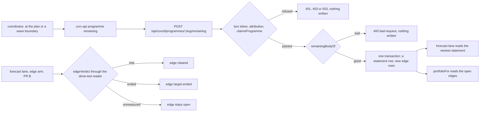

# Overlord W2: remaining work and edges, what a programme says is left Implementation Plan

> **For agentic workers:** REQUIRED SUB-SKILL: Use superpowers:subagent-driven-development (recommended) or
> superpowers:executing-plans to implement this plan task-by-task. Steps use checkbox (`- [ ]`) syntax for tracking.

## In short

- **What it is.** A programme's coordinator states how many waves are left, as a range with a reason, and what the
  programme waits on, as typed edges. The server keeps every statement and clears an edge only when it measures the
  edge's target. This is the input the forecast reads (the forecasts and health plan) and the source of a programme's
  blocks and critical path.
- **Two pull requests in lane P.** PR A (3 tasks) is **ready to build**: two tables, one coordinator door beside the
  call record's door, and one `ccrc-api` verb. PR B (2 tasks) clears edges on measurement, through the done-test
  vocabulary's one reader, once done tests and forecasts A have landed.
- **Live at merge** (the index's question 20, accepted). The door needs only the box token, attribution and ownership,
  as D-8126's call record does. No capability word gates it, and it changes nothing a running session reads.
- **What the reviewer checks.** One writer per table and per column group; the door's order copied from the call record's
  door; an edge that the server cannot measure stays open and says so; the census sites of a new lane source, all in
  PR A.
- **Waiting on the coordinator:** questions 3 and 4 (an edge the coordinator no longer lists, and the reference line that
  tells coordinators to use the door before clause 22 lands). Nothing waits on the operator.

## 1. Scope and architecture

This section says what the plan builds and where each part sits in the rings.

**Goal:** a coordinator records what is left of its programme, and the server keeps that record honest.

**Why:** §5.6, H38: "Remaining work is the coordinator's statement. It states a range of waves left, with a reason, at
the plan and at every wave boundary. Each statement is an append-only row of `programme_remaining`, written through
attribution." And: "`programme_edges` holds `needs-landed` and `needs-decision` edges. Its writer is the owning
coordinator's remaining-work door: an edge is part of what a programme says is left. The server alone clears an edge,
when it measures the target, with the done test's vocabulary (Table 5.5a)."

**Architecture:**

| Part | File | Ring and context | PR |
|---|---|---|---|
| Vocabulary: edge kinds, target shapes, the limits, the wire | `shared/programmeFacts.ts` (new) | L0, C5 | A |
| The body's rules | `server/src/coord/programmeRemaining.ts` (new) | L1, C5 | A |
| SQL: the statement's one writer, the edges' insert, the reads; B adds the edges' clearing writer | `server/src/coord/programmeFactsStore.ts` (new) | L3, C5 | A, B |
| The door `POST /api/coord/programmes/:slug/remaining` | `server/src/coord/programmeRemainingRoute.ts` (new) | L4, C5 | A |
| The verb `programme remaining` | `ccd/ccrc-api` | ccd | A |
| The edge arm: target to predicate, verdict | `server/src/coord/edgeVerdict.ts` (new) | L1, C5 | B |
| The edge arm's pass on the forecast lane | `server/src/coord/forecastLane.ts` (forecasts A's) | L4, C5 | B |


*Figure 1. The statement's path. PR A builds everything above the forecast lane. PR B adds the edge arm at the bottom,
which is the only writer that changes an edge after it is written.*

**Tech stack:** TypeScript (ESM), `node:sqlite`, Fastify, bash (`ccd/ccrc-api`), vitest. No new dependency.

**Spec:** `docs/superpowers/specs/2026-11-09-overlord-design.md`:
- §5.6, H38: the remaining-work and edges bullets, "what blocks the programme, and the critical path", and "Remaining
  work, forecasts, health, edges … ship in W2".
- Table 5.5a, the done test's vocabulary, which PR B's clearing reads through its one reader.
- Table 11.1a, rows `programme_remaining` and `programme_edges`. Table 11.1e, the coordinator-facing row, which lists
  "the remaining-work door".
- §11.4, clause 22: "State waves left as a range at the plan and at every wave boundary."
- Table 14, row W2: "Remaining work, forecasts, health and edges".

The index is `docs/superpowers/plans/2026-11-16-overlord-w2.md` (PR #2917, read from its branch until it merges). This
plan builds its row "Remaining work and edges" (lane P), and its questions 7, 13, 20 and 23, as the coordinator accepted
them.

## 2. Open questions

The index's questions come first, with their rulings. Each other question is one the spec leaves open. The plan builds
every recommendation unless the coordinator rules otherwise.

| # | Question | State | What this plan builds |
|---|---|---|---|
| 1 | The index's 7, 13, 20 and 23 | Accepted | The door's path and gate (7); clearing through done tests' reader (13); live at merge (20); built before W1 closes (23) |
| 2 | What an edge's target is | Proposed | Three target shapes bound to Table 5.5a's words |
| 3 | An edge the coordinator stops listing | Proposed | It stays open until measured |
| 4 | Telling coordinators before clause 22 | Proposed | One line in the wave-boundary reference |
| 5 | Where the clearing runs | Proposed | An arm of the forecast lane |
| 6 | An edge whose target ends the wrong way | Proposed | `target-ended`, kept and shown |

1. **The index's questions, as ruled.** The coordinator accepted every recommendation of the index's questions 2 to 23.
   - **Q7** gives the path, `POST /api/coord/programmes/:slug/remaining`, and the gate: the box token, attribution and
     `claimsProgramme`, else `not-your-programme`. The door goes beside `server/src/coord/coordCallsRoute.ts`.
   - **Q13** makes the done-tests piece the owner of the predicate vocabulary and its one reader. PR B clears edges
     through that reader, so PR B lands after done tests.
   - **Q20** makes the door live at merge, gated only by the box token and ownership.
   - **Q23** lets PR A be built before W1 finishes. PR A reads nothing W1 has not merged.
2. **An edge's target is one of three shapes, each a Table 5.5a word** (slug `edge-targets-are-done-test-words`). The
   spec says the server clears an edge "with the done test's vocabulary" and does not say what an edge names. Done
   tests' vocabulary is not on `main`, and PR A is ready now.
   - **Recommendation:** PR A stores a target as one of three shapes, each named by the Table 5.5a word that measures
     it:

     | Edge kind | Target | Measured by (Table 5.5a) |
     |---|---|---|
     | `needs-landed` | `{ predicate: 'run-closed', runId }`, a run of another programme | `run-closed`: the run closed and merged |
     | `needs-landed` | `{ predicate: 'pr-merged', repo, pr }`, a pull request by number | `pr-merged` |
     | `needs-decision` | `{ predicate: 'operator-confirms', itemId }`, an open operator item | `operator-confirms`: the operator answered the item |

   - PR A writes these three words in `shared/programmeFacts.ts` as `EDGE_PREDICATES`, with a comment naming done tests
     as the owner to come. PR B replaces that list with a type-checked pick from done tests' vocabulary, in a move
     commit with a characterization test first, so one vocabulary remains.
   - `review-passed` and `goals-modified` name what a request asks for, not what a programme waits on, so no edge takes
     them.
3. **An edge the coordinator stops listing stays open** (slug `edges-are-never-withdrawn-by-the-coordinator`). The spec
   says "the server alone clears an edge". A statement may list fewer edges than the last one.
   - **Recommendation:** the door only adds edges. An edge already open with the same kind and target is kept, never
     duplicated, and its id is answered as `kept`. An edge the new statement does not list is left open, because only a
     measurement clears it.
   - A coordinator that no longer waits on a target waits for it to be measured, or the edge ends (question 6). This
     keeps the spec's one-way rule. The alternative, a `dropped` state the coordinator can set, gives a session a way to
     hide a block from the operator, so it is not built.
4. **Coordinators learn of the door from one reference line, before clause 22** (slug
   `remaining-door-taught-before-clause-22`). Clause 22, which asks for the statement, lands with W1's `overlord-v1`.
   Until then no coordinator calls the door, the forecast has no remaining work, and every programme answers
   `unforecastable` with the reason `no-remaining`.
   - **Recommendation:** PR A adds one line to `ccd/coordinator-skill/references/wave-lifecycle-5-boundary.md`: "At the
     plan and at every wave boundary, state the waves left as a range, with a reason, through `ccrc-api programme
     remaining`." It is a reference line, not a clause, so it changes no pinned clause, and clause 22 later says the
     same.
   - Rejected: waiting for clause 22. The forecast would then start with no remaining work in any programme, which is
     what question 20 meant to avoid.
5. **The clearing runs as an arm of the forecast lane** (slug `edge-arm-on-the-forecast-lane`). Edges need a lane that
   measures their targets. The done-test lane (lane R) runs on request news, and the forecast lane (lane P, forecasts A)
   already passes every listed programme on its cadence.
   - **Recommendation:** PR B adds an edge arm to the forecast lane's pass, which calls done tests' reader. One lane
     serves lane P, and one reader serves both lanes. PR B therefore needs forecasts A as well as done tests (an index
     change).
6. **An edge whose target ends the wrong way is `target-ended`** (slug `edge-target-ended`). A run fails, a pull request
   closes unmerged, or an item is dismissed. The edge can then never be met.
   - **Recommendation:** the edge arm moves it to `target-ended`, with the measured end in its evidence. It no longer
     counts as a block. It shows on the portfolio entry until the coordinator's next statement, which may add a new
     edge. A target the reader cannot measure leaves the edge `open`, read as unmeasured, never cleared.

## 3. What exists today

Measured on `main` at `9cf263d44` (2026-11-16).

- **No remaining work and no edges.** `git grep` finds `programme_remaining`, `programme_edges`, `needs-landed` and
  `needs-decision` only in the spec. No `shared/programmeFacts.ts` exists.
- **The door to copy:** `server/src/coord/coordCallsRoute.ts#registerCoordCallsRoute` (D-8126 A3, #2606).
  - Its header states the order: not configured (501), the box token before any await, the slug (`isSlotSlug`,
    `shared/ledgers.ts#isSlotSlug`), `byId` and `byUuid`, the body (`server/src/coord/coordCalls.ts#callBodyOf`, L1,
    never throws), attribution, ownership, a run in the body belonging to this programme, the insert, the answer. "A
    refusal at any step writes nothing and notifies nothing."
  - Ownership is `server/src/coord/store.ts#claimsProgramme`: true only for a non-terminal run of that programme
    claimed by the session. A throw is 503 `run-unreadable`, a false answer 403 `not-your-programme`
    (`shared/refusal.ts#LEDGER_ROUTE_REFUSALS`).
  - It is registered from `registerCoordRoutes` in `server/src/coord/routes.ts`, which hands in its own
    `requireMailToken` and `requireAttribution` closures, so `routes.ts` grows by a few lines only.
  - Its texts pass through `coordCalls.ts`' private `text`, which masks with `redactCommand` and cuts whole.
- **The store to copy:** `server/src/coord/coordCallsStore.ts#insertCall` holds the one INSERT into
  `coordinator_calls`, behind a one-line `CoordStore` delegate.
- **The schema.** `server/src/coord/schema.ts#MIGRATIONS` holds 82 entries, `COORD_SCHEMA_VERSION = MIGRATIONS.length`.
  Each entry opens with a `// ── N: user_version N-1 -> N` comment and a note to re-measure its slot. Portfolio B (#2904)
  holds 83 in the merge queue. `server/test/coord-db.test.ts` pins the count twice, and
  `server/test/run-close-switch.test.ts`' undo step drops every table from migration 55 by hand and names their count in
  words.
- **The census sites a new lane source touches**, as the call record's door touched them:
  - `server/src/auth/gate.ts`' `EXEMPT` table, one row with its reason;
  - `server/test/box-token-census.test.ts`: a `*_SRC` read, its lanes in `ALL_LANES` and `MACHINE_LANES`, the number
    word list (now ending `eighty-five`), and the README's "eighty-five machine lanes";
  - `server/test/auth-gate.test.ts`: `scanRoutes` of the file and its length, `ROUTES.length` (245), the sweep lists,
    the lane-count title, and the count of files that register routes;
  - `server/test/coord-routes-single-file.test.ts#OWN_FILE_ROUTES`;
  - `server/test/rings/fastify-l4.data.ts`, one row;
  - `CLAUDE.md`'s box-token paragraph, which names the call record's door beside the claim lanes;
  - `server/test/single-definition/core-vocab.test.ts`' handle holders (`coordCallsStore.ts` is one);
  - `server/test/reconstruction-drill.test.ts`, which pins the tables no artifact mirrors.
- **`ccd/ccrc-api`.** `ROUTES` maps `group.verb` to `METHOD|path|needs-id|query keys`; the call record's row is
  `[calls.record]='POST|/api/coord/programmes/{id}/calls|yes|-'`. The file states its row count as "eighty-four rows",
  and `server/test/ccrc-api.test.ts` pins `toHaveLength(84)` with a `WORDS` table. The call record's row fills `byId` and
  `byUuid` from the pane. No `programme` group exists.
- **`ccd/door-process.mjs` and its `DOOR_TOOLS` do not exist on `main`.** The door is a coordinator's, not the
  Overlord's, so it takes no tool row either way (an index change).
- **Growth.** `server/test/growthCheck.ts`: `GROWTH_LIMIT = 40` net code lines per pull request for `schema.ts`,
  `store.ts`, `routes.ts` and `server.ts`. `shared/api.ts` is capped (`server/test/growth-caps/shared-api-ts.json`), so
  it takes no new line; the wire goes in `shared/programmeFacts.ts`.
- **Writers and time ports.** `server/test/single-definition/writers-map.test.ts#TABLES` lists coord.db tables whose
  writers are pinned. `server/test/single-definition/time-ports.test.ts#TIME_PORT_FILES` lists files that may read no
  ambient clock, including `shared/portfolio.ts` and `server/src/coord/portfolioStore.ts`.
- **The coordinator's wave boundary reference** is `ccd/coordinator-skill/references/wave-lifecycle-5-boundary.md`.

## 4. Global constraints

- **Architecture (`CLAUDE.md`).**
  - `shared/programmeFacts.ts` is L0 and imports nothing. Each literal union carries its `Record<X, true>` map
    (`rings/wire-totality.test.ts`).
  - `programmeRemaining.ts` and `edgeVerdict.ts` are L1: pure, no store, no clock; `now` is an argument.
  - `programmeFactsStore.ts` is L3, SQL only, synchronous over the store's database, keeping every distinction it reads.
  - The door is L4 and decides nothing: the body's verdict is `remainingBodyOf`'s, ownership `claimsProgramme`'s, an
    edge's verdict `edgeVerdict`'s.
  - No repository and no async wrapper over `CoordStore`, which gains one-line delegates only.
- **One writer per fact.**
  - `programme_remaining`: `programmeFactsStore.ts#insertRemaining`, called only by the door. Append-only: no UPDATE
    or DELETE names the table.
  - `programme_edges`: inserted only by `insertRemaining`, in the statement's transaction. Its state columns (`state`,
    `endedAt`, `evidence`) are written only by PR B's `settleEdge`, called only by the forecast lane's edge arm.
  - A census pins each in both directions (Task 2, Task 5).
- **Consolidate.** The door copies the call record's order and reuses its closures, `isSlotSlug`,
  `claimsProgramme`, `refuseRoute` and the call text's mask (exported, not copied). PR B reads targets through done
  tests' one reader, never a second predicate check.
- **Failure contracts.** An unread fact never reads as zero or as met.
  - A store throw at the door is 503 `run-unreadable`, and nothing is written.
  - An edge whose target the reader cannot measure stays `open`; the read carries `unmeasured: true`.
  - A state word outside the vocabulary, read from a newer build's row, reads as `open` with `stateUnreadable: true`,
    so a block is never hidden by a word this build does not know.
- **Wire: additive.** The answer and the reads are new types in `shared/programmeFacts.ts`. `FLEET_PROTO` is not
  bumped. An older server answers the verb's call with 404, which `ccrc-api` prints as it does any answer.
- **What a merge arms.** PR A: one live door, which writes two tables nothing yet reads but the tests; the reference
  line (question 4). PR B: the edge arm changes only edge rows. Nothing a running session reads changes.
- **SAFETY.** No ccd verb, no fleet act and no live `~/.ccrc`. Tests build `coord.db` in memory or under the per-run
  temp root, and `ccrc-api` tests run against a fixture HOME.
- **Public repository.** Fixtures use `prog-a`, `prog-b`, `lane-a-project-a` and `op-a`. Run the private-name scan over
  every changed file before each push. No D-number is invented.
- **Tests.** From `server/`: `ccrc test -- ./node_modules/.bin/vitest run test/<file>.test.ts`, one file at a time, in
  the foreground. Each task's last run adds both server typechecks (`ccrc test -- npx tsc --noEmit -p tsconfig.json`
  and `-p test/tsconfig.tests.json`), and pwa's typecheck when `shared/` changes.
- **Mutation floors.** `remainingBodyOf` (PR A) and `edgeVerdict` (PR B) each join `MUTANT_SETS`
  (`server/test/sim/mutation-floors.test.ts`) and `server/test/sim/mutation-floors.json` in the pull request that
  creates them.

## 5. Review focus

1. **The door is the call record's door with a different body.** Same order, same closures, same refusals; a refusal
   writes nothing.
2. **Append-only means append-only.** No path updates or deletes a statement, and no coordinator path clears an edge.
3. **An edge is never cleared on a guess.** Only a measured `met` clears it; unmeasured stays open and says so.
4. **Every census site of a new lane source moves in PR A**, and each count word is re-derived after merging `main`.

## 6. The PR split

| PR | Tasks | What it ships | Needs first | Growth-checked files, estimate (net code lines) |
|---|---|---|---|---|
| A | 1 to 3 | The vocabulary and wire; `remainingBodyOf`; both tables and their writer; the door and its census; the `ccrc-api` verb; the reference line | nothing: **ready to build** | `schema.ts` +24 (one migration); `store.ts` +4 (three delegates, one import); `routes.ts` +4 (import and registration); `server.ts` 0 |
| B | 4 and 5 | `edgeVerdict` through done tests' reader; `settleEdge`; the edge arm on the forecast lane; the move of `EDGE_PREDICATES` onto done tests' vocabulary | PR A, done tests, forecasts A | `store.ts` +2 (one delegate); `watch.ts` 0 (the arm is inside the forecast lane's module) |

Each pull request merges `main` once before merge and re-measures its migration slot and every count word (the index's
"Where lanes meet").

For scale, the files that are not growth-checked change by about this much: `shared/programmeFacts.ts` +90 (A) and +10
(B); `programmeRemaining.ts` +110 (A); `programmeFactsStore.ts` +120 (A) and +50 (B); `programmeRemainingRoute.ts` +85
(A); `edgeVerdict.ts` +70 (B); `forecastLane.ts` +25 (B); `ccd/ccrc-api` +3 (A).

## 7. Tasks

### Task 1: The vocabulary and the body's rules (L0, L1)

**Files:**
- Create: `shared/programmeFacts.ts`
- Create: `server/src/coord/programmeRemaining.ts`
- Modify: `server/src/coord/coordCalls.ts` (export the private `text` as `callText`, unchanged)
- Create: `server/test/programme-remaining.test.ts`, `server/test/sim/programmeFactsSets.ts`
- Modify: `server/test/sim/mutation-floors.test.ts`, `server/test/sim/mutation-floors.json`
- Modify: `server/test/single-definition/time-ports.test.ts` (`TIME_PORT_FILES` gains both new files)
- Modify: `docs/superpowers/specs/2026-08-10-architecture-ddd-clean-solid.md` (one path-table row for
  `shared/programmeFacts.ts`, C5, L0)

**The vocabulary** (`shared/programmeFacts.ts`, imports nothing):

```ts
export const REMAINING_WAVES_MAX = 99;          // a range bound above this is refused
export const REMAINING_REASON_MAX = 300;        // characters, one line
export const EDGES_PER_STATEMENT_MAX = 10;
export const EDGE_WHY_MAX = 200;                // characters, one line
const EDGE_KIND_MAP = { 'needs-landed': true, 'needs-decision': true } as const;
export type EdgeKind = keyof typeof EDGE_KIND_MAP;
export const EDGE_KINDS = Object.keys(EDGE_KIND_MAP) as EdgeKind[];
// Table 5.5a's words an edge can name (question 2). Done tests' vocabulary owns them; PR B derives this list from it.
const EDGE_PREDICATE_MAP = { 'run-closed': true, 'pr-merged': true, 'operator-confirms': true } as const;
export type EdgePredicate = keyof typeof EDGE_PREDICATE_MAP;
export const EDGE_PREDICATES = Object.keys(EDGE_PREDICATE_MAP) as EdgePredicate[];
export type EdgeTarget =
  | { readonly predicate: 'run-closed'; readonly runId: number }
  | { readonly predicate: 'pr-merged'; readonly repo: string; readonly pr: number }
  | { readonly predicate: 'operator-confirms'; readonly itemId: number };
const EDGE_STATE_MAP = { open: true, met: true, 'target-ended': true } as const;
export type EdgeState = keyof typeof EDGE_STATE_MAP;
export const EDGE_STATES = Object.keys(EDGE_STATE_MAP) as EdgeState[];
```

It also holds the wire: `RemainingStatement` (`id`, `program`, `at`, `byId`, `runId | null`, `lo`, `hi`, `reason`),
`ProgrammeEdge` (`id`, `program`, `kind`, `target`, `why`, `state`, `openedAt`, `openedBy`, `endedAt | null`,
`evidence | null`, `stateUnreadable?`, `unmeasured?`), and `RemainingAnswer` (`ok: true`, `id`, `added: number[]`,
`kept: number[]`). The kind of edge each target takes is a table, `EDGE_KIND_OF_PREDICATE`: `run-closed` and
`pr-merged` take `needs-landed`, `operator-confirms` takes `needs-decision`.

**The body's rules.** `remainingBodyOf(raw, now)` answers `{ ok: true, statement, edges }` or `{ ok: false, detail }`,
and never throws. It is first match, in this order:

| # | Input | Answer |
|---|---|---|
| 1 | Not a JSON object | refuse: the body must be a JSON object |
| 2 | `lo` or `hi` not a safe integer in 0 to `REMAINING_WAVES_MAX` | refuse, naming the field |
| 3 | `lo > hi` | refuse: lo must not exceed hi |
| 4 | `reason` not one line of 1 to `REMAINING_REASON_MAX` characters, or empty after the mask | refuse |
| 5 | `runId` present and not a positive safe integer | refuse |
| 6 | `edges` present and not an array of at most `EDGES_PER_STATEMENT_MAX` | refuse |
| 7 | An edge whose `kind` is not an `EdgeKind`, whose target is not one of the three shapes, whose kind is not `EDGE_KIND_OF_PREDICATE` of its predicate, or whose `why` is not one line of 1 to `EDGE_WHY_MAX` | refuse, naming the edge's index |
| 8 | A `pr-merged` target whose `repo` is not `owner/name` (the GitHub grammar) or whose `pr` is not a positive safe integer | refuse |
| 9 | Two edges in the body with the same kind and target | refuse: duplicate edge |
| 10 | Otherwise | the statement and the edges, `reason` and each `why` masked and cut through `callText` |

The input domain is the JSON body: any value, and for an object every combination of a present, absent or wrong-typed
field. The table is total over it (row 10 is the only accepting row), ordered (an earlier row wins), and monotonic: a
body that row 10 accepts, with any one field broken, is refused.

- [ ] **Step 1: Measure** `coordCalls.ts`' private `text` and `callBodyOf` again. If `text` differs from "What exists
  today", record it in the departures note before writing a test.
- [ ] **Step 2: Failing tests** (`test/programme-remaining.test.ts`): one case per row, each with an input that only
  that row matches; a body at each bound (0, `REMAINING_WAVES_MAX`, `REMAINING_REASON_MAX` characters, ten edges) is
  accepted, and one past each is refused; a reason carrying a token-shaped string comes back masked; the exhaustive
  property over a generated domain (each field present, absent or wrong-typed) that every refusal names the first
  failing row and that no broken body is accepted; a compile-time check that `EDGE_KIND_OF_PREDICATE` covers every
  `EdgePredicate`.
- [ ] **Step 3: Run.** `ccrc test -- ./node_modules/.bin/vitest run test/programme-remaining.test.ts`. Red.
- [ ] **Step 4: Implement** the two files and the export.
- [ ] **Step 5: Run** this suite, `test/coord-calls.test.ts`, `test/single-definition/time-ports.test.ts`,
  `test/rings/wire-totality.test.ts` and both server typechecks. Green.
- [ ] **Step 6: Mutation.** Add `programmeFactsSets.ts` with a set keyed
  `server/src/coord/programmeRemaining.ts#remainingBodyOf` (mutants: drop the `lo > hi` check, raise the wave bound
  by one, skip the duplicate check, skip the kind-of-predicate check, accept a multi-line reason) and its row in
  `mutation-floors.json` at 1. Run `test/sim/mutation-floors.test.ts`. Every mutant is killed.
- [ ] **Step 7: Commit.** `feat(programmes): the remaining-work vocabulary and the body's rules (Overlord W2 remaining work A)`

### Task 2: The two tables and their one writer (L3)

**Files:**
- Modify: `server/src/coord/schema.ts` (one migration with both tables)
- Create: `server/src/coord/programmeFactsStore.ts` (`insertRemaining`, `remainingOf`, `openEdgesOf`)
- Modify: `server/src/coord/store.ts` (three one-line delegates, one import)
- Modify: `server/test/coord-db.test.ts` (the count, twice), `server/test/run-close-switch.test.ts` (the undo step drops
  both tables, and its count word moves by one)
- Modify: `server/test/single-definition/writers-map.test.ts` (`TABLES` gains both tables, each written only by
  `insertRemaining`; a case pins that no UPDATE or DELETE names `programme_remaining`)
- Modify: `server/test/single-definition/core-vocab.test.ts` (the handle holders gain `programmeFactsStore.ts`)
- Modify: `server/test/single-definition/time-ports.test.ts` (`TIME_PORT_FILES` gains the store)
- Modify: `server/test/reconstruction-drill.test.ts` (both tables join the tables no artifact mirrors)
- Create: `server/test/programme-facts-store.test.ts`

**Schema:**

```sql
CREATE TABLE programme_remaining (
  id      INTEGER PRIMARY KEY,
  program TEXT NOT NULL REFERENCES programs(slug),
  at      INTEGER NOT NULL,            -- wall ms, stamped by the server
  byId    TEXT NOT NULL,               -- the attributed coordinator
  runId   INTEGER,                     -- the wave boundary it was stated at, or NULL at the plan
  lo      INTEGER NOT NULL,
  hi      INTEGER NOT NULL,
  reason  TEXT NOT NULL,               -- masked, one line
  build   TEXT                         -- the server build that wrote it
);
CREATE INDEX programme_remaining_by_program ON programme_remaining (program, id);
CREATE TABLE programme_edges (
  id          INTEGER PRIMARY KEY,
  program     TEXT NOT NULL REFERENCES programs(slug),
  statementId INTEGER NOT NULL REFERENCES programme_remaining(id),
  kind        TEXT NOT NULL,           -- EdgeKind, read through its guard
  target      TEXT NOT NULL,           -- canonical JSON of EdgeTarget
  why         TEXT NOT NULL,
  state       TEXT NOT NULL DEFAULT 'open',
  openedAt    INTEGER NOT NULL,
  endedAt     INTEGER,                 -- PR B: when the edge arm measured its end
  evidence    TEXT                     -- PR B: the measured end, as the reader answered it
);
CREATE UNIQUE INDEX programme_edges_one_open ON programme_edges (program, kind, target) WHERE state = 'open';
```

The migration's comment says to re-measure the slot, as every migration does. It adds new tables only, so an older
build ignores them (Table 11.1a: "Ignores it"). `target` is written in one canonical form (keys in a fixed order), so
the unique index sees two equal targets as equal.

**The writer.** `insertRemaining(db, program, byId, statement, edges, build, now)` runs in one transaction:
1. it inserts the statement row;
2. for each edge, it looks for an open row with the same `(program, kind, target)`: if one exists, its id goes to
   `kept`; otherwise it inserts the edge with `statementId`, `openedAt = now`, and its id goes to `added`;
3. it answers `{ id, added, kept }`.

It never updates a statement and never changes an edge's state.

**The reads.** `remainingOf(db, program, limit)` answers the newest statements, newest first. `openEdgesOf(db,
programs)` answers every edge whose state is not `met`, for the listed programmes. Both read `kind` and `state` through
their guards: an unknown `kind` row is carried with `kindUnreadable: true` and never dropped, and an unknown state reads
as `open` with `stateUnreadable: true`.

- [ ] **Step 1: Failing tests** (`test/programme-facts-store.test.ts`, an in-memory `coord.db`): a fresh database has
  both tables and no rows; a statement with two edges writes three rows in one transaction and answers both as
  `added`; the same edge in a later statement is answered `kept` and not duplicated; an edge a later statement omits
  stays open; a throw inside the transaction (a planted bad `program`) leaves no row in either table; the reads answer
  newest first and carry the guard flags for a row written by hand with `kind = 'needs-x'` and `state = 'paused'`; the
  canonical target form makes `{pr, repo, predicate}` and `{predicate, repo, pr}` one edge.
- [ ] **Step 2: Run.** Red.
- [ ] **Step 3: Implement** the migration, the store file and the delegates.
- [ ] **Step 4: Run** this suite, `test/coord-db.test.ts`, `test/run-close-switch.test.ts`,
  `test/single-definition/writers-map.test.ts`, `test/single-definition/core-vocab.test.ts`,
  `test/single-definition/time-ports.test.ts`, `test/reconstruction-drill.test.ts`, `test/rings/*.test.ts` and both
  server typechecks. Green.
- [ ] **Step 5: Red check.** Each change reds a case; revert each.
  - Add an `UPDATE programme_remaining` in any `server/src` function: `writers-map.test.ts` reds.
  - Insert an edge without looking for an open one: the `kept` case reds (the unique index throws).
  - Read an unknown state as `met`: the guard case reds.
- [ ] **Step 6: Commit.** `feat(programmes): programme_remaining and programme_edges, with their one writer (Overlord W2 remaining work A)`

### Task 3: The door, its census and the verb (L4)

**Files:**
- Create: `server/src/coord/programmeRemainingRoute.ts` (`registerProgrammeRemainingRoute`)
- Modify: `server/src/coord/routes.ts` (import and one registration call in `registerCoordRoutes`, beside
  `registerCoordCallsRoute`)
- Modify: `server/src/auth/gate.ts` (one `EXEMPT` row, its reason in the call record's form)
- Modify: `server/test/box-token-census.test.ts` (a `REMAINING_SRC` read and its lanes in `ALL_LANES` and
  `MACHINE_LANES`; the number words gain one; the README word)
- Modify: `server/test/auth-gate.test.ts` (`scanRoutes` of the new file and its length 1; `ROUTES.length` and its
  prose; the sweep lists; the lane-count title; the count of files that register routes)
- Modify: `server/test/coord-routes-single-file.test.ts` (`OWN_FILE_ROUTES` gains the route)
- Modify: `server/test/rings/fastify-l4.data.ts` (one row)
- Modify: `README.md` (the machine-lane count word), `CLAUDE.md` (the box-token paragraph names the door beside the
  call record's)
- Modify: `ccd/ccrc-api` (`[programme.remaining]='POST|/api/coord/programmes/{id}/remaining|yes|-'`, the pane
  identity filled as for `calls.record`, the row-count word)
- Modify: `server/test/ccrc-api.test.ts` (the length, `WORDS`, the verb table row)
- Modify: `ccd/coordinator-skill/references/wave-lifecycle-5-boundary.md` (question 4's one line)
- Create: `server/test/programme-remaining-route.test.ts`

**The door.** `POST /api/coord/programmes/:slug/remaining`, in the call record's order:

| Step | Check | Refusal, and nothing written |
|---|---|---|
| 1 | `coord` configured | 501 `not-configured` |
| 2 | the box token, before any await | 401 `unauthenticated` |
| 3 | `isSlotSlug(slug)` | 400 `bad-request` |
| 4 | `byId`, `byUuid` non-empty strings | 400 `bad-request` |
| 5 | `remainingBodyOf(body, now)` | 400 `bad-request` with its detail |
| 6 | attribution (`byUuid`) | the verdict's own word |
| 7 | `claimsProgramme(byId, slug)` | 403 `not-your-programme`, or 503 `run-unreadable` on a throw |
| 8 | a `runId` belongs to this programme | 403 `not-your-programme` |
| 9 | each `run-closed` target's run exists and belongs to another programme; each `operator-confirms` target's item exists and is open | 400 `bad-request`, naming the edge |
| 10 | `insertRemaining` | 503 `run-unreadable` on a throw |
| 11 | none | 200 `RemainingAnswer` |

Steps 8 and 9 read through `CoordStore` delegates that exist (`run`) or that Task 2 adds. A worker of the programme, and
another programme's coordinator, are both `not-your-programme`, as at the call record's door. The door emits no feed
notice and no bus event: nothing a running session reads changes (question 20).

- [ ] **Step 1: Failing tests** (`test/programme-remaining-route.test.ts`, the call record route test's harness): one
  case per refusal row, each writing nothing; the coordinator holding an open run of the programme writes one statement
  and its edges; a worker's pair of the same programme is refused; a second statement keeps an equal edge; a `run-closed`
  target naming one of the programme's own runs is refused; a store throw at step 10 answers 503 and leaves no row.
  In `test/ccrc-api.test.ts`: the new row maps to the path, and the client fills `byId` and `byUuid` from the pane.
- [ ] **Step 2: Run.** Red.
- [ ] **Step 3: Implement** the route file, the registration, the `EXEMPT` row, the verb, the census rows and the
  reference line. Re-derive every count word from the merged tree, never by adding one by hand.
- [ ] **Step 4: Run** this suite, `test/box-token-census.test.ts`, `test/auth-gate.test.ts`,
  `test/coord-routes-single-file.test.ts`, `test/rings/*.test.ts`, `test/ccrc-api.test.ts`,
  `test/coordinator-skill.test.ts`, `test/secret-mask.test.ts` and both server typechecks. Green.
- [ ] **Step 5: Red check.** Each change reds a case; revert each.
  - Move the ownership check after the insert: the worker case reds.
  - Drop the `EXEMPT` row: `auth-gate.test.ts` reds.
  - Drop the `CLAUDE.md` sentence: `box-token-census.test.ts` reds.
- [ ] **Step 6: Private-name scan** over every changed file, then commit.
  `feat(programmes): the coordinator's remaining-work door and its verb (Overlord W2 remaining work A)`

### Task 4: An edge's verdict, through done tests' reader (L1)

PR B starts here. It needs PR A, done tests and forecasts A on `main`.

**Files:**
- Create: `server/src/coord/edgeVerdict.ts`
- Modify: `shared/programmeFacts.ts` (`EDGE_PREDICATES` derived from done tests' vocabulary, in a move commit)
- Create: `server/test/edge-verdict.test.ts`
- Modify: `server/test/sim/programmeFactsSets.ts`, `server/test/sim/mutation-floors.json`

**The move.** First a characterization test pins today's `EDGE_PREDICATES` and the kind each takes. Then a move commit
replaces the literal map with a pick from done tests' vocabulary (`shared/overlordRequests.ts`, as done tests names it),
typed so that a word missing there does not compile. The test's import changes and nothing else.

**The verdict.** `edgeVerdict(edge, measured)` takes the edge and done tests' reader's answer for its target, and
answers first match:

| # | Reader's answer | Verdict | Edge after |
|---|---|---|---|
| 1 | The edge's state is not `open` | `none` | unchanged |
| 2 | The target cannot be measured (any unmeasured answer of the reader) | `unmeasured` | `open`, read as unmeasured |
| 3 | The target passed (the run closed and merged; the PR merged; the item answered) | `met` | `met`, with the evidence |
| 4 | The target ended other than as needed (the run failed; the PR closed unmerged; the item dismissed) | `ended` | `target-ended`, with the evidence |
| 5 | The target is still pending | `none` | unchanged |

Its domain is every edge state, read or unreadable, times every answer the reader can give. It is total, ordered, and
monotonic: replacing any answer with an unmeasured one never moves a verdict from `none` or `unmeasured` to `met` or
`ended`.

- [ ] **Step 1: Characterization test** of `EDGE_PREDICATES` on `main`. Green. Commit the move with only the test's
  import changed. Green.
- [ ] **Step 2: Failing tests** (`test/edge-verdict.test.ts`): one case per row; the exhaustive table over the domain;
  the monotonicity property.
- [ ] **Step 3: Run.** Red. **Step 4: Implement.** **Step 5: Run** the suite and both typechecks. Green.
- [ ] **Step 6: Mutation.** A set keyed `server/src/coord/edgeVerdict.ts#edgeVerdict` (mutants: read unmeasured as
  met, skip the not-open guard, swap rows 3 and 4) and its floor at 1. Every mutant is killed.
- [ ] **Step 7: Commit.** `feat(programmes): an edge's verdict through the done-test reader (Overlord W2 remaining work B)`

### Task 5: The edge arm and its one writer (L3, L4)

**Files:**
- Modify: `server/src/coord/programmeFactsStore.ts` (`settleEdge(db, id, state, evidence, now)`, which writes only an
  `open` row: `UPDATE … WHERE id = ? AND state = 'open'`)
- Modify: `server/src/coord/store.ts` (one delegate)
- Modify: `server/src/coord/forecastLane.ts` (the edge arm in its pass)
- Modify: `server/test/single-definition/writers-map.test.ts` (the state columns' one writer, and its caller census)
- Modify: `server/test/forecast-lane.test.ts` (forecasts A's suite gains the arm's cases)

**The arm.** On each pass of the forecast lane, for each open edge of a listed programme, the arm asks done tests'
reader about the target, asks `edgeVerdict`, and on `met` or `ended` calls `settleEdge` with the evidence. An error from
the reader on one edge is that edge's `unmeasured`, never the pass's failure. The arm writes nothing else and sends no
mail.

- [ ] **Step 1: Failing tests:** an edge whose run closed and merged is `met` after one pass; one whose PR closed
  unmerged is `target-ended`; one the reader cannot measure stays `open`; a second pass changes nothing; an edge already
  `met` by a concurrent pass is not written again (the `WHERE state = 'open'` guard).
- [ ] **Step 2: Run.** Red. **Step 3: Implement.** **Step 4: Run** the suite, `writers-map.test.ts`,
  `lane-schedule.test.ts` and both typechecks. Green.
- [ ] **Step 5: Red check.** Call `settleEdge` from the door: the caller census reds. Drop the `state = 'open'` guard:
  the concurrent case reds.
- [ ] **Step 6: Commit.** `feat(programmes): the server clears an edge when it measures the target (Overlord W2 remaining work B)`

## 8. Deviations found

These are the departures from the spec's text and from the index that this plan makes, by slug. The coordinator mints
the numbers.

- **`edge-targets-are-done-test-words`**: the spec does not say what an edge names. An edge names one of three targets,
  each measured by a Table 5.5a word (question 2).
- **`edges-are-never-withdrawn-by-the-coordinator`**: a later statement that omits an edge does not end it; only a
  measurement does (question 3).
- **`remaining-door-taught-before-clause-22`**: coordinators learn of the door from a reference line at merge, before
  clause 22 asks for it (question 4).
- **`edge-arm-on-the-forecast-lane`**: the server clears edges in an arm of the forecast lane, so remaining work B also
  needs forecasts A (question 5).
- **`edge-target-ended`**: an edge whose target ends the wrong way gets a third state, `target-ended`, which Table 11.1a
  does not list (question 6).
- **`remaining-carries-the-wave-run`**: a statement records the run it was stated at, or none at the plan, which Table
  11.1a does not list. The forecast lane uses it to pair a statement with a wave boundary.

## 9. What the index should change

- **The "Remaining work and edges" row:** B's "needs first" becomes "PR A, done tests, forecasts A" (question 5).
  Figure W2 gains `FCA --> RWB`.
- **"Where lanes meet", `ccd/ccrc-api` and `DOOR_TOOLS`:** remaining work A adds a `ccrc-api` row only. The door is a
  coordinator's, so it takes no `DOOR_TOOLS` row, and `ccd/door-process.mjs` is not on `main` yet.
- **"Where lanes meet", `LANE_SCHEDULE`:** the forecast lane's row also carries remaining work B's edge arm.
- **Lane P's file list** gains `server/src/coord/programmeRemaining.ts`, `programmeRemainingRoute.ts`,
  `programmeFactsStore.ts` and `edgeVerdict.ts`, and the line in `wave-lifecycle-5-boundary.md`.
- **The door censuses:** `programmeRemainingRoute.ts` is a new lane source, with every census site in remaining work A.
- **The spec-fixes list gains:** Table 11.1a's `programme_edges` row lacks the `target-ended` state and the statement's
  `runId`; §5.6 names no edge target shapes.

## 10. Where things stand

**Agreed:**
- From the brief: lane P, two pull requests, PR A ready to build now; the index's questions 2 to 23 accepted as written.
- The door's path, gate and place beside the call record's door (the index's question 7).

**Waiting on the coordinator** (implementation direction, ruled at this plan's review):
- Question 3: an edge the coordinator stops listing stays open.
- Question 4: the reference line before clause 22.
- Question 5: the edge arm on the forecast lane, and the index change it brings.

**Waiting on the operator:** nothing.

**Needs before it starts:** PR A needs nothing beyond `main`. PR B needs PR A, done tests and forecasts A.

**What depends on it:**
- forecasts A: the newest statement is the forecast's `remaining`;
- forecasts B: open edges, blocks and the critical path in `portfolioFor`, and `scope-growing` in `programmeHealth`;
- W3 and later: the board and the home show the edges through `portfolioFor`.

**Later:**
- Clause 22 (W1's `overlord-v1`) asks every coordinator for the statement; the reference line stays as its how.
- A ruling on whether an operator may end an edge by hand, if `target-ended` and measurement do not cover a case met in
  use.
