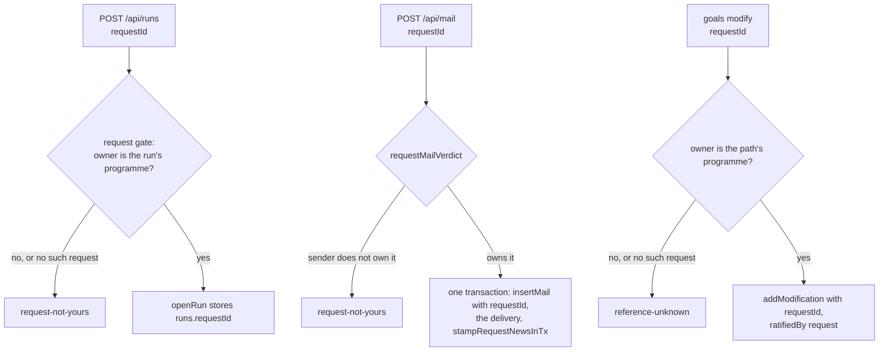
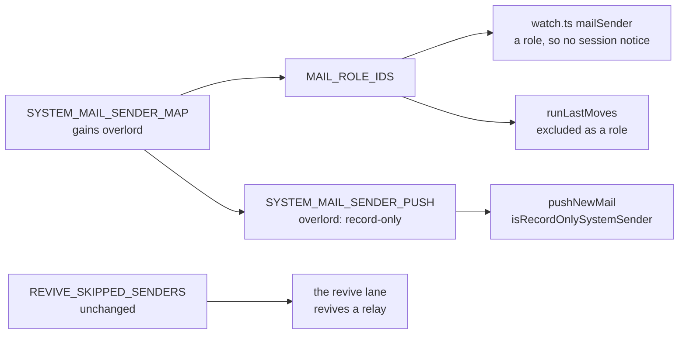
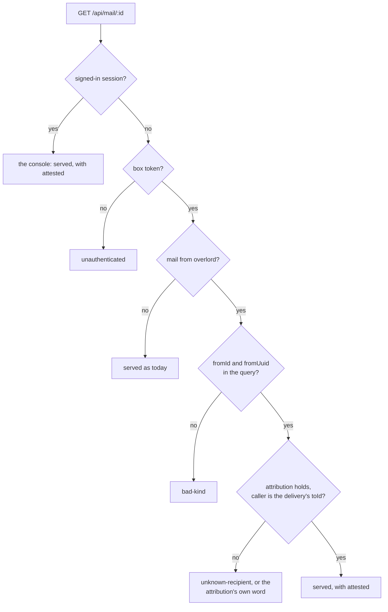
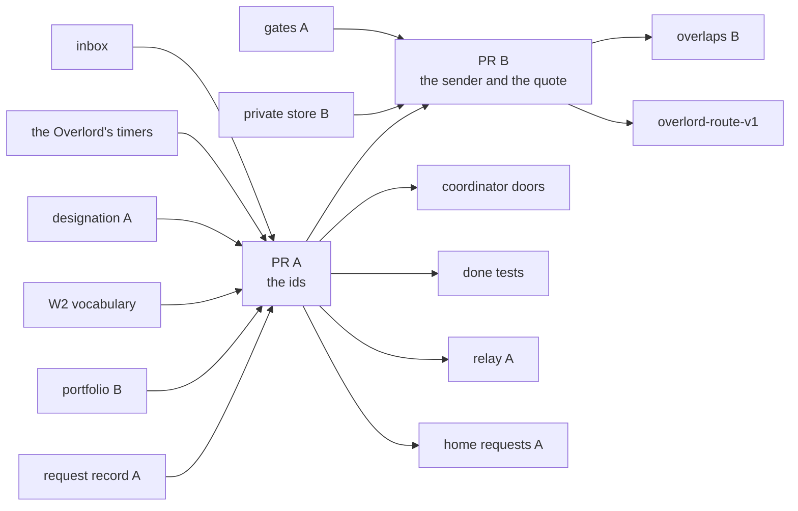

# Overlord W2: request ids on runs, mail and goals, and `overlord` as a mail sender Implementation Plan

> **For agentic workers:** REQUIRED SUB-SKILL: Use superpowers:subagent-driven-development (recommended) or
> superpowers:executing-plans to implement this plan task by task. Steps use checkbox (`- [ ]`) syntax for tracking.

## In short

- **What this is.** The plan for the W2 piece "Request ids" (the W2 index, Table W2, lane R). A request is a contract
  with one owner (spec §5.5, H22). This piece lets the owner's runs, mail and goals changes name the request, and lets
  the Overlord's relay mail render the operator's words safely. Two pull requests, nine tasks: PR A five, PR B four.
- **PR A, the ids.** One migration adds `requestId` to runs, to mail rows and to goals modifications.
  - `POST /api/runs` refuses `request-not-yours` unless the request's owner is the run's programme.
  - The mail door checks that the sender owns the request it names, and stamps news on the request in its own
    transaction.
  - Check 7 of `POST /api/mail` lifts `unknown-recipient` for `toId:'overlord'` only for a session that owns the named
    `requestId` (ruling F3). The mail resolves through the designation, as the timers' `deliverTo` does. It is recorded
    as news and an unread report: no wake, no nudge, and acked by the inbox lane. Everything else keeps
    `unknown-recipient`.
  - Reports get their own quota, 60 an hour from one coordinator, in place of the peer quotas.
  - `goals modify` with a `requestId` checks ownership (ruling F4). The `widens` half is relay A's (index question 8).
  - `ratifiedBy` gains the source `{ kind: 'request' }`.
- **PR B, the sender and the quote.**
  - `GET /api/mail/:id` serves `overlord` mail only to its recipient or the console. It renders the attested quote from
    the private store at fetch: "withdrawn by the operator" after a wipe, and "no longer on record" on a hash mismatch.
  - `SYSTEM_MAIL_SENDER_MAP` and `MAIL_ROLE_IDS` learn `overlord`, and so do their three readers: the park notice, the
    mail-revive lane and the last-move reader (index question 15). Record-only versus push follows the overlaps plan's
    `isRecordOnlySystemSender` predicate (#2923).
  - Table 11.5's rollback measurement of `server/src/watch.ts`'s `mailSender` (index question 14, ruling F12.8).
- **What changes at merge.** Nothing a running session sees. `requestId` is optional everywhere, and no request exists
  until `overlord-route-v1` opens the Overlord's doors, so every new check is reachable only after that.
- **What the reader must check.** Sixteen open questions (§2), each with a recommendation. None is for the operator.
  Two need the coordinator's eye: the mail door's refusal word (RI1, a spec fix) and the hold that keeps a report from
  being typed (RI6).

## 1. Goal, scope and the rulings this plan builds on

This section says what the piece builds, why, and which rulings it builds on.

**Goal:** every run, mail and goals change that a coordinator makes for a request carries the request's id, and the
server checks at each door that the coordinator owns that request. Mail from the Overlord renders the operator's words
from the private store at the moment it is read, and never stores them.

**Why:** H22 (§5.5): "`POST /api/runs` takes an optional `requestId` … The server refuses `request-not-yours` unless the
request's owner is the run's programme", and "When a coordinator's mail carries `requestId` … the mail door checks that
the sender owns that request … stamps the time and one line of news on it, in its own transaction". C14 (§5.4):
"Progress and the end follow as mail `toId:'overlord'`, a role address", and "Reports skip the peer quotas". §3.8:
"`GET /api/mail/:id` renders the quote from the private store at fetch, as a typed field marked attested, for the
recipient or the console only. It is never stored." §11.1: "Three more readers learn the `overlord` sender."

**Architecture.** Context C5 (Coordination) owns the ids and the mail door. The quote renderer reads C11 (the private
store) through its reader.

| Ring | File | What it holds | PR |
|---|---|---|---|
| L0 | `shared/overlordRequests.ts` (request record A's) | `REPORTS_TO_OVERLORD_HOURLY`, `REQUEST_NEWS_CHARS` | A |
| L0 | `shared/ledgers.ts` | `RatifiedBy` gains `{ kind: 'request' }`, and `RatificationWhy` gains `not-opened` | A |
| L0 | `shared/refusal.ts` | `MailRouteRefusal` gains `request-not-yours` and `unmeasured`, read from their groups | A |
| L1 | `server/src/coord/requestMail.ts` (new) | `requestMailVerdict`: the mail door's request checks and the `overlord` recipient, first match | A |
| L1 | `server/src/coord/openRun.ts` | A `request` gate in `GATES`, from the `requestOwner` fact | A |
| L1 | `server/src/coord/peerBound.ts` | `reportMailVerdict` beside `peerMailVerdict` | A |
| L1 | `server/src/coord/envelope.ts` (W1 inbox's `FIXED_LINE_MAIL`) | The `overlord-report` row, never typed | A |
| L3 | `server/src/coord/overlordRequestStore.ts` (request record A's) | `requestOwnerOf`, `stampRequestNewsInTx` | A |
| L3 | `server/src/coord/store.ts`, `ledgersStore.ts` | `insertMail`, `openRun` and `addModification` take `requestId`; `reportAtsInLastHour` | A |
| L4 | `server/src/coord/routes.ts`, `ledgersRoutes.ts` | The calls into the verdicts, and the body fields | A |
| L0, L1 | `server/src/coord/rundefs.ts` | The `overlord` row, `SYSTEM_MAIL_SENDER_PUSH` and `isRecordOnlySystemSender` | B |
| L1 | `server/src/operatorModel/attestedQuote.ts` (new) | `attestedQuoteOf`: the quote's lines from the private store's reads | B |
| L4 | `server/src/coord/routes.ts` | `GET /api/mail/:id` and `GET /api/mail/inbox`: the recipient rule and the render | B |

*Table 1. Where the code goes.*

**The rulings this plan builds on.** The coordinator accepted every recommendation of the W2 index's questions 2 to
23, and questions 24 to 28 are settled. This plan builds on these, and on the four rulings of review 2253 that its brief
names:

- **F3 (request ids A):** check 7's `unknown-recipient` lifts for `toId:'overlord'` only for a session that owns the
  named `requestId`. The mail resolves through the designation as `deliverTo` does for timers. It is recorded as news
  and an unread report, with no wake and no nudge, and acked by the inbox lane. Everything else keeps
  `unknown-recipient`. A red-first test, and the `routes.ts` line in "Where lanes meet" (present in the index since fix
  round 1).
- **F4:** request ids A keeps the ownership check of `goals modify` with a `requestId`. The `widens` half moves to
  relay A, and `widens` is a column in act rows A's migration (index question 8).
- **Request ids B:** it teaches `overlord` as a mail sender (`SYSTEM_MAIL_SENDER_MAP`, `MAIL_ROLE_IDS` and their
  readers). Record-only versus push follows the overlaps plan's `isRecordOnlySystemSender` (#2923).
- **F12.8:** a rollback to a W1 build with queued `overlord` mail is measured. Request ids B owns that measurement.
- **Q6:** `request-not-yours` reaches `shared/refusal.ts#OVERLORD_REFUSALS` with the W2 vocabulary piece. This plan
  reads it from the group.
- **Q14:** `overlord-route-v1` has no rollback floor, and Table 11.5's one measurement is this plan's (F12.8).
- **Q15:** `SYSTEM_MAIL_SENDER_MAP` and `MAIL_ROLE_IDS` and their three readers learn `overlord`. The kickoff's sender
  parameter waits for W5.
- **Q23:** this plan is written now, against W1 and W2 plans not yet built, and takes each interface from the plan that
  defines it.

## 2. Open questions

Each question carries a recommendation, which this plan builds unless the coordinator rules otherwise. None needs the
operator: each is an implementation choice under a direction the spec already gives.

- **RI1. The mail door refuses `request-not-yours` too** (slug `request-not-yours-at-the-mail-door`). Table 11.6 lists
  the word at `POST /api/runs` only, and §5.5 says the mail door "checks that the sender owns that request" without a
  word. **Recommendation:** the same word, 403, at the mail door. `MailRouteRefusal` (`shared/refusal.ts`) gains it as
  `Extract<OverlordRefusal, 'request-not-yours'>`, so `shared/api.ts#MAIL_REJECT_CODES`, which is under its total cap,
  gains nothing. Table 11.6's row names both doors (a spec fix).
- **RI2. Who owns a request.** **Recommendation:** a session owns a request when the request has an owner and
  `store.ts#CoordStore.claimsProgramme(session, owner)` answers true. That is D-8126's own test, used by the goals door
  and `coordCallsRoute.ts`. A request with no owner (not yet routed) is nobody's. A throw is `run-unreadable` (503), as
  in those doors.
- **RI3. The run door's refusal stays out of `shared/api.ts`** (slug `run-refusal-outside-the-capped-file`). The run
  door's words are `shared/api.ts#RunRefuseCode`, and that file is under its total cap
  (`server/test/growth-caps/shared-api-ts.json`), which the index keeps for `overlord-route-v1`'s one line.
  **Recommendation:** `openRun.ts#OpenRunRefusal` gains an `error` arm typed `Extract<OverlordRefusal,
  'request-not-yours'>`, sent as `{ error, detail }` as the run door's other `error` words are. The route's answer keeps
  its shape.
- **RI4. The run door checks the owner, not the state.** **Recommendation:** the `request` gate passes when the
  request's owner is the body's `program`. It does not check the state: the done test reads the runs made after the
  relay, and a run opened for a request that has just closed is harmless. An unknown id answers `request-not-yours`
  with the detail "request <id> is not this programme's", which names no other programme, since a coordinator sees no
  other programme (H23).
- **RI5. News is the mail's subject, on an open request** (slug `news-is-the-subject`). §5.5 says "one line of news".
  **Recommendation:** the line is the mail's subject, masked by `server/src/accounts/mask.ts#maskText` and cut at
  `REQUEST_NEWS_CHARS` (200). It is stamped by `stampRequestNewsInTx` in the mail's transaction, only while the request
  is open; a mail about a closed request still sends and stamps nothing. Any recipient counts, so a coordinator's mail to
  its own worker that names the request is news too. The writer is `bookkeeping` in the row-revisions census, so news
  never raises `revision` (request record's RQ7).
- **RI6. A report is held, never typed, until the inbox acks it** (slug `report-is-a-held-delivery`). F3 says a report
  is "recorded as news and an unread report, with no wake, no nudge, and acked by the inbox lane". The mail lane types
  a nudge for every queued delivery, and `wake = 'never'` (`server/src/coord/rundefsTx.ts#insertSystemMailTx`) only
  spares a sleeper. **Recommendation:** W1's inbox piece makes `server/src/coord/envelope.ts#FIXED_LINE_MAIL` the one
  table of what the mail lane types to the designated session, and the timers piece gives it a hold
  (`waitsForCard`). This plan adds one row, `overlord-report`: it matches mail to `overlord` from a sender that is not
  a role and that carries a `requestId`, its line is `null` (never typed), and its hold lasts until the delivery is
  acked. A held report counts no attempt and never parks. The inbox band 3 piece serves it as an unread report and its
  `acknowledge` acks it, which is "acked by the inbox lane". One table, not a second branch beside it.
- **RI7. When no Overlord is designated, a report is `unknown-recipient`.** The designation answers three arms
  (designation A's `designationRead()`). **Recommendation:**
  - **Designated:** the mail row keeps `toId: 'overlord'`, and the delivery and its envelope name the bound session, as
    for timer mail (`deliverTo`). A designated Overlord that is not `ready` still has a bound session, so its report is
    kept and listed on the next card (C14).
  - **Not designated:** `unknown-recipient`, with the detail "no Overlord is designated". That is what the mail door
    already does for `coordinator` when no coordinator resolves: "no guessing".
  - **Unmeasured:** 503 `unmeasured`, never folded into "not designated". `MailRouteRefusal` gains `unmeasured` from
    `GENERIC_REFUSALS`.
- **RI8. The reports quota replaces the peer quotas for mail to `overlord`.** Today's check 9 runs only when
  `runId === null`. **Recommendation:** mail to `overlord` skips check 9 whether or not it names a run, and meets
  `reportMailVerdict` instead: at most `REPORTS_TO_OVERLORD_HOURLY` (60) in the last hour from one `fromId`. Over it,
  the answer is the existing `peer-quota` with `retry: { on: 'time', … }`, since the caller's next act is the same: wait
  and send again. No word is added to `MAIL_REJECT_CODES`. The fact is `reportAtsInLastHour(fromId, now)` beside
  `peerMailAtsInLastHour`.
- **RI9. `goals modify` names one source.** **Recommendation:** a body may carry `itemId` or `requestId`, never both
  (`bad-request`): a version rests on one source. A `requestId` that names no request, or a request whose owner is not
  the path's programme, answers `reference-unknown` (400), Table 11.6's word for this door, read from
  `shared/refusal.ts`'s note group, where it already lives. A read that throws answers `unmeasured` (502), never
  `reference-unknown`.
- **RI10. A request-backed version reads "not opened" until the operator opens it** (slug
  `request-source-not-opened`). §3.8: such a version "counts as goal evidence once the operator has opened it", and
  nothing records an opening in W2. **Recommendation:** `goalRatification`'s new `request` arm answers
  `{ ratified: false, why: 'not-opened' }`. The verdict is computed at read time, so the piece that records the
  operator's opening replaces this one arm, as W3 replaces the `item` arm's `effect-unmeasured`. The index should name
  that piece (§13).
- **RI11. One migration, three nullable columns, one index** (slug `request-id-columns-one-migration`).
  **Recommendation:** `ALTER TABLE runs ADD COLUMN requestId INTEGER REFERENCES overlord_requests(id)`, the same on
  `mail` and on `programme_modifications`, and `CREATE INDEX runs_request ON runs(requestId) WHERE requestId IS NOT
  NULL` for the done tests' and the spend's reads. Each column is nullable (an `ALTER TABLE … ADD COLUMN` with `NOT
  NULL` is the dangerous shape, `schema.ts`'s entry 65 note). The pin (`programs`) takes none: §5.5 names `goals
  modify` only.
- **RI12. `overlord` mail is served to its recipient or the console.** Today `GET /api/mail/:id` checks the box token
  only. **Recommendation:** for a delivery whose mail's `fromId` is `overlord`, the door takes either a signed-in
  session (the console), or the box token with the pane's pair in the query (`fromId`, `fromUuid`), attribution-checked
  as `GET /api/mail/inbox` already does, and the caller equal to the delivery's `toId`. A pair that is missing is
  `bad-kind`, as at the inbox. A caller who is not the recipient is `unknown-recipient`, as at `POST /api/mail/:id/ack`.
  All other mail is served as today. `ccrc-api mail fetch` sends the pane's pair in the query, in the same pull request.
- **RI13. The quote renders on every read that serves an envelope** (slug `quote-renders-on-every-envelope-read`). The
  console and a coordinator read mail through `GET /api/mail/:id` and through `GET /api/mail/inbox`, which prints each
  envelope inline. **Recommendation:** both call one renderer, and a census test lists every route that answers an
  envelope (`deliveryEnvelope`, `inboxFor`) and holds that each renders through it. The quote is a typed field,
  `attested`, beside the envelope, never spliced into the stored text, and never stored.
- **RI14. `overlord` is record-only for the operator** (index question 15). C16: "Other progress is shown, never
  pushed." A relay is the Overlord's act, and the console shows it on the request. **Recommendation:** the `overlord`
  row's word in `SYSTEM_MAIL_SENDER_PUSH` is `record-only`.
- **RI15. Whichever lands first creates the predicate** (slug `push-table-created-by-the-first-sender`). The overlaps
  plan's PR B creates `SYSTEM_MAIL_SENDER_PUSH` and `isRecordOnlySystemSender` and lands after this plan's PR B.
  **Recommendation:** this plan's PR B creates both, exactly as the overlaps plan's Task 5 spells them, with rows for
  `coordinator`, `operator`, `timer` and `overlord`. `FleetWatcher#pushNewMail`'s `m.fromId === TIMER_MAIL_SENDER`
  becomes `isRecordOnlySystemSender(m.fromId)`. Overlaps B then adds only its `server` row. If overlaps B lands first,
  this plan adds only the `overlord` row.
- **RI16. A rollback does not wait for queued `overlord` mail** (slug `overlord-mail-no-rollback-wait`). Measured on
  `main` (§3): a build whose `MAIL_ROLE_IDS` lacks `overlord` reads that `fromId` as a session id in
  `watch.ts#mailSender`. A relay that parks under it would send one park notice to a session named `overlord` that does
  not exist, and one push. **Recommendation:** as the timers plan ruled for `timer` (`no-rollback-wait`), the rollback
  does not wait. Nothing sends `overlord` mail before `overlord-route-v1`, and a rollback is the operator's act. PR B
  measures it (Task B4) and records what the older build does. It changes `watch.ts` only if the measurement shows more
  than one notice and one push per parked mail.

## 3. What exists today

Measured on `main` at `7ab4d41f5` (2026-11-16), each cited by symbol. None of the W1 or W2 pieces this plan builds on is
merged except the vocabulary (#2840) and portfolio A (#2842). Portfolio B is open (#2904), and the request record is in
review (#2928).

| What | Where | What this plan does with it |
|---|---|---|
| The run door: `openRunPreconditions`, first refusal wins, `GATES` in order | `server/src/coord/openRun.ts#openRunPreconditions`, `#OPEN_RUN_GATES` | Gains a `request` gate after `shape` |
| The run door's body fields (`program`, `title`, `project`, `wave`, `claimedBy`, …) | `openRun.ts`'s `shape` gate | Gains an optional `requestId` |
| A run's programme | `runs.program`, `runs.claimedBy` (`schema.ts#MIGRATIONS` entry 0) | The owner test compares `program` |
| The run door's words | `shared/api.ts#RunRefuseCode`, `openRun.ts#OpenRunRefusal` | An `error` arm, outside the capped file (RI3) |
| The mail door's checks: 1 token, 2 shape, 3 kind, 4 size, 5 sender, 5.5 identity, 6 uuid, 7 recipient, 8 run, the role's resolution, 9 peer bounds | `server/src/coord/routes.ts`, `app.post('/api/mail')` | Check 7 lifts for `overlord` (F3); check 9 branches (RI8) |
| Check 7 | `routes.ts`: `toId` is `coordinator`, `worker` or a registry row, else `unknown-recipient` | The lift |
| The peer quotas: 3 outstanding, 12 an hour, run-less mail only | `shared/api.ts#PEER_MAIL_MAX_OUTSTANDING`, `#PEER_MAIL_HOURLY`; `server/src/coord/peerBound.ts#peerMailVerdict`; `store.ts#CoordStore.peerMailAtsInLastHour` | `reportMailVerdict` beside them |
| The one mail insert | `store.ts#CoordStore.insertMail` (`at, fromId, fromUuid, toId, runId, kind, subject, body, artifacts, answersMail`) | Gains `requestId` |
| A system mail with a delivery | `server/src/coord/rundefsTx.ts#insertSystemMailTx` (`wake?: 'never'` holds for a sleeper only) | Not used by a report: a report enters through `POST /api/mail` |
| The goals door | `server/src/coord/ledgersRoutes.ts`, `POST /api/programmes/:slug/modifications`: token, body, attribution, `owns` (`claimsProgramme`), item check, `addModification` | Gains `requestId` and its ownership check (F4) |
| Goals versions | `programs` (the pin) and `programme_modifications` (`id, program, at, text, ruling, itemId, pr, mergedAt`) | `programme_modifications.requestId` |
| `ratifiedBy` | Not on `main`. Portfolio B (#2904) adds `shared/ledgers.ts#RatifiedBy` (`coordinator`, `item`, `operator`), `modificationSource(itemId)` and `goalRatification`, with "W2 adds `{ kind: 'request' }`" | Gains `request` |
| The ownership test | `store.ts#CoordStore.claimsProgramme` | The owner test (RI2) |
| `reference-unknown` | `shared/refusal.ts`, the note refusals (`referenceUnknown`), 400 | Reused at `goals modify` (RI9) |
| `request-not-yours` | `server/test/single-definition/refusal-table.data.json`'s `waveMap`, `W2` | Read from `OVERLORD_REFUSALS` once the W2 vocabulary moves it |
| System senders | `server/src/coord/rundefs.ts#SYSTEM_MAIL_SENDER_MAP` (`coordinator`, `operator`, `timer`), `#MAIL_ROLE_IDS` derived | Gains `overlord` (PR B) |
| Reader 1: the park notice | `server/src/watch.ts#mailSender`, called by `pushSenderNotice`, `escalatePark` and `tellParkedSender`: a `fromId` that is no role is read as a session id | `overlord` becomes a role, so no notice goes to a session named `overlord` |
| Reader 2: the mail-revive lane | `server/src/coord/mailRevive.ts#REVIVE_SKIPPED_SENDERS` (`['operator']`), applied in `store.ts`'s revive select | `overlord` is not added: a relay is owed work and is revived (§11.1) |
| Reader 3: the last move | `store.ts#CoordStore.runLastMoves` excludes `MAIL_ROLE_IDS`; `server/test/run-last-move.test.ts` pins the role set | The pin gains `overlord` |
| Push for new mail | `watch.ts#FleetWatcher.pushNewMail`: timer mail is record-only by `m.fromId === TIMER_MAIL_SENDER` | The predicate (RI14, RI15) |
| The mail fetch | `routes.ts`, `app.get('/api/mail/:id')`: box token only; `store.ts#CoordStore.deliveryEnvelope` reads `mail_deliveries` only | The recipient rule and the render (RI12, RI13) |
| The inbox read | `routes.ts`, `app.get('/api/mail/inbox')`: box token, the pair in the query, `requireAttribution` | The model for RI12; the render |
| The client | `ccd/ccrc-api` `ROUTES`: `[mail.fetch]='GET|/api/mail/{id}|yes|-'`, 84 rows | `mail fetch` sends the pair |
| Migrations | `schema.ts#MIGRATIONS`, version = length = 82; the add-column model is entry 65 (`mail.answersMail`) | One entry, numbered when it lands |
| The version pins | `server/test/coord-db.test.ts` (three `toBe(82)`), `server/test/run-close-switch.test.ts` (drops back to 53) | Bumped and extended |
| The growth check | `server/test/growthCheck.ts#GROWTH_LIMIT` (40); `routes.ts`, `store.ts`, `schema.ts` and `watch.ts` are listed; `shared/api.ts` is capped | §11 |

*Table 2. What exists today.*

**From the plans not yet built** (each taken from the plan that defines it, as the index asks):

- **Request record A** (`w2-requests.md`, #2928): `overlord_requests` with `owner`, `state`, `lastNewsAt`, `news`; its
  store `server/src/coord/overlordRequestStore.ts`, "the one owner of the table's SQL", whose Table 3 says
  `lastNewsAt` and `news` are written by "a bookkeeping writer, added by request ids A"; `requestById(db, id): RequestRow
  | 'absent'`; `OPEN_REQUEST_STATES` in `shared/overlordRequests.ts`.
- **Designation A** (`w1-designation.md`): `designationRead()` answers exactly three arms, `{ designated, sessionId,
  term }`, `{ not-designated }` or `{ unmeasured, why }`, and never throws.
- **The Overlord's timers** (`w1-overlord-timers.md`): `insertSystemMailTx` gains `deliverTo`, so the mail row keeps
  `toId: 'overlord'` and the delivery and its envelope name the bound session. "`overlord` is a reserved id (F16):
  `POST /api/mail` refuses `toId: 'overlord'` with `unknown-recipient` by rule". That rule is what F3 lifts.
- **The inbox** (`w1-inbox.md`): `server/src/coord/envelope.ts#FIXED_LINE_MAIL`, one row per kind of mail the mail lane
  types to the designated session, with its matcher, `designatedOnly`, its line and `firstDelivery`; the timers piece
  adds `waitsForCard`, a hold that is read again each sweep.
- **Private store B** (`w1-private-store.md`): `messageById(id): StoreRead<OperatorMessageRow | 'absent'>`, `sha256Of`,
  and W4's wipe, which leaves a row `gone`.
- **The overlaps plan, PR B** (`w2-overlaps.md`, #2923): `SYSTEM_MAIL_SENDER_PUSH` and `isRecordOnlySystemSender`,
  spelled in its Task 5.
- **The W2 vocabulary** (`w2-vocabulary.md`): `request-not-yours` (403) in `OVERLORD_REFUSALS`.

## 4. The ids on runs, mail and goals (PR A)

This section gives the three doors' checks and what each writes.


*Figure 1. The three doors that take a `requestId`. Each checks ownership against `overlord_requests.owner` before it
writes. Relay A adds the `widens` half to the goals door.*

**The run door.** `openRun.ts`'s `shape` gate accepts an optional `requestId`, a positive safe integer. A new gate,
`request`, sits right after `shape`, so a malformed body is still `bad-request` first. It reads one fact,
`requestOwner: (id) => RequestOwnerRead`:

```ts
// server/src/coord/overlordRequestStore.ts (C5, L3), read by the run door, the mail door and the goals door
export type RequestOwnerRead =
  | { kind: 'owned'; owner: string; open: boolean }   // routed at least once
  | { kind: 'unowned' }                                // no owner yet
  | { kind: 'absent' };                                // no such request
export function requestOwnerOf(db: DatabaseSync, id: number): RequestOwnerRead;   // throws on an unreadable db
```

The gate answers `request-not-yours` unless the read is `owned` and `owner === program`. A throw is the run door's
existing `run-unreadable`. `CoordStore.openRun` writes `runs.requestId` in the insert it already makes.

**The mail door.** One L1 decider, `requestMailVerdict`, holds every new rule, so the route only gathers facts and acts:

```ts
// server/src/coord/requestMail.ts (C5, L1)
export type RequestMailFacts = {
  toId: string; requestId: number | null; senderOwns: boolean | 'unmeasured';
  request: RequestOwnerRead | 'unmeasured' | null;   // null when no requestId
  designation: { kind: 'designated'; sessionId: string } | { kind: 'not-designated' } | { kind: 'unmeasured' } | null;
};                                                     // designation null when toId is not 'overlord'
export type RequestMailVerdict =
  | { ok: true; deliverTo: string | null; stampNews: boolean; report: boolean }
  | { ok: false; refuse: 'request-not-yours' | 'unknown-recipient' | 'unmeasured' | 'run-unreadable'; detail: string };
export function requestMailVerdict(f: RequestMailFacts): RequestMailVerdict;
```

| Case, first match | Answer |
|---|---|
| `toId` is not `overlord` and there is no `requestId` | `ok`, nothing new: today's mail |
| `toId` is `overlord` and there is no `requestId` | `unknown-recipient`, "mail to the Overlord names a request it owns" (F3) |
| The request read throws | `run-unreadable` |
| The request is `absent` or `unowned`, or `senderOwns` is false | `request-not-yours` (RI1, RI2) |
| `senderOwns` is `unmeasured` | `run-unreadable` |
| `toId` is not `overlord` | `ok`, `stampNews` when the request is open |
| The designation is `unmeasured` | `unmeasured` (RI7) |
| The designation is `not-designated` | `unknown-recipient`, "no Overlord is designated" (RI7) |
| Otherwise | `ok`, `deliverTo` the bound session, `report: true`, `stampNews` when the request is open |

*Table 3. `requestMailVerdict`. A fact that cannot be read never turns into an allow.*

**Where it runs in the door.** The verdict runs at check 7, so the order of the other checks is unchanged:

- Check 7 asks it when `toId` is `overlord` or the body names a `requestId`. Any other `toId` keeps today's test.
- The role's resolution is skipped for `overlord`: `deliverTo` is the resolution.
- Check 9 branches (RI8): a `report` meets `reportMailVerdict` and skips the peer bounds, whether or not it names a
  run. All other mail keeps check 9 as today.
- The one transaction gains two writes: `insertMail` with `requestId`, then `queueDelivery` to `deliverTo` (or the
  resolved recipient), and `stampRequestNewsInTx` when `stampNews` holds.

**The report's hold** (RI6). `FIXED_LINE_MAIL` gains the row:

```ts
{ name: 'overlord-report', matches: (m) => m.toId === OVERLORD_ID && !MAIL_ROLE_IDS.has(m.fromId) && m.requestId !== null,
  designatedOnly: true, line: null, firstDelivery: 'none', waitsForCard: false, holdUntilAcked: true }
```

`line: null` with `holdUntilAcked` means the mail lane never types it, counts no attempt, and reads it again each sweep
until it is acked. The column `holdUntilAcked` is new, and the table's census holds that only this row sets it. If the
inbox piece has spelled the hold some other way by the time this lands, the row takes that spelling and adds no second
one.

**The news writer.**

```ts
// server/src/coord/overlordRequestStore.ts (C5, L3). Bookkeeping: never raises revision.
export function stampRequestNewsInTx(db: DatabaseSync, id: number, line: string, at: number): 'stamped' | 'not-open';
```

It refuses outside a transaction, as the request record's writers do, writes `lastNewsAt` and `news` (the masked
subject, cut at 200 characters), and stamps no sequence line, since news is no move.

**The goals door.** `POST /api/programmes/:slug/modifications` gains an optional `requestId`. After `owns` (the caller
coordinates the path's programme), a `requestId` is read through `requestOwnerOf`: `owned` with `owner === slug`
passes, anything else is `reference-unknown`, and a throw is `unmeasured` (RI9). `itemId` and `requestId` together are
`bad-request`. `addModification` writes `requestId`, and `modificationSource(itemId, requestId)` derives the source:
`request` when `requestId` is set, then `item`, then `coordinator`. The store derives it, never the route (portfolio B's
review F6).

**`ratifiedBy`.** `shared/ledgers.ts`:

- `RatifiedBy` gains `{ kind: 'request' }`, and `RATIFIED_BY_KIND_MAP` its row, so `parseRatifiedBy` reads it.
- `RatificationWhy` gains `not-opened`, and `goalRatification`'s `request` arm answers
  `{ ratified: false, why: 'not-opened', source }` (RI10).
- An older console reads `request` as a source it cannot name, so `isRatifiedByKind` refuses it and the version shows
  as unreadable. That is the additive rule: never ratified by a word it cannot read.

## 5. `overlord` as a mail sender, and the quote (PR B)

This section gives the sender row, its three readers, the push rule and the quote.


*Figure 2. The `overlord` sender and its readers. The map is the one place a sender is named. The revive lane's list is
left alone on purpose: a relay is owed work (§11.1).*

**The row.** `rundefs.ts`:
`overlord: 'the designated Overlord, through its relay and kickoff doors: its own part, and the operator's words only
as ids'`. No session can send as it: `POST /api/mail` finds no registry row named `overlord`, and the sender check
refuses `unknown-sender` before check 7.

**Each reader, checked against the `timer` row's treatment**, and each pinned by a test:

| Reader | `timer` today | `overlord` |
|---|---|---|
| `watch.ts#mailSender` (the park notice) | A role: no sender, so no notice to a session | The same. A parked relay is pushed to its recipient by `escalatePark`, as today for any role sender |
| `mailRevive.ts#REVIVE_SKIPPED_SENDERS` | Not skipped | Not skipped: a relay is revived |
| `store.ts#CoordStore.runLastMoves` | Excluded as a role | Excluded as a role. `run-last-move.test.ts`'s pinned set gains `overlord` |
| `watch.ts#FleetWatcher.pushNewMail` | Record-only by a name test | Record-only through `isRecordOnlySystemSender` (RI14, RI15) |

*Table 4. The three readers, and the push rule.*

**The quote at fetch.** A relay or kickoff mail from `overlord` stores its `requestId` and the Overlord's part only.
Its quote is the request's cited messages, read at fetch:

```ts
// server/src/operatorModel/attestedQuote.ts (C11, L1)
export type CitedRead = { messageId: number; storedSha: string;
  read: { kind: 'ok'; text: string; sha256: string; at: number } | { kind: 'gone' } | { kind: 'absent' } | { kind: 'unmeasured' } };
export type AttestedLine =
  | { messageId: number; at: number; text: string }          // marked attested
  | { messageId: number; withdrawn: true }                   // "withdrawn by the operator"
  | { messageId: number; noLongerOnRecord: true }            // "message no longer on record"
  | { messageId: number; unmeasured: true };                 // the private store could not be read
export function attestedQuoteOf(cites: readonly CitedRead[]): { requestId: number; lines: readonly AttestedLine[] };
```

| Case, per cited message | Line |
|---|---|
| The private store read failed | `unmeasured`: never "withdrawn", never "no longer on record" |
| The row is `gone` (W4's wipe) | `withdrawn` |
| The row is absent, or its hash is not the one the request stored | `noLongerOnRecord` |
| Otherwise | the text, its id and its time |

*Table 5. `attestedQuoteOf`. A failed read is its own line, so a reader never takes a store outage for a withdrawal.*

The cited ids and their stored hashes come from the request record's `overlord_request_messages`, through its store. The
fetch answer gains `attested`, beside `envelope`, only for mail from `overlord` that carries a `requestId`. The
envelope text is unchanged, and the quote is masked by the same `maskDeep` as the envelope.

**Who may read it** (RI12):


*Figure 3. The fetch of one delivery. Only mail from `overlord` gains the recipient rule. The inbox read is already
attributed, so it only gains the render.*

## 6. The rollback measurement (PR B)

This section gives the measurement Table 11.5 asks for (ruling F12.8, index question 14).

The build to measure is the oldest kept on either box (`ccrc versions`), and at least the newest release without this
piece. For each, from a scratch worktree of that tag, with a fixture HOME and a fixture `coord.db` that this branch's
migrations wrote:

1. **A queued relay.** One mail from `overlord` to a fixture coordinator, its delivery queued. Run that build's mail
   sweep once through its own test harness. Record whether it delivers (expected: yes, `dueDeliveries` selects by
   state), the line it types (expected: the generic nudge), and the stored envelope it serves (expected: the Overlord's
   part, and no quote, because the older fetch knows no `attested`).
2. **A parked relay.** Park that delivery (`MAIL_REPLAY_MAX_ATTEMPTS`). Record the park notice and the push (expected:
   `mailSender` reads `overlord` as a session id, so one notice mail is queued to a session named `overlord` that does
   not exist, and one push names it).
3. **A held report.** One mail to `overlord` from a fixture coordinator with its delivery held. Record what the older
   lane does with a delivery it has no `FIXED_LINE_MAIL` row for (expected: it types the generic nudge into the bound
   session's pane, which the Overlord cannot act on). This is the case to watch: it is a nudge the newer build never
   sends.
4. **The columns.** That build boots on the file, and ignores `requestId` on runs, mail and modifications (Table 11.5,
   "Ignored").

The result goes in PR B's body and in a note file beside this plan,
`docs/superpowers/plans/2026-11-16-overlord-w2/w2-request-ids/rollback-measurement.md`. If case 2 sends more than one
notice and one push per parked mail, or case 3 sends more than one nudge per report, the note says so and the
coordinator rules on a guard before `overlord-route-v1`.

## 7. Cross-plan seams

This section names what this plan takes from other pieces, and what it hands them.

| Piece | What this plan takes or hands | Direction |
|---|---|---|
| Request record A | `overlord_requests.owner`, `requestById`, the store module, `OPEN_REQUEST_STATES`; `overlord_request_messages` for the quote | takes; adds `requestOwnerOf` and `stampRequestNewsInTx` to the store |
| Row revisions | The census of writers of revised tables | adds `stampRequestNewsInTx` as `bookkeeping` |
| W2 vocabulary | `request-not-yours` in `OVERLORD_REFUSALS` | takes |
| Portfolio B (#2904) | `RatifiedBy`, `modificationSource`, `goalRatification` | takes; adds `request` |
| Designation A | `designationRead()` | takes |
| The Overlord's timers (W1) | `deliverTo`, and the reserved-id rule that F3 lifts | takes; changes the rule |
| The inbox (W1) | `FIXED_LINE_MAIL` and its hold | takes; adds `overlord-report` |
| Inbox band 3 | Serves held reports as unread reports, and acks them | hands |
| Private store B | `messageById`, `sha256Of`; W4's `gone` | takes |
| Gates A | `CallerIdentity`, for the console path's session | takes |
| Overlaps B | `SYSTEM_MAIL_SENDER_PUSH`, `isRecordOnlySystemSender` (RI15) | creates if first; else takes |
| Relay A | Writes mail from `overlord` with `requestId`; adds the `widens` half to the goals door | hands |
| Done tests | Reads `runs.requestId` and `programme_modifications.requestId` | hands |
| Home requests A, forecasts B | The spend read through runs that carry `requestId` (index question 22) | hands |

*Table 6. The seams.*

## 8. Global constraints and review focus

This section lists the rules every task keeps and what a reviewer should check first.

**Constraints:**

- **One writer per fact.** `overlordRequestStore.ts` writes `lastNewsAt` and `news`. `insertMail`, `openRun` and
  `addModification` write the three `requestId` columns, each in the insert it already makes.
- **Decide in L1, act in L4.** Every rule of §4 is in `requestMail.ts`, `openRun.ts`, `peerBound.ts` or
  `shared/ledgers.ts`. The routes gather facts and act.
- **Consolidate, don't duplicate.** The owner test is `claimsProgramme`. The report's hold is a row of
  `FIXED_LINE_MAIL`. The push rule is one predicate beside the sender map. The quota is a verdict beside the peer quota.
- **No overloaded null.** A designation that cannot be read is `unmeasured`, never "not designated". A private store
  read that fails is an `unmeasured` line, never "withdrawn".
- **No operator words in `coord.db`.** News is a coordinator's subject, masked. The quote is rendered at fetch and
  never stored.
- **`shared/api.ts` gains nothing** (RI3, RI8). New words come from `shared/refusal.ts` and new constants from
  `shared/overlordRequests.ts`.
- **The migration is numbered when it lands.**
- **Tests run one file at a time**, through `ccrc test -- ./node_modules/.bin/vitest run test/<file>` from `server/`.

**Review focus:**

1. Check 7: `toId:'overlord'` with no `requestId`, with another programme's request, and with an unowned request each
   stay `unknown-recipient` or `request-not-yours`, and only the owner's mail passes.
2. The report is never typed: no nudge, no attempt counted, and no park.
3. An unmeasured designation, request read or ownership read never turns into a pass.
4. The quote's four lines, and that a fetch by a session that is not the recipient serves nothing.
5. `run-last-move.test.ts`, `mail-role-senders.test.ts` and `push-copy.test.ts` show `overlord` treated as `timer` is,
   except that the revive lane revives it.

## 9. The PR split

This section gives the two pull requests, their files and their growth against the 40-line cap.

| PR | Tasks | Ships | Needs first |
|---|---|---|---|
| A | A1 to A5 | The migration; the run door's gate; the mail door's checks, the `overlord` recipient and the quota; the report's hold; the goals door's ownership; `ratifiedBy`'s `request` | Request record A, portfolio B (#2904), the W2 vocabulary, designation A, the Overlord's timers, the inbox |
| B | B1 to B4 | The `overlord` sender and its readers; the push predicate; the quote at fetch and the recipient rule; the rollback measurement | PR A, private store B, gates A |

*Table 7. The pull requests. PR A's needs gain the W2 vocabulary, designation A, the Overlord's timers and the inbox
(§13).*

| Growth-checked file | PR A | PR B |
|---|---|---|
| `server/src/coord/schema.ts` | +5 (three `ALTER`s and one index) | 0 |
| `server/src/coord/routes.ts` | +24 (the run door's fact, the mail door's verdict call, check 9's branch, the transaction's two writes) | +18 (the fetch's recipient rule and the two renders) |
| `server/src/coord/store.ts` | +8 (`insertMail`'s and `openRun`'s column, `reportAtsInLastHour`, two delegates) | +3 (`deliveryEnvelope` reads `mail.fromId` and `requestId`) |
| `server/src/watch.ts` | 0 | +1 (`pushNewMail`'s predicate) |
| `shared/api.ts`, `server/src/server.ts`, `pwa/src/lib/api.ts`, `ccd/ccrc-doctor-checks` | 0 | 0 |

*Table 8. Growth, estimated before the build. Each task's step 4 measures it with `growth-check`. `ccd/ccrc-api`,
`ledgersRoutes.ts`, `ledgersStore.ts`, `rundefs.ts` and the new files are not growth-checked.*


*Figure 4. The order. Overlaps B follows PR B, which creates the push predicate (RI15).*

## 10. Tasks

Each task is red first, then green, then its mutation step where it adds a guard. Run every command from `server/`.

### Task A1: The migration and the three column writers (L3, PR A)

**Files:**
- Modify: `server/src/coord/schema.ts` (one migration), `server/test/coord-db.test.ts` (the version pins and the
  entry's comment line), `server/test/run-close-switch.test.ts` (drop the index, then the three columns, and the
  replay count in its prose)
- Modify: `server/src/coord/store.ts` (`insertMail` and `openRun` take `requestId`), `server/src/coord/ledgersStore.ts`
  (`addModification` takes `requestId`)
- Create: `server/test/request-id-columns.test.ts`

- [ ] **Step 1: Measure the slot**, then write the failing tests:
  `git fetch origin main && git show origin/main:server/src/coord/schema.ts | grep -c '^  // ── [0-9]*: user_version'`.
  - each column is nullable and accepts NULL, and a row written without it reads NULL;
  - `insertMail`, `openRun` and `addModification` store the id they are given;
  - an older build's shape: a `SELECT` that names no new column still works on the migrated file.
- [ ] **Step 2: Run red**, one file at a time: `ccrc test -- ./node_modules/.bin/vitest run test/request-id-columns.test.ts`,
  then `coord-db`, then `run-close-switch`.
- [ ] **Step 3: Implement** the migration as entry 65 is written, with its comment: one writer per column, NULL means
  "names no request", and an older build ignores it.
- [ ] **Step 4: Run green**, the same files, then `growth-check` and `typecheck-tests`.
- [ ] **Step 5: Commit** (no push: PR A pushes once, at A5).

### Task A2: The run door's `request` gate (L1, PR A)

**Files:**
- Modify: `server/src/coord/openRun.ts` (the `shape` gate's `requestId`, the `request` gate, `OpenRunFacts.requestOwner`,
  `OpenRunRefusal`'s new `error` arm), `server/src/coord/routes.ts` (the fact), `server/src/coord/overlordRequestStore.ts`
  (`requestOwnerOf`)
- Modify: `server/test/open-run-preconditions.test.ts` (the gate-order row and its mutant), `server/test/mail-routes.test.ts`
  if its quoted-code scan reads the new word
- Create: `server/test/run-request-id.test.ts`

- [ ] **Step 1: Write the failing tests.**
  - a run naming a request its programme owns opens and stores `requestId`;
  - another programme's request, an unowned one and an unknown id each answer `request-not-yours`, and the detail names
    no other programme;
  - a run with no `requestId` opens as today (characterization first, green on `main`);
  - a malformed `requestId` is `bad-request` from `shape`, before the new gate;
  - a request read that throws is `run-unreadable`.
- [ ] **Step 2: Run red:** `ccrc test -- ./node_modules/.bin/vitest run test/run-request-id.test.ts`, then
  `open-run-preconditions`.
- [ ] **Step 3: Implement.** The gate sits right after `shape`.
- [ ] **Step 4: Run green**, the same files, then `sim/mutation-floors`.
- [ ] **Step 5: Mutation.** Delete the gate: the other-programme case reds. Compare `owner` to `claimedBy` instead of
  `program`: the owner case reds. Restore each from a saved copy.
- [ ] **Step 6: Commit.**

### Task A3: The mail door: ownership, news, the `overlord` recipient and the quota (L1 and L4, PR A)

**Files:**
- Create: `server/src/coord/requestMail.ts`, `server/test/request-mail-verdict.test.ts`, `server/test/mail-overlord-recipient.test.ts`
- Modify: `server/src/coord/peerBound.ts` (`reportMailVerdict`), `server/src/coord/routes.ts` (check 7, check 9, the
  transaction), `server/src/coord/store.ts` (`reportAtsInLastHour`), `server/src/coord/overlordRequestStore.ts`
  (`stampRequestNewsInTx`), `shared/overlordRequests.ts` (`REPORTS_TO_OVERLORD_HOURLY`, `REQUEST_NEWS_CHARS`),
  `shared/refusal.ts` (`MailRouteRefusal`)
- Modify: `server/test/sim/requestSets.ts` and `server/test/sim/mutation-floors.json` (`requestMailVerdict`,
  `reportMailVerdict`), `server/test/single-definition/row-revisions.test.ts` (`stampRequestNewsInTx` as
  `bookkeeping`), `server/test/single-definition/time-ports.test.ts` (`TIME_PORT_FILES`: the new file), and the timers
  piece's census of `toId: 'overlord'` writers (it gains the mail door's report)

- [ ] **Step 1: Write the failing tests, red first** (ruling F3):
  - `request-mail-verdict.test.ts`: every row of Table 3, in order, and monotonicity: an `unmeasured` fact never turns
    a refusal into an allow;
  - `mail-overlord-recipient.test.ts`, against the real route with an in-memory `coord.db` and a fake designation:
    - **`toId:'overlord'` with no `requestId` is `unknown-recipient`** (this case is green on `main` today and must stay
      green; it pins the rule F3 keeps);
    - **`toId:'overlord'` from the owner, naming its request, is accepted:** the mail row keeps `toId: 'overlord'` and
      `requestId`, the delivery names the bound session, `lastNewsAt` and `news` are stamped, and no line is typed;
    - another programme's coordinator, a worker of the owning programme, and a request with no owner each answer
      `request-not-yours`;
    - no designation is `unknown-recipient`, and an unmeasured one is 503 `unmeasured`;
    - the 61st report in an hour from one coordinator is `peer-quota` with `retry.on` `time`, and its run-less mail to
      a peer in the same hour still meets the peer quota alone;
    - a mail to a peer naming the sender's own request stamps news and keeps the peer quota;
    - a mail naming a closed request sends and stamps nothing.
- [ ] **Step 2: Run red**, one file at a time: `request-mail-verdict`, then `mail-overlord-recipient`, then
  `mail-routes` and `mail-peer-quota` (characterization: green before the change, green after).
- [ ] **Step 3: Implement.** The route gathers the four facts, asks the verdict at check 7, and acts. The news line is
  `maskText(subject)` cut at `REQUEST_NEWS_CHARS`.
- [ ] **Step 4: Run green**, the same files, then `sim/mutation-floors`, `growth-check`, `rings/outward-edges` and
  `typecheck-tests`.
- [ ] **Step 5: Mutation.** Remove the "no `requestId`" row: the first F3 case reds. Let `senderOwns: 'unmeasured'`
  pass: the monotonicity property reds. Drop the check 9 branch: the 61st report passes and the quota case reds.
  Restore each.
- [ ] **Step 6: Commit.**

### Task A4: The report's hold (L1, PR A)

**Files:**
- Modify: `server/src/coord/envelope.ts` (`FIXED_LINE_MAIL` gains `overlord-report`, and the `holdUntilAcked`
  column), `server/src/watch.ts` only if the inbox's sweep branch needs the hold's one read (expected: none, since the
  branch reads the table)
- Modify: `server/test/fixed-line-mail.test.ts` (the inbox piece's suite)
- Create: `server/test/overlord-report-hold.test.ts`

- [ ] **Step 1: Write the failing tests:**
  - a report delivery is matched by `overlord-report`, is never typed, counts no attempt, and never parks over many
    sweeps;
  - acking it (as band 3's `acknowledge` will) ends the hold;
  - mail from `timer` or from a role to `overlord` is not matched by it;
  - the census: only `overlord-report` sets `holdUntilAcked`;
  - the stall watch's mail-stuck arm does not read a held report as stuck (measured against `server/src/coord/stall.ts`'s
    inputs; if it would, the row's hold is added to the same exception the card hold has).
- [ ] **Step 2: Run red:** `ccrc test -- ./node_modules/.bin/vitest run test/overlord-report-hold.test.ts`, then
  `fixed-line-mail`.
- [ ] **Step 3: Implement.**
- [ ] **Step 4: Run green**, the same files, then `sim/mutation-floors` (the inbox's `fixedLineMailOf` set).
- [ ] **Step 5: Mutation.** Give the row a line: the "never typed" case reds. Drop `holdUntilAcked`: the "never parks"
  case reds. Restore each.
- [ ] **Step 6: Commit.**

### Task A5: The goals door's ownership and `ratifiedBy`'s `request` (PR A)

**Files:**
- Modify: `server/src/coord/ledgersRoutes.ts` (the body's `requestId`, the check), `server/src/coord/ledgersStore.ts`
  (`modificationSource(itemId, requestId)`), `shared/ledgers.ts` (`RatifiedBy`, `RATIFIED_BY_KIND_MAP`,
  `RatificationWhy`, `goalRatification`'s arm)
- Modify: `server/test/ledgers-coordinator-routes.test.ts`, `server/test/portfolio.test.ts` and `portfolioCases.ts`
  (the `request` arm), the portfolio's column census (the `ratifiedBy` writers are unchanged), and the portfolio's
  mutant set file and `mutation-floors.json` for `goalRatification`

- [ ] **Step 1: Write the failing tests:**
  - a modification naming the programme's own request is stored with `requestId` and reads `ratifiedBy` `request`,
    `not-opened`;
  - another programme's request, an unowned one and an unknown id each answer `reference-unknown`; a read that throws
    answers `unmeasured`;
  - `itemId` with `requestId` is `bad-request`;
  - a modification with neither still reads `coordinator` (characterization, green on portfolio B's tree);
  - `parseRatifiedBy('request')` reads the kind, and an older console's `isRatifiedByKind` refusal is pinned in a wire
    test.
- [ ] **Step 2: Run red**, one file at a time: `ledgers-coordinator-routes`, then `portfolio`.
- [ ] **Step 3: Implement.**
- [ ] **Step 4: Run green**, the same files, then `rings/wire-totality`, `sim/mutation-floors`, `anchors`, `citations`,
  `typecheck-tests` and `growth-check`.
- [ ] **Step 5: Mutation.** Skip the owner compare: the other-programme case reds. Let the `request` arm answer
  ratified: its case reds. Restore each.
- [ ] **Step 6: Run the private-name scan** over every changed file.
- [ ] **Step 7: Commit and push once** (worker clause 20). Open PR A against `main`. Its body names RI1 to RI11, F3 and
  F4, says nothing is reachable before `overlord-route-v1`, and gives the migration's measured slot.

**PR A ends here.**

### Task B1: The `overlord` sender, the push predicate and the readers (L1, PR B)

**Files:**
- Modify: `server/src/coord/rundefs.ts` (the `overlord` row; `SYSTEM_MAIL_SENDER_PUSH` and `isRecordOnlySystemSender`
  if overlaps B has not created them, RI15), `server/src/watch.ts` (`pushNewMail`'s test becomes the predicate)
- Modify: `server/test/run-last-move.test.ts` (the pinned role set gains `overlord`), `server/test/mail-role-senders.test.ts`,
  `server/test/mail-revive.test.ts` (a parked relay is revived), `server/test/push-copy.test.ts` and
  `server/test/push-outbox-characterization.test.ts` (relay mail is record-only; timer mail's pinned case unchanged)

- [ ] **Step 1: Write the failing tests:**
  - `MAIL_ROLE_IDS` has `overlord`, and a `POST /api/mail` with `fromId: 'overlord'` is `unknown-sender`;
  - `mailSender` answers no sender for a parked mail from `overlord`, so no notice mail is queued to a session named
    `overlord`;
  - `runLastMoves` never counts it;
  - the revive lane revives a relay parked on a dead coordinator who came back;
  - `isRecordOnlySystemSender` is true for `timer` and `overlord`, false for `coordinator`, `operator` and a session id,
    and `pushNewMail` records a relay and pushes nothing.
- [ ] **Step 2: Run red**, one file at a time: `mail-role-senders`, `run-last-move`, `mail-revive`, `push-copy`,
  `push-outbox-characterization`.
- [ ] **Step 3: Implement.** The `satisfies Record<SystemMailSender, …>` makes a sender with no push word a compile
  error.
- [ ] **Step 4: Run green**, the same files, then `single-definition/vocabularies`, `growth-check` and `typecheck-tests`.
- [ ] **Step 5: Mutation.** Mark `overlord` `push`: the relay push case reds. Add it to `REVIVE_SKIPPED_SENDERS`: the
  revive case reds. Restore each.
- [ ] **Step 6: Commit.**

### Task B2: The attested quote (L1, PR B)

**Files:**
- Create: `server/src/operatorModel/attestedQuote.ts`, `server/test/attested-quote.test.ts`
- Modify: `server/test/sim/requestSets.ts` and `mutation-floors.json` (`attestedQuoteOf`), `TIME_PORT_FILES`

- [ ] **Step 1: Write the failing tests:** every row of Table 5, each message in time order, a request citing three
  messages of which one is gone and one changed, and that an `unmeasured` read is never `withdrawn` or
  `noLongerOnRecord`.
- [ ] **Step 2: Run red:** `ccrc test -- ./node_modules/.bin/vitest run test/attested-quote.test.ts`.
- [ ] **Step 3: Implement.** Pure: the reads are its input.
- [ ] **Step 4: Run green**, then `sim/mutation-floors` and `rings/outward-edges`.
- [ ] **Step 5: Mutation.** Swap the hash compare's sides so a mismatch passes: its case reds. Fold `unmeasured` into
  `withdrawn`: its case reds. Restore each.
- [ ] **Step 6: Commit.**

### Task B3: The fetch's recipient rule and the render (L4, PR B)

**Files:**
- Modify: `server/src/coord/routes.ts` (`GET /api/mail/:id` and `GET /api/mail/inbox`), `server/src/coord/store.ts`
  (`deliveryEnvelope` and `inboxFor` read `mail.fromId` and `mail.requestId`), `server/src/index.ts` (the private store
  reader and the request record's cited-messages reader as deps), `ccd/ccrc-api` (`mail fetch` sends the pane's pair in
  the query), `server/src/auth/gate.ts` (`GET /api/mail/:id`'s `EXEMPT` reason: dual credential)
- Modify: `server/test/auth-gate.test.ts`, `server/test/ccrc-api.test.ts` (the fetch's query)
- Create: `server/test/mail-fetch-overlord.test.ts`, and a census in it of every route that answers an envelope (RI13)

- [ ] **Step 1: Write the failing tests:**
  - the recipient, with its pair, gets `attested`; a session (the console) gets it too;
  - another session's pair is `unknown-recipient`, no pair is `bad-kind`, and an older client's fetch of ordinary mail
    is served as today (characterization first);
  - the inbox entry for a relay carries `attested`;
  - a wiped message reads "withdrawn by the operator" and a changed one "message no longer on record", and nothing of
    the quote is ever written to `mail` or `mail_deliveries` (read both tables after the fetch);
  - the census: every route that reads `deliveryEnvelope` or `inboxFor` renders through `attestedQuoteOf`.
- [ ] **Step 2: Run red:** `ccrc test -- ./node_modules/.bin/vitest run test/mail-fetch-overlord.test.ts`, then
  `auth-gate`, then `ccrc-api`.
- [ ] **Step 3: Implement.** The private store reads happen before the answer is built; a read that fails gives an
  `unmeasured` line and never fails the fetch.
- [ ] **Step 4: Run green**, the same files, then `secret-mask`, `rings/fastify-l4`, `growth-check` and `typecheck-tests`.
- [ ] **Step 5: Mutation.** Drop the recipient compare: the other-session case reds. Store the rendered quote in the
  envelope: the "never written" case reds. Restore each.
- [ ] **Step 6: Commit.**

### Task B4: The rollback measurement (PR B)

**Files:**
- Create: `docs/superpowers/plans/2026-11-16-overlord-w2/w2-request-ids/rollback-measurement.md`
- Modify: `server/src/watch.ts` only if the measurement calls for a guard (RI16)

- [ ] **Step 1: List the builds:** the oldest kept on either box (`ccrc versions`, read only), and the newest release
  without this piece.
- [ ] **Step 2: Measure** §6's four cases for each build, from a scratch worktree of its tag, with a fixture HOME and a
  fixture `coord.db` this branch's migrations wrote. Never against the live `$HOME` (CLAUDE.md, SAFETY), and never with
  a destructive `ccd` verb.
- [ ] **Step 3: Write the note** with each case's expected and measured answer, and any difference.
- [ ] **Step 4: Run** `anchors`, `citations`, `docs-grammar` and `topology-clean`, then the private-name scan over every
  changed file.
- [ ] **Step 5: Commit and push once.** Open PR B against `main`. Its body names RI12 to RI16, the measurement's result,
  and that `overlord` mail exists only after `overlord-route-v1`.

**PR B ends here.**

## Deviations found

Each entry is a departure from the spec's or the index's text, by slug. The coordinator mints numbers.

- **`request-not-yours-at-the-mail-door`:** Table 11.6 lists `request-not-yours` at `POST /api/runs` only. The mail
  door answers it too (RI1).
- **`run-refusal-outside-the-capped-file`:** the run door's words live in `shared/api.ts#RunRefuseCode`. The new word
  is an `error` arm read from `shared/refusal.ts`, so the capped file gains nothing (RI3).
- **`news-is-the-subject`:** §5.5's "one line of news" is the mail's subject, masked and cut at 200 characters (RI5).
- **`report-is-a-held-delivery`:** F3's "no wake, no nudge, acked by the inbox lane" is a row of `FIXED_LINE_MAIL` that
  is never typed and holds until acked (RI6).
- **`no-overlord-no-report`:** C14 keeps a report "that arrives while no Overlord is `ready`". With no Overlord
  designated at all, a report is `unknown-recipient` (RI7).
- **`reports-quota-is-peer-quota`:** Table 11.5b's reports quota answers with the existing `peer-quota` word and its
  retry hint (RI8).
- **`request-source-not-opened`:** §3.8's "counts as goal evidence once the operator has opened it" has no record of an
  opening in W2. The `request` source reads `not-opened` until a later piece records one (RI10).
- **`quote-renders-on-every-envelope-read`:** §3.8 names `GET /api/mail/:id`. The inbox read renders the same quote,
  because it serves the same envelope (RI13).
- **`push-table-created-by-the-first-sender`:** the overlaps plan creates the push table in its PR B. This plan's PR B
  lands first and creates it (RI15).
- **`overlord-mail-no-rollback-wait`:** Table 11.5's `overlord` row asks for a measurement. A rollback does not wait,
  as for `timer`, unless the measurement shows more (RI16).

## What the index should change

- **Table W2's request ids row:**
  - PR A's "Needs first" gains the W2 vocabulary (`request-not-yours`), designation A (`designationRead()`), the
    Overlord's timers (`deliverTo` and the reserved-id rule F3 lifts) and the inbox (`FIXED_LINE_MAIL`).
  - PR A ships "the report's hold, a row of `FIXED_LINE_MAIL` never typed and held until the inbox acks it" (RI6).
  - PR B ships "`SYSTEM_MAIL_SENDER_PUSH` and `isRecordOnlySystemSender`, unless overlaps B created them" (RI15), and
    the inbox read's render (RI13).
- **Figure W2:** edges `VOC --> RIA`, `DA --> RIA`, `OT --> RIA` and `IN --> RIA`, and `RIB --> OVB` (present).
- **The overlaps row:** overlaps B adds only its `server` row to the push table when request ids B created it.
- **The inbox band 3 row:** band 3 serves held reports (`overlord-report` deliveries) as unread reports and acks them.
- **"Where lanes meet":**
  - `server/src/coord/rundefs.ts` and `server/src/watch.ts#pushNewMail`: lane R (request ids B) and lane P (overlaps B).
    Request ids B lands first.
  - `server/src/coord/envelope.ts#FIXED_LINE_MAIL`: W1's inbox and timers rows, and request ids A's `overlord-report`.
  - `shared/ledgers.ts` (`RatifiedBy`): portfolio B's, and request ids A's `request` arm.
  - `shared/refusal.ts`: request ids A widens `MailRouteRefusal`.
  - The `routes.ts` bullet already carries F3's line (fix round 1). It gains `GET /api/mail/:id` and
    `GET /api/mail/inbox` for request ids B.
- **A later piece records the operator's opening of a request-backed goals version** and replaces the `request` arm's
  `not-opened` (RI10). The index should name it; this plan suggests home requests B, which renders "since you were last
  here".
- **Table 11.6's spec fix:** `request-not-yours` names the mail door too (RI1).
- **Table 11.5's spec fix:** the `overlord` row records the measurement of §6 once PR B has it.

## States W3 may read

- **`requestId` on runs, mail and goals modifications,** and the ownership test. W3's answer and brief doors cite a
  request through the same columns.
- **`requestMailVerdict` and the `overlord` recipient.** W3 adds no recipient; W5's start door sends its kickoff with
  `requestId`.
- **`attestedQuoteOf` and the fetch's recipient rule,** which W3's answer and brief doors reuse for every mail that
  carries an operator quote.
- **The `overlord` sender, `isRecordOnlySystemSender`,** and the readers' treatment of it.
- **`ratifiedBy`'s `request` source,** whose `not-opened` arm a later piece replaces.

## Where things stand

**Agreed:**
- The index's request ids row, with F3, F4, F12.8, Q6, Q14, Q15 and Q23, built as stated.
- `goals modify` keeps the ownership check here, and relay A adds the `widens` half (F4).
- `overlord` is a sender; record-only versus push goes through `isRecordOnlySystemSender` (#2923).

**Waiting on the coordinator** (at this plan's review):
- RI1 to RI16, each with its recommendation.
- RI1 and RI6 in particular: the mail door's word (a spec fix), and the report's hold as a `FIXED_LINE_MAIL` row.
- The index changes above, PR A's needs among them.

**Waiting on the operator:** nothing.

**Later:**
- Inbox band 3: serving held reports, and acking them.
- Relay A: the `widens` half of the goals door, and mail from `overlord` with `requestId`.
- The piece that records the operator's opening of a request-backed version (RI10).
- W4's wipe, which turns a quote line into "withdrawn by the operator".
