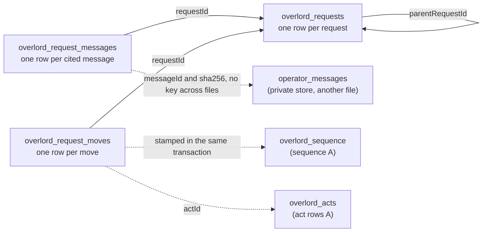
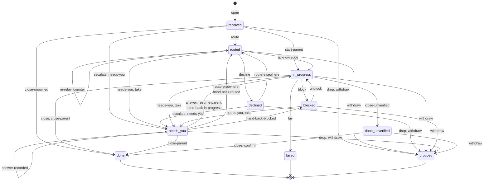
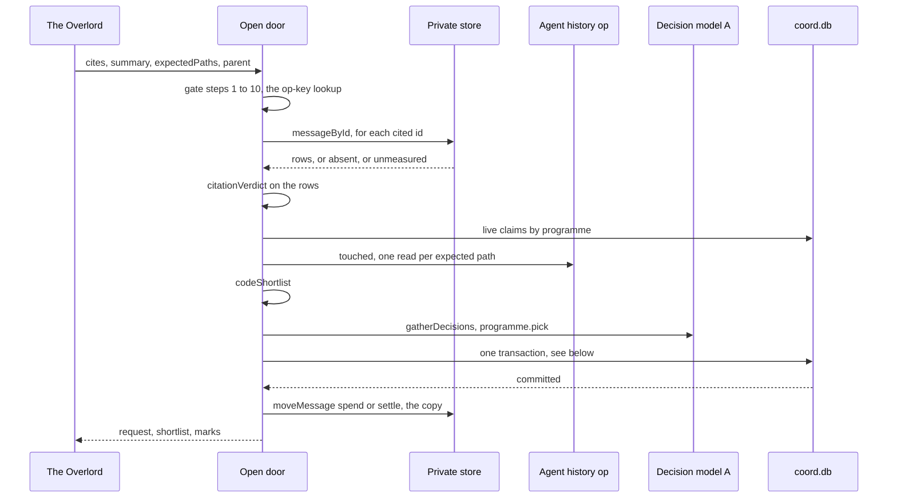
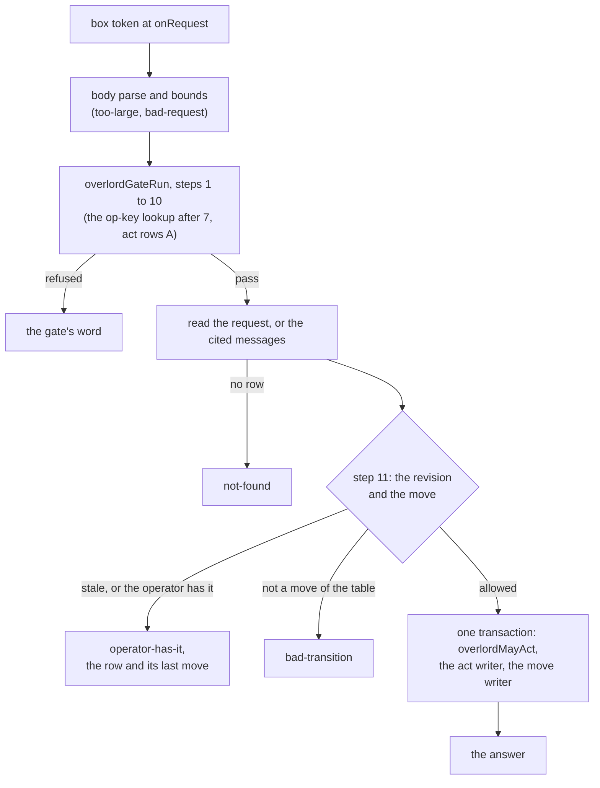
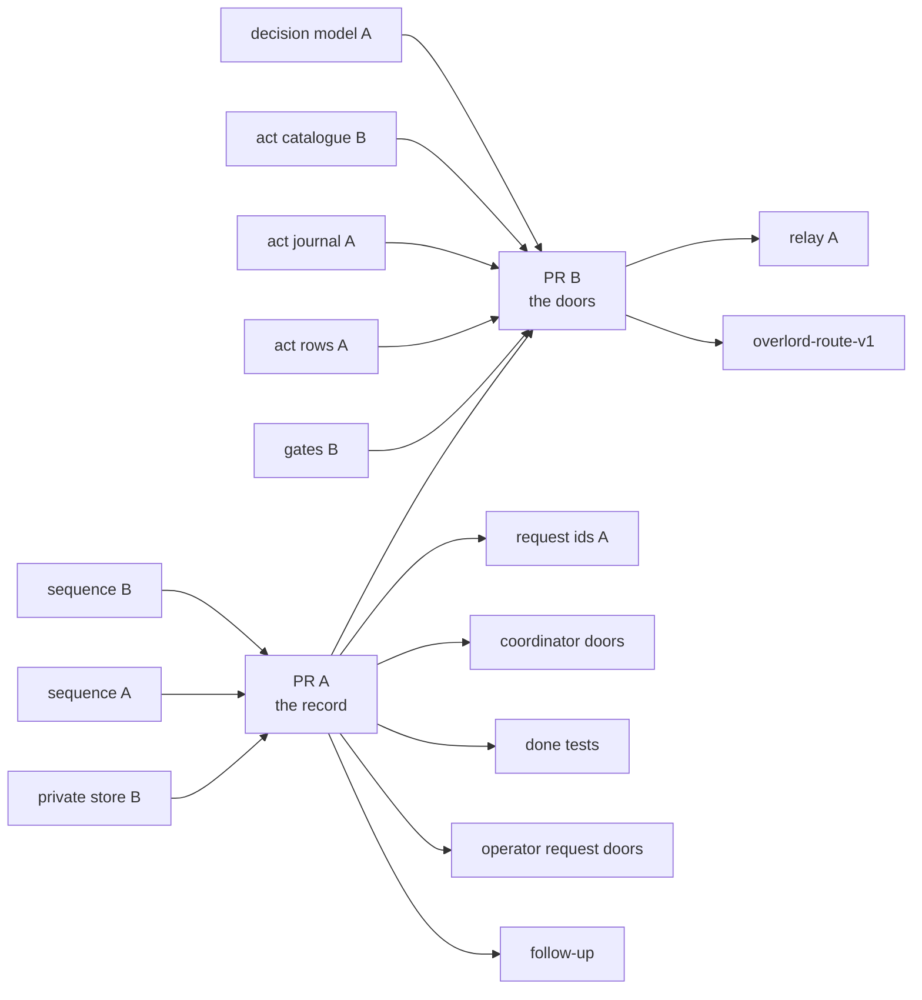

# Overlord W2: the request record, its moves and the Overlord's request doors Implementation Plan

> **For agentic workers:** REQUIRED SUB-SKILL: Use superpowers:subagent-driven-development (recommended) or
> superpowers:executing-plans to implement this plan task by task. Steps use checkbox (`- [ ]`) syntax for tracking.

## In short

- **What this is.** The plan for the W2 piece "Request record" (the W2 index, Table W2, lane R). It is the spine every
  request piece waits on: one table of requests, one table of moves, one writer that moves a request, and the
  Overlord's four request doors. Two pull requests, nine tasks: PR A four, PR B five.
- **PR A, the record.** `overlord_requests`, its cited messages and its moves, in one migration. `REQUEST_TRANSITIONS` in
  a new `shared/overlordRequests.ts`, shaped as `shared/ledgers.ts#ITEM_TRANSITIONS`, with its tests: no open state
  without an exit, hand back as three rows, and close and close unverified apart. One move writer stamps the `request`
  row of `SEQUENCE_KIND_MAP`, raises `revision`, and sets the follow-up clock. One message founds one root request
  within 24 hours, by a unique index in `coord.db`. The private store's boot pass gains its measured citation reader and
  its `spent` arm. I12's predicate joins sequence B's invariant table.
- **PR B, the doors.** Open, drop, `close-request` and escalate (index questions 2 and 7), each with its
  `OVERLORD_DOORS` row through `overlordGateRun` and an act row per move. `said-not-operator` on a bad citation, and
  `operator-has-it` on a stale revision. The code shortlist (ruling F5): a pure decider that names at most six candidate
  programmes from `expectedPaths`, live claims and history's `touched`, which the open door returns and asks
  `programme.pick` about. Their `ccrc-api` verbs and `DOOR_TOOLS` rows.
- **Q28 is built as ruled.** A request that needs a start or a proposal goes to the operator through the escalate door,
  and nothing raises an item before W3.
- **What changes at merge.** Nothing a running session sees. PR A writes no row until a door exists. PR B's doors refuse
  `capability-missing` naming `overlord-route-v1` until the index's last piece ships that word.
- **What the reader must check.** Seventeen open questions (§2), each with a recommendation, none for the operator. Two
  need the coordinator's eye: the escalate act kind is missing from the act catalogue plan (question 13), and history's
  `touched` has no server reader today, so PR B adds one (question 5).

## 1. Goal, scope and the rulings this plan builds on

This section says what the piece builds, why, and which rulings it builds on.

**Goal:** a request the operator asked for is a row in `coord.db` that outlives any generation of the Overlord. It
moves only through one table of moves and one writer, and it cites the operator's whole messages by id and hash, never
their words. The Overlord opens, drops, closes and escalates requests through four doors behind the gate order.

**Why:** C9, H7 and H22 (§5.1): "One table, `overlord_requests`, in `coord.db`, moved only through doors", "A request
cites whole messages", "One message founds one root request, within 24 hours", and "One table of moves,
`REQUEST_TRANSITIONS`". §5.3 adds the code shortlist and Figure 4. §10.4 and Table 11.7a add I12: "Every open request
outside `needs-you`, `done-unverified` and `blocked` has a follow-up time, or is a parent with at least one open child,
each of which meets this invariant itself".

**Architecture.** Context C5 (Coordination) owns the request record. The cited messages live in C11 (the private
store), which the open door reads and moves through its own writer.

| Ring | File | What it holds | PR |
|---|---|---|---|
| L0 | `shared/overlordRequests.ts` (new) | The ten states, the actors, `REQUEST_TRANSITIONS`, the move reasons, the fields each move may set, the bounds | A |
| L1 | `server/src/coord/overlordRequests.ts` (new) | `nextRequestState`, `followUpAfterMove`, `citationVerdict`, `nextRequestId`, `answeredSinceNeedsYou`, `closeUnownedVerdict` | A |
| L1 | `server/src/coord/requestShortlist.ts` (new) | `codeShortlist` | B |
| L3 | `server/src/coord/overlordRequestStore.ts` (new) | The one insert, the one move writer and the readers | A |
| L3 | `server/src/coord/requestShortlistRead.ts` (new) | Live claims by programme, and history's `touched` by programme, for the shortlist | B |
| L4 | `server/src/coord/overlordRoutes.ts` (W1's) | The four door handlers | B |
| L1, L3 | `server/src/coord/invariants.ts`, `invariantFacts.ts` (sequence B's) | I12's predicate and its gatherer | A |
| L1, L4 | `server/src/operatorModel/messages.ts`, `bootPass.ts` (private store B's) | The boot pass's `spent` arm, and its measured citation reader wired | A |

*Table 1. Where the code goes.*

No row is added to the architecture spec's path table: `server/src/coord/**` is C5 by its directory row, and a
`shared/*.ts` file states its ring and context in its header, as `shared/ledgers.ts` does (§3).

**The rulings this plan builds on.** The coordinator accepted every recommendation of the W2 index's questions 2 to
23, and questions 24 to 28 are settled. This plan builds on these:

- **Q2:** routing is a relay. The relay door makes route, re-relay and route elsewhere (relay A's piece). The
  Overlord's request doors here are open, drop, `close-request` and escalate. This plan defines the moves the relay
  makes, and relay A calls the move writer.
- **Q5, as amended:** `revision INTEGER NOT NULL DEFAULT 0` on `overlord_requests`, raised only by a writer that
  changes what an answer acts on, in that writer's transaction. An Overlord door that carries an older revision changes
  nothing and answers `operator-has-it` with the row and the act that moved it. An operator's tap is never refused for
  a stale revision.
- **Q7, as amended:** the paths `POST /api/overlord/requests` and `POST /api/overlord/requests/:id/drop`, `.../close` and
  `.../escalate`, all in the Overlord door group. The escalate door (ruled, fix round 1) moves `received` or `declined`
  to `needs-you` with one of three reasons, writes an act row, sends no mail, and has the act kind `escalate-request`.
- **Q8:** `widens` is a column of `overlord_acts`, not of this table.
- **Q13:** the done-test predicates and their one reader are the done tests piece's. This plan stores `doneTest` as an
  opaque column that only the relay writes.
- **Q23:** this plan is written now, against W1 plans not yet built, and takes each interface from the W1 plan that
  defines it.
- **Q27:** `overlordMayAct` is act catalogue B's. Every act kind here is class none, so in W2 it answers `allow` or
  `identity-too-weak`.
- **Q28:** before W3 and W5, a request that needs a proposal or a start goes to the operator. The escalate door moves
  it to `needs-you`, and nothing raises an item before W3.
- **F5 (the index review):** the code shortlist is a pure decider here. The open door returns it, and decision model A
  takes it as `programme.pick`'s input.
- **F6 (the index review):** the escalate door, its three reasons, and its act row.
- **I12:** its predicate goes in through sequence B's invariant table.

## 2. Open questions

Each question carries a recommendation, which this plan builds unless the coordinator rules otherwise. None needs the
operator: each is an implementation choice under a direction the spec already gives.

- **RQ1. Every move is a row of its own** (slug `request-moves-are-rows`). §5.1 says "Every move is a row and an event"
  and names no table. The Overlord's `operator-has-it` must name "the act that moved it" (index question 5). The drop
  door must know whether the operator answered since the request reached `needs-you`. The take's reason
  `operator-took-it` is "carried on the move's news row". **Recommendation:** `overlord_request_moves`, append-only. It
  has one row per move: the move, the actor's kind and id, the states before and after, a closed reason word or none,
  the act id when an act caused it, the revision after, and the time. No text. The move writer writes it in the move's
  own transaction.
- **RQ2. Cited messages are a child table** (slug `citations-are-a-child-table`). "One message founds one root request
  … by a unique index" needs a row per message. **Recommendation:** `overlord_request_messages (requestId, messageId,
  sha256, root)`, with `UNIQUE (messageId) WHERE root = 1`. `root` is 1 for each message a root request cites.
- **RQ3. An expected path names its project, and is a path, never a glob** (slug `expected-paths-name-their-project`).
  Claims are per project (`shared/api.ts#ClaimSummary`), and a request has no project column. No glob matcher exists:
  `server/src/coord/claims.ts#pathsOverlap` is exact or directory-prefix only. **Recommendation:** each entry is
  `{ project, path }`. The path is normalised by `server/src/coord/claims.ts#normalizeClaimPath`, and matched by
  `pathsOverlap`, so a directory covers what is under it. A second matcher is not added.
- **RQ4. An empty `expectedPaths` shortlists the programmes that hold live claims** (§5.3: "When it is empty, the
  shortlist matches on live claims alone"). With no path there is nothing to match, so the sentence can only mean that
  a live claim alone qualifies a programme. **Recommendation:** with no expected path, every programme holding a live
  claim is a candidate, ranked by its count of live claimed paths, then by its newest claim, then by slug, and cut at
  six. No `touched` read is made. The answer says `basis: 'claims-only'`.
- **RQ5. History's `touched` reaches the server as a fourth verb of the history op** (slug
  `touched-is-a-fourth-history-verb`). Measured: `touched` lives only in the fleet box's history store
  (`ccd/history/recall.mjs`, its "touched" section). The agent op `overlord-history` runs three verbs
  (`shared/overlordHistory.ts#OverlordHistoryVerb`), and `touched` is not among them. Each `touched` row names its
  session's ccrc id. **Recommendation:** add `touched` to `OverlordHistoryVerb` and to
  `ccd/history/overlord-read.mjs`'s `CLI_VERB` map. One read per expected path is made, targeted at that path's project,
  at most eight, under one 2 s deadline. The server maps each row's ccrc id to a programme through `runs.sessionId` and
  `runs.claimedBy`. The shortlist fails open: a read that did not answer leaves the claims standing alone, and the
  answer says `touched: 'unmeasured'` or `'partial'`. The history door of W1's board-history piece then serves
  `touched` to the Overlord too, which C54 asks for.
- **RQ6. The move writer stamps the follow-up clock** (slug `move-writer-stamps-the-clock`). I12 must hold from the
  first row, and the follow-up piece lands after this one. **Recommendation:** `followUpAfterMove` (L1) gives the clock
  at each move:
  - **Entering `received`, `routed`, `in-progress` or `declined`:** the time of the move plus one hour
    (`REQUEST_NEXT_MOVE_MS`, Table 11.5b's "One hour"), or the read-back's promise when the move carries one.
  - **Entering `needs-you`, `done-unverified`, `blocked` or a terminal state:** none.
  - **A parent with an open child:** none. The insert of a child clears its parent's clock in the same transaction.

  The follow-up piece keeps `followUpDue`, the arm, the nudges and the re-time after a nudge. It calls a bookkeeping
  writer of this store and never stamps a move's clock itself.
- **RQ7. Every move raises the revision, and nothing else does** (index question 5, applied to requests). Every move,
  the self-loops included, changes what an answer acts on: the state, the owner, the done test, a counter, the
  operator's recorded answer or `takenFrom`. News, `followUpAt`, `nudges` and `expectedPaths` alone are bookkeeping.
  **Recommendation:** the move writer raises it, and every other writer of the table is classified `bookkeeping` in the
  row-revisions census.
- **RQ8. Which word a refused move answers.** **Recommendation:**
  - an unknown request: `not-found`;
  - a stale revision, a request in `needs-you` the operator has not answered, or a request the operator took:
    `operator-has-it`, with the row and its last move;
  - any other move the table does not allow: `bad-transition`.

  Both `not-found` and `bad-transition` are in `shared/refusal.ts#GENERIC_REFUSALS` today, so no word is added.
- **RQ9. A child is one level deep, and cites only its root's messages.** Figure 4 makes "a parent request, one child
  per owner". **Recommendation:** a child's parent must be a root request that is not terminal. A child cites a subset
  of its root's messages with `root` 0, takes its root's `origin`, and may not itself be a parent. I12's predicate stays
  recursive, so a deeper tree would need only this rule relaxed.
- **RQ10. A request id is never issued twice.** The act journal's `open-request` record carries the request's id
  (index question 4), and act journal B puts the highest request id in the witness. **Recommendation:** the insert
  takes `id = nextRequestId(storeHighest, journalHighest)`, `max(storeHighest, journalHighest) + 1`, as the private
  store's `nextMessageId` does. The caller passes the act journal's highest request id, or `null` until act journal B
  supplies it. The table is never `AUTOINCREMENT`.
- **RQ11. The `spent` mark is a copy, written after the commit** (slug `age-spent-is-derived`).
  - **The unique index is the fact.** The private store's `spent` is a copy, and no transaction spans the two files
    (the W1 index's question 31).
  - **After the `coord.db` commit:** the open door calls `moveMessage(id, 'spend', 'citing-door')` for each root
    citation, and `moveMessage(id, 'settle', 'citing-door')` for any other citation not yet settled. A failed copy is
    logged, and the boot pass's `spent` arm repairs it.
  - **The 24-hour window is checked at the door from the message's `at`, and never written.** A message past the window
    is spent by its age, and no lane writes it.
- **RQ12. `close-request` on `received` is this plan's, and on other states the done tests piece's.** The server's
  close from `received` to `done` happens "at the Overlord's close door", when every act on the request was a read or an
  answer. The close of an `in-progress` request is the done-test lane's. **Recommendation:** PR B's close door moves
  `received` to `done` when `closeUnownedVerdict` allows: every act on the request is its own `open-request` or an
  answer kind (W3's), and it has no open child. On any other state it answers `bad-transition` until the done tests piece adds its arm to the same handler.
- **RQ13. The escalate door's act kind is missing from the act catalogue plan** (index question 7: `escalate-request`,
  class none, reversible, refused at `chat`, allowed at `advise` and `full`). The act catalogue plan in review (#2924,
  Table 4) lists `escalate` and no `escalate-request`. **Recommendation:** act catalogue A adds the row, with its
  ceiling in the `operator-reach` group (3 an hour per programme, 10 in all), because each escalation lands in front of
  the operator. If the catalogue has landed without it, PR B adds the row in its first task. The coordinator rules
  which.
- **RQ14. `server/src/coord/requestRoutes.ts` is created with its first route** (slug
  `request-routes-file-with-its-first-route`). The index has PR B create it with every census site. But PR B's four
  doors are the Overlord's, and they belong in `overlordRoutes.ts` (index question 7). A lane source with no route
  would give the censuses nothing to read. **Recommendation:** the coordinator request doors piece or the operator's
  request doors piece creates it, whichever lands first, with every census site.
- **RQ15. The open door asks `programme.pick`, so PR B needs decision model A** (the decision-model plan, #2922, Figure
  2). **Recommendation:** the open door calls decision model A's `gatherDecisions` before its transaction, with the rows
  `programme.pick` and `programme.any`. It records the checks on its act row and returns each check's mark. With every
  row `off` (Q29), the check is `disarmed` and costs nothing.
- **RQ16. The bounds.** **Recommendation**, as starting values for Table 11.5b:
  - at most 8 cited messages;
  - a summary of at most 200 characters (the act row's own cap);
  - at most 32 expected paths, each path at most 512 bytes;
  - at most 6 consulted programmes;
  - a close note of at most 600 characters.

  Summary and close note are masked on the way in by the server's masker (`server/src/accounts/mask.ts#maskText`).
  A larger body refuses `too-large`, an existing word.
- **RQ17. Where the drop's reason sits.** Table 5.1a: "A drop carries the dropper's reason". **Recommendation:** the
  drop door requires a reason of 1 to 600 characters, masked, in `closeNote`. Its move row carries the reason word
  `dropped`. The text is the Overlord's own words, never the operator's.

## 3. What exists today

Measured on `main` at `fb763bef8` (2026-11-16), each cited by symbol. None of the W1 pieces this plan builds on is
merged: private store A is open (#2896), and private store B, sequence A, B and C, gates A and B, the ladder, door
process A2 and the Overlord's routes file are planned only.

| What | Where | What this plan does with it |
|---|---|---|
| The item moves table, keyed by move, `{ actor, from: readonly ItemState[], to }` | `shared/ledgers.ts#ITEM_TRANSITIONS` | The shape `REQUEST_TRANSITIONS` copies |
| Open states derived as those some row leaves | `shared/ledgers.ts#OPEN_ITEM_STATES` | Derived the same way: no hand list of open or terminal states |
| The item decider, refusal order `not-open`, `wrong-actor`, `programme-live` | `shared/ledgers.ts#nextItemState` | `nextRequestState` follows its shape |
| The one writer of an item's state, refusing by return value | `server/src/coord/ledgersStore.ts#moveItemInTx` | The move writer's model |
| The item policy tests (vocabulary, derived open states, every state, act and actor) | `server/test/ledgers-policy.test.ts` | The request policy tests' model |
| Migrations: an array of SQL strings, version = length = 82 | `server/src/coord/schema.ts#MIGRATIONS`, `#COORD_SCHEMA_VERSION` | One new entry, numbered when it lands |
| Partial unique indexes | `MIGRATIONS` entries 75 (`push_outbox_one_per_source`) and 82 (`operator_responses_one_waiting`) | The model for the one-root index |
| The version pins | `server/test/coord-db.test.ts` (three `toBe(82)`), `server/test/run-close-switch.test.ts` (drops back to 53) | Bumped and extended when the migration lands |
| Live claims, with paths | `server/src/coord/store.ts#activeClaims`, `shared/api.ts#ClaimSummary` | The shortlist's claim input |
| Claim paths, normalised and overlapped | `server/src/coord/claims.ts#normalizeClaimPath`, `#pathsOverlap` | Reused for expected paths (RQ3) |
| A claim's programme | None. A claim names `runId`, and `runs.program` names the programme. A claim with no run has none | The shortlist reader joins through runs |
| A session's programme | `runs.sessionId` (a worker) and `runs.claimedBy` (a coordinator), in `MIGRATIONS` entry 1 | Maps a `touched` row to a programme (RQ5) |
| `touched` | `ccd/history/recall.mjs` (the "touched" section), rows typed `ccd/history/lib.d.mts#TouchedRow`, each naming its session's ccrc id | Not reachable from the server today (RQ5) |
| The Overlord's history op | `shared/overlordHistory.ts#OverlordHistoryVerb` (`search`, `describe`, `expand`), `ccd/history/overlord-read.mjs#overlordRead` | Gains `touched` (RQ5) |
| Generic words | `shared/refusal.ts#GENERIC_REFUSALS`: `not-found` (404), `bad-transition` (409), `too-large`, `unmeasured` | Reused (RQ8, RQ16) |
| The Overlord's words | `shared/refusal.ts#OVERLORD_REFUSALS`: W1's words. `said-not-operator` and `operator-has-it` arrive with the W2 vocabulary piece or W1's inbox | Read from the group, never re-declared |
| The masker | `server/src/accounts/mask.ts#maskText` | Masks the summary and the close note |
| A routes file registered from the coordination routes | `server/src/coord/coordCallsRoute.ts#registerCoordCallsRoute` | Not used: the doors go in W1's `overlordRoutes.ts` (RQ14) |
| The growth check | `server/test/growthCheck.ts#GROWTH_LIMIT` (40 net lines per growth-checked file) | `schema.ts` is the only growth-checked file this plan grows |
| The table, clock and mutation registries | `server/test/single-definition/writers-map.test.ts#TABLES`, `server/test/single-definition/time-ports.test.ts#TIME_PORT_FILES`, `server/test/sim/mutation-floors.test.ts#MUTANT_SETS` with `mutation-floors.json` | Each new table, clock-free file and decider joins |
| The `ccrc-api` routes | `ccd/ccrc-api`'s `ROUTES`, 84 rows, pinned by `server/test/ccrc-api.test.ts` (length and `WORDS`) | Four rows; the count words re-derived when it lands |
| The skill's door tables | `ccd/overlord-skill/references/routing.md` and `starting.md` name `relay`, `close-request`, `drop-request` and `nudge-owner` | Gain `open-request` and `escalate-request` |

*Table 2. What exists today.*

**From the W1 plans, not yet built** (each taken from the plan that defines it, as the index asks):

- **Private store** (`w1-private-store.md`): `operator-model.db`, a second file. `operator_messages` has
  `sha256` (of the stored text), `state` (`recorded`, `queued`, `delivered`, `picked-up`, `settled`, `spent`) and
  `spentAt`. Its one writer is `moveMessage(id, event, actor, at)`, where `spend` is accepted from every state but
  `spent` and `citing-door` may `settle` and `spend`. The reader is `messageById(id): StoreRead<OperatorMessageRow |
  'absent'>`. Private store B's boot pass takes a citation reader as a port:
  `CitationRead = { kind: 'measured'; cited } | { kind: 'not-applicable' } | { kind: 'unmeasured'; why }`. Its W1
  adapter answers `not-applicable`, and "W2 adds the measured adapter and the `spent` arm".
- **Sequence** (`w1-sequence-monitor.md`): `SEQUENCE_KIND_MAP` in `shared/overlord-sequence.ts`, a row per kind
  (`states`, `id`, `spec`). `stampSequenceInTx(db, line)` refuses outside a transaction, and the order inside a stamped
  transaction is "authority append first, then the row write, then the stamp". The stamp census is
  `server/test/sequence-stamp-census.test.ts`, with `STAMPED_TABLES`. Sequence B's `INVARIANT_MAP` in
  `server/src/coord/invariants.ts` reads `not-applicable` for a row with no predicate, and "the piece that creates a
  row's tables adds the predicate and its gatherer".
- **Gates** (`w1-gates.md`): `OVERLORD_DOORS` in `server/src/coord/overlordDoors.ts`, each row
  `{ method, path, file, verbClass, group, write, word, others, ladderClass, act }`. Every handler calls
  `deps.gate(req, reply, '<key>', claim)` before its first `coord` access, and the next statement is
  `if (g.kind === 'refused') return`. On a pass it gets `{ caller, generation }`.
- **Door process** (`w1-door-process.md`): `DOOR_TOOLS` in `ccd/door-process.mjs`, each row
  `{ name, verb, class, fenced, reader, input, argv }`. Every `operate` row is fenced, and no input names attribution.
- **The ladder** (`w1-ladder.md`): `RUNG_MAP.advise.needs = 'overlord-route-v1'`. W2's act kinds are allowed at
  `advise` and `full`.

## 4. The record

This section gives the three tables and the writers of each column. One migration creates all three.


*Figure 1. The request record. Solid edges are keys inside `coord.db`. Dashed edges are references to another table or
another file, written in the same transaction where the target is in `coord.db`.*

| Column | Holds | Written by |
|---|---|---|
| `id` | The request's number, from `nextRequestId` (RQ10) | `insertRequestInTx` |
| `origin` | `operator` when it cites a message, else `overlord`. A child takes its root's | `insertRequestInTx` |
| `summary` | The Overlord's one line, masked, at most 200 characters | `insertRequestInTx` |
| `owner` | One programme slug, or none before routing | `moveRequestInTx` (route, re-relay, route elsewhere) |
| `parentRequestId` | The parent, for a child (RQ9) | `insertRequestInTx` |
| `consulted` | Programmes consulted, a JSON list of at most 6 slugs | `insertRequestInTx` |
| `state` | One of ten states | `moveRequestInTx` only (the insert writes `received`) |
| `doneTest` | Typed predicates, opaque here (index question 13) | `moveRequestInTx` (route, re-relay), for the relay |
| `expectedPaths` | `{ project, path }[]`, at most 32 (RQ3) | `insertRequestInTx`. The relay refines it in its route move |
| `dependsOn` | `request:<id>` or `programme:<slug>` | `moveRequestInTx` (block), for the coordinator doors |
| `takenFrom` | `routed`, `in-progress` or `blocked`, or none | `moveRequestInTx` (take sets it, hand back clears it) |
| `openedAt` | When it was opened | `insertRequestInTx` |
| `lastNewsAt`, `news` | The latest news and its time, masked | A bookkeeping writer, added by request ids A |
| `followUpAt` | The next follow-up time (RQ6) | `moveRequestInTx`, `insertRequestInTx` (a child clears its parent's), and the follow-up piece's bookkeeping writer |
| `nudges` | The nudges sent | The follow-up piece's bookkeeping writer |
| `counters` | The counters received | `moveRequestInTx` (counter) |
| `closedAt`, `closeNote` | When and why it ended, the note masked, at most 600 characters | `moveRequestInTx` (every move to a terminal state) |
| `revision` | The counter of RQ7 | `moveRequestInTx` only |

*Table 3. `overlord_requests`. Every writer is a function of `server/src/coord/overlordRequestStore.ts`, the one owner
of the table's SQL.*

- **`overlord_request_messages`:** `requestId`, `messageId`, `sha256`, `root`, `at`, with primary key
  `(requestId, messageId)` and the unique index `overlord_request_messages_one_root ON (messageId) WHERE root = 1`.
  `insertRequestInTx` is its one writer.
- **`overlord_request_moves`:** `id`, `requestId`, `move`, `actorKind`, `actor`, `fromState` (none for `open`),
  `toState`, `reason`, `actId`, `revision`, `at`, with an index on `(requestId, id)`. `moveRequestInTx` and
  `insertRequestInTx` write it, and nothing updates or deletes it.
- **No vocabulary sits in a CHECK** (the private store's slug `no-vocabulary-in-check`). The L0 table governs every
  word. A CHECK holds shapes only, such as `(closedAt IS NULL) = (closeNote IS NULL OR closeNote = '')` where it
  helps.
- **A newer column is additive.** An older build ignores all three tables (Table 11.5, "Ignored").

## 5. The moves

This section gives `REQUEST_TRANSITIONS`, the one table every door moves a request through.

It is keyed by move, as `ITEM_TRANSITIONS` is, with one actor and one target state per move. So close and close
unverified are two rows, and hand back is three, one per state it returns to. `open` is a row whose `from` is empty:
only the insert honours it.

| Move | Actor | From | To | Who calls it (piece) |
|---|---|---|---|---|
| `open` | overlord | (none) | `received` | The open door (this plan, B) |
| `route` | overlord | `received` | `routed` | The relay door (relay A) |
| `re-relay` | overlord | `routed` | `routed` | The relay door (relay A) |
| `route-elsewhere` | overlord | `declined`, `needs-you` | `routed` | The relay door (relay A). From `needs-you` only after the operator's answer |
| `drop` | overlord | `received`, `declined`, `needs-you` | `dropped` | The drop door (this plan, B). From `needs-you` only after the operator's answer |
| `escalate` | overlord | `received`, `declined` | `needs-you` | The escalate door (this plan, B) |
| `acknowledge` | owner | `routed` | `in-progress` | The coordinator doors |
| `counter` | owner | `routed` | `routed` | The coordinator doors |
| `decline` | owner | `routed` | `declined` | The coordinator doors |
| `block` | owner | `in-progress` | `blocked` | The coordinator doors |
| `fail` | owner | `in-progress` | `failed` | The coordinator doors |
| `close` | server | `in-progress`, `done-unverified` | `done` | The done-test lane (done tests) |
| `close-unowned` | server | `received` | `done` | The close door (this plan, B) |
| `close-unverified` | server | `in-progress` | `done-unverified` | The done-test lane (done tests) |
| `start-parent` | server | `received` | `in-progress` | Done tests |
| `close-parent` | server | `in-progress`, `needs-you` | `done` | Done tests |
| `resume-parent` | server | `needs-you` | `in-progress` | Done tests |
| `unblock` | server | `blocked` | `in-progress` | Done tests |
| `needs-you` | server | `received`, `routed`, `in-progress`, `blocked`, `declined` | `needs-you` | Coordinator doors (two counters), follow-up, done tests, `overlord-route-v1` (`off`) |
| `answer` | operator | `needs-you` | `in-progress` | The operator's request doors, when the owner has acknowledged |
| `answer-recorded` | operator | `needs-you` | `needs-you` | The operator's request doors, otherwise |
| `take` | operator | `routed`, `in-progress`, `blocked` | `needs-you` | The operator's request doors |
| `hand-back-routed` | operator | `needs-you` | `routed` | The operator's request doors, when `takenFrom` is `routed` |
| `hand-back-in-progress` | operator | `needs-you` | `in-progress` | As above, for `in-progress` |
| `hand-back-blocked` | operator | `needs-you` | `blocked` | As above, for `blocked` |
| `confirm` | operator | `done-unverified` | `done` | The operator's request doors |
| `withdraw` | operator | every open state | `dropped` | The operator's request doors |

*Table 4. `REQUEST_TRANSITIONS`, as Table 5.1b states it. The terminal states are those no row leaves: `done`, `failed`
and `dropped`. A test derives them and compares the result to §5.1's list.*


*Figure 2. Every edge of `REQUEST_TRANSITIONS`, labelled by its moves. It is Figure 3 of the spec with each edge named
by the move that makes it. A self-loop is a move that keeps the state and still raises the revision.*

**The guards the table cannot hold.** `nextRequestState(row, move, actor, ctx)` checks the row's move first. Then it
checks four facts from `ctx`, which the move writer reads in its transaction:

| Fact | Guards | Refusal (internal) | Door word |
|---|---|---|---|
| `answered`: the operator answered since the row last entered `needs-you` (`answeredSinceNeedsYou` over its moves) | `drop`, `route-elsewhere` from `needs-you` | `not-answered` | `operator-has-it` |
| `takenFrom` | An Overlord move on a taken row. Each `hand-back-*` needs `takenFrom` equal to its target | `taken`, `not-taken-from` | `operator-has-it`, `bad-transition` |
| `ownerAcknowledged`: the row's moves hold an `acknowledge` | `answer` (else `answer-recorded`) | `not-acknowledged` | (the operator's door picks the move) |
| `openChildren` | `close-unowned`, `drop` and `escalate` on a parent | `has-open-children` | `bad-transition` |

*Table 5. The guards. The refusal order is: the move's actor, then its `from`, then the guards in this table's order.*

**What each move may set.** `REQUEST_MOVE_FIELDS` is an L0 map from each move to the columns it may set:

- `route`, `re-relay` and `route-elsewhere`: `owner`, `doneTest` and `expectedPaths`;
- `block`: `dependsOn`;
- `take`: `takenFrom`, from the state it leaves. Each `hand-back-*` clears it;
- every move to a terminal state: `closeNote`, which `drop` requires.

The move writer refuses a field the move may not set, and writes nothing.

**Move reasons.** `REQUEST_MOVE_REASONS` is an L0 key map of closed words, carried on the move row. This plan adds
the escalate door's three, `needs-start`, `needs-proposal` and `unnamed-widening`, and `dropped` (RQ17). Each later
piece adds its own words in its own pull request: `two-counters`, `two-silent-nudges`, `off-before-ack`,
`child-ended`, `dependency-ended` and `operator-took-it`. A test holds that every move to `needs-you` carries a reason.

## 6. Citing the operator's messages

This section says how the open door binds a request to whole operator messages across the two files.


*Figure 3. The open door. Every read that can be slow, the private store's and the agent's, happens before the
transaction, as `gatherDecisions` requires. Inside it the door re-decides what can race: the one root citation, by the
unique index.*

**Inside the one transaction**, in the order the sequence plan fixes (journal, then row, then stamp):

1. `overlordMayAct` (act catalogue B) runs inside the transaction that commits the act (§7.1). For a class-none kind
   it allows, unless the caller's strength is under the kind's least (`identity-too-weak`).
2. The act writer of act rows A appends the act journal record `open-request` with the request's id, writes the act
   row with its decision checks, and stamps the `act` line.
3. `insertRequestInTx` writes the request, its cited messages and its `open` move row, and stamps the `request` line.
4. If the unique index refuses a root citation, the transaction rolls back, and the door answers `said-not-operator`
   with the detail `spent`.

**`citationVerdict` (L1)** decides from the rows the door read. It is first match:

| Case | Answer |
|---|---|
| The private store read failed for an id | `unmeasured` (502): never folded into absent |
| An id is no row of the store, or a row W4's wipe made `gone` | `said-not-operator`, `absent` |
| `sha256Of(row.text)` is not `row.sha256` | `said-not-operator`, `changed` |
| A root request cites a row whose state is `spent` | `said-not-operator`, `spent` |
| A root request cites a row older than 24 hours (`ROOT_FOUND_WINDOW_MS`) | `said-not-operator`, `spent` |
| A child cites an id its root does not cite (RQ9) | `said-not-operator`, `not-in-root` |
| More than 8 ids, or a repeated id | `too-large`, `bad-request` |
| Otherwise | `ok`, with each id's hash and whether it is a root citation |

*Table 6. `citationVerdict`. A request with no citation is the Overlord's own (`origin: overlord`) and needs no
verdict.*

**The boot pass's two arms** (private store B's pass, PR A here):

- **The measured citation reader.** `citedMessagesForBoot(db)` reads `overlord_request_messages`. The cited set settles
  a `cite` row, as private store B's open question 9 foresees.
- **The `spent` arm.** `CitationRead`'s measured arm gains `rootCited` (additive). `bootSettlement` gains the answer
  `spend` for a row whose id is root-cited and whose state is not `spent`. It never takes a mark away: a `spent` row with
  no root citation stays spent, because a confirmed restore spends every message up to the highest id on record
  (§5.1).
- **A table not yet migrated answers `not-applicable`,** as W1's adapter did, and a read that throws answers
  `unmeasured`.

## 7. The code shortlist

This section gives the decider that names at most six candidate programmes (ruling F5, §5.3, Table 3.7a).

`codeShortlist(input): Shortlist` is L1, pure and total. Its inputs come from `requestShortlistRead.ts` (L3), which the
open door calls before its transaction:

```ts
// server/src/coord/requestShortlist.ts (C5, L1)
export type ExpectedPath = { readonly project: string; readonly path: string };   // normalised (RQ3)
export type ClaimByProgramme = { readonly programme: string; readonly project: string;
  readonly paths: readonly string[]; readonly renewedAt: number };                  // live claims with a run only
export type TouchedRead =
  | { readonly kind: 'measured' | 'partial'; readonly hits: readonly { programme: string; project: string;
      file: string; latestMs: number | null }[]; readonly why: string | null }
  | { readonly kind: 'unmeasured'; readonly why: string }
  | { readonly kind: 'not-asked' };                                                 // no expected path (RQ4)
export type ShortlistCandidate = { readonly programme: string; readonly claimHits: number;
  readonly touchedHits: number; readonly newest: number | null };
export type Shortlist = { readonly candidates: readonly ShortlistCandidate[];        // at most SHORTLIST_MAX (6)
  readonly basis: 'paths' | 'claims-only'; readonly touched: TouchedRead['kind'] };
export function codeShortlist(input: { expected: readonly ExpectedPath[]; claims: readonly ClaimByProgramme[];
  touched: TouchedRead; live: ReadonlySet<string> }): Shortlist;
```

**The rule**, first match per programme, then ranked:

| Step | Rule |
|---|---|
| 1 | A programme not in `live` (not open) is never a candidate |
| 2 | With no expected path: every programme with a live claim is a candidate, `claimHits` = its live claimed paths (RQ4) |
| 3 | Otherwise `claimHits` counts the expected paths that `pathsOverlap` a live claimed path of that programme in the same project |
| 4 | `touchedHits` counts the expected paths that a `touched` hit of that programme names in the same project. An `unmeasured` read adds none |
| 5 | A programme with no hit of either kind is not a candidate |
| 6 | Rank: more `claimHits` first, then more `touchedHits`, then the newest claim or touch, then slug. Cut at six |

*Table 7. `codeShortlist`. A claim outranks history, because a live claim is work in hand.*

**Properties the tests hold** (Table 11.7b asks them of a first-match decider):

- **Monotone:** adding a live claim to a programme never lowers its rank.
- **Fail-open:** turning `touched` from `measured` into `unmeasured` removes no programme that had a claim hit.
- **Capped:** never more than six candidates.
- **No goals:** the decider reads no goals text. Nothing parses `doneWhen` (§5.3).
- **Deterministic:** the same input gives the same order.

**`requestShortlistRead.ts` (L3)** composes two readers and decides nothing:

- **`claimsByProgramme(db, now)`:** `activeClaims()`, kept where `expiresAt > now` (the route's own filter), joined to
  `runs.program` through `runId`. A claim with no run is dropped.
- **`touchedByProgramme(fleet, db, expected, deadline)`:**
  - one `overlord-history` read with verb `touched` per expected path, at most eight, target `project`;
  - each row's ccrc id is mapped to a programme through `runs.sessionId`, else `runs.claimedBy`, and an unmapped id is
    dropped;
  - the answer is `partial` when the deadline cut a read, and `unmeasured` when none answered.

## 8. The Overlord's four doors

This section gives the doors of PR B. Each is a row of `OVERLORD_DOORS`, registered in `overlordRoutes.ts`, and runs
`overlordGateRun` first.

| Door | Path | Act kind | Body | Moves | Answer |
|---|---|---|---|---|---|
| Open | `POST /api/overlord/requests` | `open-request` | `cites` (ids), `summary`, `expectedPaths`, `parentRequestId`, `consulted` | `open` | The request, the shortlist, the decision marks |
| Drop | `POST /api/overlord/requests/:id/drop` | `drop-request` | `revision`, `reason` | `drop` | The request and its move |
| Close | `POST /api/overlord/requests/:id/close` | `close-request` | `revision` | `close-unowned` (RQ12) | The request and its move |
| Escalate | `POST /api/overlord/requests/:id/escalate` | `escalate-request` (RQ13) | `revision`, `reason` (`needs-start`, `needs-proposal`, `unnamed-widening`) | `escalate` | The request and its move. No mail |

*Table 8. The four doors. Attribution is the client's: no body names `fromId` or `fromUuid` (the door process plan).*

Every row is `group: 'overlord'`, `verbClass: 'operate'`, `write: true`, `word: 'overlord-route-v1'` and `others:
'refuse'`. The `ladderClass` is the one the act catalogue gives the kind.


*Figure 4. One door's order. Steps 1 to 10 are the gate runner's. Step 11 is the door's own: the target row and its
revision, then the citations, then `overlordMayAct`. The move writer re-decides the move inside the transaction, so a
race between the read and the transaction answers as the table says.*

**Each door's act row** carries the kind, the target `request:<id>`, the revision it acted on, the summary (for drop,
the reason's first 200 characters), and for the open door the decision checks. Act rows A owns the row, its natural key
and the operation key. A retry with the same operation key returns the stored answer and writes nothing (index
question 3).

## 9. I12, the sequence line and the revision

This section gives the three facts the move writer keeps true in every transaction.

- **The `request` row of `SEQUENCE_KIND_MAP`:** `request: { states: REQUEST_STATES, id: 'the request id, in decimal',
  spec: '§10.4 "a request"' }`. A line is stamped at the insert and at every move whose state word changes. A self-loop
  (`re-relay`, `counter`, `answer-recorded`) changes no state word, so it stamps nothing, and the census lists it with
  that reason. The line's actor kind comes from one L0 map, `REQUEST_ACTOR_SEQUENCE_KIND`, which maps each request
  actor to the sequence's actor kind.
- **The revision (RQ7):** the move writer adds one in the row's `UPDATE`, and the move row records the new value. The
  row-revisions census gains `overlord_requests`, with `moveRequestInTx` as `raises` and every other writer as
  `bookkeeping`.
- **I12:** `i12FollowUpClock(lines, facts)` goes into `INVARIANT_MAP`'s I12 row, in place of its `waitsOn`. Its gatherer
  `requestClockFacts(db)` reads every open request's `id`, `state`, `followUpAt` and `parentRequestId`. The predicate
  is first match per open request:

| Case | Verdict |
|---|---|
| The table is absent | `not-applicable` (sequence B's `absent` arm) |
| State `needs-you`, `done-unverified` or `blocked` | holds for it |
| `followUpAt` is set | holds for it |
| It has an open child, and every open child holds | holds for it |
| Otherwise | a finding, subject `request:<id>` |

*Table 9. I12. A child depth beyond one is refused by the insert (RQ9), and the predicate still carries a visited set,
so a planted cycle is a finding, never a loop.*

## 10. Cross-plan seams

This section names what this plan takes from other pieces, and what it hands them.

| Piece | What this plan takes or hands | Direction |
|---|---|---|
| Private store B | `moveMessage`, `messageById`, `sha256Of`, the boot pass and its `CitationRead` port | takes; adds the measured adapter and the `spent` arm |
| Sequence A, B | `stampSequenceInTx`, `SEQUENCE_KIND_MAP`, the stamp census; `INVARIANT_MAP`, its gatherer | takes; adds `request` and I12 |
| Row revisions | The census of writers of revised tables | adds `overlord_requests`. Whichever lands second adds the row |
| Gates A, B | `OVERLORD_DOORS`, `overlordGateRun`, `CallerIdentity` | takes; adds four rows |
| Act catalogue A, B | The four kinds, their ceilings, `overlordMayAct` | takes; RQ13 asks for `escalate-request` |
| Act rows A | The act writer, the natural key, the operation key | takes |
| Act journal A | The `open-request` record, appended through the act writer | takes |
| Act journal B | The highest request id after a restore (RQ10) | hands it `nextRequestId`'s second argument |
| Decision model A | `gatherDecisions`, `decisionMarkOf` (RQ15) | takes |
| Relay A | Calls `moveRequestInTx` with `route`, `re-relay` and `route-elsewhere`, and sets `owner`, `doneTest` and `expectedPaths` | hands |
| Request ids A | Adds the news writer, a bookkeeping writer of this store | hands |
| Coordinator doors, done tests, operator's doors, follow-up | Call `moveRequestInTx` with their moves, and add their reason words | hand |
| Board W2 parts, home requests | Read through this store's readers | hand |
| W1's board history (its history door) | `touched` becomes a verb its door also serves (RQ5) | adds |

*Table 10. The seams.*

## 11. Global constraints and review focus

This section lists the rules every task keeps and what a reviewer should check first.

**Constraints:**

- **One writer per fact.** `overlordRequestStore.ts` is the only file that writes the three tables, and
  `writers-map.test.ts` names each writer function. A later piece adds a writer there, never elsewhere.
- **Decide in L1, act in L4.** The handlers in `overlordRoutes.ts` read, call the deciders and call the writers. Every
  rule of §5 to §7 is in an L1 or L0 file.
- **Rings by imports.** `shared/overlordRequests.ts` imports only `./` modules, and every exported literal union has a
  `Record<X, true>` map (`rings/wire-totality.test.ts`). The deciders import no `node:*` module but `node:crypto`'s
  hash, through the private store's `sha256Of`, which PR A exports from `server/src/operatorModel/messages.ts` (today a
  module-local constant on private store A's branch), so no second hash is written.
- **No operator words in `coord.db`.** Message ids and hashes only. The summary, the news and the close note are the
  Overlord's or a coordinator's words, masked.
- **No overloaded null.** A failed private store read is `unmeasured`, never `absent`. An unread `touched` is
  `unmeasured` or `partial`, never an empty `measured`.
- **The migration is numbered when it lands.** The plan names no number (the index's order rule).
- **Tests run one file at a time**, through `ccrc test -- ./node_modules/.bin/vitest run test/<file>` from `server/`.

**Review focus:**

1. `REQUEST_TRANSITIONS` against Table 5.1b, edge by edge, and Figure 2 against the spec's Figure 3.
2. The one-root index: two concurrent opens citing one message must give one request and one `said-not-operator`.
3. The guards of Table 5: no Overlord move on a taken row, and no drop from `needs-you` before the operator's answer.
4. The `spent` arm never unspends.
5. The shortlist's fail-open property, and the `touched` reader's deadline.

## 12. The PR split

This section gives the two pull requests, their files and their growth against the 40-line cap.

| PR | Tasks | Ships | Needs first |
|---|---|---|---|
| A | A1 to A4 | The three tables, `REQUEST_TRANSITIONS`, the deciders, the one insert and move writer, the `request` sequence kind, the boot pass's citation reader and `spent` arm, I12 | Private store B, sequence A and B |
| B | B1 to B5 | The code shortlist and its reader, `touched` on the history op, the four doors, their `ccrc-api` and `DOOR_TOOLS` rows | PR A, gates B, act rows A, act journal A, act catalogue B, decision model A |

*Table 11. The pull requests. Decision model A is added to PR B's needs (RQ15).*

| Growth-checked file | PR A | PR B |
|---|---|---|
| `server/src/coord/schema.ts` | +30 (one migration, three tables, four indexes) | 0 |
| `server/src/coord/store.ts` | 0 (the store is its own module) | 0 |
| `server/src/coord/routes.ts`, `server/src/server.ts`, `server/src/watch.ts` | 0 | 0 |
| `shared/api.ts`, `pwa/src/lib/api.ts`, `ccd/ccrc-doctor-checks` | 0 | 0 |

*Table 12. Growth. `ccd/ccrc-api`, `ccd/door-process.mjs`, `overlordRoutes.ts` and `server/src/index.ts` are not
growth-checked. The migration's comment header does not count.*


*Figure 5. The order. Every request piece waits on PR A. PR B waits on the act spine and on decision model A, and relay
A and `overlord-route-v1` wait on it.*

## 13. Tasks

Each task is red first, then green, then its mutation step where it adds a guard. Run every command from `server/`.

### Task A1: The vocabulary and `REQUEST_TRANSITIONS` (L0, PR A)

**Files:**
- Create: `shared/overlordRequests.ts`
- Create: `server/test/overlord-requests-transitions.test.ts`
- Modify: `server/test/single-definition/time-ports.test.ts` (`TIME_PORT_FILES`: the new file)

**Interfaces:**

```ts
// shared/overlordRequests.ts (L0, context C5 Coordination). Imports only ./ modules.
export type RequestState = 'received' | 'routed' | 'in-progress' | 'blocked' | 'declined' | 'needs-you'
  | 'done-unverified' | 'done' | 'failed' | 'dropped';
export const REQUEST_STATES: readonly RequestState[];          // Object.keys of a Record<RequestState, true>
export type RequestActor = 'overlord' | 'owner' | 'server' | 'operator';
export type RequestMove = 'open' | 'route' | 're-relay' | 'route-elsewhere' | 'drop' | 'escalate' | 'acknowledge'
  | 'counter' | 'decline' | 'block' | 'fail' | 'close' | 'close-unowned' | 'close-unverified' | 'start-parent'
  | 'close-parent' | 'resume-parent' | 'unblock' | 'needs-you' | 'answer' | 'answer-recorded' | 'take'
  | 'hand-back-routed' | 'hand-back-in-progress' | 'hand-back-blocked' | 'confirm' | 'withdraw';
export const REQUEST_TRANSITIONS: Readonly<Record<RequestMove, {
  actor: RequestActor; from: readonly RequestState[]; to: RequestState }>>;
export const OPEN_REQUEST_STATES: readonly RequestState[];     // derived: the states some row leaves
export const TERMINAL_REQUEST_STATES: readonly RequestState[]; // derived: the complement
export const UNCLOCKED_REQUEST_STATES: readonly RequestState[]; // 'needs-you', 'done-unverified', 'blocked' (I12)
export type RequestColumn = 'owner' | 'doneTest' | 'expectedPaths' | 'dependsOn' | 'takenFrom' | 'closeNote';
export const REQUEST_MOVE_FIELDS: Readonly<Record<RequestMove, readonly RequestColumn[]>>;
export type RequestMoveReason = 'needs-start' | 'needs-proposal' | 'unnamed-widening' | 'dropped';
export const REQUEST_MOVE_REASONS: readonly RequestMoveReason[];
export type EscalateReason = Extract<RequestMoveReason, 'needs-start' | 'needs-proposal' | 'unnamed-widening'>;
export const ESCALATE_REASONS: readonly EscalateReason[];
export const REQUEST_BOUNDS: { readonly cites: 8; readonly summaryChars: 200; readonly expectedPaths: 32;
  readonly pathBytes: 512; readonly consulted: 6; readonly closeNoteChars: 600 };
export const ROOT_FOUND_WINDOW_MS: number;   // 24 hours (Table 11.5b)
export const REQUEST_NEXT_MOVE_MS: number;   // one hour (Table 11.5b)
export const SHORTLIST_MAX: 6;
```

- [ ] **Step 1: Write the failing tests.**
  - **Vocabulary:** each list equals its type's map, and its spelled `EXPECTED` list.
  - **Table 4:** each row `toEqual` an independently spelled row.
  - **Derived states:** `TERMINAL_REQUEST_STATES` equals `['done', 'failed', 'dropped']`, the list §5.1 states.
  - **Exits:** every state that is not terminal has at least one exit. Exactly one row (`open`) has an empty `from`.
  - **Hand back:** three rows, each from `needs-you`, one to each of `routed`, `in-progress` and `blocked`.
  - **Close apart:** `close` and `close-unverified` are separate rows with different targets.
  - **Fields:** every move to a terminal state lists `closeNote`, and only the three relay moves list `doneTest`.
  - **Reasons:** `ESCALATE_REASONS` is the three words of index question 7.
- [ ] **Step 2: Run red:** `ccrc test -- ./node_modules/.bin/vitest run test/overlord-requests-transitions.test.ts`.
- [ ] **Step 3: Implement** `shared/overlordRequests.ts`. Every list is derived from its key map, never kept by hand.
- [ ] **Step 4: Run green**, then `rings/wire-totality`, `rings/shared-imports` and `single-definition/time-ports`, one
  file at a time.
- [ ] **Step 5: Mutation.** Point `hand-back-blocked` at `routed`, and the hand-back test reds. Add `done` to
  `withdraw`'s `from`, and the derived terminal states red. Restore each from a saved copy.
- [ ] **Step 6: Commit** (no push: PR A pushes once, at A4).

### Task A2: The deciders (L1, PR A)

**Files:**
- Create: `server/src/coord/overlordRequests.ts`
- Create: `server/test/overlord-requests-policy.test.ts`, `server/test/requestCases.ts`, `server/test/sim/requestSets.ts`
- Modify: `server/test/sim/mutation-floors.test.ts` (`MUTANT_SETS` spreads `REQUEST_MUTANT_SETS`),
  `server/test/sim/mutation-floors.json`, `server/test/single-definition/time-ports.test.ts`

**Interfaces:**

```ts
// server/src/coord/overlordRequests.ts (C5, L1)
export type RequestMoveRefusal = 'wrong-actor' | 'not-from' | 'not-answered' | 'taken' | 'not-taken-from'
  | 'not-acknowledged' | 'has-open-children' | 'field-not-allowed';
export type RequestMoveCtx = { answered: boolean; takenFrom: RequestState | null; ownerAcknowledged: boolean;
  openChildren: number; fields: readonly RequestColumn[] };
export function nextRequestState(state: RequestState, move: RequestMove, actor: RequestActor, ctx: RequestMoveCtx):
  { ok: true; to: RequestState } | { ok: false; why: RequestMoveRefusal };
export function followUpAfterMove(m: { to: RequestState; openChildren: number; at: number;
  promiseAt: number | null }): number | null;
export function answeredSinceNeedsYou(moves: readonly { move: RequestMove; toState: RequestState }[]): boolean;
export function closeUnownedVerdict(f: { state: RequestState; actKindsOnIt: readonly string[];
  openChildren: number }): 'allow' | 'has-acts' | 'has-open-children' | 'not-received';
export function citationVerdict(c: { root: boolean; rootCites: ReadonlySet<number> | null; now: number;
  rows: readonly { id: number; read: 'ok' | 'absent' | 'unmeasured'; state?: string; at?: number;
  sha256?: string; rehash?: string }[] }): CitationAnswer;
export function nextRequestId(storeHighest: number | null, journalHighest: number | null): number;
```

- [ ] **Step 1: Write the failing tests**, an exhaustive table per decider in `requestCases.ts`:
  - `nextRequestState` over every state, move, actor and guard fact (the cube, as `ledgers-policy.test.ts` does for
    items), with the refusal order of Table 5;
  - `followUpAfterMove` over every target state, with and without a promise and an open child;
  - `answeredSinceNeedsYou`: true only for an `answer-recorded` after the last move into `needs-you`;
  - `closeUnownedVerdict`: Table 8's close rule;
  - `citationVerdict`: every row of Table 6, in its order, with an `unmeasured` read never answered as absent;
  - `nextRequestId`: both nulls, either null, and the larger of the two;
  - **monotonicity:** a fact that is unknown or worse never turns a refusal into an allow.
- [ ] **Step 2: Run red:** `ccrc test -- ./node_modules/.bin/vitest run test/overlord-requests-policy.test.ts`.
- [ ] **Step 3: Implement.** Each decider is first match and total, and takes the time as an argument.
- [ ] **Step 4: Run green.** Register each decider in `requestSets.ts` and `mutation-floors.json` at floor 1, then run
  `ccrc test -- ./node_modules/.bin/vitest run test/sim/mutation-floors.test.ts`. Every mutant dies.
- [ ] **Step 5: Commit.**

### Task A3: The migration, the one insert and the move writer (L3, PR A)

**Files:**
- Create: `server/src/coord/overlordRequestStore.ts`, `server/test/overlord-request-store.test.ts`
- Modify: `server/src/coord/schema.ts` (one migration), `server/test/coord-db.test.ts` (the version pins and the
  entry's comment line), `server/test/run-close-switch.test.ts` (three `DROP TABLE`s, and the replay count in its
  prose), `server/test/single-definition/writers-map.test.ts` (`TABLES` and the writers of the three tables),
  `shared/overlord-sequence.ts` (the `request` row), `server/test/sequence-stamp-census.test.ts` (`STAMPED_TABLES`),
  `server/test/single-definition/row-revisions.test.ts` (the `overlord_requests` writers), `TIME_PORT_FILES`

**Interfaces:**

```ts
// server/src/coord/overlordRequestStore.ts (C5, L3). The one owner of the three tables' SQL.
export function insertRequestInTx(db: DatabaseSync, r: { id: number; origin: 'operator' | 'overlord';
  summary: string; parentRequestId: number | null; consulted: readonly string[];
  expectedPaths: readonly ExpectedPath[]; cites: readonly { messageId: number; sha256: string; root: boolean }[];
  actor: string; actId: number | null; at: number }): { ok: true; row: RequestRow; seq: number }
  | { ok: false; why: 'one-root-taken' | 'parent-not-open' | 'parent-is-child' | 'stamp-refused'; detail: string };
export function moveRequestInTx(db: DatabaseSync, m: { id: number; move: RequestMove; actor: RequestActor;
  actorId: string; at: number; expectRevision: number | null; reason: RequestMoveReason | null;
  actId: number | null; promiseAt: number | null; set: Partial<Record<RequestColumn, unknown>> }):
  { ok: true; row: RequestRow; move: RequestMoveRow; seq: number | null }
  | { ok: false; why: 'not-found' | 'stale-revision' | RequestMoveRefusal | 'stamp-refused';
      row: RequestRow | null; lastMove: RequestMoveRow | null };
export function requestById(db: DatabaseSync, id: number): RequestRow | 'absent';
export function movesOf(db: DatabaseSync, id: number): readonly RequestMoveRow[];
export function openRequests(db: DatabaseSync): readonly RequestRow[];
export function highestRequestId(db: DatabaseSync): number | null;
export function citedMessagesForBoot(db: DatabaseSync): { cited: ReadonlySet<number>; rootCited: ReadonlySet<number> };
```

- [ ] **Step 1: Measure the slot**, then write the failing tests:
  `git fetch origin main && git show origin/main:server/src/coord/schema.ts | grep -c '^  // ── [0-9]*: user_version'`.
  - **Insert:** writes `received`, its cited messages and its `open` move row, and stamps one `request` line. A second
    root request citing a root-cited message answers `one-root-taken` and writes nothing. A child of a child answers
    `parent-is-child`. A child clears its parent's `followUpAt`.
  - **Move:** each move goes through `nextRequestState`. A refusal writes nothing. A stale `expectRevision` answers
    `stale-revision` with the row and its last move. A success raises `revision` by one and writes a move row. It sets
    `followUpAt` by `followUpAfterMove`, sets `closedAt` on a terminal state, and stamps a line only when the state
    word changes. A field not in `REQUEST_MOVE_FIELDS` answers `field-not-allowed`.
  - **Outside a transaction,** both writers refuse, because `stampSequenceInTx` does. A refused stamp rolls the row
    back.
  - **The censuses** go red until the rows are added: writers-map, the stamp census (the self-loops listed as stamping
    nothing, with their reason) and row revisions (`moveRequestInTx` raises, nothing else does).
- [ ] **Step 2: Run red**, one file at a time: `overlord-request-store`, `coord-db`, `run-close-switch`,
  `single-definition/writers-map`, `sequence-stamp-census`, `single-definition/row-revisions`.
- [ ] **Step 3: Implement** the migration (compact, as entry 82 is, with no vocabulary in a CHECK) and the store.
- [ ] **Step 4: Run green**, the same files, then `growth-check` (schema.ts within 40) and `typecheck-tests`.
- [ ] **Step 5: Mutation.** Drop the one-root index from the migration: the concurrent-open test reds. Remove the
  revision raise: the stale-revision test reds. Remove the stamp call: the stamp census reds. Restore each.
- [ ] **Step 6: Commit.**

### Task A4: The boot pass's citation reader and `spent` arm, and I12 (PR A)

**Files:**
- Modify: `server/src/operatorModel/bootPass.ts` (`CitationRead`'s measured arm gains `rootCited`),
  `server/src/operatorModel/messages.ts` (`bootSettlement` gains `spend`, and `sha256Of` is exported for the open
  door), `server/src/index.ts` (wire
  `citedMessagesForBoot` as the port's adapter), `server/src/coord/invariants.ts` (I12's predicate),
  `server/src/coord/invariantFacts.ts` (its gatherer), `server/test/sim/sequenceSets.ts` and `mutation-floors.json`
- Create: `server/test/request-citations-boot.test.ts`, `server/test/invariant-i12.test.ts`

- [ ] **Step 1: Write the failing tests.**
  - **Boot:** a root-cited row in `settled` answers `spend`. A cited row in `delivered` settles as a `cite`. A `spent`
    row with no root citation stays `spent`. A table not yet migrated answers `not-applicable`, and a read that throws
    answers `unmeasured`, which changes nothing.
  - **I12:** every row of Table 9, a parent whose open children hold, a parent with one child that fails, a planted
    cycle (a finding, no loop), and monotonicity: an extra open child with a clock never removes a finding from
    another request.
- [ ] **Step 2: Run red:** `ccrc test -- ./node_modules/.bin/vitest run test/request-citations-boot.test.ts`, then
  `invariant-i12`, then `invariants` (the table's two-way check against Table 11.7a).
- [ ] **Step 3: Implement.** The `spent` arm calls `moveMessage(id, 'spend', 'boot-pass', at)`, which private store's
  actor map already allows.
- [ ] **Step 4: Run green**, then `sim/mutation-floors`, `rings/totality`, `rings/outward-edges`, `anchors`, `citations`
  and `typecheck-tests`.
- [ ] **Step 5: Mutation.** Remove the `spend` arm: the boot test reds. Make the predicate accept a missing clock: I12's
  table reds.
- [ ] **Step 6: Commit and push once** (worker clause 20). Open PR A against `main`. Its body names RQ1 to RQ11, says
  nothing is reachable, and gives the migration's measured slot.

**PR A ends here.**

### Task B1: The code shortlist (L1, PR B)

**Files:**
- Create: `server/src/coord/requestShortlist.ts`, `server/test/request-shortlist.test.ts`,
  `server/test/shortlistCases.ts`
- Modify: `server/test/sim/requestSets.ts`, `mutation-floors.json`, `TIME_PORT_FILES`

- [ ] **Step 1: Write the failing tests:** every row of Table 7, and the five properties of §7 (monotone, fail-open,
  capped, no goals, deterministic) as fast-check properties over generated claims and hits.
- [ ] **Step 2: Run red:** `ccrc test -- ./node_modules/.bin/vitest run test/request-shortlist.test.ts`.
- [ ] **Step 3: Implement**, reusing `pathsOverlap` and `normalizeClaimPath`. No second matcher.
- [ ] **Step 4: Run green**, then `sim/mutation-floors`.
- [ ] **Step 5: Mutation.** Swap the first two ranking keys: the "claim outranks history" row reds. Remove the cut: the
  cap property reds.
- [ ] **Step 6: Commit.**

### Task B2: `touched` on the history op, and the shortlist's reader (L3, PR B)

**Files:**
- Modify: `shared/overlordHistory.ts` (`HISTORY_VERB_MAP` gains `touched`), `ccd/history/overlord-read.mjs`
  (`CLI_VERB` gains `touched: 'touched'`), `server/test/overlord-read.test.ts`
- Create: `server/src/coord/requestShortlistRead.ts`, `server/test/request-shortlist-read.test.ts`

- [ ] **Step 1: Measure first:** that a `touched` row in the op's `rows` answer keeps its session's ccrc id. If it does
  not, the reader maps nothing, and the plan's RQ5 goes back to the coordinator before Step 2.
- [ ] **Step 2: Write the failing tests:**
  - the op accepts `touched` and refuses a regex as before;
  - the reader maps a ccrc id through `runs.sessionId`, then `runs.claimedBy`, and drops an unmapped one;
  - it makes at most eight reads, and answers `partial` past the deadline and `unmeasured` when none answered;
  - `claimsByProgramme` drops a claim with no run and an expired one.
- [ ] **Step 3: Run red**, one file at a time, `request-shortlist-read`, then `overlord-read`.
- [ ] **Step 4: Implement.** The deadline is a local of the call (L3, not a scheduler).
- [ ] **Step 5: Run green**, then `rings/outward-edges` and the agent's own `overlord-history` tests from `agent/`:
  `ccrc test -- ./node_modules/.bin/vitest run test/overlord-history-op.test.ts`.
- [ ] **Step 6: Commit.**

### Task B3: The open door (L4, PR B)

**Files:**
- Modify: `server/src/coord/overlordRoutes.ts` (the handler), `server/src/coord/overlordDoors.ts` (the
  `open-request` row), `server/src/index.ts` (its deps)
- Create: `server/test/overlord-request-open.test.ts`

- [ ] **Step 1: Write the failing tests**, with the gate stubbed to pass and with doubles for the private store, the
  agent and the decision model:
  - a root request citing two settled messages opens, spends both after the commit, and answers the shortlist and the
    marks;
  - every row of Table 6 answers its word, and an unreadable private store answers `unmeasured`, never
    `said-not-operator`;
  - two opens racing on one message give one request and one `said-not-operator` (`spent`);
  - a failed `moveMessage` after the commit still answers the request, and is logged;
  - a body over a bound answers `too-large`, and a body that names `fromId` is refused by the client, not the door;
  - with every decision row `off`, the open door makes no model call;
  - an open request with no citation is `origin: overlord`.
- [ ] **Step 2: Run red:** `ccrc test -- ./node_modules/.bin/vitest run test/overlord-request-open.test.ts`.
- [ ] **Step 3: Implement** in the order of Figure 3. The gate call is the handler's first statement after the body
  parse, as the gates census requires.
- [ ] **Step 4: Run green**, then `overlord-doors-census`, `rings/fastify-l4` and `secret-mask`.
- [ ] **Step 5: Mutation.** Move the private store read inside the transaction: the "slow reads before the
  transaction" test reds. Fold `unmeasured` into absent: its test reds.
- [ ] **Step 6: Commit.**

### Task B4: The drop, close and escalate doors (L4, PR B)

**Files:**
- Modify: `server/src/coord/overlordRoutes.ts` (three handlers), `server/src/coord/overlordDoors.ts` (three rows)
- Create: `server/test/overlord-request-moves.test.ts`

- [ ] **Step 1: Write the failing tests.**
  - **Drop:** from `received` and `declined` it moves and writes the reason, masked. From `needs-you` before the
    operator's answer it is `operator-has-it`, and after it the drop moves. From `routed` it is `bad-transition`.
  - **Close:** from `received` with no other act and no open child it moves to `done`. With a planted act of another
    kind on it, or an open child, it is `bad-transition`. From `in-progress` it is `bad-transition` (RQ12).
  - **Escalate:** from `received` and `declined` it moves to `needs-you` with its reason, writes an act row and sends
    no mail. An unknown reason is `bad-request`.
  - **All three:** a stale revision is `operator-has-it` with the row and its last move. A taken row is
    `operator-has-it`. An unknown id is `not-found`. Every success writes one act row, one move row, and one line when
    the state word changes.
- [ ] **Step 2: Run red:** `ccrc test -- ./node_modules/.bin/vitest run test/overlord-request-moves.test.ts`.
- [ ] **Step 3: Implement.** If act catalogue A landed without `escalate-request` (RQ13), add its row first, with its
  three tests' rows.
- [ ] **Step 4: Run green**, then `overlord-doors-census`, and the act catalogue's three tests (its single definition,
  its D-8126 class map and `overlord-act-compensators`).
- [ ] **Step 5: Mutation.** Drop the `answered` guard: the drop-before-answer test reds. Skip the revision compare: the
  stale test reds.
- [ ] **Step 6: Commit.**

### Task B5: The client rows, the skill's door tables and the censuses (PR B)

**Files:**
- Modify: `ccd/ccrc-api` (`ROUTES`: `request.open`, `request.drop`, `request.close`, `request.escalate`, and its count
  word), `server/test/ccrc-api.test.ts` (length and `WORDS`), `ccd/door-process.mjs` (`DOOR_TOOLS`: `open-request`,
  `drop-request`, `close-request`, `escalate-request`, each `operate` and fenced), `ccd/overlord-skill/references/routing.md`
  and `starting.md` (the two new doors), `server/src/auth/gate.ts` (`EXEMPT`, four rows with one reason each, and its
  count words), `server/test/auth-gate.test.ts`, `server/test/box-token-census.test.ts` (the Overlord door set and its
  number words), `README.md` (the auth paragraph), `server/test/overlord-act-compensators.test.ts` (remove
  `POST /api/overlord/requests` from `LATER_DOORS`)

- [ ] **Step 1: Run the censuses red**, one file at a time: `ccrc-api`, `door-tools`, `door-tools-argv`,
  `auth-gate`, `box-token-census`, `overlord-skill`, `overlord-act-compensators`.
- [ ] **Step 2: Add the rows.** Each `DOOR_TOOLS` input schema names no attribution. Each `ccrc-api` verb takes its
  body on `--json -`.
- [ ] **Step 3: Run green**, the same files, then `topology-clean`, `anchors`, `citations`, `typecheck-tests` and
  `growth-check`.
- [ ] **Step 4: Run the private-name scan** over every changed file.
- [ ] **Step 5: Commit and push once.** Open PR B against `main`. Its body names RQ5, RQ12 to RQ15, the four doors, and
  that each refuses `capability-missing` until `overlord-route-v1`.

**PR B ends here.**

## Deviations found

Each entry is a departure from the spec's or the index's text, by slug. The coordinator mints numbers.

- **`request-moves-are-rows`:** §5.1's "Every move is a row" names no table. It is `overlord_request_moves` (RQ1).
- **`citations-are-a-child-table`:** Table 5.1a's "cited message ids" is a child table, so the one-root rule is a
  unique index (RQ2).
- **`expected-paths-name-their-project`:** Table 5.1a's "paths" are `{ project, path }`, with no glob (RQ3).
- **`touched-is-a-fourth-history-verb`:** §5.3's "history's `touched`" has no server reader. It becomes a fourth verb of
  the history op (RQ5).
- **`move-writer-stamps-the-clock`:** the index gives `followUpAt` at the moves to the follow-up piece. The move writer
  stamps it, so I12 holds from the first row (RQ6).
- **`age-spent-is-derived`:** §5.1's "after that the message is spent" is checked from the message's time and never
  written. Only a root citation writes the `spent` copy (RQ11).
- **`close-unowned-is-its-own-move`:** Table 5.1b's server close has three sources. The close from `received` at the
  Overlord's door is a move of its own, `close-unowned`, apart from the done-test lane's `close`.
- **`answer-recorded-is-a-move`:** Table 5.1b's "the answer is recorded, and it stays `needs-you`" is a self-loop move,
  `answer-recorded`, so the drop and route-elsewhere guards can read it.
- **`request-routes-file-with-its-first-route`:** the index has PR B create `requestRoutes.ts`. Its first route's piece
  creates it (RQ14).

## What the index should change

- **Table W2's request record row:** PR B's "Needs first" gains decision model A (RQ15). PR B is "the code shortlist
  and its `touched` reader" (RQ5). The row names `overlord_request_messages` and `overlord_request_moves` beside
  `overlord_requests`.
- **The follow-up row:** "`followUpAt` stamped at the §5.4 moves" becomes "the read-back's promise passed to the move
  writer, `followUpDue`, the arm, and the re-time after a nudge through the store's bookkeeping writer" (RQ6).
- **"Where lanes meet", the censuses bullet:** `requestRoutes.ts` is created by the first piece that registers a route
  in it (RQ14).
- **Lane R's "The record" bullet** gains `server/src/coord/requestShortlist.ts`, `requestShortlistRead.ts`, and
  `shared/overlordHistory.ts` and `ccd/history/overlord-read.mjs` (the `touched` verb, shared with W1's board history).
- **Question 7's table:** the escalate door's act kind `escalate-request` is in no catalogue plan yet (RQ13).
- **The architecture spec's path table:** no row is needed for `coord/**` or a `shared/*.ts` sibling. The index's "the
  new `shared/*.ts` siblings among them" can drop that clause (measured: the table has no `shared/` rows).
- **Table 11.5b's spec-fix list** gains the starting values of RQ16.

## States W3 may read

- **`overlord_requests` and its two child tables,** `REQUEST_TRANSITIONS`, the move reasons and the fields each move
  may set. W3 adds reason words for the items it raises, and changes no move.
- **`moveRequestInTx`,** the one writer every later move goes through. W5's start door calls it with `route` and adds
  its own act kind.
- **`citationVerdict` and the cited messages,** which W3's answer and brief doors reuse for `said-not-operator`.
- **`codeShortlist`,** which W5's start door reads for `split-overlaps`.
- **I12's predicate,** unchanged by W3.

## Where things stand

**Agreed:**
- The index's ruling on the request record row, with F5, F6, Q2, Q5 as amended, Q7, Q13, Q27, Q28 and I12, built as
  stated.
- One table of moves, keyed by move, in the shape of `ITEM_TRANSITIONS`.

**Waiting on the coordinator** (at this plan's review):
- RQ1 to RQ17, each with its recommendation.
- RQ13: `escalate-request` in the act catalogue, and its ceiling group.
- RQ5: building the `touched` reader in PR B rather than deferring it.

**Waiting on the operator:** nothing.

**Later:**
- The follow-up piece's `followUpDue` and the re-time, through this store.
- W4's wipe, which moves every open request that cites only wiped messages to `needs-you` in the same step (§5.1),
  through `moveRequestInTx` with a reason word of its own.
- W3's items on `needs-you`, and W5's start door.
