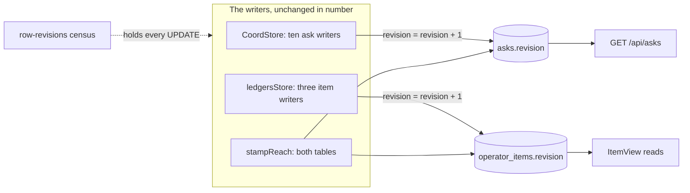

# Overlord W2: row revisions on asks and items Implementation Plan

> **For agentic workers:** REQUIRED SUB-SKILL: Use superpowers:subagent-driven-development (recommended) or
> superpowers:executing-plans to implement this plan task by task. Steps use checkbox (`- [ ]`) syntax for tracking.

**Goal:** every ask and every operator item carries a `revision`, a counter that each write of the row raises in the
same statement, so a later door can tell whether the row moved since its caller read it.

**Why:** the spec's H18 (§6.7, "Revisions decide a race", and §10.3, "Three outcomes, kept apart"). Every Overlord write
door carries the target row's revision. A stale one at an Overlord door changes nothing and answers `operator-has-it`.
An operator's tap is never refused for a stale revision: it is applied, and the act it raced is `superseded`,
`concurred` or `overturned`. Both rules need the revision to exist first, and to move on every change, written by the
row's own writers. The W2 index's question 5 (`revision-is-a-counter-column`) makes it a column.

**Architecture:** one pull request in lane C.

- One `coord.db` migration adds `revision INTEGER NOT NULL DEFAULT 0` to `asks` and to `operator_items`. An insert
  leaves it 0.
- Each UPDATE statement of either table adds `revision = revision + 1` to its own `SET`. No new statement and no new
  writer function: the bump is part of the write, so it is atomic with it, inside whatever transaction the writer holds.
- A census test holds that every UPDATE of either table raises it by one, and that nothing else writes it.
- The column goes out on the existing reads, additively: `GET /api/asks` and the item views.

**Tech Stack:** TypeScript (ESM), `node:sqlite`, vitest. No new dependency.

**Spec:** `docs/superpowers/specs/2026-11-09-overlord-design.md`: §6.7, "Revisions decide a race"; §6.3, "One transaction
ends the hold"; §10.1, "Two keys" (an act's natural key is its target row and that row's revision); §10.3, "Three
outcomes, kept apart"; Table 11.1a's row "Hold columns … on asks and items; row revisions", W3 (revisions W2), with
"Ignores the columns (§11.5)" for an older build.

**The index:** `docs/superpowers/plans/2026-11-16-overlord-w2.md`, read from PR #2917's branch: its row "Row
revisions" (lane C, one pull request, four tasks, ready to build), its question 5, and the "Where lanes meet" bullets
for the migrations' order rule and for `server/src/coord/store.ts` and `ledgersStore.ts`.

Written against `main` at `9cf263d44` (2026-11-16).

## In short

- **One pull request, four tasks:** characterize every writer, then the red census and behaviour tests, then the
  column and the bumps, then the wire.
- **Thirteen UPDATE statements in three files raise the revision,** each by one, in its own `SET`. Inserts start at 0.
- **Every UPDATE raises it, with no exception** (question 1): a revision means "this row changed since you read it".
- **Nothing refuses on it yet.** The first door that reads it is the request record's B (`overlord_requests` has its
  own column) and, for asks and items, W3's answer doors.
- **The index's file list needs two fixes:** `server/src/coord/questions.ts` writes neither table, and the push
  outbox's reach stamp writes both.

## 1. Open questions

Each carries a recommendation, which this plan builds unless the coordinator rules otherwise. None needs the operator.

- **Q1. Which writes raise it** (slug `every-update-raises-the-revision`). A revision could move only on "meaningful"
  changes (state, answer, deadline), or on every UPDATE. **Recommendation:** every UPDATE of the row raises it by one,
  including the re-stamp of an ask, the reach stamp, the question prune and the correction flag. One rule is one census
  that a test can hold; a per-writer judgement is a list someone forgets to extend. It is also what the code already
  does by another name: `takeAskForAnswer` refuses an answer whose `askAt` is not the row's current one, so a re-stamp
  already makes an in-flight answer stale (`ask-moved`). A reach stamp makes the Overlord's answer door refuse
  `operator-has-it` on its own (§6.7, "Once a row has reached the operator"), so raising the revision there changes no outcome.
- **Q2. A refused write raises nothing** (slug `a-cas-miss-raises-nothing`). Most ask writers are compare-and-set
  statements (`WHERE id = ? AND state = 'held'`). **Recommendation:** the bump sits in the statement's `SET`, so a
  statement that matches no row raises nothing. Task 2 pins it for each guarded writer.
- **Q3. Where it starts** (slug `revision-starts-at-zero`). **Recommendation:** 0, by the column's default, on every
  existing and inserted row. No insert names the column. An act's natural key is the row and the revision acted on
  (§10.1), and a fresh row is revision 0.
- **Q4. Which reads carry it** (slug `revision-on-the-row-reads`). **Recommendation:** `GET /api/asks` (the ask row, as
  `CoordStore`'s `AskRow` serves it) and every item view (`ItemView`, served by `GET /api/waiting`,
  `GET /api/items/:id` and `GET /api/programmes/:slug/items`). `ItemView.revision` is optional on the wire, because a
  console newer than its server meets rows without it. Nothing in the console reads it in W2, so no reader is added:
  the first piece that reads it (W3's answer doors and their taps) adds the one reader, `rowRevisionOf`, answering a
  number or `'absent'`. The ask rows of Waiting on you (`shared/answerMarks.ts#AskMarkRow`) gain it with W3's taps,
  not here.

## 2. What exists today

Measured on `main` at `9cf263d44`.

- **The tables.** `asks` (the ask lane's migration) and `operator_items` (the programme ledgers' migration) live in
  `server/src/coord/schema.ts#MIGRATIONS`. `COORD_SCHEMA_VERSION` is `MIGRATIONS.length`, 82 today, and portfolio B
  (#2904) holds 83 in the merge queue. The push outbox's migration is the precedent for this one: it adds
  `reachedOperatorAt` to both tables with two `ALTER TABLE … ADD COLUMN` lines.
- **The ask writers,** all in `server/src/coord/store.ts#CoordStore`:

  | Writer | Statement | Guard | Transaction |
  |---|---|---|---|
  | `insertAsk` | INSERT | none | `tx` |
  | `takeAskForAnswer` | `SET state = 'answering'` | state and `askAt` | `tx` |
  | `untakeAsk` | `SET state = ?` | `state = 'answering'` | none |
  | `settleAsk` | `SET state = 'answered', answeredBy, answer, answeredAt` | state | none |
  | `releaseAsk` | `SET state = 'released', releasedAt` | `state = 'held'` | `tx` with a bound outbox row, else none |
  | `declineAsk` | `SET state = 'declined', releasedAt` | `state = 'held'` | `tx` with a bound outbox row, else none |
  | `staleAsk` | `SET state = 'stale', releasedAt` | state | none |
  | `restampAsk` | `SET askAt` | state, dialog and key | none |
  | `pruneAskQuestions` | `SET question = '', options = '[]'` (many rows) | age and content | none |
  | `correctWithMail` | `SET corrected = 1` (its ask arm) | none | `tx` |

- **The item writers,** in `server/src/coord/ledgersStore.ts`: `raiseItemInTx` (INSERT), `moveItemInTx`
  (`SET state, tickedAt, closedAt, answer, note`, reached through `moveItem`, `tickWithMail`, `moveItemWithMail`,
  `settleEndRequestsInTx` and `settleEndRequestsOfClosedRuns`, all in `tx`) and `setBlocking` (`SET neededBy`, in `tx`).
- **The reach stamp,** `server/src/coord/pushOutboxStore.ts#stampReach`, writes `reachedOperatorAt` on both tables,
  guarded `reachedOperatorAt IS NULL`, inside its caller's transaction.
- **`server/src/coord/questions.ts` writes neither table.** The spec names it as the writer of W3's hold columns, which
  do not exist yet.
- **The writers census.** `server/test/single-definition/writers-map.test.ts#TABLES` maps `asks` to the ten
  `CoordStore` methods above and `stampReach`, and `operator_items` to the three ledgers functions and `stampReach`.
  Folding the bump into each statement adds no writer, so the census stays as it is.
- **Pins on the columns.** `server/test/asks-store.test.ts` pins the sorted column list of `asks` from
  `pragma_table_info`, and its comment asks each later migration that touches `asks` to extend it. No test pins
  `operator_items`' columns. `server/test/run-close-switch.test.ts` rolls a fresh database back to version 53 by hand,
  and lists each later migration's undo.
- **The reads.** `CoordStore`'s `AskRow` and its `readAsk` build an ask; `GET /api/asks?parent=` serves them
  (`server/src/coord/routes.ts`). `ledgersStore.ts`'s `ITEM_COLS` and `ItemRow` read an item, and
  `server/src/coord/ledgersRoutes.ts#operatorView` builds `shared/ledgers.ts#ItemView` from it.
- **Growth.** `server/src/coord/store.ts` and `server/src/coord/schema.ts` are listed in
  `server/test/growthCheck.ts#GROWTH_FILES`, at 40 net code lines a pull request. `ledgersStore.ts`,
  `pushOutboxStore.ts`, `questions.ts` and `shared/ledgers.ts` are not.


*Figure R1. The column, its writers and its reads. The census holds each UPDATE statement of either table to the one
bump. No new writer and no new statement.*

## 3. Global constraints

- **Architecture (`CLAUDE.md`).**
  - **One writer per fact.** Each table's revision is written only by that table's own writers, inside the statement
    that changes the row. No function sets it to a value, and no statement writes it alone.
  - **No decision here.** Nothing compares a revision in this pull request. The doors that do (request record B for
    its own table, W3's answer doors for asks and items) decide in their own L1 code.
  - **Wire discipline.** The field is additive. `ItemView.revision` is optional; `FLEET_PROTO` is unchanged.
- **What a merge arms.** Nothing a session or the operator sees changes. The reads carry one more number. An older
  server opening this database ignores the column (Table 11.1a, "Ignores the columns"; the schema's rule 3).
- **Migrations.** The migration takes the next free slot when this pull request lands. If another lands first, this
  one merges `main` once, renumbers, and re-measures `run-close-switch.test.ts`'s undo (the index's order rule).
  `DROP COLUMN` undoes it: the column has no index and no `CHECK`.
- **Growth.** `server/src/coord/store.ts` about +6 net code lines (the `AskRow` field, `readAsk`'s line, and lines that
  wrap with the longer `SET`); `server/src/coord/schema.ts` about +5 (the migration's comment and two `ALTER` lines). No
  other growth-checked file changes.
- **Mutation.** No new L1 decider, so no `MUTANT_SETS` entry. The census is the new guard: Task 3's mutation step
  removes each statement's bump in turn and shows both the census and the behaviour test go red.
- **Public repository.** Fixtures use `lane-a`-style ids and `project-a`-style programmes only.
- **Tests.** From `server/`, in the foreground, one file at a time, through
  `ccrc test -- ./node_modules/.bin/vitest run test/<file>`. Each task's last step runs
  `ccrc test -- npx tsc --noEmit -p tsconfig.json` and `-p test/tsconfig.tests.json` in `server/`; Task 4 also runs
  `ccrc test -- ./node_modules/.bin/tsc --noEmit` in `pwa/`. A source-text scan is built on `server/test/scan`, never
  `readFileSync` and a regex alone.

## 4. Review focus

1. Every UPDATE of `asks` and `operator_items` in `server/src` raises the revision by exactly one, in its own `SET`.
2. A compare-and-set that matches no row raises nothing.
3. No insert names the column, and nothing writes it any other way.
4. The wire field is optional for readers, and nothing reads it yet.
5. The migration's undo is in `run-close-switch.test.ts`, and `asks-store.test.ts`' column pin is extended.

## 5. The PR split

| PR | Tasks | What it ships | Needs first | Growth-checked files, estimate |
|---|---|---|---|---|
| Row revisions | 1 to 4 | The column on `asks` and `operator_items`, one migration; the bump in thirteen UPDATE statements; the census; the reads | nothing: **ready to build** | `server/src/coord/store.ts` about +6; `server/src/coord/schema.ts` about +5; `shared/api.ts` 0; `server/src/coord/routes.ts` 0; `server/src/server.ts` 0; `server/src/watch.ts` 0; `pwa/src/lib/api.ts` 0 |

## 6. Tasks

### Task 1: Characterize every writer, green on `main`

**Files:**
- Create: `server/test/row-revisions.test.ts`

- [ ] **Step 1: One case per writer.** A table-driven suite over a fresh `CoordStore` (the existing store test
  helpers): for each of the thirteen writers, seed a row in the state its guard needs, call the writer, and pin what it
  returns and the row's columns after. For each guarded writer, add a second case whose guard misses (a wrong state, a
  moved `askAt`, a stamped `reachedOperatorAt`) and pin that the row is unchanged. `pruneAskQuestions` gets a case
  with two old rows and one new one.
- [ ] **Step 2: Run it green on `main`.**

  Run: `cd server && ccrc test -- ./node_modules/.bin/vitest run test/row-revisions.test.ts`

  Expected: PASS. It describes today's behaviour and names no `revision`.

- [ ] **Step 3: Commit:** `test(coord): characterize every writer of asks and operator_items`.

### Task 2: The census and the revision cases, red

**Files:**
- Create: `server/test/single-definition/row-revisions.test.ts`
- Modify: `server/test/row-revisions.test.ts`, `server/test/asks-store.test.ts`

- [ ] **Step 1: The census.** Built on `server/test/scan`, over every `.ts` file of `server/src`: find each SQL string
  that writes `asks` or `operator_items` (the writers census's statement grammar: `INSERT [OR …] INTO`, `UPDATE`,
  `REPLACE INTO`, `DELETE FROM`). Assert:
  - every `UPDATE asks` and `UPDATE operator_items` string's `SET` contains `revision = revision + 1` exactly once;
  - no INSERT or REPLACE names `revision`;
  - no other text in those strings writes `revision` (`revision =` followed by anything but `revision + 1`);
  - the functions holding these strings are exactly the writers census's `TABLES` entries for the two tables, so a
    new writer meets both censuses.

  Its `CONTROLS` plant, in memory, an UPDATE without the bump, one with `revision = ?`, an INSERT naming the column
  and a second bump, and each is red.
- [ ] **Step 2: The revision cases.** In `server/test/row-revisions.test.ts`, each Task 1 case now also reads
  `revision`: 0 after an insert; one more after each effective write; unchanged after a guard miss.
  `pruneAskQuestions` raises the two old rows only.
- [ ] **Step 3: The column pin.** `asks-store.test.ts`' sorted column list gains `revision`.
- [ ] **Step 4: Run them red,** one file at a time:

  Run: `cd server && ccrc test -- ./node_modules/.bin/vitest run test/single-definition/row-revisions.test.ts`, then
  `test/row-revisions.test.ts`, then `test/asks-store.test.ts`.

  Expected: FAIL. No statement carries the bump, and no table has the column. The census's controls pass.

- [ ] **Step 5: Commit** the red tests: `test(coord): every write of an ask or an item raises its revision, red`.

### Task 3: The column and the bumps

**Files:**
- Modify: `server/src/coord/schema.ts` (`MIGRATIONS`: one new entry at the end)
- Modify: `server/src/coord/store.ts` (the nine UPDATE strings of the ask writers; `insertAsk` unchanged)
- Modify: `server/src/coord/ledgersStore.ts` (`moveItemInTx`, `setBlocking`)
- Modify: `server/src/coord/pushOutboxStore.ts` (`stampReach`, both arms)
- Modify: `server/test/run-close-switch.test.ts` (the undo string and its comment)

- [ ] **Step 1: The migration.** Append one entry with the file's header comment form (`// ── N: user_version N-1 ->
  N`), saying "row revisions on asks and operator items (Overlord W2)", and:

  ```sql
  ALTER TABLE asks ADD COLUMN revision INTEGER NOT NULL DEFAULT 0;
  ALTER TABLE operator_items ADD COLUMN revision INTEGER NOT NULL DEFAULT 0;
  ```

- [ ] **Step 2: The bumps.** Add `, revision = revision + 1` to the `SET` of each of the thirteen UPDATE strings,
  keeping each `WHERE` as it is. For example `stampReach`'s ask arm becomes
  `'UPDATE asks SET reachedOperatorAt = ?, revision = revision + 1 WHERE id = ? AND reachedOperatorAt IS NULL'`.
- [ ] **Step 3: The undo.** Prepend
  `ALTER TABLE operator_items DROP COLUMN revision; ALTER TABLE asks DROP COLUMN revision;` to
  `run-close-switch.test.ts`' rollback string, and add the migration's line to the comment that lists each undone one.
- [ ] **Step 4: Run green,** one file at a time: `test/single-definition/row-revisions.test.ts`,
  `test/row-revisions.test.ts`, `test/asks-store.test.ts`, `test/run-close-switch.test.ts`,
  `test/single-definition/writers-map.test.ts`, `test/coord-db.test.ts`, and the suites of the writers' own files
  (`test/push-outbox-asks.test.ts`, `test/push-outbox-items.test.ts`, `test/push-outbox-store.test.ts`,
  `test/ledgers-store.test.ts`). Expected: PASS.
- [ ] **Step 5: Mutation.** With `mutation-run.py` (the coordinator skill's `references/`), thirteen mutants each
  remove one statement's bump, and two change one to `revision = revision + 2`. Run each against
  `test/single-definition/row-revisions.test.ts` and `test/row-revisions.test.ts`. Expected: every mutant killed by
  both files. Record the counts in the commit body.
- [ ] **Step 6: Growth.** Run `test/growth-check.test.ts`, then `test/growth-caps.test.ts`. Expected: `store.ts` and
  `schema.ts` within their 40 lines. Over the estimate by more than ten lines: stop and ask.
- [ ] **Step 7: Commit:** `feat(coord): asks and operator items carry a revision, raised by every write`.

### Task 4: The reads carry it

**Files:**
- Modify: `server/src/coord/store.ts` (`AskRow`, `readAsk`)
- Modify: `server/src/coord/ledgersStore.ts` (`ItemRow`, from which `ItemRowRaw` derives, and `ITEM_COLS`)
- Modify: `server/src/coord/ledgersRoutes.ts` (`operatorView`)
- Modify: `shared/ledgers.ts` (`ItemView.revision?: number`, with its comment)
- Test: `server/test/asks-routes.test.ts` (`GET /api/asks`) and `server/test/ledgers-operator-routes.test.ts` (the item reads)

- [ ] **Step 1: Red.** In the asks route's suite, `GET /api/asks?parent=` answers each row's `revision`, raised after a
  release. In the ledgers routes' suite, `GET /api/items/:id` and `GET /api/waiting` answer it on an item, raised after
  a tick. Run each file: FAIL.
- [ ] **Step 2: Green.** `AskRow` gains `revision: number`, read by `readAsk`. `ITEM_COLS`, `ItemRowRaw` and `ItemRow`
  gain it (`ItemRowRaw` follows `ItemRow`), and `operatorView` copies it into `ItemView`. `ItemView`'s comment says a server from before W2 omits it,
  and that the first reader adds `rowRevisionOf` (question 4). Run each file: PASS.
- [ ] **Step 3: Typecheck** in `server/` (both configs) and `pwa/`. Expected: no errors; nothing in `pwa/src` reads
  the field.
- [ ] **Step 4: The guards that scan the tree,** one at a time: `test/single-definition/writers-map.test.ts`,
  `test/secret-mask.test.ts`, `test/rings/totality.test.ts`, `test/rings/wire-totality.test.ts` (with its data row for
  `ItemView`'s new field if it asks for one), and the docs guards (`anchors`, `citations`, `dtbd`,
  `topology-clean`, and `deviation-refs` after `git fetch origin main`). Expected: PASS.
- [ ] **Step 5: Commit:** `feat(coord): the ask and item reads carry the row's revision`.

## 7. Deviations found

By slug; the coordinator mints numbers (cross-plan ruling X9).

- **`every-update-raises-the-revision`**: the spec says "row revisions" and does not say which writes raise one. Every
  UPDATE does (question 1).
- **`ask-writers-are-in-the-store`**: the index names `server/src/coord/questions.ts` among the writers. It writes
  neither table; the ask writers are `CoordStore`'s, and the push outbox's `stampReach` writes both tables.
- **`row-revisions-row-is-in-table-11-1a`**: the index's question 5 cites Table 11.1e for "row revisions"; the row is
  Table 11.1a's ("Hold columns … on asks and items; row revisions"). A citation fix only.
- **`revision-on-the-row-reads`**: the reads carry the revision, optional on the item wire, with no reader until W3
  (question 4).

## 8. What the index should change

- **Table W2, the row "Row revisions":** "A `revision` column on asks and items (question 5), raised by one in the
  `SET` of every UPDATE of each (the nine UPDATEs of `CoordStore`'s ask writers in `server/src/coord/store.ts`, `moveItemInTx` and
  `setBlocking` in `server/src/coord/ledgersStore.ts`, and both arms of `server/src/coord/pushOutboxStore.ts#stampReach`),
  with a characterization test of each writer first and a census that every UPDATE raises it; the column on
  `GET /api/asks` and on `ItemView`, additive." Size unchanged: 1 PR, 4 tasks.
- **Question 5:** cite Table 11.1a, where the row "Hold columns … on asks and items; row revisions" is, not 11.1e.
- **Lane C's "Revisions" bullet:** replace `server/src/coord/questions.ts` with `server/src/coord/pushOutboxStore.ts`.
- **"Where lanes meet":** add `pushOutboxStore.ts#stampReach` to the bullet for `store.ts` and `ledgersStore.ts`
  ("row revisions raise `revision` in each ask and item writer, the reach stamp included").
- **"States W3 may read":** "Revisions on asks and items: raised by every UPDATE, 0 at insert; on `GET /api/asks` and
  `ItemView`, with no reader yet. W3 adds the one reader and the field on Waiting on you's ask rows with its taps."

## 9. Where things stand

**Agreed:**
- A counter column on asks and items, raised by each table's writers (index question 5, accepted by the coordinator).

**Waiting on the coordinator** (at this plan's review):
- Every UPDATE raises it (question 1), and the reads that carry it (question 4).

**Later:**
- Request record A adds `revision` to `overlord_requests` with its own writer.
- W3's answer doors compare it, answer `operator-has-it` on a stale one, and write the raced act's outcome.
