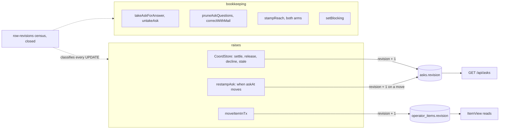

# Overlord W2: row revisions on asks and items Implementation Plan

> **For agentic workers:** REQUIRED SUB-SKILL: Use superpowers:subagent-driven-development (recommended) or
> superpowers:executing-plans to implement this plan task by task. Steps use checkbox (`- [ ]`) syntax for tracking.

**Goal:** every ask and every operator item carries a `revision`, a counter raised by each write that changes what an
answer acts on, in that write's own statement, so a later door can tell whether the row moved since its caller read it.

**Why:** the spec's H18 (§6.7, "Revisions decide a race", and §10.3, "Three outcomes, kept apart"). Every Overlord write
door carries the target row's revision. A stale one at an Overlord door changes nothing and answers `operator-has-it`.
An operator's tap is never refused for a stale revision: it is applied, and the act it raced is `superseded`,
`concurred` or `overturned`. Both rules need the revision to exist first, and to move exactly when the thing an answer
acts on moves. A revision that moved on a bookkeeping stamp would make every Overlord act read `operator-has-it`. The
W2 index's question 5 (`revision-is-a-counter-column`) makes it a column, and the coordinator's ruling on the index's
review (run 2253, F8) says which writes raise it.

**Architecture:** one pull request in lane C.

- One `coord.db` migration adds `revision INTEGER NOT NULL DEFAULT 0` to `asks` and to `operator_items`. An insert
  leaves it 0.
- Each UPDATE statement that changes what an answer acts on adds the raise to its own `SET`. No new statement and no
  new writer function: the raise is part of the write, so it is atomic with it, inside whatever transaction the writer
  holds. Bookkeeping stamps leave it alone.
- A census test holds a CLOSED classification of every `UPDATE asks` and `UPDATE operator_items` in `server/src`, each
  writer `raises` or `bookkeeping`, and is red on a writer it has not classified.
- The column goes out on the existing reads, additively: `GET /api/asks` and the item views.

**Tech Stack:** TypeScript (ESM), `node:sqlite`, vitest. No new dependency.

**Spec:** `docs/superpowers/specs/2026-11-09-overlord-design.md`: §6.7, "Revisions decide a race"; §6.3, "One transaction
ends the hold" (the answer door "moves the row's revision"); §10.1, "Two keys" (an act's natural key is its target row
and that row's revision); §10.3, "Three outcomes, kept apart"; Table 11.1a's row "Hold columns … on asks and items; row
revisions", W3 (revisions W2), with "Ignores the columns (§11.5)" for an older build.

**The index:** `docs/superpowers/plans/2026-11-16-overlord-w2.md`, read from PR #2917's branch: its row "Row
revisions" (lane C, one pull request, four tasks, ready to build), its question 5 as the coordinator amended it after
the index's review (run 2253, F8 and F12.5), and the "Where lanes meet" bullets for the migrations' order rule and for
`server/src/coord/store.ts` and `ledgersStore.ts`.

Written against `main` at `9cf263d44` (2026-11-16).

## In short

- **One pull request, four tasks:** characterize every writer, then the red census and behaviour tests, then the
  column and the raises, then the wire.
- **Six UPDATE statements raise the revision** (five of asks, one of items), each by one in its own `SET`. Seven leave
  it alone. Inserts start at 0.
- **Raised by what an answer acts on (ruled, F8):** a settled answer, a release, a decline, a stale question, an item's
  move, and `askAt` and `askKey`. Not by the in-flight hold and its rollback (ruled, F14), reach stamps, the correction
  flag, `neededBy` or retention wipes.
- **The re-stamp raises only when `askAt` moves** (question 2): it runs on the 2-second poll and often writes the value
  the row already holds.
- **The census is closed:** a new writer of either table is red until someone classifies it.
- **Nothing refuses on it yet.** The first doors that read it on asks and items are W3's answer doors.

## 1. Open questions

The coordinator ruled question 1 on the index's review. The rest carry a recommendation, which this plan builds unless
the coordinator rules otherwise. None needs the operator.

- **Q1. Which writes raise it** (slug `revision-tracks-what-an-answer-acts-on`; **ruled, F8**). The revision protects an
  answer against a row that moved under it (§6.3: the answer door "moves the row's revision"; §10.1: an act's key is
  its target and that revision). So it is raised by each write that changes what an answer acts on: the state, the
  options, the question text, the answer, a release, a hold, and `askAt` and `askKey`. Bookkeeping stamps leave it
  alone: the reach stamps, the correction flag, `neededBy` and the retention wipe. A reach stamp already makes the
  Overlord's answer door refuse `operator-has-it` on its own (§6.7, "Once a row has reached the operator").
  Table R1 is the classification.

  | Writer | Table | What it changes | Class |
  |---|---|---|---|
  | `CoordStore.takeAskForAnswer` | `asks` | state to `answering`, the in-flight hold | bookkeeping (ruled, F14) |
  | `CoordStore.untakeAsk` | `asks` | state back, the hold's rollback | bookkeeping (ruled, F14) |
  | `CoordStore.settleAsk` | `asks` | state, answer, who and when | raises |
  | `CoordStore.releaseAsk` | `asks` | state to `released` | raises |
  | `CoordStore.declineAsk` | `asks` | state to `declined` | raises |
  | `CoordStore.staleAsk` | `asks` | state to `stale` | raises |
  | `CoordStore.restampAsk` | `asks` | `askAt` | raises, only when `askAt` moves (question 2) |
  | `CoordStore.pruneAskQuestions` | `asks` | the question and options of old rows (the retention wipe) | bookkeeping |
  | `CoordStore.correctWithMail` | `asks` | `corrected` | bookkeeping |
  | `pushOutboxStore.ts#stampReach`, ask arm | `asks` | `reachedOperatorAt` | bookkeeping |
  | `ledgersStore.ts#moveItemInTx` | `operator_items` | state, answer, note and their times | raises |
  | `ledgersStore.ts#setBlocking` | `operator_items` | `neededBy` | bookkeeping |
  | `pushOutboxStore.ts#stampReach`, item arm | `operator_items` | `reachedOperatorAt` | bookkeeping |

  *Table R1. Every UPDATE of the two tables on `main`, classified. The census holds this table closed.*

  The in-flight hold and its rollback do not raise (ruled, F14): an answer door's own take-then-untake, a press that
  was refused, leaves the revision where it was, so an Overlord that retries with the revision it read is not refused
  against its own failed attempt. The operator's tap still wins any race (H18). No writer changes `askKey` or `options`
  on its own today. The writer that adds W3's hold columns classifies itself `raises`.
- **Q2. The re-stamp raises only when `askAt` moves** (slug `restamp-raises-on-a-move`; **ruled**: `askAt` and `askKey`
  raise, only when `askAt` actually moves). `restampAsk` is called on every
  question tick, every 2 seconds, for each held ask (`server/src/coord/questions.ts`, its `restamp` and the re-seed),
  with the hook state's `updatedAt`, which most ticks is the value the row already holds. SQLite counts such a write as
  a change. Raising by one there would move every held ask's revision every 2 seconds, and an Overlord answer would
  almost never land. **Recommendation:** the re-stamp's `SET` reads
  `askAt = ?1, revision = revision + (askAt IS NOT ?1)`, so it raises by one when the value moves and by nothing when it
  does not. A moved `askAt` already refuses an in-flight answer today (`takeAskForAnswer` checks it, `ask-moved`), so
  the revision agrees with the code's own rule.
- **Q3. A refused write raises nothing** (slug `a-cas-miss-raises-nothing`). Most ask writers are compare-and-set
  statements (`WHERE id = ? AND state = 'held'`). **Recommendation:** the raise sits in the statement's `SET`, so a
  statement that matches no row raises nothing. Task 2 pins it for each guarded writer.
- **Q4. Where it starts** (slug `revision-starts-at-zero`). **Recommendation:** 0, by the column's default, on every
  existing and inserted row. No insert names the column.
- **Q5. Which reads carry it** (slug `revision-on-the-row-reads`). **Recommendation:** `GET /api/asks` (the ask row, as
  `CoordStore`'s `AskRow` serves it) and every item view (`ItemView`, served by `GET /api/waiting`,
  `GET /api/items/:id` and `GET /api/programmes/:slug/items`). `ItemView.revision` is optional on the wire, because a
  console newer than its server meets rows without it. Nothing in the console reads it in W2, so no reader is added:
  the first piece that reads it (W3's answer doors and their taps) adds the one reader, `rowRevisionOf`, answering a
  number or `'absent'`. The ask rows of Waiting on you (`shared/answerMarks.ts#AskMarkRow`) gain it with W3's taps,
  not here.

## 2. What exists today

Measured on `main` at `9cf263d44`.

- **The tables.** `asks` (the ask lane's migration) and `operator_items` (the programme ledgers' migration) live in
  `server/src/coord/schema.ts#MIGRATIONS`. `COORD_SCHEMA_VERSION` is `MIGRATIONS.length`, 82 today, and portfolio B
  (#2904) holds 83 in the merge queue. The push outbox's migration is the precedent for this one: it adds
  `reachedOperatorAt` to both tables with two `ALTER TABLE … ADD COLUMN` lines.
- **The writers** are Table R1's thirteen UPDATE statements and two inserts: `CoordStore.insertAsk`
  (`server/src/coord/store.ts`) and `raiseItemInTx` (`server/src/coord/ledgersStore.ts`). Of the ask writers,
  `insertAsk`, `takeAskForAnswer` and `correctWithMail` run in `tx`; `releaseAsk` and `declineAsk` run in `tx` when
  they carry a bound outbox row; the rest are single statements. `moveItemInTx` is reached through `moveItem`,
  `tickWithMail`, `moveItemWithMail`, `settleEndRequestsInTx` and `settleEndRequestsOfClosedRuns`, all in `tx`;
  `setBlocking` runs in `tx`; `stampReach` runs inside its caller's transaction. No writer deletes a row of either
  table.
- **The re-stamp's caller.** `server/src/coord/questions.ts` calls `restampAsk` from its `restamp` helper on each tick
  for a held ask, and from the boot re-seed. `restampAsk`'s own comment states the 2-second poll.
- **`server/src/coord/questions.ts` writes neither table itself.** The spec names it as the writer of W3's hold
  columns, which do not exist yet.
- **The writers census.** `server/test/single-definition/writers-map.test.ts#TABLES` maps `asks` to the ten
  `CoordStore` methods and `stampReach`, and `operator_items` to the three ledgers functions and `stampReach`. Folding
  the raise into each statement adds no writer, so that census stays as it is.
- **Pins on the columns and the version.** `server/test/asks-store.test.ts` pins the sorted column list of `asks` from
  `pragma_table_info`, and its comment asks each later migration that touches `asks` to extend it. No test pins
  `operator_items`' columns. `server/test/coord-db.test.ts` pins the schema version (`toBe(82)`, in several cases).
  `server/test/run-close-switch.test.ts` rolls a fresh database back to version 53 by hand, undoing every migration
  from 54 on, each listed in its comment.
- **The reads.** `CoordStore`'s `AskRow` is filled from `ASK_COLS` through `hydrateAsk`, whose parameter type names
  each column; `GET /api/asks?parent=` serves them (`server/src/coord/routes.ts`). `ledgersStore.ts`'s `ITEM_COLS` and
  `ItemRow` read an item, and `server/src/coord/ledgersRoutes.ts#itemViewOf`, "THE ONE BUILDER" of an `ItemView`, builds
  `shared/ledgers.ts#ItemView` from it for the coordinator's list, the operator's routes (`GET /api/waiting` through
  `waitingViewOf` and `viewOfItem`) and the `/ws/fleet` frame. `server/test/ledgers-store.test.ts` pins a whole
  `ItemRow` with `toEqual({…} satisfies ItemRow)`.
- **The statement scanner.** `server/test/single-definition/writers-map.test.ts#tableWriters` maps each table to the
  functions whose SQL writes it. `settleAsk` and `staleAsk` build their SQL from `+`-joined literals.
- **Growth.** `server/src/coord/store.ts` and `server/src/coord/schema.ts` are listed in
  `server/test/growthCheck.ts#GROWTH_FILES`, at 40 net code lines a pull request. `ledgersStore.ts`,
  `pushOutboxStore.ts`, `questions.ts` and `shared/ledgers.ts` are not.


*Figure R1. The column, its writers and its reads. The census classifies every UPDATE of either table; bookkeeping
writers never touch the revision.*

## 3. Global constraints

- **Architecture (`CLAUDE.md`).**
  - **One writer per fact.** Each table's revision is written only by that table's own raising writers, inside the
    statement that changes the row. No function sets it to a value, and no statement writes it alone.
  - **The classification is written once,** in the census's table, and a new writer is red until it is added there.
  - **No decision here.** Nothing compares a revision in this pull request. The doors that do (W3's answer doors for
    asks and items) decide in their own L1 code.
  - **Wire discipline.** The field is additive. `ItemView.revision` is optional; `FLEET_PROTO` is unchanged.
- **What a merge arms.** Nothing a session or the operator sees changes. The reads carry one more number. An older
  server opening this database ignores the column (Table 11.1a, "Ignores the columns"; the schema's rule 3).
- **Migrations (F12.5).** The migration takes the next free slot when this pull request lands. If another lands first,
  this one merges `main` once and renumbers. Either way it moves `coord-db.test.ts`' version pins to the new version and
  adds its own undo to `run-close-switch.test.ts`, which returns to version 53 by undoing every migration from 54 on.
  `DROP COLUMN` undoes it: the column has no index and no `CHECK`.
- **Growth.** `server/src/coord/store.ts` about +5 net code lines (the `AskRow` field, `ASK_COLS` and `hydrateAsk`, the re-stamp's
  longer `SET`, and lines that wrap); `server/src/coord/schema.ts` about +5 (the migration's comment and two `ALTER`
  lines). No other growth-checked file changes.
- **Mutation.** No new L1 decider, so no `MUTANT_SETS` entry. The census is the new guard: Task 3's mutation step
  removes each raise, adds one to each bookkeeping writer, and drops the re-stamp's condition, and shows the census or
  the behaviour test goes red for each.
- **Public repository.** Fixtures use `lane-a`-style ids and `project-a`-style programmes only.
- **Tests.** From `server/`, in the foreground, one file at a time, through
  `ccrc test -- ./node_modules/.bin/vitest run test/<file>`. Each task's last step runs
  `ccrc test -- npx tsc --noEmit -p tsconfig.json` and `-p test/tsconfig.tests.json` in `server/`; Task 4 also runs
  `ccrc test -- ./node_modules/.bin/tsc --noEmit` in `pwa/`. A source-text scan is built on `server/test/scan`, never
  `readFileSync` and a regex alone.

## 4. Review focus

1. Table R1 is every UPDATE and upsert of `asks` and `operator_items` in `server/src`, and the census is red on any
   writer it does not list.
2. Each `raises` writer raises by exactly one in its own `SET`; each `bookkeeping` writer never names the revision.
3. A re-stamp to the value the row already holds raises nothing.
4. A compare-and-set that matches no row raises nothing.
5. No insert names the column; the wire field is optional, and nothing reads it yet.
6. The migration's undo and version pins are moved, and `asks-store.test.ts`' column pin is extended.

## 5. The PR split

| PR | Tasks | What it ships | Needs first | Growth-checked files, estimate |
|---|---|---|---|---|
| Row revisions | 1 to 4 | The column on `asks` and `operator_items`, one migration; the raise in six UPDATE statements; the closed census; the reads | nothing: **ready to build** | `server/src/coord/store.ts` about +5; `server/src/coord/schema.ts` about +5; `shared/api.ts` 0; `server/src/coord/routes.ts` 0; `server/src/server.ts` 0; `server/src/watch.ts` 0; `pwa/src/lib/api.ts` 0 |

## 6. Tasks

### Task 1: Characterize every writer, green on `main`

**Files:**
- Create: `server/test/row-revisions.test.ts`

- [ ] **Step 1: One case per writer.** A table-driven suite over a fresh `CoordStore` (the existing store test
  helpers): for each of Table R1's thirteen statements and the two inserts, seed a row in the state its guard needs,
  call the writer, and pin what it returns and the row's columns after. For each guarded writer, add a second case
  whose guard misses (a wrong state, a moved `askAt`, a stamped `reachedOperatorAt`) and pin that the row is unchanged.
  `restampAsk` gets a case with the same `askAt` and one with a new one. `takeAskForAnswer` then `untakeAsk` gets a case
  of its own. `pruneAskQuestions` gets a case with two old rows and one new one.
- [ ] **Step 2: Run it green on `main`.**

  Run: `cd server && ccrc test -- ./node_modules/.bin/vitest run test/row-revisions.test.ts`

  Expected: PASS. It describes today's behaviour and names no `revision`.

- [ ] **Step 3: Commit:** `test(coord): characterize every writer of asks and operator_items`.

### Task 2: The closed census and the revision cases, red

**Files:**
- Create: `server/test/single-definition/row-revisions.test.ts`
- Modify: `server/test/row-revisions.test.ts`, `server/test/asks-store.test.ts`

- [ ] **Step 1: The census.** No second scanner (F12): extend `writers-map.test.ts#tableWriters`' scan to also answer
  each statement's joined SQL text (the `+`-joined literal pieces of `settleAsk` and `staleAsk` joined before any
  judgement), and export that, so this census and the writers census read one scan. For each statement that writes
  `asks` or `operator_items` it has the function that holds it. `REVISION_CLASSES` in the test is Table R1, keyed
  `file#function` and arm (`stampReach` has one row per table), each `raises` or `bookkeeping`. Assert:
  - every `UPDATE asks` and `UPDATE operator_items` string, and every upsert of either (`INSERT … ON CONFLICT … DO
    UPDATE`, none on `main`), sits in a function `REVISION_CLASSES` names for that table; otherwise red, naming the
    function and asking for its class. An upsert's class governs its `DO UPDATE SET`;
  - a `raises` string's `SET` holds exactly one raise, `revision = revision + 1`, or, for `restampAsk` alone,
    `revision = revision + (askAt IS NOT ?1)`;
  - a `bookkeeping` string never names `revision`;
  - no INSERT's column list or VALUES, and no REPLACE, names `revision`;
  - every `REVISION_CLASSES` row matches a string in the tree, so a stale row is red too.

  Its `CONTROLS` plant, in memory, an unclassified UPDATE, a raise missing from a `raises` writer, a raise in a
  `bookkeeping` writer, `revision = ?`, a second raise, the conditional form outside `restampAsk`, an INSERT naming the
  column and a stale row, and each is red.
- [ ] **Step 2: The revision cases.** In `server/test/row-revisions.test.ts`, each Task 1 case now also reads
  `revision`: 0 after an insert; one more after each effective `raises` write; unchanged after a guard miss, after each
  `bookkeeping` write, after a take then an untake (ruled, F14), and after a re-stamp to the same `askAt`.
- [ ] **Step 3: The column pin.** `asks-store.test.ts`' sorted column list gains `revision`.
- [ ] **Step 4: Run them red,** one file at a time:

  Run: `cd server && ccrc test -- ./node_modules/.bin/vitest run test/single-definition/row-revisions.test.ts`, then
  `test/row-revisions.test.ts`, then `test/asks-store.test.ts`.

  Expected: FAIL. No `raises` statement carries the raise, and no table has the column. The census's controls pass.

- [ ] **Step 5: Commit** the red tests: `test(coord): a closed classification of every ask and item write, red`.

### Task 3: The column and the raises

**Files:**
- Modify: `server/src/coord/schema.ts` (`MIGRATIONS`: one new entry at the end)
- Modify: `server/src/coord/store.ts` (the five `raises` UPDATE strings of the ask writers)
- Modify: `server/src/coord/ledgersStore.ts` (`moveItemInTx`)
- Modify: `server/test/coord-db.test.ts` (its version pins), `server/test/run-close-switch.test.ts` (the undo string
  and its comment)

- [ ] **Step 1: The migration.** Append one entry with the file's header comment form (`// ── N: user_version N-1 ->
  N`), saying "row revisions on asks and operator items (Overlord W2)", and:

  ```sql
  ALTER TABLE asks ADD COLUMN revision INTEGER NOT NULL DEFAULT 0;
  ALTER TABLE operator_items ADD COLUMN revision INTEGER NOT NULL DEFAULT 0;
  ```

- [ ] **Step 2: The raises.** Add `, revision = revision + 1` to the `SET` of `settleAsk`, `releaseAsk`, `declineAsk`,
  `staleAsk` and `moveItemInTx`, keeping each `WHERE` as it is. `restampAsk`'s
  statement becomes
  `"UPDATE asks SET askAt = ?1, revision = revision + (askAt IS NOT ?1) WHERE id = ?2 AND state = 'held' AND dialogId = ?3 AND askKey = ?4"`,
  with its `run` arguments in that order. The seven bookkeeping statements do not change.
- [ ] **Step 3: The undo and the pins.** Prepend
  `ALTER TABLE operator_items DROP COLUMN revision; ALTER TABLE asks DROP COLUMN revision;` to
  `run-close-switch.test.ts`' rollback string, and add the migration's line to the comment that lists each undone one.
  Move `coord-db.test.ts`' version pins to the new version.
- [ ] **Step 4: Run green,** one file at a time: `test/single-definition/row-revisions.test.ts`,
  `test/row-revisions.test.ts`, `test/asks-store.test.ts`, `test/run-close-switch.test.ts`, `test/coord-db.test.ts`,
  `test/single-definition/writers-map.test.ts`, and the suites of the writers' own files
  (`test/push-outbox-asks.test.ts`, `test/push-outbox-items.test.ts`, `test/push-outbox-store.test.ts`,
  `test/ledgers-store.test.ts`). Expected: PASS.
- [ ] **Step 5: Mutation.** With `mutation-run.py` (the coordinator skill's `references/`): six mutants each remove
  one raise; seven each add `, revision = revision + 1` to one bookkeeping statement; one replaces the re-stamp's
  condition with `+ 1`; one changes a raise to `+ 2`. Run each against
  `test/single-definition/row-revisions.test.ts` and `test/row-revisions.test.ts`. Expected: every mutant killed, the
  re-stamp's by the behaviour test's same-`askAt` case. Record the counts in the commit body.
- [ ] **Step 6: Growth.** Run `test/growth-check.test.ts`, then `test/growth-caps.test.ts`. Expected: `store.ts` and
  `schema.ts` within their 40 lines. Over the estimate by more than ten lines: stop and ask.
- [ ] **Step 7: Commit:** `feat(coord): asks and operator items carry a revision, raised by what an answer acts on`.

### Task 4: The reads carry it

**Files:**
- Modify: `server/src/coord/store.ts` (`AskRow`, `ASK_COLS` and `hydrateAsk`'s parameter type)
- Modify: `server/src/coord/ledgersStore.ts` (`ItemRow`, from which `ItemRowRaw` derives, and `ITEM_COLS`)
- Modify: `server/src/coord/ledgersRoutes.ts` (`itemViewOf`, the one builder)
- Modify: `server/test/ledgers-store.test.ts` (its whole-`ItemRow` pin gains `revision: 0`)
- Modify: `shared/ledgers.ts` (`ItemView.revision?: number`, with its comment)
- Test: `server/test/asks-routes.test.ts` (`GET /api/asks`) and `server/test/ledgers-operator-routes.test.ts` (the
  item reads)

- [ ] **Step 1: Red.** In the asks route's suite, `GET /api/asks?parent=` answers each row's `revision`, raised after a
  release. In the ledgers routes' suite, `GET /api/items/:id` and `GET /api/waiting` answer it on an item, raised after
  a tick. Run each file: FAIL.
- [ ] **Step 2: Green.** `AskRow` gains `revision: number`, filled through `ASK_COLS` and `hydrateAsk`. `ITEM_COLS` and
  `ItemRow` gain it (`ItemRowRaw` follows `ItemRow`), and `itemViewOf` sets `revision: row.revision` (F3), so the
  coordinator's list, the operator's reads and the `/ws/fleet` frame all carry it from the one builder.
  `ledgers-store.test.ts`' `ItemRow` pin gains `revision: 0`. `ItemView`'s comment says a server
  from before W2 omits it, and that the first reader adds `rowRevisionOf` (question 5). Run each file, and `test/ledgers-store.test.ts`: PASS.
- [ ] **Step 3: Typecheck** in `server/` (both configs) and `pwa/`. Expected: no errors once `ledgers-store.test.ts`' pin
  carries the field; nothing in `pwa/src` reads it.
- [ ] **Step 4: The guards that scan the tree,** one at a time: `test/single-definition/writers-map.test.ts`,
  `test/secret-mask.test.ts`, `test/rings/totality.test.ts`, `test/rings/wire-totality.test.ts` (with its data row for
  `ItemView`'s new field if it asks for one), and the docs guards (`anchors`, `citations`, `dtbd`,
  `topology-clean`, and `deviation-refs` after `git fetch origin main`). Expected: PASS.
- [ ] **Step 5: Commit:** `feat(coord): the ask and item reads carry the row's revision`.

## 7. Deviations found

By slug; the coordinator mints numbers (cross-plan ruling X9).

- **`revision-tracks-what-an-answer-acts-on`**: the spec says "row revisions" and does not say which writes raise one.
  Writes that change what an answer acts on do; bookkeeping stamps and the in-flight hold do not (question 1, ruled F8
  and F14).
- **`restamp-raises-on-a-move`**: the re-stamp raises only when `askAt` changes, because it runs every 2 seconds
  (question 2).
- **`ask-writers-are-in-the-store`**: the index names `server/src/coord/questions.ts` among the writers. It writes
  neither table; the ask writers are `CoordStore`'s, and the push outbox's `stampReach` writes both tables.
- **`row-revisions-row-is-in-table-11-1a`**: the index's question 5 cites Table 11.1e for "row revisions"; the row is
  Table 11.1a's ("Hold columns … on asks and items; row revisions"). A citation fix only.
- **`revision-on-the-row-reads`**: the reads carry the revision, optional on the item wire, with no reader until W3
  (question 5).

## 8. What the index should change

- **Table W2, the row "Row revisions":** "A `revision` column on asks and items (question 5), raised by one in the
  `SET` of each write that changes what an answer acts on (a settled answer, a release, a decline, a stale question, an
  item's move, `askAt` and `askKey`; the re-stamp only when `askAt` moves), and never by the in-flight hold and its
  rollback or by bookkeeping stamps (reach stamps, `corrected`, `neededBy`, the retention wipe); a characterization test of each writer first; a census that classifies
  every `UPDATE asks` and `UPDATE operator_items` (and any upsert of either) in `server/src`, `pushOutboxStore.ts`
  included, `raises` or `bookkeeping`, red on an unclassified writer, read from `writers-map`'s one scan; the column on
  `GET /api/asks` and on `ItemView` from its one builder, `itemViewOf`, additive." Size
  unchanged: 1 PR, 4 tasks.
- **Question 5:** as amended by F8, and cite Table 11.1a, where the row "Hold columns … on asks and items; row
  revisions" is, not 11.1e.
- **Lane C's "Revisions" bullet:** replace `server/src/coord/questions.ts` with `server/src/coord/pushOutboxStore.ts`
  (which this piece reads and classifies, and does not change).
- **"Where lanes meet":**
  - the bullet for `store.ts` and `ledgersStore.ts`: "row revisions raise `revision` in each writer the census classes
    `raises`; any piece that adds a writer of `asks` or `operator_items` classifies it in
    `server/test/single-definition/row-revisions.test.ts` in its own pull request". The coordinator tells W1's builders
    who add such writers (readiness' settle, sequence B's raise, the push outbox's reach stamps).
  - the migrations' order rule: name `server/test/coord-db.test.ts`' version pins, and say that
    `run-close-switch.test.ts` returns to version 53 by undoing every migration from 54 on (F12.5).
- **"States W3 may read":** "Revisions on asks and items: raised by what an answer acts on, 0 at insert; the closed
  census, where W3's hold writer classifies itself `raises`; on `GET /api/asks` and `ItemView`, with no reader yet. W3
  adds the one reader and the field on Waiting on you's ask rows with its taps."

## 9. Where things stand

**Agreed:**
- A counter column on asks and items (index question 5, accepted by the coordinator).
- Raised by what an answer acts on, never by bookkeeping or the in-flight hold, with a closed census (ruled, F8, F14).
- The re-stamp raises only when `askAt` moves (question 2, ruled).

**Waiting on the coordinator** (at this plan's review):
- The reads that carry it (question 5).

**Later:**
- Request record A adds `revision` to `overlord_requests` with its own writer.
- W3's answer doors compare it, answer `operator-has-it` on a stale one, and write the raced act's outcome.
