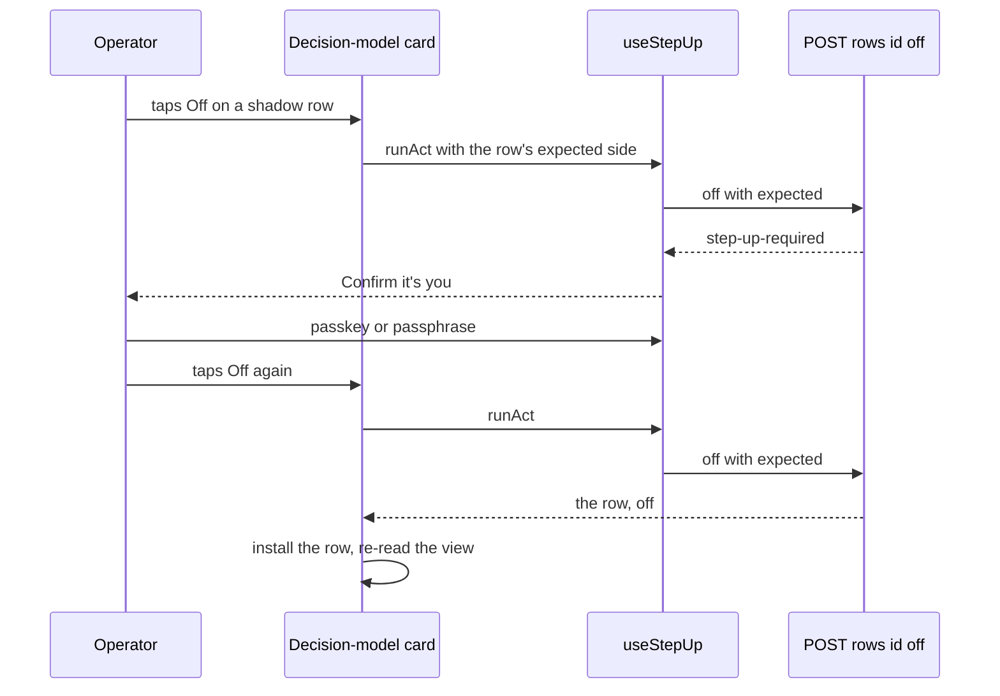

# Overlord W2: Settings for the decision model and the private-name list Implementation Plan

> **For agentic workers:** REQUIRED SUB-SKILL: Use superpowers:subagent-driven-development (recommended) or
> superpowers:executing-plans to implement this plan task by task. Steps use checkbox (`- [ ]`) syntax for tracking.

**Goal:** from Settings › Overlord the operator sets the decision model's host and key, moves each decision-model row
between off, shadow and armed, sets its daily ceiling, and uploads the private-name list. Each control goes through its
own server door.

- **The decision model's rows.** One row per catalogue question, with its three states, why it is held, what it spent
  today against its ceiling, whether a line is admitted, and the canary. Shadow and armed go through the arm door, off
  through the off door, and the ceiling through the ceiling door.
- **The host and the key.** The host's kind, endpoint and model id, and a write-only key, saved through the key door;
  Remove through its `DELETE`.
- **The private-name list.** Its status (never uploaded, a list, or unreadable and why) and an upload that replaces the
  whole list. The list's names never come back from the server, and the console keeps no copy.
- **The console never decides the step-up.** Every write goes through the section's one step-up hook. The step is shown
  only when a door answers `step-up-required`.

**Why:** spec §3.7 (H6: "The operator sets it from Settings, behind the step-up"; "It is a spend … The operator arms each
row in Settings, and the server enforces a daily ceiling"; "Easing a gate is an authority change"), §9.4, rule 7 (the
private-name list's step-up upload), §11.2 (the operator's doors keep the step-up for raising) and Table 11.1d. The
decision-model plan and the private-names plan each built the server doors and left the rows to "the W2 Settings piece"
(`w2-decision-model.md`, "What the index should change"; `w2-private-names.md`, Where things stand).

**Architecture:** one pull request in lane F, all in the console except, if needed, one wire type in `shared/`.

| Part | File | Ring and context |
|---|---|---|
| The decision-model read's wire and its one reader (question SQ2) | `shared/decisionModel.ts` (decision model A's) | L0, C5 |
| The list's mode words for the console (question SQ6) | `shared/privateNames.ts` (private names B's) | L0, K |
| The words and the deciders | `pwa/src/overlord/decisionModelWords.ts`, `pwa/src/overlord/nameListWords.ts` (new) | L1 |
| The read hooks | `pwa/src/overlord/useDecisionModelView.ts`, `pwa/src/overlord/useNameListView.ts` (new) | L4 |
| The cards | `pwa/src/screens/settings/DecisionModelCard.tsx`, `DecisionHostCard.tsx`, `PrivateNamesCard.tsx` (new), in home C's `OverlordSection.tsx` | L4 |
| The client calls | `pwa/src/lib/api.ts` | L3 |
| The sentences | `pwa/src/lib/refusalWords.ts` | L1 |

**Tech Stack:** TypeScript (ESM), React, vitest and its browser runner. No new dependency, no server door and no
migration.

**Spec:** `docs/superpowers/specs/2026-11-09-overlord-design.md`: §3.7 (H6 and Table 3.7b), §9.4 (rule 7), §11.2,
Table 11.1d, Table 11.6's step-up words.

**The index:** `docs/superpowers/plans/2026-11-16-overlord-w2.md`: its row "W2 Settings" (lane F, 1 PR, 3 tasks; needs
decision model B, private names B and home C), its questions 7, 9, 10 and 29, and "Where lanes meet" for
`pwa/src/lib/api.ts`. The organization warning is designation C's (W1), not this piece's.

**The plans this one reads** (each is the authority for its doors; Task 1 re-measures every name on `main` first):

| Plan | What this plan takes from it |
|---|---|
| `w2-decision-model.md` (decision model B, #2922) | The six doors on five paths: `GET /api/decision-model`; `POST /api/decision-model/rows/:id/arm` (`{ mode, line?, expected }`), `.../off` (`{ expected }`), `.../ceiling` (`{ ceiling, expected }`); `PUT` and `DELETE /api/decision-model/key`. Every write behind the account gate with the step-up, so each refuses `auth-off` while sign-in is dark. `DecisionRowSide`, `DecisionRowId`, `DECISION_ROW_IDS`, `DECISION_HOST_KINDS`, `DECISION_CEILING_MIN` and `_MAX`, `DECISION_FLEET_DAILY_TOTAL`. `DECISION_MODEL_REFUSALS`. Its rulings F1 (off falls back to `held`, `offRefused: true`), F4 (a separate ceiling door; every off move asks the step-up, `shadow` to `off` included) and F8 (`decideKeyDoor`'s endpoint rules) |
| `w2-private-names.md` (private names B, #2925) | `PUT /api/overlord/private-names` (`{ rows: [{ text, mode }] }`, session and step-up, `credentialBodyRoute`), `GET /api/overlord/private-names` (`none`, `list` with `rows` and `uploadedAt`, or `unreadable` with its reason). `shared/privateNames.ts`' caps and status words. Its question 9: only "never uploaded" skips the check |
| `w1-home.md` (home C) | `SETTINGS_SECTIONS`' `overlord` section, `OverlordSection.tsx`, `overlordSettingsWords.ts`, the section's one `useStepUp` and one `ConfirmItsYou`, the rule that "the console follows the door's `step-up-required` and never decides the direction itself" |

Written against `main` at `fe887521f` (2026-11-16). None of the three pieces is on `main` yet.

## In short

- **One pull request, three tasks:** the reads, words and client calls; the decision model's two cards; the
  private-name card with the browser runs.
- **Each control has its own door,** and the console sends exactly what that door takes: a row's `expected` side as it
  read it, a mode, a ceiling, a host and a key, or the list's rows.
- **The step-up is the door's to ask.** The decision model's plan asks it on every write, lowering included (its ruling
  F4). The console runs every write through one `useStepUp` and shows the step only when asked, so it is right whichever
  way a door rules.
- **The server's answer is what is drawn.** A row is drawn from the read, never from the tap: an `off` answer that came
  back `held` says "held, not off", and a `row-changed` re-reads and asks the operator to look again.
- **The list's names stay in memory for one upload only.** The text box is never filled from the server, is cleared after
  an upload and when the page is hidden, and asks the browser for no spelling check or autofill.
- **Phone first:** 360 px with no horizontal scroll, 44 px controls, browser runs at 360, 390, 1280 and 1920 across both
  skins and both themes.

## 1. Open questions

The coordinator accepted the index's questions 2 to 23 as written; this plan builds on 7, 9 and 10, and on the settled
29. Question 19 (the act ceilings) does not touch this piece: it adds no act kind, and the decision model's daily
ceilings are that plan's. Every question below carries a recommendation, which this plan builds unless the coordinator
rules otherwise. None needs the operator.

- **SQ1. Which writes ask the step-up** (slug `settings-step-up-follows-the-door`). The brief for this piece says
  "raising authority or spend asks it, and lowering does not", and the index's question 7 table says "step-up for every
  move but `shadow` to `off`". The decision model's plan, as ruled at its review (F4, F14), asks the step-up on every
  write, `shadow` to `off` and a lower ceiling included, and that plan is merged.
  **Recommendation:** the console decides nothing here. Every write runs through `stepUp.runAct`, which acts at once
  when the door passes and shows the step only on `step-up-required`, as W1 home C's cards do. So a lowering lands in one
  tap if a door does not ask, and goes through the step if it does. The tests pin both: a stub door that asks, and one
  that does not. The index's question 7 gate column should read as the decision model's plan rules (§8).
- **SQ2. The decision-model read's wire** (slug `decision-model-view-in-shared`). The decision model's plan lists the
  read's fields in prose and types none. The console needs one reader that tells an absent field from a wrong one.
  **Recommendation:** `DecisionModelView` and `readDecisionModelView(x: unknown)` in `shared/decisionModel.ts`, beside
  `DecisionRowSide`. Decision model B should ship them with its read. If it landed without them, Task 1 adds them, and a
  server test builds the read's answer through the type, so the server's answer and the console's reader cannot drift.
  The reader answers `{ ok: true, view }` or `{ ok: false, detail }`, never a partial view.

  ```ts
  export interface DecisionRowView {
    readonly id: DecisionRowId; readonly side: DecisionRowSide; readonly heldWhy: string | null;
    readonly direction: 'advice' | 'gate'; readonly privateState: boolean;
    readonly today: { readonly serve: number; readonly maintenance: number; readonly reserved: number; readonly total: number };
    readonly line: { readonly id: string; readonly admitted: boolean; readonly labelled: number; readonly errors: number;
      readonly bound: number | null; readonly canaryAsked: number; readonly canaryExpected: number;
      readonly canaryCrossed: number } | null;
    readonly offered: { readonly id: string; readonly line: number } | null;  // the newest line offered to an armed gate
  }
  export interface DecisionModelView {
    readonly rows: readonly DecisionRowView[];
    readonly fleetToday: number; readonly fleetCap: number;
    readonly host: { readonly kind: DecisionHostKind; readonly origin: string; readonly modelId: string } | null;
    readonly key: { readonly setAt: number; readonly masked: boolean } | null;
  }
  ```

  The field names follow the decision model's door table; where its built answer names one differently, the built name
  wins and this plan's notes file says so.
- **SQ3. What a row draws, and what it never draws** (slug `decision-row-drawn-from-the-read`).
  **Recommendation:** each row draws, from the read:
  - its question's id and one plain line of what it asks (`DECISION_QUESTIONS`' own text, never a second copy);
  - the three states as one radio set whose checked choice is the stored mode, never the tap's;
  - `held` with its reason in words, when `side.held` is true ("Held: the line's key changed. Turn it on again to
    resume");
  - "advice" or "gate", and for a private-state row: "Carries your words: never asked of a hosted model";
  - today's calls of its ceiling, and the fleet's calls of its cap once, above the rows;
  - the line: "not admitted yet, n labelled answers", or "admitted", with the canary as asked of expected and crossed;
  - for an armed gate with `offered`: "A new line is offered" and Approve, which arms with `line: offered.id`.

  It never draws a model's answer, a price or any part of the key. A state the read does not hold (a row id the console
  does not know, a mode outside the three) draws the row as "unknown to this console" with no control, rather than
  guessing.
- **SQ4. The answer of each write** (slug `decision-row-answer-drawn`). The doors answer the row, a refusal, or, for off
  over a journal that refuses the widening, `{ state: 'held', offRefused: true }` with the guard's cause (F1).
  **Recommendation:** after any answer the hook installs the row the door returned and re-reads the view. An
  `offRefused` answer says "Held, not off: the authority journal could not record the change (<cause>). Nothing is
  asked while it is held." `row-changed` re-reads and says "This row changed since you read it. Look again, then try
  again." Every other refusal shows its sentence from `refusalWords.ts`; an unknown word shows `refused (<word>)`.
- **SQ5. The host and key card** (slug `decision-host-card`). The key door takes `{ kind, endpoint, modelId, key? }`, and
  `decideKeyDoor` rules on the endpoint (F8).
  **Recommendation:** one card with the kind (from `DECISION_HOST_KINDS`), the endpoint, the model id and a key field
  that is always empty on load, with the read's "Key set <date>" or "No key" beside it. Save sends the key only when the
  field holds one, so a host change with no new key reaches `key-required` from the door, not from the console. The key
  field uses `pwa/src/lib/secretInput.ts#SECRET_INPUT` and is cleared after every answer and when the page is hidden.
  Remove asks "Removing the key holds every armed gate" and sends `DELETE`. A `hosted` kind shows one line: "A hosted
  model is paid per question, and its provider sees each question. Read its terms before you turn a row to shadow." The
  console names no provider.
- **SQ6. The list's text, and its mode words** (slug `name-list-text-and-mode-words`). The upload takes `{ text, mode }`
  rows with `mode` one of `shared/private-names.mjs#MODES` (`part`, `exact`, `run`, `words`). The console cannot import
  that module (it imports `node:crypto`), and `shared/privateNames.ts` imports it by type only.
  **Recommendation:**
  - **The words.** `shared/privateNames.ts` gains `NAME_LIST_MODES`, the four words, with a test in the server suite
    that it equals `MODES` in both directions. The reason for a second spelling is the bundle boundary: the console
    bundles `shared/*.ts` and cannot load a module that imports `node:crypto`. If private names B already exports a
    mode list the console can import, this question is void and Task 1 uses it.
  - **The text.** One name per line. A line may start with a mode word and a colon (`exact: some-name`); a line without
    one is `part`, the committed list's default. Blank lines are skipped. `parseNameListText(text)` (L1) answers
    `{ ok: true, rows }` or `{ ok: false, line, why }`, checking the caps from `shared/privateNames.ts` (rows and
    characters) and the mode word; the server stays the authority, and its `bad-request` detail, which names a row's
    index, is turned back into a line number.
- **SQ7. What the list card says** (slug `name-list-status-words`). Private names B's question 9: only "never uploaded"
  skips the check, and an unreadable list makes the relay refuse.
  **Recommendation:** three sentences from `nameListWords.ts`:
  - `none`: "No list uploaded. The relay does not check outgoing text for private names."
  - `list`: "<rows> names, uploaded <time>. Every outgoing relay is checked against them."
  - `unreadable`: "The list cannot be read (<reason in words>). The relay refuses outgoing text until you upload the
    list again."

  Under the upload: "Uploading replaces the whole list. The server keeps only a keyed hash of each name, so the list
  cannot be shown back to you." The status read's `rows` is the count the server holds; the card shows no entry and no
  hash.
- **SQ8. Where the names live in the browser** (slug `name-list-text-never-kept`). The names are the operator's private
  data, and a browser offers several ways to keep or send typed text.
  **Recommendation:** the text box is a plain `textarea` with `spellCheck={false}`, `autoComplete="off"`,
  `autoCorrect="off"` and `autoCapitalize="off"`. It is never filled from the server or from storage, is cleared after a
  successful upload and on `onPageHidden`, and its text never reaches a log line, a store or the error reporter. A
  refused upload keeps the text so the operator can fix the line the door named.
- **SQ9. Sign-in dark and an older server** (slug `settings-w2-dark-and-absent`). Every write here refuses `auth-off`
  while sign-in is dark; an older server answers the reads 404.
  **Recommendation:** a 404 on either read draws "This server has no decision model" or "This server has no private-name
  list", and no control, through `pwa/src/lib/notAvailable.ts#settingsReadFailure`. While the gate answers `auth-off`,
  the controls draw disabled with "Sign in to change this", as the item secret panel does. The section itself is drawn
  only under `overlord-v1` (home C).
- **SQ10. The words of the decision model's doors** (slug `decision-model-sentences-in-settings`). The index says the
  piece that ships a door ships its words' sentences. The decision model's plan adds `DECISION_MODEL_REFUSALS` and
  names no console file.
  **Recommendation:** this piece adds a sentence for each word the two cards can receive: the ten of
  `DECISION_MODEL_REFUSALS`, `authority-rolled-back` and `journal-unreadable` as these doors use them, and the list
  door's `write-failed` and `oversize`. The refusal table's census pins each one.

## 2. What exists today

Measured on `main` at `fe887521f`.

| What | Where | What this plan does with it |
|---|---|---|
| The Settings sections, one list | `pwa/src/lib/routes.ts#SETTINGS_SECTIONS` | Home C adds `overlord`; this plan adds cards to it |
| A switch row: a read hook that keeps the last good view, a write whose answer is installed, the stored choice checked | `pwa/src/fleet/ShadowLanesSection.tsx`, `pwa/src/fleet/useLaneArmView.ts`, `pwa/src/lib/api.ts` (`setLaneArm`, through `postJsonOr`) | The model for the row and its hook |
| A read that an older or unconfigured server lacks | `pwa/src/lib/notAvailable.ts#settingsReadFailure` | SQ9 |
| The step-up hook (one live instance per page) and its sheet | `pwa/src/accounts/useStepUp.ts#useStepUp`, `pwa/src/accounts/ConfirmItsYou.tsx` | Home C's one instance; every write here through `runAct` |
| A step-up door called from the console, with a secret field cleared on page hide | `pwa/src/ledgers/ItemView.tsx` (the item secret panel), `pwa/src/lib/secretInput.ts#SECRET_INPUT` | The key field, the list's text and the dark gate |
| A refusal's sentence | `pwa/src/lib/refusalWords.ts#refusalText` | SQ10 |
| The private-name modes | `shared/private-names.mjs#MODES` | SQ6 |
| The 44 px census and the contrast gate | `pwa/test/tap-targets.test.tsx`, `pwa/test/contrast.test.ts` | Each new control class gains a case |
| A browser test across widths, skins and themes | `pwa/browser/account-knob.browser.test.ts` | The model for this plan's browser test |
| The growth check | `server/test/growthCheck.ts#GROWTH_FILES`, `#GROWTH_LIMIT` (40) | §5 |

**Not on `main`, taken from the plans that build them:** the decision model's doors and `shared/decisionModel.ts`
(decision model A and B), the list's doors and `shared/privateNames.ts` (private names B), Settings › Overlord (home C).


*Figure 1. A write whose door asks the step-up. The console asked nothing itself: the door's answer showed the step, and
the operator's second tap acted. A door that does not ask lands on the first tap.*

## 3. Global constraints

- **Architecture (`CLAUDE.md`).**
  - **Decide in L1, act in L4.** `decisionModelWords.ts` and `nameListWords.ts` hold the sentences and the two small
    deciders (`decisionRowLine`, `parseNameListText`); the hooks read and the cards draw and call.
  - **One owner per fact.** The rows, the host, the key and the list are each the server's, read through one hook each;
    the console holds no copy past the read it installed.
  - **No control without a row (H9).** Each row's controls come from the read's rows, and each choice from a shared
    table (`DECISION_ROW_IDS`, `DECISION_HOST_KINDS`, `NAME_LIST_MODES`), never a list in the console.
  - **No overloaded null.** The read reader answers a view or why not; a held row, an unknown row and an absent field are
    each drawn as what they are.
- **Authority.** Every write goes through the door with the step-up the door asks, by `runAct` (SQ1). No write is
  optimistic: the stored state is drawn only from an answer or a re-read.
- **Privacy.** The key and the list's names live only in the field that holds them, for one request. Neither is logged,
  stored, put in an error report or echoed from a refusal (SQ5, SQ8).
- **Wire: additive.** `DecisionModelView` (if added here) and `NAME_LIST_MODES` are new exports. No field of any existing
  wire changes.
- **What a merge arms.** Nothing runs until the operator acts. Every decision-model row ships `off`, and no call is made
  until the operator sets a host and key and moves a row to shadow (index question 29). Nothing checks text against the
  list until the relay piece lands.
- **Phone first.** Every card at 360 px with no horizontal scroll; the radio sets, the ceiling field, the key field and
  the text box at least 44 px high (`--tap-min`), each class pinned by a scrape and a render case in
  `pwa/test/tap-targets.test.tsx`. The endpoint and model id wrap.
- **Design system.** `@ccrc/ui`'s tokens and its status label for "held", "armed", "shadow" and "off". No hex value is
  written and no generated palette is edited, so the contrast gate rules on the result unchanged.
- **SAFETY.** No ccd verb, no fleet act, no live `~/.ccrc`. Tests use synthetic names (`zz-alpha`, `zq-bravo-x9`) and a
  synthetic key, never a real one.
- **Tests.** From `pwa/`: `ccrc test -- ./node_modules/.bin/vitest run test/<file>.test.ts` and
  `ccrc test -- ./node_modules/.bin/vitest run --config vitest.browser.config.ts browser/<file>.browser.test.ts`, each in
  the foreground. Each task ends with `ccrc test -- npx tsc --noEmit` in `pwa/`, and for a `shared/` change both server
  typechecks. Task 3 runs the whole pwa suite, the whole browser suite and the server's `single-definition`,
  `topology-clean` and refusal-table suites, because a console change can red a server scan.
- **Growth check.** `pwa/src/lib/api.ts` stays within 40 net lines (§5), with no waiver.
- **Mutation floors.** `parseNameListText` and `decisionRowLine` join `server/test/sim/homeSets.ts` (home A's set file,
  by `modulePath`) with their floors. The sentence tables get totality tests over their words.
- **Public repository.** No private name, no provider name in the console's text, no D-number invented.

## 4. Review focus

1. No write decides its own step-up; a door that asks and a door that does not both work in one tap or through the step.
2. The key and the list's names are never stored, logged, echoed or refilled.
3. Each row is drawn from the read: held, unknown, absent and refused are each drawn as themselves.
4. A refusal shows its sentence; `row-changed` and `offRefused` show what to do next.
5. 360 px with no horizontal scroll, 44 px targets, and the contrast gate unchanged.

## 5. The PR split

| PR | Tasks | What it ships | Needs first | Growth-checked files, estimate (net lines) |
|---|---|---|---|---|
| W2 Settings | 1 to 3 | The decision model's read hook, row card and host card; the private-name card; the eight client calls; the sentences; `DecisionModelView` and `NAME_LIST_MODES` if their pieces did not ship them | decision model B, private names B, home C | `pwa/src/lib/api.ts` +26 (eight calls of about three lines: the read, arm, off, ceiling, key save, key remove, the list's status and its upload; and two import lines); `shared/api.ts` 0; `server/src/server.ts` 0 |

**If a PR cannot fit.** If `pwa/src/lib/api.ts` passes 40 at build time (another lane F piece landed in it first), the
private-name card and its two calls move to a further pull request, B2, after this one. No waiver is planned.

For scale, the files that are not growth-checked change by about this much: `pwa/src/overlord/decisionModelWords.ts`
+140, `nameListWords.ts` +90, the two hooks +120, the three cards +420, `OverlordSection.tsx` +8, `overlord.css` +60,
`refusalWords.ts` +16, `shared/decisionModel.ts` +40 and `shared/privateNames.ts` +4 (if added here), the console tests
+600, the browser test +160, `server/test/sim/homeSets.ts` +60.

## 6. Tasks

### Task 1: The reads, the words and the client calls (L0, L1, L3, L4)

**Files:**
- Modify: `shared/decisionModel.ts` (`DecisionModelView`, `DecisionRowView`, `readDecisionModelView`), only if decision
  model B did not ship them, with `server/test/decision-model-routes.test.ts` building its answer through the type
- Modify: `shared/privateNames.ts` (`NAME_LIST_MODES`), only if private names B did not ship a console-importable list,
  with a case in `server/test/private-names.test.ts` that it equals `MODES` both ways
- Create: `pwa/src/overlord/decisionModelWords.ts` (`decisionRowLine`, the held reasons, the line's and the canary's
  words, the host-kind words), `pwa/src/overlord/nameListWords.ts` (`parseNameListText`, the three status sentences, the
  unreadable reasons in words)
- Create: `pwa/src/overlord/useDecisionModelView.ts`, `pwa/src/overlord/useNameListView.ts` (each modelled on
  `useLaneArmView`: a poll, the last good view kept beside a failure, `settle(view)` and `reload`)
- Modify: `pwa/src/lib/api.ts` (`decisionModel()`, `armDecisionRow(id, body)`, `offDecisionRow(id, body)`,
  `setDecisionCeiling(id, body)`, `setDecisionKey(body)`, `removeDecisionKey()`, `privateNameList()`,
  `uploadPrivateNames(body)`, each through `postJsonOr` or `request` as its neighbours, with an unreadable answer kept
  apart from a refusal)
- Modify: `pwa/src/lib/refusalWords.ts` (SQ10's sentences), `server/test/single-definition/refusal-table.data.json` if
  its census asks
- Create: `pwa/test/decision-model-words.test.ts`, `pwa/test/name-list-words.test.ts`
- Modify: `server/test/sim/homeSets.ts`

- [ ] **Step 1: Re-measure the inputs** on `main`: the decision model's read answer and door bodies, `DecisionRowSide`,
  the refusal group; the list doors' bodies and status words and `shared/privateNames.ts`' exports; home C's
  `OverlordSection.tsx` and its step-up instance. Record any name that differs in the pull request's notes file.
- [ ] **Step 2: Failing tests:**
  - `readDecisionModelView` accepts the decision model's own route fixture and refuses a view with a missing row field,
    naming it; it never answers a partial view;
  - `decisionRowLine` draws held with its reason, a private-state row's line, an admitted and an unadmitted line, and an
    unknown row id as "unknown to this console";
  - `parseNameListText`: a plain line is `part`; `exact: name` is `exact`; an unknown mode word is refused with its line
    number; blank lines are skipped; one row over `NAME_LIST_MAX_CHARS` and one row past `NAME_LIST_MAX_ROWS` are refused
    with their line; a server `bad-request` detail naming row index 3 maps back to the fourth non-blank line;
  - each status sentence, and each unreadable reason, has words (a totality test over `NAME_LIST_STATES` and
    `NAME_LIST_UNREADABLE`);
  - every word of SQ10 has a sentence (a totality test over the groups);
  - each client call posts the body its door takes and returns the door's answer, and an answer that cannot be parsed is
    `unreadable`, never a refusal.
- [ ] **Step 3: Run.** Red. **Step 4: Implement.** **Step 5: Run.** Green; pwa's `tsc`, and the server typechecks if a
  `shared/` file changed.
- [ ] **Step 6: Mutation.** In `homeSets.ts`: W1 read a line with no mode as `exact`; W2 skip the rows cap; W3 draw an
  unknown row with a control. Each killed; floors recorded.
- [ ] **Step 7: Commit.** `feat(pwa): the decision model's and the private-name list's reads, words and client calls (Overlord W2 Settings)`

### Task 2: The decision model's rows and its host card (L4)

**Files:**
- Create: `pwa/src/screens/settings/DecisionModelCard.tsx` (the fleet line, then one row per read row: the radio set,
  the ceiling field with Save, held and its reason, the line and the canary, Approve for an offered line)
- Create: `pwa/src/screens/settings/DecisionHostCard.tsx` (SQ5)
- Modify: `pwa/src/screens/settings/OverlordSection.tsx` (mount both cards with the section's one `useStepUp`),
  `pwa/src/overlord/overlord.css`
- Create: `pwa/test/settings-decision-model.test.tsx`
- Modify: `pwa/test/tap-targets.test.tsx`, `pwa/test/settings-overlord.test.tsx` (home C's)

- [ ] **Step 1: Failing tests** (`settings-decision-model.test.tsx`, with the client stubbed):
  - each row's checked state is the read's mode, and stays so after a tap until an answer or a re-read changes it;
  - shadow and armed call the arm door with `{ mode, expected }`, where `expected` is the row's side as read; off calls
    the off door with `{ expected }`; Save calls the ceiling door with the field's value and `expected`;
  - with a stub door that answers `step-up-required`, every one of those writes (off and a lower ceiling included)
    shows the step and acts once after it; with a stub door that passes, the same writes land in one tap and the step
    never shows (SQ1);
  - an off answer of `held` with `offRefused: true` draws "Held, not off" with the cause; `row-changed` re-reads and
    says so; `line-not-admitted`, `canary-unmet`, `private-state-host` and `key-unset` each draw their sentence; an
    unknown word draws `refused (<word>)`;
  - Approve on an armed gate with an offered line calls arm with `line: offered.id`;
  - the host card shows "Key set <date>" or "No key", never a key's text; Save without a key sends no `key` field; the
    key field is empty on load, cleared after any answer and on page hide; Remove asks first, then calls `DELETE`;
  - a `hosted` kind shows the paid-and-provider line, and no provider name appears anywhere in the card;
  - a 404 read draws "This server has no decision model" and no control; `auth-off` disables every control with "Sign in
    to change this";
  - each new control class has a scrape and a render case in `tap-targets.test.tsx`.
- [ ] **Step 2: Run.** Red. **Step 3: Implement.** **Step 4: Run.** Green, and pwa's `tsc`.
- [ ] **Step 5: Mutation, by hand.** Ask the step-up in the console before an off: the "lands in one tap" case reds.
  Check the tapped radio before the answer: the "stays so" case reds. Prefill the key field: its case reds. Revert each.
- [ ] **Step 6: Commit.** `feat(pwa): the decision model's rows, ceilings, host and key in Settings (Overlord W2 Settings)`

### Task 3: The private-name list, the browser runs and the last checks (L4)

**Files:**
- Create: `pwa/src/screens/settings/PrivateNamesCard.tsx` (the status, the text box of SQ8, Upload)
- Modify: `pwa/src/screens/settings/OverlordSection.tsx`, `pwa/src/overlord/overlord.css`
- Create: `pwa/test/settings-private-names.test.tsx`, `pwa/browser/settings-overlord-w2.browser.test.ts` (modelled on
  `account-knob.browser.test.ts`: `WIDTHS` 360, 390, 1280, 1920 × both skins × both themes)
- Modify: `pwa/test/tap-targets.test.tsx`

- [ ] **Step 1: Failing tests** (`settings-private-names.test.tsx`):
  - each of the three states draws its sentence; `list` shows the row count and the upload time and no entry;
  - the text box is empty on load, has spell check, autofill, autocorrect and autocapitalize off, and is never filled
    from the read;
  - Upload parses the text, sends `{ rows }` once through `runAct`, and after `ok` clears the box and re-reads the
    status; a stub door that asks the step-up shows it and acts once after it;
  - a local parse error names its line and sends nothing; a server `bad-request` names the line it maps to and keeps
    the text; `oversize` and `write-failed` draw their sentences and keep the text;
  - the box is cleared on page hide;
  - no synthetic name appears in any `console` call, in the store, or in any rendered refusal (spies, and a search of the
    rendered output for each synthetic name after a refused upload except inside the box itself);
  - a 404 read draws "This server has no private-name list" and no control; `auth-off` disables Upload with "Sign in to
    change this".
- [ ] **Step 2: Run.** Red. **Step 3: Implement.** **Step 4: Run.** Green, and pwa's `tsc`.
- [ ] **Step 5: Browser runs.** `ccrc test -- ./node_modules/.bin/vitest run --config vitest.browser.config.ts browser/settings-overlord-w2.browser.test.ts`:
  at each width, skin and theme, the section with seven rows (one held, one armed with an offered line), the host card
  with a long endpoint, and the list card with an error line has no horizontal scroll, and every control measures at
  least 44 px. Red first where a layout overflows; fix through tokens; green.
- [ ] **Step 6: The whole suites** (in the foreground): the whole pwa suite, the whole browser suite, and from `server/`:
  `growth-check` (with `pwa/src/lib/api.ts`), `single-definition/*.test.ts`, the refusal-table suite, `topology-clean`,
  `private-names` (if Task 1 added the mode list), the mutation floors, the docs guards (`anchors`, `citations`,
  `dtbd`, `docs-grammar`, `deviation-refs` after `git fetch origin main`), and the typechecks. Expected: PASS.
- [ ] **Step 7: Commit.** `feat(pwa): the private-name list's upload and status in Settings (Overlord W2 Settings)`
- [ ] **Step 8: Before the push.** Merge `main` once if another lane F piece landed in `pwa/src/lib/api.ts` first
  (worker clause 16), re-run what it touched, run the private-name scan over every changed file, then push once
  (clause 20).

## 7. Deviations found

By slug; the coordinator mints the numbers (cross-plan ruling X9).

- **`settings-step-up-follows-the-door`**: the console asks no step-up of its own; the decision model's doors, as ruled,
  ask it on every write, unlike the brief's "lowering does not" and index question 7's table (SQ1).
- **`decision-model-view-in-shared`**: the read's wire type and its one reader, which the decision model's plan did not
  type (SQ2).
- **`decision-row-drawn-from-the-read`** and **`decision-row-answer-drawn`** (SQ3, SQ4).
- **`decision-host-card`**: a key sent only when typed, and a hosted kind's paid-and-provider line, with no provider
  named (SQ5).
- **`name-list-text-and-mode-words`**: a console-importable copy of the four mode words, pinned to `MODES`, for the
  bundle boundary; one name per line with an optional mode prefix (SQ6).
- **`name-list-status-words`** and **`name-list-text-never-kept`** (SQ7, SQ8).
- **`settings-w2-dark-and-absent`** (SQ9).
- **`decision-model-sentences-in-settings`**: the decision model's words get their sentences here (SQ10).

## 8. What the index should change

- **Table W2, the row "W2 Settings":** "The Settings › Overlord cards: each decision-model row's state through the arm
  door (`shadow`, `armed`, with Approve for an offered line) and the off door, its daily ceiling through the ceiling
  door, the host and the write-only key through `PUT` and `DELETE /api/decision-model/key`, drawn from
  `GET /api/decision-model`; the private-name list's status and its upload, which replaces the list; every write through
  the section's one step-up hook, asking the step only when a door does; `DecisionModelView` and `NAME_LIST_MODES` if
  their pieces did not ship them; the decision model's refusal sentences". Size unchanged: 1 PR, 3 tasks.
- **Question 7's door table:** the decision model's rows read as its plan built them: `arm`, `off`, `ceiling`, the key's
  `PUT` and `DELETE`, and `GET /api/decision-model`; the gate column "session, step-up on every write" (its F4 and F14),
  replacing "step-up for every move but `shadow` to `off`".
- **"Where lanes meet":**
  - `shared/decisionModel.ts`: the read's view type, from decision model B or, failing that, this piece.
  - `shared/privateNames.ts`: `NAME_LIST_MODES`, from private names B or, failing that, this piece, pinned to `MODES`.
  - `pwa/src/lib/refusalWords.ts`: the decision model's sentences are added by W2 Settings.

## 9. Where things stand

**Agreed:**
- From the brief and the index: lane F, one pull request after decision model B, private names B and home C; each
  control through its own server door; the decision model's three states (question 29); the list's three states
  (question 9); the organization warning is designation C's.
- From the producing plans: the doors, their bodies and answers; every decision-model write behind the step-up (F4,
  F14); off falling back to `held` (F1); `decideKeyDoor`'s endpoint rules (F8).

**Waiting on the coordinator** (at this plan's review): SQ1 to SQ10 stand as recommendations. SQ1 is where the brief and
the merged decision-model plan differ; this plan builds to work either way and asks the coordinator to confirm the
index's question 7 text. SQ6 adds a second spelling of the mode words, pinned, for the bundle boundary.

**Waiting on the operator:** nothing.

**Later operator acts:**
- Setting the decision model's host and key, then moving a row to shadow (spend on a hosted host), then arming it on an
  admitted line.
- Uploading the private-name list, so the relay's name check runs.

**Later:**
- The label queue's cards (decision model B's label lane, the label queue piece) sit on the daily view, not here.
