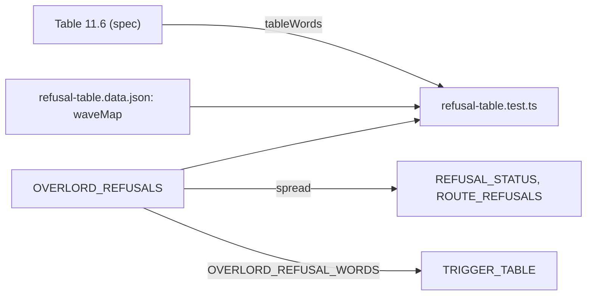

# Overlord W2: the W2 refusal words Implementation Plan

> **For agentic workers:** REQUIRED SUB-SKILL: Use superpowers:subagent-driven-development (recommended) or
> superpowers:executing-plans to implement this plan task by task. Steps use checkbox (`- [ ]`) syntax for tracking.

**Goal:** the eleven W2 refusal words of Table 11.6 join `OVERLORD_REFUSALS` in one pull request, each with its one
status, and leave the vocabulary's wave map, so that every later W2 piece reads its word from the group.

**Why:** the W2 index's question 6 (`w2-words-at-once`). Eleven W2 pieces each need one or two of these words. If each
piece added its own, the wave map and the group would change in eleven pull requests, and two pieces landing together
would each move the same word. One pull request moves them all, as W1's vocabulary did for W1.

**Architecture:** one pull request in lane K. It changes two data files and one test, and adds no module, no route, no
table and no PWA code.

- `shared/refusal.ts#OVERLORD_REFUSALS` (K, L0) gains eleven rows, each with its door, its status and the family rule
  that chose it.
- `server/test/single-definition/refusal-table.data.json` loses the eleven rows of its `waveMap`.
- `server/test/single-definition/refusal-table.test.ts` pins the W2 rows beside `W1_GROUP`, and takes `W2` out of
  its closed list of waves a word may wait for.

**Tech Stack:** TypeScript (ESM), vitest. No new dependency.

**Spec:** `docs/superpowers/specs/2026-11-09-overlord-design.md`: §11.6 and Table 11.6, the eleven rows named in Task 2;
Appendix B, "The refusal list"; §5's request-door table, whose rows name the same words.

**The index:** `docs/superpowers/plans/2026-11-16-overlord-w2.md`, read from PR #2917's branch. This plan builds its
row "W2 vocabulary" (lane K, one pull request, needs only W1's vocabulary, #2840, merged) and its question 6. The W1
plan whose state it reads is `docs/superpowers/plans/2026-11-14-overlord-w1/w1-vocabulary.md` (Task 3, the group and
the Table 11.6 guard).

Written against `main` at `9cf263d44` (2026-11-16).

## In short

- **One pull request, three tasks.** Red tests first, then the eleven rows, then the readers that follow the group.
- **Each word gets one status**, chosen by `shared/refusal.ts`'s family rule. The coordinator approves the eleven at
  this plan's review (question 1).
- **No console sentence** (ruled, F16). No W2 door exists until its own piece, which also ships the sentence where an
  operator sees the word, as W1 did (question 2).
- **`W2` leaves the wave map's closed list,** so no W2 word can be deferred again (question 3).
- **Nothing a session sees changes.** No door sends these words until its piece lands. The trigger table gains eleven
  rows, derived from the group, with no writer until W4b.

## 1. Open questions

Each question carries a recommendation, which this plan builds unless the coordinator rules otherwise. None needs the
operator: they are implementation detail.

- **Q1. Each word's status** (slug `w2-word-statuses`). Table 11.6 gives no status. The family rule in
  `OVERLORD_REFUSALS`' doc comment chooses one: 403 for a caller that is not allowed, 409 for a state of the world,
  429 for a rate, 400 for a body the caller can fix. **Recommendation:** the eleven of Table V1. The coordinator
  approves them at review, as it approved W1's (review 2102 F6).

  | Word | Status | Why, by the family rule |
  |---|---|---|
  | `act-ceiling` | 429 | A rate: the act kind's ceiling for its window (as `read-ceiling`) |
  | `dependency-cycle` | 409 | A state of the world: the requests' dependency graph |
  | `egress-refused` | 403 | The caller may not send this text. One word with no detail, so the status says nothing a fix could use |
  | `goal-conflict-open` | 409 | A state of the world: a pair the operator has not ruled |
  | `identity-too-weak` | 403 | The caller is not allowed: its identity strength is under the act's least |
  | `operator-has-it` | 409 | A state of the world: the row reached the operator, or moved since the caller read it |
  | `operator-only` | 403 | The caller is not allowed: a member of the act's effective class is not covered (C25, C26) |
  | `relay-carries-method` | 400 | A body the caller can fix: the relay's own part, rewritten without the method |
  | `request-not-yours` | 403 | The caller is not allowed, as `not-owner` |
  | `said-not-operator` | 409 | A state of the world: the cited message is not on record, spent or changed. The W1 inbox plan chose 409 too |
  | `server-not-isolated` | 409 | A state of the world: how the box is installed |

  *Table V1. The eleven words and their statuses.*

- **Q2. No console sentence in this pull request** (slug `w2-words-no-console-sentence-yet`; **ruled, F16** on the
  index's review: W2's vocabulary follows W1 and adds no PWA sentence). The index's row says
  "each word's sentence in `pwa/src/lib/refusalWords.ts`". W1's vocabulary added none, because no W1 door existed
  yet, and it left each sentence to the piece that ships an operator's door (`w1-vocabulary.md`, Global Constraints).
  Today the console shows the raw code for any word it does not know. **Recommendation:** none here either. Of the
  eleven, every word is answered to the Overlord or to a coordinator, never at an operator's door: the operator's
  request doors are never refused for a stale revision (index question 5). A later piece that answers one of these words
  to the console adds its sentence in its own pull request.
- **Q3. `W2` leaves the closed list of waves** (slug `w2-leaves-the-wave-list`). The guard's `WAVES` set names the
  waves a Table 11.6 word may wait for. W1 is not in it, so no W1 word can be deferred. **Recommendation:** take `W2`
  out too, in this pull request. A spec fix that adds a new W2 word to Table 11.6 must then add it to the group in the
  same pull request, as the index's "Where lanes meet" bullet for `shared/refusal.ts` already asks.
- **Q4. `said-not-operator` and the W1 inbox** (index question 6). The inbox plan adds `'said-not-operator': 409` with
  its `acknowledge` door. **Recommendation:** whichever pull request lands second finds the row present and keeps one.
  Both say 409, so the second merges `main` once and drops its own copy of the row and comment. The guard's "no other
  group holds one of its words" test catches a second copy in another group.

## 2. What exists today

Measured on `main` at `9cf263d44`.

- **The group.** `shared/refusal.ts#OVERLORD_REFUSALS` holds W1's eighteen words with their statuses, and its doc
  comment states the family rule. `OVERLORD_REFUSAL_WORDS` is derived from its keys, and `isOverlordRefusal` is its
  guard. `REFUSAL_STATUS` spreads the group, so `ROUTE_REFUSALS` and the `RouteRefusal` union take each word from it.
- **The wave map.** `server/test/single-definition/refusal-table.data.json`'s `waveMap` holds the eleven W2 words, each
  under `"W2"`, beside W1a's three and the later waves' words. `codeOnly` is empty.
- **The guard.** `server/test/single-definition/refusal-table.test.ts` reads Table 11.6 from the spec
  (`tableWords`) and checks it against the code both ways (`tableFindings`). It pins the group's exact contents with
  `W1_GROUP`, and its `WAVES` set is `W1a`, `W2`, `W3`, `W4`, `W4b`, `W5` and `W6`. It is a guard suite
  (`.github/ci/fast-plan.mjs#GUARD_TESTS`), so a fast run runs it.
- **The table.** Table 11.6 has a row for each of the eleven words. None of them is spelled in `server/src`,
  `shared` or `pwa/src` today. Five appear in the Overlord skill's reference `ccd/overlord-skill/references/starting.md`
  as prose, which this pull request does not change. `operator-only` appears only inside `fable-operator-only`, a
  different word of `GENERIC_REFUSALS`.
- **Readers that follow the group.** `shared/practice-triggers.ts#TRIGGER_TABLE` makes one `refusal` row per word of
  `OVERLORD_REFUSAL_WORDS`, and `parseSignature` reads them back through `isOverlordRefusal`. The trigger table has no
  writer until W4b. `server/test/sim/vocabularySets.ts` and `server/test/single-definition/vocabularies.test.ts` derive
  their expectations from the group, so they need no edit. `server/test/practice-cases.test.ts` checks that some row is
  a refusal, and counts nothing.
- **The console.** `pwa/src/lib/refusalWords.ts` has no Overlord word, and no table there is keyed by all of
  `RouteRefusal`.


*Figure V1. The group, the guard and the readers. This pull request moves eleven words from the wave map into the
group; every arrow keeps its shape.*

## 3. Global constraints

- **Architecture (`CLAUDE.md`).** Each word is declared once, in the group, with its status. `REFUSAL_STATUS` takes it
  from the spread alone: no literal key and no second group (the guard's last two tests). No `server/src` file spells a
  word: each door's piece reads it from the group.
- **What a merge arms.** Nothing a session sees changes. No door sends a W2 word until its piece lands. The trigger
  table gains eleven rows, which nothing writes before W4b. An older console shows the raw code for a word it does not
  know, as it does today.
- **Growth.** `shared/refusal.ts` is not growth-checked; it grows by about 25 lines (eleven rows and their comments).
  No growth-checked file changes.
- **Mutation.** No new decider: the group is data and `isOverlordRefusal` is unchanged. The guard is the existing
  `refusal-table.test.ts`, and Task 2's mutation step shows it goes red when any one of the eleven rows is deleted or
  its status changed.
- **Public repository.** No name, host or ticket; the plan cites by symbol and file.
- **Tests.** From `server/`, in the foreground, one file at a time, through
  `ccrc test -- ./node_modules/.bin/vitest run test/<file>`. Because `shared/` changes, each task's last step also runs
  `ccrc test -- npx tsc --noEmit -p tsconfig.json` and `-p test/tsconfig.tests.json` in `server/`, and
  `ccrc test -- ./node_modules/.bin/tsc --noEmit` in `pwa/`.

## 4. Review focus

1. Each status follows the family rule, and Table V1 is the code's.
2. The wave map holds no W2 word, and `W2` is no longer a wave a word may wait for.
3. `REFUSAL_STATUS` takes the eleven from the spread alone.
4. No W2 word appears in any other route-refusal group.

## 5. The PR split

| PR | Tasks | What it ships | Needs first | Growth-checked files, estimate |
|---|---|---|---|---|
| W2 vocabulary | 1 to 3 | The eleven words in `OVERLORD_REFUSALS` with their statuses; off the wave map; `W2` out of the guard's waves; the guard's W2 pins | W1's vocabulary (#2840, merged): **ready to build** | none. `shared/refusal.ts` about +25, not listed |

## 6. Tasks

### Task 1: The guard's W2 pins, red on `main`

**Files:**
- Modify: `server/test/single-definition/refusal-table.test.ts`

- [ ] **Step 1: Pin the W2 rows.** Beside `W1_GROUP`, add `W2_GROUP`, the eleven words of Table V1 with their
  statuses. The test "its words are exactly the W1 rows …" becomes "… the W1 and W2 rows …" and compares
  `{ ...OVERLORD_REFUSALS }` with `{ ...W1_GROUP, ...W2_GROUP }`.
- [ ] **Step 2: Close the list.** Take `W2` out of `WAVES`, and rename the test "the wave map holds no W1 word …" to
  "no W1 or W2 word"; it now also checks `expect(wave, w).not.toBe('W2')`.
- [ ] **Step 3: Controls.** Under `CONTROLS`, add two cases: a W2 word dropped from the group and the route words
  (as the `history-unreachable` control does, with `egress-refused`) reds `tableFindings`; and a W2 word put back on
  the wave map under `W2` reds it (at least one finding: a wave outside the list; once Task 2 has made it a route word,
  a route word on the map as well).
- [ ] **Step 4: Run it red.**

  Run: `cd server && ccrc test -- ./node_modules/.bin/vitest run test/single-definition/refusal-table.test.ts`

  Expected: FAIL. The group lacks the eleven words, and the wave map holds eleven entries under a wave no longer in
  the list. The new controls pass.

- [ ] **Step 5: Commit** the red test alone: `test(refusal): pin the W2 refusal words, red until they join the group`.

### Task 2: The eleven words join the group and leave the wave map

**Files:**
- Modify: `shared/refusal.ts` (`OVERLORD_REFUSALS`, its doc comment, and the spread's comment in `REFUSAL_STATUS`)
- Modify: `server/test/single-definition/refusal-table.data.json` (`waveMap`)

- [ ] **Step 1: Add the rows.** Append the eleven words to `OVERLORD_REFUSALS`, after `read-ceiling`, each with a
  one-line comment that names its door or lane from Table 11.6 and its status, in the group's style:

  ```ts
  // Every Overlord write door: the act kind's ceiling for its window is reached (act catalogue A). 429, a rate.
  'act-ceiling': 429,
  // `overlordMayAct`: the caller's identity strength is under the act's least (act catalogue B). 403.
  'identity-too-weak': 403,
  // `overlordMayAct`: a member of the act's effective class is not covered (C25, C26; act catalogue B). 403.
  'operator-only': 403,
  ```

  and so on for `server-not-isolated`, `operator-has-it`, `said-not-operator`, `request-not-yours`,
  `dependency-cycle`, `egress-refused`, `relay-carries-method` and `goal-conflict-open`, each naming the piece of the
  W2 index that sends it.
- [ ] **Step 2: Say W2 in the comments.** The group's doc comment says "The Overlord's W1 and W2 refusal words", and
  that no W2 door sends one until its piece lands. The spread's comment in `REFUSAL_STATUS` says the same. In passing,
  fix `read-ceiling`'s comment, which says `codeOnly` names it: `codeOnly` is empty on `main`.
- [ ] **Step 3: Empty the W2 rows of the wave map.** Delete the eleven `"W2"` entries from `waveMap`. Leave W1a's and
  the later waves' entries.
- [ ] **Step 4: Run the guard green.**

  Run: `cd server && ccrc test -- ./node_modules/.bin/vitest run test/single-definition/refusal-table.test.ts`

  Expected: PASS, every case and control.

- [ ] **Step 5: Mutation.** Run `mutation-run.py` (the coordinator skill's `references/`) over `shared/refusal.ts` with eleven mutants that each delete one W2 row and eleven that each change one
  W2 status by one family (403 to 409, 409 to 403, 429 to 409, 400 to 409), against
  `test/single-definition/refusal-table.test.ts`. Expected: every mutant killed. Record the counts in the commit body.
- [ ] **Step 6: Commit:** `feat(refusal): the W2 refusal words join OVERLORD_REFUSALS and leave the wave map`.

### Task 3: The readers that follow the group

**Files:**
- Read only, unless a run says otherwise: `shared/practice-triggers.ts`, `server/test/sim/vocabularySets.ts`,
  `server/test/single-definition/vocabularies.test.ts`, `server/test/practice-cases.test.ts`,
  `server/test/refusal-status.test.ts`

- [ ] **Step 1: Run each reader's suite**, one file at a time:

  Run: `cd server && ccrc test -- ./node_modules/.bin/vitest run test/practice-cases.test.ts`, then the same for
  `test/single-definition/vocabularies.test.ts` and `test/refusal-status.test.ts`.

  Expected: PASS. The trigger table has eleven more rows, each read back by `parseSignature`; no test counts them.

- [ ] **Step 2: Typecheck.**

  Run: `cd server && ccrc test -- npx tsc --noEmit -p tsconfig.json`, then
  `ccrc test -- npx tsc --noEmit -p test/tsconfig.tests.json`, then
  `cd ../pwa && ccrc test -- ./node_modules/.bin/tsc --noEmit`.

  Expected: no errors. `RouteRefusal` grows by eleven words, and no table in `pwa/src` is keyed by all of it.

- [ ] **Step 3: The docs guards.** Run `anchors`, `citations`, `dtbd` and `topology-clean` from `server/`, and
  `deviation-refs` after `git fetch origin main`. Expected: PASS.
- [ ] **Step 4: Commit** any fix a run asked for, with the run named in its body. With none, there is no commit.

## 7. Deviations found

By slug; the coordinator mints numbers (cross-plan ruling X9).

- **`w2-word-statuses`**: Table 11.6 gives no status. This plan gives each W2 word one, by the family rule (question 1).
- **`w2-words-no-console-sentence-yet`**: the index's row asks for each word's console sentence. None is written here,
  because no operator's door answers these words (question 2).
- **`w2-leaves-the-wave-list`**: the guard's closed list of waves loses `W2` (question 3).

## 8. What the index should change

- **Table W2, the row "W2 vocabulary":** "The eleven W2 words of the wave map in `OVERLORD_REFUSALS` at once, each with
  its status (Table V1 of this plan), off the wave map, and `W2` out of the guard's closed list of waves (question 6);
  `refusal-table.test.ts` green both ways. No console sentence: each door's piece adds one where the operator sees its
  word." Size unchanged: 1 PR, 3 tasks.
- **Question 6:** add the statuses, and that `W2` leaves the guard's waves.
- **"Where lanes meet", the `shared/refusal.ts` bullet:** "A later piece that needs a word the group lacks adds it,
  with its Table 11.6 row, in the same pull request. No W2 word can go on the wave map."
- **"States W3 may read":** the eleven words and their statuses.

## 9. Where things stand

**Agreed:**
- One pull request moves all eleven words (index question 6, accepted by the coordinator).
- No console sentence in this pull request (question 2, ruled F16).

**Waiting on the coordinator** (approved at this plan's review):
- The eleven statuses of Table V1 (question 1).
- `W2` out of the guard's waves (question 3).

**Later:**
- Each W2 door's piece sends its word, and adds the console sentence where the operator sees it.
