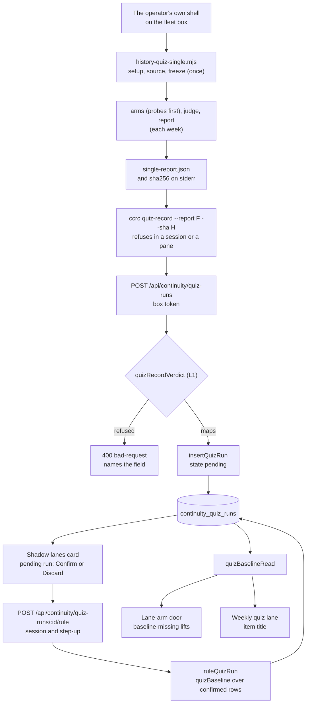

# Overlord W1a: the replay quiz's record path, history's single-arm mode and `ccrc quiz-record` Implementation Plan

> **For agentic workers:** REQUIRED SUB-SKILL: Use superpowers:subagent-driven-development (recommended) or
> superpowers:executing-plans to implement this plan task by task. Steps use checkbox (`- [ ]`) syntax for tracking.

## In short

- **What this is.** The plan for the missing half of the replay quiz piece (`2026-11-10-overlord/w1a-replay-quiz.md`):
  how the operator runs one recall-on quiz on the fleet box, records it, and confirms it. The first confirmed run,
  taken while every W1a lane-arm row is in shadow, becomes M13's baseline, and the three W1a lanes (`continuity`,
  `launch-profile`, `anchor-slot`) can then go Live. Today their Live is refused `baseline-missing`.
- **Two pull requests.** PR 1 is history's single-arm mode: a new driver module, `deploy/history-quiz-single.mjs`. It is
  built over the driver's own pieces, which one export-only edit of `deploy/history-replay.mjs` opens, under the
  history coordinator's waiver (§3). PR 2 is the replay quiz plan's Task 3, plus the operator's confirmation:
  - `ccrc quiz-record` and its box-token door, which records a run as **pending**;
  - one session-gated door, with the step-up, through which the operator confirms or discards it from the Shadow lanes
    card;
  - `QUIZ_RECORD_READY` set to `true`, and the weekly item rewritten to the real commands.
- **Ruled at review 2390** (fix round 1, §1):
  - The single-arm run skips the pilot's A/B instrument only. It keeps step 0b's skill, tool and deny probes, and takes
    its settings mode explicitly.
  - Questions come from every admitted family.
  - The weekly cap is 5M token-equivalents.
  - A report whose interval misses its score is refused, never clamped.
  - Only an operator-confirmed run can be the baseline.
- **The report carries no comparison** (§4): one arm, its share with a 95% interval, its counts, the settings mode and
  `pilot: skipped-by-ruling`. It has no lift, delta, verdict or PASS word. One L1 decider, `quizRecordVerdict`,
  refuses anything inconsistent, stale or mostly unanswered before the record writer sees it (§5).
- **The operator's steps** (§7): set up and freeze the questions once. Each week, run `arms`, `judge` and `report` on
  the fleet box in their own shell, record with `ccrc quiz-record`, and press Confirm on the card. No session runs any
  of it.

## 1. Goal, scope and the rulings this plan builds on

**Goal:** the operator can run the replay quiz once, recall on and with no A/B window, record it, and confirm it. The
first confirmed run taken while every W1a lane-arm row reads `shadow` is the baseline. The guard that already stands
(`decideLaneArmPost`'s `baseline-missing`) then lets those rows go Live.

**Why:** on 2026-11-17 the operator ruled that the three W1a lanes reach Live through a real quiz baseline. That
answers the replay quiz plan's open question 1: "not taken" is not offered. The departures note of that piece
(`w1a-replay-quiz/departures.md`, slugs `quiz-record-waits-for-the-single-arm-plan` and
`quiz-item-waits-for-the-record-path`) parked Task 3 and the weekly item until this plan.

**Spec:** `docs/superpowers/specs/2026-11-09-overlord-design.md`:
- §3.3.9 C52, "The replay quiz runs";
- §3.3.10 C53, "The replay quiz is history's own … a measure only, never a gate on history's waves";
- §12 M13, "quiz above its W0 baseline".

The results note `2026-11-11-overlord-w0-spike-results.md` holds W0-28, ruled B, under "The replay quiz's baseline".

**The history coordinator's five terms** (from the departures note; each is a rule of PR 1):

| # | Term | Where this plan keeps it |
|---|---|---|
| 1 | Additive beside today's arms, with a characterization test green on `main` first | A new module (§4). Task 1 is the characterization commit |
| 2 | No edit to the quiz scorer, its code-file list or the frozen-tree diff set | Waived for one export-only edit of `history-replay.mjs` under five conditions (§3). Nothing else in `GATE_CODE_FILES` changes |
| 3 | The single-arm report carries no comparison figure: no lift, delta or PASS word | §4's field list. Task 5's absence pin |
| 4 | The pull request number is mailed to that coordinator before its close | Task 6: the worker mails the Overlord coordinator, who relays it |
| 5 | This programme's plan names the report's fields, one by one | §4 and §5 |

**The four conditions of W0-28** (the replay quiz plan's Global Constraints) bind both pull requests:
1. The history store is read read-only, and no session runs a writing form of `ccrc history`.
2. No history marker is written by any code here.
3. The driver runs by the operator's hand.
4. The baseline is never a W2 result, a PASS or a measured benefit of recall.

**Rulings, all binding:**

| Ruling | By | What it says |
|---|---|---|
| OQ1, as restated | Operator | The single-arm run skips W2's pilot A/B instrument by a recorded ruling (§3). It keeps step 0b's fidelity probes |
| Node | Operator | The fleet box. Measured: the store, the families, the token and the address are all there (§2) |
| OQ2 | Coordinator | Questions come from every admitted family on the node, as W2 does |
| OQ3 | Operator | A weekly cap of 5M token-equivalents |
| OQ4 | Coordinator | A report whose interval does not contain its score is refused, never clamped |
| F3 | Coordinator | A recorded run is pending until the operator confirms it on the card. Only a confirmed run can be the baseline |
| F4 waiver | History coordinator (mail 23076) | One export-only edit of `deploy/history-replay.mjs`, under five conditions (§3) |
| Skip conditions | History coordinator (mail 23066) | Three conditions on the skip ruling (§3) |

**Footing.** Everything marked *measured* was read on `main` at `bd82b7f50` (2026-11-17), or in review 2390's refute
passes. No driver, no `ccrc history` form and no `ccd` verb was run. Every numeral and count in this plan is re-derived
at build from the merged tree.

## 2. What exists today

**The record half is built** (replay quiz plan Tasks 1, 2 and 4, merged):
- `server/src/continuity/quiz.ts` holds `QuizReport`, `QUIZ_REPORT_FIELDS`, `validQuizReport`, `quizBaseline`,
  `quizItemText`, `quizLaneVerdict` and `QUIZ_RECORD_READY = false`.
- `quizStore.ts` holds the one writer `insertQuizRun` and the reads `quizRuns`, `quizRecordedAts` and
  `quizBaselineRead`. The last answers `{ok:true, exists}` or `{ok:false, detail}` and is typed `LaneArmBaseline`.
- `continuity_quiz_runs` is migration 77, with no state column. F3's pending state needs one more migration, in PR 2.
- `continuity-quiz-lane.test.ts` pins `QUIZ_RECORD_READY === existsSync('server/src/continuity/quizRoutes.ts')`.

**The guard stands.** `decideLaneArmPost` refuses Live on a W1a row with `baseline-missing` while no baseline row exists,
and with `state-unreadable` when the read fails. Live still needs a signed-in operator and the confirm key.

**The driver** (*measured*):
- `deploy/history-replay.mjs` registers 16 subcommands (`HANDLERS`, pinned in `history-replay.test.ts`).
- `main` refuses `in-pane` (exit 2) on any `TMUX_PANE` (`paneRefusal`). It has no `CLAUDECODE` check.
- `main` alone installs the stop handler. It maps `STOP_SIGNALS` to `onStopSignal`, which signals every group in the
  private `liveChildren` and arms the `stopping` flag that `refuseIfStopping` reads.
- Children start detached as group leaders through the private `spawnGroup`.
- The quiz arms always run both recall arms (`armAttemptsOf` through `RECALL_ARMS.map(...)`).
- `report` writes `verdict.json`, with a `gate.verdict` of `pass|fail|halt|incomplete`.

**What W2's code check diffs** (*measured*):
- `GATE_CODE_FILES` (`deploy/history-gate.mjs`) is `deploy/history-gate.mjs`, `deploy/measure-history.py`,
  `deploy/history-replay.mjs` and `ccd/history/lib.mjs`. `recheckCode` and `checkGateCode` diff those four files' shas.
  That is the frozen-tree diff set.
- `deploy/history-replay.mjs` is growth-capped (`server/test/growth-caps/deploy-history-replay-mjs.json`, D-8635). An
  export-only edit adds no code line, so the cap does not bear on it. Term 2 is what governs it.

**The reusable pieces are bound to W2's chain** (review 2390 F4, *measured*). So the module cannot be a thin wrapper:
- `judgedOf` is both-arm: a treatment-only map throws. It also needs `JUDGED_KIND` and a signed record's judge fields.
- `readArmAnswers` reads only `ANSWER_KIND` (`ccrc-history-w2-answer`), in section `pilot` or `quiz`.
- `frozenListText` and `writeFrozenList` write the W2 kind `ccrc-history-w2-quiz`.
- `sourceQuiz` calls `writeBaselineRecord`, kind `ccrc-history-w2-baseline`.
- `prepareOut` stamps the driver's `.ccrc-history-replay` marker.
- `judgeTallyOf` answers `judged`, `judge_failed`, `uncertain`, `fabricated` and `sampled`, not the counts the report
  needs.
- These are private: `armJob`, `armAttemptsOf`, `armBatchPreflight`, `settleAnswers`, `writeArmsSummary`,
  `preflightSpawn`, `readPlain`, `writePlain`, `pinOutBytes`, `ensurePlainDir`, `refuseUnusableInputs`,
  `refuseSpawnAdmission`, `refuseOpusModel`, `printWithSha`, `step0bCardOf`, `step0bRunOf`, the stop handling, and the
  `umask 077` set in `main`.

**What a run touches outside `--out`** (review 2390 F7, *measured*):
- Every spawn's working directory and the Claude Code version probe use a transient directory under the system temp
  (`os.tmpdir()`).
- The arm and judge spawns run with the account's real `HOME` and `CLAUDE_CONFIG_DIR`, and spend its pool. They stop at
  the 70% limits threshold or at `--budget`.
- An arm's admitted `ccrc history` read appends one counter line to the live spool (`writeRecallLine`), tagged with its
  `arm`.
- The lifecycle class `history-replay-out` (`shared/lifecycle.ts`) covers one W2 run only, with the driver as its sole
  creator.

**Markers** (*measured*):
- `SWITCHES` (`ccd/history/lib.mjs`) names `steerOff`, `steerLivePrefix`, `steerOnDir` (one file per session id),
  `headlessOn` and `agentsOn`.
- `agentsArmedOf(st)` counts only a regular, non-link file as armed, and answers `false` for `null`. A failed `lstat`
  must therefore be told apart from absence before it is called.
- The arms need every quiz family listed in `headless-on` (`requireListed`), a marker that is the operator's to write.

**The node** (*measured*):
- The driver opens the history store of the box it runs on.
- The families, the accounts and the Claude Code builds are on the fleet box.
- The fleet box also holds the box token (`~/.cc-secrets/ccrc-mail.token`) and the server's address (`~/.ccrc/agent.env`,
  `CCRC_SERVER_URL`).

## 3. The skip ruling, its conditions, and the export waiver

This section is the ruling record: what the single-arm run skips, on what conditions, and the one edit to the driver it
is allowed.

**How the gate works** (*measured*):
- The pilot acts are `step0b`, `fidelity`, `arms --section pilot` with `judge --section pilot`, and `pilot-result`.
- `open --finalize` requires `--pilot-result`.
- `arms --section quiz` reads its run through `loadArmRun`, which calls `loadFinalRecord`: a signed part 2 that carries
  the pilot result.
- So the quiz sits behind the record chain, not behind a flag.

| | A. A path through the pilot acts | B. A recorded ruling to skip the A/B instrument |
|---|---|---|
| What it runs | W2's acts 7 to 21, then the quiz arms | A setup record of its own, quiz sourcing and freezing once, then each week step 0b's probes, one arm, the judge and a report |
| Records it writes | Signed W2 part 1 and part 2 | No signed W2 record. It reuses W2-kind working files (§4), which W2's readers refuse as records (condition 1 below) |
| Calendar | A 14 to 15 day window before `report` | Hours, each week |
| Conflicts | Manufactures signed W2 records, which the 2026-11-02 skip ruling forbids | None |

**The ruling (OQ1, restated; operator).** The single-arm run skips the pilot's A/B instrument: `fidelity` as a paired
check, the pilot arms and judge, `pilot-result`, and part 2. It keeps the fidelity checks that bear on an absolute score:
- **Step 0b's probes run first.** The skill, tool and deny probes (`step0bProbesOf`, `step0bVerdictOf`, `step0bCardOf`,
  `step0bRunOf`) run in `arms` before any arm spawns, and the run refuses if any probe fails. So a baseline cannot be
  taken with the `ccrc-history` skill dropped, and later "beaten" by a run that has it.
- **The settings mode is explicit.** `setup` takes `--settings-mode restricted|fallback` with no default, so a
  restricted default can never drop the skill unnoticed.
- **The report says so.** It carries `pilot: "skipped-by-ruling"` and `settings_mode`. `quizRecordVerdict` refuses a
  report without either.

**The history coordinator's three conditions on the skip (mail 23066):**
1. **A test, not a table cell.** Every file the module writes goes through W2's readers: the setup, the report, the
   judged file, and every other file it writes. Each of `loadFinalRecord`, `loadArmRun`, and `validateOpenRecord`'s open
   and final checks refuses it. The test goes red if any of them could read such a file as a W2 record (Task 6).
2. **This measure only.** A single-arm run is not a W2 pilot and does not resume the W2 study. Nothing it writes is
   reused as W2 pilot evidence, as W2's budget extrapolation or as W2's quiz list: not its spend ledger, not its frozen
   list, not its scores. If the operator ever resumes W2, its pilot acts run in full.
3. **Never inside a W2 window.** What a weekly run does during an open W2 window is settled before any W2 window opens.
   Until then a single-arm run never runs inside one. The runbook says so (§7), and so does the item (Task 11).

**The export waiver (term 2; the history coordinator, mail 23076).** PR 1's first code change is one export-only edit of
`deploy/history-replay.mjs`, under five conditions:
1. **Export-only and machine-checkable.** The only change is the word `export ` in front of existing top-level
   declarations, each one named in PR 1. There are no new lines and no export list, and no body, comment or order
   changes. Removing those tokens gives `main`'s bytes exactly. PR 1 shows that check, and its reviewer re-measures it.
   Growth-check is untouched.
2. **Functions, not state.** `liveChildren` and `stopping` stay private if `onStopSignal`, `refuseIfStopping`,
   `yieldToSignals`, `STOP_SIGNALS` and the registered spawn (`spawnGroup`) suffice. The module registers its children
   only through the driver's own registered spawn. Any state export needs a named reason in PR 1.
3. **A red test for the guard.** A SIGINT to a single-arm run whose arms step has a live stub child signals that child's
   group, and nothing further is spawned or written. The test goes red when the module stops installing the handler.
   The measurement goes in the PR.
4. **Terms 1 and 2 otherwise stand.** The two-arm path and `history-replay.test.ts` stay green unchanged.
   `history-gate.mjs`, `GATE_CODE_FILES`, the frozen-tree diff set and the open redaction and workflow-ids item stay
   untouched.
5. **This one edit only.** Any other change to a `GATE_CODE_FILES` member goes back to that coordinator while
   ccrc-history is open, and to the operator after it closes.

**The candidates for `export `** (Task 2 names the final set; each must be a function or a frozen constant):
- the stop handling: `onStopSignal`, `refuseIfStopping`, `yieldToSignals`, `STOP_SIGNALS`, `spawnGroup`;
- the arm path: `armJob`, `armAttemptsOf`, `armBatchPreflight`, `settleAnswers`, `preflightSpawn`;
- the probes: `step0bCardOf`, `step0bRunOf`;
- the output helpers: `readPlain`, `writePlain`, `pinOutBytes`, `ensurePlainDir`;
- the refusals: `refuseUnusableInputs`, `refuseSpawnAdmission`, `refuseOpusModel`;
- `printWithSha`.

A candidate that turns out to need its file's module state stays private and is re-spelled (below).

## 4. History's single-arm mode (PR 1)

A new operator-run module, `deploy/history-quiz-single.mjs`, run on the fleet box as
`node --no-warnings ~/ccrc/deploy/history-quiz-single.mjs <subcommand>`.

**Its first acts**, in order:
- `paneRefusal` (`in-pane`, exit 2).
- `in-session` (exit 2) when `CLAUDECODE` is set.
- `umask 077`.
- The driver's stop handler, installed for `STOP_SIGNALS` as `main` installs it.

It reads the history store only through `openReplayStore`, so `history-replay.test.ts`'s `node:sqlite` scan covers it.
It never writes a marker.

**Where it writes and what it spends** (review 2390 F7). Its files go under `--out`. Its spawns also:
- use a transient directory under the system temp;
- run with the account's real `HOME` and `CLAUDE_CONFIG_DIR`, spending its pool up to the 5M weekly cap (OQ3), which
  `setup --budget` records, and stopping at the 70% limits threshold or the budget, whichever comes first;
- append arm-tagged counter lines to the live spool, one per admitted recall read.

The spool lines are kept, and justified. They are the lines W2's arms write (W2-D46), they carry `arm`, and history's
counters already read `arm IS NOT NULL` as an arm call. So the M13 reading "the share of generations that used recall"
must count `arm IS NULL` only. That is pinned when the reading is built (W1); this plan adds no reader.

**Its own lifecycle class.** `shared/lifecycle.ts` gains a row: `history-quiz-single-out`, root "the single-arm module's
`--out`, operator-chosen outside any git tree, mode 0700, marked by `.ccrc-history-quiz-single` beside the driver's own
marker", creator `deploy/history-quiz-single.mjs`, no collector. Its bound: the setup directory for as long as the quiz
lane runs, and a week directory until its run is confirmed or discarded, then removed by hand. `lifecycle.test.ts`
gains the row, and `history-replay-out` is unchanged.

**Fresh expectations each run** (F5). `setup` stores the release and Claude Code build it measured, for information only.
`arms` and `judge` each measure a fresh expected node at their own start, as the driver's `expectedForNode` path does.
So a weekly run is never refused `claude-version-moved` or `tree-moved` from week two on. The only cross-act check is
`report`'s `release-moved`, when `arms` and `judge` ran on different releases.

**The interval's generator** (F1). No `substream` label is added: `SUBSTREAMS` lives in `history-gate.mjs`. The
module builds its own stream with `substream`'s recipe, and the derivation is written in its header: the exported
`xoshiro128ss` over the four little-endian words of `sha256Hex(seed + ':quiz-single-ci')`.

**What it still re-spells**, each with a characterization test against the driver's behaviour (Task 1):
- the one-arm summary, since `writeArmsSummary` and `armsSummaryOf` write both arms;
- the one-arm judged file and its tally, since `judgedOf` is both-arm and `judgeTallyOf` lacks the counts;
- the subcommand dispatch and flag table.

The answer files, the frozen list and the sourcing baseline record keep their W2 kinds, written by the driver's own
code. That is what condition 1's test exercises.

**Subcommands.** Each file it writes is printed as `sha256 <hex>` on stderr:

| Subcommand | Reads | Writes |
|---|---|---|
| `setup` | `--account`, `--budget`, `--settings-mode`, `--writer-model`, `--judge-model`, `--arm-model`, optional `--target` (default 100) | `setup.json`: kind `ccrc-history-quiz-single-setup`, the fields `sourceQuiz`, `openWriter` and `runBatch` read, a drawn seed, and the measured release and build (informational) |
| `source` | `--setup(+sha256)` | `quiz/sourced.json` and the sourcing baseline record, through `sourceQuiz` and `openWriter`, over every admitted family (OQ2) |
| `freeze` | `--setup`, `--sourced` (each with sha256) | `quiz/frozen.json` and its meta, through `mergeSourced`, `frozenListText` and `writeFrozenList` |
| `marker` | `--frozen(+sha256)` | Nothing. It prints the `headless-on` lines the frozen families need, for the operator to write |
| `arms` | `--setup`, `--frozen` (each with sha256) | Step 0b's probes, refusing on a failure, then `quiz/arms-summary.json`: the treatment arm only (`TREATMENT_ARM`, recall on), at most `ARM_ATTEMPTS_MAX` attempts, with the arms' start and end time and the steer and agents-on words read at arms time |
| `judge` | `--setup`, `--frozen`, `--arms-summary` (each with sha256) | `quiz/judged.json`, kind `ccrc-history-quiz-single-judged`, through `judgeItemsOf`, `judgeJobsOf` and `openJudge` over the one arm |
| `report` | `--setup`, `--frozen`, `--arms-summary`, `--judged` (each with sha256) | `single-report.json` (below), and its `sha256 <hex>` on stderr |

The judge model must be an exact Opus id (`EXACT_MODEL_ID_RE`, `OPUS_MODEL_RE`). The arm model refuses any Fable id
(`ARM_MODEL_FORBIDDEN_RE`). All three are imported from `history-gate.mjs`, never re-spelled.

**The single-arm report** (`single-report.json`: canonical JSON, one trailing newline; term 5, field by field):

| Field | Type | What it is |
|---|---|---|
| `kind` | string | `ccrc-history-quiz-single-report`, never a W2 kind |
| `v` | integer | `1` |
| `measured_ms` | integer | When the arms finished, read from `arms-summary.json`: the arms' own time, never `report`'s |
| `arm` | string | `treatment`: recall on, the one arm run |
| `pilot` | string | `skipped-by-ruling` |
| `settings_mode` | string | `restricted` or `fallback`, the setup's |
| `frozen_sha256` | hex64 | The frozen question list's sha |
| `n_questions` | integer | The frozen list's entries |
| `n_families` | integer | The frozen list's distinct families |
| `counts` | `{questions, answered, correct, run_failed, absent}` | `questions = answered + run_failed + absent`, and `correct <= answered` |
| `share` | `{num, den}` | `num = correct`, and `den = answered`: run-failed and absent questions sit outside the share and show in `counts` |
| `interval` | `{lower: {num, den}, upper: {num, den}, ci, method, B}` | `clusterBootstrap({mode: 'share'})` over one cluster per family (`{num: correct, den: answered}`), with the generator above and `BOOTSTRAP`'s `ci` (95), `method` and `B` |
| `judge_model` | string | The setup's judge model |
| `ccrc_release` | string | The release `arms` and `judge` both ran on (`release-moved` otherwise) |
| `claude_code_versions` | string[] | The builds the arm and judge spawns ran, sorted and unique |
| `steer_armed` | word | `yes`, `no`, `partial` or `unmeasured`: W3 steering on the frozen families at arms time, read by existence through `SWITCHES` |
| `agents_on_armed` | word | `yes`, `no` or `unmeasured`: W4 agents-on on this node at arms time. A failed `lstat` reads `unmeasured`, never `no` |
| `inputs` | object | `setup_sha256`, `frozen_sha256`, `arms_summary_sha256`, `judged_sha256` |

There is no `verdict`, `gate`, `criteria`, `lift`, `delta` or `pass` key, and the word `PASS` appears nowhere in the
file (term 3). Task 5 pins the absence and goes red when a planted key comes back.

## 5. The record path (PR 2)


*Figure 1. The record flow. The operator runs the quiz and the verb by hand; the box-token door records a pending run;
the operator confirms it on the card through a session-gated door; only a confirmed run can be the baseline, which
three readers read from one read.*

**The verb.** `ccrc quiz-record --report <file> --sha <hex>` lives in its own file, `ccd/ccrc-quiz-record` (bash). One
dispatch line in `ccd/ccrc`'s `case "$VERB"` reaches it, as `ccrc-test` and `ccrc-testbox-admin` are reached.
- It refuses `in-session` when `CLAUDECODE` is set and `in-pane` when `TMUX_PANE` is set (exit 2, nothing posted).
- It reads the report: a regular file (`[ -f ]`) of at most 64 KiB (`wc -c`).
- It reads no server address and no box token (the coordinator's ruling C, 2026-11-17; slug
  quiz-record-posts-through-the-client): it posts through `ccrc-api`, which reads both.
- It builds the body with `jq --rawfile`, so the text travels as UTF-8 JSON:
  `{"report": "<the file's text>", "sha256": "<hex>", "recordedBy": "<trace>"}`. The trace is
  `quiz-record <user> <role> <ISO time>`, from `id -un`, the box's recorded `CCRC_ROLE` and `date -u`.
- It hands the body on stdin to `ccrc-api quiz record --json -`, a row of that client's closed table, and runs no `curl`.
  It uses no `stat -c`, no `sha256sum` and no bare `timeout`, and has zero shellcheck findings.
- It prints `recorded run <id>, pending: confirm it on the Shadow lanes card`, or `already recorded as run <id>
  (<state>)`, or the refusal's word and detail.
- `ccd/ccrc-api` gains the one row `quiz.record` (ruling C, reversing this plan's first "no client row" line): CLAUDE.md's
  consolidate rule allows no fifth hand copy of the address-and-token read, and since the door records `pending` only, a
  session posting through the row records nothing that counts.

**Deny lists** (F8). Neither the module nor the verb is on any session deny list (`FORBIDDEN_CCD_VERBS`,
`FORBIDDEN_PATTERNS`, `childDenyRules`, the hook's deny arms, `ACCOUNT_DENY_RULES`). Neither are `history-replay.mjs`,
`ccrc history` or `ccrc test`. Their refusals inside a session and a pane are speed bumps, and the shared box token lets
a session post anyway, so a deny entry would only be an accident guard. F3's confirmation is what stops a posted run
from counting. `ccrc-api-closed.test.ts` counts the client's rows, `quiz.record` among them (ruling C).

**The record door.** `server/src/continuity/quizRoutes.ts` registers `POST /api/continuity/quiz-runs` from `server.ts`,
beside `registerContinuityRoutes`.
- It is box-token gated in its own `onRequest`, as `continuity/routes.ts`'s lanes are (`checkMailToken`,
  `MAIL_TOKEN_HEADER`, refusal `unauthenticated`), with `bodyLimit` 64 KiB.
- Its caller has no session, so it takes no attribution. It stores the verb's `recordedBy` trace, which is at most 200
  characters and one line.
- The handler measures `sha256` over the UTF-8 bytes of `report` and passes `{text, claimedSha, measuredSha,
  recordedBy, now}` to the L1 decider.
- It acts on the answer: 400 `bad-request` with the field; `insertQuizRun` with state `pending` (503 `write-failed`
  when that fails); 501 `not-configured` without a coordination store. It then answers `{ok: true, id, fresh, state}`.
- Its census reason says it plainly: a session holding the box token could post a pending run, and only the operator
  can make it count.

**`quizRecordVerdict`** (L1, `quiz.ts`, with a mutant set and a floor; F2). First match:
1. The sha is 64 lower-case hex and equals the measured one (field `sha256`).
2. The text is JSON (field `report`).
3. `kind` and `v` are known (field `kind`).
4. `arm` is `treatment` (field `arm`).
5. `pilot` is `skipped-by-ruling`, and `settings_mode` is a known mode (fields `pilot` and `settings_mode`).
6. `interval.ci`, `.method` and `.B` equal `BOOTSTRAP`'s (field `interval`). The server holds the three values as a
   frozen L0 copy, which a contract test compares with `history-gate.mjs#BOOTSTRAP`.
7. The counts add up: `questions = answered + run_failed + absent`, `questions = n_questions`, `correct <= answered`,
   and `share.num = correct`, `share.den = answered` (field `counts`).
8. `0 <= num <= den` and `den > 0` for the share and both interval ends, so `0 <= score <= 1`. A zero denominator never
   divides (field `share` or `interval`).
9. **The answered floor:** `answered >= 9/10 × questions` (`QUIZ_ANSWERED_FLOOR = {num: 9, den: 10}`, field
   `counts`). Why 90%: a run where more than one question in ten failed to run or came back absent measures the
   instrument rather than recall. It can never become a baseline that a working run later "beats".
10. **Freshness:** `measured_ms` is not in the future (more than 5 minutes past `now`) and not older than
    `QUIZ_RECORD_MAX_AGE_DAYS = 8` days before `now` (field `measured_ms`). A week plus a day of slack means re-reporting
    an old week's files cannot make a fresh row. The bound is written in days times the day length, never as a
    seven-day literal (`token-shared.test.ts` counts those).
11. It maps the fields below and hands them to `validQuizReport`, whose refusal it passes on unchanged. Its check
    `lo <= score <= hi` is OQ4's refusal.

| `continuity_quiz_runs` column | From the single-arm report | Checked by |
|---|---|---|
| `measuredAt` | `measured_ms` (the arms' time) | `validQuizReport`, rule 10 |
| `reportSha` | the verified `sha256` of the file's bytes | rule 1, `validQuizReport` |
| `questionsSha` | `frozen_sha256` | `validQuizReport` |
| `questions` | `n_questions` | `validQuizReport`, rule 7 |
| `families` | `n_families` | `validQuizReport` |
| `score` | `share.num / share.den` | rules 7 and 8, `validQuizReport` |
| `lo` | `interval.lower.num / .den` | rule 8, `validQuizReport` (`lo <= score`) |
| `hi` | `interval.upper.num / .den` | rule 8, `validQuizReport` (`hi >= score`) |
| `judgeModel` | `judge_model` | `validQuizReport` |
| `ccrcRelease` | `ccrc_release` | `validQuizReport` |
| `claudeBuilds` | `claude_code_versions` | `validQuizReport` |
| `steerArmed` | `steer_armed` | `validQuizReport` |
| `agentsOnArmed` | `agents_on_armed` | `validQuizReport` |
| `answered`, `correct`, `runFailed`, `absent` (new) | `counts` | rules 7 and 9 |
| `arm`, `settingsMode`, `pilot` (new) | `arm`, `settings_mode`, `pilot` | rules 4 and 5 |
| `ci`, `method`, `bootstrapB` (new) | `interval.ci`, `.method`, `.B` | rule 6 |
| `inputs` (new, JSON) | `inputs` | well formed, four hex64 values |
| `state`, `ruledAt`, `ruledBy` (new) | the record door writes `pending`; the rule door writes the rest | `ruleQuizRun` |

`QuizReport` and `QUIZ_REPORT_FIELDS` keep their thirteen fields. The new columns travel beside them in a
`QuizRunExtra` that `quizRecordVerdict` builds. `insertQuizRun` takes both and stays the table's one inserter.

**The rule door** (F3). `POST /api/continuity/quiz-runs/:id/rule`, body `{"action": "confirm"|"discard"}`, is registered
from the same file.
- It is session-gated and takes the account gate's step-up first (`AccountGate`, as `PUT /api/items/:id/secret` does).
  So it refuses while sign-in is dark, from a plain-HTTP origin, or without a recent step-up.
- It calls `ruleQuizRun`, the one writer of `state`, `ruledAt`, `ruledBy` and `baseline`, which in one transaction:
  - refuses a run that is not `pending` (`bad-request`, detail `already <state>`; an unknown id is `bad-request` too);
  - on `confirm`, asks `quizBaseline` over the confirmed rows and the W1a lane rows read now, and sets `state =
    'confirmed'` and `baseline`;
  - on `discard`, sets `state = 'discarded'` and leaves the row, which never counts.
- It answers `{ok: true, id, state, baseline}`.
- No session can confirm: that needs the console's session and a step-up.

## 6. The baseline, and what the Shadow lanes card shows

**What makes a run the baseline.** `quizBaseline` now reads confirmed rows only. A run becomes the baseline when the
operator confirms it, no earlier confirmed row is a baseline, and every row of `W1A_ARM_ROWS` reads exactly `shadow` in
`lane_arm_settings` at that moment, inside `ruleQuizRun`'s transaction. A row stored `live`, an unknown token or a
failed read makes no baseline. A pending or discarded row is never one. A resend of the same report (the same
`reportSha`) writes nothing and answers the first row. A discarded report's bytes cannot be re-recorded; the operator
re-runs `report` after a new `arms` run.

**The weekly lane.** A run recorded this week holds this week's item when it is pending or confirmed; a discarded one
does not (`quizRecordedAts` reads non-discarded rows). The lane's title keys are unchanged.

**The card.** The Shadow lanes card gains one block under its rows, from `quizBaselineRead` and a pending-runs read:
- **A pending run:** "Replay quiz run, 24 Nov 2026: score 0.82 (0.76 to 0.88), 100 questions over 34 families,
  96 answered, 3 failed to run, 1 absent", with **Confirm** and **Discard**. With several pending runs, the oldest
  shows first.
- **Then the baseline line:** "Replay quiz baseline: recorded 24 Nov 2026", "Replay quiz baseline: not yet", or "Replay
  quiz baseline: could not be read".

`quizBaselineRead` gains the baseline row's `recordedAt`. It answers `{ok: true, exists: true, at}`,
`{ok: true, exists: false, at: null}` or `{ok: false, detail}`. That shape is still assignable to `LaneArmBaseline`, so
`decideLaneArmPost` and the lane do not change. `laneArmViewOf` takes both reads and puts an optional `quizBaseline` on
`LaneArmView`; the field is additive, and an older server's view shows no block. The words live in
`LANE_ARM_TEXT.quizBaseline(...)` and `LANE_ARM_TEXT.quizPending(...)` (`shared/lane-arm.ts`). The PWA renders the dates
in the console's time zone, and the buttons through the step-up flow the secret door's UI uses.

**Afterwards.** Once confirmed as the baseline, the lane-arm door no longer refuses `baseline-missing`, and each W1a row's
Live turns on its own gate and the confirm key as before. The weekly lane's title drops "the baseline".

## 7. The operator's runbook

The step the operator takes. Every command runs on the fleet box, in the operator's own shell, outside tmux and outside
any Claude Code session; both refuse. Never run it while a W2 window is open (condition 3).
- `<OUT>` is a directory of the operator's choosing outside every work tree, made once.
- `<WEEK>` is a fresh directory per run.
- Each `--x-sha256` is the hex the previous command printed as `sha256 <hex>` on stderr.

```bash
Q="node --no-warnings $HOME/ccrc/deploy/history-quiz-single.mjs"

# Once: the setup and the frozen questions (every later run reuses them).
$Q setup  --out <OUT> --account <account> --budget 5000000 --settings-mode <restricted|fallback> \
          --writer-model <exact opus id> --judge-model <exact opus id> --arm-model <exact model id>
$Q source --out <OUT> --setup <OUT>/setup.json --setup-sha256 <H_SETUP>
$Q freeze --out <OUT> --setup <OUT>/setup.json --setup-sha256 <H_SETUP> \
          --sourced <OUT>/quiz/sourced.json --sourced-sha256 <H_SOURCED>
$Q marker --frozen <OUT>/quiz/frozen.json --frozen-sha256 <H_FROZEN>
#   then write the printed lines into ~/.ccrc/history/headless-on yourself (the marker is yours; nothing writes it)

# Each week, the baseline first, before arming any W1a lane. arms runs step 0b's probes first and stops if one fails.
$Q arms   --out <WEEK> --setup <OUT>/setup.json --setup-sha256 <H_SETUP> --frozen <OUT>/quiz/frozen.json --frozen-sha256 <H_FROZEN>
$Q judge  --out <WEEK> --setup <OUT>/setup.json --setup-sha256 <H_SETUP> --frozen <OUT>/quiz/frozen.json --frozen-sha256 <H_FROZEN> \
          --arms-summary <WEEK>/quiz/arms-summary.json --arms-summary-sha256 <H_ARMS>
$Q report --out <WEEK> --setup <OUT>/setup.json --setup-sha256 <H_SETUP> --frozen <OUT>/quiz/frozen.json --frozen-sha256 <H_FROZEN> \
          --arms-summary <WEEK>/quiz/arms-summary.json --arms-summary-sha256 <H_ARMS> \
          --judged <WEEK>/quiz/judged.json --judged-sha256 <H_JUDGED>

# Record it, within 8 days of the arms run.
ccrc quiz-record --report <WEEK>/single-report.json --sha <H_REPORT>
```

Then open the console's Shadow lanes card and press **Confirm** (or **Discard**) on the pending run. Confirming the
first run while all three W1a rows read Shadow makes it the baseline. The `--budget` of 5M token-equivalents is the
weekly cap (OQ3); the spend ledger under `<WEEK>` says what the run used. A week directory can be removed by hand once
its run is confirmed or discarded (`history-quiz-single-out`). PR 1 adds this text as a new runbook file. PR 2 copies
its commands, in short form, into the weekly item's `how` steps.

## 8. Global constraints

- **SAFETY (`CLAUDE.md`).** No session, worker or test runs the module or the verb against the live home. Their tests
  use fixture HOMEs (`makeCcdHarness`, `tmpHelpers.ts`), a fixture TMPDIR snapshot, a stub launcher and a stub server,
  spawned through `spawnSyncGroup`. No code here writes under `~/.ccrc/history` except the arm reads' own counter lines
  (§4). Nothing here writes a history marker or runs a writing form of `ccrc history`. Those stay the operator's, and
  the module refuses inside a pane and inside a session. The verb never prints the token.
- **Spend** (F7). A run spends the named account's pool, up to the 5M weekly cap, and stops at the 70% limits
  threshold. That is the operator's choice of account and time.
- **The five terms, the waiver's five conditions, and the three skip conditions** (§1, §3) bind every task. PR 1's diff
  touches `deploy/history-replay.mjs` by the export edit alone, and no other `GATE_CODE_FILES` member. Check it with
  `git diff --name-only origin/main...HEAD` and Task 2's token-removal check.
- **Architecture.**
  - One inserter, `insertQuizRun`, and one ruler, `ruleQuizRun`, both in `quizStore.ts`.
  - Decide in L1: `quizRecordVerdict`, `validQuizReport`, `quizBaseline`, `laneArmViewOf`. Act in L4: the doors measure
    the sha, call, and map the answer.
  - The module's re-spelled pieces carry their recorded reason (term 2, §3), and so does the verb's transport (§5).
  - An adapter keeps every distinction: `quizBaselineRead` never folds a failed read into "not yet".
- **Migration** (PR 2). An `ALTER TABLE continuity_quiz_runs` adds the columns of §5's table, and each existing row
  reads `state = 'confirmed'`. None exist live, because the record door never shipped. Re-measure the slot before
  merge. `coord-db.test.ts`'s version pins move, and `run-close-switch.test.ts`'s rollback case must still pass.
- **Censuses PR 2 touches** (*measured* at `bd82b7f50`; re-derive every figure at build from the merged tree):
  - **`server/src/auth/gate.ts`.**
    - Add an `EXEMPT` entry for `POST /api/continuity/quiz-runs`, with the reason "the operator's quiz record from the
      box: box-token gated, refused inside a session and a pane at the client; a session holding the token could post a
      pending run, and only the operator's confirmation, behind a session and a step-up, makes it count".
    - The `MACHINE_LANES` words "eighty-three" become "eighty-four" (two passages) and "eighty-six" becomes
      "eighty-seven" (two passages).
    - The numeral 253 becomes 254, and the caller list names the operator's shell and the quiz door.
    - The rule door is session-gated, so it gets no `EXEMPT` entry.
  - **`server/test/auth-gate.test.ts`.**
    - Add `...scanRoutes('continuity/quizRoutes.ts')` to `ROUTES`, and the per-file count, now 2.
    - `ROUTES.length` gains two: 256 becomes 258, at both its assertions.
    - The exempt count goes from 95 to 96. The 253 numerals become 254 for the box-token door; recount the gated figure
      for the session door.
    - Update the ORDER-PINNED title's number words and family list.
  - **`server/test/box-token-census.test.ts`.**
    - Add `QUIZ_SRC` and `QUIZ_LANES = lanesIn(QUIZ_SRC)`, joined to `ALL_LANES` and `MACHINE_LANES`.
    - Add `'eighty-seven'` to the words list, `expect(QUIZ_LANES).toEqual(['POST /api/continuity/quiz-runs'])`, and the
      lane sum.
    - Add a hand-kept `QUIZ_SESSION_DOORS` (`['POST /api/continuity/quiz-runs/:id/rule']`), checked against the file in
      both directions, as `CONTINUITY_SESSION_DOORS` is.
  - **`server/test/rings/fastify-l4.data.ts`:** `'server/src/continuity/quizRoutes.ts'`, with a reason and `since`.
  - **`README.md`'s auth paragraph:** "eighty-six machine lanes" becomes "eighty-seven", and both doors are named.
  - **`CLAUDE.md`'s box-token bullet:** one sentence naming the rule door with the other session-gated operator doors
    (the census reads that class), and the record door as a box-token door whose caller is the operator's shell. Its
    number words are scanned.
  - **`server/test/ccrc-api.test.ts` and `ccrc-api-closed.test.ts`:** the client's row count moves by one for `quiz.record`
    (ruling C, replacing F8's "no client row").
  - **`server/test/ccrc-cli.test.ts`:** the usage line gains `quiz-record`, plus one help row. New usage text goes in a
    helper below `ccd/ccrc`'s corpus cut, as `_usage_test_paragraph` does.
- **Refusal words.** None is new: `bad-request`, `unauthenticated`, `not-configured`, `write-failed`, and the account
  gate's own words.
- **Tests.** Every run goes through `ccrc test -- …` from the package.
  - PR 1's new test files are named `history-*.test.ts`, so `ci-pipeline.test.ts` requires each in CI's node-floor
    Test step. That edits `.github/workflows/ci.yml`, which makes PR 1 a full CI run.
  - PR 1 also runs `lifecycle.test.ts`.
  - PR 2 runs `run-close-switch.test.ts` and `token-shared.test.ts`.
- **Mutation floors.** `quizRecordVerdict` joins `QUIZ_MUTANT_SETS` (`server/test/sim/quizSets.ts`) with a floor in
  `mutation-floors.json`, and so does `quizBaseline`'s confirmed-only read. In the module, the no-comparison guard and
  the stop-handler install are each proven red with `ccd/coordinator-skill/references/mutation-run.py`.
- **Growth.**
  - `ccd/ccrc` grows by the dispatch line and a usage mention.
  - `server/src/coord/routes.ts` and `server/src/server.ts`, both growth-listed at 40, grow by a few lines.
  - `deploy/history-replay.mjs` gains no line.
  - New files carry no cap.
- **Claims.** PR 2 touches `server/src/coord/routes.ts`, `server/src/server.ts`, `server/src/coord/schema.ts`,
  `server/src/auth/gate.ts`, `README.md` and `CLAUDE.md`, which peers often hold. Claim before editing, and mail a holder
  through the 409's `mailHint`.
- **No private names; cite by symbol or `@anchor`; no D-number invented** (departures by slug, §12).

## 9. The PR split

| PR | Title | Tasks | Merges after |
|---|---|---|---|
| 1 | `feat(history): the replay quiz's single-arm mode (Overlord W1a)` | 1 to 6 | This plan |
| 2 | `feat(continuity): ccrc quiz-record, the quiz record door and its confirmation (Overlord W1a Task 3)` | 7 to 12 | PR 1, for its report kind and runbook commands |

PR 2's contract test runs PR 1's `singleReportOf` on a fixture and feeds the output to the door, so the two cannot drift.
PR 1's number is mailed to the Overlord coordinator when it opens, for relay to the history coordinator before its close
(term 4). PR 2 sets `QUIZ_RECORD_READY` to `true`, so the weekly lane raises its first item the week it merges.

## 10. Tasks

### Task 1: Characterize the driver behaviour the mode reuses or re-spells, green on `main` (PR 1)

**Files:**
- Create: `server/test/history-quiz-single-characterization.test.ts`
- Modify: `.github/workflows/ci.yml` (the node-floor Test step lists the file)

- [ ] **Step 1: Write the characterization tests** against `main`'s code through its public surface. On fixed inputs, pin:
  - `clusterBootstrap({mode: 'share'})`'s `{point, lower, upper}`;
  - `substream`'s recipe, reproduced over `xoshiro128ss` and `sha256Hex`, equal to `substream(seed, 'quiz-ci')`'s
    stream, which proves the module's generator follows it;
  - `labelCorrect` and `parseAnswerField` on a fixed answer set;
  - `armPayloads`' treatment payload on a fixture store;
  - `frozenListText` and `loadFrozenList` round-trip;
  - the shape of the summary and the judged tally the module re-spells, as the driver writes them for the quiz section
    on the stub walk;
  - `GATE_CODE_FILES`' value and the driver's `HANDLERS` list.
- [ ] **Step 2: Run on `main`.** `cd server && ccrc test -- ./node_modules/.bin/vitest run test/history-quiz-single-characterization.test.ts`. Green.
- [ ] **Step 3: Commit.** `test(history): characterize the quiz pieces the single-arm mode reuses (Overlord W1a)`

### Task 2: The export-only edit (PR 1; the waiver)

**Files:** Modify: `deploy/history-replay.mjs` (the token `export ` only). Test:
`server/test/history-quiz-single-characterization.test.ts`.

- [ ] **Step 1: Name the set.** From §3's candidates, list every declaration the module needs. Drop any that needs module
  state other than through the registered spawn. Write the list into the task note.
- [ ] **Step 2: Edit.** Add `export ` in front of each named declaration and nothing else.
- [ ] **Step 3: The byte check.** Strip each added `export ` token and compare with `main`'s bytes:
  `git show origin/main:deploy/history-replay.mjs > "$TMPDIR/main.mjs"`, a `sed` that removes the token on the named
  lines only, then `cmp`. They are equal. Put the commands and their output in the PR body and the task note.
- [ ] **Step 4: Run.** `history-replay.test.ts`, the characterization file and growth-check: green, unchanged.
- [ ] **Step 5: Commit.** `refactor(history): export the arm, probe and stop pieces for the single-arm mode, no other change (Overlord W1a)`

### Task 3: The module, its refusals, setup, source, freeze and marker (PR 1)

**Files:** Create: `deploy/history-quiz-single.mjs`. Test: `server/test/history-quiz-single.test.ts` (fixture HOME and
TMPDIR, stub writer through `sourceQuiz`'s deps).

- [ ] **Step 1: Measure** the setup's fields: every field `sourceQuiz`, `openWriter`, `runBatch` and `batchGate` read off
  a part 1 record, with W2's defaults (`OPEN_RECORD_V1`). Write the list into the task note.
- [ ] **Step 2: Failing tests.**
  - `TMUX_PANE` refuses `in-pane` and `CLAUDECODE` refuses `in-session` (exit 2), before any file is read.
  - `setup` refuses without `--settings-mode`, and writes kind `ccrc-history-quiz-single-setup`.
  - `source` then `freeze` on the fixture store gives a frozen list whose sha `loadFrozenList` reads.
  - `marker` prints the frozen families' lines and writes nothing.
  - A non-Opus judge model refuses, and so does a Fable arm model.
  - The module loads no `node:sqlite`.
- [ ] **Step 3: Run.** Red. **Step 4: Implement**, with the header's recorded reasons and the generator's derivation.
  **Step 5: Run.** Green.
- [ ] **Step 6: Commit.** `feat(history): the single-arm quiz module: setup, sourcing and freezing (Overlord W1a)`

### Task 4: Step 0b's probes, one arm, its judge, and the stop (PR 1)

**Files:** Modify: `deploy/history-quiz-single.mjs`. Test: `server/test/history-quiz-single.test.ts`.

- [ ] **Step 1: Failing tests.**
  - `arms` runs step 0b's probes first, and a failing skill, tool or deny probe refuses before any arm spawns.
  - Only `TREATMENT_ARM` spawns (the stub launcher sees no control job), at most `ARM_ATTEMPTS_MAX` times.
  - A family not listed in `headless-on` refuses (`requireListed`), and the run stops at the budget.
  - `arms` and `judge` each measure a fresh expected node: a fixture whose Claude Code version moved since `setup` still
    runs.
  - `judge` writes `ccrc-history-quiz-single-judged` over the one arm.
  - Nothing is written outside `--out`, the fixture TMPDIR and the fixture spool.
- [ ] **Step 2: The stop test (waiver condition 3).** A SIGINT to `arms` with a live stub child: that child's group is
  signalled, and nothing further is spawned or written. Delete the handler install and see it go red; restore. Record
  the measurement.
- [ ] **Step 3: Run.** Red. **Step 4: Implement.** **Step 5: Run.** Green.
- [ ] **Step 6: Commit.** `feat(history): the single-arm quiz runs step 0b's probes, one recall-on arm and its judge (Overlord W1a)`

### Task 5: The single-arm report (PR 1)

**Files:** Modify: `deploy/history-quiz-single.mjs` (export `singleReportOf` for PR 2's contract test). Test:
`server/test/history-quiz-single.test.ts`.

- [ ] **Step 1: Failing tests.**
  - The report has exactly §4's fields: canonical JSON, one newline, and a stderr sha over those bytes.
  - `measured_ms` is the arms' time.
  - `share.den` is the answered count, and the counts add up.
  - `share` and `interval` equal `clusterBootstrap({mode: 'share'})` on the same clusters and generator.
  - No key named `verdict`, `gate`, `criteria`, `lift`, `delta` or `pass` appears at any depth, and the text holds no
    `PASS`.
  - Mixed releases refuse `release-moved`.
  - The armed words read `yes`, `no`, `partial` and `unmeasured` from fixture markers, and a failed `lstat` reads
    `unmeasured`.
- [ ] **Step 2: Run.** Red. **Step 3: Implement.** **Step 4: Run.** Green.
- [ ] **Step 5: Mutation.** With `mutation-run.py`, delete the absence guard and plant a `lift` key: red. Restore.
- [ ] **Step 6: Commit.** `feat(history): the single-arm quiz report, with no comparison figure (Overlord W1a)`

### Task 6: W2's readers refuse every file, the lifecycle class, the runbook, the relay (PR 1)

**Files:**
- Modify: `shared/lifecycle.ts`, `server/test/lifecycle.test.ts`
- Create: the runbook (§7's text) and the task note, under `docs/superpowers/programs/overlord/` if item 393 has
  landed, else beside this plan as the coordinator rules
- Test: `server/test/history-quiz-single.test.ts`

- [ ] **Step 1: Skip condition 1's test.** Walk every file the module wrote on the stub run. Each of `loadFinalRecord`,
  `loadArmRun`, and `validateOpenRecord`'s open and final checks refuses it. Plant a file that one of them accepts:
  red.
- [ ] **Step 2: The lifecycle row** `history-quiz-single-out` (§4), with `lifecycle.test.ts`'s pins.
- [ ] **Step 3: Checks.** `git diff --name-only origin/main...HEAD` names `deploy/history-replay.mjs` (the export edit)
  and no other `GATE_CODE_FILES` member. Then run the whole server suite and both `tsc` runs once, through
  `ccrc test`, and record the first run's colour.
- [ ] **Step 4: Relay.** Open the PR, and mail its number to the Overlord coordinator for relay to the history
  coordinator (term 4).
- [ ] **Step 5: Commit.** `feat(history): the single-arm quiz output's lifecycle class and runbook (Overlord W1a)`

### Task 7: The migration and the store (PR 2)

**Files:** Modify: `server/src/coord/schema.ts`, `server/src/continuity/quizStore.ts`, `server/src/continuity/quiz.ts`
(`quizBaseline` reads confirmed rows). Test: `server/test/coord-db.test.ts`, `server/test/continuity-quiz.test.ts`,
`server/test/run-close-switch.test.ts`.

- [ ] **Step 1: Failing tests.**
  - `insertQuizRun` writes `pending` with no baseline.
  - `ruleQuizRun` confirms a pending run, and the first confirmation with every W1a row in shadow becomes the baseline.
  - A second confirmation is not the baseline.
  - A discard leaves the row and never counts.
  - Ruling a run that is not pending refuses.
  - `quizBaselineRead` carries `at`.
  - `quizRecordedAts` skips discarded rows.
- [ ] **Step 2: Run.** Red. **Step 3: Implement.** **Step 4: Run.** Green, with the migration's version pins.
- [ ] **Step 5: Commit.** `feat(continuity): a quiz run is pending until the operator confirms it (Overlord W1a)`

### Task 8: The record door and `quizRecordVerdict` (PR 2)

**Files:** Modify: `server/src/continuity/quiz.ts` (`quizRecordVerdict`, `QUIZ_ANSWERED_FLOOR`, `QUIZ_RECORD_MAX_AGE_DAYS`,
`QUIZ_RECORD_READY = true`). Create: `server/src/continuity/quizRoutes.ts`. Modify: `server/src/server.ts`,
`server/test/sim/quizSets.ts`, `server/test/sim/mutation-floors.json`. Test: `server/test/continuity-quiz-route.test.ts`
(new), `server/test/continuity-quiz.test.ts`, `server/test/continuity-quiz-lane.test.ts`.

- [ ] **Step 1: Failing tests.**
  - In the decider, each of §5's eleven rules refuses with its field: counts that do not add up, a share over the
    answered count, `num > den`, an answered share under 9/10, a `measured_ms` 9 days old or in the future, a wrong
    arm, a missing `pilot` or `settings_mode`, a foreign `ci`, `method` or `B`, and an interval missing its score.
  - The frozen `BOOTSTRAP` copy equals `history-gate.mjs`'s.
  - At the route, no token answers 401, a malformed body answers 400 naming the field, a good report answers 200 with
    `state: 'pending'`, and a resend answers `fresh: false`.
  - The contract test maps and inserts PR 1's `singleReportOf` output.
  - With `QUIZ_RECORD_READY` true, the lane raises once a week.
- [ ] **Step 2: Run.** Red. **Step 3: Implement.** **Step 4: Run.** Green. Register the floors.
- [ ] **Step 5: Mutation.** Drop the sha comparison, then the answered floor, then the freshness bound. Each is red;
  restore.
- [ ] **Step 6: Commit.** `feat(continuity): the quiz record door, POST /api/continuity/quiz-runs (Overlord W1a Task 3)`

### Task 9: The rule door (PR 2)

**Files:** Modify: `server/src/continuity/quizRoutes.ts`, `server/src/server.ts` (the account gate passed in). Test:
`server/test/continuity-quiz-route.test.ts`.

- [ ] **Step 1: Failing tests.**
  - Without a session the door refuses, while sign-in is dark it refuses, and without a step-up it refuses.
  - The box token alone does not open it.
  - With a session and a step-up, confirm and discard each answer the new state, and the baseline flag follows §6.
- [ ] **Step 2: Run.** Red. **Step 3: Implement.** **Step 4: Run.** Green.
- [ ] **Step 5: Commit.** `feat(continuity): the operator confirms or discards a quiz run (Overlord W1a)`

### Task 10: The operator's verb (PR 2)

**Files:** Create: `ccd/ccrc-quiz-record`. Modify: `ccd/ccrc` (one dispatch line, a usage mention). Test:
`server/test/ccrc-quiz-record.test.ts` (new: fixture HOME, stub server, `spawnSyncGroup`), `server/test/ccrc-cli.test.ts`.

- [ ] **Step 1: Failing tests.**
  - `CLAUDECODE` set refuses `in-session` and `TMUX_PANE` set refuses `in-pane`; neither posts.
  - A missing file, a non-regular file and one over 64 KiB each refuse.
  - A good report posts once with the token header and a `recordedBy` trace, and prints the pending line.
  - A 400 prints its word and detail and exits 1.
  - The token never appears in stdout or stderr.
  - `shellcheck` reports zero findings, and the file uses no `stat -c`, `sha256sum` or bare `timeout`.
- [ ] **Step 2: Run.** Red. **Step 3: Implement.** **Step 4: Run.** Green.
- [ ] **Step 5: Commit.** `feat(ccrc): quiz-record, the operator's record of a replay quiz run (Overlord W1a Task 3)`

### Task 11: The censuses and the weekly item's steps (PR 2)

**Files:** every census of §8, and `server/src/continuity/quiz.ts#quizItemText`.

- [ ] **Step 1:** Update each census and its test in one commit. Run `auth-gate`, `box-token-census`, `rings/*`,
  `ccrc-api-closed`, `ccrc-cli` and `single-definition/*`, all green.
- [ ] **Step 2:** Rewrite `quizItemText`'s `how` steps:
  - §7's commands, in short form, naming the runbook file;
  - the Confirm step on the card;
  - the never-inside-a-W2-window rule.

  Leave the title untouched, because the lane keys "once a week" on it (review 2121 F6). The lane test pins the new
  steps.
- [ ] **Step 3: Commit.** `docs(continuity): the quiz doors in every census, and the item's real commands (Overlord W1a Task 3)`

### Task 12: The Shadow lanes card's pending run and baseline line (PR 2)

**Files:**
- Modify: `server/src/coord/laneArm.ts` (`laneArmViewOf` takes both reads), `server/src/coord/routes.ts` (the GET and
  POST pass them), `shared/lane-arm.ts` (`LaneArmView.quizBaseline?`, `LANE_ARM_TEXT.quizBaseline`, `.quizPending`)
- Modify: `pwa/src/fleet/laneArmWords.ts` (`asLaneArmView` reads the optional field), `pwa/src/fleet/ShadowLanesSection.tsx`
  (the block, and Confirm and Discard through the step-up flow), `pwa/src/lib/api.ts` (the rule call)
- Test: `server/test/lane-arm-route.test.ts`, `server/test/continuity-quiz.test.ts`, `pwa/test/shadow-lanes-section.test.tsx`

- [ ] **Step 1: Failing tests.**
  - The view carries a pending run with its date, score, interval, families and counts, and the baseline as
    `recorded`, `not-yet` or `unreadable`.
  - A view without the field parses and shows no block.
  - The card shows each line, and Confirm and Discard call the rule door after a step-up.
  - `decideLaneArmPost`'s cases are unchanged.
- [ ] **Step 2: Run.** Red. **Step 3: Implement.** **Step 4: Run.** Green. Then run the whole server and pwa suites and
  both `tsc` runs, once.
- [ ] **Step 5: Commit.** `feat(lane-arm): the Shadow lanes card confirms a quiz run and shows the baseline (Overlord W1a)`

## 11. Review focus

1. **The export edit.** Removing its `export ` tokens gives `main`'s bytes. No other `GATE_CODE_FILES` member changes,
   and no state is exported without a named reason.
2. **The module.** It refuses inside a pane and a session before reading anything. It runs step 0b's probes before any
   arm, and stops its children on a signal. W2's readers refuse every file it writes.
3. **The report.** It carries no comparison, verdict or PASS. Its share is over answered questions, with the counts
   beside it. Its interval comes from W2's own `clusterBootstrap` with the recorded generator.
4. **The record door.** `quizRecordVerdict` refuses inconsistent, mostly unanswered and stale reports. A recorded run
   stays pending until the operator confirms it behind a session and a step-up, and only a confirmed run can be the
   baseline.
5. **The censuses.** Every census moves as §8 says, re-derived from the merged tree. `ccrc-api` gains the one row
   `quiz.record` (ruling C).

## 12. Deviations found

None has a D-number; the coordinator folds them into the ledger.

- **single-arm-mode-is-its-own-module:** the mode is a new module, not a flag or a subcommand of the driver. Term 2
  allows only the one export-only edit of the driver.
- **pilot-ab-instrument-skipped-by-ruling:** the mode skips W2's pilot A/B instrument and part 2. It keeps step 0b's
  probes and an explicit settings mode (§3, OQ1 as restated).
- **driver-export-edit-under-waiver:** one export-only edit of `deploy/history-replay.mjs`, under the history
  coordinator's five conditions (§3).
- **single-arm-pieces-re-spelled:** the one-arm summary, the judged file with its tally, and the dispatch are re-spelled,
  each with a characterization pin. The answer files, the frozen list and the sourcing baseline record keep their W2
  kinds, and W2's readers refuse each as a record.
- **single-arm-generator-follows-substream:** the interval's stream is built locally with `substream`'s recipe, with no
  new label.
- **single-arm-share-over-answered:** `share.den` is the answered count, and the run-failed and absent questions show in
  `counts`, which the row now keeps.
- **builds-come-from-the-report:** Task 3 of the replay quiz plan had the verb read the release and Claude Code builds
  from `ccrc version`, which prints no Claude Code build. The report carries what the run used.
- **armed-words-at-arms-time:** the steer and agents-on words are measured when the arms run, not by the verb.
- **the-door-checks-the-sha:** the verb posts the report's text, and the door measures its sha.
- **quiz-run-pending-until-confirmed:** a recorded run is pending, and the operator confirms or discards it behind a
  session and a step-up. Only a confirmed run can be the baseline (F3). This needs a migration the replay quiz plan did
  not have.
- **quiz-record-refuses-any-pane:** the verb refuses in any pane, as the driver does, not only in a `cc-*` one.
- **quiz-record-posts-through-the-client** (ruling C, replacing quiz-record-has-no-ccrc-api-row): the verb reads no
  credential and no address, and posts through `ccrc-api`'s one new row, `quiz.record`.
- **recorded-by-is-a-verb-trace:** the door stores the verb's trace (user, role, time), because its caller has no
  session.
- **baseline-read-carries-its-date:** `quizBaselineRead` gains the baseline's `recordedAt` for the card, and stays
  assignable to `LaneArmBaseline`.
- **single-arm-output-own-lifecycle-class:** the module's output is `history-quiz-single-out`, and `history-replay-out`
  is unchanged.

## Where things stand

**Agreed**
- The operator's rulings:
  - W1a's arms wait for a true baseline;
  - the fleet box;
  - OQ1 as restated (skip the A/B instrument, keep the probes);
  - a weekly cap of 5M token-equivalents.
- The coordinator's rulings: OQ2 (every admitted family), OQ4 (refuse, never clamp), and F3 (pending until the operator
  confirms).
- The history coordinator's export waiver and its five conditions, and the three conditions on the skip ruling.
- No new refusal word and no `ccrc-api` row. One migration in PR 2.

**Waiting on you**
- The relay of PR 1's number to the history coordinator before PR 1 closes (term 4).
- Where task notes and the runbook go, if item 393 is not answered before PR 1 opens.

**Later**
- What a weekly run does while a W2 window is open (skip condition 3): settled before any W2 window opens.
- The M13 reading that counts recall use with `arm IS NULL` only (W1).
- The Overlord's weekly drift reading over these rows (C52, W1).

## Open questions

All four questions from the first round are ruled; none is open.

| # | Question | Ruling |
|---|---|---|
| 1 | May the single-arm mode skip W2's pilot acts? | Ruled by the operator: skip the A/B instrument only, keep step 0b's probes and an explicit settings mode, under the history coordinator's three conditions |
| 2 | Which families does the quiz draw from? | Ruled by the coordinator: every admitted family on the node |
| 3 | What spend cap does a run take? | Ruled by the operator: 5M token-equivalents a week |
| 4 | What if the interval misses the score? | Ruled by the coordinator: refused, never clamped |
