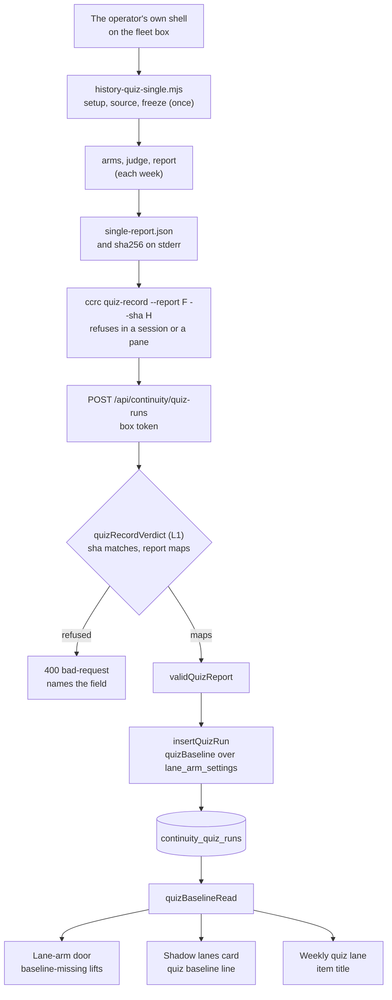

# Overlord W1a: the replay quiz's record path, history's single-arm mode and `ccrc quiz-record` Implementation Plan

> **For agentic workers:** REQUIRED SUB-SKILL: Use superpowers:subagent-driven-development (recommended) or
> superpowers:executing-plans to implement this plan task by task. Steps use checkbox (`- [ ]`) syntax for tracking.

## In short

- **What this is.** The plan for the missing half of the replay quiz piece (`2026-11-10-overlord/w1a-replay-quiz.md`):
  the way the operator runs one recall-on quiz on the fleet box and records it, so the first recorded run becomes M13's
  baseline and the three W1a lanes (`continuity`, `launch-profile`, `anchor-slot`) can go Live. Today their Live is
  refused `baseline-missing`, and nothing can record a run.
- **Two pull requests.** PR 1 is history's single-arm mode: a new driver module, `deploy/history-quiz-single.mjs`, beside
  today's arms, under the history coordinator's five terms (§1). PR 2 is the replay quiz plan's Task 3: `ccrc
  quiz-record`, `POST /api/continuity/quiz-runs`, their censuses, `QUIZ_RECORD_READY` set to `true`, the weekly item's
  steps rewritten to the runbook's real commands, and one line on the Shadow lanes card.
- **The pilot acts are skipped by a recorded ruling, not walked** (§3, measured). A path through them needs a full W2
  part 1 and part 2, a 14 to 15 day window and signed W2 records, which the 2026-11-02 skip ruling forbids. The mode
  therefore runs in its own module, with its own setup record, and never writes a W2 record. The module edits none of
  the four files W2's code check diffs.
- **The report carries no comparison** (§4): one arm, one share with its 95% interval, the counts, and no lift, delta,
  verdict or PASS word. The door maps it to `validQuizReport`'s thirteen fields (§5).
- **The operator's step** (§7): set up once and freeze the questions, then each week run `arms`, `judge` and `report`
  on the fleet box in their own shell, and record with `ccrc quiz-record`. No session runs any of it.
- **What the reader must check.** The skip ruling (open question 1), the question population (question 2), and the
  first run's cost cap (question 3). Open question 2 of the replay quiz plan (which node) stays ruled: the fleet box.

## 1. Goal, scope and the rulings this plan builds on

**Goal:** the operator can run the replay quiz once, recall on and with no A/B window, and record it. The first run
recorded while every W1a lane-arm row reads `shadow` is the baseline, and the guard that already stands
(`decideLaneArmPost`'s `baseline-missing`) then lets those rows go Live.

**Why:** the operator ruled on 2026-11-17 that the three W1a lanes reach Live through a real quiz baseline, which
answers the replay quiz plan's open question 1 ("not taken" is not offered). The departures note of that piece
(`w1a-replay-quiz/departures.md`, slugs `quiz-record-waits-for-the-single-arm-plan` and
`quiz-item-waits-for-the-record-path`) parked Task 3 and the weekly item until this plan.

**Spec:** `docs/superpowers/specs/2026-11-09-overlord-design.md` §3.3.9 C52 ("The replay quiz runs"), §3.3.10 C53 ("The
replay quiz is history's own … a measure only, never a gate on history's waves"), §12 M13 ("quiz above its W0
baseline"); the results note `2026-11-11-overlord-w0-spike-results.md`, "The replay quiz's baseline" (W0-28, ruled B).

**The history coordinator's five terms** (from the departures note; each is a rule of PR 1):

| # | Term | Where this plan keeps it |
|---|---|---|
| 1 | Additive beside today's arms, with a characterization test green on `main` first | A new module (§4); Task 1 is the characterization commit |
| 2 | No edit to the quiz scorer, its code-file list or the frozen-tree diff set | PR 1's diff names none of the four `GATE_CODE_FILES` (§2) |
| 3 | The single-arm report carries no comparison figure: no lift, delta or PASS word | §4's field list; Task 4's absence pin |
| 4 | The pull request number is mailed to that coordinator before its close | Task 5: the worker mails the Overlord coordinator, who relays |
| 5 | This programme's plan names the report's fields, one by one | §4 and §5 |

**The four conditions of W0-28** (the replay quiz plan's Global Constraints) bind both pull requests: the history store
is read read-only and no session runs a writing form of `ccrc history`; no history marker is written by any code here;
the driver runs by the operator's hand; the baseline is never a W2 result, a PASS or a measured benefit of recall.

**The operator's rulings, binding:** W1a's arms wait for a true baseline (open question 1 of the replay quiz plan). The
quiz runs on the fleet box (its open question 2): measured below, nothing argues otherwise.

**Footing.** Everything marked *measured* was read on `main` at `bd82b7f50` (2026-11-17) by reading files. No driver,
no `ccrc history` form and no `ccd` verb was run.

## 2. What exists today

- **The record half is built** (replay quiz plan Tasks 1, 2 and 4, merged). `server/src/continuity/quiz.ts` holds
  `QuizReport`, `QUIZ_REPORT_FIELDS`, `validQuizReport`, `quizBaseline`, `quizItemText`, `quizLaneVerdict` and
  `QUIZ_RECORD_READY = false`. `quizStore.ts` holds the one writer `insertQuizRun` and the reads `quizRuns`,
  `quizRecordedAts` and `quizBaselineRead` (`{ok:true, exists}` or `{ok:false, detail}`, typed `LaneArmBaseline`).
  `continuity_quiz_runs` is migration 77, so **no migration** is needed here. `continuity-quiz-lane.test.ts` pins
  `QUIZ_RECORD_READY === existsSync('server/src/continuity/quizRoutes.ts')`.
- **The guard stands.** `decideLaneArmPost` refuses Live on a W1a row with `baseline-missing` while no baseline row
  exists, and with `state-unreadable` when the read fails. The card's words are `LANE_ARM_TEXT.baselineMissing` and
  `.baselineUnreadable` (`shared/lane-arm.ts`).
- **The driver** (*measured*). `deploy/history-replay.mjs` registers 16 subcommands (`HANDLERS`, pinned in
  `history-replay.test.ts`). `main` refuses `in-pane` (exit 2) on any `TMUX_PANE` (`paneRefusal`) before anything else.
  It has no `CLAUDECODE` check and no TTY check. The quiz arms always run both recall arms: `armAttemptsOf` is called
  through `RECALL_ARMS.map(...)`, and `armsSummaryOf`, `judgeMapOf` and `reportCommand` all assume both.
  `report` writes `verdict.json`, whose `gate` carries `verdict: 'pass'|'fail'|'halt'|'incomplete'` and the paired
  `criteria.accuracy` (`point_t`, `point_c`, `lower`, `upper`).
- **What W2's code check diffs** (*measured*). `GATE_CODE_FILES` (`deploy/history-gate.mjs`) is
  `deploy/history-gate.mjs`, `deploy/measure-history.py`, `deploy/history-replay.mjs` and `ccd/history/lib.mjs`.
  `recheckCode` and `checkGateCode` diff those four files' shas, and that is what the five terms call the frozen-tree
  diff set. `deploy/history-replay.mjs` is also growth-capped (`server/test/growth-caps/deploy-history-replay-mjs.json`,
  cap 6796, D-8635): it may only shrink.
- **The building blocks are exported** (*measured*): `sourceQuiz`, `openWriter`, `mergeSourced`, `frozenListText`,
  `writeFrozenList`, `loadFrozenList`, `openReplayStore`, `spawnArgv`, `spawnEnv`, `runBatch`, `batchGate`,
  `decideBudget`, `armPayloads`, `armAnswerOf`, `readArmAnswers`, `judgeMapOf`, `judgeItemsOf`, `judgeJobsOf`,
  `openJudge`, `judgedOf`, `judgeTallyOf`, `paneRefusal`, `requireListed`, `readHeadlessOn`, `prepareOut`, `claimOut`,
  `TREATMENT_ARM` (`history-replay.mjs`), and `labelCorrect`, `parseAnswerField` and `clusterBootstrap` with its
  `mode: 'share'` (`history-gate.mjs`). The orchestration (`armJob`, `armAttemptsOf`, `armBatchPreflight`,
  `printWithSha`, `refuseOpusModel`) is private, and `loadArmRun` binds an arm run to a W2 part 2.
- **Markers** (*measured*). `SWITCHES` (`ccd/history/lib.mjs`) names `steerOff`, `steerLivePrefix`, `steerOnDir` (one
  file per session id), `headlessOn` and `agentsOn`. `agentsArmedOf` counts only a regular, non-link file as armed. The
  arms need every quiz family listed in `headless-on` (`requireListed`), a marker that is the operator's to write.
- **The node** (*measured*). The driver opens the history store of the box it runs on (`openReplayStore(home)`). The
  families, the accounts and the Claude Code builds the arms spawn are on the fleet box, which also holds the box token
  (`~/.cc-secrets/ccrc-mail.token`) and the server's address (`~/.ccrc/agent.env`, `CCRC_SERVER_URL`). The fleet box
  stands as ruled.

## 3. The pilot acts: a path through them, or a ruling to skip them

The history coordinator measured that the quiz sections run behind part 2's pilot acts. This section measures how, and
recommends one way.

**How the gate works** (*measured*). The pilot acts are `step0b`, `fidelity`, `arms --section pilot` with `judge
--section pilot`, and `pilot-result`. `open --finalize` requires `--pilot-result`, checks it against part 1's sha, and
refuses `pilot-failed` without `--accept-failed-pilot`; it derives the spend budget from the pilot's usage
extrapolation. `arms --section quiz` reads its run through `loadArmRun(flags, 'quiz')`, which calls `loadFinalRecord`:
a signed part 2 carrying the pilot result. Quiz sourcing (`quiz-source`, `freeze`) needs a part 1 draft too. So the
gate is the record chain itself, not a flag.

| | A. A path through the pilot acts | B. A recorded ruling to skip them |
|---|---|---|
| What it runs | W2's acts 7 to 21: step 0a, pilot sourcing, part 1, census, power, the pilot, quiz sourcing, part 2, then the quiz arms | A setup record of its own, quiz sourcing and freezing once, then each week one arm, the judge and a single-arm report |
| Records it writes | Signed W2 part 1 and part 2 | Its own kinds only, which W2's validators refuse |
| Calendar | A 14 to 15 day window (`window-length`) before `report` (`window-open`) | Hours, each week |
| Cost | About 30M token-equivalents for the quiz arms (W2 runbook) plus the pilot | One arm and one judge pass over the frozen list (question 3) |
| Conflicts | Manufactures W2's signed records, which the 2026-11-02 skip ruling forbids unless the operator resumes the study; W2's release freeze (acts 6 to 28) | None found. Its cost is a second orchestration beside W2's arms (below) |
| Files changed | None | A new module. None of the four `GATE_CODE_FILES` |

**Recommendation: B**, recorded as a ruling (open question 1). The pilot exists to check the A/B instrument and to
extrapolate the window's spend. The weekly run has no window and no comparison, and C53 makes it a measure, never a
gate, so a failing run shows up in its counts (`run_failed`, `absent`) rather than as a halt.

**The cost of B, said plainly.** The arm and judge orchestration (`armJob`, `armAttemptsOf`, `armBatchPreflight`) is
private, and exporting it would edit `history-replay.mjs`, which term 2 forbids and its growth cap refuses. So the
module carries its own thin orchestration of one arm over the exported blocks. That is a second mechanism beside W2's
arms, and the module's header records the "legitimately different" reason (CLAUDE.md, Consolidate): term 2 forbids
any edit to the owner, and the W2 code check would read one as `code-changed`.

## 4. History's single-arm mode (PR 1)

A new operator-run module, `deploy/history-quiz-single.mjs`, run as `node --no-warnings ~/ccrc/deploy/history-quiz-single.mjs
<subcommand>` on the fleet box. Its first act is `paneRefusal` (`in-pane`, exit 2), as the driver's is. It also refuses
`in-session` (exit 2) when `CLAUDECODE` is set, a speed bump the driver lacks. It reads the history store only through
`openReplayStore`, so `history-replay.test.ts`'s scan (no `deploy/history-*.mjs` loads `node:sqlite`) covers it. It writes
only under `--out`, through `prepareOut` and `claimOut`, and never writes a marker.

**Subcommands.** Each file it writes is printed as `sha256 <hex>` on stderr, the driver's convention:

| Subcommand | Reads | Writes |
|---|---|---|
| `setup` | `--account`, `--budget`, `--writer-model`, `--judge-model`, `--arm-model`, optional `--target` (default 100) | `setup.json`: kind `ccrc-history-quiz-single-setup`, the fields `sourceQuiz`, `openWriter` and `runBatch` read, a drawn seed, the release and the Claude Code build it measured |
| `source` | `--setup(+sha256)` | `quiz/sourced.json`, through `sourceQuiz` and `openWriter`, over this store's admitted families |
| `freeze` | `--setup(+sha256)`, `--sourced(+sha256)` | `quiz/frozen.json` through `mergeSourced`, `frozenListText` and `writeFrozenList`, and its meta |
| `marker` | `--frozen(+sha256)` | Nothing. It prints the `headless-on` lines the frozen families need, for the operator to write |
| `arms` | `--setup`, `--frozen` (each with sha256) | `quiz/arms-summary.json`: the treatment arm only (`TREATMENT_ARM`, recall on), at most `ARM_ATTEMPTS_MAX` attempts, answers read by `armAnswerOf` |
| `judge` | `--setup`, `--frozen`, `--arms-summary` (each with sha256) | `quiz/judged.json`, through `judgeMapOf(seed, entries, [TREATMENT_ARM])`, `judgeItemsOf`, `openJudge` and `judgedOf` |
| `report` | `--setup`, `--frozen`, `--arms-summary`, `--judged` (each with sha256) | `single-report.json` (below), and its `sha256 <hex>` on stderr |

The judge model must be an exact Opus id: the module asks the same two patterns as `refuseOpusModel`, imported from
`history-gate.mjs` (`EXACT_MODEL_ID_RE`, `OPUS_MODEL_RE`) and never re-spelled. The arm model refuses any Fable id, as
`ARM_MODEL_FORBIDDEN_RE` does. `setup` and `source` run once; their files are reused every week, so every run uses the
same questions, judge model and scoring (the W0-28 minimum).

**The single-arm report** (`single-report.json`, canonical JSON, one trailing newline; term 5, field by field):

| Field | Type | What it is |
|---|---|---|
| `kind` | string | `ccrc-history-quiz-single-report`, never a W2 kind |
| `v` | integer | `1` |
| `measured_ms` | integer | When `report` ran (wall ms) |
| `arm` | string | `treatment`: recall on, the one arm run |
| `frozen_sha256` | hex64 | The frozen question list's sha (`loadFrozenList(...).sha256`) |
| `n_questions` | integer | The frozen list's entries |
| `n_families` | integer | The frozen list's distinct families |
| `share` | `{num, den}` | Correct answers over questions, pooled (`clusterBootstrap`'s point, `mode: 'share'`) |
| `interval` | `{lower: {num, den}, upper: {num, den}, ci, method, B}` | `clusterBootstrap({mode: 'share'})` over one cluster per family, seeded from the setup's seed (`substream(seed, 'quiz-single-ci')`), with `BOOTSTRAP`'s `ci` (95), `method` and `B` |
| `counts` | `{questions, answered, correct, run_failed, absent}` | The tallies, from `judgeTallyOf` over the one arm |
| `judge_model` | string | The setup's judge model |
| `ccrc_release` | string | The release every act of this run ran on; `report` refuses `release-moved` if `arms` and `judge` stamped different ones |
| `claude_code_versions` | string[] | The Claude Code builds the arm and judge spawns ran, sorted and unique |
| `steer_armed` | word | `yes`, `no`, `partial` or `unmeasured`: W3 steering on the frozen families, read by existence through `SWITCHES` at `report` |
| `agents_on_armed` | word | `yes`, `no` or `unmeasured`: W4 agents-on on this node (`agentsArmedOf`) |
| `inputs` | object | `setup_sha256`, `frozen_sha256`, `arms_summary_sha256`, `judged_sha256` |

There is no `verdict`, `gate`, `criteria`, `lift`, `delta` or `pass` key, and the word `PASS` appears nowhere in the file
(term 3; Task 4 pins the absence and goes red when a planted key comes back).

## 5. The record path (PR 2)


*Figure 1. The record flow: the operator runs the quiz and the verb by hand, the door decides in L1 and writes through
the one writer, and three readers read the baseline from that one read.*

**The verb.** `ccrc quiz-record --report <file> --sha <hex>` lives in its own file, `ccd/ccrc-quiz-record` (bash), behind
one dispatch line in `ccd/ccrc`'s `case "$VERB"`, the precedent of `ccrc-test` and `ccrc-testbox-admin` (`ccd/ccrc` is
growth-listed). It refuses `in-session` when `CLAUDECODE` is set, and `in-pane` when `TMUX_PANE` is set, as the driver does
(exit 2, and nothing is posted). It reads the report, which must be a regular file of at most 64 KiB, reads the server's
address and the box token as `ccd-update-sync` reads them, and posts `{"report": "<the file's text>", "sha256": "<hex>"}`.
It prints `recorded run <id>; baseline: yes|no`, or `already recorded as run <id>`, or the refusal's word and detail. It
gets no `ccd/ccrc-api` row: that client is the sessions' closed table, and its header says an operator need "is an
operator tool, not a row below". That is the "legitimately different" reason for its own transport: a security boundary.

**The door.** `server/src/continuity/quizRoutes.ts` registers `POST /api/continuity/quiz-runs` from `server.ts`, beside
`registerContinuityRoutes`. It is box-token gated in its own `onRequest`, as `continuity/routes.ts`'s lanes are
(`checkMailToken`, `MAIL_TOKEN_HEADER`, refusal `unauthenticated`). It sets `bodyLimit` to 64 KiB. Its caller has no
session, so it takes no attribution. It records `recordedBy: 'ccrc quiz-record'`, and its census reason says a session
holding the shared token could still post. The handler measures `sha256` over the received `report` text and passes
`{text, claimedSha, measuredSha}` to the L1 decider. It acts on the answer: 400 `bad-request` with the field,
`insertQuizRun` (503 `write-failed` when that fails), or 501 `not-configured` without a coordination store. Then it
answers `{ok: true, id, fresh, baseline}`. No new refusal word is needed.

**The mapping** (`quiz.ts#quizRecordVerdict`, L1). It refuses a sha that is not 64 lower-case hex or does not equal the
measured one (field `sha256`), a text that is not JSON (field `report`), and a `kind` or `v` it does not know (field
`kind`). Otherwise it builds the thirteen fields below and hands them to `validQuizReport`, whose refusal it passes on
unchanged:

| `QuizReport` field | From the single-arm report | `validQuizReport`'s check |
|---|---|---|
| `measuredAt` | `measured_ms` | positive safe integer |
| `reportSha` | the verified `sha256` of the file's bytes | 64 lower-case hex |
| `questionsSha` | `frozen_sha256` | 64 lower-case hex |
| `questions` | `n_questions` | positive safe integer |
| `families` | `n_families` | positive safe integer |
| `score` | `share.num / share.den` | finite real |
| `lo` | `interval.lower.num / interval.lower.den` | finite real, `lo <= score` |
| `hi` | `interval.upper.num / interval.upper.den` | finite real, `hi >= score` |
| `judgeModel` | `judge_model` | one-line word, at most 200 characters |
| `ccrcRelease` | `ccrc_release` | one-line word |
| `claudeBuilds` | `claude_code_versions` | non-empty list of words |
| `steerArmed` | `steer_armed` | one of `QUIZ_ARMED_WORDS` |
| `agentsOnArmed` | `agents_on_armed` | one of `QUIZ_ARMED_WORDS` |

A zero denominator answers `bad-request` on that field and never divides. The builds and the armed words come from the
report, measured when the run ran, not from the node at record time (slug `builds-come-from-the-report`; `ccrc version`
prints no Claude Code build, *measured*).

## 6. The baseline, and what the Shadow lanes card shows

**What makes the first recorded run the baseline** (unchanged, `quiz.ts#quizBaseline`): no earlier row is a baseline,
and every row of `W1A_ARM_ROWS` reads exactly `shadow` in `lane_arm_settings` when `insertQuizRun` writes, inside its
own transaction. A row stored `live`, an unknown token or a failed read makes no baseline. The verb prints whether the
run became one. A resend of the same report (the same `reportSha`) writes nothing and answers the first row.

**Afterwards.**
- The lane-arm door no longer refuses `baseline-missing`. Each W1a row's Live then turns on its own gate and the
  confirm key, as before.
- The weekly lane's title drops "the baseline", because `quizItemText` reads the same fact.
- **The new card line** (Task 9): the Shadow lanes card shows one line under its rows, from `quizBaselineRead`:
  "Replay quiz baseline: recorded 24 Nov 2026", "Replay quiz baseline: not yet", or "Replay quiz baseline: could not be
  read".
  - `quizBaselineRead` gains the baseline row's `recordedAt`. It answers `{ok: true, exists: true, at}`,
    `{ok: true, exists: false, at: null}` or `{ok: false, detail}`. That shape is still assignable to `LaneArmBaseline`,
    so `decideLaneArmPost` and the lane do not change.
  - `laneArmViewOf` takes the read and puts an optional `quizBaseline` on `LaneArmView`. The field is additive, and an
    older server's view without it shows no line.
  - The words are `LANE_ARM_TEXT.quizBaseline(...)` in `shared/lane-arm.ts`. The date is rendered in the console's
    time zone by the PWA.

## 7. The operator's runbook

The step the operator takes. Every command runs on the fleet box, in the operator's own shell, outside tmux and outside
any Claude Code session (both refuse). `<OUT>` is a directory of the operator's choosing outside every work tree, made
once; `<WEEK>` is a fresh directory per run. Each `--x-sha256` is the hex the previous command printed as
`sha256 <hex>` on stderr.

```bash
Q="node --no-warnings $HOME/ccrc/deploy/history-quiz-single.mjs"

# Once: the setup and the frozen questions (every later run reuses them).
$Q setup  --out <OUT> --account <account> --budget <tokens> \
          --writer-model <exact opus id> --judge-model <exact opus id> --arm-model <exact model id>
$Q source --out <OUT> --setup <OUT>/setup.json --setup-sha256 <H_SETUP>
$Q freeze --out <OUT> --setup <OUT>/setup.json --setup-sha256 <H_SETUP> \
          --sourced <OUT>/quiz/sourced.json --sourced-sha256 <H_SOURCED>
$Q marker --frozen <OUT>/quiz/frozen.json --frozen-sha256 <H_FROZEN>
#   then write the printed lines into ~/.ccrc/history/headless-on yourself (the marker is yours; nothing writes it)

# Each week, the baseline first: before arming any W1a lane.
$Q arms   --out <WEEK> --setup <OUT>/setup.json --setup-sha256 <H_SETUP> --frozen <OUT>/quiz/frozen.json --frozen-sha256 <H_FROZEN>
$Q judge  --out <WEEK> --setup <OUT>/setup.json --setup-sha256 <H_SETUP> --frozen <OUT>/quiz/frozen.json --frozen-sha256 <H_FROZEN> \
          --arms-summary <WEEK>/quiz/arms-summary.json --arms-summary-sha256 <H_ARMS>
$Q report --out <WEEK> --setup <OUT>/setup.json --setup-sha256 <H_SETUP> --frozen <OUT>/quiz/frozen.json --frozen-sha256 <H_FROZEN> \
          --arms-summary <WEEK>/quiz/arms-summary.json --arms-summary-sha256 <H_ARMS> \
          --judged <WEEK>/quiz/judged.json --judged-sha256 <H_JUDGED>

# Record it.
ccrc quiz-record --report <WEEK>/single-report.json --sha <H_REPORT>
```

The baseline is the first record taken while all three W1a rows on the Shadow lanes card read Shadow; the verb says
whether it became one. PR 1 adds this text to a new runbook file,
`docs/superpowers/plans/2026-11-17-overlord-quiz-record/runbook.md`. PR 2 copies its commands, in short form, into the
weekly item's `how` steps.

## 8. Global constraints

- **SAFETY (`CLAUDE.md`).** No session, worker or test runs the module or the verb against the live home. Their tests
  use fixture HOMEs (`makeCcdHarness`, `tmpHelpers.ts`) and a stub server. No code here writes under `~/.ccrc/history`,
  writes a history marker, or runs a writing form of `ccrc history`. Those stay the operator's, and the module refuses
  inside a pane and inside a session. The verb never prints the token.
- **The five terms and the four conditions** (§1) bind every task. PR 1's diff names none of the four `GATE_CODE_FILES`.
  Check it with `git diff --name-only origin/main...HEAD` before the push.
- **Architecture.** One writer: `insertQuizRun`. Decide in L1 (`quizRecordVerdict`, `validQuizReport`, `quizBaseline`,
  `laneArmViewOf`), act in L4 (the door measures the sha, calls, maps the answer). The module's own orchestration
  carries its recorded reason (§3), and so does the verb's transport (§5). An adapter keeps every distinction:
  `quizBaselineRead` never folds a failed read into "not yet".
- **Censuses PR 2 touches** (*measured*). All four counts move by one, and each test that reads them is updated in the
  same commit:
  - `server/src/auth/gate.ts`: an `EXEMPT` entry for `POST /api/continuity/quiz-runs`, reason "the operator's quiz record
    from the box: box-token gated, refused inside a session and a pane at the client, recordedBy names the verb". The
    prose counts "eighty-six" become "eighty-seven".
  - `server/test/auth-gate.test.ts`: `...scanRoutes('continuity/quizRoutes.ts')` in `ROUTES`; `ROUTES.length` goes from
    256 to 257 and the exempt count from 95 to 96; the per-file count; the ORDER-PINNED title's number words.
  - `server/test/box-token-census.test.ts`: `QUIZ_SRC`, `QUIZ_LANES = lanesIn(QUIZ_SRC)`, joined to `ALL_LANES` and
    `MACHINE_LANES`, `'eighty-seven'` in the words list, `expect(QUIZ_LANES).toEqual(['POST /api/continuity/quiz-runs'])`
    and the lane sum.
  - `server/test/rings/fastify-l4.data.ts`: `'server/src/continuity/quizRoutes.ts'`, with a reason and `since`.
  - `README.md`'s auth paragraph: "eighty-six machine lanes" becomes "eighty-seven", and the door is named.
  - `CLAUDE.md`'s box-token bullet: one clause naming the quiz record door as a box-token door with no attribution,
    whose caller is the operator's shell. Before writing it, read what `box-token-census.test.ts`'s CLAUDE.md reader
    demands.
  - `ccd/ccrc-api` ROUTES: **no row** (§5). `ccrc-api-closed.test.ts` stays green unchanged.
  - `server/test/ccrc-cli.test.ts`: the usage line gains `quiz-record`, plus one help row. New usage text goes in a
    helper below `ccd/ccrc`'s corpus cut, as `_usage_test_paragraph` does.
  - `ccrc-doctorFixture.ts` and the install census: a sibling file is symlinked and installed as `ccrc-test` is. Measure
    with `grep -rn "ccrc-test" server/test/*Fixture.ts server/test/install*`.
- **Refusal words.** None is new: `bad-request`, `unauthenticated`, `not-configured` and `write-failed` exist in
  `shared/refusal.ts`.
- **Tests.** Every run goes through `ccrc test -- …` from the package. PR 1's new test files are named `history-*.test.ts`,
  so `ci-pipeline.test.ts` requires each in CI's node-floor Test step. That line edits `.github/workflows/ci.yml`, which
  makes PR 1 a full CI run (`infraTrigger`).
- **Mutation floors.** `quizRecordVerdict` joins `QUIZ_MUTANT_SETS` (`server/test/sim/quizSets.ts`) with a floor in
  `mutation-floors.json`. The single-arm report's no-comparison guard is proven with
  `ccd/coordinator-skill/references/mutation-run.py`: drop the guard, see red, restore.
- **Growth.** `ccd/ccrc` grows by the dispatch line and a usage mention (well under 40). `server/src/coord/routes.ts` grows
  by the read passed to `laneArmViewOf` in the GET and POST builders (a few lines). `deploy/history-replay.mjs` is not
  touched. The new files carry no cap.
- **Claims.** PR 2 touches `server/src/coord/routes.ts`, `server/src/auth/gate.ts`, `README.md` and `CLAUDE.md`, which
  peers often hold. Claim before editing, and mail a holder through the 409's `mailHint`.
- **No private names; cite by symbol or `@anchor`; no D-number invented** (departures by slug, §12).

## 9. The PR split

| PR | Title | Tasks | Merges after |
|---|---|---|---|
| 1 | `feat(history): the replay quiz's single-arm mode (Overlord W1a)` | 1 to 5 | This plan, and open question 1 ruled |
| 2 | `feat(continuity): ccrc quiz-record and the quiz record door (Overlord W1a Task 3)` | 6 to 9 | PR 1 (its runbook commands and its report kind) |

PR 2's contract test runs PR 1's `report` builder on a fixture and feeds the output to the door, so the two cannot
drift. PR 1's number is mailed to the Overlord coordinator when it opens, for relay to the history coordinator before
its close (term 4). PR 2 sets `QUIZ_RECORD_READY` to `true`, so the weekly lane raises its first item the week it merges.

## 10. Tasks

### Task 1: Characterize the blocks the mode reuses, green on `main` (PR 1)

**Files:**
- Create: `server/test/history-quiz-single-characterization.test.ts`
- Modify: `.github/workflows/ci.yml` (the node-floor Test step lists the file)

- [ ] **Step 1: Write the characterization tests** against `main`'s code, imports only. On fixed inputs, pin:
  `clusterBootstrap({mode: 'share'})`'s `{point, lower, upper}`; `labelCorrect` and `parseAnswerField` on a fixed answer
  set; `judgeMapOf(seed, entries, [TREATMENT_ARM])`; `armPayloads`' treatment payload on a fixture store;
  `frozenListText` and `loadFrozenList` round-trip. Also pin `GATE_CODE_FILES`' value and the driver's `HANDLERS` list
  (the mode adds no subcommand to it).
- [ ] **Step 2: Run on `main`.** `cd server && ccrc test -- ./node_modules/.bin/vitest run test/history-quiz-single-characterization.test.ts`.
  Green. If a block cannot be reached without a W2 record, record it in the task note and stop for a ruling.
- [ ] **Step 3: Commit.** `test(history): characterize the quiz blocks the single-arm mode reuses (Overlord W1a)`

### Task 2: The module, its refusals, setup, source, freeze and marker (PR 1)

**Files:**
- Create: `deploy/history-quiz-single.mjs`
- Test: `server/test/history-quiz-single.test.ts` (fixture HOME, stub writer through `sourceQuiz`'s deps, as
  `history-replay.test.ts` does)

- [ ] **Step 1: Measure** the setup's fields: every field `sourceQuiz`, `openWriter`, `runBatch` and `batchGate` read off
  a part 1 record, with W2's defaults (`OPEN_RECORD_V1`). Write the list into the task note.
- [ ] **Step 2: Failing tests.** `TMUX_PANE` set refuses `in-pane` and `CLAUDECODE` set refuses `in-session` (exit 2),
  before any file is read. `setup` writes kind `ccrc-history-quiz-single-setup`, which `validateOpenRecord` refuses.
  `source` then `freeze` on the fixture store gives a frozen list whose sha `loadFrozenList` reads. `marker` prints the
  frozen families' lines and writes nothing (the fixture HOME's `headless-on` is unchanged). A non-Opus judge model
  refuses. The module loads no `node:sqlite` (the existing scan sees it).
- [ ] **Step 3: Run.** Red. **Step 4: Implement.** **Step 5: Run.** Green.
- [ ] **Step 6: Commit.** `feat(history): the single-arm quiz module: setup, sourcing and freezing (Overlord W1a)`

### Task 3: One arm and its judge (PR 1)

**Files:** Modify: `deploy/history-quiz-single.mjs`. Test: `server/test/history-quiz-single.test.ts`.

- [ ] **Step 1: Failing tests.** `arms` spawns only `TREATMENT_ARM` (the stub spawner sees no control job) at most
  `ARM_ATTEMPTS_MAX` times. It refuses a family not listed in `headless-on` (`requireListed`), stops at the budget
  (`batchGate`), and writes `arms-summary.json` with one arm. `judge` judges that arm only and writes `judged.json`.
  Neither writes outside `--out`.
- [ ] **Step 2: Run.** Red. **Step 3: Implement**, with the header's recorded reason for the module's own orchestration.
  **Step 4: Run.** Green.
- [ ] **Step 5: Commit.** `feat(history): the single-arm quiz runs one recall-on arm and its judge (Overlord W1a)`

### Task 4: The single-arm report (PR 1)

**Files:** Modify: `deploy/history-quiz-single.mjs` (export `singleReportOf` for PR 2's contract test). Test:
`server/test/history-quiz-single.test.ts`.

- [ ] **Step 1: Failing tests.** The report has exactly §4's fields, canonical JSON and one newline, and the stderr sha
  is over those bytes. `share` and `interval` equal `clusterBootstrap({mode: 'share'})` on the same clusters and seed.
  No key named `verdict`, `gate`, `criteria`, `lift`, `delta` or `pass` appears at any depth, and the text holds no
  `PASS`. Mixed releases refuse `release-moved`. The armed words read `yes`, `no`, `partial` and `unmeasured` from
  fixture markers. A lstat that fails reads `unmeasured`, never `no`.
- [ ] **Step 2: Run.** Red. **Step 3: Implement.** **Step 4: Run.** Green.
- [ ] **Step 5: Mutation.** With `mutation-run.py`, delete the absence guard and plant a `lift` key: red. Restore.
- [ ] **Step 6: Commit.** `feat(history): the single-arm quiz report, with no comparison figure (Overlord W1a)`

### Task 5: The runbook, the term check and the relay (PR 1)

**Files:** Create: `docs/superpowers/plans/2026-11-17-overlord-quiz-record/runbook.md` (§7's text) and the task note
`docs/superpowers/plans/2026-11-17-overlord-quiz-record/pr-1.md`.

- [ ] **Step 1:** `git diff --name-only origin/main...HEAD` names none of the four `GATE_CODE_FILES`. Record the output in
  the task note.
- [ ] **Step 2:** the whole server suite and both `tsc` runs, once, through `ccrc test`. Record the first run's colour.
- [ ] **Step 3:** open the PR. Mail its number to the Overlord coordinator for relay to the history coordinator (term
  4). Name it in the wave-done.
- [ ] **Step 4: Commit.** `docs(plan): the single-arm quiz runbook (Overlord W1a)`

### Task 6: The door and its mapping (PR 2)

**Files:**
- Modify: `server/src/continuity/quiz.ts` (`quizRecordVerdict`; `QUIZ_RECORD_READY = true`)
- Create: `server/src/continuity/quizRoutes.ts`; Modify: `server/src/server.ts`
- Modify: `server/test/sim/quizSets.ts`, `server/test/sim/mutation-floors.json`
- Test: `server/test/continuity-quiz-route.test.ts` (new), `server/test/continuity-quiz.test.ts`,
  `server/test/continuity-quiz-lane.test.ts`

- [ ] **Step 1: Failing tests.** In the decider: every row of §5's mapping table, a sha mismatch, a malformed sha, a
  non-JSON text, an unknown kind, and a zero denominator each refuse naming their field. At the route: no token answers
  401; a malformed body answers 400 naming the field; a good report answers 200 with `id`, `fresh: true` and
  `baseline`; a resend answers `fresh: false` and the same id. In the contract test, PR 1's `singleReportOf` output maps
  and inserts. With `QUIZ_RECORD_READY` true, the lane raises once a week (the pin's present direction).
- [ ] **Step 2: Run.** Red. **Step 3: Implement.** **Step 4: Run.** Green. Register `quizRecordVerdict`'s floor.
- [ ] **Step 5: Mutation.** Drop the sha comparison: red. Restore.
- [ ] **Step 6: Commit.** `feat(continuity): the quiz record door, POST /api/continuity/quiz-runs (Overlord W1a Task 3)`

### Task 7: The operator's verb (PR 2)

**Files:** Create: `ccd/ccrc-quiz-record`. Modify: `ccd/ccrc` (one dispatch line, a usage mention). Test:
`server/test/ccrc-quiz-record.test.ts` (new, fixture HOME, stub server), `server/test/ccrc-cli.test.ts`.

- [ ] **Step 1: Failing tests.** `CLAUDECODE` set refuses `in-session`, and `TMUX_PANE` set refuses `in-pane`; neither
  posts, and the stub sees no request. A missing file, a non-regular file and one over 64 KiB each refuse. A good report
  posts once, with the token header, and prints `recorded run <id>; baseline: yes`. A 400 prints its word and detail and
  exits 1. The token never appears in stdout or stderr.
- [ ] **Step 2: Run.** Red. **Step 3: Implement.** **Step 4: Run.** Green.
- [ ] **Step 5: Commit.** `feat(ccrc): quiz-record, the operator's record of a replay quiz run (Overlord W1a Task 3)`

### Task 8: The censuses and the weekly item's steps (PR 2)

**Files:** every census of §8, and `server/src/continuity/quiz.ts#quizItemText`.

- [ ] **Step 1:** update each census and its test in one commit. Then run `auth-gate`, `box-token-census`,
  `rings/*`, `ccrc-api-closed`, `ccrc-cli` and `single-definition/*`, all green.
- [ ] **Step 2:** rewrite `quizItemText`'s first two `how` steps to §7's commands, in short form, naming the runbook
  file. Leave the title untouched: the lane keys "once a week" on it (review 2121 F6). The lane test pins the new
  steps.
- [ ] **Step 3: Commit.** `docs(continuity): the quiz record door in every census, and the item's real commands (Overlord W1a Task 3)`

### Task 9: The Shadow lanes card's baseline line (PR 2)

**Files:**
- Modify: `server/src/continuity/quizStore.ts` (`quizBaselineRead` carries `at`), `server/src/coord/laneArm.ts`
  (`laneArmViewOf` takes the read), `server/src/coord/routes.ts` (the GET and POST pass it), `shared/lane-arm.ts`
  (`LaneArmView.quizBaseline?`, `LANE_ARM_TEXT.quizBaseline`)
- Modify: `pwa/src/fleet/laneArmWords.ts` (`asLaneArmView` reads the optional field), `pwa/src/fleet/ShadowLanesSection.tsx`
- Test: `server/test/lane-arm-route.test.ts`, `server/test/continuity-quiz.test.ts`, `pwa/test/shadow-lanes-section.test.tsx`

- [ ] **Step 1: Failing tests.** The view carries `{state: 'recorded', at}`, `{state: 'not-yet'}` or
  `{state: 'unreadable'}`, each from the matching read. A view without the field still parses and shows no line. The
  card shows each of the three lines. `decideLaneArmPost`'s cases are unchanged.
- [ ] **Step 2: Run.** Red. **Step 3: Implement.** **Step 4: Run.** Green. Then the whole server and pwa suites and both
  `tsc` runs, once.
- [ ] **Step 5: Commit.** `feat(lane-arm): the Shadow lanes card shows the replay quiz baseline (Overlord W1a)`

## 11. Review focus

1. PR 1 edits none of `GATE_CODE_FILES`, writes no W2 record kind, writes no marker, and refuses inside a pane and a
   session before reading anything.
2. The single-arm report carries no comparison, verdict or PASS (term 3), and its interval comes from W2's own
   `clusterBootstrap`, unchanged.
3. The door decides in L1 and verifies the sha itself. `quizBaselineRead` never folds a failed read into "not yet",
   and the baseline rule is untouched.
4. Every census moves by exactly one, in both directions. `ccrc-api` gains no row.

## 12. Deviations found

None has a D-number; the coordinator folds them into the ledger.

- **single-arm-mode-is-its-own-module** — the mode is a new module, not a flag or a subcommand of the driver: term 2
  forbids editing the driver, and its growth cap refuses any growth.
- **pilot-acts-skipped-by-ruling** — the mode skips W2's pilot acts and part 2 instead of walking them (§3; open question
  1 asks for the ruling).
- **single-arm-orchestration-beside-w2** — the module carries its own one-arm orchestration over the exported blocks;
  the recorded reason is term 2 (§3).
- **builds-come-from-the-report** — Task 3 of the replay quiz plan had the verb read the release and Claude Code
  builds from `ccrc version`, which prints no Claude Code build. The report carries what the run used.
- **armed-words-come-from-the-report** — the steer and agents-on words are measured at `report` over the frozen
  families, not by the verb at record time.
- **the-door-checks-the-sha** — the verb posts the report's text, and the door measures its sha. Task 3 had the verb
  check it.
- **quiz-record-refuses-any-pane** — the verb refuses in any pane, as the driver does, not only in a `cc-*` one.
- **quiz-record-has-no-ccrc-api-row** — the verb has its own transport, because the sessions' closed client carries no
  operator verb.
- **recorded-by-is-the-verb** — the door records `recordedBy: 'ccrc quiz-record'`, because its caller has no session.
- **baseline-read-carries-its-date** — `quizBaselineRead` gains the baseline's `recordedAt` for the card line, kept
  assignable to `LaneArmBaseline`.

## Where things stand

**Agreed**
- The operator's rulings: W1a's arms wait for a true baseline, and the quiz runs on the fleet box (measured: the store,
  the families, the token and the address are all there).
- The five terms and the four conditions, each placed in a task (§1).
- No migration, no new refusal word, and no `ccrc-api` row.

**Waiting on you**
- Open questions 1 to 3 below, ruled at review.
- The relay of PR 1's number to the history coordinator before PR 1 closes (term 4).

**Later**
- A coordinator-only question population, if question 2 is ruled "all families" now.
- The Overlord's weekly drift reading over these rows (C52, W1).
- What a weekly run does while a W2 window is open, if the operator ever resumes the study (it would share the
  account's limits).

## Open questions

1. **May the single-arm mode skip W2's pilot acts by a recorded ruling?** The quiz arms sit behind part 2, and part 2
   sits behind the pilot. Walking them means a W2 part 1 and part 2, a 14 to 15 day window and signed W2 records, which
   the 2026-11-02 skip ruling forbids. **Recommendation: yes, skip by ruling (option B, §3).** The run is a measure,
   never a gate (C53). Its failures show in its counts. Its records are its own kinds, so no W2 record is
   manufactured. This needs the operator's word, and the history coordinator's through the relay, because the pilot
   is that programme's instrument.
2. **Which families does the quiz draw from: every admitted family on the fleet box, or coordinators only?** M13 reads
   "Coordinators: … the weekly replay quiz score". But `sourceQuiz` has no family filter, and adding one edits a
   `GATE_CODE_FILES` member, which term 2 forbids. **Recommendation: every admitted family, as W2 does,** and the
   report's `n_families` says how many. A coordinator filter waits for that programme to add one.
3. **What spend cap does the setup take for the first run?** One arm over 100 questions, at most two attempts each,
   plus the judge, each week. The W2 runbook's figure (about 30M token-equivalents) covers both arms over a 14-day
   window, so it is no estimate for this run. **Recommendation:** set `--budget` at the operator's chosen weekly
   ceiling. Record the first run's spend (the module's spend ledger) in the item's ledger, and revisit after the
   baseline.
4. **What happens when the interval does not contain the score?** `validQuizReport` refuses `lo > score` or
   `hi < score`. A nearest-rank percentile bootstrap almost always contains the pooled point, but with very few
   families it may not. **Recommendation:** leave it refused. Such a run is not recorded, and the operator re-runs
   with more families. Clamping would fabricate the interval.
