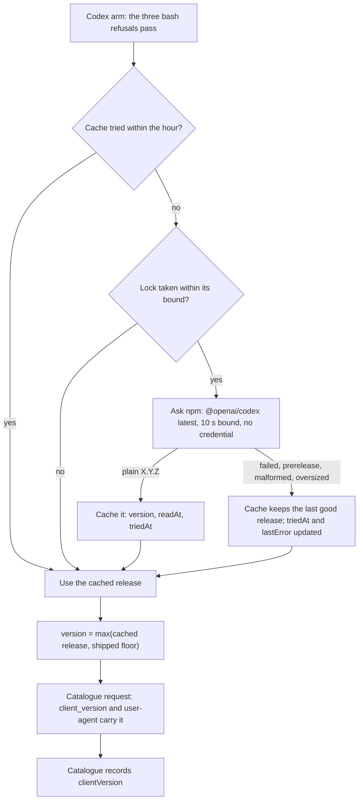

# Model-class-advance wave 2: the Codex client version tracks the published release

Programme: `model-class-advance` (ledger `docs/superpowers/programs/model-class-advance.md`), wave 2 of 10, run 2454,
ticket `client-version-tracks`.
Spec: `docs/superpowers/specs/2026-10-13-model-class-auto-advance-design.md`. The rule this wave reverses is in
`docs/superpowers/specs/2026-09-08-model-class-registry-design.md` §5.
Execution: `superpowers:executing-plans` with `superpowers:test-driven-development`. Every test and typecheck runs
through `ccrc test`.

## In short

`ccd/ccrc-models-probe` asks the Codex catalogue for the models a given client version may use. Wave 1 (#3023) raised
the shipped constant from `0.160.0` to `0.170.0` by hand. That constant falls behind again at every Codex release, and
the owner's rule of 2026-10-07 is that nobody keeps model currency up by hand. In this wave the probe learns the
published Codex CLI release from npm's registry, at most once an hour for the whole box. It asks as the greater of that
release and the shipped constant, and it says the same version in its user-agent. The catalogue records the version it
was fetched as.

*Figure 1. How the Codex arm picks the client version it asks as.*

## 1. What changes

The Codex arm's fetch gains one step before the catalogue request. Everything else the probe does is unchanged.

| Piece | Today | After this wave |
|---|---|---|
| `client_version` in the request | the constant `CODEX_CLIENT_VERSION` | `max(published release, CODEX_CLIENT_VERSION)` |
| The constant | the version asked as | the floor, never undercut |
| The user-agent | `codex_cli_rs/0.0.0 (Unknown 0; unknown) unknown` | `codex_cli_rs/<version> (Unknown 0; unknown) unknown` |
| The catalogue file | `probe`, `fetchedAt`, `stale`, `models` | the same, plus `clientVersion` on a Codex catalogue |
| npm | never asked | `GET https://registry.npmjs.org/@openai/codex/latest`, at most once an hour per box |

### 1.1 The release lookup

- **Source.** npm's registry answer for `@openai/codex` at its `latest` dist-tag, read with `curl -q` (no `.curlrc`),
  `--proto '=https'`, `--max-redirs 0`, `--max-time 10` and a size cap. Nothing is sent but the URL and an `Accept`
  header: no credential, no `.netrc`, no npm config.
- **What is read.** The answer's `version`, and nothing else. Only a plain `X.Y.Z` of decimal numbers is accepted: a
  prerelease or build suffix, a leading zero, an oversized number, an answer over the size cap, or an answer that is
  not a JSON object is refused as a failed lookup.
- **The cache.** One file, `~/.ccrc/codex-client-release.json`, written atomically (temp file and rename in the same
  directory), mode 0600. It holds `version` and `readAt` (the last good release and when it was read), `triedAt` (the
  last attempt, good or not) and `lastError` (the last failure's reason, bounded, absent after a success).
- **Cadence.** A lookup runs only when `triedAt` is more than an hour old, absent, unreadable or in the future. A lock
  file beside the cache serialises lanes refreshing at the same moment: a probe that cannot take it within its bound
  uses the cache as it stands, so two lanes never both ask in one hour.
- **Failure.** A failed, slow or refused lookup uses the cached release, else the floor. It never fails the probe,
  never changes `--check`'s exit status and never blocks the catalogue request beyond its bound.
- **The floor.** The version asked as is never below `CODEX_CLIENT_VERSION`. An older published release (npm's
  `latest` moved back) is cached as what npm said and is not used.

### 1.2 The test seam

`CCRC_MODELS_PROBE_RELEASE_FIXTURE`, when set, replaces the npm request, and only that request, with a read of the
named file. A missing file through it is a failed lookup. It is read in one place, as the catalogue seam is, and it is
a `fixture-path` row of the settings census. The catalogue seam (`CCRC_MODELS_PROBE_FIXTURE`) still replaces the whole
fetch, so a run through it makes no lookup and writes no `clientVersion`.

## 2. Tasks

### Task 1: the plan, the ruling and the spec rows

- This file, with D-8743 defined below.
- Amend the registry spec §5's `codex` row and §4.2's catalogue example to say the client version tracks the
  published release, with the constant as a floor.

### Task 2: red tests first

In `server/test/models-probe.test.ts`, through the Codex arm's fixture runtime (`probeRuntime`), which records every
catalogue request with its headers:

1. A newer published release is asked as, in both `client_version` and the user-agent.
2. An older release, a prerelease, a malformed answer and an oversized answer each fall to the floor.
3. A failed lookup uses the cached release; with no cache it uses the floor.
4. A cache tried within the hour is used and npm is not asked; one tried over an hour ago is refreshed.
5. The user-agent and `client_version` agree on every case.
6. The catalogue records `clientVersion`, and `parseCatalogue` keeps it on a Codex catalogue only, as a plain `X.Y.Z`.
7. The network branch sends no credential: a recording `curl` sees `-q`, `--proto =https`, `--max-redirs 0`, the
   exact npm URL, and no `-K`, `-H Authorization`, `-u` or `--netrc`.
8. The release seam is read in exactly one place.

Each must be red against today's probe before Task 3.

### Task 3: the lookup in the probe

`_codex_client_version` in `ccd/ccrc-models-probe`: one python program (lock, cache, lookup by `curl`, validation,
atomic write) that prints the version to ask as. `_fetch_codex_lane` calls it after its three refusals, exports the
result as `CODEX_CLIENT_VERSION` and writes it to `$TMPD/client-version`; the python request reads it for both the URL
and the user-agent. The normaliser adds `clientVersion` to a Codex catalogue when that file holds a plain `X.Y.Z`.

### Task 4: the catalogue field

`shared/models.mjs`'s `parseCatalogue` keeps `clientVersion` on a Codex catalogue when it is a plain `X.Y.Z` and drops
it otherwise; `shared/models.ts`'s `Catalogue` gains it as optional. Older readers ignore it already: `parseCatalogue`
drops unknown fields.

### Task 5: censuses, mutation rows, the suite

- The settings census gains the seam's row; the python-heredoc count in `ccd-harness-integrity.test.ts` moves by one.
- Each guard gets a mutation row measured red and restored from a saved copy (table below).
- The models-probe, models, settings-census, harness-integrity and `ccrc-models` suites, then the PR's CI.

## 3. Mutation rows

| Guard | Mutation | Expected red |
|---|---|---|
| floor never undercut | use the release even when older | older-release case |
| plain `X.Y.Z` only | accept any string | prerelease and malformed cases |
| size cap | remove it | oversized case |
| hourly cadence | always look up | within-the-hour case |
| failure uses the cache | ignore the cache on failure | failed-lookup-with-cache case |
| user-agent carries the version | restore `0.0.0` | agreement case |
| catalogue records the version | drop `clientVersion` | catalogue case |
| no credential to npm | drop `-q` | network-argv case |

Measured results are below.

## Mutation results

Measured 2026-11-18 on this branch. Each row applied one exact replacement to the named file, ran
`server/test/models-probe.test.ts` through `ccrc test`, and restored the file from its saved bytes. The coordinator's
`mutation-run.py` mutates a Python module in memory, and these guards live in a bash script (with embedded Python)
driven by vitest, so the rows ran through a small script that does the same save, mutate, run and restore by hand.

| Row | File | Mutation | Result |
|---|---|---|---|
| M1 | probe | the release is used even below the floor | killed (2 cases) |
| M2 | probe | any version string is accepted | killed (5) |
| M3 | probe | the size cap is removed | survived at first: cutting the read at the cap already broke the JSON. A case with a good object padded past the cap was added; then killed (2) |
| M4 | probe | a lookup on every run | killed (3) |
| M5 | probe | a failed lookup drops the cached release | killed (1) |
| M6 | probe | the user-agent back to `0.0.0` | killed (20) |
| M7 | probe | the catalogue does not record the version | killed (2) |
| M8 | probe | `curl` without `-q` (reads `.curlrc`) | killed (1) |
| M9 | probe | no lock wait | killed (1) |
| M10 | probe | a try stamped in the future is trusted | killed (1) |
| M11 | `shared/models.mjs` | `parseCatalogue` keeps any `clientVersion` | killed (1) |
| M12 | probe | the request asks as the floor | killed (6) |
| M13 | `server/test/ccdWsHelpers.ts` | contained envs leave the release seam empty | killed (1) |
| M14 | probe | a failed try is not recorded | killed (12) |

## Deviations found

- **D-8743 — the Codex client version follows the published release (the coordinator's ruling, 2026-11-18).** The
  probe asks the Codex catalogue as the published Codex CLI release, learned on its own from npm's registry answer for
  `@openai/codex`'s `latest` dist-tag (`version`). It accepts only a plain `X.Y.Z` and refuses a prerelease, a
  malformed or an oversized answer. It asks as the greater of that release and the shipped constant, which stays as a
  floor and is never undercut. One cache file holds the last good release and when it was read, and the lookup runs at
  most once an hour for the whole box. A failed or slow lookup (bounded at 10 s) uses the cached value, else the
  floor, and never blocks or fails the catalogue fetch. The user-agent carries the same version. The catalogue records
  the client version it was fetched as, in an additive field older readers ignore. No credential goes to npm, and
  nothing but the version string is read from the answer. This reverses the registry spec's "bumped deliberately"
  rule (§5) under the owner's rule of 2026-10-07. Its cost if wrong: a newer client version can list a model the
  bridge serves badly; each class move still waits on a passing canary, and a hold stops a class.

## Follow-ups (not this wave)

- **Doctor warning on a stale release lookup.** Warn when the lookup has failed for over a day (`now - readAt` over a
  day with `triedAt` recent, or no `readAt` at all after a day of tries). It needs `ccd/ccrc-doctor-checks`, held for
  #2943 until after 2026-11-21. The coordinator files it.
- **`ccd/ccgpt-usage.py`'s user-agent.** It sends the same `codex_cli_rs/0.0.0` user-agent the probe sent. Out of this
  wave's files; named for the coordinator.

## Where things stand

- **Agreed:** D-8743 as above; the files this wave keeps to.
- **Waiting on you:** nothing.
- **Later:** the two follow-ups above.
