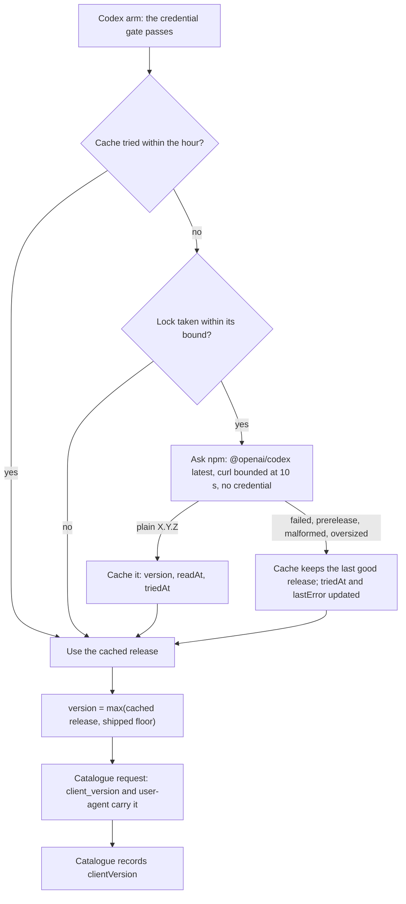

# Model-class-advance wave 2: the Codex client version tracks the published release

Programme: `model-class-advance` (ledger `docs/superpowers/programs/model-class-advance.md`), wave 2 of 10, run 2454,
ticket `client-version-tracks`.
Spec: `docs/superpowers/specs/2026-10-13-model-class-auto-advance-design.md`. The rule this wave reverses is in
`docs/superpowers/specs/2026-09-08-model-class-registry-design.md` §5.
Execution: `superpowers:executing-plans` with `superpowers:test-driven-development`. Every test and typecheck runs
through `ccrc test`.

## In short

`ccd/ccrc-models-probe` asks the Codex catalogue for the models a given client version may use. Wave 1 (#3023) raised
the shipped constant from `0.160.0` to `0.170.0` by hand. That constant falls behind again at every Codex release, and
the owner's rule of 2026-10-07 is that nobody keeps model currency up by hand. In this wave the probe learns the
published Codex CLI release from npm's registry, at most once an hour for the whole box. It asks as the greater of that
release and the shipped constant, and it says the same version in its user-agent. The catalogue records the version it
was fetched as.

*Figure 1. How the Codex arm picks the client version it asks as.*

## 1. What changes

The Codex arm's fetch gains one step before the catalogue request, taken past the credential gate (fix round 1, A8),
so a run that sent nothing asked npm for nothing. Everything else the probe does is unchanged.

| Piece | Today | After this wave |
|---|---|---|
| `client_version` in the request | the constant `CODEX_CLIENT_VERSION` | `max(published release, CODEX_CLIENT_VERSION)` |
| The constant | the version asked as | the floor, never undercut |
| The user-agent | `codex_cli_rs/0.0.0 (Unknown 0; unknown) unknown` | `codex_cli_rs/<version> (Unknown 0; unknown) unknown` |
| The catalogue file | `probe`, `fetchedAt`, `stale`, `models` | the same, plus `clientVersion` on a Codex catalogue |
| npm | never asked | `GET https://registry.npmjs.org/@openai/codex/latest`, at most once an hour per box |

### 1.1 The release lookup

- **Source.** npm's registry answer for `@openai/codex` at its `latest` dist-tag, read with `curl -q` (no `.curlrc`),
  `--proto '=https'`, `--max-redirs 0`, `--max-time 10` and a size cap. Nothing is sent but the URL and an `Accept`
  header: no credential, no `.netrc`, no npm config.
- **What is read.** The answer's `version`, and nothing else. Only a plain `X.Y.Z` of decimal numbers is accepted: a
  prerelease or build suffix, a leading zero, an oversized number, an answer over the size cap, or an answer that is
  not a JSON object or does not parse (a deeply nested one included) is refused as a failed lookup.
- **The cache.** One file, `~/.ccrc/codex-client-release.json`, written atomically (temp file and rename in the same
  directory), mode 0600. It holds `version` and `readAt` (the last good release and when it was read), `triedAt` (the
  last attempt, good or not) and `lastError` (the last failure's reason, bounded, absent after a success). A cache
  file that cannot be read or parsed (a deeply nested one included) is absent, so the next lookup rewrites it.
- **Cadence.** A lookup runs only when `triedAt` is more than an hour old, absent or unreadable, or stamped more than
  60 s ahead of the box's clock; a stamp up to 60 s ahead is trusted as clock skew between writers (fix round 1, A6).
  A lock file beside the cache serialises lanes refreshing at the same moment: a probe waits up to 15 s for the holder
  and re-reads what it wrote, and one that cannot take or open the lock uses the cache as it stands, so two lanes
  never both ask in one hour.
- **Bounds (fix round 1, A5).** The lookup itself is bounded at 10 s by curl (`--max-time 10`), with an alarm at
  13 s as the backstop and a curl whose output passes the cap killed at once. Its whole worst case, the 15 s lock wait
  included, is about 30 s, and the request program stops waiting for it at 40 s. The refresh is hourly, so the latency
  costs nothing; it is stated so that nothing claims less.
- **Failure.** A failed, slow or refused lookup uses the cached release, else the floor. Every failure, an exception
  nothing foresaw included (fix round 1, F1), is recorded as `triedAt` and `lastError` when the file can be written.
  It never fails the probe and never changes `--check`'s exit status.
- **The floor.** The version asked as is never below `CODEX_CLIENT_VERSION`. An older published release (npm's
  `latest` moved back) is cached as what npm said and is not used.

### 1.2 The test seam

`CCRC_MODELS_PROBE_RELEASE_FIXTURE`, when set, replaces the npm request, and only that request, with a read of the
named file. A missing file through it is a failed lookup. It is read in one place, as the catalogue seam is, and it is
a `fixture-path` row of the settings census. The catalogue seam (`CCRC_MODELS_PROBE_FIXTURE`) still replaces the whole
fetch, so a run through it makes no lookup and writes no `clientVersion`.

`ghContainedEnv` sets it to a missing file for every contained env. A test that strips the ccrc knobs from a contained
env does it through `stripCcrcKnobs` (`server/test/ccdWsHelpers.ts`), which keeps the containment seams;
`ccd-harness-integrity.test.ts` refuses a hand-written `CCRC_` delete loop anywhere else under `server/test` (fix round
1, A9).

## 2. Tasks

### Task 1: the plan, the ruling and the spec rows

- This file, with D-8743 defined below.
- Amend the registry spec §5's `codex` row and §4.2's catalogue example to say the client version tracks the
  published release, with the constant as a floor.

### Task 2: red tests first

In `server/test/models-probe.test.ts`, through the Codex arm's fixture runtime (`probeRuntime`), which records every
catalogue request with its headers:

1. A newer published release is asked as, in both `client_version` and the user-agent.
2. An older release, a prerelease, a malformed answer and an oversized answer each fall to the floor.
3. A failed lookup uses the cached release; with no cache it uses the floor.
4. A cache tried within the hour is used and npm is not asked; one tried over an hour ago is refreshed.
5. The user-agent and `client_version` agree on every case.
6. The catalogue records `clientVersion`, and `parseCatalogue` keeps it on a Codex catalogue only, as a plain `X.Y.Z`.
7. The network branch sends no credential: a recording `curl` sees `-q`, `--proto =https`, `--max-redirs 0`, the
   exact npm URL, and no `-K`, `-H Authorization`, `-u` or `--netrc`.
8. The release seam is read in exactly one place.

Each must be red against today's probe before Task 3.

### Task 3: the lookup in the probe

`_codex_release_lookup_program` in `ccd/ccrc-models-probe` stages one python program (lock, cache, lookup by `curl`,
validation, atomic write) that prints the version to ask as. Since fix round 1 (A8) the Codex request program runs it
as a child past its credential gate, re-checks what it prints against the floor, and uses the result for the URL and
the user-agent. `_fetch_codex_lane` calls it after its three refusals, exports the
result as `CODEX_CLIENT_VERSION` and writes it to `$TMPD/client-version`; the python request reads it for both the URL
and the user-agent. The normaliser adds `clientVersion` to a Codex catalogue when that file holds a plain `X.Y.Z`.

### Task 4: the catalogue field

`shared/models.mjs`'s `parseCatalogue` keeps `clientVersion` on a Codex catalogue when it is a plain `X.Y.Z` and drops
it otherwise; `shared/models.ts`'s `Catalogue` gains it as optional. Older readers ignore it already: `parseCatalogue`
drops unknown fields.

### Task 5: censuses, mutation rows, the suite

- The settings census gains the seam's row; the python-heredoc count in `ccd-harness-integrity.test.ts` moves by one.
- Each guard gets a mutation row measured red and restored from a saved copy (table below).
- The models-probe, models, settings-census, harness-integrity and `ccrc-models` suites, then the PR's CI.

### Task 6: fix round 1 (review run 2482, the coordinator's rulings)

- F1: every exception at the two parse sites and around the program's top-level flow is a failed try, recorded with
  `triedAt`; a cache that cannot be parsed is absent. Tests: a deeply nested answer, a deeply nested cache file.
- F2: the curl arm's bounds get tests, the lookup program run directly with a planted `curl` that hangs, passes the
  cap, exits nonzero or is absent; and mutation rows for the alarm, `--max-time`, `--max-filesize`, the over-cap kill
  and the exit-status check.
- A1: the probe and the direct runs get a non-empty stdin, and curl must read none of it.
- A2, A3, A11, A12: comments, counts, the missing-answer case's assertions, the two-seam headers.
- A4: M9 holds the lock 3 s and is marked timing-dependent below.
- A5: the bounds are stated as they are (§1.1, D-8743, the spec's amendment).
- A6: a stamp up to 60 s ahead is trusted as clock skew; further ahead triggers a lookup. The boundary is tested.
- A8: the lookup runs past the credential gate. Test: a refused credential asks npm nothing.
- A9: `stripCcrcKnobs` and its guard, above.
- Found by the round's mutation run: the floor had two owners. The lookup now prints the last good release or
  nothing, and the request program alone applies the floor.

## 3. Mutation rows

| Guard | Mutation | Expected red |
|---|---|---|
| floor never undercut | use the release even when older | older-release case |
| plain `X.Y.Z` only | accept any string | prerelease and malformed cases |
| size cap | remove it | oversized case |
| hourly cadence | always look up | within-the-hour case |
| failure uses the cache | ignore the cache on failure | failed-lookup-with-cache case |
| user-agent carries the version | restore `0.0.0` | agreement case |
| catalogue records the version | drop `clientVersion` | catalogue case |
| no credential to npm | drop `-q` | network-argv case |

Measured results are below.

## Mutation results

Measured 2026-11-18 at fix round 1's tip, every row run again after the round's last code change (review A3: the counts
are the file's as it now reads). Each row applied one exact replacement to the named file, ran
`server/test/models-probe.test.ts` (M26: `ccd-harness-integrity.test.ts`) through `ccrc test`, and restored the file
from its saved bytes. The coordinator's `mutation-run.py` mutates a Python module in memory, and these guards live in
a bash script (with embedded Python) driven by vitest, so the rows ran through a small script that does the same save,
mutate, run and restore by hand. Each row was checked to fail on the case written for it, not on a crash: the slice's
memory cap killed processes twice during the run.

| Row | File | Mutation | Result (failing cases) |
|---|---|---|---|
| M1 | probe | the request asks as the release even below the floor | killed (2) |
| M2 | probe | any version string is accepted | killed (5) |
| M3 | probe | the size check is removed | killed (3) |
| M4 | probe | a lookup on every run | killed (4) |
| M5 | probe | a failed lookup drops the cached release | killed (2) |
| M6 | probe | the user-agent back to `0.0.0` | killed (24) |
| M7 | probe | the catalogue does not record the version | killed (2) |
| M8 | probe | `curl` without `-q` (reads `.curlrc`) | killed (1) |
| M9 | probe | no lock wait (timing-dependent, see Known limits) | killed (1) |
| M10 | probe | a try stamped any distance ahead is trusted | killed (2) |
| M11 | `shared/models.mjs` | `parseCatalogue` keeps any `clientVersion` | killed (1) |
| M12 | probe | the request asks as the floor | killed (9) |
| M13 | `server/test/ccdWsHelpers.ts` | contained envs leave the release seam empty | killed (1) |
| M14 | probe | a failed try is not recorded | killed (15) |
| M15 | probe | no alarm | killed (1) |
| M16 | probe | no `--max-time` | killed (1) |
| M17 | probe | no `--max-filesize` | killed (1) |
| M18 | probe | no kill and early return on an over-cap answer | killed (1) |
| M19 | probe | curl's exit status unchecked | killed (1) |
| M20 | probe | the answer's parse catches `ValueError` only | killed (1) |
| M21 | probe | the cache's parse catches `OSError` and `ValueError` only | killed (1) |
| M22 | probe | the lookup runs before the credential gate | killed (1) |
| M23 | probe | curl inherits the lookup's stdin | killed (1) |
| M24 | probe | no stamp ahead of the clock is trusted | killed (1) |
| M26 | `server/test/ccdWsHelpers.ts` | `stripCcrcKnobs` drops the containment seams | killed (1) |

The first run of the round left M1 alive: the floor was applied twice, in the lookup's output and in the request
program's re-check. The lookup now prints the last good release or nothing, and the request program alone applies the
floor. In the wave's first round, M3 survived until a good answer padded past the cap was added.
## Known limits

- **An unwritable `~/.ccrc` (A7).** If the lock cannot be created, the lookup never runs and the probe asks as the
  cache it can read, else the floor, with nothing recorded. If the lock exists but the cache cannot be written,
  `triedAt` is never recorded, so every probe asks npm again (each bounded as above). A box whose `~/.ccrc` is
  unwritable has larger problems; the doctor follow-up below reads the cache's age.
- **Thin detection in two hand-written curl poisons (A10).** `ccrc-models.test.ts` and `models-probe.test.ts` plant
  their own `curl` poison with no ledger-hit line, and their `afterEach` removes HOME, so a missing release seam there
  is not caught by the poison scan. It would still be stopped: the poison exits 97, which is a failed lookup.
- **The seam is honoured outside tests (A13).** As the catalogue seam is: a caller that sets
  `CCRC_MODELS_PROBE_RELEASE_FIXTURE` decides npm's answer and caches it box-wide for an hour, within the same
  plain `X.Y.Z` and floor rules.
- **M9 is timing-dependent (A4).** It tells a probe that waits from one that does not only while the probe reaches the
  lock inside the holder's 3 s hold.
- **The top-level catch-all has no test trigger.** With both parse sites catching everything, no answer or cache file
  reaches it; it is the backstop for an exception nothing above foresaw, and it has no mutation row.

## Deviations found

- **D-8743 — the Codex client version follows the published release (the coordinator's ruling, 2026-11-18).** The
  probe asks the Codex catalogue as the published Codex CLI release, learned on its own from npm's registry answer for
  `@openai/codex`'s `latest` dist-tag (`version`). It accepts only a plain `X.Y.Z` and refuses a prerelease, a
  malformed or an oversized answer. It asks as the greater of that release and the shipped constant, which stays as a
  floor and is never undercut. One cache file holds the last good release and when it was read, and the lookup runs at
  most once an hour for the whole box. The lookup itself is bounded at 10 s by curl, and its whole worst case, the lock
  wait included, is about 30 s; a failed or slow lookup uses the cached value, else the floor, and never fails the
  catalogue fetch. It runs past the credential gate, so a run that sent nothing asked npm for nothing. The user-agent carries the same version. The catalogue records
  the client version it was fetched as, in an additive field older readers ignore. No credential goes to npm, and
  nothing but the version string is read from the answer. This reverses the registry spec's "bumped deliberately"
  rule (§5) under the owner's rule of 2026-10-07. Its cost if wrong: a newer client version can list a model the
  bridge serves badly; each class move still waits on a passing canary, and a hold stops a class.

## Follow-ups (not this wave)

- **Doctor warning on a stale release lookup.** Warn when the lookup has failed for over a day (`now - readAt` over a
  day with `triedAt` recent, or no `readAt` at all after a day of tries). It needs `ccd/ccrc-doctor-checks`, held for
  #2943 until after 2026-11-21. The coordinator files it.
- **`ccd/ccgpt-usage.py`'s user-agent.** It sends the same `codex_cli_rs/0.0.0` user-agent the probe sent. Out of this
  wave's files; named for the coordinator.

## Where things stand

- **Agreed:** D-8743 as above; the files this wave keeps to.
- **Waiting on you:** nothing.
- **Later:** the two follow-ups above.
