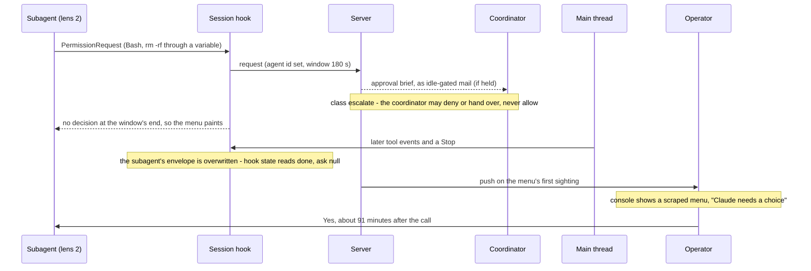
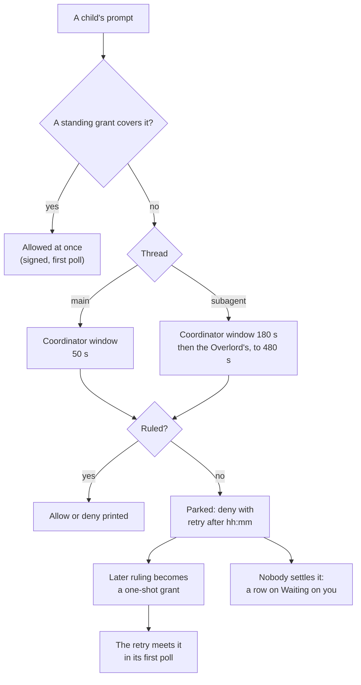
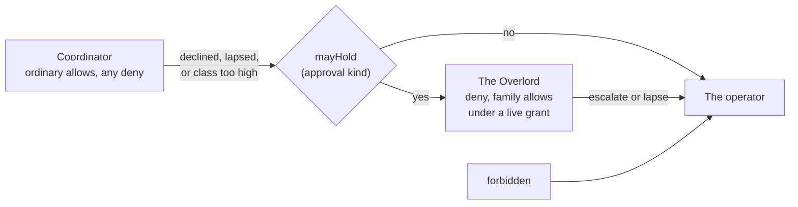

# Permission prompts through the coordinator and the Overlord: Implementation Plan

> **For agentic workers:** REQUIRED SUB-SKILL: Use superpowers:subagent-driven-development (recommended) or
> superpowers:executing-plans to implement this plan task by task. Steps use checkbox (`- [ ]`) syntax for tracking.

**Plan** · 2026-11-18 · Status: Proposed · Programme: Overlord (slug `overlord`, issue #2491) · Builds on:
`docs/superpowers/specs/2026-10-17-coordinator-first-routing-design.md` (the approvals lane) and
`docs/superpowers/specs/2026-11-09-overlord-design.md` (§6.1, §6.7, §7.1, §12, §14; amended in this pull request)

## In short

- **What this is.** The operator's direction of 2026-11-18: a child's permission prompt is handled by its
  coordinator and then the Overlord, and reaches the operator only when neither may settle it. The Overlord spec kept
  approvals "unchanged in this programme" for two reasons: the 60 s main-thread window leaves no room for a second
  hop, and an allow wider than `ordinary` changes the signer and the hook's verifier. This plan solves both and moves
  the spec's Later entry, "Approvals through the Overlord", into two waves.
- **Why the trigger prompt reached the operator** (§2, measured). A reviewer child's background subagent ran a Bash
  call that deletes through a variable. Claude Code prompts for that even with permissions bypassed. The call was
  `escalate` by the classifier's default, so the coordinator could not allow it. The subagent window is 180 s; the
  operator answered 91 minutes later. Meanwhile the main thread's later events erased the prompt's envelope from the
  hook state, so the console showed a bare "Claude needs a choice" with no context. Separately, 11 of 48 live
  children carry a stale deny digest and skip the hold silently.
- **First, and independent of everything else: PR 0** (§3.2.1). A child whose deny digest is older than the managed
  file's is routed instead of skipped. The server accepts any digest the managed file has had, and caps that child's
  allow. It is written to be dispatched as a build on its own.
- **Prevention, also independent: PR P** (§3.8). The rule against deleting through a variable is carried to the
  reviewer skill and to every lens and subagent brief the skills tell sessions to write. It is listed beside the other
  shapes Claude Code prompts for under bypass, so fewer prompts are raised at all.
- **Wave AP1, now (needs nothing from the Overlord).** PR 1 measures: one approval census read and the counter M38.
  PR 2 closes the erased envelope (path 6) in the same PR as its hook fix, and itemises untrusted builds. PR 3 solves the window by
  **parking**: past the live window the hook denies with a "parked, retry later" message instead of painting the
  menu, and a later ruling becomes a one-shot grant the retry meets within one poll. PR 4 adds **standing grants**,
  recorded ahead of time by a coordinator for `ordinary` shapes, so a main-thread prompt is allowed inside its window.
- **Wave AP2, after W3's second step (`overlord-answer-v1`).** PR 5 adds the Overlord's tier: a prompt the coordinator
  declined, let lapse or could not allow is held for the Overlord under `mayHold`, as a new row of Table 6.7b. PR 6
  adds **wider grants**: the Overlord may allow two `escalate` families confined to the child's own roots
  (`read-only`, `scratch-write`), signed by a second key that the fleet pins separately and can unpin. `forbidden`
  stays the operator's, always.
- **What the operator still sees** (§3.7): `forbidden` prompts, prompts from children whose hook cannot route (each
  one counted and itemised), root sessions' prompts (open question 3), and parked rows nobody settled, as rows on
  Waiting on you rather than menus in a pane. M38 proves the share falls (target: half of PR 1's two-week baseline
  after AP1, a quarter after AP2).
- **Check on review:** the three open questions for the operator (§5), the park's message and retry contract
  (§3.3), and the verifier's v2 rule (§3.6).

## 1. Goal, scope and the direction this plan builds on

**Goal:** every child's permission prompt, its subagents' included, is held for its claimant coordinator first, then
for the Overlord, and reaches the operator only when neither may settle it. The share that still reaches the operator
is counted and falls.

**The direction.** On 2026-11-18 the operator directed that permission prompts are handled by the coordinators and
the Overlord, not raised to the operator by the session directly. The coordinator turned the spec's two reasons for
leaving approvals alone into design problems: the window (§3.3) and the signer (§3.6).

**In scope:** the approvals lane end to end, which covers:

- the hook's approval arm and its hook-state envelope;
- the server's mint, hold, lapse and push;
- the console's approval surface;
- a census read;
- grants;
- the Overlord's tier;
- the signer and verifier;
- the spec delta.

**Out of scope:**

- the classifier's `ordinary` grammar, which this plan leaves unchanged;
- what Claude Code prompts for at all;
- the asks lane, apart from reusing its `mayHold`;
- root sessions' prompts, which wait on open question 3.

## 2. The diagnosis (measured 2026-11-18, read-only)

This section records why the trigger prompt reached the operator, and every path by which a child's prompt does
today. It was mailed to the coordinator before this plan was written.

### 2.1 The trigger prompt

The trigger was a reviewer child's prompt, measured from the child's transcripts:

- **The lenses.** The child's main thread launched three background lenses (`Agent`, `run_in_background`).
- **The call.** At 12:43:06Z the second lens, a general-purpose subagent, issued one Bash call. The call extracts
  `git archive` output into a scratch directory and runs `rm -rf $L/$t/...` inside a `for` loop. It also compares
  files through process substitution.
- **The mode.** Every transcript row records `bypassPermissions`. Claude Code still prompts for a delete through a
  variable, which is the case worker clause 5 warns about. The child ran Claude Code 2.1.327.
- **The answer.** The call's result landed at 14:14:20Z, 91 minutes later, with the commands' output. Someone
  answered Yes in the pane.
- **The parent kept working.** Meanwhile the main thread ran Bash, launched three more subagents and ended its turn
  at 13:39:54Z.

*Figure 1. The trigger prompt. The row's own state is unmeasured (§2.3); the rest is read from the transcripts, the
hook state and the source.*

**Why the console showed "Claude needs a choice".** The console draws that kicker only when it has no usable hook
envelope (`askSource` returns kind `menu`, `pwa/src/session/askLive.ts#askSource`), so the menu was scraped from the
pane. The hook overwrites a subagent's waiting envelope in three cases:

- on any main-thread `PreToolUse`, `PostToolUse` or `UserPromptSubmit`;
- on another subagent's tool event when no `waitPrev` stands;
- on the subagent's own later tool event.

The D-4039 carry protects only a main-thread wait (`fr_by != subagent`).

### 2.2 The paths to the operator today

A prompt from a child takes one of eight paths. Path 0 is the one where the coordinator rules. The other seven end
at the operator.

| # | Path | Where it is decided | Recorded? | This plan |
|---|---|---|---|---|
| 0 | Held, ruled by the coordinator inside the window | the claimant's rule door | a row | Kept |
| 1 | Never sent: the hook returns silently before the request | `_hook_approval_wait`'s gates (kill switch, stale or unreadable deny digest, no verifier or pinned key, a static forbidden match, no uuid) | nothing | Counted (PR 1). Stale digest is routed (PR 0) |
| 2 | Refused at mint: `not-a-child`, `single-box`, `deny-not-engaged`, `version-unverified`, `digest-mismatch` | `raiseApproval` | `digest-mismatch` only, in a journal | Counted (PR 1). `version-unverified` itemised (PR 2) |
| 3 | Minted `released`: run-unclaimed, run-other-programme, run-unattributed, parent-not-live, parent-unmeasured, forbidden, truncated, unparseable | `heldFor`, the classifier | a row | Counted. The Overlord's tier takes the run and parent reasons (PR 5) |
| 4 | Held, then lapsed: 60 s main thread, 180 s subagent. The brief is idle-gated mail, so a coordinator in mid-turn often cannot read it in time | `lapseApprovals` | a row | Parked (PR 3), then the Overlord (PR 5) |
| 5 | Held, class `escalate`: the coordinator may deny or hand over, never allow | the verifier, the rule door | a row | Grants (PR 4), the Overlord and wider grants (PR 5, PR 6) |
| 6 | The envelope is erased while the menu stays painted, so the console shows a bare menu with no hold | the hook's state write | nothing | Kept per agent (PR 2) |
| 7 | Not a child: root sessions (coordinators, the Overlord, top-level sessions) | `heldFor` | nothing | Counted. Open question 3 |

*Table 2a. Every path a child's prompt takes, and what this plan does with it. Footing: sourced from
`ccd/session-hook.sh` (`_hook_approval_wait`), `server/src/coord/heldFor.ts#heldFor` and
`server/src/coord/questions.ts` (`raiseApproval`, `holdApproval`, `lapseApprovals`).*

Three facts behind the table:

- **The push for a subagent's prompt is never withheld by a row.** `holdApproval` keeps only main-thread rows
  (`agentId === ''`). The premise (D-5491) is that a background subagent's menu paints only after its hook returns.
  So the subagent's hold is the hook's own wait, and the first sighting of the menu pushes at once.
- **Most real prompts are `escalate`** (judgement from source). The classifier defaults to `escalate`, and every read
  or inspection command escalates. Command substitution, pipes and loops escalate too (`approvalguard.ts`, its
  header). A coordinator can therefore allow almost nothing that Claude Code actually prompts for.
- **Stale deny digests were measured** on the fleet box at 14:20Z:
  - The managed deny file changed on 2026-11-16 at 20:41Z.
  - 11 of the 48 live child rows with a pane, and 19 of all 69 child rows, carry an older digest.
  - For each of them the hook skips the wait silently, so every prompt goes straight to the operator with no row.

### 2.3 What could not be measured

These figures are unmeasured, each for a stated reason:

- **The trigger prompt's own row (path 0 or 3 to 5), and every 7-day count by path, state, release reason, class and
  agent.** A dispatched child may not read the approval surface: the child's surface deny refused the read.
  The server's one approval read answers only the held-for claimant and refuses a released row to everyone, so the
  coordinator could not read it either (coordinator's ruling, 2026-11-18).
- **Paths 1, 6 and 7.** Nothing records them at all.
- **The consequence.** This gap is the plan's first finding, and PR 1 closes it.

## 3. Design

This section states each mechanism once. The PRs in §9 build them in order.

### 3.1 Measure first: the approval census (PR 1)

Every later share figure depends on one read, so it ships first.

- **The census rows.** Each prompt a child or root session raised gets one record. A minted row is already a record.
  For the paths that leave none (1, 2, 6, 7), the questions owner writes one row into a new `approval_census` table.
  It writes it the first time it sees an approval envelope or an approval-shaped menu that names no minted row. The
  row records the path word, the session, the agent id, the tool, and the redacted summary the envelope already
  carries.
- **Where path 1 comes from.** The hook stamps its decision in the envelope it already writes, as one additive field,
  `approval.route`. The word is `sent`, or one of the skip words (`kill-switch`, `deny-unknown`, `deny-unreadable`,
  `no-verifier`, `no-key`, `forbidden`, `no-uuid`, `request-refused:<word>`, `request-failed`). One writer: the hook.
  The server's questions owner records it, and no second writer is added.
- **The read.** `GET /api/approvals/census?days=N` answers counts by path, state, release reason, class, thread (main
  or subagent) and programme, and the redacted rows. It is session-gated: the operator's console reads it. The
  Overlord's door process reads it once W2's identity port names it. It never answers an unredacted input, and its
  privacy is the redacted input's (`APPROVAL_INPUT_RETENTION_DAYS`).
- **The push is bound to its source.** Every approval push the outbox sends carries `source: approval:<row>` or
  `census:<row>`. M38 is then read from rows the server wrote, never from a session's account.
- **The counter, M38.** "Permission prompts the operator must answer, per programme-day, by path", read beside M1.
  Its card sits on the Week page beside M1's. The baseline is the first two weeks after PR 1 merges.

### 3.2 Close the fleet's own leaks (PR 0 and PR 2)

Paths 1 (stale digest), 2 (untrusted build) and 6 (the erased envelope) are defects of the fleet, not decisions.

#### 3.2.1 PR 0: the stale deny digest (first, independent, dispatchable alone)

**The defect.** `ccd`'s spawn records `$REG/<id>.deny-settings` as the sha256 of the managed deny file at spawn time.
The hook's approval wait returns silently, before sending anything, when that differs from the managed file's current
digest. The server refuses the same case `deny-not-engaged`. The managed file changes whenever `ccrc update` installs a
deny list that changed. Every child spawned before then skips the hold for the rest of its life, and every one of its
prompts goes to the operator with no row. Measured on 2026-11-18: 11 of 48 live children with a pane.

**Why the check exists.** It is spec §6.6's rule: a child spawned without the current deny rules never gets rulings.
The fix must keep that guarantee for allows, while routing the prompt.

| Option | What it does | Trade-off | Verdict |
|---|---|---|---|
| Re-stamp on change | When the managed file changes, `ccd` rewrites every live child's `.deny-settings` to the new digest | One comparison stays as it is. But the stamp then asserts a fact `ccd` cannot see, that the running Claude Code loaded the new rules, and it gives the field a second writer after the spawn | Rejected, unless Task 0.1 measures that a running Claude Code re-reads its `--settings` file. Then the stamp is true, and this becomes the cheaper arm |
| Accept any digest the managed file has had | The installer keeps a history of the digests it wrote. A child with a digest in the history is routed and held, and its allow is capped at `escalate` unless its digest is current | Holds, denies and hand-overs work for every child. Allows under older rules stay the operator's. One more file, with one writer | Chosen |
| Skip as today | Nothing changes | Every prompt of those children reaches the operator, unrecorded | Rejected |

*Table 3c. The stale-digest options.*

**Who owns what.** No session touches the registry.

- **`ccd`'s install spine** (`ccd/install-session-hooks.sh`, the one writer of the managed deny file) also appends the
  digest it writes to `$REG/child-deny.digests`, one `<digest> <epoch ms>` line, skipping a digest already last. It
  keeps the newest 32 lines. It is the file's only writer.
- **`ccd`'s spawn** keeps writing `.deny-settings` at spawn, unchanged. Nothing else writes it.
- **The hook** reads both files. A digest equal to the current one is sent as today. A digest in the history is sent
  with the fact `denyDigest`. A digest in neither returns silently as today (and PR 1's census names it `deny-unknown`).
- **The server** decides. Its L1 `approvalClassFloor(class, denyCurrent)` raises the class to at least `escalate`
  when the digest is not current. `raiseApproval` reads the history through the same agent read it already uses for the
  managed file, and refuses `deny-not-engaged` only for a digest in neither. Decide in L1, act in L4.
- **Older peers.** An older server refuses a history digest `deny-not-engaged`, so the hook prints nothing, as today.
  An older hook never sends one. Both directions fail towards the operator.

**Task 0.1** measures whether a running Claude Code re-reads a changed `--settings` file, on a fixture session under
the current build. Its result is recorded in the PR's note. It decides only whether the re-stamp arm is ever worth
adding. The chosen arm ships either way.

#### 3.2.2 PR 2: the erased envelope (path 6) and untrusted builds

- **The envelope is kept per agent.** Hook state gains one additive list, `approvals`. Each entry holds `agentId`,
  `tool`, `summary`, `route` and `at`.
  - A subagent's `PermissionRequest` adds its entry.
  - That agent's own next tool event, its `SubagentStop`, or a `tool_result` the hook's tie already watches removes it.
  - Every other event carries the list unchanged. The main thread's events no longer erase a subagent's prompt.
  - `holdApproval`, the census and the console read the entry whose tool and summary match the painted menu. The
    console then shows the approval surface ("one of its subagents asks to run a Bash call"), never a bare menu.
  - The reader is `hookstate.ts`, the one reader. An older server ignores the field.
- **An untrusted build is itemised once.** A `version-unverified` refusal is counted (PR 1). It also raises one
  Waiting on you item per untrusted build, keyed by the build: "children on Claude Code <build> cannot route
  permission prompts until it is captured". It uses the capture flow D-8289 already has (`claude_builds`).

### 3.3 The window, solved per thread (PR 3)

The two threads have different windows, and the plan treats them apart.

- **Main thread.** Claude Code runs an unattended auto-deny countdown (about 120 s, measured on 2.1.300, D-5441).
  After it, a hook's allow is ignored, which is why the window is 60 s.
- **Background subagent.** It has no countdown (a fleet child's subagents run in the background, D-5443). Its only
  bound is the hook's own timeout.

The hook timeout, measured on 2026-11-18:

- Every managed hook entry is installed with `timeout: 600` (seen in two account homes' settings).
- `HOOK_TIMEOUT_S` is 600 (`ccd/install-session-hooks.sh`), which is Claude Code's own default for a command hook.
- The wait's ceiling is `APPROVAL_HOOK_WAIT_S`, 540 s.

| Option | What it does | Cost | Verdict |
|---|---|---|---|
| A longer wait | The hook waits past today's window | Main thread: impossible past the countdown. Subagent: up to 540 s, and only that subagent waits. The operator's push waits too | Accepted for subagents (coordinator 180 s, Overlord up to 480 s) |
| Park (deny and retry) | Past the live window the hook prints a deny that says "parked" and when to retry. A later ruling is a one-shot grant on the request's digest, which the retry meets in its first poll | One tool result and a retry in the same turn; no turn is burned and no pane is blocked. The model may rewrite the command instead of retrying, and the classifier and denies still guard that | Accepted for both threads, behind a switch, shadow first |
| A standing grant | The coordinator records ahead of time which shapes its children may run. The server answers at once with a signed allow | A grant table, a door, and a matcher. A grant is authority, so it is scoped, capped and expiring | Accepted (PR 4 for coordinators, PR 6 for the Overlord) |
| An instant model call | The server asks the decision model inside the window | A model call on the hot path, and authority for the decision model, which the spec keeps advisory | Rejected for version 1 (Later) |

*Table 3a. The options for the window, measured costs, and the choice.*

*Figure 2. One prompt's way through the tiers once AP1 and AP2 have shipped. A `forbidden` prompt never enters: it
goes to the operator's pane as today.*

**The park, exactly.**

- **When the hook parks.** It parks when the live window ends with no ruling, the row is still with a principal
  (`held`, or held for the Overlord), and `$REG/approval-park-live` stands. The marker has no writer in the tree; the
  operator's Settings switch writes it. The hook then prints:
  `{"decision":{"behavior":"deny","message":"parked: approval <n> is with your coordinator. Carry on with other work, and run this same command again, unchanged, after <hh:mm> UTC."}}`
- **Shadow.** In shadow the hook prints nothing, as today, and the server records `wouldPark`.
- **The row while parked.** The row moves to `parked`, a new `ApprovalState`. Older readers degrade it to `unknown`.
  A principal may still rule it until its park horizon (2 h).
- **A ruling on a parked row** is recorded as a one-shot grant, keyed by `(child, agentId, digest)` and expiring at
  the park horizon. The retry carries the same session, agent, tool, `cwd` and input, so it carries the same digest.
  The server answers the retry's request with an immediate signed ruling for its new nonce, and the hook prints it on
  its first poll.
- **A retry before any ruling** joins the parked row: the hook waits one live window again, then parks again. At the
  third park the server releases the row to the operator, so a loop cannot grow.
- **Nobody rules by the horizon.** The row becomes a Waiting on you row: Allow once, or Deny with words. The operator's
  Allow is not signed. It is queued as an operator pass for that digest. The retry's hook stops at once (stop state
  `operator`) and the menu paints. The console's existing option-row answer presses Yes for the queued pass, keyed to
  the digest and the painted menu's envelope. The operator's escalate allows therefore never widen what the server
  signs.

### 3.4 Standing grants for coordinators (PR 4)

A grant moves the decision to before the prompt, which is what solves the main-thread window.

- **The table.** `approval_grants` holds, per grant:
  - the grantor, attributed;
  - the scope: a run, a child, or one agent of a child;
  - what it covers: an exact digest, or a classifier shape;
  - the class ceiling;
  - the expiry, at most the run's life and never past 8 h;
  - the uses, a count or unlimited.
- **The door.** One box-token door, `POST /api/approvals/grants`, with attribution. A coordinator grants only for
  runs it claims. The child's surface deny already refuses any `/api/approvals` call from a child, so a child can never
  grant itself.
- **The matcher.** One L1 decider, `grantCovers(grant, request, class, nowMs)`.
  - A coordinator's grant covers `ordinary` only, the verifier's v1 rule.
  - The Overlord's covers its families (§3.6).
  - Nothing covers `forbidden`.
- **The coordinator skill.** The grant recipe goes into `references/`, not into a pinned clause. A one-sentence
  pointer in an existing clause is a pin change that the clause test carries, in the same PR.

### 3.5 The Overlord's tier (PR 5)

A prompt the coordinator does not settle goes to the Overlord before the operator, under the same `mayHold` that
Table 6.7b applies to asks.

- **What enters the tier:** a row the coordinator declined (`cannot-decide`), a row that lapsed, or a row whose class
  is above what the coordinator may allow. A row minted `released` for `run-unclaimed`, `run-other-programme` or
  `parent-not-live` enters too, because its coordinator cannot answer. `forbidden`, `truncated` and `unparseable` do
  not.
- **Holding is `mayHold`'s call, with one new kind.** The row kind is `approval`, armed by itself as
  `answer-approval`, and every other condition of H18 applies unchanged. This adds no parallel predicate: the row kind
  is a new case of the one decider.
- **The Overlord's window.** A subagent's prompt gets the time left under the 480 s live bound. A main-thread prompt
  is parked first (§3.3), and the Overlord rules the parked row. Its ruling becomes the one-shot grant the retry
  meets.
- **The Overlord's acts.**
  - `answer-approval` denies with a reason, which needs no grant.
  - It allows only what a live grant names through a family (§3.6).
  - It may also escalate (to the operator, with a brief) or `attach-brief`.
  - It answers only through its own door, behind the designation, the fence and the authority decider (§7.1),
    never through the claimant's door.
- **The hold's columns are the row's.** The row keeps its coordinator, so a late coordinator ruling still counts
  (D-5289). The tier is two columns, `overlordUntil` and `overlordOutcome`, from the same closed list as the asks' tier
  (§6.1). Retention follows Table 6.7c with no new cause.

*Figure 3. The three tiers. Every arrow to the operator is counted by M38's path word.*

### 3.6 Wider grants, the signer and the verifier (PR 6)

The Overlord may allow beyond `ordinary`, but only inside the child's own roots, and only through a key the fleet can
revoke on its own.

- **Families.** One L1 sub-verdict for an `escalate` request, `approvalFamily(request)`, answers one of three words.
  - `read-only`: every simple command is a read or inspection from a fixed list: `cat`, `head`, `tail`, `grep`,
    `ls`, `find` with no action, `git show`, `git log`, `git diff`, `git status`, `wc`, `cmp`, `diff`, `jq`,
    `sed -n`. Every path is inside the child's roots, nothing redirects out of them, and no network or credential path
    is named.
  - `scratch-write`: every write (`rm`, `mkdir`, `ln`, `cp`, `mv`, `tar -x`, `git archive` piped to `tar`) lands
    inside the child's temp root. A variable counts when it is assigned once, in the same command, to a literal path
    under the temp root. That is the trigger prompt's shape.
  - `none`: everything else.
  - A credential mention is always `none`, and `forbidden` is never a family. A property test pins that a family is
    never derived for a `forbidden` request.
- **The act's reversibility.** An allow in a family is *contained*: its effect stays inside the child's own branch
  (kept by git, and attic-pinned at reclaim) and temp root. So `answer-approval` is compensable through a correction
  mail and the branch's history, which satisfies the version-1 ban on irreversible effects. A request whose family is
  `none` is not contained, so it is refused to the Overlord at every rung.
- **A second key.** The server keeps a second Ed25519 pair, `approval-signing-wide`, which it uses only for a ruling
  whose authority is the Overlord. The fleet box's install spine pins its public half beside the first. The name
  contains `approval-signing`, so the child's surface deny and the classifier's forbidden match already cover it.
  Removing the wide pin on the fleet box revokes every wide allow at once, with no server change.
- **Record v2.** `ApprovalRulingRecord` gains `v: 2`, `authority` (`coordinator` or `overlord`) and `family`.
  `approvalRulingBytes` signs all fields. A v1 record is unchanged.
- **The verifier's rule, v2.**

| Record | Class | Authority | Key | Verdict |
|---|---|---|---|---|
| v1 | `ordinary` | (none) | main | allow, as today |
| v1 | `escalate`, `forbidden` | (none) | main | no allow, as today |
| v2 | `ordinary` | coordinator or overlord | main or wide | allow |
| v2 | `escalate`, family `read-only` or `scratch-write` | overlord | wide only | allow |
| v2 | `escalate`, family `none`, or any other authority | any | any | no allow |
| any | `forbidden` | any | any | no allow, ever |
| any | any deny | any | the record's key | deny, printed |

*Table 3b. What the verifier prints. An older verifier refuses `v: 2` outright, so it prints nothing and the prompt
parks or goes to the operator: older builds fail towards the operator.*

### 3.7 What the operator still sees, and the counter

After AP1 and AP2 the operator still sees these prompts:

- **`forbidden` prompts,** in the pane as today (O1 by definition).
- **Prompts from children whose hook cannot route:** the kill switch, no verifier or pinned key, an untrusted build.
  Each is counted, and the last raises an item until fixed.
- **Root sessions' own prompts,** until open question 3 is ruled.
- **Parked rows nobody settled by the horizon,** as Waiting on you rows with the coordinator's and the Overlord's notes,
  never as a bare menu.
- **`escalate` prompts whose family is `none`** that no principal denied.

**M38** counts each of these by its path word, per programme-day, and states the share against PR 1's two-week
baseline. Targets: half the baseline four weeks after AP1's last PR goes Live, and a quarter four weeks after AP2's.

### 3.8 Prevention: fewer prompts raised at all (PR P, independent)

The cheapest prompt is the one never raised. The trigger prompt was a shape the worker skill already forbids (clause
5: never delete through a variable). The reviewer skill does not carry that rule, and neither do the lens and subagent
briefs the skills tell sessions to write. Subagents never read a skill, and they raise almost every prompt.

**What Claude Code still prompts for under `bypassPermissions`,** measured on 2026-11-18. The sources are the
permission-modes page of the Claude Code documentation and the text of build 2.1.327:

| Shape | Prompts under bypass? | Source |
|---|---|---|
| `rm` or `rmdir` whose target is a shell variable (`rm -rf $L/x`) | Yes | Measured (the trigger prompt, 2.1.327). The build's own message: "Dangerous rm operation on possibly-empty variable path" |
| `rm` whose target is a command substitution's output | Yes | 2.1.327: "requires explicit approval and cannot be auto-allowed by permission rules" |
| `rm` inside `bash -c` or `sh -c` with a target built at run time | Yes | 2.1.327: "Pass a literal path, or guard the value with ${NAME:?}" |
| `rm` with a relative glob after a `cd` in the same command | Yes | 2.1.327: "the relative glob target cannot be statically resolved" |
| `rm` of a target that cannot be resolved, or a glob over directories that cannot be listed | Yes | 2.1.327 |
| `rm` of a critical system directory, the working directory or a parent of it | Yes | The documentation ("critical-path removals") and 2.1.327 |
| A tool an explicit ask rule matches, `AskUserQuestion`, a tool marked as needing the user | Yes | The documentation |
| Recognised file-reading Bash commands outside the working directories, only when `blockReadsOutsideWorkingDirectories` is set | Yes | The documentation |
| `rm` of a literal, resolvable path inside the working directory | Unmeasured | No source says it prompts |
| `sed` with "potentially dangerous operations", and the build's generic "This command requires approval" | Unmeasured | 2.1.327 has the strings, but they do not say whether bypass skips them |
| Writes to `.git`, `.claude`, `.vscode` or `.idea` | No | The documentation's protected-path table: allowed under bypass |

*Table 3d. The shapes that still prompt under bypass. Every "Yes" is a removal Claude Code cannot resolve statically,
or a prompt the user configured.*

**The rule the briefs carry**, in one sentence each session can follow: *"Remove only literal paths you have
written out, never a path held in a variable or built by a command, a glob after a `cd`, or a path inside
`bash -c`. Leave temporary directories to the reaper, or name them in full."* The rule goes into:

- the reviewer skill's contract, as a pinned clause, with `reviewer-skill.test.ts` updated in the same PR;
- the coordinator skill's lens and subagent brief text in its references, word for word;
- the worker skill's clause 5, which already carries it, unchanged.

**One more line for planning and review children.** The child's approval-surface deny matches names in plain prose,
not only commands. A planning or review child therefore cannot write a note or a heredoc that names the approval
files: the verifier script, the signing keys, the approval client verb or the approvals route. It describes them in
words instead. The skills say so beside the rule above. (Measured on this plan's own run: two refusals, one for a
read and one for a memory note whose text named the verifier.)

## 4. Decisions (the author's calls)

This plan records its calls by slug. The coordinator mints D-numbers for any deviation when the run's block is issued.

| Slug | Call | Options considered | Chosen, and why | Status |
|---|---|---|---|---|
| `approval-census-first` | Measure before changing | build the tiers first; measure first | Measure first. Every share figure and the M38 baseline need the census, and paths 1, 6 and 7 are recorded nowhere today | Proposed |
| `hook-reports-route-as-a-fact` | How a hook-side skip is counted | a new journal file; a server request per skip; a field in the envelope | A field in the envelope the hook already writes (one writer). The questions owner records it | Proposed |
| `stale-deny-routes-capped` | A child with an older deny digest (PR 0) | skip as today; re-stamp on change; accept any digest the managed file has had | Accept the history, with the allow capped at `escalate`: holds work, nothing is allowed under older rules, and no field gets a second writer | Proposed |
| `prevention-before-routing` | Fewer prompts raised (PR P) | route only; carry the rule to every brief | Carry the literal-path rule to the reviewer skill and to every lens and subagent brief, beside the measured list of shapes | Proposed |
| `envelope-kept-per-agent` | The erased envelope | a main-thread carry; one list keyed by agent | One additive list keyed by agent id, removed by that agent's own events only | Proposed |
| `subagent-window-480` | A subagent's live window | 180 s; up to the 540 s ceiling | 180 s for the coordinator, then the Overlord to 480 s, leaving 60 s under the ceiling for the park print | Proposed |
| `approval-park-is-deny-and-retry` | The main thread's window | a longer wait; park; grants; a model call | Park plus grants. A longer wait cannot pass the countdown, and a model call puts authority on the hot path | Proposed |
| `operator-allow-is-a-pane-pass` | The operator's Allow on a parked `escalate` row | sign it as the operator; pass it to the pane | A queued pane pass. The signer never widens for the operator, and the verifier keeps its v1 rule for that path | Proposed |
| `grants-are-scoped-and-expire` | Standing grants | none; per run; per programme | Per run, child or agent, at most 8 h, the class capped by the grantor | Proposed |
| `overlord-approval-is-a-mayhold-case` | The Overlord's hold | a new predicate; a case of `mayHold` | A case of `mayHold` (C31, H18). No parallel mechanism | Proposed |
| `wide-key-is-separately-pinned` | The signer for wider allows | the same key with a flag; a second key | A second key, pinned apart, so the fleet can revoke Overlord allows with no server change | Proposed |
| `families-confined-to-roots` | What the Overlord may allow beyond `ordinary` | any `escalate`; families | Two families confined to the child's roots, so the act stays contained and compensable | Proposed |

*Table 4. The calls this plan makes. The two marked as the operator's in §5 wait on them.*

## 5. Open questions

The first three need the operator. The rest are recorded with the author's recommendation and proceed unless
overruled.

| # | Question | Recommendation | Whose |
|---|---|---|---|
| 1 | Parking changes where approvals appear: a parked row reaches the operator on Waiting on you, not as a menu in a pane. Accept that? | Yes. It is what "not from the session directly" asks, and the row carries the coordinator's and the Overlord's notes | The operator |
| 2 | Version 1's families the Overlord may allow beyond `ordinary`: `read-only` and `scratch-write`, both inside the child's own roots | Yes, those two only. Network, credentials, and writes outside the roots stay with the operator | The operator |
| 3 | Root sessions' own prompts (a coordinator's): hold them for the Overlord too? | Yes for coordinators in AP2, under the same `mayHold`. No for plain top-level sessions, which are the operator's own | The operator |
| 4 | Does a running Claude Code re-read a changed `--settings` file? | Measure it in Task 0.1. Until then, cap the allow | Author |
| 5 | The park horizon | 2 h, then a Waiting on you row | Author |
| 6 | The retry cap | 3 parks of one digest, then to the operator | Author |

*Table 5. Open questions.*

## 6. The spec delta in this pull request

These edits to `docs/superpowers/specs/2026-11-09-overlord-design.md` land with this plan:

- **C17 and Table 6.1a's approvals row.** "Unchanged in this programme" becomes the coordinator, then the Overlord
  under `mayHold`, then the operator, with the two reasons answered by the park, grants and the wide key.
- **Table 6.7b gains an approvals row.**
- **Table 7.1a gains `answer-approval`.**
- **New calls C71 to C76 in Table 13a:**
  - C71: the stale digest (`stale-deny-routes-capped`);
  - C72: the park (`approval-park-is-deny-and-retry`, `operator-allow-is-a-pane-pass`);
  - C73: standing grants (`grants-are-scoped-and-expire`);
  - C74: the census (`approval-census-first`, `hook-reports-route-as-a-fact`);
  - C75: the Overlord's tier and families (`overlord-approval-is-a-mayhold-case`, `families-confined-to-roots`);
  - C76: the second key (`wide-key-is-separately-pinned`).
- **§12 gains M38.**
- **§14 gains waves AP1 and AP2.** AP1 depends on nothing in the Overlord; AP2 follows W3's second step.
- **The Later entry "Approvals through the Overlord" is removed** and replaced by a pointer to the waves.
- **Waiting on you gains open questions 1 to 3.**

## 7. Global constraints

These rules bind every PR below.

- **Rings.** The deciders are L1 and pure: `approvalClassFloor`, `grantCovers`, `approvalFamily`, the park decision
  `parkDue`, and `mayHold`'s new case. Doors and sweeps are L4 and decide nothing. The census table, grants and park
  state live in `coord.db` through `CoordStore`, synchronously, with no repository over it.
- **One owner.** `coord/questions.ts` owns approval rows, the census rows and the park state (C31). The hook owns the
  envelope. `hookstate.ts` is its one reader. `ccd`'s install spine owns the managed deny file and its digest history,
  and `ccd`'s spawn owns each child's `.deny-settings`. No session writes any registry file.
- **Wire.** Every new field is additive: `route`, `approvals[]`, `denyDigest`, `parked`, and the record's `v: 2`.
  `FLEET_PROTO` is not bumped. An older peer omitting a field is read through one reader per field.
- **Capability words.**
  - `approval-deny-history-v1` (PR 0);
  - `approval-census-v1` (PR 1);
  - `approval-route-v2` (PR 2 and PR 3);
  - `approval-grants-v1` (PR 4);
  - `overlord-approvals-v1` (PR 5);
  - `approval-wide-v1` (PR 6).
  - The hook's request to an older server fails `404`, so it prints nothing: the safe direction.
- **Censuses.**
  - Each new door joins `box-token-census.test.ts` in the same PR.
  - A session-gated door also joins the `SESSION_ONLY` set and CLAUDE.md's census sentence, which that test checks in
    both directions.
  - A new box-token lane file touches the six census sites.
- **SAFETY.** No `ccd` verb is added. The surface deny is widened only by the name `approval-signing-wide`, which it
  already matches. Every test uses fixture homes.
- **Public repository.** Fixtures use `lane-a`, `project-a` and `a reviewer child`. No session, lane, account or host
  names appear.
- **Migration slots** are measured again before each merge.

## 8. The PR split

| PR | Wave | What it ships | Depends on | Growth (src + tests, lines) |
|---|---|---|---|---|
| 0 | first, alone | The stale deny digest: the installer's digest history, the hook sends `denyDigest`, the server's class floor | nothing | +25 ccd install, +20 hook, +80 server; +350 tests |
| P | alone | Prevention: the literal-path rule and the prose-names line in the reviewer skill's pinned contract and the coordinator skill's brief text, with Table 3d | nothing | +40 skill text; +20 tests (the pins) |
| 1 | AP1 | The census: the envelope's `route`, `approval_census`, the census read, push source binding, the M38 card | nothing | +450 server, +40 hook, +150 pwa; +500 tests |
| 2 | AP1 | The per-agent envelope list with its hook fix (path 6), the untrusted-build item | PR 1 | +80 server, +120 hook, +60 pwa; +500 tests |
| 3 | AP1 | The windows and the park, with one-shot grants, shadow then the operator's switch | PR 2 | +250 server, +90 hook, +40 shared, +80 pwa; +700 tests |
| 4 | AP1 | Standing grants, the grant door and matcher, the coordinator skill's reference | PR 3 | +350 server; +500 tests; +60 skill reference |
| 5 | AP2 | The Overlord's tier: the `approval` kind in `mayHold`, its door, `answer-approval` | PR 4, W3 step two | +400 server, +100 pwa; +700 tests |
| 6 | AP2 | Families, the wide key, record v2, verifier v2, the install pin, doctor's check | PR 5 | +300 classifier, +200 server, +60 verifier, +40 install; +900 tests |

*Table 8. The six pull requests. Growth is the author's estimate, and growth-check runs armed on any listed file
it grows.*

## 9. Tasks

Every task is red-first: the test is written, run red against the unchanged tree, and only then made green. Every new
guard gets a mutation step with the coordinator skill's mutation runner (`references/mutation-run.py`): the guard is
deleted or inverted in memory, and the named test must go red. Test commands run from `server/` (or the package
named), in the foreground, one file at a time, through `ccrc test -- ./node_modules/.bin/vitest run test/<file>`.

### Task 0.1: Measure the settings re-read (PR 0)

- [ ] On a fixture session under the current build, change the `--settings` file mid-session. Check whether a newly
  denied command is refused. Record the result in the PR's note (open question 4). This task changes no code. Its
  result decides only whether a re-stamp arm is ever worth adding (Table 3c).

### Task 0.2: The installer's digest history (PR 0)

- [ ] Red: `install-session-hooks` in a fixture home appends `<digest> <epoch ms>` to `$REG/child-deny.digests` when it
  writes a changed deny file, writes no line for an unchanged one, and keeps the newest 32 lines.
- [ ] Green: the install spine's one writer.
- [ ] Mutation: write the line on every install. The unchanged case reds.

### Task 0.3: The hook routes a known stale digest (PR 0)

- [ ] Red: in a fixture home with a stubbed client, a child whose `.deny-settings` is in the history but not current
  sends the request with `denyDigest`. A digest in neither returns silently, as today. A current digest is unchanged.
- [ ] Green: the gate in `_hook_approval_wait` reads the history, with no new fork on the current-digest path.
- [ ] Mutation: send a digest in neither. The unknown case reds.
- [ ] Run `session-hook-approval-wait.test.ts` and `session-hook-approval-deny.test.ts`, each alone.

### Task 0.4: The server's class floor (PR 0)

- [ ] Red: `approvalClassFloor` (L1) raises any class to at least `escalate` when the digest is not current. A
  history digest is minted `held`. A coordinator's allow is refused `guard-escalate`, and its deny is signed. A digest
  in neither is refused `deny-not-engaged`, as today.
- [ ] Green: `raiseApproval` reads the history through the agent read it uses for the managed file.
- [ ] Mutation: let the floor ignore the digest. The allow case reds.

### Task P.1: Carry the literal-path rule (PR P)

- [ ] Red: `reviewer-skill.test.ts` pins the new clause word for word. The coordinator skill's test pins the brief
  text's rule sentence and its prose-names line.
- [ ] Green: the reviewer skill's clause, the coordinator skill references' lens and subagent brief text, and Table 3d
  as a reference the briefs point to. Keep every apostrophe straight.
- [ ] Mutation: soften one word of the clause. The pin reds.

### Task 1.1: Characterize today's approval paths, green on `main` (PR 1)

- [ ] Pin today's inputs and outputs for each path in Table 2a, the paths that end at the operator included:
  `approval-paths-characterization.test.ts`. It covers the hook's silent gates (fixture home), the mint refusals,
  the released reasons, the lapse, and `holdApproval`'s main-thread filter.
- [ ] Green on `main` before any change: `ccrc test -- ./node_modules/.bin/vitest run test/approval-paths-characterization.test.ts`.

### Task 1.2: The envelope's `route` word (PR 1)

- [ ] Red: `session-hook-approval-route.test.ts` asserts the envelope carries `route` for each gate (fixture home,
  stubbed client).
- [ ] Green: each gate in `_hook_approval_wait` sets `apr_route` before it returns. The `PermissionRequest` arm
  writes it into `ask_json`. The `jq` stays one fork.
- [ ] Mutation: drop one gate's word. The test goes red.
- [ ] Run it, then `session-hook-approval-wait.test.ts` and `session-hook-approval-deny.test.ts`, each alone.

### Task 1.3: `approval_census` and its one writer (PR 1)

- [ ] Red: `approval-census.test.ts`. An envelope or an approval-shaped menu with no minted row writes exactly one
  census row per prompt, keyed by session, agent and the envelope's summary. A repeat sighting writes none.
- [ ] Green: a migration (slot measured at merge) and one writer in `coord/questions.ts`'s raise path.
- [ ] Mutation: remove the dedupe key, and the test reds. Make the writer write twice, and the one-writer census reds.

### Task 1.4: The census read and push binding (PR 1)

- [ ] Red: the read answers counts by path, state, release reason, class, thread and programme, never an unredacted
  input. An outbox row for an approval push carries its source.
- [ ] Green: the L1 `approvalCensusOf(rows)`, the session-gated door, and the census sites.
- [ ] Mutation: let the read return `input` unredacted. The privacy case reds.

### Task 1.5: The M38 card (PR 1, `pwa/`)

- [ ] Red: the Week page shows M38 beside M1, with "unmeasured" when the read fails, never zero.
- [ ] Green: the card. From `pwa/`: `ccrc test -- ./node_modules/.bin/vitest run test/week-m38.test.tsx`.

### Task 2.3: The per-agent envelope list, with its hook fix (PR 2, path 6)

- [ ] Red: `session-hook-approval-envelope.test.ts`. A subagent's prompt survives the main thread's `PreToolUse`,
  `PostToolUse` and `Stop`. It is removed by its own agent's next tool event, its `SubagentStop`, or its
  `tool_result`.
- [ ] Red, the sibling case: a sibling subagent's `PreToolUse` and `PostToolUse` land while the first subagent's menu
  is painted. The first subagent's entry stands, and so does the menu's approval surface, before and after. Today's
  hook fails this case: the sibling's event overwrites the waiting envelope when no `waitPrev` stands.
- [ ] Green: the `approvals` list in hook state. Its one reader is `hookstate.ts`. `holdApproval`, the census and
  `askSource` pick the matching entry.
- [ ] Mutation: let a main-thread event clear the list. The test reds.
- [ ] From `pwa/`: the console renders the approval surface for a subagent's painted menu, not "Claude needs a
  choice".

### Task 2.4: The untrusted-build item (PR 2)

- [ ] Red: two `version-unverified` refusals for one build raise one item, keyed by the build. A captured build
  withdraws it.
- [ ] Green, and the mutation: drop the key, and the duplicate case reds.

### Task 3.1: The subagent window to 480 s (PR 3)

- [ ] Red: `approvalWindowMs` answers 180 s for the coordinator and a live bound of 480 s for a subagent. The
  main-thread value is unchanged. The `201`'s `waitS` and the record's `expiresAt` follow.
- [ ] Green, and the mutation on the bound.

### Task 3.2: The park (PR 3)

- [ ] Red, hook: with `$REG/approval-park-live`, a request whose window ends unruled prints the park deny. Without
  the marker it prints nothing and the server records `wouldPark`. In a fixture home.
- [ ] Red, server: `parkDue` (L1) decides. The `parked` state, the horizon, the retry joining the row, and the
  third-park release.
- [ ] Red, one-shot grant: a ruling on a parked row allows the retry with the same digest on its first poll, and no
  other digest.
- [ ] Green. Mutations: key the grant without `agentId`, and the cross-agent case reds. Drop the retry cap, and the
  loop case reds.

### Task 3.3: The operator's pane pass and the switch (PR 3)

- [ ] Red: an operator Allow on a parked `escalate` row is never signed. The retry stops at state `operator`, and
  the queued pass presses Yes only on a painted menu whose envelope matches the digest.
- [ ] Green: the Settings switch writes `approval-park-live` through the server's one writer. The switch refuses
  `live` while sign-in is dark.

### Task 4.1: Grants, the door and the matcher (PR 4)

- [ ] Red: `grantCovers` covers `ordinary` for a coordinator, nothing above it, and never `forbidden`. Expiry and
  uses are honoured. A grant for a run the caller does not claim is refused.
- [ ] Green: the migration, the box-token door and the census sites. The coordinator skill's reference
  `references/approval-grants.md`.
- [ ] Mutations: invert the class cap, and the escalate case reds. Drop the claimant check, and the foreign-run case
  reds.

### Task 5.1: The `approval` kind in `mayHold` (PR 5)

- [ ] Red: `mayHold` holds a declined, lapsed or class-too-high approval row only under every H18 condition, and never
  a `forbidden`, `truncated` or `unparseable` row.
- [ ] Green: the new case. `answer-approval` in `OVERLORD_ACT_KINDS`. The door behind the designation, the fence and
  the authority decider.
- [ ] Mutations: drop the arming check, and the disarmed case reds. Admit `forbidden`, and the floor case reds.

### Task 6.1: Families (PR 6)

- [ ] Red: `approval-family.test.ts` over the guard corpus plus a family corpus. The trigger prompt's shape is
  `scratch-write`. A credential mention is `none`. A property test checks that `forbidden` never has a family.
- [ ] Green: `approvalFamily` in `approvalguard.ts` (L1).
- [ ] Mutation: let `$VAR` count without its in-command assignment, and the unsafe-variable case reds.

### Task 6.2: The wide key, record v2 and verifier v2 (PR 6)

- [ ] Red: Table 3b row by row, in `approval-verify.test.ts`, which carries the verifier's documented second copy. An
  older verifier refuses `v: 2`. A wide allow without the wide pin is refused.
- [ ] Green: the signer's second pair, the record, the install spine's second pin, and doctor's `approval-wide-pin`
  check.
- [ ] Mutations: accept an `escalate` allow on the main key, and the key case reds. Accept family `none`, and the
  family case reds.

### Every PR

- [ ] Run each guard file alone: `anchors`, `citations`, `dtbd`, `docs-grammar`, `topology-clean`, the census
  tests, and `deviation-refs` after `git fetch origin main`.

## 10. Review focus

A reviewer should test these points first:

- **The park message and the retry contract.** Does a model retry unchanged? Measure it on the fixture before Live.
- **The one-shot grant's key.** Session, agent and digest: can any other request meet it?
- **The verifier's v2 rule** against Table 3b, and the older verifier's refusal of `v: 2`.
- **The per-agent envelope list.** No event of another agent may remove an entry.
- **The census read.** It never answers an unredacted input.

## 11. Deviations found

None yet. Departures found while building are reported by slug in the PR's note, and the coordinator mints their
numbers.

## Where things stand

### Agreed

- The coordinator ruled that the approval-row counts are unmeasured for a child, and that the census read goes first
  (§2.3, PR 1).

### Waiting on you

- Open questions 1 to 3 (§5): parked rows on Waiting on you, the two families, and coordinators' own prompts.

### Later

- **An instant decision-model ruling inside the main-thread window.** Trigger: the decision model's approval rows
  leave shadow with M19's bounds met.
- **More families.** Trigger: M38 shows `none`-family prompts as the largest remaining path.
