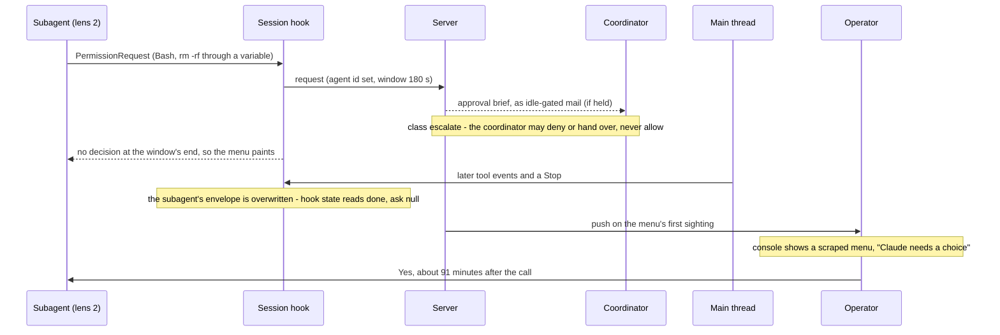
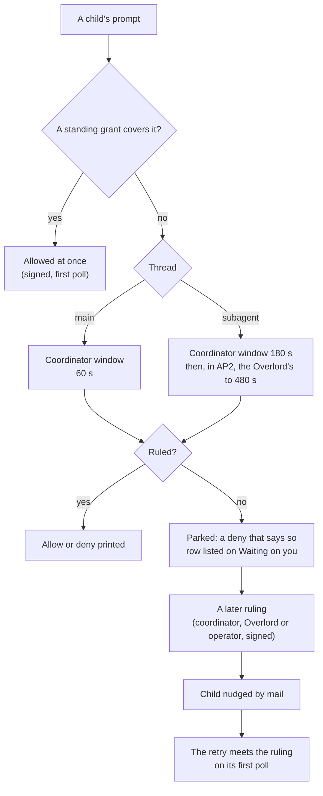
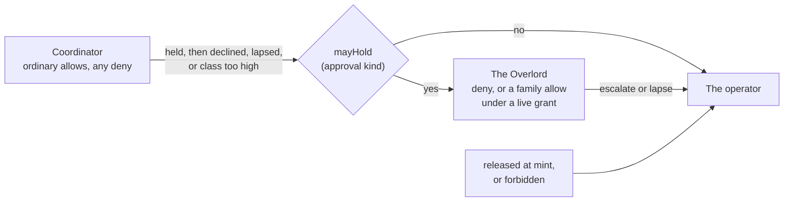

# Permission prompts through the coordinator and the Overlord: Implementation Plan

> **For agentic workers:** REQUIRED SUB-SKILL: Use superpowers:subagent-driven-development (recommended) or
> superpowers:executing-plans to implement this plan task by task. Steps use checkbox (`- [ ]`) syntax for tracking.

**Plan** · 2026-11-18 · Status: Proposed, revised after review 2536 (fix round 1) · Programme: Overlord (slug
`overlord`, issue #2491) · Builds on: `docs/superpowers/specs/2026-10-17-coordinator-first-routing-design.md` (the
approvals lane) and `docs/superpowers/specs/2026-11-09-overlord-design.md` (§6.1, §6.7, §7.1, §12, §14; amended in
this pull request)

## In short

- **What this is.** The operator's direction of 2026-11-18: a child's permission prompt is handled by its
  coordinator and then the Overlord, and reaches the operator only when neither may settle it. The Overlord spec kept
  approvals "unchanged in this programme" for two reasons. First, the 60 s main-thread window leaves no room for a
  second hop. Second, an allow wider than `ordinary` changes the signer and the hook's verifier. This plan answers
  both, and moves the spec's Later entry "Approvals through the Overlord" into two waves.
- **Why the trigger prompt reached the operator** (§2, measured).
  - A reviewer child's background subagent ran a Bash call that deletes through a variable. Claude Code prompts for
    that even with permissions bypassed.
  - The call was `escalate` by the classifier's default, so the coordinator could not allow it.
  - The subagent window is 180 s. The operator answered 91 minutes later.
  - The main thread's later events erased the prompt's envelope from the hook state, so the console showed a bare
    "Claude needs a choice" with no context.
  - Separately, 11 of 48 live children carry a stale deny digest and skip the hold silently.
- **PR 0 comes first and stands alone** (§3.2.1). The installer keeps a history of every managed deny digest. A child
  whose stamp is in that history is routed, and its row carries the fact "deny not current", so nobody but the operator
  can allow it. Children already stale before PR 0's first install are not recovered. They route once they are
  respawned, renewed or rolled.
- **PR P is prevention, and also stands alone** (§3.8). Reviewer clause 9 already carries the rule against deleting
  through a variable. It is widened in place to the other shapes Claude Code prompts for under bypass. The brief
  sentence and the measured table of shapes go into the coordinator skill's references, pinned.
- **Wave AP1 needs nothing from the Overlord.**
  - PR 1 measures: one approval census and the counter M38.
  - PR 2 keeps a subagent's envelope per agent (path 6), with its hook fix.
  - PR 3 parks a prompt past its live window. The hook prints a deny that says the prompt is parked, and the row
    reaches Waiting on you at once. A later ruling by the coordinator, or a **signed** ruling by the operator, meets the
    retry through the hook's verifier. Nothing ever presses a painted menu.
  - PR 4 adds standing grants: a coordinator records `ordinary` shapes ahead of time.
- **Wave AP2 follows W3's second step.**
  - PR 5 holds for the Overlord, under `mayHold`, only the rows the coordinator held and then declined, let lapse or
    could not allow. Rows released at mint go to the operator as today.
  - PR 6 lets the Overlord allow two families confined to the child's own workspace, under a second key the fleet pins
    apart. `read-only` is a closed allowlist of commands and options. `scratch-write` is literal-path `rm` and `mkdir`
    under the child's temp root. `forbidden` stays the operator's, always.
- **The operator's three answers** are recorded as yes, the coordinator's provisional ruling (§5).
- **Check on review:** F1, F3, F4, F8 and F12 of review 2536, as this revision answers them (§10).

## 1. Goal, scope and the direction this plan builds on

**Goal:** every child's permission prompt, its subagents' included, is held for its claimant coordinator first, then
for the Overlord, and reaches the operator only when neither may settle it. The share that still reaches the operator
is counted, and it falls.

**The direction.** On 2026-11-18 the operator directed that permission prompts are handled by the coordinators and
the Overlord, not raised to the operator by the session directly. The coordinator turned the spec's two reasons for
leaving approvals alone into design problems: the window (§3.3) and the signer (§3.6).

**In scope:** the approvals lane end to end:

- the hook's approval arm and its envelope;
- the server's mint, hold, lapse and push;
- the console's approval rows;
- a census read;
- grants;
- the Overlord's tier;
- the signer and the verifier;
- the spec delta.

**Out of scope:**

- What Claude Code prompts for at all.
- The asks lane, apart from reusing its `mayHold`.
- Rows released at mint holding for the Overlord (Later, §11).
- Root sessions' prompts until AP2 (open question 3).

## 2. The diagnosis (measured 2026-11-18, read-only)

This section records why the trigger prompt reached the operator, and every path by which a child's prompt does
today. It was mailed to the coordinator before this plan was written.

### 2.1 The trigger prompt

Measured from the transcripts of a reviewer child:

- **The lenses.** Its main thread launched three background lenses (`Agent`, `run_in_background`).
- **The call.** At 12:43:06Z the second lens, a general-purpose subagent, issued one Bash call. The call extracts
  `git archive` output into a scratch directory and runs `rm -rf $L/$t/...` inside a `for` loop. It also compares
  files through process substitution.
- **The mode.** Every transcript row records `bypassPermissions`. Claude Code 2.1.327 still prompts for a delete
  through a variable.
- **The answer.** The call's result landed at 14:14:20Z, 91 minutes later, with the commands' output. Someone answered
  Yes in the pane.
- **The parent kept working.** Meanwhile the main thread ran Bash, launched three more subagents and ended its turn at
  13:39:54Z.

*Figure 1. The trigger prompt. The row's own state is unmeasured (§2.3). Everything else is read from the
transcripts, the hook state and the source.*

**Why the console showed "Claude needs a choice".** The console draws that kicker only when the hook state has no
usable envelope (`askSource` returns kind `menu`, `pwa/src/session/askLive.ts#askSource`), so the menu was scraped
from the pane. The hook overwrites a subagent's waiting envelope in three cases:

- **A main-thread event:** `PreToolUse`, `PostToolUse` or `UserPromptSubmit`.
- **Another subagent's tool event**, whether or not a previous wait stands. With no `waitPrev`, the event writes
  `working` with no ask. With one, it restores the main state that `waitPrev` saved. Either way the subagent's
  envelope is gone.
- **The subagent's own later tool event.**

The D-4039 carry protects only a main-thread wait (`fr_by != subagent`).

### 2.2 The paths to the operator today

The trigger was one path among eight. Table 2a lists them all, with where each is decided today and what this plan
changes.

| # | Path | Where it is decided | Recorded? | This plan |
|---|---|---|---|---|
| 0 | Held, ruled by the coordinator inside the window | the claimant's rule door | a row | Kept |
| 1 | Never sent: the hook returns silently before the request | `_hook_approval_wait`'s gates: the kill switch, a stale or unreadable deny digest, no `node`, no verifier or pinned key, no ccrc client, no uuid, a static forbidden match, a canonical-form failure, a nonce failure | nothing | Counted (PR 1). A stale digest the history knows is routed (PR 0); already-stale children are not recovered |
| 2 | Refused at mint: `not-a-child`, `single-box`, `deny-not-engaged`, `version-unverified`, `digest-mismatch`, `run-unreadable`, `internal` | the request route and `raiseApproval` | `digest-mismatch` only, in a journal | Counted (PR 1). `version-unverified` is itemised (PR 2) |
| 3 | Minted `released`: run-unclaimed, run-other-programme, run-unattributed, parent-not-live, parent-unmeasured, forbidden, truncated, unparseable | `heldFor`, the classifier | a row | Counted. Holding the run and parent reasons for the Overlord is Later (F12) |
| 4 | Held, then lapsed: 60 s on the main thread, 180 s on a subagent. The brief is idle-gated mail, so a coordinator in mid-turn often cannot read it in time | `lapseApprovals` | a row | Parked (PR 3), then the Overlord (PR 5) |
| 5 | Held, class `escalate`: the coordinator may deny or hand over, never allow | the verifier, the rule door | a row | The operator's signed ruling (PR 3), the Overlord and a family (PR 5, PR 6) |
| 6 | The envelope is erased while the menu stays painted, so the console shows a bare menu with no hold | the hook's state write | nothing | Kept per agent (PR 2) |
| 7 | Not a child: root sessions (coordinators, the Overlord, top-level sessions) | the hook's first gate (the `.child` test), and the route's `not-a-child` for a child the server does not recognise | nothing | Counted. Open question 3 |

*Table 2a. Every path a child's prompt takes, and what this plan does with it. Footing: sourced from
`ccd/session-hook.sh` (`_hook_approval_wait`), `server/src/coord/heldFor.ts#heldFor`, the approvals request route in
`server/src/coord/routes.ts`, and `server/src/coord/questions.ts` (`raiseApproval`, `holdApproval`,
`lapseApprovals`).*

Four facts sit behind the table:

- **The push for a subagent's prompt is never withheld by a row.** `holdApproval` keeps only main-thread rows
  (`agentId === ''`). The premise (D-5491) is that a background subagent's menu paints only after its hook returns.
  So the subagent's hold is the hook's own wait, and the first sighting of the menu pushes at once.
- **Most real prompts are `escalate`** (judgement from source). The classifier defaults to `escalate`, and every read
  or inspection command escalates by the coordinator's round-5 ruling. Command substitution, pipes and loops escalate
  too (`approvalguard.ts`, its header).
- **Stale deny digests,** measured on the fleet box at 14:20Z:
  - 11 of the 48 live child rows with a pane, and 19 of all 69 child rows, carry a digest older than the managed deny
    file's.
  - For each of them the hook skips the wait silently.
  - The managed file is rewritten when its deny list changes, and when the roster's upstream id changes
    (`ccd/install-session-hooks.sh`). It last changed on 2026-11-16 at 20:41Z.
- **Mint-time refusals come from two places.** The request route decides `run-unreadable` and `internal`, and the hook
  decides the not-a-child case first.

### 2.3 What could not be measured

These counts and states are unmeasured:

- **Which apply.** The trigger prompt's own row (paths 0 and 3 to 5), and every 7-day count by path, state, release
  reason, class and agent. Paths 1, 6 and 7 are recorded nowhere at all.
- **Why the rows cannot be read.** A dispatched child may not read the approval surface: the child's surface deny
  refused the read. The server's one approval read answers only the held-for claimant, and refuses a released row to
  everyone, so the coordinator could not read it either (the coordinator's ruling, 2026-11-18).
- **What follows.** That gap is the plan's first finding, and PR 1 closes it.

## 3. Design

This section states each mechanism once. The PRs in §9 build them in order.

### 3.1 Measure first: the approval census (PR 1)

Every later share figure depends on one read, so it ships before the routing changes. Its words assume PR 0's
vocabulary, so it follows PR 0.

**The census rows.**

- Each prompt a child or root session raised gets one record. A minted row is already a record.
- The paths that leave none are 1, 2, 6 and 7. For those, the questions owner writes one row into a new
  `approval_census` table, the first time it sees an approval envelope, or an approval-shaped menu, that names no
  minted row.
- The row records the path word, the session, the agent id, the tool, and the redacted summary the envelope already
  carries.

**Where path 1 comes from.** The hook stamps its decision in the envelope it already writes, as one additive field,
`approval.route`. One writer: the hook. The questions owner records the field, and no second writer is added. The word
is `sent`, or one of the skip words:

- `kill-switch`;
- `not-a-child`;
- `deny-unknown`;
- `deny-unreadable`;
- `no-node`;
- `no-verifier`;
- `no-key`;
- `no-client`;
- `no-uuid`;
- `forbidden`;
- `canonical-failed`;
- `nonce-failed`;
- `request-refused:<word>`;
- `request-failed`.

**The read.** `GET /api/approvals/census?days=N`:

- **What it answers:** counts by path, state, release reason, class, thread (main or subagent), deny currency and
  programme, and the redacted rows.
- **Who may read it:** it is session-gated, so the operator's console reads it. The Overlord's door process reads it
  once W2's identity port names it.
- **What it never answers:** an unredacted input. Its privacy is the redacted input's (`APPROVAL_INPUT_RETENTION_DAYS`).

**Pushes are bound to their source.** Every approval push the outbox sends carries `source: approval:<row>` or
`census:<row>`. M38 is then read from rows the server wrote, never from a session's account.

**The counter, M38.**

- **What it counts:** "Permission prompts the operator must answer, per programme-day, by path", read beside M1.
  Its card sits on the Week page beside M1's.
- **The baseline:** the first two weeks after PR 1 is **Live** on the fleet. The census records nothing before it is
  deployed.
- **What else shapes the baseline:** PR 0 and PR P may already be Live. The plan's ledger note records the Live dates
  of both, so the baseline names what it already includes.

### 3.2 Close the fleet's own leaks (PR 0 and PR 2)

Paths 1 (stale digest), 2 (untrusted build) and 6 (the erased envelope) are defects of the fleet, not decisions.

#### 3.2.1 PR 0: the stale deny digest (first, independent, dispatchable alone)

**The defect.**

- **The stamp.** `ccd`'s spawn, and its resume, record `$REG/<id>.deny-settings` as the sha256 of the managed deny
  file at that moment.
- **The silent skip.** The hook's approval wait returns silently, before sending anything, when that stamp differs
  from the managed file's current digest. The server refuses the same case `deny-not-engaged`.
- **When the file changes.** The managed file is rewritten when its deny list changes, and when the roster's upstream
  id changes.
- **The consequence.** Every child stamped before a rewrite skips the hold until its next spawn, and every one of its
  prompts goes to the operator with no row. Measured on 2026-11-18: 11 of 48 live children with a pane.

**Why the check exists.** Spec §6.6's rule: a child spawned without the current deny rules never gets rulings. The fix
keeps that guarantee for allows, while routing the prompt.

| Option | What it does | Trade-off | Verdict |
|---|---|---|---|
| Re-stamp on change | When the managed file changes, `ccd` rewrites every live child's `.deny-settings` | The stamp would assert a fact `ccd` cannot see: that the running Claude Code loaded the new rules. It would also give the field a second writer after the spawn | Rejected, unless Task 0.1 measures that a running Claude Code re-reads its `--settings` file |
| Accept any digest the managed file has had | The installer keeps a history of the managed digests. A child whose stamp is in it is routed, and its row records that the deny is not current | Holds, denies and hand-overs work. Allows under older rules stay the operator's. One more file, with one writer | Chosen |
| Skip as today | Nothing changes | Every prompt of those children reaches the operator, unrecorded | Rejected |

*Table 3c. The stale-digest options.*

**What PR 0 does not do (F1).**

- **Already-stale children stay stale.** The history starts at PR 0's first install, so children stale before that
  are not recovered: their stamp is in neither the history nor current. They route once respawned, renewed or rolled,
  because every spawn and resume stamps afresh.
- **No one-off list.** A list of the digests from before PR 0 is not added. The fleet's earlier deny files are not
  recorded anywhere this tree can read, and a hand-kept list would be a second writer of the history.

**Who owns what.** No session touches the registry.

- **The install spine** (`ccd/install-session-hooks.sh`, the one writer of the managed deny file) is also the only
  writer of `$REG/child-deny.digests`. The file holds one `<digest> <epoch ms>` line per digest, and the spine keeps
  the newest 32 lines.
  - On every install, it appends the current file's digest when that digest is not already the last line.
  - On a rewrite, it first appends the outgoing digest (when not already last), then the incoming one.
  - So a child spawned at any time after PR 0's first install has its stamp in the history.
- **`ccd`'s spawn and resume** keep writing `.deny-settings`, unchanged. Nothing else writes it.
- **The hook's trusted-file write deny** gains `child-deny.digests` (F6). A poisoned history is harmless while the cap
  holds, and it must stay unwritable once PR 6 exists.
- **The hook** reads both files. A current stamp is sent as today. A stamp in the history is sent, with the stamp as
  the advisory field `denyDigest`. A stamp in neither returns silently, as today, with route word `deny-unknown` from
  PR 1.
- **The server** computes "deny current" itself, in the request route's closure. It compares the child's registry
  stamp against the managed file's live digest, beside the existing engaged check (F6), and the hook's `denyDigest`
  decides nothing.
  - A stamp in the history but not current is minted as usual, with the row fact `denyCurrent: false`.
  - A stamp in neither is refused `deny-not-engaged`, as today.
  - The fact is its own column, never folded into the class (F5).
- **Who reads `denyCurrent`.** The rule door refuses any allow of a row whose deny is not current. The grant matcher
  (PR 4), the family decider (PR 6) and the verifier's v2 rule (Table 3b) refuse it too. The census and M38 count it
  apart from class.
- **Older peers.** An older server refuses a history stamp `deny-not-engaged`, so the hook prints nothing, as today.
  An older hook never sends one. Both directions fail towards the operator.

**The accepted cost (F7).**

- **What a routed row costs.** A row minted for a stale child is `held`. A main-thread prompt's push is withheld for
  its 60 s window, a subagent's menu waits 180 s, and each prompt sends one coordinator mail. In exchange, the child
  can get a deny or a hand-over, which a coordinator rarely issues.
- **Parity.** A current child's `escalate` prompt behaves exactly so today, so this is parity, not a regression.

**Task 0.1** measures whether a running Claude Code re-reads a changed `--settings` file. Its result decides only
whether a re-stamp arm is ever worth adding. The chosen arm ships either way.

#### 3.2.2 PR 2: the erased envelope (path 6) and untrusted builds

**The envelope is kept per agent.** Hook state gains one additive list, `approvals`, whose entries hold `agentId`,
`tool`, `summary`, `route` and `at`.

- **Added:** by a subagent's `PermissionRequest`.
- **Removed:** by that agent's own next tool event, its `SubagentStop`, or the `tool_result` the hook's tie already
  watches.
- **Carried unchanged:** by every other event. Neither the main thread's events nor a sibling's erase a subagent's
  prompt, whether or not a `waitPrev` stands.
- **Read by:** `holdApproval`, the census and the console, which pick the entry whose tool and summary match the
  painted menu. The console then shows the approval surface ("one of its subagents asks to run a Bash call"), never a
  bare menu.
- **Its one reader** is `hookstate.ts`. An older server ignores the field.

**An untrusted build is itemised once.** A `version-unverified` refusal is counted (PR 1). It also raises one Waiting
on you item per untrusted build, keyed by the build: "children on Claude Code <build> cannot route permission prompts
until it is captured". It uses the capture flow D-8289 already has (`claude_builds`).

### 3.3 The window, solved per thread (PR 3)

The two threads face different limits, so the plan treats them apart.

- **The main thread.** Claude Code runs an unattended auto-deny countdown, about 120 s, measured on 2.1.300 (D-5441).
  After it, a hook's allow is ignored, which is why the window is 60 s.
- **A background subagent.** It has no countdown (a fleet child's subagents run in the background, D-5443), so its
  only bound is the hook's own timeout. Measured 2026-11-18: every managed hook entry is installed with
  `timeout: 600`, and `HOOK_TIMEOUT_S` is 600 (`ccd/install-session-hooks.sh`), Claude Code's own default for a
  command hook. The wait's ceiling is `APPROVAL_HOOK_WAIT_S`, 540 s.

| Option | What it does | Cost | Verdict |
|---|---|---|---|
| A longer wait | The hook waits past today's window | Main thread: impossible past the countdown. Subagent: up to 540 s, and only that subagent waits | Accepted for subagents in AP2: coordinator 180 s, then the Overlord to 480 s |
| Park (deny and retry) | Past the live window the hook prints a deny that says the prompt is parked. A later ruling meets the retry | One tool result and a retry. No pane is blocked. The model may rewrite the command instead, and the classifier and denies still guard that. Whether it burns a turn is judged, not measured, so Task 3.2 measures it before Live | Accepted for both threads, as a shadow lane first |
| A standing grant | The coordinator records ahead of time which shapes its children may run. The server answers at once with a signed allow | A grant table, a door, and a matcher. A grant is authority, so it is scoped, capped and expiring | Accepted (PR 4) |
| An instant model call | The server asks the decision model inside the window | A model call on the hot path, and authority for a model the spec keeps advisory | Rejected for version 1 (Later) |
| An unsigned pane press for the operator | The console's later Allow presses Yes on a painted menu | The routing spec rejected answering the pane from the server (§6.2): a menu's id excludes the command, the summary is cut to 200 characters, and a mis-walk can write a permanent rule. Two identical menus cannot be told apart | Rejected (F3) |

*Table 3a. The options for the window, their costs, and the choice.*

*Figure 2. One prompt's way through the tiers once AP1 and AP2 have shipped. A `forbidden` prompt never enters:
it goes to the operator's pane as today.*

#### 3.3.1 The park's row model (F8)

- **The park key.** It is the child's registry id plus the sha256 of `[tool_name, cwd, tool_input]` in canonical
  form. It leaves out Claude Code's `session_id` and the agent id. The registry id survives a roll, and the key's
  input is exactly what a retry repeats.
  - A ruling is still signed for one request: the retry's own session, agent, digest, nonce and row, as the verifier
    checks today.
  - Leaving the agent out lets the main thread, or a new subagent of the same child, meet a ruling for the exact same
    command in the same `cwd`.
- **The park record.** A new table, `approval_parks`, in the coordination store, written only by the questions owner.
  Its key is the park key, and it holds:
  - the first row;
  - the horizon (2 h from the first park);
  - the retry count;
  - the ruling, once a principal gives one: its verdict, its authority, its reason and its use (one);
  - its state.
- **One row per request.** Every request, a retry included, mints its own row with its own nonce. A row is never
  rewritten to a new nonce, so no fact gets a second writer.
- **A retry is classified again** from the input it carries. The row keeps no input past its window (no retained
  input), and the ruling on the park was taken against the earlier row's stored class.
  - A retry whose fresh class is the same or lower meets the ruling.
  - A higher class is held fresh, and the ruling stays unused.
- **The rule door accepts a parked row** until its horizon. It does not answer `hook-gone` for it. The ruling is
  recorded on the park, not signed then.
  - **When the retry arrives,** the server signs a ruling for the retry's row and nonce through the one signing site
    (§3.4). That site re-runs the guard against the fresh class and `denyCurrent`, then marks the park's use spent.
  - **A second identical request after that** is held fresh. The ruling is one-shot.
- **Lapse and stale carve out `parked`.** `lapseApprovals` leaves a `parked` row alone, and the stale sweep stales
  it only at its park's horizon.
- **The third park of one key** is the last. The next retry of that key is not parked: the hook prints nothing, as
  today, and the menu paints. So a loop cannot grow.

#### 3.3.2 What the operator sees, and when (F9)

- **The row reaches Waiting on you at park time,** not at the horizon. It sits in a group that says who holds it:
  "with your coordinator", or from AP2 "with the Overlord".
  - The operator may rule it there at once.
  - Its push follows the row's level, as any item's does.
  - Against today the first sight is delayed by at most the tier windows: 60 s on the main thread, 180 s on a subagent
    in AP1, and 480 s in AP2. That is the same as today on the main thread, and up to five minutes later on a
    subagent. It is never the 2 h horizon.
- **The operator's Allow is a signed ruling (F3).** Their answer on a parked row goes through the question family's
  operator answer door, behind the account gate's step-up.
  - It is recorded on the park as authority `operator`.
  - When the retry arrives, the server signs a record v2 with authority `operator` for the retry's own session, agent,
    digest, nonce and row. The retry meets it through the hook's verifier.
  - Nothing presses a painted menu, ever.
  - Two identical prompts meet one ruling once. The second is held fresh.
- **A ruling nudges the child by mail.** The body says: "approval <n> (your parked Bash call) was allowed by
  <authority>: run the same command again, unchanged". A deny says the same with the reason.
  - Mail goes to the session, so for a subagent's park the main thread reads it. Because the park key leaves the agent
    out, it may re-run the command itself or relaunch a subagent.
- **The roll.** A roll keeps the registry id, so the park key, the ruling and the mail survive it. The retry after a
  roll meets the park as any other retry does.

#### 3.3.3 The park's switch (F10)

The park is a lane, not a marker:

- **Where it lives.** It is a row on the Shadow lanes card (`lane-arm`), held in the coordination store.
- **How the hook learns its state.** The server's `201` reply to a request carries `park: live|shadow`. The hook parks
  only on an exact `live`, and an absent field means shadow.
- **In shadow,** the hook prints nothing, as today, and the server records `wouldPark` on the row.
- **What it adds.** No registry marker, and no `ccd` verb. Arming it `live` is the operator's, behind the card's
  existing step-up, and refused while sign-in is dark.

### 3.4 Standing grants for coordinators (PR 4)

A grant moves the decision to before the prompt, which is what solves the main-thread window.

**The table.** `approval_grants` holds, per grant:

- the grantor, attributed;
- the scope: a run, a child, or one agent of a child;
- what it covers: an exact digest, or a classifier shape;
- the class ceiling;
- the expiry, at most the run's life and never past 8 h;
- the uses, a count or unlimited.

**A classifier shape (F11)** is what the classifier emits for an `ordinary` request as `shapeKey`. It is the sequence
of statements, each with:

- its command (`rm`, `mkdir`, `touch`, an assignment, `true`);
- its option set, normalised;
- for each operand, the root it falls in (worktree, temp root, scratch leaf);
- whether the operand is a glob.

So `rm -rf <temp root>/a` and `rm -rf <temp root>/b` share a shape. `rm -rf <worktree>/a` does not share it.

**The door.** One box-token door, `POST /api/approvals/grants`, with attribution. A coordinator grants only for runs
it claims.

- **The real guard is the claimant check.** The child's surface deny is an accident guard, and attribution proves
  freshness, not identity (routing spec §6.4).
- **The claimant is checked again at use.** A grant counts only while its grantor is still the run's claimant. A
  reclaim heir's run is no longer the grantor's, so its grants lapse.

**The matcher.** One L1 decider, `grantCovers(grant, request, row, nowMs)`:

- A coordinator's grant covers `ordinary` only, the verifier's v1 rule.
- No grant covers a row whose deny is not current (F5), or a `forbidden` request.

**One signing site (F11).** Every signed ruling goes through one function in the questions owner, the only caller of
`ApprovalSigner.signRuling`. It runs the guard first: the class, `denyCurrent`, the authority's ceiling and, from PR 6,
the family. That covers:

- the claimant's rule door;
- a grant hit at mint;
- a park's ruling at retry;
- the Overlord's door.

**The coordinator skill.** The grant recipe goes into its references, not into a pinned clause.

### 3.5 The Overlord's tier (PR 5)

A prompt its coordinator held and did not settle goes to the Overlord before the operator, under the same `mayHold`
that Table 6.7b applies to asks.

- **What enters (F12):** a row the coordinator held and then declined (`cannot-decide`), let lapse, or could not
  allow because its class is above `ordinary`.
- **What does not enter.** Rows released at mint go to the operator as today, counted in the census: `run-unclaimed`,
  `run-other-programme`, `run-unattributed`, `parent-not-live`, `parent-unmeasured`, `forbidden`, `truncated` and
  `unparseable`.
  - The route answers those `409`, so the hook never waits for them, and a released row cannot be held again (spec
    §6.1).
  - Holding them is Later (§11).
- **Holding is `mayHold`'s call, with one new kind,** `approval`, armed by itself as `answer-approval`. Every other
  condition of H18 applies unchanged. The kind is a new case of the one decider, not a parallel predicate.
  - `mayHold` and the act catalogue are spec-only until W3's second step, so PR 5 is built on top of that step.
- **The Overlord's window.**
  - A subagent's prompt gets the time left under the 480 s live bound.
  - A main-thread prompt is parked first (§3.3), and the Overlord rules the parked row. Its ruling is used by the
    retry, as any park ruling is.
- **The Overlord's acts.** `answer-approval` denies with a reason, which needs no grant. It allows only what §3.6
  admits, under a live grant naming the family. It may also escalate to the operator with a brief, or `attach-brief`.
  It answers only through its own door, behind the designation, the fence and the authority decider (§7.1).
- **The hold's columns are the row's.** The row keeps its coordinator, so a late coordinator ruling still counts
  (D-5289). The tier adds two columns, `overlordUntil` and `overlordOutcome`, from the asks tier's closed list (§6.1).
  Retention follows Table 6.7c with no new cause.

*Figure 3. The three tiers. M38 counts every arrow to the operator by its path word.*

### 3.6 Wider grants, the signer and the verifier (PR 6)

The Overlord may allow beyond `ordinary` only inside the child's own workspace, and only through a key the fleet can
revoke on its own.

**This re-rules a standing call, and says so (F4).** The classifier's header records the coordinator's ruling after
review round 5: every read or inspection command escalates, because rounds 3 to 5 each found a read that printed a file
it should not have. This plan re-rules that call for two narrow families only, on the operator's direction of
2026-11-18. Both families are closed allowlists, and they inherit every rule `ordinary` already has:

- every target strictly inside a root;
- no `..` component;
- no target ending in `/` or `/.`;
- no agent-instruction or hook file;
- no option after the first operand;
- no non-ASCII character;
- the shell is bash.

| Family | What it admits in v1 | What it refuses |
|---|---|---|
| `read-only` | One command per request from a fixed list, each with an allowlist of its options: `cat` (none); `head` and `tail` (`-n <int>`, `-c <int>`); `wc` (`-l`, `-c`, `-w`); `ls` (`-l`, `-a`, `-1`, `-d`, `-h`); `stat` (none); `cmp` (`-s`); `diff` (`-u`, `-q`), between two files; `grep` (`-n`, `-i`, `-c`, `-l`, `-w`, `-v`, `-F`, `-E`, `-H`, `-h`, and one `-e <pattern>`); `find` (`-name`, `-type`, `-path`, `-maxdepth`, `-mindepth`, `-newer`, `-size`, `-mtime`). Every operand is a literal path inside a root and outside `.git`. The only redirects are `>/dev/null`, `2>/dev/null` and `2>&1` | `sed`, `jq`, `git` (its configured programs run from a `.git/config` a child can write), `tar`, `du` and every other command. `grep -r`, `-R`, `-f`, `--include`. `find -L` and every `find` action. Any other redirect. Pipelines, loops, substitutions, subshells, variables in an operand. A credential path mention |
| `scratch-write` | `rm` and `mkdir` of literal paths strictly under the child's own temp root, with the options `ordinary` allows | Every target in the worktree or the scratch leaf. Globs. Variables. Every command that moves or copies |

*Table 3e. The v1 families. An `escalate` request either matches one row wholly or has family `none`.*

- **The source rule.** A write that moves or copies (`mv`, `cp`, `tar -x`, `git archive`) is outside v1. Any later
  family that admits one must also require every source inside the roots, since `mv` of an outside file into the temp
  root deletes outside the roots.
- **The symlink limit.** Resolution is lexical (§6.1's accepted limit). A symlink inside a root that points outside it
  is outside the guard's reach, and `read-only` can print what such a link points at. v1 therefore refuses every
  link-making command in any request (`ln`, `cp -s`, `cp -l`), so a child cannot plant a link and read through it in
  one request. A link planted earlier stays the accepted limit, as it is for `ordinary`.
- **What `scratch-write` adds.** Literal in-root `rm` and `mkdir` are already `ordinary`, which a coordinator may
  allow. `scratch-write` adds no new shape. It bounds which `ordinary` rows the Overlord may allow: only those under the
  temp root, never the worktree.
  - The trigger shape (a `for` loop, unquoted and mid-word variables) stays `escalate`, family `none`, in v1.
  - Loops and pipelines stay `escalate`.
- **Reversibility (F16).**
  - A `read-only` allow changes nothing, so it is reversible.
  - A `scratch-write` allow is irreversible: a deleted temp file is not in git. It is confined to the child's own temp
    root, which the reaper removes anyway.
  - The operator's answer to open question 2 ("the Overlord may approve reads and scratch cleanups inside a child's own
    workspace") is recorded as the bounded exception to the version-1 ban on irreversible effects, for that root only.
- **The family decider,** `approvalFamily(request, row)` (L1), answers `read-only`, `scratch-write` or `none`.
  - It answers `none` for a row whose deny is not current (F5).
  - A property test pins that `forbidden` never has a family.
  - Every case review 2536 named (F4) is a red test in Task 6.1.
- **The grammar's size, honestly.** Each `read-only` command needs its option parser, written as a closed table with
  the option-after-operand rule, plus a corpus of refusals for every case F4 named and every past round's read. That is
  about +600 classifier lines and +1,500 test lines. The +300 this plan first estimated was too low. Loops and pipelines
  are not attempted.

**A second key.**

- **The pair.** The server keeps a second Ed25519 pair, `approval-signing-wide`, and uses it only for a ruling whose
  authority is `overlord`.
- **The pin.** The fleet box's install spine pins its public half beside the first.
- **Its name** contains `approval-signing`, so the child's surface deny and the classifier's forbidden match already
  cover it.
- **Revocation.** Removing the wide pin on the fleet box revokes every Overlord allow at once, with no server change.

**Record v2** ships in PR 3, for the operator's authority. It adds three fields, `authority`, `denyCurrent` and
`family`, and the authority names the key:

| Authority | Key |
|---|---|
| `coordinator`, `operator` | main |
| `overlord` | wide |

`approvalRulingBytes` signs all fields. A v1 record is unchanged and is always checked against the main key.

**The verifier's rule, v2:**

| Record | Class and facts | Authority | Key checked | Verdict |
|---|---|---|---|---|
| v1 | `ordinary` | (none) | main | allow, as today |
| v1 | `escalate` or `forbidden` | (none) | main | no allow, as today |
| v1 | any | (none) | verifies only under the wide key | refused: a v1 record is checked against the main key only, so it is unsigned here |
| v2 | `ordinary`, deny current | `coordinator` | main | allow |
| v2 | `ordinary` or `escalate`, any deny currency | `operator` | main | allow (PR 3): the operator's own ruling, through the step-up door |
| v2 | `ordinary` under the temp root (`scratch-write`) or `escalate` family `read-only`, deny current | `overlord` | wide | allow (PR 6) |
| v2 | deny not current | `coordinator` or `overlord` | any | no allow (F5) |
| v2 | family `none`, or a family the authority may not use, or a key that is not the authority's | any | any | no allow |
| any | `forbidden` | any | any | no allow, ever |
| any | a deny verdict | any | the key its authority names (v1: main) | deny, printed |

*Table 3b. What the verifier prints. An older verifier refuses `v: 2` outright (it requires exactly ten fields and
version 1), so it prints nothing, and the prompt parks or goes to the operator. Older builds fail towards the operator.*

### 3.7 What the operator still sees, and the counter

After AP1 and AP2, these prompts still reach the operator:

- **`forbidden` prompts,** in the pane as today (O1 by definition).
- **Prompts the hook cannot route:** the kill switch, no `node`, no verifier or pinned key, an unknown deny digest, or
  an untrusted build. Each is counted, and an untrusted build raises an item until it is captured.
- **Rows released at mint** (§3.5), counted.
- **Parked rows,** on Waiting on you from park time, with the coordinator's and the Overlord's notes, never as a bare
  menu.
- **`escalate` prompts whose family is `none`,** and every prompt of a child whose deny is not current, unless a
  principal denied them.
- **Root sessions' own prompts,** until AP2 under open question 3.

**M38** counts each of these by its path word, per programme-day, and states the share against its baseline (§3.1).
Targets: half the baseline four weeks after AP1's last PR goes Live, and a quarter four weeks after AP2's.

### 3.8 Prevention: fewer prompts raised at all (PR P, independent)

The cheapest prompt is the one never raised.

**The premise, corrected (F2).**

- **What already exists.** Reviewer clause 9 already carries the rule against deleting through a variable, and
  requires every subagent brief a reviewer writes to carry it, pinned by `reviewer-skill.test.ts`. The worker skill's
  clause 5 says the same.
- **What the trigger was.** A brief or compliance gap, plus a shape gap. Clause 9 names only the variable shape, and
  Claude Code prompts for others.
- **What is missing.** The coordinator skill and its references carry no such sentence.

**What Claude Code still prompts for under `bypassPermissions`,** measured on 2026-11-18 from the permission-modes page
of the Claude Code documentation and from the text of build 2.1.327:

| Shape | Prompts under bypass? | Source |
|---|---|---|
| `rm` or `rmdir` whose target is a shell variable (`rm -rf $L/x`) | Yes | Measured (the trigger prompt, 2.1.327). The build's own message: "Dangerous rm operation on possibly-empty variable path" |
| `rm` whose target is a command substitution's output | Yes | 2.1.327: "requires explicit approval and cannot be auto-allowed by permission rules" |
| `rm` inside `bash -c` or `sh -c` with a target built at run time | Yes | 2.1.327: "Pass a literal path, or guard the value with ${NAME:?}" |
| `rm` with a relative glob after a `cd` in the same command | Yes | 2.1.327: "the relative glob target cannot be statically resolved" |
| `rm` of a target that cannot be resolved, or a glob over directories that cannot be listed | Yes | 2.1.327 |
| `rm` of a critical system directory, the working directory or a parent of it | Yes | The documentation ("critical-path removals") and 2.1.327 |
| A tool an explicit ask rule matches, `AskUserQuestion`, a tool marked as needing the user | Yes | The documentation |
| Recognised file-reading Bash commands outside the working directories, only when `blockReadsOutsideWorkingDirectories` is set | Yes | The documentation |
| `rm` of a literal, resolvable path inside the working directory | Unmeasured | No source says it prompts |
| `sed` with "potentially dangerous operations", and the build's generic "This command requires approval" | Unmeasured | 2.1.327 has the strings, but they do not say whether bypass skips them |
| Writes to `.git`, `.claude`, `.vscode` or `.idea` | No | The documentation's protected-path table: allowed under bypass |

*Table 3d. The shapes that still prompt under bypass. Every "Yes" is a removal Claude Code cannot resolve statically,
or a prompt the user configured.*

**What PR P changes:**

- **Reviewer clause 9 is widened in place** to the shapes of Table 3d: a command substitution's output, `bash -c`, and
  a glob after a `cd`, beside the variable. The clause count stays ten, so `README.md` and `CLAUDE.md`, which each say
  "ten clauses", are untouched. `reviewer-skill.test.ts`'s pin of clause 9 changes in the same PR.
- **The brief sentence** goes into the coordinator skill's references, word for word, pinned:
  *"Remove only literal paths you have written out: never a path held in a variable or built by a command, a glob
  after a `cd`, or a path inside `bash -c`. Leave temporary directories to the reaper, or name them in full."* The
  references point every lens and subagent brief at it.
- **Table 3d** lives in the coordinator skill's references, pinned. The reviewer skill keeps no references directory,
  by its own pin.
- **The prose-names line.** The child's approval-surface deny matches names in plain prose, not only commands. A
  planning or review child therefore cannot write a note or a heredoc that names the approval files (the verifier
  script, the signing keys, the approval client verb, the approvals route), and describes them in words instead. This
  plan's own run measured it: two refusals, one for a read and one for a memory note whose text named the verifier.
  The line goes into the coordinator skill's references beside the brief sentence, pinned.

## 4. Decisions (the author's calls)

This plan records its calls by slug. The coordinator mints D-numbers for any deviation when the run's block is issued.

| Slug | Call | Options considered | Chosen, and why | Status |
|---|---|---|---|---|
| `approval-census-first` | Measure before changing | build the tiers first; measure first | Measure first. Every share figure and the M38 baseline need the census, and paths 1, 6 and 7 are recorded nowhere today | Proposed |
| `hook-reports-route-as-a-fact` | How a hook-side skip is counted | a new journal file; a server request per skip; a field in the envelope | A field in the envelope the hook already writes (one writer). The questions owner records it | Proposed |
| `stale-deny-routes-capped` | A child with an older deny digest (PR 0) | skip as today; re-stamp on change; accept the digest history | Accept the history, recorded on every install and on both sides of a rewrite. "Deny current" is the server's own row fact, never the hook's word and never folded into the class | Ruled (fix round 1) |
| `prevention-before-routing` | Fewer prompts raised (PR P) | a new reviewer clause; widen clause 9 | Widen clause 9 in place; the brief sentence, the prose-names line and Table 3d go in the coordinator skill's references, pinned | Ruled (fix round 1) |
| `envelope-kept-per-agent` | The erased envelope | a main-thread carry; one list keyed by agent | One additive list keyed by agent id, removed only by that agent's own events | Proposed |
| `subagent-window-480` | A subagent's live window | 180 s; up to the 540 s ceiling | 180 s for the coordinator, then the Overlord to 480 s in AP2, leaving 60 s under the ceiling for the park print | Proposed |
| `approval-park-is-deny-and-retry` | The main thread's window | a longer wait; park; grants; a model call | Park plus grants, with a row per request linked by a server-owned park key | Ruled (fix round 1) |
| `operator-allow-is-signed` | The operator's Allow on a parked row | an unsigned pane press; a signed operator ruling | A signed ruling, record v2, authority `operator`, met by the retry through the verifier. Nothing presses a menu (routing spec §6.2) | Ruled (fix round 1) |
| `park-is-a-lane` | How the park is switched | a registry marker; a lane row | A row on the Shadow lanes card, carried to the hook in the server's reply; absent means shadow | Ruled (fix round 1) |
| `grants-are-scoped-and-expire` | Standing grants | none; per run; per programme | Per run, child or agent, at most 8 h, `ordinary` only, the claimant re-checked at use, signed only through the one signing site | Proposed |
| `overlord-holds-only-held-rows` | Which rows the Overlord's tier takes | every released reason; rows the coordinator held | Rows the coordinator held, then declined, let lapse or could not allow. Mint-time reasons are Later | Ruled (fix round 1) |
| `overlord-approval-is-a-mayhold-case` | The Overlord's hold | a new predicate; a case of `mayHold` | A case of `mayHold` (C31, H18). No parallel mechanism | Proposed |
| `families-on-an-allowlist` | What the Overlord may allow beyond `ordinary` | any `escalate`; listed commands; an allowlist of commands and options | Two closed allowlists inside the child's workspace (Table 3e); a re-ruling of round 5 for these two only | Ruled (fix round 1) |
| `wide-key-is-separately-pinned` | The signer for the Overlord's allows | the same key with a flag; a second key | A second key, pinned apart, named by the record's authority | Proposed |

*Table 4. The calls this plan makes.*

## 5. Open questions

| # | Question | Answer, or recommendation | Whose |
|---|---|---|---|
| 1 | Parking changes where approvals appear. A parked prompt reaches the operator as a row on Waiting on you from park time, and no longer as a menu in a pane. The first sight is delayed by at most the tier windows: the same as today on the main thread, and up to five minutes later on a subagent | Yes (the coordinator's provisional ruling, 2026-11-18) | The operator |
| 2 | May the Overlord approve reads and scratch cleanups inside a child's own workspace? | Yes (provisional), as Table 3e bounds them. This is also the bounded exception to the version-1 ban for the temp root | The operator |
| 3 | May coordinators' own permission prompts be held for the Overlord? | Yes (provisional), in AP2, under the same `mayHold`. Plain top-level sessions stay the operator's | The operator |
| 4 | Does a running Claude Code re-read a changed `--settings` file? | Measure it in Task 0.1. The chosen arm ships either way | Author |
| 5 | The park horizon | 2 h | Author |
| 6 | The park cap | 3 parks of one key, then the menu paints | Author |

*Table 5. Open questions. The operator may overturn any provisional answer.*

## 6. The spec delta in this pull request

These edits to `docs/superpowers/specs/2026-11-09-overlord-design.md` land with this plan:

- **C17 and Table 6.1a's approvals row.** "Unchanged in this programme" is replaced: the coordinator, then the
  Overlord under `mayHold` for held rows, then the operator. The two old reasons are answered by the park, grants and
  the wide key.
- **Table 6.7b** gains an approvals row for held rows only (F12). A released row stays unheld.
- **Table 7.1a** gains `answer-approval`, with `read-only` reversible and `scratch-write` irreversible but confined
  (F16).
- **New calls C71 to C76 in Table 13a:**
  - C71: the stale digest (`stale-deny-routes-capped`);
  - C72: the park (`approval-park-is-deny-and-retry`, `operator-allow-is-signed`, `park-is-a-lane`);
  - C73: standing grants (`grants-are-scoped-and-expire`);
  - C74: the census (`approval-census-first`, `hook-reports-route-as-a-fact`);
  - C75: the Overlord's tier and families (`overlord-holds-only-held-rows`, `overlord-approval-is-a-mayhold-case`,
    `families-on-an-allowlist`);
  - C76: the second key (`wide-key-is-separately-pinned`).
- **§12 gains M38.**
- **§14 gains waves AP1 and AP2,** with a capability word per PR.
- **Later.** The entry "Approvals through the Overlord" is removed, and an entry for holding mint-time released rows
  is added.
- **Waiting on you** gains the three questions, with the provisional answers.

## 7. Global constraints

- **Rings.**
  - The deciders are L1 and pure: the readers of the `denyCurrent` fact,
    `grantCovers`, `approvalFamily`, the park decision `parkDue`, and `mayHold`'s new case.
  - The "deny current" read happens in the request route's closure, beside the engaged check, and the L1 questions
    owner receives it as a fact.
  - Doors and sweeps are L4 and decide nothing.
  - The census, grants and parks live in `coord.db` through `CoordStore`, synchronously, with no repository over it.
- **One owner.**
  - `coord/questions.ts` owns approval rows, census rows, parks and the one signing site (C31).
  - The hook owns the envelope, and `hookstate.ts` is its one reader.
  - `ccd`'s install spine owns the managed deny file and its digest history. `ccd`'s spawn and resume own each child's
    `.deny-settings`.
  - No session writes any registry file.
- **The park is a lane.** It is a Shadow lanes row in the coordination store, carried to the hook in the server's
  `201` reply as `park: live|shadow`. It adds no registry marker and no `ccd` verb (F10).
- **Wire.** Every new field is additive: `route`, `approvals[]`, `denyDigest` (advisory), `denyCurrent`, `park`,
  `parked`, and the record's `v: 2`. `FLEET_PROTO` is not bumped. An older peer omitting a field is read through one
  reader per field.
- **Capability words, one per PR (F16).** In each case the hook's request to an older server fails, so it prints
  nothing: the safe direction.

| PR | Capability word |
|---|---|
| PR 0 | `approval-deny-history-v1` |
| PR 1 | `approval-census-v1` |
| PR 2 | `approval-envelope-v1` |
| PR 3 | `approval-park-v1` |
| PR 4 | `approval-grants-v1` |
| PR 5 | `overlord-approvals-v1` |
| PR 6 | `approval-wide-v1` |

- **Censuses.**
  - Each new door joins `box-token-census.test.ts` in the same PR.
  - A session-gated door also joins the `SESSION_ONLY` set and CLAUDE.md's census sentence, which that test checks in
    both directions.
  - A new box-token lane file touches the six census sites.
- **SAFETY.**
  - No `ccd` verb is added.
  - The hook's trusted-file write deny gains `child-deny.digests` (PR 0).
  - The surface deny already matches `approval-signing-wide`.
  - Every test uses fixture homes.
- **Public repository.** Fixtures use `lane-a`, `project-a` and `a reviewer child`. No session, lane, account or host
  names appear.
- **Migration slots** are measured again before each merge.

## 8. The PR split

| PR | Wave | What it ships | Depends on | Growth (src + tests, lines) |
|---|---|---|---|---|
| 0 | first, alone | The digest history (both sides of a rewrite), the hook's routing of a known stamp, `denyCurrent` from the route closure, the rule door's refusal, the trusted-file deny | nothing | +30 ccd install, +30 hook, +100 server; +450 tests |
| P | alone | Reviewer clause 9 widened in place; the brief sentence, the prose-names line and Table 3d in the coordinator skill's references, pinned | nothing | +40 skill text; +30 tests (the pins) |
| 1 | AP1 | The census: the envelope's `route`, `approval_census`, the census read, push source binding, the M38 card | PR 0 | +450 server, +40 hook, +150 pwa; +500 tests |
| 2 | AP1 | The per-agent envelope list with its hook fix (path 6); the untrusted-build item | PR 1 | +80 server, +120 hook, +60 pwa; +550 tests |
| 3 | AP1 | The park: `approval_parks`, the parked-aware rule door, the lapse and stale carve-outs, the operator's signed ruling, record v2 and the verifier's v2 rule for `operator`, the child's nudge, the Shadow lanes row, the subagent window | PR 2 | +450 server, +100 hook, +60 verifier, +40 shared, +100 pwa; +1,000 tests |
| 4 | AP1 | Standing grants: the table, the door, `shapeKey`, `grantCovers`, the claimant re-check, the one signing site | PR 3 | +400 server, +80 classifier; +600 tests; +60 skill reference |
| 5 | AP2 | The Overlord's tier for held rows: the `approval` kind in `mayHold`, its door, `answer-approval` | PR 4, W3 step two | +400 server, +100 pwa; +700 tests |
| 6 | AP2 | The two families on their allowlists, the wide key, the `overlord` authority, the install pin, doctor's check | PR 5 | +600 classifier, +200 server, +40 verifier, +40 install; +1,500 tests |

*Table 8. The eight pull requests. Growth is the author's estimate. growth-check runs armed on any listed file a PR
grows.*

## 9. Tasks

**Every task is red-first.** The test is written, run red against the unchanged tree, and only then made green.

**Every new guard gets a mutation step.** It runs with the coordinator skill's mutation runner
(`references/mutation-run.py`), which deletes or inverts the guard in memory, and the named test must go red.

**Test commands** run from `server/` (or the package named), in the foreground, one file at a time, through
`ccrc test -- ./node_modules/.bin/vitest run test/<file>`.

### Task 0.1: Measure the settings re-read (PR 0)

- [ ] On a fixture session under the current build, change the `--settings` file mid-session and check whether a newly
  denied command is refused. Record the result in the PR's note (open question 4). This task changes no code.

### Task 0.2: The installer's digest history (PR 0)

- [ ] Red: `install-session-hooks`, in a fixture home:
  - appends the current file's digest on an install when it is not already the last line, the **unchanged** install
    included;
  - writes nothing when it is already last;
  - on a rewrite, appends the outgoing digest (when not already last), then the incoming one;
  - keeps the newest 32 lines.
- [ ] Green: the install spine, the history's one writer.
- [ ] Mutation: record only the incoming digest on a rewrite. The outgoing case reds. Skip the unchanged install. The
  first-install case reds.

### Task 0.3: The hook routes a known stamp, and the trusted-file deny (PR 0)

- [ ] Red, in a fixture home with a stubbed client:
  - a child whose stamp is in the history but not current sends the request, with the advisory `denyDigest`;
  - a stamp in neither returns silently, as today;
  - a current stamp is unchanged;
  - a write to `child-deny.digests` by a child is denied by the trusted-file arm.
- [ ] Green: the gate in `_hook_approval_wait`, with no new fork on the current-stamp path, and `TRUST` gains the file.
- [ ] Mutation: send a stamp in neither. The unknown case reds. Drop the file from `TRUST`. The write case reds.
- [ ] Run `session-hook-approval-wait.test.ts` and `session-hook-approval-deny.test.ts`, each alone.

### Task 0.4: `denyCurrent`, decided by the server (PR 0)

- [ ] Red:
  - the request route computes `denyCurrent` from the registry stamp against the managed file's live digest, and
    ignores the hook's `denyDigest`. A request whose `denyDigest` claims current while the stamp is stale mints
    `denyCurrent: false`;
  - a history stamp mints `held`;
  - a coordinator's allow is refused, and its deny is signed;
  - a stamp in neither is refused `deny-not-engaged`;
  - the class column is unchanged by the stamp.
- [ ] Green: the route closure, beside the engaged check. The column, and the rule door's refusal.
- [ ] Mutation: read `denyDigest` instead of the stamp. The lying-hook case reds. Drop the rule door's refusal. The
  allow case reds.

### Task P.1: Widen reviewer clause 9 and carry the brief sentence (PR P)

- [ ] Red:
  - `reviewer-skill.test.ts` pins clause 9's widened text, word for word, with the count still ten;
  - the coordinator skill's test pins the brief sentence, the prose-names line and Table 3d in its references.
- [ ] Green: the clause edit and the references. Keep every apostrophe straight.
- [ ] Mutation: soften one word of clause 9. The pin reds. Drop the prose-names line. Its pin reds.

### Task 1.1: Characterize today's approval paths, green on `main` (PR 1)

- [ ] Pin today's inputs and outputs for each path in Table 2a in `approval-paths-characterization.test.ts`. It covers:
  - the hook's silent gates (fixture home), each one listed in row 1;
  - the route's and `raiseApproval`'s mint refusals;
  - the released reasons;
  - the lapse;
  - `holdApproval`'s main-thread filter.
- [ ] Green on `main` before any change: `ccrc test -- ./node_modules/.bin/vitest run test/approval-paths-characterization.test.ts`.

### Task 1.2: The envelope's `route` word (PR 1)

- [ ] Red: `session-hook-approval-route.test.ts` asserts the envelope carries `route` for each gate and each word of
  §3.1 (fixture home, stubbed client).
- [ ] Green: each gate in `_hook_approval_wait` sets `apr_route` before it returns, and the `PermissionRequest` arm
  writes it into `ask_json`. The `jq` stays one fork.
- [ ] Mutation: drop one gate's word. The test reds.

### Task 1.3: `approval_census` and its one writer (PR 1)

- [ ] Red: `approval-census.test.ts`. An envelope, or an approval-shaped menu, with no minted row writes exactly one
  census row per prompt, keyed by session, agent and the envelope's summary. A repeat sighting writes none.
- [ ] Green: a migration (slot measured at merge), and one writer in `coord/questions.ts`'s raise path.
- [ ] Mutation: remove the dedupe key. The test reds. Make the writer write twice. The one-writer census reds.

### Task 1.4: The census read and push binding (PR 1)

- [ ] Red: the read answers counts by path, state, release reason, class, thread, deny currency and programme, and
  never an unredacted input. An outbox row for an approval push carries its source.
- [ ] Green: the L1 `approvalCensusOf(rows)`, the session-gated door, and the census sites.
- [ ] Mutation: let the read return `input` unredacted. The privacy case reds.

### Task 1.5: The M38 card (PR 1, `pwa/`)

- [ ] Red: the Week page shows M38 beside M1, with "unmeasured" when the read fails, never zero, and names its
  baseline's start and the Live dates of PR 0 and PR P.
- [ ] Green: the card. From `pwa/`: `ccrc test -- ./node_modules/.bin/vitest run test/week-m38.test.tsx`.

### Task 2.3: The per-agent envelope list, with its hook fix (PR 2, path 6)

- [ ] Red: `session-hook-approval-envelope.test.ts`:
  - a subagent's prompt survives the main thread's `PreToolUse`, `PostToolUse` and `Stop`;
  - it is removed by its own agent's next tool event, its `SubagentStop`, or its `tool_result`.
- [ ] Red, the sibling cases: a sibling subagent's `PreToolUse` and `PostToolUse` land while the first subagent's menu
  is painted.
  - **With no wait present**, the first subagent's entry stands, and so does the menu's approval surface.
  - **With a wait present** (a `waitPrev` the main thread left), the same holds. Today's hook fails both cases: with no
    `waitPrev` it writes `working` with no ask, and with one it restores the main state.
- [ ] Green: the `approvals` list in hook state. Its one reader is `hookstate.ts`, and `holdApproval`, the census and
  `askSource` pick the matching entry.
- [ ] Mutation: let a main-thread event clear the list. The test reds. Let a sibling's event restore `waitPrev` over
  it. The wait-present case reds.
- [ ] From `pwa/`: the console renders the approval surface for a subagent's painted menu, not "Claude needs a
  choice".

### Task 2.4: The untrusted-build item (PR 2)

- [ ] Red: two `version-unverified` refusals for one build raise one item, keyed by the build. A captured build
  withdraws it.
- [ ] Green, and the mutation: drop the key, and the duplicate case reds.

### Task 3.1: The park's row model (PR 3)

- [ ] Red, `approval-park.test.ts`:
  - **The key.** It is computed from the registry id and `[tool_name, cwd, tool_input]`, never Claude Code's
    `session_id` or the agent id.
  - **Rows.** Each retry mints its own row and nonce, linked to the park. No row's nonce is ever rewritten.
  - **The rule door.** It accepts a parked row until the horizon, records the ruling on the park, and signs nothing
    then.
  - **The retry.** It is classified again. A same-or-lower class meets the ruling, through the one signing site, and
    spends it. A higher class is held fresh.
  - **The sweeps.** `lapseApprovals` and the stale sweep leave a parked row alone until the horizon.
  - **The cap.** At the third park of one key, the next retry is not parked.
- [ ] Green: `approval_parks`, its one writer, and `parkDue` (L1).
- [ ] Mutations:
  - add the agent id to the key, and the new-subagent case reds;
  - rewrite a parked row's nonce, and the one-writer case reds;
  - let a retry meet a ruling at a higher class, and the reclassify case reds;
  - drop the cap, and the loop case reds.

### Task 3.2: The hook's park, the lane and the window (PR 3)

- [ ] Red, hook (fixture home, stubbed client):
  - **On `park: live`,** a request whose window ends unruled prints the park deny. The deny names the row.
  - **On `park: shadow` or no field,** the hook prints nothing.
  - **On the retry,** a ruling recorded on the park is printed on the first poll.
- [ ] Red, server:
  - the Shadow lanes row carries the park's state into the `201`;
  - shadow records `wouldPark`;
  - `approvalWindowMs` keeps 60 s for the main thread and 180 s for a subagent in AP1.
- [ ] Measure before Live: on a fixture child under the current build, whether a model retries a parked command
  unchanged, and whether the park burns a turn. The result goes in the PR's note, and the lane stays shadow until it
  is read.
- [ ] Mutation: let the hook park on any non-empty `park` word. The shadow case reds.

### Task 3.3: Waiting on you at park time, the signed operator ruling and the nudge (PR 3)

- [ ] Red:
  - a parked row is listed on Waiting on you at park time, held by its principal;
  - the operator's Allow goes through the question family's operator answer door with the step-up, and is recorded on
    the park as authority `operator`;
  - the retry gets a record v2 that the verifier accepts for `escalate`, bound to the retry's own session, agent,
    digest, nonce and row;
  - a ruling mails the child its nudge.
- [ ] Red, the two-identical-menus case (F3): two subagents of one child paint menus for the same command. The
  operator rules once. Nothing presses either menu. The first retry meets the ruling, and the second is held fresh and
  must not be allowed by it.
- [ ] Red, the verifier: Table 3b's v1, `coordinator` and `operator` rows, in `approval-verify.test.ts`, which carries
  the verifier's documented second copy.
- [ ] Green: record v2, the verifier's v2 rule for `coordinator` and `operator`, the door, and the nudge mail.
- [ ] Mutations: let one ruling serve two uses, and the identical-menus case reds. Accept an `escalate` allow with
  authority `coordinator`, and the verifier case reds.

### Task 4.1: Grants, the door, the matcher and the one signing site (PR 4)

- [ ] Red:
  - **`shapeKey`.** It groups `rm -rf <temp root>/a` with `<temp root>/b`, and not with a worktree path.
  - **`grantCovers`.** It covers `ordinary` for a coordinator, and nothing above it. It never covers `forbidden` or a
    row whose deny is not current. It honours expiry and uses.
  - **The grantor.** A grant whose grantor is no longer the run's claimant (a reclaim heir holds it) covers nothing.
  - **The door.** It refuses a grant for a run the caller does not claim.
  - **Signing.** Every signing path reaches `signRuling` through the one signing site. A census test fails on a second
    caller.
- [ ] Green: the migration, the box-token door, the census sites, and the coordinator skill's reference
  `references/approval-grants.md`.
- [ ] Mutations: invert the class cap, and the escalate case reds. Skip the use-time claimant check, and the heir case
  reds. Call the signer directly from the grant path, and the one-site census reds.

### Task 5.1: The `approval` kind in `mayHold` (PR 5)

- [ ] Red:
  - `mayHold` holds a row the coordinator held and then declined, let lapse or could not allow, only under every H18
    condition;
  - it never holds a row minted released, or a `forbidden`, `truncated` or `unparseable` row.
- [ ] Green: the new case, `answer-approval` in `OVERLORD_ACT_KINDS`, and the door behind the designation, the fence
  and the authority decider.
- [ ] Mutations: drop the arming check, and the disarmed case reds. Admit a mint-released row, and the released case
  reds.

### Task 6.1: The families, on their allowlists (PR 6)

- [ ] Red, `approval-family.test.ts`, over the guard corpus plus a family corpus. Every case below answers `none`:
  - **Moves, copies and links:** `mv` of an outside file into the temp root; `cp -r ~ <temp root>`; `ln -s` and
    `ln`.
  - **Readers that write or run things:** `sed -n` with `w`, `r` or `e`; `jq -n env`; `git` in any form, with any
    option; `tar` with any option; `git diff --output=`; `jq --rawfile`.
  - **Redirects:** `cat x > <in-root file>`.
  - **Option tricks:** `grep -f`; `grep -r`; `grep -e --`; `find -L`; `find -exec`; `find -delete`; an option after
    the first operand.
  - **Paths:** a `..` component; a path under `.git`; a credential path.
  - **Shape:** a pipeline; a loop; a variable in an operand; the trigger prompt's shape.
  - **Deny:** a row whose deny is not current.
- [ ] Red, the admitted cases: each `read-only` command with each allowed option on an in-root literal path;
  `rm -rf <temp root>/x` as `scratch-write`; `rm -rf <worktree>/x` as `none` for the Overlord.
- [ ] Red, the property: `forbidden` never has a family.
- [ ] Green: `approvalFamily` in `approvalguard.ts` (L1), as closed option tables.
- [ ] Mutations: admit `-r` for `grep`, admit `>` to an in-root path, and admit `ln`. Each case reds.

### Task 6.2: The wide key and the `overlord` authority (PR 6)

- [ ] Red: Table 3b's `overlord` rows, and its v1-under-the-wide-key row, in `approval-verify.test.ts`. A wide allow
  is refused when the wide pin is missing. An `overlord` record on the main key is refused.
- [ ] Green: the signer's second pair, the install spine's second pin, and doctor's `approval-wide-pin` check.
- [ ] Mutations: accept an `overlord` allow on the main key, and the key case reds. Accept family `none`, and the
  family case reds.

### Every PR

- [ ] Run each guard file alone: `anchors`, `citations`, `dtbd`, `docs-grammar`, `topology-clean`, the census
  tests, and `deviation-refs` after `git fetch origin main`.

## 10. Review focus, and what fix round 1 changed

The second review checks F1, F3, F4, F8 and F12. This table says where each now stands.

| Finding | Where it is answered |
|---|---|
| F1: already-stale children unrouted, and the history missing the first digest | §3.2.1 (both sides of a rewrite, every install, not recovered), Task 0.2 flipped, Table 2a row 1, In short |
| F2: reviewer clause 9 already carries the rule | §3.8, Task P.1 (widen in place, the count stays ten) |
| F3: the unsigned pane press | §3.3.2 (a signed operator ruling, no press), Table 3a, Task 3.3's two-identical-menus case |
| F4: the families as worded | §3.6, Table 3e (allowlists, no `sed`, `jq` or `git`, the source rule, the symlink limit, the size), Task 6.1 |
| F5: the cap folded into the class | `denyCurrent` as its own fact (§3.2.1), Table 3b's deny row, `grantCovers` and `approvalFamily` |
| F6: the "current" read misplaced, the history writable | §3.2.1 (the route closure, the advisory field, the trusted-file deny), §7, Task 0.4's lying-hook case |
| F7: the held-row cost | §3.2.1, "The accepted cost" |
| F8: the park's row model | §3.3.1, Task 3.1 |
| F9: the park's timing and the nudge | §3.3.2, open question 1 |
| F10: the registry marker | §3.3.3, §7 |
| F11: grants | §3.4 (the use-time claimant, `shapeKey`, the one signing site), Task 4.1 |
| F12: mint-released rows | §3.5, Task 5.1, the spec's Table 6.7b row, Later |
| F13: diagnosis gaps | Table 2a, §2.1's envelope cases, §3.1's words, Task 2.3's wait-present case, Figure 2's 60 s |
| F14: M38's baseline | §3.1 (from PR 1 Live, with PR 0's and PR P's Live dates), PR 1 now follows PR 0 |
| F15: the verifier table | Table 3b (the v1-wide row, the key named by authority) |
| F16: compensability, the capability words, question 2's framing | §3.6, §7, §5 |

*Table 10. Review 2536's findings and where this revision answers them.*

## 11. Deviations found, and Later

None of the departures found while building has been recorded yet. Each is reported by slug in its PR's note, and the
coordinator mints its number.

**Later:**

- **Holding mint-released rows for the Overlord** (`run-unclaimed`, `run-other-programme`, `run-unattributed`,
  `parent-not-live`, `parent-unmeasured`). It needs a held mint for the Overlord, a `201` with a window, a hook change,
  and a change to the pinned door tests. Trigger: M38 shows those reasons as a large remaining path.
- **An instant decision-model ruling inside the main-thread window.** Trigger: the decision model's approval rows
  leave shadow with M19's bounds met.
- **Wider families** (loops over literal lists, pipelines of `read-only` commands, writes with the source rule).
  Trigger: M38 shows family `none` as the largest remaining path.

## Where things stand

### Agreed

- **The approval rows.** The counts are unmeasured for a child, and the census read goes first (the coordinator's
  ruling, §2.3, PR 1).
- **Review 2536's rulings, fix round 1:**
  - PR 0 as §3.2.1;
  - PR P widens clause 9 in place;
  - no unsigned pane press;
  - the park's row model and lane;
  - PR 5 takes held rows only;
  - PR 6 on allowlists.
- **The three operator questions.** They are answered yes, provisionally, by the coordinator.

### Waiting on you

- The operator's confirmation of the three provisional answers (§5).

### Later

- §11's three entries.
