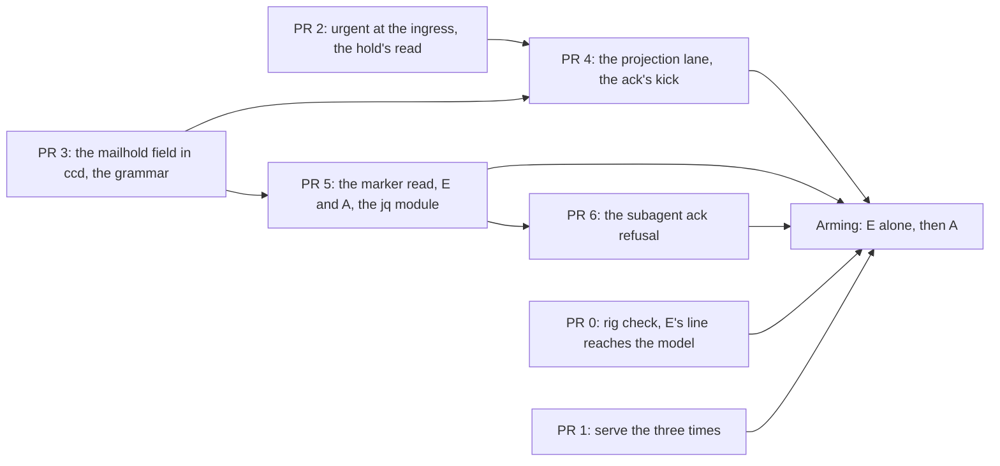
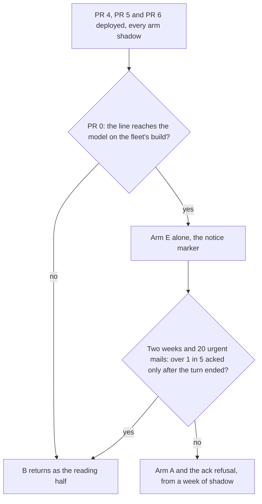

# Mail a busy session sees mid-turn: Implementation Plan

> **For agentic workers:** REQUIRED SUB-SKILL: Use superpowers:subagent-driven-development (recommended) or
> superpowers:executing-plans to implement this plan task by task. Steps use checkbox (`- [ ]`) syntax for tracking.

**Plan** · 2026-11-19 · Status: Proposed, revised after review 2727 (fix round 1) · Programme: Overlord (slug `overlord`, issue #2491), wave 169 · Builds:
`docs/superpowers/specs/2026-11-19-mid-turn-mail-design.md` (#3054, every decision of its §4 ruled) · Task note:
`docs/superpowers/programs/overlord/mid-turn-mail-plan.md`

## In short

- **What this builds.** The spec's C, as A + E. An urgent mail to a session makes the server write a small marker on
  the fleet box, the `mailhold` route field. While it stands, the session hook refuses that session's push, commit,
  merge of main, `gh pr merge` and `ccd pr-admin-merge` (A), and adds one fixed line to the main thread's tool calls
  (E). Nothing is typed into a pane, and nothing on the tool path reaches the network.
- **Measure first (PR 1).** The mail wire serves `deliveredAt`, `ingestedAt` and `ackedAt`, three optional fields
  that use 3 of the 27 free code lines under `shared/api.ts`'s cap. That gives the baseline the hold must lower.
- **Seven pull requests, two of them alone.** PR 1 (the three times) and PR 0 (the rig check that E's line reaches
  the model) stand alone. PR 2 marks mail urgent at the ingress. PR 3 adds the field to `ccd`, with one owner of its
  grammar in `shared/`. PR 4 is the projection lane that writes the marker, kicked by the ack. PR 5 is the hook's
  marker read, E and A, with the matcher and the fixed texts in a new jq module, `ccd/lib/mail-hold.jq`. PR 6 is the
  subagent ack refusal, in its own pull request so the hook stays under its growth limit.
- **No growth waiver.** Every listed file stays under 40 net code lines per pull request (Table 5). New logic goes in
  new files: an L0 grammar, an L1 sender rule, an L1 projection decider, a lane file and the jq module.
- **Everything ships dark.** The projection runs live from its first deploy, but the hook's arms ship shadow. Two
  markers with no writer in the tree arm them: one for E's line, one for A's refusals and the subagent ack refusal.
  E is armed first and alone, once PR 0's rig check says the line reaches the model (§7).
- **Roll order: server first** for the wave that ships the writer and the arms (the coordinator's ruling,
  2026-11-19). The writer composes nothing until the fleet box's `ccd caps` advertises `route-mailhold-v1`, so either
  order fails open.
- **The plan's own calls** (§4): the urgent column stores the sender's role, not a boolean; the hook's three arms sit
  in one block after the last deny arm, which keeps every ordering rule of the spec; the hook appends a `stop` line to
  the shadow log, so the measurement that would bring B back reads one file; the log keeps one line per hold, not
  per call; and the jq module computes the over-cap kinds itself, so `MERGE_STRIP_JQ` stays byte-identical.

## 1. Goal, scope and what the plan does not change

This section states what the plan builds and the boundaries it keeps.

**Goal:** an urgent mail from a run's coordinator, or from the Overlord to a coordinator, stops the recipient's gated
acts until the mail is read, and tells the recipient's main thread at its next tool call that the mail is waiting.

**In scope:**

- the three times on `MailSummary` (D12);
- the `urgent` field at the ingress, its echo, its sender rule and `urgent-outstanding` (spec §3.1), with the three
  refusal words in `MAIL_REJECT_CODES`;
- the hold, derived from the same predicate as `inboxFor` (spec §3.2);
- the `mailhold` route field in `ccd`, its capability word and its one grammar owner (spec §3.3);
- the projection lane, its lease and the ack's kick (spec §3.4);
- the hook's marker read, the gated-act matcher, the subagent ack refusal, the fixed texts, the shadow log and the two
  arming markers (spec §3.5);
- the rig check that a `PreToolUse` `additionalContext` line reaches the model, and the measurement that would bring B
  back (spec §7).

**Unchanged:** `mailTurnIdle` and every delivery rule, the nudge, `mail-gate-strict`'s precedence, the ack route's own
answer, the worker merge deny's definitions and texts, and every pinned skill clause. No new route, no new `ccd` verb,
no new agent grant.

**Out of scope** (the spec's Later): an operator door for urgent mail, B, urgent system mail, the skill clauses for
urgent mail, and the console's badge and session-card hold.

## 2. What exists today, measured from the code

This section records the tree this plan builds on, read on `main` at `67ee91d71` (2026-11-19). Each row names its
owner by symbol, so the citation survives edits above it.

### 2.1 Mail

| Fact | Where |
|---|---|
| `MailSummary` serves `at`, the state, `attempts`, `lastError`, the gate fields and `parkedAt`. It serves no delivery, ingest or ack time. | `shared/api.ts#MailSummary` |
| The summary's columns are one list and one mapper. Neither selects `deliveredAt`, `ingestedAt` or `ackedAt`, which `mail_deliveries` stores. | `server/src/coord/store.ts#MAIL_ROW_COLUMNS`, `#hydrateMail` |
| The mail insert writes `at, fromId, fromUuid, toId, runId, kind, subject, body, artifacts, answersMail`. Nothing marks a mail urgent. | `server/src/coord/store.ts#insertMail` |
| `POST /api/mail` reads its body field by field from an untyped record, checks the box token, the sender's uuid (`stale-uuid`), the recipient and the run, and answers `202 {ok, id}`. An unknown field is ignored. | `server/src/coord/routes.ts` (the `POST /api/mail` handler) |
| The ack route commits through `markAcked` and then settles an operator nudge. Its deps carry no lane handle, and nothing in `routes.ts` kicks a lane. | `server/src/coord/routes.ts` (the ack handler), `server/src/coord/store.ts#markAcked` |
| `inboxFor` selects deliveries to one recipient that are ackable (`ackableDeliverySql`) and outstanding or abandoned (`OUTSTANDING_OR_ABANDONED_SQL`), in delivery-id order. | `server/src/coord/store.ts#inboxFor` |
| A run's close and a child's reclaim reject that run's or that recipient's outstanding rows with a deliberate-cancel error, which `ackableDeliverySql` excludes. | `server/src/coord/store.ts#cancelOutstandingDeliveries`, `#cancelDeliveriesTo`, `#DELIBERATE_CANCEL_ERRORS_SQL` |
| The one rule for which run is a session's (the run it works on, or the runs it claims). | `server/src/coord/store.ts#bindingsOf`, `server/src/coord/runBinding.ts` |
| The Overlord's designation: `designated`, `not-designated` or `unmeasured`. | `server/src/coord/store.ts#designationRead` |
| The mail routes' refusal words are `MAIL_REJECT_CODES`, each with a status in `REFUSAL_STATUS`. A scan requires every quoted code-shaped token in `server/src/coord` to be declared ("every quoted kebab token in server/src/coord that looks like a code is declared"), and the coordinator skill's test requires every member to be named in the skill's text. | `shared/api.ts#MAIL_REJECT_CODES`, `shared/refusal.ts#REFUSAL_STATUS`, `server/test/mail-routes.test.ts`, `server/test/coordinator-skill.test.ts` |
| `ccrc-api mail inbox` is show-only when fd 1 is a pipe or `/dev/null` (`$( )` included), and acks otherwise. | `ccd/ccrc-api` (`cmd_inbox`, `INBOX_BARE`) |

### 2.2 Lanes and route writes

| Fact | Where |
|---|---|
| A lane row has `name`, `cadenceMs`, `derivedFrom`, `clock`, `flight`, an optional `staleAfterMs` and `warnKey`. There is no kick field on the row. | `server/src/laneSchedule.ts#LaneRow` |
| The mail row beats at `MAIL_SWEEP_MS` (10 s), flight `none`. The landing rows carry `staleAfterMs`. `decisionAnchors` is the last row, and a test pins it last. | `server/src/laneSchedule.ts`, `server/test/lane-schedule.test.ts` |
| A lane is kicked by `Watcher.kick(name)`, which makes it due at the next tick. Today only the lifecycle and delegation lanes are kicked, both from inside the watcher. | `server/src/watch.ts` (`kick`), `server/src/laneRunner.ts` |
| The launch-profile lane derives, diffs against `route.fields`, skips a row whose route names an unreadable field, and writes one `CCD_ARGV.routeSet` argv per session behind `ccdCan`. It maps `ccd`'s answer itself. | `server/src/continuity/profileLane.ts` |
| The generations lane writes `precompact` through `routeSet` and maps `ccd`'s answer itself (`unreachable`, `written`, `refused`). Before it calls `ccd` it answers `capability-missing` on its own, which stays outside any shared helper. | `server/src/continuity/renewalWiring.ts` (`routePrecompact`) |
| `ROUTE_WRITABLE_FIELDS` lists 13 fields, `precompact` tenth. `ROUTE_LANE_ONLY_FIELDS` is derived from `profile` on. `parseRouteFields` refuses a lane-only field at every door. | `shared/api.ts#ROUTE_WRITABLE_FIELDS`, `#ROUTE_LANE_ONLY_FIELDS`, `#parseRouteFields` |
| The registry reads a `ROUTE_WRITABLE_FIELDS` file only where its directory listing names it (`listedMeasured`), and names an unreadable listed one in `route.unreadable`. For a session with no marker the new field costs a set lookup. | `server/src/registry.ts` (the route read) |
| A capability word that is not a `CCD_ARGV` row is checked with `capSupported`, as `browser-route-v1` is. | `server/src/ccdargv.ts#capSupported`, `#BROWSER_ROUTE_CAP` |
| The Shadow lanes card lists four lanes. | `shared/lane-arm.ts#LANE_ARM_LANES` |

### 2.3 ccd's route field

| Fact | Where |
|---|---|
| `ROUTE_FIELDS` holds 15 words, `precompact` twelfth. | `ccd/ccd#ROUTE_FIELDS` |
| `_route_valid` judges a written and a stored value alike, returning 0, 1 or 2. `precompact`'s row is a closed word set. | `ccd/ccd#_route_valid` |
| `cmd_route` dies `no such session` without `$REG/<id>.uuid`; refuses `poolset` and `acctorder` from a session shell (`CLAUDECODE` set); skips the empty value of `compact`, `compactwindow`, `poolset`, `acctorder` and `profiledigest`; calls `_route_fable_shell` as its write-site check; writes the journal and `swap.log` lines; then clears the retry budget for every field written. | `ccd/ccd#cmd_route` |
| `_route_any` skips `precompact` and the other non-routing fields. | `ccd/ccd#_route_any` |
| `_route_argv_check` refuses `--route poolset=` and `--route acctorder=` on the minting verbs. | `ccd/ccd#_route_argv_check` |
| `_route_tries_clear` runs once per `cmd_route` call, whatever the field. | `ccd/ccd#_route_tries_clear` |
| `ccd caps` prints one word per line. `CCD_CAPABILITY_TOKENS` holds the advertised set exactly. | `ccd/ccd#cmd_caps`, `server/test/ccdCapTokens.ts` |
| The route functions sit in context C1, the caps verb in C2. | `ccd/contexts.tsv` |

### 2.4 The session hook

| Fact | Where |
|---|---|
| The header says the hot path takes no lock and waits on nothing, with five declared exceptions, all off the tool path. | `ccd/session-hook.sh` (header) |
| `MERGE_STRIP_JQ` removes quoted text and heredoc bodies. It runs once per call, only on a Bash `PreToolUse` whose payload holds a merge word and when no deny exists. Under `MERGE_PARSE_CAP` (2048 bytes) it answers the stripped command and flags; over it, the merge kinds (`ockinds`). It is called with no `-L`. | `ccd/session-hook.sh#MERGE_STRIP_JQ`, `#MERGE_PARSE_CAP` |
| The head grammar: a command head after `;`, `&`, `|`, `(`, `$(` or a newline, past reserved words, the wrappers `time`, `env`, `command`, `exec`, `nohup`, `sudo` and `timeout <n>`, `VAR=value` prefixes and a path. `CCD_DOOR_RE` already matches `ccd pr-admin-merge`, but only inside the worker merge deny. | `ccd/session-hook.sh#GH_MERGE_RE`, `#CCD_DOOR_RE` |
| The graph arm's Read nudge runs first. The landing-order advisory then runs only on an empty `pre_json`, reading sync targets on the raw command. Every later deny arm overwrites advice ("A DENY SUPERSEDES ADVICE"), and the last deny arm today is the fan-out routing deny (an `Agent`, `Task` or `Workflow` call that names no model or effort). `pre_json` is printed once. | `ccd/session-hook.sh` (`LANDING_SYNC_RE`, `_hook_nudge_json`, `_hook_deny_json`) |
| `_hook_compact_refuse` reads `$REG/<id>.precompact` with one bounded `read`, refusing a symlink. `_hook_server_cap` reads the clock inline (`EPOCHREALTIME`, else `printf -v now '%(%s)T' -1`). | `ccd/session-hook.sh#_hook_compact_refuse`, `#_hook_server_cap` |
| `tmsub` is set only on a join in `$REG/<id>.joined` (or `.joinedprev`). It fails toward the main thread. | `ccd/session-hook.sh` (the join test, `JOIN_ROTATE_AT`) |
| The jq library directory is `ROSTER_CARD_LIB`, loaded with `jq -L`. It is installed to `~/.cc-sessions/lib/` by `ccd/ccrc`'s install list and `deploy/deploy.sh`, backed up and uninstalled by the same files, and listed in `server/test/installTreeFixture.ts`. | `ccd/session-hook.sh#ROSTER_CARD_LIB` |
| The one hook shadow log is the roster card's, under `~/.ccrc/`, which stops appending past 256 KiB. | `ccd/session-hook.sh#_hook_roster_card` |
| The hook tests `$REG/mail-disabled` nowhere today. | `ccd/session-hook.sh` |

### 2.5 Growth, measured with the growth check's own counter

| File | Code lines now | Rule |
|---|---|---|
| `shared/api.ts` | 5,113 | capped at 5,140: **27 free**, shared by every pull request |
| `ccd/session-hook.sh` | 3,079 | listed: 40 per pull request |
| `server/src/coord/store.ts` | 5,504 | listed: 40 |
| `server/src/coord/routes.ts` | 2,632 | listed: 40 |
| `server/src/coord/schema.ts` | 1,785 | listed: 40 |
| `server/src/watch.ts` | 6,459 | listed: 40 |
| `server/src/server.ts` | 2,077 | listed: 40 |
| `ccd/ccd` | 22,127 | listed: 40, and the `ccd (program)` row |
| `ccd/ccrc` | 14,269 | listed: 40 |

*Table 2. Code lines by `server/test/growthCheck.ts`'s counter at `67ee91d71`. A `.jq` file is in no growth row.*

## 3. Global constraints

These bind every task.

- **Rings.**
  - L0: `shared/mailHold.ts` holds the `mailhold` grammar, its bounds and its two role words, and imports nothing.
  - L1, pure: the sender rule (`server/src/coord/urgentMail.ts`), the projection decider
    (`server/src/coord/mailHoldPolicy.ts`), and the mapping of a `routeSet` answer (`server/src/routeSetOutcome.ts`).
  - Contexts: the `coord/` files fall under C5's row. `server/src/routeSetOutcome.ts` is a top-level file, so PR 4
    adds it by name to C2 Fleet Mutation's row, beside `ccdargv.ts`, in the ring and context table of
    `docs/superpowers/specs/2026-08-10-architecture-ddd-clean-solid.md`; `server/test/rings/totality.test.ts` reds a
    file no row reaches. `shared/mailHold.ts` is outside the table's packages.
  - L4: the projection pass (`server/src/coord/mailHoldLane.ts`), its lane row and its watcher wiring, and the routes.
    They decide nothing: the pass reads, asks the decider, and writes what it answered.
  - L5: `server/src/index.ts` and the route deps in `server/src/server.ts` wire the ack's kick.
- **One owner per fact.**
  - The store owns delivery state and the urgent column (one writer, the insert). The hold is derived, never stored.
  - The projection lane is the one writer of `mailhold`. `ccd route` is its only carrier.
  - The `mailhold` grammar has one owner, `shared/mailHold.ts`. Its two bash readers are held to it by a parity test.
  - The hook owns its arms and its shadow log. Nothing in the tree writes the two arming markers.
- **Consolidate.** The hold reuses `inboxFor`'s predicate as one named fragment, never a second copy. The projection
  follows the launch-profile lane's shape and shares one `routeSet` answer helper with it and with the generations
  lane. Its "legitimately different" reasons are the spec's §3.7, quoted in each PR body.
- **Wire.** Every new field is additive: `deliveredAt`, `ingestedAt` and `ackedAt` on `MailSummary`, `urgent` on the
  send body and its answer, and the `mailhold` route field. `FLEET_PROTO` is not bumped. A missing echo reads as "not
  urgent, no hold".
- **Capability.** `route-mailhold-v1` in `ccd caps`, checked with `capSupported`. An older fleet box gets no write.
- **Fail open (D3).** A missing marker, an unreadable or malformed one, a lapsed or far-future lease, a missing jq
  module, `$REG/mail-disabled`, and a down server each hold nothing.
- **No new route and no new `ccd` verb,** so the box-token census and `CLAUDE.md`'s census sentence are unchanged.
- **SAFETY.** Every `ccd` and hook test runs in a fixture HOME. No test touches the live registry, tmux or a
  `claude-session@` unit.
- **Public repository.** Fixtures use `lane-a`, `project-a`, `a coordinator` and `a worker`. No session, lane,
  account or host name appears in code, tests, notes or the PR.
- **Migration slots** are measured again before the merge, under the commuting-migrations rule if it has landed,
  else positionally (`docs/superpowers/specs/2026-11-11-coord-migrations-commute-design.md`).
- **Tests** run one file at a time through `ccrc test`, from the package directory:
  `ccrc test -- ./node_modules/.bin/vitest run test/<file>`.

## 4. The plan's own calls

The spec rules every design decision. These are the implementation choices it left open, each with its reason.

| # | Choice | Options | Chosen, and why |
|---|---|---|---|
| P1 | How the urgent mark is stored | A boolean, the sender's role | One nullable text column, `urgentAs`, holding `coordinator` or `overlord`, written once at the insert. The marker needs each delivery's sender role (spec §3.3). Deciding it at the ingress fixes it, so a coordinator later designated as the Overlord, or a run that closes, never changes what an old mail says. Null means not urgent. |
| P2 | Which reads decide the sender rule | The mail's `runId`, the recipient's bindings | The recipient's bindings (`bindingsOf`). A run's coordinator may mark mail urgent when the recipient works on a non-terminal run (work or review) that the sender claims. The Overlord may when it is the designated session and the recipient claims a non-terminal run. `runId` is not required. |
| P3 | An unreadable fact in the sender rule, and where the words live | Fold into `urgent-not-allowed`, a word of its own; `MAIL_REJECT_CODES` or the generic refusals | A word of its own, `urgent-unmeasured` (503), when the designation or the bindings cannot be read: two conditions a sender handles differently never share one value. The three words join `MAIL_REJECT_CODES` beside `key-conflict` (#3056) (the coordinator's ruling, fix round 1), so a refused send is recorded as every mail refusal is. |
| P4 | Where `urgent-outstanding` is decided | Before the transaction, inside it | Inside the insert's transaction, over the hold's fragment, so two concurrent sends cannot both pass. |
| P5 | Where the hook's arms sit | E before the landing advisory and A after the deny arms, one block after the last deny arm | One block after the last deny arm (the fan-out routing deny today). Every ordering rule of spec §3.5 still holds: a deny already built wins, A overwrites advice, E overwrites advice (the graph nudge and the landing advisory alike) and never a deny. The landing advisory may build its nudge first, which costs one `jq` fork that E then replaces. It saves the hook a second block. |
| P6 | How the hook reads the stripped command, and the over-cap kinds | Add `-L` to `MERGE_STRIP_JQ`'s call, a second `jq` call; extend `ockinds`, compute the kinds in the module | A second call, the module's, with `-L`. `MERGE_STRIP_JQ` stays byte-identical, and so do the merge deny's gate and code (the coordinator's ruling, fix round 1). The arm reuses the strip's answer when the merge deny's call ran for this payload, and otherwise makes that same call itself, with the same arguments, so the strip runs at most once per call. Over `MERGE_PARSE_CAP` the module computes the gated kinds (`push`, `commit`, `sync`, `admin-merge`) itself from the raw payload it receives on stdin. |
| P7 | The arming markers | One, two | Two, both with no writer in the tree: `$REG/mailhold-notice-live` arms E, and `$REG/mailhold-refuse-live` arms A and the subagent ack refusal. E is armed alone first (spec §7). |
| P8 | The shadow log | One line per call and stop at a cap, one line per hold and rotate | A fixed tab-separated line in `~/.ccrc/mail-hold-shadow.log`, at most 120 bytes: `<epoch> <session> <arm> <outcome> <delivery> <act>`. Arms: `notice`, `refuse`, `ack`, `stop`. Outcomes: `would`, `did`, `lapsed`, `far`, `module-missing`. It is written in both modes. **One line per hold, not per call:** a per-session seen file, `~/.ccrc/mail-hold-shadow.d/<id>` (at most 4 KiB, read with one bounded builtin `read`), holds the `<arm>.<delivery>.<act>` keys already logged for the marker's current pairs, and is reset when the pairs change; the module decides from it whether a line is new. `stop` lines are one per turn. **Rotation:** past 1 MiB (about 9,000 lines) the log is renamed to `.1`, replacing the older one, and a new one starts. The size is tested only when a line is appended, which the seen file makes rare, by one `stat` fork. So a 300-call hold in shadow adds one `notice` line, and the evidence a week of shadow needs is never the part that is dropped. |
| P9 | Turn ends for the B measurement | Read transcripts, log them | The hook appends a `stop` line on `Stop` while a marker file exists. The read is the shadow log and the mail's `ackedAt`, no transcript needed. |
| P10 | The Shadow lanes card | Join `LANE_ARM_LANES`, not | Not. The projection has no shadow mode: it is live from its first deploy, nothing acts on its output until the hook's arms are armed, and a projection that stopped would leave stale markers. The arms' switches are fleet-box files the hook reads with a builtin, not server settings. A card row for them is Later. |
| P11 | The `routeSet` answer helper | Each writer maps its own, one helper | One L1 helper, `routeSetOutcome(res)`, answering `written`, `unreachable` or `refused` with the first stderr line. The generations lane and the launch-profile lane move onto it in a commit of their own, behind characterization tests. |
| P12 | Where `mailhold` sits in the two field lists | Beside `precompact`, at the end | At the end of `ROUTE_FIELDS` and of `ROUTE_WRITABLE_FIELDS`. `ROUTE_LANE_ONLY_FIELDS` is derived from `profile` on, so the field inherits lane-only. Either place changes the order pins, which the same pull request updates. |
| P13 | The retry budget | Skip the clear for lane-only fields, for `mailhold` only | For `mailhold` only, as the spec says: `cmd_route` skips `_route_tries_clear` when every field written is `mailhold`. `precompact` clears it today; that is reported, not changed (§10). |
| P14 | The digit widths | Unbounded, bounded | `until` is 1 to 11 digits and a delivery id 1 to 10, neither with a leading zero, as `_hook_server_cap` bounds `at`. Both bash readers compare with `10#`. Without the bound, a 25-digit value reads one way in bash (a wrapped integer) and another in JavaScript (`1e+23`). |

## 5. The PR split

This section orders the pull requests and estimates what each adds.


*Figure 1. Dependencies. PR 1 and PR 0 stand alone. PR 2 and PR 3 are independent of each other. Arming E needs PR 4,
PR 5, the rig answer and the baseline; arming A needs PR 6 as well.*

| PR | What it ships | Depends on | Listed-file growth (net code lines) | New files and tests |
|---|---|---|---|---|
| 1 | `deliveredAt`, `ingestedAt`, `ackedAt` on `MailSummary` | nothing | `shared/api.ts` +3 (24 free after), `store.ts` +6 | tests +120 |
| 0 | The rig scenario for a `PreToolUse` `additionalContext` line, and its results note | nothing | none | scenario JSON, note |
| 2 | The `urgentAs` column and its migration, the sender rule, the three refusal words in `MAIL_REJECT_CODES` and `REFUSAL_STATUS`, the echo, the hold's fragment and its read, and one sentence naming the words in the coordinator skill's references | nothing | `shared/api.ts` +3 (21 free after PR 1 and PR 2, less what #3056 takes if it lands first), `schema.ts` +14, `store.ts` +32, `routes.ts` +22 | `coord/urgentMail.ts` +70, `shared/refusal.ts` +2; tests +450 |
| 3 | The `mailhold` field in `ccd`, `route-mailhold-v1`, the L0 grammar, the parity corpus, `ROUTE_WRITABLE_FIELDS` | nothing | `ccd/ccd` +14, `shared/api.ts` 0 (one line edited in place) | `shared/mailHold.ts` +60, a corpus JSON; tests +400 |
| 4 | The projection decider and pass, the lane row, the watcher's wiring, the ack's kick, the shared `routeSet` answer helper and its C2 row in the ring and context table | PR 2, PR 3 | `watch.ts` +16, `routes.ts` +4, `server.ts` +2 | `coord/mailHoldPolicy.ts` +70, `coord/mailHoldLane.ts` +100, `routeSetOutcome.ts` +20 (and -8 in each of the two lanes it replaces in); tests +600 |
| 5 | The marker read, the block with E and A, the shadow log with its seen file and rotation, the `Stop` line, the arming markers, `ccd/lib/mail-hold.jq` and its install, backup and uninstall | PR 3 | `session-hook.sh` +34, `ccd/ccrc` +3 | `ccd/lib/mail-hold.jq` +170, `deploy/deploy.sh` +2; tests +800 |
| 6 | The subagent ack refusal: its arm in the block, its matcher and text in the module | PR 5 | `session-hook.sh` +8 | `ccd/lib/mail-hold.jq` +50; tests +250 |

*Table 5. Seven pull requests. Growth is the author's estimate. `growth-check` runs armed on every listed file a pull
request grows, and no waiver is taken. The subagent ack refusal is in PR 6 by plan (the spec's fallback split). If
PR 5's hook growth still measures over 40, E and A split into two pull requests as well, never a waiver.*

**Roll order.** PR 3, PR 5 and PR 6 reach the fleet box, PR 2 and PR 4 the server. The wave that ships PR 4 and PR 5 rolls
server first (`--server-first`): the writer waits for `route-mailhold-v1`, and the arms ship shadow, so both orders
fail open.

## 6. Tasks

**Every task is red-first.** The test is written and run red against the unchanged tree, then made green.

**Every new guard gets a mutation step,** run with the coordinator skill's mutation runner
(`references/mutation-run.py`), which deletes or inverts the guard in memory. The named test must go red.

### Task 1.1: Serve the three times (PR 1)

- [ ] Red, `mail-times-wire.test.ts`, on a temporary `CoordStore`:
  - a queued row answers no `deliveredAt`, `ingestedAt` or `ackedAt`;
  - a delivered row answers `deliveredAt`, and an acked row all three it has;
  - `mail list` and the outstanding read carry them;
  - a stored value that is not a whole number is answered absent, never zero (`persistedInt`).
- [ ] Green: three optional fields on `MailSummary` beside `parkedAt`, three columns in `MAIL_ROW_COLUMNS`, and their
  reads in `hydrateMail`.
- [ ] Mutation: drop one column from `MAIL_ROW_COLUMNS`. Its case reds. Answer zero for an absent time. The absent
  case reds.
- [ ] Measure `shared/api.ts`'s code lines after the change and record them in the PR body.

### Task 0.1: The rig scenario (PR 0)

- [ ] Write `server/test/delegation-rig/scenarios-overlord/ov-pretool-context.json`:
  - a `PreToolUse` hook, `emit-context.mjs --event PreToolUse --chars 200 --tag pretool`, beside ccrc's own;
  - a mock script whose main turn makes three tool calls (Bash, Read, Bash) before its final answer;
  - `requests: true`, `timing: true`, and the scenario's `mainMarker`.
- [ ] Run the scenario's corpus checks: `check-scenario` passes it, and the bypass-free and `mainMarker` pins still
  hold.
- [ ] By hand, on the test box, with the Claude Code build the fleet runs: `rig.sh run <version> <file> <out-dir>`.
  Read the bundle's `reqs/`: each request after a tool result carries the canary, inside the turn.
- [ ] Record the answer, the build and the date in `docs/superpowers/programs/overlord/mid-turn-mail-e-rig.md`, a
  task note.
  Nothing from the run is committed. A "no" stops arming E and is mailed to the coordinator: B returns as the
  reading half (spec §7).

### Task 2.1: Characterize the inbox predicate (PR 2)

- [ ] Pin `inboxFor`'s set in `mail-hold-set.test.ts` before any move: rows in each state (`queued`, `delivered`,
  `acked`, `rejected` at `MAIL_MAX_ATTEMPTS`, the replay-ceiling reject with its run open and with it closed, the park
  ceiling, `'run closed'`, `'child workspace reclaimed'`). Green on `main`.
- [ ] Move: name the predicate once, `ACKABLE_OUTSTANDING_SQL(prefix)`, built from `ackableDeliverySql` and
  `OUTSTANDING_OR_ABANDONED_SQL`, and make `inboxFor` use it. The move commit changes no test.

### Task 2.2: The urgent column and its one writer (PR 2)

- [ ] Red, `mail-urgent-store.test.ts`:
  - `insertMail` with `urgentAs: 'coordinator'` stores it, without it stores null;
  - a migration of a database at the previous version adds the column, null on every old row, and a partial index
    on urgent rows;
  - the one-writer census finds one writer of `urgentAs`.
- [ ] Green: the migration (slot measured at merge), the insert's column.
- [ ] Mutation: write `urgentAs` on every insert. The null case reds.

### Task 2.3: The sender rule (PR 2)

- [ ] Red, `urgent-mail-rule.test.ts`, over the L1 `urgentSenderVerdict(facts)`:
  - a coordinator to the worker of a run it claims: allowed, role `coordinator`;
  - the same to the reviewer of a review run it claims: allowed;
  - a coordinator to a worker of another coordinator's run, to a peer, or to a session with no binding:
    `urgent-not-allowed`;
  - a coordinator to its worker on a terminal run: `urgent-not-allowed`;
  - the designated Overlord to a session that claims a non-terminal run: allowed, role `overlord`;
  - the Overlord to a worker that claims nothing: `urgent-not-allowed`;
  - a session that is not designated, sending as the Overlord would: `urgent-not-allowed`;
  - the designation `unmeasured`, or the recipient's bindings unreadable: `urgent-unmeasured`, never
    `urgent-not-allowed`;
  - a sender that qualifies both ways gets `coordinator` when it claims the recipient's run.
- [ ] Green: `server/src/coord/urgentMail.ts`, pure, its inputs the two bindings and the designation as facts.
- [ ] Mutation: drop the terminal-run test. Its case reds. Fold `unmeasured` into `not-allowed`. Its case reds.

### Task 2.4: The ingress, the echo and one outstanding (PR 2)

- [ ] Red, `mail-urgent-route.test.ts`, through the real route:
  - `urgent: true` from an allowed sender answers `202 {ok, id, urgent: true}` and stores the role;
  - `urgent` absent or `false` answers as today, with no `urgent` field;
  - `urgent` that is not a boolean is refused `bad-kind`;
  - a refused sender gets `403 urgent-not-allowed`, an unreadable fact `503 urgent-unmeasured`, and no mail or
    delivery row is written either way;
  - a second urgent mail from the same sender to the same recipient is refused `409 urgent-outstanding` while the
    first is on the hold's set, and is accepted once the first is acked, or rejected by the run's close;
  - the same second mail without `urgent` is accepted;
  - while the first stands, an urgent mail to the same recipient from a different sender the rule allows is accepted
    (the fixture: a coordinator that is also the worker of another coordinator's run, sent urgent mail first by that
    run's coordinator, then by the Overlord), so the rule is keyed on the pair, never on the recipient alone;
  - two concurrent urgent sends to one recipient write one row (P4).
- [ ] Red: `mail-routes.test.ts`'s scan ("every quoted kebab token in server/src/coord that looks like a code is
  declared") goes red on the three new words until they are declared, and `coordinator-skill.test.ts`'s scan of every
  `MAIL_REJECT_CODES` member goes red until the skill's text names them.
- [ ] Green: the body read beside the others, the facts gathered in the route, the verdict, and the outstanding test
  inside the insert's transaction over `ACKABLE_OUTSTANDING_SQL`. The three words join `MAIL_REJECT_CODES` beside
  `key-conflict` (#3056, or on its own line if #3056 has not landed), with 403, 409 and 503 in `REFUSAL_STATUS`, and
  one sentence in the coordinator skill's references (`references/wave-lifecycle-3-mail.md`) names them; no pinned
  clause changes. Measure `shared/api.ts`'s code lines after the change and record them in the PR body.
- [ ] Mutation: skip the outstanding test. The second-send case reds. Key the test on the recipient alone. The
  second-sender case reds. Echo `urgent` on a refused send. The refusal case reds. Drop the echo. The echo case reds.

### Task 2.5: The hold's read (PR 2)

- [ ] Red, in `mail-hold-set.test.ts`:
  - `urgentHolds()` answers, per recipient, the urgent deliveries in delivery-id order with their roles;
  - **set equality:** for each recipient, the hold's delivery ids are exactly the urgent members of `inboxFor`'s set,
    in both directions, over every state of Task 2.1;
  - closing the run with an urgent mail unread empties the hold, and so does reclaiming the child;
  - acking empties it.
- [ ] Green: one query over `ACKABLE_OUTSTANDING_SQL` and `urgentAs IS NOT NULL`.
- [ ] Mutation: drop the ackable clause. The replay-ceiling-closed case reds. Drop the urgent filter. The equality
  reds.

### Task 3.1: The grammar's one owner (PR 3)

- [ ] Red, `mailhold-grammar.test.ts`, over a corpus file `server/test/fixtures/mailhold-grammar.json`:
  - accepted: one pair, eight pairs, both roles;
  - refused: nine pairs, an unknown role, a zero or signed delivery id, a missing `until`, spaces, a trailing comma,
    an empty value, a control character, a 12-digit `until`, an 11-digit delivery id, a leading zero in either, and a
    25-digit number in either;
  - `renderMailHold` keeps the eight lowest delivery ids, ascending, from any larger set;
  - the bounds: `MAILHOLD_LEASE_S` 300, `MAILHOLD_REACH_S` 360, `MAILHOLD_RENEW_UNDER_S` 120,
    `MAILHOLD_MAX_PAIRS` 8.
- [ ] Green: `shared/mailHold.ts`, importing nothing, with `parseMailHold`, `renderMailHold`, `mailHoldLive(until,
  now)` (`now < until <= now + 360`) and the regular expression body both bash readers copy.
- [ ] Mutation: allow nine pairs. Its refusal reds. Make the upper bound `<`. The edge case reds. Widen `until` to 12
  digits. Its corpus line reds. Allow a leading zero. Its corpus line reds.

### Task 3.2: The field in ccd (PR 3)

- [ ] Red, `ccd-route-mailhold.test.ts`, in fixture HOMEs:
  - `ccd route --session <id> --set mailhold=<valid>` writes the file, with a journal and a `swap.log` line;
  - the empty value removes it;
  - a value outside the grammar is refused, and so is one whose `until` is more than 360 s past ccd's clock;
  - a stored marker whose `until` has passed still reads valid through `_route_get` (the bound is at the write site
    only);
  - from a session shell (`CLAUDECODE` set) the write is refused;
  - `ws-add --route mailhold=…`, `start --route mailhold=…` and `enable --route mailhold=…` are each refused, and
    nothing is touched;
  - a standing marker does not make `_route_any` true;
  - a `mailhold`-only write leaves `.routetries` in place, and a `class` write still clears it;
  - an absent session dies `no such session`;
  - `ccd caps` prints `route-mailhold-v1`.
- [ ] Green, as rows in existing tables: the `ROUTE_FIELDS` member, the `_route_valid` row (grammar and role words
  only), the write-site bound beside `_route_fable_shell`, the empty-value clear, the `_route_any` skip, the
  `_route_argv_check` refusal, the session-shell refusal (its own message, `mailhold-lane-only`), the retry-budget
  skip, and the caps line. Update `CCD_CAPABILITY_TOKENS` and `ccd/contexts.tsv` and `ccd/contexts-edges.tsv` for any
  new helper.
- [ ] Mutation: drop the write-site bound. The far-future case reds. Drop the `_route_any` skip. Its case reds. Drop
  the argv refusal. The `ws-add` case reds.
- [ ] Run `ccd-route-fields.test.ts` alone, and every pin of the field order (Task 3.4).

### Task 3.3: The parity of the three readers (PR 3, finished in PR 5)

- [ ] Red, `mailhold-parity.test.ts`: every corpus line gets the same accept or refuse from `parseMailHold`, from
  `ccd route`'s `_route_valid` (fixture HOME), and, from PR 5 on, from the hook's builtin parse (a fixture hook run),
  bounds, the digit widths and the eight-pair edge included, as `_hook_server_cap`'s copies are held to
  `parseServerCaps`. Both bash readers compare numbers with `10#`.
- [ ] Mutation: widen the bash role words by one. The parity reds. Drop `10#` from a bash reader. The leading-zero
  line reds.

### Task 3.4: `ROUTE_WRITABLE_FIELDS` (PR 3)

- [ ] Red: the order pins name `mailhold` last, and `ROUTE_LANE_ONLY_FIELDS` has 8 members: `route-fields-parse`,
  `launch-profile-route-wire`, `sessions-route-body`, `run-route-route`, `sessions-route-route` and
  `ccd-route-fields`. `parseRouteFields` refuses `mailhold` at a door as `lane-only`.
- [ ] Green: append `'mailhold'` to `ROUTE_WRITABLE_FIELDS`, an in-place edit of its one line.
- [ ] Check the persisted-snapshot reader (`reviveRoute`) on a rollback: a state cache written with a `mailhold`
  field and read by the previous server. Record what happens in the PR body (§9).

### Task 4.1: One `routeSet` answer helper (PR 4)

- [ ] Characterize, green on `main`: the generations lane's `routePrecompact` answers and the launch-profile lane's
  pass counts for a `ccd` result that did not run, ran and succeeded, and ran and failed.
- [ ] Green: `server/src/routeSetOutcome.ts`, taking the `runCcd` result only, so each lane's own pre-checks
  (`capability-missing`, the launch-profile lane's `unsupported`) stay where they are. Add the file to C2's row in the
  ring and context table, and run `server/test/rings/totality.test.ts`. Then, in a commit of its own, the two lanes
  call it. The characterization tests change only their imports.

### Task 4.2: The projection decider (PR 4)

- [ ] Red, `mail-hold-policy.test.ts`, over the L1 `decideMailHold({held, measured, unreadable, now, capable,
  mailDisabled})`:
  - a hold and no marker: write `now + 300` and the pairs;
  - a hold and a matching marker with more than 120 s left: nothing;
  - the same with under 120 s left: write (renew);
  - a hold and a marker that differs (another pair, another role, a forged value, a malformed value): write;
  - no hold and any marker: clear;
  - no hold and no marker: nothing;
  - more than eight held deliveries: the eight lowest;
  - `mailDisabled`: clear a standing marker, write nothing;
  - `unreadable`: skip, counted;
  - not `capable`: skip, counted, and never "no hold".
- [ ] Green: `server/src/coord/mailHoldPolicy.ts`, pure, rendering through `shared/mailHold.ts`.
- [ ] Mutation: drop the renewal rule. The under-120 case reds. Drop the clear of a forged marker. Its case reds.
  Write under `mailDisabled`. Its case reds.

### Task 4.3: The pass and its lane row (PR 4)

- [ ] Red, `mail-hold-lane.test.ts`, with a stubbed `runCcd` and a temporary store:
  - **renewal while not due:** a delivered urgent row the mail lane will not retry for 600 s still has its lease
    renewed on schedule;
  - a marker the derived hold does not hold is cleared;
  - a row the registry does not list is skipped, and nothing is written for it;
  - a pass with no urgent mail outstanding and no marker writes nothing, after one store query;
  - a failed write is logged once per episode and retried next pass;
  - the lease's `until` comes from the clock port's `wall()`, never the monotonic clock;
  - one `routeSet` argv per session, behind `capSupported(route-mailhold-v1)` and `ccdCan('routeSet')`;
  - **under `mail-disabled`, end to end:** with `$REG/mail-disabled` present and a marker standing, the watcher's
    `tick()` still runs the `mailHold` sweep, the pass sends exactly one clearing `routeSet` argv (the empty value) for
    that session and no write, and an urgent delivery queued meanwhile adds no marker.
- [ ] Red, `lane-schedule.test.ts`: the `mailHold` row beats at `MAIL_SWEEP_MS` by `derivedFrom`, flight `skip`,
  clock `mono`, a `staleAfterMs` of 60 s (under the 120 s renewal margin), placed after the `mail` row, and
  `decisionAnchors` stays last.
- [ ] Green: `server/src/coord/mailHoldLane.ts`, the row, and the watcher's sweep, which runs whether or not
  `mail-disabled` stands.
- [ ] Mutation: let the pass read the mail lane's due list instead of the store. The not-due renewal case reds.
  Change the flight to `none`. The row pin reds. Return from the pass when `mail-disabled` stands. The end-to-end
  case reds. Call the sweep from inside `mailPass`, after its first act. The end-to-end case reds.

### Task 4.4: The ack kicks the projection (PR 4)

- [ ] Red, `mail-hold-ack-kick.test.ts`, through the real ack route with a recording kick:
  - a successful ack kicks the `mailHold` row once, after the commit;
  - a refused ack (`unknown-recipient`, `already-acked`, `parked`) kicks nothing;
  - the ack's answer is unchanged, and a kick that throws does not change it;
  - with a pass in flight, the kick leaves the row due, and the next tick runs one pass.
- [ ] Green: an optional `onMailAcked` in the route deps, called after the commit and never awaited, composed in
  `server/src/server.ts` as the watcher's `kick('mailHold')`.
- [ ] Mutation: kick before the commit. The ordering case reds. Drop the kick. The first case reds.

### Task 5.1: The jq module, the gated acts and the texts (PR 5)

- [ ] Red, `mail-hold-module.test.ts`, running `jq -L ccd/lib` over payload fixtures, one shape per case. Each line
  of spec §6 the matcher decides is a case:
  - denied, the act word given: `git push`, `git commit`, `git pull origin main`, `git merge origin/main`,
    `git rebase origin/HEAD`, `gh pr merge 42`, `git merge main`, `gh -R o/r pr merge 42`;
  - denied past a head separator: `cd repo && git push`, `true; git push`, `true || git push`, `a | git push`,
    `(git push)`, `x=$(git push)`, and a newline before `git push`;
  - denied past git's own options: `git -C repo push`, `git -c k=v push`, `git --git-dir=x push`,
    `git --work-tree=x push`, `git --no-pager push`, and, by shape, `git -P push`, `git --bare push`,
    `git --config-env=a=B push`;
  - denied past each wrapper and prefix: `time git push`, `env X=1 git commit -m x`, `command git push`,
    `exec git push`, `nohup git push`, `sudo git push`, `timeout 30 git push`, `VAR=x git push`, `a=1 b=2 git push`,
    and `/usr/bin/git push`;
  - denied past each reserved word: `if git push; then :; fi`, `if true; then git push; fi`,
    `if false; then :; else git push; fi`, `if false; then :; elif git push; then :; fi`,
    `while git pull origin main; do :; done`, `for x in a; do git push; done`, `until git push; do :; done`,
    `! git push`, `{ git push; }`;
  - `ccd pr-admin-merge` in each position: at the start, after `cd x &&`, after `VAR=x`, and with a path;
  - the quoted targets, read on the raw text: `git merge "origin/main"`, `git rebase 'main'`;
  - fail closed: an unterminated quote followed by `git push`; an over-cap command whose raw text holds `git push`,
    refused with A's text plus the merge deny's advice to split the command or pass its text as a file (the module
    computes the over-cap kinds from the raw payload, P6);
  - not gated: `gh pr create --body "notes; git push later"`, `echo "git push"`, a heredoc whose body holds
    `git push`, `git merge feature-x`, `git pull origin feature-x`, an over-cap command that holds no gated act;
  - the texts: E's line and A's two texts, byte for byte, with `<id>`, `<sender>` and `<act>` filled, and the
    subagent text given only for the subagent thread;
  - the sender map: `coordinator` renders "its coordinator", `overlord` renders "the Overlord", and any other word
    renders no text;
  - the log decision: a key already in the seen text gives no log line, a new one gives one line and the new seen
    text.
- [ ] Red, a parity case: on the merge deny's own corpus (`session-hook-merge-deny.test.ts`'s), the module's head
  grammar finds `gh pr merge` where `GH_MERGE_RE` does, and only there.
- [ ] Green: `ccd/lib/mail-hold.jq`, defining the head grammar (the merge deny's method, written in jq), the gated
  acts, the sync targets read on the raw text, the over-cap kinds, E's and A's texts, the sender map and the log
  decision.

### Task 5.2: The hook's marker read and block (PR 5)

- [ ] Red, `session-hook-mail-hold.test.ts`, in fixture HOMEs, with both arming markers present unless a case says
  otherwise:
  - **no marker costs nothing new:** an ungated Read forks `jq` exactly as often as it does with the arm's code
    absent, counted by a `jq` wrapper on `PATH` after a warm-up call, with a floor that the count is above zero (the
    hook's own event parse), so the case cannot pass vacuously;
  - a live marker on an ungated main-thread call: E's line, the call proceeds;
  - a live marker on a gated main-thread call: A's main-thread text;
  - an expired marker (`until <= now`), a marker whose `until` is beyond `now + 360`, and one at exactly
    `now + 360`: the first two let the gated call proceed and the log records `lapsed` or `far`; the third holds;
  - a symlinked or malformed marker: nothing, and nothing logged as `did`;
  - a deny an earlier arm built (the worker merge deny, the fan-out routing deny) is kept byte for byte, and neither
    A nor E replaces it; the worker merge deny's text is unchanged under a live marker;
  - the two paths the strip feeds, end to end: `git merge "origin/main"` and `git rebase 'main'` are refused (the
    target read on the raw text), and an over-cap command holding `git push` is refused through the module's over-cap
    kinds, while one holding no gated act gets E's line; `MERGE_STRIP_JQ`'s text is byte-identical to `main`'s;
  - the graph arm's Read nudge does not suppress E's line; under a live marker the landing advisory's sync gives E's
    line, not the advisory's;
  - a joined subagent's `git push` gets the subagent text, and its ungated call gets no line;
  - an unjoined `agent_id` gets the main-thread text, and E's line;
  - with `ccd/lib/mail-hold.jq` missing: nothing denied or said, and the log records `module-missing`;
  - with `$REG/mail-disabled` present: nothing refused or said;
  - **shadow:** with neither arming marker, nothing is refused or said, and the log records `would` for the line and
    the refusal; with only `mailhold-notice-live`, E's line is said and A is `would`;
  - **the log's bound:** a 300-call hold in shadow leaves one `notice would` line for that delivery, its `refuse`
    lines one per act, and its `stop` lines one per turn; a new pair set starts the seen file again; past 1 MiB the
    log moves to `.1` and the next line starts a new file;
  - on `Stop` with a marker file present, the log gains one `stop` line; with none, it gains nothing.
- [ ] Green, in `ccd/session-hook.sh`:
  - the marker read, beside `_hook_compact_refuse`'s: one `[[ -f ]]`, then a bounded `read` refusing a symlink, the
    grammar's regular expression, and the inline clock, compared with `10#`;
  - one block after the last deny arm: the strip's answer reused, or the same `MERGE_STRIP_JQ` call made once (P6);
    the module called once, with `-L "$ROSTER_CARD_LIB"`, the payload on stdin, and the stripped command, the cap, the
    thread, the arming words and the seen text as arguments; it prints a log line, the new seen text and an envelope;
    the hook appends the first, writes the second and keeps the third only under "no deny built yet";
  - the `Stop` append, and the rotation;
  - the header's amendment: one more builtin read beside `precompact`'s, and no new exception.
- [ ] Green, the install: `ccd/lib/mail-hold.jq` in `ccd/ccrc`'s install, backup and uninstall lists, in
  `deploy/deploy.sh`'s install and backup, and in `server/test/installTreeFixture.ts`.
- [ ] Red, `single-definition`: no file in the tree writes `mailhold-notice-live` or `mailhold-refuse-live`.
- [ ] Run each `session-hook*` suite the change touches alone, and `session-hook-merge-deny.test.ts` and
  `session-hook-sync-advisory.test.ts` unchanged.

### Task 5.3: One mutation per guard (PR 5)

Each row is one mutant, run with the mutation runner; the case named must go red. A row that names a list runs one
mutant per member.

| Guard | Mutation | Red case |
|---|---|---|
| Each head separator (`&&`, `;`, `\|\|`, `\|`, `(`, `$(`, newline) | drop it from the head grammar | its separator case |
| Each git option skip (`-C`, `-c`, `--git-dir`, `--work-tree`, `--no-pager`) | drop it | its option case |
| The by-shape option skip | replace it with a closed list of the five | `-P`, `--bare`, `--config-env` |
| Each wrapper and prefix (`time`, `env`, `command`, `exec`, `nohup`, `sudo`, `timeout <n>`, `VAR=value`, a path) | drop it | its wrapper case |
| Each reserved word (`if`, `then`, `else`, `elif`, `while`, `for`, `do`, `until`, `!`, `{`) | drop it | its reserved-word case |
| `ccd pr-admin-merge` as an act | drop it | all four of its cases |
| The sync targets on the raw text | read them on the stripped text only | both quoted-target cases |
| Fail closed on an unterminated quote | answer "no act" for text the strip cannot finish | the unterminated-quote case |
| The over-cap kinds | answer no kinds over the cap | the over-cap `git push` case |
| The lease's lower bound (`now < until`) | drop it | the expired case |
| The lease's upper bound (`until <= now + 360`) | drop it, then make it `<` | the far-future case, then the exact-edge case |
| The subagent text | give the main-thread text to every thread | the joined subagent's `git push` |
| No E line in a joined subagent | drop the `tmsub` test from E | the subagent's ungated call |
| The join test, not the bare `agent_id` | test `paid` instead of `tmsub` | the unjoined `agent_id` case |
| The sender map | render `overlord` as "its coordinator" | the map case |
| The missing module | drop the file test, so `jq`'s error is taken as an answer | the missing-module case |
| `mail-disabled` dark | drop the file test | the `mail-disabled` case |
| E's arming marker | test A's marker for E | the E-only case |
| A's arming marker | test E's marker for A | the E-only case's `would` |
| "No deny built yet" | drop the guard | the earlier-deny case |
| The seen file | log every call | the 300-call case |
| The rotation | never rotate | the 1 MiB case |

*Table 6. PR 5's mutations: one per guard and per spec §6 line, as spec §6 asks.*

### Task 5.4: Measure the hook's cost (PR 5)

- [ ] In a fixture HOME, time 200 `PreToolUse` calls of each kind (no marker, a live marker on a Read, a live marker
  on a gated Bash call) and record p50 and p95 in the PR body. This replaces the spec §3.6 estimate. No assertion is
  written on the numbers.

### Task 6.1: The subagent ack refusal (PR 6)

- [ ] Red, in `mail-hold-module.test.ts` and `session-hook-mail-hold.test.ts`:
  - refused in a joined subagent, with and without a marker: `mail ack`, bare `mail inbox`, `mail inbox > f`,
    `mail inbox >> f`, `mail inbox &> f`, `mail inbox >&2`, `mail inbox 2>/dev/null`, `"$API" mail inbox`, a path to
    `ccrc-api`, and `x=$(ccrc-api mail inbox)` (stricter than `cmd_inbox`, which only shows under `$( )`: the matcher
    does not decide a substitution, so it fails closed, §10);
  - passed in a joined subagent: `mail inbox | cat`, `mail inbox > /dev/null`, `mail list`, `mail fetch 7`;
  - passed on the main thread and for an unjoined `agent_id`;
  - the text: the subagent ack refusal's text, byte for byte;
  - shadow: with `mailhold-refuse-live` absent, nothing is refused and the log records `ack would` once per key.
- [ ] Green: the ack forms and the text in the module; the arm in the hook's block, which, alone of the arms, runs
  without a live marker, behind a builtin prefilter on the payload (`mail`, and `ack` or `inbox`).
- [ ] Mutation, one per guard: drop the `tmsub` test (the main-thread ack is refused, and its pass case reds); gate
  the arm on a live marker (the no-marker case reds); accept `2>/dev/null` as show-only (its case reds); accept
  `>&2` (its case reds); accept any `>` target (the `> f` case reds); drop the variable head (`"$API"` reds); test
  E's marker for the arm (the shadow case reds).

### Every PR

- [ ] Run each guard file alone, from `server/`: `anchors`, `citations`, `dtbd`, `docs-grammar`, `topology-clean`,
  `growth-check`, the single-definition area files touched, and `deviation-refs` after `git fetch origin main`.

## 7. Arming, and the measurement that would bring B back

This section says how each arm leaves shadow, and what number reopens B.


*Figure 2. Arming. The operator touches each arming marker by hand on the fleet box. Nothing in the tree writes
either.*

- **The baseline.** From PR 1's deploy, `mail list --program overlord --all 1` gives each coordinator mail's wait
  (`deliveredAt - at`) and how long it stayed unread (`ackedAt - deliveredAt`). One week of it is the number the hold
  must lower.
- **E before arming.** PR 0's rig answer is yes on the build the fleet runs. On a newer build, the scenario runs again
  before the arm relies on it.
- **The B trigger.** With E armed and A still shadow, over two weeks and at least 20 urgent mails: for each urgent
  delivery whose recipient's log holds a `notice did` line, compare the mail's `ackedAt` with the recipient's next
  `stop` line after that notice. If more than one in five were acked only after that `stop`, B returns. A delivery
  whose recipient's log holds an `ack would` line for it is left out of the count: while the ack refusal is shadow, a
  subagent's ack reads as "acked inside the turn" though the main thread may never have read the mail. The read is
  recorded in `docs/superpowers/programs/overlord/mid-turn-mail-e-measurement.md`, a task note.
- **A's arming.** A week of shadow: refusals it would have made, passes on a lapsed or far-future marker, and
  `module-missing`. The operator arms A from that evidence.

## 8. Review focus

Each pull request gets its own build review. These are the points most likely to be wrong.

- **PR 2.** The sender rule reads bindings only through `bindingsOf`. `urgent-outstanding` is decided inside the
  transaction. No path folds an unreadable fact into a refusal word that means "not allowed".
- **PR 3.** The write-site bound is in `cmd_route`, never in `_route_valid`, so a standing marker survives a clock
  step. `mailhold` never resets the retry budget and never counts as routing.
- **PR 4.** The pass derives from the store, never from the mail lane's due list. Its flight is `skip`. The kick is
  after the commit and never awaited. The pass writes only on appear, differ, renew and clear.
- **PR 5.** The block runs after every deny arm and keeps an existing deny byte for byte. `MERGE_STRIP_JQ` and the
  merge deny's gate are byte-identical to `main`'s. E is said only on the main thread. The module, missing or failing,
  makes the hook hold nothing. The head grammar's parity with the merge deny holds on its corpus. The log keeps one
  line per hold and rotates. Each row of Table 6 has its mutant.
- **PR 6.** The ack refusal holds without a marker, and only in a joined subagent. No redirect that still acks
  passes.
- **Every PR.** No private name, no waiver, no numeric line citation, no new route or verb.

| Round 3 (review 2710) | Where this plan answers it |
|---|---|
| B1: no waiver, the jq module | Table 5, Task 5.1, Task 5.2, §3 |
| B2: the lane always runs | Task 4.3 (a pass with nothing held, and the forged-marker clear) |
| B3: a row of its own, the launch-profile lane's shape | §3, Task 4.3, P11 |
| B4: the fixed texts | Task 5.1 (byte for byte, the sender map) |
| F5: the matcher's shapes, `ccd pr-admin-merge`, the quoted-target and over-cap paths given code | Task 5.1 (each shape a case), Task 5.2 (both paths end to end), P6 |
| F6: the ack forms that still ack | Task 5.1 (each refused, `2>/dev/null` with its own mutation) |
| F7: the hold set | Task 2.1, Task 2.5 (set equality) |
| F8: the bound at ccd's write site, the skew window | Task 3.2 (a stored marker past its `until` still reads valid) |
| F9: one grammar owner, three readers | Task 3.1, Task 3.3 |
| D12: the three fields fit the free cap lines | Task 1.1, §2.5 |

*Table 8. Review 2710's findings, from the excerpt the coordinator kept, and the tasks that carry them.*

| Review 2727 (fix round 1) | Where this revision answers it |
|---|---|
| F1: the projection under `mail-disabled`, end to end | Task 4.3 (the watcher's tick, one clearing argv, and two mutations) |
| F2: a mutation per guard | Table 6 (PR 5), Task 6.1 (PR 6) |
| F3: the three refusal words' home (ruled: `MAIL_REJECT_CODES`) | P3, Task 2.4, Table 5 PR 2 |
| F4: the helper's ring and context row | §3 (C2's row, beside `ccdargv.ts`), Task 4.1, Table 5 PR 4 |
| F5: the result notes nested under `plans/` | Task 0.1, §7 (flat in `docs/superpowers/programs/overlord/`) |
| F6: the no-marker case could not pass | Task 5.2 (counted as a delta, with a warm-up and a floor) |
| F7: the shadow log's bound | P8 (one line per hold, rotation at 1 MiB), Task 5.2, Table 6 |
| F8: `MERGE_STRIP_JQ` untouched (ruled) | P6, Task 5.1, Task 5.2 |
| F9: the skew window | §9 |
| F10: the digit widths | P14, Task 3.1, Task 3.3 |
| M1: `$( )` refused, stricter | §10, Task 6.1 |
| M2: `then`, `do`, `else`, `elif`, `until` | Task 5.1, Table 6 |
| M3: a second sender to one recipient | Task 2.4 |
| M4: `ack would` deliveries out of the B read | §7 |
| M5, M6, M7: wording | §2.2, §9, §10, the task note |
| M9: the ack refusal in its own PR | Table 5 (PR 6), Figure 1, Task 6.1 |

*Table 8b. Review 2727's findings and where fix round 1 answers them.*

## 9. Risks the build measures

- **The registry's cost is a set lookup** for a session with no marker, because it reads a route file only where its
  listing names it, as for `precompact`. A session with a marker pays one more read. PR 3 records the pass time
  before and after.
- **The clock-skew window.** The design assumes time-synchronised boxes and tolerates a fleet clock from about 60 s
  behind the server's to about 110 s ahead (spec §3.4). Further behind, ccd refuses every write (`until <= now + 360`
  on the fleet clock); further ahead, a marker lapses between renewals and, at 300 s ahead, is never live. Both fail
  open. The projection logs a refused write once per episode, and the shadow log's `far` and `lapsed` lines point at
  either.
- **A rollback after a state cache holds `mailhold`.** The persisted reader refuses a field it does not know
  (`reviveRoute`). Task 3.4 measures what the previous server does with such a cache, and the PR says it. If it drops
  the session's cached record rather than re-measuring it, the PR raises that before the merge.
- **E's line on every main-thread call while a hold stands** costs one `jq` fork and about 60 tokens. Task 5.3
  measures the fork. The ack's kick ends the hold within seconds, so a hold that lasts is a mail left unread.

## 10. Deviations found

None is defined here. The findings below are reported by slug in the task note, and the coordinator mints any
numbers.

| Slug | Finding | Where |
|---|---|---|
| `precompact-resets-route-tries` | `cmd_route` clears the retry budget on every write, so each `precompact` write by the generations lane resets a pending route's retry count. The spec's rule for `mailhold` (skip the clear) is not applied to `precompact`. | `ccd/ccd#cmd_route`, `#_route_tries_clear` |
| `precompact-empty-clear` | An observation, possibly no deviation: `precompact` has no empty-value clear (an empty value fails validation), and the spec places `mailhold`'s clear "beside `precompact`'s siblings", which is where the plan puts it. | `ccd/ccd#cmd_route` |
| `last-deny-arm` | The spec places E before the landing advisory and A after the deny arms. The plan meets both with one block after the last deny arm, the fan-out routing deny today (P5). | `ccd/session-hook.sh` |
| `ack-substitution-stricter` | A departure from spec §3.5, which passes every `mail inbox` whose standard output is a pipe: under `$( )` it is one, so `cmd_inbox` only shows, but the matcher does not decide a substitution and refuses it in a joined subagent (fail closed). | `ccd/ccrc-api` (`cmd_inbox`), Task 6.1 |
| `review-report-reclaimed` | The round-3 review report the brief named was reclaimed with its reviewer's clips while this wave read it. The coordinator sent what it kept, and Table 8 maps each of its findings to a task. | the brief |

## 11. Promise delta

The build ships its arms in shadow, and arming them is the operator's act after measurement.

```promise-delta
none - an implementation plan whose arms ship shadow; the arming step carries any Promise change
```

## Where things stand

### Agreed

- Every design decision, ruled in the spec's §4 (2026-11-19), and the roll order, server first.
- The brief's coverage: A, E as a shadow-first arm with its switch and B's trigger, placement and growth with no
  waiver, and the rig check before arming.
- The coordinator's rulings of fix round 1 (review 2727): the three refusal words join `MAIL_REJECT_CODES`;
  `MERGE_STRIP_JQ` stays byte-identical and the module computes the over-cap kinds; the ack refusal ships in its own
  pull request; every other finding fixed as the report directs.

### Waiting on you

- The coordinator: the short second review of F1 to F8, and the minting of any deviation numbers from §10.
- Nothing waits on the operator until arming (§7).

### Later

- The spec's Later list: an operator door, B, urgent system mail, the skill clauses, the console's badge and hold.
- A Shadow lanes card row for the two arming markers (P10).
- Moving the worker merge deny onto `ccd/lib/mail-hold.jq`'s head grammar, so the two copies become one. Trigger: the
  parity case of Task 5.1 has held for a release.
- Applying `mailhold`'s retry-budget rule to `precompact` (§10).

---

*Written by Claude for the Overlord programme. Diagrams are Mermaid text.*
