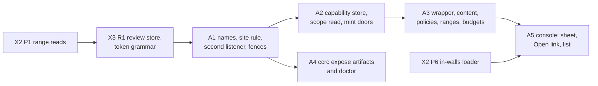

# Native Docs HTML artifacts (X5) Implementation Plan

> **For agentic workers:** REQUIRED SUB-SKILL: Use superpowers:subagent-driven-development (recommended) or superpowers:executing-plans to implement this plan task-by-task, under the dispatched `ccrc-worker` role. Steps use checkbox (`- [ ]`) syntax for tracking.

**Goal:** HTML pages in the docs run at artifact level (their own scripts, modules, workers, WebAssembly, sibling fetches, dialogs, downloads and opted-in windows) on two names outside the console's site, never on the console's origin.

**Architecture:** Five waves. A1 adds the stated artifact names, the site rule, a second Fastify listener with four routes and host fences on both listeners. A2 adds the in-memory capability store, bound to the minting session, with its scope read and mint-side doors in the docs plugin. A3 serves the script-free wrapper and the page's files by manifest pin, under header CSPs, fetch-metadata fences, ranges and budgets, with the lane's artifact rules. A4 is `ccrc expose artifacts` and doctor. A5 is the console side: the launch sheet, the Open link, the list and the tier routing.

**Tech Stack:** TypeScript (server: Fastify, `node:crypto`; PWA: React, vitest, vitest browser), bash (`ccd/ccrc`), Caddy (generated config only).

**Spec:** `docs/superpowers/specs/2026-11-19-native-docs-html-artifacts-design.md` (read it with this plan). Builds on X2 (`docs/superpowers/plans/2026-11-18-native-docs-parity.md`, waves P1 and P6) and runs beside X3 (`docs/superpowers/plans/2026-11-18-native-docs-draft-review.md`).

**Status:** 2026-11-19, X5 design wave (run 2837). No implementation is claimed by this document.

## Global Constraints

- The console's origin never runs a page's code. Reader frame sandbox exactly `allow-scripts`; shell CSP meta exactly `frame-src 'none'`; mockup sandbox `""` or exactly `allow-scripts`; `MOCKUP_CSP` unchanged; no window `message` listener in `pwa/src` (spec §1.3), and the console posts no message to an artifact tab or frame (`postMessage` already exists in `pwa/src` for the reader lab's frames and the markdown worker; neither is touched). Any widening of a console policy is a stop-and-ask.
- Artifact keys (exposure file), all or nothing: `CCRC_ARTIFACT_ORIGIN`, `CCRC_ARTIFACT_CONTENT_ORIGIN`, `CCRC_ARTIFACT_PORT` (default 7790). On the duckdns arm `CCRC_DDNS_DOMAIN` holds the comma list of the three full hosts (`<console-name>.duckdns.org` first, as today, then the two artifact hosts); never bare labels. Partial or invalid means the tier is off, never an error at boot.
- Site rule: an artifact host and the console host share no trailing labels, or one label, or an entry of `ARTIFACT_PUBLIC_SUFFIXES` = `['duckdns.org']` (measured on the Public Suffix List 2026-11-19; never derived from `PUBLIC_SUFFIX_TRAPS`); neither equals or ends with `.` plus the other. Loopback http only as `http://localhost:<p>` for the console with `http://127.0.0.1:<p>` artifact origins. No Public Suffix List dependency.
- Capability: 32 random bytes, base64url, 43 characters, only its SHA-256 kept, re-drawn if the answer mask would alter it; id 16 random bytes base64url. `ARTIFACT_IDLE_MS` = 3600000; `ARTIFACT_MAX_AGE_MS` = 43200000; `ARTIFACT_MAX_AGE_DRAFT_MS` = 7200000; `ARTIFACT_MAX_LIVE` = 32; `ARTIFACT_MAX_LIVE_PER_SESSION` = 16; `ARTIFACT_MAX_ORIGINS` = 8; `ARTIFACT_MAX_INFLIGHT` = 4; `ARTIFACT_MAX_INFLIGHT_BOX` = 16; `ARTIFACT_QUEUE_PER_CAPABILITY` = 64; `ARTIFACT_QUEUE_WAIT_MS` = 60000; `ARTIFACT_HOURLY_BYTES` = 1073741824. Past the in-flight limits a request waits (spec §5), never an immediate 429. Memory only; bound to the minting session. Committed and draft pins only; no outside-folder page in this tier.
- Per-file ceiling is `DOCS_RANGE_MAX_BYTES` (X2 P1), derived, never restated. No total asset budget on the artifact tier. Above `DOCS_LANE_LARGE_RAW` a file is read in range frames.
- Lane rules for source `artifact`: console jobs are admitted ahead of queued artifact jobs; at most one artifact job runs; an artifact job's raw bytes are at most `DOCS_LANE_LARGE_RAW`; artifact jobs have their own queue bound of 16; artifact range prepares at most 1 at a time and 3 a minute.
- No new ccd verb, agent grant or cap token. No box token on any new door. No new exempt class in `server/src/auth/gate.ts`.
- No shared policy constant between the walls tier and the artifact tier; only the exact-https-origin grammar is shared, from `shared/httpsOrigin.ts`.
- Fixture HOMEs only for ccd; poisoned `gh` where a fixture spawns tools; `ccrc test -- <command>` for every test and typecheck, foreground, timeout at least 600000 ms; mutation runs through the coordinator's mutation runner, scratch outside the worktree.
- Public repository: neutral names only (`<console-host>`, `<artifact-host>`, `<content-host>`, `project-a`); a test host is under a reserved name (`.test`, `.invalid`), and a `duckdns.org`, `nip.io` or `co.uk` case builds its label at run time, never a fixed registrable name; no real host, address, path or tracker id in code, tests, docs or commit text.
- Each wave opens with its own run and issued deviation block; a departure found mid-wave is `D-TBD-<slug>` and reported.

## Review Focus

- A page that references a file above its own directory (`../shared/lib.js`): the load 404s, and the launch sheet says beforehand how many references point above the folder. Owned by Task A5.2 (`sheet: counts references above the page's folder`).
- A file name with spaces, non-ASCII characters or percent-escapes, and a request spelled with `%2e%2e`, a backslash, an empty segment or a NUL: the name is decoded once and found, and every traversal spelling is the identical 404. Owned by Task A3.3 (`content: names decode once`, `content: traversal spellings are the identical 404`).
- A content URL with a query string or fragment (cache busters, `?v=2`): the file is found by its path, ignoring the query. Owned by Task A3.3 (`content: a query string is ignored for the lookup`).
- A tab left open across a server restart, a sign-out or the idle hour: the next load is the identical 404, and the wrapper route's 404 body reads "This artifact link has ended. Open it again from ccrc." Owned by Task A3.1 (`wrapper: an ended link shows the fixed sentence`).
- A draft edited by a session while its artifact is open: that file answers 409 `draft-changed`, and every unchanged file still loads. Owned by Task A3.3 (`content: a changed draft answers 409, others load`).

---

## Waves, order and file ownership

| Wave | Tasks | Depends on | Owns (creates or modifies) |
|---|---|---|---|
| A1 | A1.1 to A1.4 | X2 P1 and X3 R1 merged (R1 itself waits for P1) | `shared/artifacts.ts`, `shared/httpsOrigin.ts`, `shared/capabilityToken.ts`, `shared/docsReview.ts` (the token grammar move only), `pwa/src/docs/mockup/policy.ts` (the grammar move only), `server/src/artifacts/{policy,routes}.ts`, `server/src/config.ts`, `server/src/index.ts`, `server/src/server.ts` (console host fence), the architecture spec's ring and context map (`docs/superpowers/specs/2026-08-10-architecture-ddd-clean-solid.md`, one row), census and ring test files, X2's spec text (D-8786) |
| A2 | A2.1 to A2.3 | A1 (so X2 P1's `DocsRangePin` and `statPin` are on `main`) | `server/src/auth/sessions.ts` (one additive method), `server/src/artifacts/{store,ports}.ts`, `server/src/docs/routes.ts`, `server/src/docs/ccdsource.ts`, `server/src/server.ts` (`MASKED_GET_ROUTES` rows), `shared/docs.ts` (`docsApi` additions) |
| A3 | A3.1 to A3.3 | A2 | `server/src/artifacts/{wrapper,policy,routes}.ts`, `server/src/docs/lane.ts` and `server/src/docs/policy.ts` (the artifact source rules), `server/src/docs/ccdsource.ts` (range port use) |
| A4 | A4.1 to A4.2 | A1 (key names) | `ccd/ccrc` (`cmd_expose`, `_exp_env_write`, `_exp_caddyfile`, `_exp_status`), `ccd/ccrc-doctor-checks` |
| A5 | A5.1 to A5.3 | A3, X2 P6 merged | `pwa/src/docs/artifact/*`, `pwa/src/docs/MockupView.tsx`, `pwa/src/lib/api.ts`, Page details and the Docs index list |


*Figure 1. Wave order. A1 waits for X3 R1, as R1 waits for X2 P1: A1 shares P1's and R1's server files and moves R1's token grammar. A4 runs beside A2 and A3. A5 waits for X2 P6, because both edit the HTML leaf.*

**Against X2 and X3.** Docs workers stay serial (the programme ledger), and clause 10 never dispatches two workers onto overlapping claims, so A1 waits for X3 R1 exactly as R1 waits for X2 P1. R1 lands first and defines the capability token grammar as `isReviewToken` in `shared/docsReview.ts`. A1.1 then moves that body into `shared/capabilityToken.ts` as `isCapabilityToken`, and `shared/docsReview.ts` keeps `isReviewToken` as a re-export under its own name: a move with R1's own tests as the characterization, run before and after unchanged. So R1's approved plan and its tests change nothing, and the move is recorded here and in the wave's task note for the ledger. X3 adds exempt class 9; X5 adds no exempt class, so the gate's class count is X3's alone. Outside-folder pages stay in the walls tier (spec §3.2).

Every file an X5 wave shares with an X2 or X3 wave, and its order (P3 and P5 share none; "claim order" means whichever wave is dispatched later re-counts or rebases on the earlier one's merge):

| File | X5 wave | Also owned by | Order |
|---|---|---|---|
| `server/src/server.ts` | A1 (console fence), A2 (`MASKED_GET_ROUTES`) | P1, P2, P4, R1 | After P1 and R1; claim order against P2 and P4 |
| `server/test/box-token-census.test.ts` | A1 (`ARTIFACT_DOORS`), A2 (`DOCS_DOORS`) | P1, P2, P4, R1, R4 | After P1 and R1; claim order, the later re-counts |
| `server/test/auth-gate.test.ts`, `server/src/auth/gate.ts` (header count) | A1, A2 | P1, P2, P4, R1 (class 9), R4 | After R1; claim order, the later re-counts |
| `server/test/rings/fastify-l4.data.ts` and the other `rings/*.data.ts` | A1 | P1, P4, R1 | After P1 and R1 |
| `server/src/config.ts` | A1 | R1 (one path) | After R1 |
| `shared/docsReview.ts` | A1 (grammar move) | R1, R4 | After R1; claim order against R4 |
| the architecture spec's ring and context map | A1 (C9 row) | R1 (C9 Docs row), R2 (PWA column) | After R1; claim order against R2 |
| `pwa/src/docs/mockup/policy.ts` | A1 (grammar move) | P6 | Claim order: P6 pins `MOCKUP_*` unchanged and A1 moves only the origin grammar, so either may land first, and the later runs `mockup-policy.test.ts` before and after |
| `shared/docs.ts` | A2 (`docsApi` calls) | P1, P2, P3, P4, R1 | After P1 and R1; claim order against P2 to P4 |
| `server/src/docs/routes.ts`, `server/src/docs/ccdsource.ts`, `server/src/docs/policy.ts` | A2, A3 | P1, P2 (`server/src/docs/*`), P4 (`routes.ts`) | After P1; claim order against P2 and P4 |
| `server/src/docs/lane.ts`, `server/test/docs-lanes.test.ts` | A3 | P2 (`server/src/docs/*`) | Claim order |
| `server/test/single-definition/docs-ring.test.ts` | A2 | P2, P5 | Claim order |
| `pwa/src/lib/api.ts` | A5 | P1, P2, P4, R3, R4 | After P1; claim order against the rest |
| `pwa/src/docs/DocsHead.tsx` (Page details), `pwa/src/docs/DocsIndexView.tsx` | A5 | P2, P4, P5, P6 (`DocsHead`), R3 | After P6; claim order against R3 |
| `pwa/src/docs/MockupView.tsx` | A5 | none named; P6 edits `mockup/{load,plan}.ts` beside it | After P6 |

## Acceptance rows

| Row | Task 17 row | Installed action and observation | Waves |
|---|---|---|---|
| AR-A1 | Complete parity inventory (the tier's setup, which every row below needs) | On a duckdns box: `ccrc expose artifacts` with two labels, then its three printed steps (copy the Caddyfile, `sudo systemctl reload caddy`, restart the server), then `ccrc doctor` shows `name` and `artifacts` green; each artifact name answers its fixed page; the console's name is unchanged; re-running `ccrc expose duckdns` keeps the artifact block; a request to the console's port naming an artifact host answers 421 | A1, A4 |
| AR-A2 | Complete parity inventory (F11) | The two dialog pages show their dialogs (ART-L9); a page's download button saves the file; the popup page opens its window only when windows was ticked, and does nothing otherwise (ART-L8) | A3, A5 |
| AR-A3 | Complete parity inventory (F12, F13), Large files | The three pages with assets above 5 MiB in total, the WebAssembly page, the page above 2 MiB, a page with a worker, a page with SVG icons as images and the four runtime-fetch pages each run as an artifact; a video seeks (ART-L12); a reload does not re-read files above 1 MiB (browser cache) | A3, A5 |
| AR-A4 | Complete parity inventory (the isolation every artifact row relies on) | Lab rows ART-L1 to ART-L12 of the spec §10, desktop and phone, each recorded with its result. Passes when every row's Decides cell holds on both; a failed lab row fails AR-A4 and is never waived | All |
| AR-A5 | Complete parity inventory (the capability's life, which every artifact row relies on) | An open artifact's next load is the identical 404 after each of: Revoke, Revoke all, sign-out, a passphrase change, the idle hour, a server restart, and 2 hours for a page beside drafts; the Page details list never shows a URL | A2, A3, A5 |

---

## Wave A1: names, the site rule, the second listener and the fences

### Task A1.1: L0 vocabulary and the grammar move

**Files:**
- Create: `shared/artifacts.ts`, `shared/httpsOrigin.ts`, `shared/capabilityToken.ts`
- Modify: `pwa/src/docs/mockup/policy.ts` (`isMockupHost`, `isMockupOrigin` become re-exports of the shared grammar, names kept), `shared/docsReview.ts` (`isReviewToken` becomes a re-export of `isCapabilityToken`, name kept; nothing else in the file changes)
- Test: `server/test/artifacts-vocabulary.test.ts`, `pwa/test/mockup-policy.test.ts` and R1's `isReviewToken` tests (unchanged assertions, run before and after the moves), `server/test/single-definition/` docs area file (the no-shared-policy scan)

**Interfaces:**
- Consumes: `isReviewToken(s: string): boolean` from `shared/docsReview.ts` (X3 R1.1), whose body moves.
- Produces: `isExactHttpsHost(host: string): boolean`, `isExactHttpsOrigin(raw: string): boolean` (`shared/httpsOrigin.ts`); `CAPABILITY_TOKEN_CHARS = 43`, `isCapabilityToken(s: string): boolean` (base64url, exactly 43) (`shared/capabilityToken.ts`); in `shared/artifacts.ts` the constants of Global Constraints, `ARTIFACT_PUBLIC_SUFFIXES: readonly string[]` = `['duckdns.org']`, `ARTIFACT_SANDBOX_BASE: readonly string[]` = `['allow-scripts','allow-same-origin','allow-forms','allow-modals','allow-downloads','allow-pointer-lock']`, `ARTIFACT_SANDBOX_WINDOWS = 'allow-popups'`, `ARTIFACT_MIME: Readonly<Record<string,string>>` (spec §5's table, rasters derived from `DOCS_RASTER_TYPES`), `artifactMime(path: string): {mime: string; attachment: boolean}`, and the wire types `ArtifactMintAsk {pin: DocPin; project: string; origins: string[]; windows: boolean}`, `ArtifactScopeOk {ok: true; files: number; uncommitted: number; unsized: number; bytes: number}`, `ArtifactMintOk {ok: true; id: string; url: string; expiresAt: number; files: number; uncommitted: number; unsized: number}`, `ArtifactRow {id; project; section; path; pinLabel; mintedAt; lastAt; expiresAt; windows; origins}`, `ArtifactRefusal = 'auth-off' | 'insecure-origin' | 'unauthenticated' | 'unsupported' | 'artifact-host-unset' | 'not-html' | 'too-many' | 'bad-origin' | 'unmeasured' | 'pin-moved'`.

- [ ] **Step 1: Characterize.** Run `pwa/test/mockup-policy.test.ts` and R1's `isReviewToken` tests green on `main` before any change.
- [ ] **Step 2: Write the failing tests** in `artifacts-vocabulary.test.ts`: `isCapabilityToken` accepts a 43-character base64url string and refuses 42, 44, `+`, `/`, `=`; `artifactMime('m.glb')` is `model/gltf-binary` not attachment, `artifactMime('x.exe')` is `application/octet-stream` with attachment, `artifactMime('A.WASM')` is `application/wasm`; every raster row equals `DOCS_RASTER_TYPES`'s mime; `ARTIFACT_SANDBOX_BASE` never contains `allow-top-navigation`, `allow-popups-to-escape-sandbox` or `allow-popups`; `ARTIFACT_PUBLIC_SUFFIXES` equals exactly `['duckdns.org']`. In the single-definition docs area file: no file under `server/src/artifacts` and not `shared/artifacts.ts` names a `MOCKUP_` identifier, and `pwa/src/docs/mockup/policy.ts` imports nothing from `shared/artifacts.ts`.
- [ ] **Step 3: Run** `ccrc test -- ./node_modules/.bin/vitest run test/artifacts-vocabulary.test.ts` (from `server/`); expect FAIL (module missing).
- [ ] **Step 4: Implement** the three files; move the grammar bodies from `mockup/policy.ts` into `shared/httpsOrigin.ts` with the mockup names re-exported, and `isReviewToken`'s body from `shared/docsReview.ts` into `shared/capabilityToken.ts` with `isReviewToken` re-exported, so neither file's tests change. `shared/*.ts` imports nothing.
- [ ] **Step 5: Run** both tests, the scan and `pwa`'s typecheck; expect PASS. **Step 6: Commit** `feat(docs): artifact vocabulary and the shared origin grammar (X5 A1.1)`.

### Task A1.2: the config decision and the site rule

**Files:**
- Create: `server/src/artifacts/policy.ts`
- Modify: `server/src/config.ts` (read the three keys into `cfg.artifact`)
- Test: `server/test/artifacts-config.test.ts`

**Interfaces:**
- Consumes: `isExactHttpsOrigin` (`shared/httpsOrigin.ts`, L0) and its own loopback rule, `ARTIFACT_PUBLIC_SUFFIXES`. It never imports `server/src/auth/webauthn.ts`, which is L3 (it imports `node:crypto`), so `policy.ts` stays L1 with no outward edge and `OUTWARD_EDGE_EXEMPTIONS` stays empty.
- Produces: `type ArtifactConfig = {state: 'on'; artifactOrigin: string; contentOrigin: string; port: number; artifactHost: string; contentHost: string} | {state: 'off'; why: 'unset' | 'partial' | 'invalid' | 'by-address'; detail: string}`; `artifactConfig(env: {origin?: string; content?: string; port?: string; exposeMode?: string}, consoleOrigin: string, consolePort: number): ArtifactConfig` (`exposeMode` `ip` with no artifact keys is `off/by-address`); `siteRuleProblem(consoleHost: string, artifactHost: string): string | null`.

- [ ] **Step 1: Write the failing tests:** the five rows of spec §2.3's table give the stated verdicts (`nip.io` refused), each placeholder built from a label generated per run (`genLabel()`: `t` plus 12 random hex characters); with `d` = `genLabel() + '.duckdns.org'`, `d` against `d` is refused (equal) and `'x.' + d` against `d` is refused (below); no keys is `off/unset`; two of three is `off/partial`; an `http://` origin on a non-loopback host, a trailing slash, a path, equal artifact and content origins, and `CCRC_ARTIFACT_PORT` equal to the console port are `off/invalid` with a detail naming the key; console `http://localhost:7788` with `http://127.0.0.1:7790` and `http://127.0.0.1:7791` is `on`; console `http://localhost:7788` with `http://localhost:7790` is `off/invalid` (same site); an `http://127.0.0.1` artifact origin beside an https console is `off/invalid`.
- [ ] **Step 2: Run**; expect FAIL. **Step 3: Implement** `siteRuleProblem` as the longest common run of trailing labels (lower-cased, no trailing dot), and `artifactConfig` as one pure decision; `config.ts` calls it once and logs `console.warn('ccrc-server: artifact tier off — …')` for `partial` and `invalid`, never for `unset`.
- [ ] **Step 4: Run**; expect PASS. **Step 5: Commit** `feat(server): artifact names and the site rule (X5 A1.2)`.

### Task A1.3: the second listener and the host fences

**Files:**
- Create: `server/src/artifacts/routes.ts`
- Modify: `server/src/server.ts` (`buildServerWithArtifacts`, below, and the console host fence, an `onRequest` hook registered before the gate), `server/src/index.ts` (calls `buildServerWithArtifacts` instead of `buildServer`, listens the second instance on `127.0.0.1:<port>` when it is not null, and closes it in the first instance's `onClose`), `docs/superpowers/specs/2026-08-10-architecture-ddd-clean-solid.md` (the ring and context map gains `server/src/artifacts/**` in C9)
- Test: `server/test/artifacts-listener.test.ts`, `server/test/box-token-census.test.ts` (`ARTIFACT_DOORS`), `server/test/rings/fastify-l4.data.ts`, `server/test/rings/totality.test.ts` (green with the new map row), `server/test/secret-mask.test.ts` (its `routeFiles()` walk finds `server/src/artifacts/routes.ts`: the `setErrorHandler(` scan gains that one file as allowed, beside `server.ts` and `docs/`, because its handler answers the fixed 500 body with no request detail, which a new case pins; the every-GET-masked scan lists the four artifact GETs as exempt, because they serve page bytes and fixed pages on another instance, where masking would corrupt file bytes and no ccrc secret is written), `server/test/auth-gate.test.ts` (unchanged: the artifact routes are not on the gated instance, so `artifacts/routes.ts` is not one of its scanned route files and `ROUTES.length` does not move in A1)

**Interfaces:**
- Consumes: `ArtifactConfig`.
- Produces: **the seam.** `buildServerWithArtifacts(deps: Deps, bus?: Bus, watcher?: FleetWatcher): Promise<{app: FastifyInstance; artifactApp: FastifyInstance | null}>` in `server/src/server.ts`. `buildServer` keeps its signature and becomes `(await buildServerWithArtifacts(deps, bus, watcher)).app`, so its callers and tests change nothing. Everything both instances share is built once inside it, beside the objects it already builds: the session store (`authStore`, which stays off `Deps`, as its comment requires), the one `composeDocs(...)` result and `secretNow`. From A2 it also builds the one capability store there. The docs plugin's mint doors receive that store through their plugin options, and `buildArtifactServer` receives it through `ArtifactRouteDeps`. `Deps` gains no field. `artifactApp` is null when `cfg.artifact.state` is `off`.
- Produces: `interface ArtifactRouteDeps {cfg: Extract<ArtifactConfig,{state:'on'}>}` in `server/src/artifacts/routes.ts`, which A2.2 extends with `store: ArtifactStore` and `now: () => number`, and A3.3 with `bytes: ArtifactBytes` (over the same docs composition's readers and lanes the console's reads use). `buildArtifactServer(deps: ArtifactRouteDeps): FastifyInstance` with exactly the four routes of spec §3.4 (A1 registers `GET /a/:token`, `GET /c/:token/*` and `GET /clear` as the identical 404 until A3 fills them); `ARTIFACT_NOT_FOUND_BODY` (the fixed page of spec §3.4); `hostFence(host: string | undefined, allowed: readonly string[]): 'ok' | 'misdirected'` (L1, in `policy.ts`), used by both listeners: the artifact listener allows its two hosts, the console listener refuses the two artifact hosts.

- [ ] **Step 1: Write the failing tests:** the artifact instance's `printRoutes()` equals `ARTIFACT_DOORS` (`GET /`, `GET /a/:token`, `GET /c/:token/*`, `GET /clear`, each with its HEAD); `listener: no shell` (`GET /index.html`, `/api/auth/status`, `/assets/x.js` and `/ws/fleet` on it are 404 with `ARTIFACT_NOT_FOUND_BODY`, which a not-found shell would turn into the app's HTML); `POST /` is 405; a `Host` of the console host on it is 421; on the console instance a `Host` of either artifact host is 421 before the gate runs (no `unauthenticated` answer), and the console's own host still answers; no artifact response carries `Set-Cookie`; `ARTIFACT_DOORS` matches `server/src/artifacts/routes.ts` in both directions; `listener: logs no path` (a spy on every `console` method sees no request path or token while the instance answers its 404s, 405 and 421s).
- [ ] **Step 2: Run**; expect FAIL. **Step 3: Implement.** The artifact instance is `Fastify({ logger: false })`, with its own not-found and error handlers answering the fixed 404 or 500 body and no request detail. The console fence answers 421 `{ok:false,error:'misdirected'}` and does nothing when the tier is off.
- [ ] **Step 4: Run** these tests and `rings/totality.test.ts`; expect PASS. **Step 5: Commit** `feat(server): the artifact listener and host fences (X5 A1.3)`.

### Task A1.4: record the ruling in X2's spec (D-8786)

**Files:**
- Modify: `docs/superpowers/specs/2026-11-18-native-docs-parity-design.md`

- [ ] **Step 1: Amend** each passage D-8786 quotes (below) with its stated replacement, each ending "(amended <date>; X5 A1, D-8786)".
- [ ] **Step 2: Run** `ccrc test -- ./node_modules/.bin/vitest run test/deviation-refs.test.ts` (from `server/`, after `git fetch origin main`); expect PASS. **Step 3: Commit** `docs(specs): C3 ruled, the artifact tier designed (X5 A1, D-8786)`.

## Wave A2: the capability store, the scope read and the mint doors

### Task A2.1: session liveness by id

**Files:**
- Modify: `server/src/auth/sessions.ts`
- Test: `server/test/auth-sessions-liveness.test.ts`

**Interfaces:**
- Produces: `SessionStore.livenessOf(idHash: string, currentGeneration: number, now: number): 'live' | 'ended'`, derived from the same row compare, generation and TTL rules `verifyMeasured` applies, with no side effect (it never touches `lastSeenAt`).

- [ ] **Step 1: Write the failing tests:** a fresh session is `live`; after revoke, after the idle TTL, after the absolute TTL and after a generation bump it is `ended`; a malformed id is `ended`; calling it leaves `lastSeenAt` unchanged.
- [ ] **Step 2: Run**; expect FAIL. **Step 3: Implement** by extracting the liveness predicate `verifyMeasured` already applies into one private function both call. **Step 4: Run** this test and `auth-sessions*.test.ts`; expect PASS. **Step 5: Commit** `feat(auth): session liveness by id, for capabilities (X5 A2.1)`.

### Task A2.2: the in-memory capability store

**Files:**
- Create: `server/src/artifacts/store.ts`, `server/src/artifacts/ports.ts`, `server/src/artifacts/liveness.ts` (L3, the `SessionLiveness` adapter)
- Modify: `server/src/server.ts` (`buildServerWithArtifacts` builds the store when the tier is on)
- Test: `server/test/artifacts-store.test.ts`, `server/test/artifacts-liveness.test.ts`

**Interfaces:**
- Consumes: `SessionLiveness` port (`livenessOf` above), `isCapabilityToken`, A1.3's seam (`buildServerWithArtifacts`, `ArtifactRouteDeps`).
- Produces: `interface ArtifactManifestEntry {rel: string; pin: DocsRangePin; size: number; mime: string; committed: boolean}` (X2 P1's `DocsRangePin`: `blob` for a committed file, `fp` for a draft, `stat` from `statPin(size, mtimeNs)` above the hash ceiling); `interface Capability {id; tokenHash; sessionIdHash; project; section; dir; page: string; manifest: ReadonlyMap<string, ArtifactManifestEntry>; drafts: number; origins: readonly string[]; windows: boolean; mintedAt; lastAt; servedThisHour: number; hourStart: number; inflight: number; snapshots: Map<string, string>}` (`snapshots`: one X2 P1 snapshot id per manifest entry above `DOCS_LANE_LARGE_RAW`, kept for the capability's life); `createArtifactStore(clock: () => number, liveness: SessionLiveness, mint: () => string = defaultToken): ArtifactStore` with `mint(input): {ok: true; id; token} | {ok: false; error: 'too-many'}`, `lookup(token: string): Capability | null` (null for every miss, after the expiry and liveness decisions), `touch(id)`, `revoke(id): boolean`, `revokeAll(sessionIdHash?: string): number`, `list(): ArtifactRow[]`, `sweep(): number`. Ports in `ports.ts`: `ArtifactBytes`, `ArtifactTree`, `SessionLiveness`, each with its failure contract written on it. `interface SessionLiveness {of(sessionIdHash: string, now: number): 'live' | 'ended'}`, whose contract reads: it measures the CURRENT secret generation on every call, uncached, as the gate does; a secret that is `absent`, `unusable` or `unread` answers `ended`, so a missing or broken secret ends every capability; any other read failure answers `ended` too; it never throws. The capability keeps no generation of its own, so nothing can compare against a stale one. The adapter is `sessionLiveness(sessions: Pick<SessionStore, 'livenessOf'>, secretNow: () => SecretState): SessionLiveness` in `liveness.ts`, built in `buildServerWithArtifacts` from `authStore` and the same `secretNow` the gate uses (`measureSecret`, `server/src/auth/gate.ts`).

- [ ] **Step 1: Write the failing tests:** `store: minted token length` (a minted token is 43 base64url characters and decodes to 32 bytes); a minted token looks up; a malformed, unknown or revoked one is null; idle 3600000 ms after `lastAt` is null and 3599999 is live; 43200000 after mint is null even when touched; with `drafts > 0`, 7200000 after mint is null even when touched; an ended session makes it null with no other act; the 33rd mint box-wide and the 17th for one session refuse `too-many`; `store: no plaintext token` (no value reachable from any stored record, walked recursively, equals the token); `list()` rows have no `url` or `token` key; `revokeAll(session)` kills only that session's. In `artifacts-liveness.test.ts`, with a real `SessionStore` over a temp sessions file and a real secret file written by `hashLine(passphrase, params, generation)` (`server/src/auth/secret.ts`): `store: a passphrase change ends it` (a session stamped at generation 1 mints a live capability; rewriting the secret at generation 2 makes the next `lookup` null with no other act); `store: a missing secret ends it` (the secret file removed: null); `store: an unusable secret ends it` (the file holding a line `readAuthSecret` refuses: null); the adapter never throws.
- [ ] **Step 2: Run**; expect FAIL. **Step 3: Implement**, with `randomBytes(32).toString('base64url')` for the token and `randomBytes(16)` for the id, the token kept as `sha256` hex, lookup by hash in a `Map`, and every expiry decided inside `lookup`. **Step 4: Run**; expect PASS. **Step 5: Commit** `feat(server): the in-memory capability store (X5 A2.2)`.

### Task A2.3: the scope read and the mint-side doors

**Files:**
- Modify: `server/src/docs/routes.ts`, `server/src/docs/ccdsource.ts` (`ArtifactTree` over the existing tree read), `server/src/artifacts/policy.ts` (`mintAdmission`, `manifestScope`, `originAdmission`, `pinHolds`), `server/src/auth/gate.ts` (the header comment's route count gains five), `server/src/server.ts` (`MASKED_GET_ROUTES` decides the two new GETs), `shared/docs.ts` (`docsApi.artifacts()`, `docsApi.artifactScope(project, pin)`, `docsApi.artifactMint()`, `docsApi.artifactRevoke(id)`, `docsApi.artifactRevokeAll()`)
- Test: `server/test/artifacts-mint.test.ts`, `server/test/box-token-census.test.ts` (`DOCS_DOORS` gains five), `server/test/auth-gate.test.ts` (the docs count gains five, and its pinned `ROUTES.length` gains five, from whatever it reads when A2 is dispatched), `server/test/secret-mask.test.ts` (the two GETs in its inventory), `server/test/single-definition/docs-ring.test.ts` (`ccdsource.ts`'s import list gains `../artifacts/ports.js` and `shared/artifacts.ts`)

**Interfaces:**
- Consumes: the store, `ArtifactTree`, the account gate (`server/src/accounts/gate.ts`, `cap: null`), `answerMasked` and the mask (`server/src/server.ts`).
- Produces: `GET /api/docs/artifacts` → `{ok: true; available: boolean; why?: 'unset'|'partial'|'invalid'|'auth-off'; live: ArtifactRow[]}`; `GET /api/docs/artifacts/scope?<pin query, as docsApi.file builds it>` → `ArtifactScopeOk` or `{ok:false; error: ArtifactRefusal}`; `POST /api/docs/artifacts` (body `ArtifactMintAsk`) → `ArtifactMintOk` or `{ok:false; error: ArtifactRefusal}`; `POST /api/docs/artifacts/:id/revoke` and `POST /api/docs/artifacts/revoke-all` → `{ok: true; revoked: number}`. `manifestScope(pagePath: string, entries): ArtifactManifestEntry[]` keeps the page's directory and below, never `..`, dot components or anything above. `originAdmission(o: string, own: readonly string[]): boolean` refuses a non-exact-https origin and any origin whose host equals the console, artifact or content host. `pinHolds(pin: DocPin, tree: DocsTreeOk): boolean` (L1): a committed pin holds when `tree.ref.commit === pin.commit`; a draft pin holds when `tree.ref.commit === pin.head` and the page's entry has `draft.fp === pin.fp`. The scope read and the mint both refuse `pin-moved` when it does not hold.

- [ ] **Step 1: Write the failing tests:** dark (`CCRC_AUTH` off) the scope read and the mint answer `auth-off` and revoke still answers; an http origin that is not loopback answers the account gate's `insecure-origin`, unchanged; armed without a session is the gate's 401; a markdown pin is `not-html`; a ninth origin, an `http://` origin, one with a path, `https://<content-host>`, `https://<artifact-host>` and the console origin are `bad-origin`; a tree read that fails is `unmeasured` and nothing is minted; `mint: a moved pin refuses` (a tree whose `ref.commit` differs from a committed pin's `commit`, one whose `ref.commit` differs from a draft pin's `head`, and one whose page entry's `fp` differs from the draft pin's `fp` each answer `pin-moved` on the scope read and the mint, and `list()` is unchanged); the scope read's counts equal the mint's for the same pin and mint nothing (`list()` unchanged); the manifest of `design/x/page.html` holds `design/x/a.js` and `design/x/sub/m.glb` and not `design/y.js` or `index.md`; a draft entry carries its `fp` and an above-ceiling one its stat pin, and the answer's `uncommitted` counts both; `mint: an unsized entry is left out` (an entry whose `size` is null is not in the manifest, its load is the identical 404, and `unsized` counts it on the scope read and the mint); `mint: answer never masked` (with a mint stub whose first token the mask alters, the answer's URL holds the second token and the first is not live); the mint answer's `url` is `https://<artifact-host>/a/<token>` and no later answer contains the token; the tier off answers `artifact-host-unset`; each door sits behind the docs marker check.
- [ ] **Step 2: Run**; expect FAIL. **Step 3: Implement** the five doors in the docs plugin, decisions in `policy.ts`. The mint draws again while `mask(url) !== url`, at most 8 times, then answers `unmeasured`. **Step 4: Run** the five test files; expect PASS. **Step 5: Commit** `feat(docs): scope, mint, list and revoke artifact capabilities (X5 A2.3)`.

## Wave A3: the wrapper, the content door and the budgets

### Task A3.1: the wrapper

**Files:**
- Create: `server/src/artifacts/wrapper.ts`
- Modify: `server/src/artifacts/routes.ts` (`GET /a/:token`)
- Test: `server/test/artifacts-wrapper.test.ts`

**Interfaces:**
- Produces: `wrapperDocument(c: Capability, token: string, contentOrigin: string): {html: string; headers: Record<string,string>}`; `ARTIFACT_ENDED_BODY` = a fixed page whose text is "This artifact link has ended. Open it again from ccrc."

- [ ] **Step 1: Write the failing tests:** the iframe's `sandbox` is exactly `ARTIFACT_SANDBOX_BASE` joined by spaces, plus `allow-popups` only when `windows`; `allow` is exactly `fullscreen; clipboard-write`; the iframe has a `name`, and the "Clear this host's data" link's `target` is that name and its `href` is `<contentOrigin>/clear`; `src` is `<contentOrigin>/c/<token>/<page>` with each path segment percent-encoded; the document contains no `<script`; a project or path holding `<`, `"` or `&` is escaped; the headers are exactly spec §4.2's (CSP with `frame-src <contentOrigin>/c/<token>/ <contentOrigin>/clear`, COOP `same-origin-allow-popups`, Referrer-Policy, nosniff, `no-store`, X-Robots-Tag); the bar says "This is not ccrc"; no response holds a session id, box token or the console origin; a request with `Sec-Fetch-Dest` other than `document` is 403; `wrapper: an ended link shows the fixed sentence` (unknown, revoked and idle tokens give byte-identical `ARTIFACT_ENDED_BODY` with 404).
- [ ] **Step 2: Run**; expect FAIL. **Step 3: Implement.** The bar's stylesheet is a constant, its `sha256` computed once into the CSP. **Step 4: Run**; expect PASS. **Step 5: Commit** `feat(server): the artifact wrapper (X5 A3.1)`.

### Task A3.2: the page's policy and the fences

**Files:**
- Modify: `server/src/artifacts/policy.ts`
- Test: `server/test/artifacts-policy.test.ts`

**Interfaces:**
- Produces: `contentCsp(contentOrigin: string, artifactOrigin: string, token: string, origins: readonly string[], windows: boolean): string` (spec §4.3, verbatim directive order); `CONTENT_HEADERS: Readonly<Record<string,string>>` (nosniff, CORP `same-origin`, no-referrer, `X-DNS-Prefetch-Control: off`, X-Robots-Tag, `Accept-Ranges: bytes`, the Permissions-Policy of spec §4.3); `fetchFence(h: {dest?: string; mode?: string; site?: string; serviceWorker?: string}, windows: boolean): 'ok' | 'refused'`; `cacheControl(kind: 'html' | 'other', secondsLeft: number): string`; `parseRange(header: string | undefined, size: number): {kind: 'whole'} | {kind: 'one'; start: number; end: number} | {kind: 'unsatisfiable'}`.

- [ ] **Step 1: Write the failing tests:** `policy: CONTENT_HEADERS equals the spec` (`CONTENT_HEADERS` deep-equals this literal, written in the test from spec §4.3 and never imported from the source: `X-Content-Type-Options: nosniff`, `Cross-Origin-Resource-Policy: same-origin`, `Referrer-Policy: no-referrer`, `X-DNS-Prefetch-Control: off`, `X-Robots-Tag: noindex, nofollow`, `Accept-Ranges: bytes`, and `Permissions-Policy: camera=(), microphone=(), geolocation=(), usb=(), serial=(), hid=(), bluetooth=(), payment=(), display-capture=(), fullscreen=(self), clipboard-write=(self)`); `contentCsp` equals the spec's text for no origins and for two origins, the origins in script, style, image and font only; it never contains `'self'`, never adds an origin to `connect-src`, and carries `allow-popups` in `sandbox` only with `windows`; each `fetchFence` row of spec §4.3 (a navigation as `iframe` ok; as `document` refused without windows and ok with it; `serviceworker`, `embed` and `object` refused; a `Service-Worker` header refused; a non-navigation with `site` `same-origin` ok whatever its destination, `image` and `empty` included; with `cross-site` or `same-site` refused; any of the three headers missing refused); `cacheControl('html', n)` is `no-store`, `cacheControl('other', 7200)` is `private, max-age=3600, immutable` and `cacheControl('other', 90)` is `private, max-age=90, immutable`; `parseRange` gives `one` for `bytes=0-9`, `bytes=5-` and `bytes=-4`, `unsatisfiable` for `bytes=0-1,4-5` and for a start at or past the size, and `whole` for no header.
- [ ] **Step 2: Run**; expect FAIL. **Step 3: Implement.** **Step 4: Run**; expect PASS. **Step 5: Commit** `feat(server): artifact page policy, fetch fences and ranges (X5 A3.2)`.

### Task A3.3: the content door, bytes, the lane rules and budgets (D-8787)

**Files:**
- Modify: `server/src/artifacts/routes.ts` (`GET /c/:token/*`, `GET /clear`), `server/src/docs/ccdsource.ts` (`ArtifactBytes` over `docs-show` and X2 P1's range port), `server/src/docs/lane.ts` and `server/src/docs/policy.ts` (`laneAdmit` gains the job's source and the artifact rules of Global Constraints)
- Test: `server/test/artifacts-content.test.ts`, `server/test/docs-lanes.test.ts` (the artifact cases)

**Interfaces:**
- Consumes: the store, `contentCsp`, `CONTENT_HEADERS`, `fetchFence`, `cacheControl`, `parseRange`, `artifactMime`, `ArtifactBytes.prepare(entry): Promise<{ok: true; snapshot: string} | {ok: false; error: 'prepare-busy' | 'draft-changed' | 'unreadable'}>` and `ArtifactBytes.read(entry, range: {start: number; end: number}, snapshot: string | null, sink): Promise<{ok: true} | {ok: false; error: 'draft-changed' | 'unreadable' | 'too-large' | 'frame-digest' | 'snapshot-gone'}>` (`snapshot` null for a file at most `DOCS_LANE_LARGE_RAW`, read whole and cut), where `sink` takes one checked frame at a time; the L1 decider `admitLoad(c: {inflight: number; queued: number}, boxInflight: number): 'run' | 'wait' | 'full'`; the lane job's new field `source: 'console' | 'artifact'` (absent means `console`).
- Produces: the door's answers: 200 or 206 with the bytes, `Content-Length` and headers; 416 for an unsatisfiable range; the identical 404 for every capability or manifest miss; 403 fixed for a fence refusal; 409 `draft-changed`; past `ARTIFACT_MAX_INFLIGHT` or `ARTIFACT_MAX_INFLIGHT_BOX` the request waits in its capability's FIFO, at most `ARTIFACT_QUEUE_PER_CAPABILITY` deep (the next is 429), for at most `ARTIFACT_QUEUE_WAIT_MS`, then 503 with `Retry-After: 5` and a fixed body; a prepare waits for the artifact prepare slot and retries `prepare-busy` inside the same wait, with the same 503 when it runs out; the first request for a large entry prepares and records the snapshot id, concurrent ones share that prepare, later ones reuse the id, and `snapshot-gone` prepares once more; 429 past `ARTIFACT_HOURLY_BYTES`; a frame that fails its digest destroys the socket after the headers, short of `Content-Length`.

- [ ] **Step 1: Write the failing tests:** `content: names decode once` (`a%20b.js` finds `a b.js`, a non-ASCII name round-trips, `%2520` finds a file literally named `%20`); `content: traversal spellings are the identical 404` (`..`, `%2e%2e`, `%2E%2E%2F`, a backslash, `//`, `./`, `%00`); `content: a query string is ignored for the lookup`; `content: a changed draft answers 409, others load`; `content: the fences hold at the route` (through `app.inject` at `/c/`: `serviceworker` refused, a cross-site subresource refused, a request missing `Sec-Fetch-Dest` refused, an SVG requested as `image` same-origin served, an HTML `fetch` same-origin served); a file of `DOCS_RANGE_MAX_BYTES` streams in frames with `Content-Length` equal to its size and one byte more is never in a manifest; `content: a bad frame aborts the response` (a file of three frames whose second fails its digest, the bad frame filled with a marker byte pattern that no good frame holds: the client receives exactly the first frame's bytes, then a reset short of `Content-Length`, and no byte of the marker pattern; never a short 200); `Range: bytes=100-199` on a framed file answers 206 with exactly those bytes and `Content-Range: bytes 100-199/<size>`; two ranges answer 416; `content: a page with many parallel loads loads whole` (under a fake clock, a page requesting 12 small files and 5 files above 1 MiB at once: at most 4 run for the capability at any moment, none answers 429 or 503, each large file is prepared exactly once, at most one prepare runs at a time and at most 3 start in a minute, and every response's bytes match); the 17th request box-wide waits; the 65th queued request for one capability is 429; a request whose wait passes 60000 ms answers 503 with `Retry-After: 5`, and so does a prepare that still meets `prepare-busy` when the wait runs out; a second capability on the same page prepares its own snapshot, and `snapshot-gone` prepares once more and serves; the hour's byte budget refuses past 1073741824 and resets at the hour; every response carries `contentCsp` and `CONTENT_HEADERS`; `/clear` answers `Clear-Site-Data: "cache", "storage"` (no `"cookies"`) to an `iframe` request; `clear: its headers` (the `/clear` answer carries exactly the CSP of spec §3.4, `default-src 'none'; base-uri 'none'; form-action 'none'; frame-ancestors https://<artifact-host>`, with `nosniff` and `no-store`); `clear: the Dest fence` (`/clear` with `Sec-Fetch-Dest` `document`, `empty` or missing is the fixed 403 with no `Clear-Site-Data` header); `content: two ranges answer 416` at the route; `content: the hour's budget resets` (past 1073741824 bytes a request is 429, and the first request after the hour turns is served); a `.exe` answers with `Content-Disposition: attachment`; `content: logs no path` (with a spy on every `console` method, `log`, `info`, `warn`, `error`, `debug` and `trace`, no call during any of these cases holds a path, a token or a token hash). In `docs-lanes.test.ts`, `lane: console first behind artifact jobs` (with one artifact job running and two queued, a console job starts before both queued artifact jobs; with a 1 MiB artifact job running, a console job still starts; a seventeenth queued artifact job is refused while the console queue is empty; an artifact job above `DOCS_LANE_LARGE_RAW` is refused by the decider, which the door never sends); a second artifact range prepare waits while one runs, and a fourth in a minute waits.
- [ ] **Step 2: Run**; expect FAIL. **Step 3: Implement.** Decode the wildcard once with `decodeURIComponent` inside a try, refuse any segment that is empty, `.` or `..`, or that holds `\` or NUL, then look the joined path up in the manifest; no file-system path is ever built from the request.
- [ ] **Step 4: Run**; expect PASS. **Step 5: Amend** the completion plan sentences D-8787 quotes, with the stated additions ending "(amended <date>; X5 A3, D-8787)". The head commit carries a `Ledger-Edit: D-8787 completion-plan walls sentences scoped to the console's origin` trailer in its last paragraph, or the coordinator applies the text on its ledger pull request if it prefers. **Step 6: Commit** `feat(server): the artifact content door (X5 A3.3, D-8787)`.

## Wave A4: `ccrc expose artifacts` and doctor

### Task A4.1: the expose arm

**Files:**
- Modify: `ccd/ccrc` (`cmd_expose`'s `artifacts` arm, `_exp_env_write`, `_exp_artifact_carry`, `_exp_caddyfile`, `_exp_status`, `_exp_landing`)
- Test: `server/test/ccrc-expose-artifacts.test.ts` (fixture HOME, the existing expose harness), `server/test/ccrc-expose.test.ts` (its pinned bytes and landing text stay green: a console-only run is unchanged), `server/test/ccrc-settings-census.test.ts` (`SERVER_SETTINGS` gains `CCRC_ARTIFACT_ORIGIN`, `CCRC_ARTIFACT_CONTENT_ORIGIN` and `CCRC_ARTIFACT_PORT`, because `ccd/ccrc` reads them through `_box_env_value`; check C8(a) reds otherwise)

**Interfaces:**
- Produces: `ccrc expose artifacts` (duckdns: prompts two labels on a TTY; byo: `--artifact-origin <o> --content-origin <o>`; `--off` removes); the exposure file's three keys, and on duckdns `CCRC_DDNS_DOMAIN` as the comma list of full hosts; `_exp_artifact_carry` (one helper, reading the current exposure file through `_box_env_value`) answering the three artifact keys and the extra hosts, which every arm's call of `_exp_env_write` passes through, so `_exp_env_write` stays the file's one writer and a re-run of another arm keeps them (the ip arm drops them and prints "artifacts turned off: an address has no second site"); `_exp_landing`'s artifacts arm printing exactly these lines, the angle-bracketed parts filled as the console arms fill them:

```
expose: artifacts: this run started NO system service (the commands below are printed, not run). Three steps are yours:
expose:   1. sudo install -m 0644 <CCRC_CADDYFILE> <CCRC_CADDY_SYSTEM_FILE>   (a COPY, as for the console's block)
expose:   2. sudo systemctl reload caddy   (Caddy then obtains the two new certificates)
expose:   3. restart the server so it starts the artifact listener: <restart hint>
expose: once all of the above are done, <artifact origin> and <content origin> serve artifacts; ccrc doctor measures each piece
```

and, on duckdns only, running `systemctl --user start ccrc-ddns.service` once before printing; `_exp_caddyfile` generating both blocks from the exposure file on every run of any arm, the second `<artifact-host>, <content-host> {` / optional `bind <stored bind>` / `reverse_proxy 127.0.0.1:<port>` / `}`; and, only when the artifact keys are set, the global options block of spec §2.4 as the file's first lines, exactly:

```
{
	log default {
		output stderr
		format filter {
			wrap json
			fields {
				request>uri delete
				request>headers>Referer delete
			}
		}
	}
}
```

(tabs as shown; a console-only Caddyfile is unchanged byte for byte).

- [ ] **Step 1: Write the failing tests:** on a fixture duckdns box the arm writes the keys and the block, keeps the console's block byte for byte, and `CCRC_DDNS_DOMAIN` becomes `<console>.duckdns.org,<a>.duckdns.org,<b>.duckdns.org` (full hosts, labels generated per run); with a stored bind the artifact block carries the same `bind`; neither block holds a `log` directive; `expose: the log filter is written` (with the artifact keys set, the Caddyfile starts with exactly the global block above, holding both `delete` lines; with them unset, the Caddyfile equals today's pinned bytes and has no global block); `expose: a re-run carries the artifact keys` (re-running `ccrc expose duckdns` afterwards keeps the three keys, the artifact block and the comma list byte for byte; re-running `ccrc expose byo` with an origin that still passes the site rule keeps the keys; re-running the ip arm removes them and prints its sentence); a label equal to the console's, or two equal labels, refuses with nothing written; on the byo arm `art.example.test` beside `ccrc.example.test` refuses with the site-rule sentence, `art.example.invalid` is accepted and the run prints the dedicated-domain sentence; the ip arm refuses; `--off` removes the keys, the two labels and the block and nothing else; `status` prints both artifact origins; no run prints the DuckDNS token; `expose: the artifacts arm's landing text` (the printed lines equal the block above, with no `enable --now` and no `RE-ENROL`; on duckdns the fake `systemctl` saw exactly `--user start ccrc-ddns.service` once, before the copy step was printed; on byo it saw nothing). The site-rule cases are read from one table file that `artifacts-config.test.ts` reads too.
- [ ] **Step 2: Run**; expect FAIL. **Step 3: Implement**, the site rule in bash mirroring `siteRuleProblem`, its accept list read from the same table file in the test only (the bash holds `duckdns.org` as its one accept entry, pinned by that table). **Step 4: Run**; expect PASS. **Step 5: Commit** `feat(ccrc): expose artifacts (X5 A4.1)`.

### Task A4.2: doctor

**Files:**
- Test also: `server/test/ccrc-installFixture.ts` (`FLEET_BOX_CLASSES` gains one row, `"artifacts"`, at the class the fresh-install fixture measures, expected `SKIP` because a fresh install has no exposure file; re-measured, never hand-set)
- Modify: `ccd/ccrc-doctor-checks` (`_check_name` splits `CCRC_DDNS_DOMAIN` on commas and resolves each full host with `getent hosts`; new `_check_artifacts`)
- Test: `server/test/ccrc-doctor-artifacts.test.ts`

- [ ] **Step 1: Write the failing tests:** `name` with a three-host list resolves each and names the one that fails, and a one-host value behaves exactly as today; no keys is `skip` with its reason; partial keys `FAIL` naming the missing key; a site-rule breach `FAIL`; the Caddyfile without the second block `FAIL` with the remedy `ccrc expose artifacts`; all present and the loopback port answering the fixed page `ok`; the ip arm `skip`.
- [ ] **Step 2: Run**; expect FAIL. **Step 3: Implement.** **Step 4: Run**; expect PASS. **Step 5: Commit** `feat(ccrc): doctor checks the artifact names (X5 A4.2)`.

## Wave A5: the console side

### Task A5.1: availability and the tier routing

**Files:**
- Create: `pwa/src/docs/artifact/artifactWords.ts` (L1), `pwa/src/docs/artifact/tier.ts` (L1)
- Modify: `pwa/src/lib/api.ts` (the five calls through `docsApi`), `pwa/src/docs/MockupView.tsx` (the offer)
- Test: `pwa/test/artifact-tier.test.ts`

**Interfaces:**
- Produces: `artifactOffer(avail: {available: boolean; why?: 'unset' | 'partial' | 'invalid' | 'by-address' | 'auth-off'}, folder: boolean): {kind: 'button' | 'disabled' | 'none'; text: string}` per spec Figure 4: `button` on every HTML page when available, whatever the walls did; `disabled` with spec §2.5's sentence for `unset`, `partial`, `invalid` and `by-address`; `none` for `auth-off` and for an outside-folder page. It takes no input about what the walls refused: no refusal detector is built. The sentences of spec §2.5 and the sheet's Why line (spec §6.2) live in `artifactWords.ts`. `by-address` comes from `GET /api/docs/artifacts` when `CCRC_EXPOSE_MODE` is `ip` (A1.2's `artifactConfig` takes `exposeMode` and answers `off/by-address`).

- [ ] **Step 1: Write the failing tests:** each path of Figure 4; `offer: every HTML page` (an available box gives `button` for a page the walls ran in full and for one with a budget refusal alike); `unset`, `partial` and `invalid` give `disabled` with the setup sentence and `by-address` with the address sentence; `auth-off` gives `none`; an outside-folder page gives `none`; the sheet's Why line is `artifactWords`' constant; the walls view itself is unchanged (`MockupFrame` props and `MOCKUP_*` imports are unchanged; the existing `mockup-view` and `mockup-frame` tests stay green).
- [ ] **Step 2: Run**; expect FAIL. **Step 3: Implement.** **Step 4: Run**; expect PASS. **Step 5: Commit** `feat(docs): offer the artifact tier beside every HTML page's walls view (X5 A5.1)`.

### Task A5.2: the launch sheet and the Open link

**Files:**
- Create: `pwa/src/docs/artifact/LaunchSheet.tsx` (L4)
- Test: `pwa/test/artifact-sheet.test.tsx`

**Interfaces:**
- Consumes: the pre-scan census (`pwa/src/docs/mockup/census.ts`, `origins.ts`) for the page's outside origins and its references above the folder; the scope read; the mint and revoke calls; the live list's count.
- Produces: a sheet that reads the scope on open, mints on Prepare and then shows one `<a href={url} target="_blank" rel="noopener noreferrer">Open</a>`.

- [ ] **Step 1: Write the failing tests:** every origin checkbox and the windows checkbox start unticked; at most 8 origins are offered and none on the console's, artifact or content host; the "what runs" line shows the scope read's file count and uncommitted count before Prepare; `sheet: counts references above the page's folder`; the "Others open" line shows only when another capability is live; changing a tick after Prepare revokes the minted capability and hides Open until Prepare again; the Open element is an anchor whose `rel` is exactly `noopener noreferrer`, never a `window.open` call (scan `pwa/src/docs/artifact` for `window.open`); no Copy link control exists; a refusal shows its sentence and no link.
- [ ] **Step 2: Run**; expect FAIL. **Step 3: Implement.** **Step 4: Run**; expect PASS. **Step 5: Commit** `feat(docs): the artifact launch sheet (X5 A5.2)`.

### Task A5.3: the list, revoke, and the browser proofs

**Files:**
- Create: `pwa/src/docs/artifact/ArtifactList.tsx` (L4)
- Modify: Page details and the Docs index (one list each)
- Test: `pwa/test/artifact-list.test.tsx`, `pwa/browser/artifact-isolation.browser.test.ts`

- [ ] **Step 1: Write the failing tests:** the list shows page, version, minted, last request and expiry, and never a URL; Revoke and Revoke all call their doors and drop the rows; in the browser suite, with the console on `http://localhost:<p>`, the wrapper on `http://127.0.0.1:<q>` and the content on `http://127.0.0.1:<q+1>` (the harness serves the artifact instance's routing on both ports): a page's `location = 'https://example.invalid/'` in the frame is blocked, `parent.document` throws, `window.opener` in the tab is null, the content request carries no `Referer`, `navigator.serviceWorker.register` fails, the console origin's `localStorage` is unreadable from the page, an SVG icon and a same-origin HTML fetch load, and a page with `alert`, a WebAssembly module and a module worker runs.
- [ ] **Step 2: Run**; expect FAIL. **Step 3: Implement.** **Step 4: Run** `ccrc test -- ./node_modules/.bin/vitest run test/artifact-list.test.tsx` and the browser file; expect PASS. **Step 5: Commit** `feat(docs): artifact list, revoke and isolation proofs (X5 A5.3)`.

---

## Mutation rows

Each row deletes or weakens one guard; the named test must go red. Run through the coordinator's mutation runner.

| Row | Task | Mutation | Red test |
|---|---|---|---|
| MX5.1 | A1.3 | Register a not-found handler that answers the app shell on the artifact instance | listener: no shell |
| MX5.2 | A1.3 | Drop the artifact listener's host fence | listener: console host on the artifact instance is 421 |
| MX5.3 | A1.3 | Drop the console's host fence | listener: an artifact host on the console instance is 421 |
| MX5.4 | A1.2 | Accept a two-label common suffix not in the accept list | config: `ccrc.example.test` with `art.example.test` refused |
| MX5.5 | A1.2 | Accept a host below the console host | config: `'x.' + d` refused, `d` a generated `duckdns.org` name |
| MX5.6 | A1.2 | Treat partial keys as on | config: two of three is `off/partial` |
| MX5.7 | A2.2 | Mint a token of 16 bytes | store: minted token length |
| MX5.8 | A1.1 | Add `allow-popups` to `ARTIFACT_SANDBOX_BASE` | vocabulary: base never holds `allow-popups` |
| MX5.9 | A2.1 | `livenessOf` ignores the generation | liveness: a generation bump ends it |
| MX5.10 | A2.2 | Drop the idle expiry | store: idle 3600000 is null |
| MX5.11 | A2.2 | Drop the absolute expiry | store: 43200000 after mint is null when touched |
| MX5.12 | A2.2 | Drop the session binding | store: an ended session makes it null |
| MX5.13 | A2.2 | Live limit 33 | store: the 33rd mint refuses |
| MX5.14 | A2.2 | Keep the plaintext token in the record | store: no plaintext token |
| MX5.15 | A2.3 | Skip the account gate on mint | mint: dark answers `auth-off` |
| MX5.16 | A2.3 | Mint for any class | mint: markdown is `not-html` |
| MX5.17 | A2.3 | Keep files above the page's directory in the manifest | mint: `design/y.js` is not in the manifest |
| MX5.18 | A2.3 | Return the URL in `list()` | mint: no later answer contains the token |
| MX5.19 | A3.1 | Add `allow-top-navigation` to the wrapper frame | wrapper: sandbox is exactly the base |
| MX5.20 | A3.1 | Widen the wrapper's `frame-src` to the content origin | wrapper: `frame-src` names the capability path and `/clear` |
| MX5.21 | A3.1 | Answer a revoked token differently from an unknown one | wrapper: ended links are byte-identical |
| MX5.22 | A3.2 | Add the confirmed origins to `connect-src` | policy: origins never in `connect-src` |
| MX5.23 | A3.2 | Use `'self'` instead of the capability path | policy: never `'self'` |
| MX5.24 | A3.2 | Drop `frame-ancestors` | policy: `contentCsp` equals the spec text |
| MX5.25 | A3.2 | Allow a navigation as `document` without windows | policy: the fence row |
| MX5.26 | A3.2 | Allow a `Service-Worker` header | policy: the fence row |
| MX5.27 | A3.2 | Allow a missing `Sec-Fetch-Dest` | policy: the fence row |
| MX5.28 | A3.2 | Allow a cross-site subresource | policy: the fence row |
| MX5.29 | A3.2 | Cache HTML | policy: `cacheControl('html')` is `no-store` |
| MX5.30 | A3.3 | Skip `..` refusal after decoding | content: traversal spellings are the identical 404 |
| MX5.31 | A3.3 | Write a frame before its digest check | content: a bad frame aborts the response (the marker bytes reach the client) |
| MX5.32 | A3.3 | Serve a changed draft | content: a changed draft answers 409 |
| MX5.33 | A3.3 | Per-capability in-flight limit 5 | content: a page with many parallel loads loads whole (at most 4 run) |
| MX5.34 | A3.3 | Drop the console-first rule from `laneAdmit` | lane: console first behind artifact jobs |
| MX5.35 | A3.3 | Serve an unknown extension inline | content: `.exe` is an attachment |
| MX5.36 | A1.1 | Import a `MOCKUP_` constant into `server/src/artifacts` or `shared/artifacts.ts` | single-definition: no shared policy between tiers |
| MX5.37 | A4.1 | Write the Caddyfile block on the ip arm | expose: the ip arm refuses |
| MX5.38 | A4.2 | Doctor passes partial keys | doctor: partial keys FAIL |
| MX5.39 | A5.2 | Open by `window.open` or without `noopener` | sheet: the Open anchor's `rel` |
| MX5.40 | A5.2 | Tick windows by default | sheet: every checkbox starts unticked |
| MX5.52 | A4.1 | Drop the `request>headers>Referer delete` line, or the whole global block | expose: the log filter is written |
| MX5.53 | A2.3 | Skip `pinHolds` and mint from whatever the tree read answered | mint: a moved pin refuses |
| MX5.54 | A3.3 | Answer 429 instead of waiting past the in-flight limit | content: a page with many parallel loads loads whole |
| MX5.55 | A3.3 | Prepare on every request instead of reusing the entry's snapshot id | content: a page with many parallel loads loads whole (each large file prepared once) |
| MX5.56 | A4.1 | `_exp_env_write` called without the carried artifact keys on the duckdns arm | expose: a re-run carries the artifact keys |
| MX5.57 | A4.1 | Reuse the console arms' landing text (`enable --now`, the passkey line) for the artifacts arm | expose: the artifacts arm's landing text |
| MX5.58 | A2.2 | Per-session live limit 17 | store: the 17th mint for one session refuses |
| MX5.59 | A3.3 | Box-wide in-flight limit 17 | content: the 17th request box-wide waits |
| MX5.60 | A3.3 | Never reset the hour's byte count | content: the hour's budget resets |
| MX5.61 | A3.1 | Drop the wrapper's `Sec-Fetch-Dest: document` fence | wrapper: a non-document request is 403 |
| MX5.62 | A3.3 | Drop `/clear`'s `Sec-Fetch-Dest: iframe` fence | clear: the Dest fence |
| MX5.63 | A3.3 | Serve the whole file for an unsatisfiable range | content: two ranges answer 416 |
| MX5.64 | A3.2 | Delete `Permissions-Policy`, CORP, `nosniff` or `X-DNS-Prefetch-Control` from `CONTENT_HEADERS` | policy: CONTENT_HEADERS equals the spec |
| MX5.65 | A3.3 | Log the request path in the error handler with `console.error` | content: logs no path |
| MX5.50 | A2.2 | The liveness adapter compares against the generation the session was minted at, not the measured one | store: a passphrase change ends it |
| MX5.51 | A2.2 | Treat an absent or unusable secret as live | store: a missing secret ends it; store: an unusable secret ends it |
| MX5.49 | A5.1 | Offer the button only when the walls report a refusal | offer: every HTML page |
| MX5.41 | A3.3 | Delete the `fetchFence` call from the `/c/` route | content: the fences hold at the route |
| MX5.42 | A3.2 | Allow `Sec-Fetch-Dest: serviceworker` | policy: the fence row |
| MX5.43 | A1.1 | Derive the accept list from `PUBLIC_SUFFIX_TRAPS` | vocabulary: the accept list is exactly `['duckdns.org']`; config: `nip.io` refused |
| MX5.44 | A2.3 | Admit a confirmed origin on the content host | mint: `https://<content-host>` is `bad-origin` |
| MX5.45 | A2.3 | Drop the re-draw on a masked token | mint: answer never masked |
| MX5.46 | A3.3 | Drop `Content-Length` on a framed response | content: `Content-Length` equals the size |
| MX5.47 | A2.2 | Use the 12-hour expiry for a capability with drafts | store: with drafts, 7200000 is null |
| MX5.48 | A4.1 | Write the artifact block without the stored bind | expose: the artifact block carries the bind |

## Deviations found

- **D-8786 (2026-11-19)** — c3-ruled-artifact-tier. Wave A1 (Task A1.4): X2's parity spec records the operator's ruling of 2026-11-19 on conflict C3 (ask 598), "we will need to support them, think claude artifacts levels of support, but maybe we should sandbox how they are hosted or adopt other safety measures", and points at this design. Because the In short bullet it replaces names C1 too, it also records C1 as ruled: ask 596, a fresh start (the programme ledger's decisions of 2026-11-19: "No reading state is imported from the standalone reader"), so no passage of X2's spec still lists C1 as waiting. Departs from the operator-approved X2 spec (`docs/superpowers/specs/2026-11-18-native-docs-parity-design.md`) in eight places, each quoted exactly:
  - The §3 table's C3 row ends "| Waiting on you; recommendation (a). §4.8 counts what stays standalone-only and prices (b). |". It becomes "| Ruled 2026-11-19: supported at artifact level, the safety in the hosting; designed in `2026-11-19-native-docs-html-artifacts-design.md`. §4.8 counts what the walls tier alone leaves out. |".
  - The In short bullet, whole: "- **What you must check.** Two choices in "Waiting on you": the reading state left on the old origin (C1), and HTML pages that need more than today's walls allow (C3). Each has a recommendation. Nothing in waves P1 to P6 waits on either, but under the completion plan's Task 16 step 1 an unresolved product conflict blocks E and F (completion Tasks 16 and 17), so both need your ruling before the release candidate. The coordinator ruled the other two: figures print drawn, in two stages (C2), and the ceilings are 64 MiB for large files and 4 MiB for inline PDFs (C4)." It becomes "- **What you must check.** Nothing waits on you. You ruled both product choices: the reading state left on the old origin starts fresh (C1, ask 596), and HTML pages that need more than today's walls allow run as artifacts on an isolated origin (C3, ask 598, 2026-11-19), which the HTML artifacts design carries out. The coordinator ruled the other two: figures print drawn, in two stages (C2), and the ceilings are 64 MiB for large files and 4 MiB for inline PDFs (C4)."
  - The "Waiting on you" bullet "- **C3, HTML pages beyond today's walls** (dialogs, popups, page downloads, WebAssembly, assets above 5 MiB, pages above 2 MiB). Recommended: keep the walls; run what fits with the in-walls loader; Download and Source for the rest. The pages that stay standalone-only in part are counted in §4.8. The alternative, a separately isolated origin, is priced there too. Nothing in P1 to P6 waits on this; it gates E and F (completion Task 16 step 1)." moves to "Agreed" as "- C3 ruled 2026-11-19: HTML pages beyond the walls run as artifacts on an isolated origin (`2026-11-19-native-docs-html-artifacts-design.md`); the in-walls loader stays the default view."
  - §4.8's bullet "- **Not within the walls.** Dialogs, popups and page downloads need sandbox tokens; WebAssembly and workers need `wasm-unsafe-eval` and `worker-src blob:` in the mockup policy; budgets above 5 MiB and pages above 2 MiB need cap changes. All are C3." gains, after "All are C3.", the sentence "C3 is ruled: the artifact tier runs them on its own site, and the mockup policy and budgets stay as they are."
  - §4.8's paragraph opening "**The widening, priced, not designed (C3's alternative).**" and ending "This spec proposes no token, CSP or budget change." gains the closing sentence "Designed by `2026-11-19-native-docs-html-artifacts-design.md` after the operator's ruling of 2026-11-19; this spec's own frames still change no token, CSP or budget."
  - The §3 table's C1 row ends "| Waiting on you; recommendation (a). §4.9 prices (b). |". It becomes "| Ruled (ask 596): (a), a fresh start. §4.9 prices (b), which was not taken. |".
  - §4.9's sentence "Whether that is acceptable is C1, waiting on you." becomes "Whether that is acceptable was C1, ruled a fresh start (ask 596)."
  - The "Waiting on you" bullet "- **C1, reading state on the old origin.** Recommended: a fresh start; every kind of state exists natively, and only the old data stays behind. The alternative, an opt-in import, is priced in §4.9. Nothing in P1 to P6 waits on this; it gates E and F (completion Task 16 step 1)." moves to "Agreed" as "- C1 ruled (ask 596): a fresh start. No reading state is imported from the standalone reader." "Waiting on you" holds only the C1 and C3 bullets today, so with both moved it reads "- Nothing: C1 and C3 are ruled (asks 596 and 598)."
  Issued to run 2837 (X5) in its brief's block 8786 to 8788.
- **D-8787 (2026-11-19)** — walls-scoped-to-console-origin. Wave A3 (Task A3.3): the completion plan's walls sentences bind frames on the console's origin, and the artifact tier on its own site is the reviewed design they wait for. Carries out the operator's ruling of 2026-11-19 on C3 (ask 598). Departs from `docs/superpowers/plans/2026-11-07-native-docs-reader-completion.md`, Global Constraints, quoted exactly:
  - "Existing per-read/render safety limits remain until a reviewed parity-extension design replaces them. No unsafe blanket cap increase, unauthenticated working-tree read or sandbox/CSP widening is authorised here." gains "The HTML artifacts design (X5) is that reviewed design for HTML pages run on its own site. Its sandbox and policy are not the console's and widen nothing on the console's origin. Its content door reads draft bytes only by the pins a signed-in session's mint recorded, through a capability bound to that session that lives at most 2 hours when it reads drafts; it reads no outside folder."
  - "HTML at most 2 MiB, above 1 MiB tap-to-render; prescan depth 64 (256 until D-8695 lowered it, 2026-11-16); asset count 64, aggregate 5 MiB, CSS recursion 3, queue concurrency 2. Reader-specific seed limits can be stricter and are not raised." gains "These are the walls tier's limits. The artifact tier has its own (X5 spec §5)."
  - In the paragraph "**Parity inventory reconciliation:**", the sentence "Keep the current sandbox/CSP and state boundaries until a reviewed design or explicit ruling resolves the seam; do not add allow-modals or claim a missing capability delivered." gains "For HTML pages the operator's ruling of 2026-11-19 and the X5 design resolve the seam: `allow-modals` and the other artifact tokens apply only to the artifact frame on its own site, never to a frame on the console's origin."
  Argued against the boundary those sentences protect, the console's origin: every token and directive the artifact tier adds is on another site, with no cookie, session or console route (X5 spec §2, §4.5). Issued to run 2837 (X5) in its brief's block 8786 to 8788.

The block's third number, 8788, is unused. The adversarial pass proposed it for outside folders in the artifact tier, and this design leaves them out instead (spec §3.2), so no third departure exists.

## Results

### What was read and measured (2026-11-19)

- **Shipped source on `main` at `0b96bd0dc`, read for this design:** `server/src/index.ts` (one `app.listen`), `server/src/server.ts` (the not-found handler answers any GET outside `/api` and `/ws` with the app shell; the shell has no CSP or Referrer-Policy header; `answerMasked`, `WRITE_ANSWER_EXEMPT`, `MASKED_GET_ROUTES`), the absence of any `Host`-based routing in `server/src`, `server/src/auth/gate.ts` (origin check: whole-string equality, writes and upgrades only, `Origin: null` a mismatch; eight exempt classes), `server/src/auth/cookie.ts` (host-only, `SameSite=Lax`, no `Domain`), `server/src/auth/sessions.ts` (no liveness-by-id read today), `server/src/auth/webauthn.ts` (`originProblem`, `PUBLIC_SUFFIX_TRAPS`), `shared/docs.ts` (`DOCS_RESPONSE_HEADERS`, `DocPin`, `docsApi`, the caps), `server/src/docs/{policy,hooks,lane,cache,ccdsource}.ts` (the marker check, the head-only FIFO lane and its admission rules, the 64 MiB blob cache), `agent/src/whitelist.ts` (docs grants; no `docs-show-range` yet), `pwa/src/docs/mockup/policy.ts`, `pwa/src/docs/MockupFrame.tsx`, `pwa/index.html` (`frame-src 'none'`), `pwa/vite.config.ts` and `pwa/src/lib/sw-denylist.ts` (the console's service worker, scope `/`), `ccd/ccrc` (`cmd_expose`, `_exp_caddyfile`: one site block, only the bind reproduced; `_exp_env_write`; the DDNS unit sends `domains=${CCRC_DDNS_DOMAIN}`), `ccd/ccrc-doctor-checks` (`name`, `exposure`, `caddy`, `caddyfile`, `cert`), the backup set (`_upd_backup_set`: nothing of a capability store is backed up, because there is none).
- **Specs and plans read:** X2's spec and plan (§3, §4.1, §4.3, §4.8, §7, §8, wave P6), X3's spec and plan, the completion plan's Global Constraints and Tasks 16 and 17, the programme ledger's asks 596 and 598.
- **Public documentation read:** the sources of spec §1.4, cited by public URL. The Public Suffix List's `duckdns.org` entry was read on 2026-11-19. Whether DuckDNS resolves labels below a name was not confirmed by any source found, so the design does not rely on it.
- **Not measured:** any browser behaviour (the lab rows ART-L1 to ART-L12 and the browser proofs of A5.3 measure it); the three over-budget pages' total sizes (AR-A3 runs them). No server, domain, certificate or service was stood up.

### Choices this wave made, and why

Every decision table in the spec is a technical choice made by this wave under the operator's ruling. None was put as an ask: the one product decision, whether to support these pages at all, is the ruling itself. The choices most worth a reviewer's eye are the second listener instead of Host routing (spec §2.2), the wrapper with a separate content name instead of a bare tab (§4.1), the path capability instead of X3's fragment (§3.1), memory-only capabilities bound to the session (§3.3), egress closed by default with opt-in hosts and windows (§4.4), and outside folders left in the walls tier (§3.2).

### Commands

- Fact checks: three read-only subagents (Sonnet, medium) over shipped source, the X2 and X3 plans and the expose code; their findings are cited in the list above.
- Adversarial pass: one Opus (high) read of the spec and plan before wave-done, 22 findings (1 blocking, 15 important, 6 minor), each fixed in this pull request; the task note `docs/superpowers/programs/native-docs-reader/x5-html-artifacts.md` lists each with its fix.
