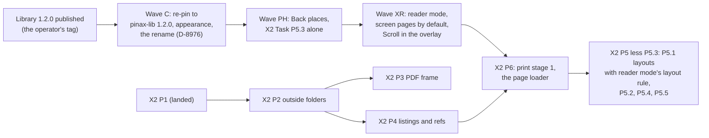

# Native Docs reader: reader mode (X6) Implementation Plan

> **For agentic workers:** REQUIRED SUB-SKILL: Use superpowers:subagent-driven-development (recommended) or superpowers:executing-plans to implement this plan task-by-task, under the dispatched `ccrc-worker` role. XR1 and XR2 are each their own run, dispatched by the coordinator; one worker never executes more than its wave. The library landing LX6 is the library programme's, built in its own repository. Steps use checkbox (`- [ ]`) syntax for tracking.

**Goal:** A Reader mode button that takes the open Docs page full screen, Kindle-like: only the text, turned one screen at a time, with a minimal overlay, one Back model and the place kept.

**Architecture:** ccrc owns the view: a reading container around the Docs screen's body that draws a fill over the console and asks for element full screen on itself, an overlay, a history place through X2's popstate dispatcher, and a screen wake lock (XR1, on the library's contract release, in continuous scroll, entering a desktop by a remount with the reader's chrome off). The library adds screen pages, in-place reading chrome, a text size and one op each way on the existing port (LX6), in the contract release if ready by its cut, otherwise the next. XR2 adopts the release that carries LX6 and drops the remount.

**Tech Stack:** TypeScript, React 19, the existing `@ccrc/ui` sheet primitive (vaul), the Fullscreen and Screen Wake Lock APIs, package-local vitest, the existing `browser (pwa)` leg (Playwright-driven Chrome), the shared library at the contract release (X1's contract and X2's history places, pinned by X1's wave C) for XR1, and at the release carrying LX6 for XR2.

**Spec:** `docs/superpowers/specs/2026-11-20-native-docs-reader-mode-design.md` (read it with this plan). Also the rich-docs spec `2026-10-12-rich-docs-reader-and-shared-renderer-design.md` §4.1, §4.4 and §5; X1's spec `2026-11-18-native-docs-appearance-continuity-design.md` §2, §6 and §10 (test 8, test 9); X2's spec `2026-11-18-native-docs-parity-design.md` §4.7 and its plan's Task P5.3; the completion plan `2026-11-07-native-docs-reader-completion.md` (Global Constraints, Task 17).

**Status:** 2026-11-20, X6 design wave (run 2847). No implementation is claimed by this document. Run ids and deviation blocks for XR1 and XR2 are issued when each opens.

**Amended 2026-11-24** (wave 41, run 3605, D-8974 and D-8975): Reader Mode now comes first, as one wave, XR, on the library's 1.2.0 release, after X1's wave C and a wave PH that builds X2's Task P5.3 alone. Read § Amendment 2026-11-24 below before the waves; where it and the rest of this plan differ, above or below it, it governs.

## Global Constraints

- Reader frame sandbox exactly `allow-scripts`; no `allow`, no `allowfullscreen` on it; shell CSP meta exactly `frame-src 'none'`; no parent-DOM access by any frame; no extra message channel; no window `message` listener anywhere in `pwa/src`; never `allow-modals`.
- The shared library by exact pin only, each release adopted with provenance, `npm audit signatures` and the import list (rich-docs §4.7). XR1 runs on the contract release exactly as X1's wave C pins it and changes no pin. XR2 adopts the release carrying LX6, unless X2's P5 or another wave already pinned it. No library repository edit from a ccrc wave.
- Both 2026-11-06 phone blocks byte for byte; production Mermaid stays on request (`E17-READING does-not-hold`).
- Tap floor `--tap-min` 44 px; the one bar 44 px tall, its title at most 61 px down with at most 48 px of it the console's (`docs-compact-head.browser.test.ts`: `TAP = 44`, `ONE_BAR_TITLE_MAX = 61`, `CONSOLE_PART_MAX = 48`); the desktop head at most 80 px (`HEAD_MAX`) and its row on one line, at 1280 by 800.
- Reader mode's values, each one constant in `pwa/src/docs/reader/readerMode.ts`: `READER_WAKE_IDLE_MS = 300000`; `READER_EXIT_SETTLE_MS = 100`; `READER_REMOUNT_QUIET_MS = 400`; `READER_LAYOUT_RULE: 'remount' | 'default-only'`, set by Task XR1.1 Step 0's measurement (spec §4.3): `'remount'` unless that measurement shows the layout remount breaks a budget.
- Reader mode reads in the default layout only (the coordinator's ruling on review 2947 F3): entering mounts the frame in `default` for its duration and leaving restores the reader's own layout; under `'default-only'`, reader mode is offered only while the default layout is active. Outside it, the desktop head and the one bar draw no Reader mode action, because the one bar has no room for a sentence. Page details shows the sentence "Reader mode reads in the default layout. Choose it here to use reader mode." beside X2's Layout row. If device row FS-9 later breaks a budget on a phone engine, the coordinator switches the constant to `'default-only'` in a follow-up, whose tests XR1 already carries. LX6's cases and AR-X6 hold for the default layout and say so. The layer token `--z-reading: 70` in `ui/src/styles/tokens.css`, between `--z-toast` (60) and `--z-block` (100).
- No new `popstate` listener (X2's `lib/popstate.ts` is the only one), no new window `keydown` listener (the command registry), no new `visibilitychange` subscription (`lib/pageClock.ts`'s `onPageVisible` and `onPageHidden`, D-7191), one hiding owner, `ui/src/lib/modal-layers.ts`, which gains `hideAsPage` and `releaseAsPage` beside `recordModalLayer` (reader mode calls no `hideOthers` of its own, and `sheet.tsx`'s lift rule is unchanged), no second progress mechanism (`readerBar.ts#createReaderProgress`).
- Fixture HOMEs only where a fixture spawns tools; `ccrc test -- <command>` for every test and typecheck, foreground, timeout at least 600000 ms; mutation runs through the coordinator's mutation runner, scratch outside the worktree.
- Public repository: neutral names only; private-name scan of every changed file and every commit message before each push.
- Each wave opens with its own run and issued deviation block; a departure found mid-wave is `D-TBD-<slug>` and reported.
- Ownership against the sibling waves: X1's wave C owns the re-pin to the contract release and the reader's prefs and appearance; X2's P5.3 owns `lib/popstate.ts`, `lib/historyPlaces.ts` and `docs/reader/places.ts`, which XR1 extends by one place kind after P5 merges; X2's P6 and P5 edit `ReaderFrame.tsx`, `DocsHead.tsx`, `docs.css` and `reader/{bridge,policy}.ts`, so XR1 and XR2 claim those files only after X1's wave C and X2's P5 and P6 have merged, and only while no other wave holds them.

## Review Focus

- The browser leaves full screen while a sheet raised from the frame is open (the external-link sheet in reader mode): reader mode ends once, the sheet stays open and usable in the normal view, and nothing is left in the hidden portal target. Owned by Task XR1.2 (`reader mode: losing full screen with a sheet open keeps the sheet usable`).
- The frame falls back to the plain view while reader mode is on (the reading remount's watchdog): reader mode ends, the fallback note shows, and the reader place is consumed, so the next Back leaves the doc and is not spent on a dead place. Owned by Task XR1.4 (`reader mode: a fallback after entering ends reader mode and consumes its place`).
- Esc or the browser's exit and a Back land together (Android Back in full screen, a double press): exactly one exit, at most one history step, the doc still shown. Owned by Task XR1.3 (`reader place: fullscreenchange and popstate in either order exit once`).
- The page is hidden and shown again (a tab switch, the phone locked) while reading: the wake lock is requested again on return if reader mode is still on; if the browser dropped full screen on the way, reader mode has ended once and the wake lock is released. Owned by Task XR1.2 (`wake lock: re-requested on visible, released when reader mode ended while hidden`).
- A rotation or a resize while reading: the place is kept and, in screen pages, the top lands on a whole line. Owned by Task XR2.3 (`screen pages: a resize keeps the place and lands on a whole line`).

---

## Waves, order and file ownership

| Wave | Tasks | Depends on | Owns (create or modify) |
|---|---|---|---|
| XR1 reader mode on the contract release, in scroll | XR1.1 to XR1.5 | X1's wave C (ccrc re-pinned to the contract release); X2's P5, P5.3's dispatcher and decider included, and P6 | `pwa/src/docs/reader/{readerMode,readerModeWords}.ts` (new), `pwa/src/docs/{useReaderMode.ts,DocsReading.tsx,ReaderModeOverlay.tsx,readerModeHandle.ts}` (new), `ui/src/lib/modal-layers.ts` (`hideAsPage`, `releaseAsPage`), `ui/src/index.ts` (those four exports), `pwa/src/command/useShortcuts.ts` (the Cmd or Ctrl+K branch), `pwa/src/screens/DocsScreen.tsx` (the container around `{body}`), `pwa/src/docs/ReaderFrame.tsx`, `pwa/src/docs/reader/{bridge,policy}.ts` (the `reading` chrome), `pwa/src/docs/DocsHead.tsx` (`ActionsRow`, `OneBarControls`), `pwa/src/docs/docs.css`, `pwa/src/command/commands.ts` and the command layer's key-holding check, `pwa/src/lib/historyPlaces.ts`, `pwa/src/lib/popstate.ts` and `pwa/src/docs/reader/places.ts` (the `reader` kind and its host slot), `ui/src/primitives/sheet.tsx` (the portal target context), `ui/src/styles/tokens.css` (`--z-reading`), rich-docs spec §4.4 (D-8805) and §5.2 (D-8831) |
| LX6 the library landing | LX6.1 to LX6.3 | the library's L1 (X1's landing), its rename and L2 (X2's landing); in the contract release if ready by its cut, otherwise the next release, and the cut never waits for it | the library's repository only: designed here (§ Library landing LX6), built by the library programme |
| XR2 reader ops, the screen pages | XR2.1 to XR2.3 | XR1; the release carrying LX6 (the contract release or the next) | `pwa/package.json` and lock (only if the contract release lacks LX6 and no other wave has pinned the release carrying it), `pwa/src/docs/reader/{bridge,policy,readerMode}.ts`, `pwa/src/docs/{ReaderFrame.tsx,ReaderModeOverlay.tsx,useReaderMode.ts}`, `pwa/src/lib/readerRenderJob.ts` (reading time), rich-docs spec §4.4 (D-8803, D-8804) |

The order is the coordinator's ruling on review 2933 F7, option (a): the library lands L1, its rename and L2, and cuts the contract release; X1's wave C re-pins ccrc to it; X2's P6 follows X1's host wave and P4, and X2's P5 then adopts the release (X2 plan's waves table); XR1 follows on it, in continuous scroll. XR1 needs that release, not a split of P5.3: its places tests use the frame's `place` op and `hash {push, from}`, which the 1.1 bridge drops. LX6 joins the contract release if ready by its cut, otherwise the next release; XR2 follows on whichever carries it. Every wave ends with the common acceptance cycle of the completion plan (exact-tip CI and CodeQL, privacy scan, review run).

*Amended 2026-11-24 (D-8974, D-8975): the table and the order above are superseded by § Amendment 2026-11-24 §2. LX6 has landed in the library, and the 1.2.0 candidate carries it, so XR1 and XR2 run as one wave, XR.*

## Acceptance row (proposed for completion Task 17)

| Row | Task 17 row | Installed action and observation | Waves |
|---|---|---|---|
| AR-X6 | Reader mode | On the installed release carrying XR2, in the default layout (reader mode switches to it for its duration, and the other four layouts are never reached in reader mode; one entry from `review` checks the switch and the return, or, under `default-only`, the note): open a spec on a phone (412 by 915, in the browser and installed) and on a desktop (1280 by 800 and 1920 by 1080). Enter by the button and by `r`. Only the text remains. (After XR1 alone, the text scrolls and two small controls stay over its top corners, ccrc's menu control and the reader's own Aa, spec §4.2; the row is run in full after XR2.) Turn forward and back by a side tap, a swipe and the arrow keys; every turn lands on a whole line; a link, a selection and a Render button never turn; a wide table scrolls under a swipe. Switch to Scroll and back. A tap at the top shows the percentage, the time left, Aa and Exit. Leave by Esc, Back (Android Back, iOS swipe), Exit and the browser's own exit, each once. Reopen the doc: the place is kept. The screen stays on while reading and sleeps after the idle release. An external link's sheet shows inside reader mode. Every control meets 44 px. Device rows FS-1 to FS-10 (spec §4.4) recorded per engine | XR1, XR2 |

*Amended 2026-11-24 (D-8975): the row's text stands. It is run after wave XR, which carries XR1 and XR2 together, so "the release carrying XR2" is the release carrying XR, and its parenthesis "(After XR1 alone, …)" describes no shipped state. Its layout clause ("one entry from `review` checks the switch and the return, or, under `default-only`, the note") and device row FS-9 move to X2's P5.1, which brings the layouts; FS-10 is recorded against the overlay's Aa. § Amendment 2026-11-24 §5 says when Reader Mode is done.*

---

## Amendment 2026-11-24: Reader Mode first (wave 41, run 3605)

The operator's priority of 2026-11-24: Reader Mode in the console comes first. This section changes the order and the shape of the waves above. It changes no wall, op, decider or test unless a row below says so. The rest of the plan, above and below this section (the task bodies and the mutation rows included), stays as the dispatched record, and where the two differ, this section governs. D-8974 and D-8975 are defined at its end. D-8976, the library's new package name, is defined in X1's plan (`2026-11-18-native-docs-appearance-continuity.md`, its amendment of the same date).

### What was verified first

Each of the brief's three statements about the library holds. They were read as git objects of the library's repository (now `Synapsium-Labs/pinax-lib`) at `996a39b2602d2e1e636c54c95cc9e403fe55cf88`. That commit is the versioned 1.2.0 candidate of the package `@synapsium-labs/pinax-lib`, not yet tagged or published.

| Statement | Where, at that commit | Holds |
|---|---|---|
| The appearance contract | `appearance` in `FRAME_ACCEPTS`, `PARENT_OPS` and `OP_KEYS` (`src/frame/protocol.ts`); `parseAppearance` (`src/enhance/appearance.ts`), exported from `./frame` | Yes |
| The frame's `place` op and `hash {push, from}` | `place` in `FRAME_OPS`, `OP_KEYS.place = ['t', 'kind']`; `OP_KEYS.hash = ['t', 'id', 'push', 'from']`; both sent only to a seed with `bridge.places`, which `onPlace` sets (`src/host/mount.ts`, `src/frame-runtime/adapters.ts`) | Yes |
| LX6 | `reading` in `FRAME_ACCEPTS` (`READING_MODES`: `screens`, `scroll`, `off`); `reader` in `FRAME_OPS` (`READER_ACTS`: `menu`, `exit`, `toggle`, `active`); `BRIDGE_LIMITS.readerWindowMs` 250 and `readerActiveMs` 60000; `HostAdapters.onReader`; `DocFrame.setReading`; screen pages (`src/enhance/pages.ts`); `size` (`s`, `m`, `l`, `xl`) in enhance's own prefs; `meta.readingMinutes` | Yes |

The library's changelog entry for 1.2.0 adds three facts this section relies on:
- while a reading mode is on, the `settings` command still opens the frame's settings menu;
- `setReading` is replayed at the ready of that `DocFrame`'s own later mounts, and is "not a paint guarantee: a mount that leaves chrome out cannot restore it in place" (the ledger's LX6 outcome records this as the library's D-8950);
- the 1.2.0 assets' hashes, which `assets/assets.json` records at that commit.

### 1. The smallest slice: what reader mode consumes from P5 and P6

Traced against X2's plan (`2026-11-18-native-docs-parity.md`) and `main` at `2b5b5e32a6`. On `main`, X2's P1 has landed and none of P2 to P6 has: `pwa/src/lib/popstate.ts`, `pwa/src/lib/historyPlaces.ts`, `pwa/src/docs/reader/places.ts`, `pwa/src/docs/print/` and `pwa/src/lib/printAllow.ts` are all absent. X1's wave C has not landed either: `pwa/package.json` still pins the old package at 1.1.0.

| What reader mode consumes | Named in | Comes from | Needs P2, P4, P6 or the rest of P5? |
|---|---|---|---|
| The one `popstate` dispatcher and `onPop`, with the router's, `useReaderOnly`'s and the release gate's listeners moved onto it | Global Constraints, XR1.3 | P5.3 (`lib/popstate.ts`, `lib/router.ts`, `docs/readerHistory.ts`, `lib/swupdate.ts`) | No |
| The pop decider `decidePop` and its answers (`close-overlay`, `goto`, `consume`, `skip`, `router`) | XR1.3 | P5.3 (`lib/historyPlaces.ts`) | No |
| The place host, `setPlaceHost`, beside which XR1.3 adds the reader host | XR1.3 | P5.3 (`lib/popstate.ts`) | No |
| The tab record (`visit`, `doc`, `places`, `pendingSeq`, `lastIdx`, `next`), `docsIdx` on every entry, and `PLACES_MAX = 20` (amended 2026-11-26; D-9139: was 50) | XR1.3 | P5.3 | No |
| The place push in `docs/reader/places.ts`, to which XR1.3 adds the drop of recorded places above `lastIdx` | XR1.3 | P5.3 | No |
| The frame's `place` (`overlay`, `overlay-closed`) and a `hash` with `push` reaching ccrc: `onPlace` and the two-argument `onHash`, passed by the bridge | XR1.3; XR1.4 (wake-lock activity) | P5.3's wiring in `ReaderFrame.tsx` and `reader/bridge.ts` | No. It needs the library at 1.2.0, which is wave C's pin |
| `close-overlay` sent on the step-back's pop | XR1.3 | P5.3, through `DocFrame.closeOverlay()`, which 1.2.0 adds (the shipped 1.1.0's `COMMAND_OPS` has only the four tools) | No. It needs wave C's pin, like the places |
| `ReaderLayout`, the five layouts and the Layout row in Page details | XR1.1 (`readerModeOffered`), XR1.4 (`remount({chrome, layout})`), XR1.5 (the note) | P5.1 | Only for the layout rule, which has nothing to decide while the console mounts the default layout alone. The rule moves to P5.1 (D-8975) |
| The library at a release carrying the contract, the places and LX6 | Global Constraints | Wave C's re-pin (X1's Task 1), not P5.1 | No |
| `lib/pageClock.ts` (`onPageVisible`, `onPageHidden`, `onWindowBlur`), `modal-layers.ts#recordModalLayer`, `readerBar.ts#createReaderProgress`, `ReaderMount.command`, `readerMountPlan` and `ReaderChrome` | XR1.2, XR1.4 | Already on `main` | No |
| Print, the page loader, `docs.css`'s print rules, `DocsHead.tsx`'s Print row | none | P6 | No. P6 shares files with reader mode (`ReaderFrame.tsx`, `DocsHead.tsx`, `docs.css`). "P6 before P5" only serialised those edits, and claims serialise them just as well |
| Tracker links, reading-layer flags, print stage 2 | none | P5.2, P5.4, P5.5 | No |

So the slice is X2's Task P5.3 alone, as its plan writes it, on wave C's pin. Its real dependencies are three:
- the frame's `place` op and `hash {push, from}` exist only from the 1.2.0 release, so the slice waits for wave C;
- the one dispatcher, decider, place host and tab record are what XR1.3 extends;
- `ReaderFrame.tsx` and `reader/bridge.ts` are edited in turn by P5.3, reader mode, and later P6 and P5.1, each under its own claim.

### 2. The new order

*Figure A1. The order from 2026-11-24. Start at the library's release. Wave C re-pins ccrc to 1.2.0, wave PH builds Back places on it, and wave XR builds reader mode on PH. The rest of X2 follows, and P5.1, which brings the layouts, takes reader mode's layout rule. P2 to P4 touch no reader host file except P2.4's truth line, so they may run beside C, PH and XR under claims.*

**A scroll-only XR1 is no longer worth shipping apart from XR2.** 1.2.0 carries LX6, so one wave delivers screen pages as the default, with continuous scroll kept as the reader's own choice. The reasons:
- XR2.1 removes every part that only XR1 needs: the `reading` chrome and the desktop remount with its 400 ms quiet wait, the corner menu control, the frame's own Aa in reader mode and the window-blur hide. The plan's own retirement list names nine mutation rows built for them (X6.21, X6.25, X6.35, X6.54, X6.55, X6.56, X6.66, X6.68, X6.69). Wave XR keeps X6.25's guard with its test reworded, and adds X6.73 to the rows never built (below).
- The remount is a frame swap of 0.2 to 1.4 s (lab E4) and resets the changed-since notice, the open folds and the drawn figures. The in-place `reading` op keeps all of them.
- Screen pages are the operator's answer to ask 656. Scroll-only first would ship the reading model that was not chosen, as the default.
- XR alone is smaller than XR1 and XR2 together, because the parts XR2 removes are never built.

**Where the Scroll choice lives.** The choice of Pages or Scroll stays where XR2.2 puts it: a switch in reader mode's overlay, remembered per device, with Pages as the default. Nothing is added to the Settings screen. The Settings audit (`docs/superpowers/specs/2026-11-22-settings-audit.md`) keeps three pages (Appearance, Security, Updates) and lists per-device view state as "remembered toggles, not settings". The switch is such a toggle, beside the reading it changes. Ask 656's "scroll kept as a reader setting" is that switch. The text size is the frame's own (LX6.3, in its Aa menu, which the overlay's Aa opens).

#### Wave C: X1's Tasks 1 to 7, on 1.2.0

| | |
|---|---|
| Tasks | X1's Tasks 1 to 7 as written, on 1.2.0. Task 1 also takes the rename (D-8976): every import, test and script reference in §3 below moves in Task 1's first commit, before Tasks 2 to 7, and only what needs the registry waits for the wave's last commit (§4) |
| Files | X1's "File ownership (wave C)" table, and the rename's files (§3) |
| Tests | As written. The rename edits the existing pins: `reader-pin.test.ts` (name, version, `resolved`), `server/test/ci-pipeline.test.ts` (the provenance step's repository, signer, lock key and pack name), `server/test/docs-parity.test.ts` (M79's specifier rule) |
| Mutation rows | X1's rows as written. The rename adds none: each renamed line is already pinned by an existing test, which a revert reds |
| Depends on | The 1.2.0 publication, for its pull request only (§4) |
| Overlap | None with PR #3138 (X3's R1: server review files, `shared/docs.ts`, `pwa/src/docs/export/policy.ts`, docs). None with the live claims measured on 2026-11-24 |

#### Wave PH: Back places, X2's Task P5.3 alone (D-8974)

| | |
|---|---|
| Tasks | P5.3 Steps 0 to 6 as written: lab E16 per engine first, the characterization commit for `router-location.test.tsx` and `reload-on-move.test.ts`, then the places. It carries the programme ledger's P5.3 items (the forward-skip trap with `lastIdx` updated on a skip, case 8b of `reader-history-adapter.test.tsx`, M11.73 extended, A1's skip-loop bound and counter seeding) |
| Files | P5.3's Files, and from P5's row the two it needs: `pwa/src/docs/reader/bridge.ts` (pass `onPlace`, take `onHash`'s second argument) with `pwa/test/reader-bridge.test.ts`; rich-docs §4.4 (D-8763). `onPlace` rides input presence in `bridge.ts`: the library's adapter is optional, and passing it is what sets the seed's `bridge.places`, so `reader/policy.ts` is not needed |
| Tests | P5.3's Step 1 list, and `reader-places` in the browser leg |
| Mutation rows | M11.27, M11.28, M11.29, M11.30, M11.49, M11.57, M11.63, M11.64, M11.73 |
| Depends on | Wave C merged. It may be built ahead on a workspace cut from wave C's branch (before publication, C has no accepted tip), and absorbs `main` once C has merged; its pull request opens after C's merge |
| Overlap | None with PR #3138. None with the live claims measured on 2026-11-24 |

#### Wave XR: reader mode, XR1 and XR2 as one wave (D-8975)

The task ids are kept, so every row and test above stays traceable.

| Task | In wave XR |
|---|---|
| XR1.1 | As written, with three changes. `readerModeOffered` takes no `layout` or `rule`, and `readerModeLayoutNote`, `READER_LAYOUT_RULE` and `READER_REMOUNT_QUIET_MS` are not defined here (all to P5.1). `readerModeStep` gains XR2.1's events `frame-exit` and `frame-toggle`. Step 0 re-reads the facts on the installed 1.2.0, LX6's included: `setReading` hides and restores the chrome in place with the same nonce; `onReader`'s acts and their pacing; the `settings` command while reading; `r` and Esc. Its layout measurement moves to P5.1. M-3, M-4 and M-7's frame half stay. The row `offered: under remount, …` moves to P5.1 |
| XR1.2 | As written, with one change: `ReaderModeContext.setFrame` takes `{ ready, focus() }` and the mount's `setReading`, with no `remount` and no `layout`. `ReaderLayout` does not exist until P5.1, which adds both back with the layout rule. And the focus wrap: while reader mode is on and no ccrc control is drawn (the overlay hidden), the leading focus guard sends focus to the frame, not to the last ccrc control. This is the coordinator's ruling on review 3626 A3, a consequence of D-8975: the menu control that held that place in XR1 is never built. Browser row `focus: with the overlay hidden, Shift+Tab out of the frame's first control returns focus to the frame`; mutation row X6.77 |
| XR1.3 | As written, on wave PH. The row `reader place: a Back during the desktop remount still exits` reads `reader place: a Back during a same-document remount still exits` (a new commit, or `openAt`): entering no longer remounts |
| XR1.4 | XR2.1's in-place mount replaces XR1.4's remount. Not built: the `reading` chrome, `ReaderMount.remount`, `ReaderModeMenuControl`, the window-blur subscription. The overlay is XR2's: a top strip with the title only, a bottom strip with Exit, the turn switch and Aa (`onAa` hides the overlay and its layer, then sends `command settings`), and the clear layer between them; `onReader` and `setReading`. Kept from XR1.4: `onProgress` on every production mount (D-8805), `ReaderMount.focus()`, a changed share and the frame's figure places counted as activity, the fallback reaching the context, and Step 5's amendments (D-8805, D-8831) beside XR2.1's Step 5 (D-8803, D-8804). `readerMountPlan` takes reader mode's state: a mount made while it is on is sent `setReading` with the turn before its ready, because each of ccrc's mounts is a new `DocFrame` and the library replays only within one. XR2.1's Step 0 is not run: wave C has already pinned 1.2.0 |
| XR1.5 | As written, less its `default-only` rows (to P5.1) |
| XR2.1 | Folded into XR1.4 above, as written, with three exceptions. Step 0 is not run, and its package files are not touched. `remount` is not kept for a layout switch, which comes with P5.1: the Files clause "`remount` kept only for the layout switch" and the parenthesis of `reader ops: entering sends setReading with the stored turn and remounts nothing` ("from another layout …") move to P5.1. The row `reader ops: with the frame accepting reader, ccrc's menu control is not drawn` is dropped, because the control is never built |
| XR2.2 | As written |
| XR2.3 | As written |

- **XR1.4's tests in XR:** `every production mount asks for progress, the lab's does not`; `focus: the frame is focused after entering and after leaving` (reworded: entering no longer makes a new mount); `reader mode: a fallback after entering ends reader mode and consumes its place`; the three `wake lock:` rows; `overlay: hidden on entry, a menu act shows it, Esc on it hides it and returns focus to the frame`; `overlay: Exit leaves reader mode`; `overlay: a tap on the layer outside it hides it and does nothing else`; `overlay: nothing hides it on a timer`; `overlay: an Esc that closes a sheet in reader mode neither hides the overlay nor leaves reader mode`; `overlay: the percentage follows progress, at most once a second`; `overlay: every control is at least the tap floor`; and one new row, `mount plan: a mount made while reader mode is on is sent setReading with the turn before its ready`. With them, XR2.1's Step 1 list as written, less the row it drops.
- **XR1.4's browser rows in XR:** none of them is run. Five name the menu control or the frame's Aa while the overlay shows, and are never built: `menu control: the frame's Aa is uncovered …`, `menu control: a drag that starts at the frame's top centre …`, `overlay: while shown, the frame's Aa corner is uncovered`, `overlay: Exit never sits where the menu control was`, `overlay: a click on the frame's Aa while shown …`. `overlay: Exit is the strip's rightmost control, left of the frame's Aa corner` is replaced by XR2.1's own row for the bottom strip (`reader ops: the top strip holds no control …`, X6.74). XR2.1's browser row and XR2.3's rows stand.
- **Two rows the programme's definition of done needs** (review 3626; the gap is older than this amendment, and wave XR closes it):
  - `reader mode: a new mount made while reader mode is on paints its first frame with the reader's chrome hidden`. Browser, a same-document remount at 412 by 915 and at 1280 by 800, sampled on every animation frame from the new frame's first paint. `setReading`'s replay at ready is not a paint guarantee, so where it fails, XR keeps the new mount under the reading ground until its `ready` has applied the turn. That stays inside the existing container, with nothing widened.
  - `reader mode: leaving after a same-document remount sends off to the new mount, never to the destroyed one`. jsdom, through the mount's real path. Mutation row X6.78.
- **A Docs page in its own tab** (the coordinator's addendum to fix round 1, 2026-11-24): a Docs page can open in a browser tab of its own at desk width, with no console around the reader and no history entry before it. Browser row, XR1.3's: `reader place: on a Docs page that is the first history entry in its own tab, entering reader mode, then Exit, and again Back, each leave reader mode and stay on the document, and no entry before the page is consumed`, at 1280 by 800, checking `history.length` and the URL after each. Mutation row X6.79.
- **Mutation rows built in XR:** every row whose task is XR1.1, XR1.2, XR1.3, XR1.5, XR2.1 or XR2.2, less those moved below. Of XR1.4's rows: X6.24, X6.36, X6.43, X6.49, X6.53, X6.64 and X6.67, and X6.25 with its test reworded as above. X6.20's red test is renamed with XR1.3's row: `reader place: a Back during a same-document remount still exits`.
- **Never built, their mechanism never ships:** X6.21, X6.35, X6.54, X6.55, X6.56, X6.66, X6.68, X6.69 and X6.73.
- **Moved to P5.1 (D-8975):** X6.22, X6.23, X6.59, X6.60, X6.70.
- **New:** X6.76, X6.77, X6.78 and X6.79 (below).
- **Files:** XR1's row and XR2's row of the waves table, less `pwa/package.json` and its lock, `reader-pin.test.ts`, `reader-assets.test.ts` and `frame-cost.browser.test.ts` (wave C pinned the release and took the BASE), and with `pwa/test/reader-mode-overlay.test.tsx` and `pwa/test/w7-storage-keys.test.ts` (XR2.2).
- **Depends on:** wave PH merged, and so wave C.
- **Overlap:** none with PR #3138. With the live claims measured on 2026-11-24, one file: `ui/src/index.ts` (XR1.2's four exports), held by a desktop-polish fix round. XR claims it at dispatch and asks the holder by mail if it is still held.
- **Overlap, the Docs tab view:** the tab view of the row above belongs to the Desktop polish programme. It does not edit the Docs head or the reader frame, and wave XR absorbs it from main.

| Row | Task | Mutation | Red test |
|---|---|---|---|
| X6.76 | XR1.4 | A mount made while reader mode is on is not sent `setReading` | mount plan: a mount made while reader mode is on is sent setReading with the turn before its ready |
| X6.77 | XR1.2 | The leading focus guard sends focus to the last ccrc control even when none is drawn | focus: with the overlay hidden, Shift+Tab out of the frame's first control returns focus to the frame (browser) |
| X6.78 | XR1.4 | Leaving sends `off` to the mount reader mode was entered on, not to the current one | reader mode: leaving after a same-document remount sends off to the new mount, never to the destroyed one |
| X6.79 | XR1.3 | `stepBelowReaderPlace` steps one entry further than the reader place (`n` plus 1) | reader place: on a Docs page that is the first history entry in its own tab, entering reader mode, then Exit, and again Back, each leave reader mode and stay on the document, and no entry before the page is consumed (browser) |

#### The rest of X2, after XR

- **P2, P3 and P4** keep their order and may run beside C, PH and XR: they touch no reader host file, except P2.4's truth line in `DocsHead.tsx`, which is serialised by claim (XR1.5 edits the same file). They share two other files with wave C: `pwa/package.json` and its lock (P3.1 adds `pdfjs-dist`) and `server/test/docs-parity.test.ts` (P2.1's `H.VERBS` case, beside the M79 rename). A claim serialises each.
- **P6**, as written, after XR and P4.
- **P5, less P5.3**, as written, after P6. P5.1 no longer pins the library, because wave C did: it takes the layouts, and with them reader mode's layout rule (D-8975). That means XR1.1 Step 0's layout measurement, `READER_LAYOUT_RULE`, `readerModeOffered`'s `layout` and `rule` inputs, `readerModeLayoutNote`, the remount into `default` on entry and back on exit with `READER_REMOUNT_QUIET_MS` and no opening hash, the Page details note, the rows `offered: under remount, …`, `remount: entering from review …`, `remount: under default-only …`, `remount: the same document, no body read, no initialHash`, `remount: waits 400 ms after the last progress message` and the `default-only` rows of XR1.5, mutation rows X6.22, X6.23, X6.59, X6.60 and X6.70, device row FS-9, and AR-X6's layout clause. It also takes the rule that a same-document remount made while reader mode is on (a new commit, or `openAt`) is planned in the default layout, whatever the stored layout pref: X6.68's layout half, whose chrome half never ships.
- **The HTML-artifacts plan's wave A5** (`2026-11-19-native-docs-html-artifacts.md`) still waits for P6, so under this order it lands later, after XR.

### 3. The rename

The package is now `@synapsium-labs/pinax-lib` and the repository `Synapsium-Labs/pinax-lib`; the console still pins `@synapsium-labs/docserver` at 1.1.0. Every file outside `docs/` that names the old package or repository, measured on `main` at `2b5b5e32a6` with `git grep`, goes to **wave C's Task 1** (D-8976), split by what each change needs:
- **Task 1's first commit, on the branch as it is built.** Every import, test and script reference moves here, ahead of Tasks 2 to 7 and of PH. The built-ahead tarball installs under the new name, so code left on the old name would resolve to the locked 1.1.0, which has neither the contract nor the places.
- **The wave's last commit (§4).** Only what needs the registry waits: the package file's dependency, the lock, and the pin and asset tests' literals.

| File | What names the old package or repository |
|---|---|
| `pwa/package.json` | The dependency `"@synapsium-labs/docserver": "1.1.0"` (last commit) |
| `pwa/package-lock.json` | The root dependency and the `node_modules/@synapsium-labs/docserver` entry (`resolved`, `integrity`), re-taken from the registry (last commit) |
| `pwa/src/docs/reader/assets.ts` | A type import of `./frame` and five `?raw` imports of assets |
| `pwa/src/docs/reader/bridge.ts` | Imports of `./frame` and `./host` |
| `pwa/src/docs/reader/labPolicy.ts` | An import of `./frame` |
| `pwa/src/lib/readerRenderJob.ts` | An import of `./render` |
| `pwa/test/docs-scans.test.ts` | `LIBRARY`, the allowed edges and the planted specifiers |
| `pwa/test/markdown-purity.test.ts` | `ALLOWED_PACKAGES`' `…/render` |
| `pwa/test/reader-pin.test.ts` | `LIB` and its title (first commit); the version and the `resolved` prefix, `…/pinax-lib/-/pinax-lib-1.2.0.tgz` (last commit) |
| `pwa/test/reader-assets.test.ts`, `reader-bridge.test.ts`, `reader-built.test.ts`, `reader-diff.test.ts`, `reader-images.test.ts`, `reader-lab-bridge.test.ts`, `reader-lab-frames.test.ts`, `reader-policy.test.ts`, `reader-commands.test-d.ts`, `reader-history-types.test-d.ts` | Imports of the library's entry points, `reader-assets`' built specifiers (its hash rows in the last commit), and in `reader-images.test.ts` a deep import of the installed package's `dist/frame/seed.js` |
| `pwa/test/w7-storage-keys.test.ts` | An import of `./frame`, and a path to the package's `dist/host` joined from separate segments (`'@synapsium-labs', 'docserver', …`), which a search for the whole path string misses |
| `pwa/browser/reader-frame.browser.test.ts` | An import of `./frame` and the path `node_modules/@synapsium-labs/docserver/assets/frame/bootstrap.js` |
| `.github/ci/library-provenance.sh` | `REPO`, `SIGNER` (`…/.github/workflows/release.yml`), the lock key, the `npm pack` spec, the tarball's name and the closing line |
| `server/test/ci-pipeline.test.ts` | The pins of those lines, the fake lock and tarball, the expected log lines, and the scan for the signer's holders |
| `server/test/docs-parity.test.ts` | M79's specifier rule and its planted cases, the near-miss cases (`@synapsium-labs/docserverx`, `@other/docserver`) included |

Not renamed:
- the lines that name the standalone docs server, the operator's own tool, rather than the library: `CLAUDE.md`, `ccd/ccrc`, `ccd/ccrc-doctor-checks`, `server/test/ccrc-doctor-exposure.test.ts` and `server/test/ccrc-memory.test.ts`;
- the dated plans and specs under `docs/`, which are the record. Their instructions for later waves are amended by this wave's dated notes.

### 4. Building ahead of publication

This is analysis only. This wave packs and installs nothing.

**What can be built before publication.** Wave C, and PH on wave C's branch, can be built and tested on worker branches against a tarball packed from the verified commit. The console reads the library only through its package's entry points and frame assets. At `996a39b2…` the frame assets' hashes are committed (`assets/assets.json`), and the library's `prepack` (`scripts/verify-assets.mjs`) refuses a pack whose built assets differ from them. The worker:
1. exports `996a39b2…` from the library's repository into its session temp root (`git archive`, never a checkout of the library's working tree);
2. runs the library's `npm ci` and `npm run build`, then `npm pack`;
3. records the tarball's sha512 and every asset hash in Results;
4. installs it into its worktree's `node_modules` with `npm install --no-save`, which writes neither `package.json` nor the lock.

That install is of a package that is not from the registry, so it needs the coordinator's word at dispatch. The pressure reclaim deletes scratch older than 14 days, so the recorded digest is what lets a later worker pack the same bytes again. With Task 1's rename commit in place, the typecheck, the unit suites and the browser leg run against the 1.2.0 code. `reader-pin.test.ts` and `library-provenance.sh` fail there by design until the pin commit, and nothing edits them to pass.

**What waits for the registry.** These, and only these, go in the wave's last commit, which only the published release can make. Every import, test and script reference was renamed in Task 1's first commit (§3):
- the exact pin `1.2.0` in `pwa/package.json`;
- the lock's `resolved` (the registry's address) and `integrity` (the registry tarball's sha512, which a local pack need not match);
- `reader-pin.test.ts`'s and `reader-assets.test.ts`'s literals, read from the installed package;
- the provenance check: `library-provenance.sh` against the registry's attestation;
- `npm audit signatures`.

No `file:` spec, no tarball and no weakened pin or provenance check is ever committed.

**The exact condition that holds the pull request.** The branch is pushed and its pull request opened only when all of these hold, checked in this order:
1. `@synapsium-labs/pinax-lib@1.2.0` resolves on the public registry.
2. `v1.2.0` is a signed annotated tag on `996a39b2602d2e1e636c54c95cc9e403fe55cf88`.
3. The provenance step, renamed in Task 1's first commit, verifies the registry tarball's attestation: repository `Synapsium-Labs/pinax-lib`, signer workflow `Synapsium-Labs/pinax-lib/.github/workflows/release.yml`, source ref `refs/tags/v1.2.0`. The worker reads both names from the published attestation and checks that they equal the step's. Any other value stops the wave.
4. `npm audit signatures` is clean.
5. The installed package's `assets/assets.json` equals the one at `996a39b2…`, hash for hash. If not, the branch was built against other bytes: the wave's suites run again at the registry pin before the push.
6. The last commit (the pin, the lock, and the pin and asset tests' literals) is the branch's last, and the wave's own checks pass on it. The import list (rich-docs §4.7, M8.10) was read at Task 1 Step 1, per X1's amendment.

Then the worker pushes once and the common acceptance cycle runs on the exact tip. Wave PH's pull request opens after wave C's merges, and wave XR's after PH's.

### 5. When Reader Mode is done

Reader Mode is done when all three hold:
- wave XR has merged through the common acceptance cycle: exact-tip CI and CodeQL, the privacy scan, and a held-out review run before the landing;
- a release carrying XR is installed;
- AR-X6 passes on that release as written, with two exceptions, both defined by D-8975. Its layout clause, and device row FS-9 with it, is run at P5.1's acceptance, because until P5.1 the console mounts only the default layout, so there is no layout to enter from. FS-10 is recorded against the overlay's Aa, the only Aa on screen in reader mode from XR on; its pass words hold for it unchanged.

That is Reader Mode's own definition of done; this wave's acceptance is the review of this amendment. No setting is added.

### Deviations defined by this amendment

The plan's `## Deviations found` stays as it was; these two are defined here, as issued to this run.

- **D-8974 (2026-11-24)** — reader-mode-first. Reader mode moves ahead of X2's P2, P4, P6 and the rest of P5. The order becomes wave C, then wave PH (X2's Task P5.3 alone), then wave XR, then the rest of X2 (§2). It departs from three texts:
  - the order this plan records from the coordinator's ruling on review 2933 F7, option (a): "X2's P6 follows X1's host wave and P4, and X2's P5 then adopts the release (X2 plan's waves table); XR1 follows on it";
  - this plan's ownership constraint: "XR1 and XR2 claim those files only after X1's wave C and X2's P5 and P6 have merged";
  - X2's waves table and its Figure 7, where P5 is one wave, after P6, and last.

  Argued: the operator's priority of 2026-11-24. F7 did not split P5.3 because of the library release, and the 1.2.0 candidate now carries the places, the contract and LX6 (verified above). Reader mode needs P5.3 alone (§1), and "P6 before P5" only serialised shared files, which claims serialise as well. Issued to run 3605 (wave 41), block 8974 to 8976.
- **D-8975 (2026-11-24)** — reader-mode-one-wave. XR1 and XR2 run as one wave, XR, on 1.2.0, with screen pages the default from its first release. XR1's interim parts are never built: the `reading` chrome remount, the corner menu control, the frame's own Aa in reader mode and the window-blur hide. R21's layout rule moves to X2's P5.1, which brings the layouts, and with it AR-X6's layout clause and device row FS-9 (§2, §5). FS-10 is recorded against the overlay's Aa. It departs from this plan's waves table, its acceptance row's Waves column (XR1, XR2) and its Global Constraints on `READER_LAYOUT_RULE`, and from the design's R16, R20 and §7.5.

  Argued:
  - with LX6 in the same release, XR1's interim parts would be built only for XR2.1 to remove them: nine mutation rows by the plan's own list;
  - the remount costs a 0.2 to 1.4 s frame swap and resets the notice, folds and figures, which the in-place op keeps;
  - screen pages are the operator's answer to ask 656;
  - before P5.1 the console mounts only the default layout, so the layout rule has nothing to decide and AR-X6's entry from `review` cannot be run.

  Issued to run 3605.

## Wave XR1: reader mode on the contract release, in continuous scroll

### Task XR1.1: The decisions (L1), and the measurements first

**Files:** Create `pwa/src/docs/reader/readerMode.ts`, `pwa/src/docs/reader/readerModeWords.ts`; Test `pwa/test/reader-mode-policy.test.ts` (new), browser `pwa/browser/reader-mode-lab.browser.test.ts` (new); `server/test/single-definition/docs-ring.test.ts` if it lists `docs/reader/*` modules by ring.

**Interfaces:**
- Produces:
  - `type ReaderTurn = 'screens' | 'scroll'`
  - `type ReaderModeHow = 'full-screen' | 'fill'`
  - `type ReaderModeState = { on: false } | { on: true; doc: string; how: ReaderModeHow; overlay: boolean; placed: boolean }`
  - `type ReaderModeEvent = { kind: 'enter'; doc: string; activation: boolean; fullscreenEnabled: boolean; placeFree: boolean } | { kind: 'full-screen-granted' } | { kind: 'full-screen-refused' } | { kind: 'full-screen-lost' } | { kind: 'settled'; landedBelow: boolean } | { kind: 'esc' } | { kind: 'exit-tap' } | { kind: 'key' } | { kind: 'place-popped' } | { kind: 'doc-changed'; doc: string } | { kind: 'fallback' } | { kind: 'block' } | { kind: 'menu' } | { kind: 'dismiss' }` (`menu` toggles the overlay; `dismiss`, a tap on the layer outside it or focus entering the frame, only hides it)
  - `type ReaderModeAct = 'draw-fill' | 'push-place' | 'request-full-screen' | 'exit-full-screen' | 'clear-fill' | 'await-settle' | 'step-back' | 'focus-frame' | 'hide-console' | 'show-console' | 'toggle-overlay' | 'announce'`
  - `readerModeStep(state: ReaderModeState, event: ReaderModeEvent): { state: ReaderModeState; acts: readonly ReaderModeAct[] }`
  - `readerModeOffered(input: { frameReady: boolean; plainView: boolean; modalMounted: boolean; layout: ReaderLayout; rule: 'remount' | 'default-only' }): boolean`, with X2's `ReaderLayout`; under `'default-only'` it is false outside `default`; `readerModeLayoutNote(input: { layout: ReaderLayout; rule: 'remount' | 'default-only' }): string | null`, the fallback's sentence or null; `modalMounted` is true while any `[role="dialog"]` is in the document, open or still animating closed, so reader mode never starts its hiding under a modal layer (spec §4.1)
  - `wakeLockWanted(input: { on: boolean; visible: boolean; lastActivityMs: number; nowMs: number }): boolean`, the one wake-lock decider, re-read on every state change
  - `timeLeftMinutes(readingMinutes: number, share: number): number` (unrounded)
  - `READER_WAKE_IDLE_MS = 300000`, `READER_EXIT_SETTLE_MS = 100`, `READER_REMOUNT_QUIET_MS = 400`
  - In `readerModeWords.ts`: `READER_MODE_TEXT` (`enter: 'Reader mode'`, `exit: 'Exit reader mode'`, `live: 'Reader mode. Back or Exit leaves it.'`, `toolbar: 'Reader mode'`, `menu: 'Reader mode menu'`) and `timeLeftText(minutes: number): string` (`'less than a minute left'` below 1, else `'about N min left'` with N rounded).

- [ ] **Step 0: Measure before any code (spec §1, §4.5).** First re-read, from the installed contract release's `dist/`, the facts spec §1.1 took from 1.1.0, and record each in Results with the file read: the chrome keys and that they are read at mount; that `settings: false` unregisters the `settings` command; the keys the frame binds; `progress` and its 250 ms window; `pos` and that `initialHash` wins over it; the frame's Aa (`.aa-wrap`) and where it draws with the bar off. If any differs from spec §1.1, stop and report it with the release's text before writing code. All of these are read in the `default` layout. Next, measure the layout rule (spec §4.3) in the browser leg at 412 by 915: enter from `review` and from `guided`, and record the remount's cost (X2 spec §4.2 already says a layout change remounts the frame): its time (five runs, the worst against lab E4's 1.4 s), and whether the one bar's budgets (`TAP`, `ONE_BAR_TITLE_MAX`, `CONSOLE_PART_MAX`) hold after the return and no figure is drawn without a request. Set `READER_LAYOUT_RULE` to `'default-only'` if any breaks, otherwise `'remount'`, and record the reading and the choice in Results; the phones' half is device row FS-9. Then, in `pwa/browser/reader-mode-lab.browser.test.ts`, against a page of the built PWA with a ready reader frame and a wrapper around its host: M-3 (inside the frame, `document.fullscreenEnabled` is false and `requestFullscreen` rejects), M-4 (with the wrapper full screen and the frame focused, `?` opens the library's keys sheet), and M-7's frame half (`navigator.wakeLock` absent or refused inside the frame). Record each as a line in Results. M-1's refusal without activation and M-5's Esc are the device item's (FS-8, FS-5): Playwright evaluates with a gesture and headless Chrome owns no Esc. If M-3 shows the frame CAN enter full screen, stop and report: the sandbox reading is wrong.
- [ ] **Step 1: Failing tests** in `reader-mode-policy.test.ts`: `reader mode: enter draws the fill, pushes the place, then requests full screen, hides the console, focuses the frame and announces, in that order` (acts equal `['draw-fill','push-place','request-full-screen','hide-console','focus-frame','announce']`); `reader mode: enter without fullscreenEnabled draws the fill and never requests full screen`; `reader mode: enter without activation draws the fill alone`; `reader mode: enter with the place budget spent opens unplaced`; `reader mode: a refusal keeps reader mode on as fill`; `reader mode: losing full screen exits and awaits the settle before stepping back`; `reader mode: settled after a pop landed below steps nothing, otherwise steps back once`; `reader mode: a popped place exits without stepping back`; `reader mode: Exit and r each step back exactly once` (table); `reader mode: esc hides the overlay and focuses the frame, and never exits` (the `esc` event is Esc on ccrc's overlay; Esc in browser full screen arrives as `full-screen-lost`); `reader mode: an unplaced exit steps back nothing`; `reader mode: every exit shows the console and focuses the frame, and no exit closes the frame's overlay itself` (the step-back's pop does, XR1.3); `reader mode: a place popped after an exit is a no-op`; `reader mode: a doc change exits and steps back nothing`; `reader mode: a fallback exits and steps back once`; `reader mode: a block exits full screen and reader mode`; `reader mode: menu toggles the overlay`; `reader mode: dismiss hides a shown overlay, does nothing when hidden, and never exits`; `offered: only a ready frame outside the plain view, and never while a modal layer is mounted`; `offered: under remount, in every layout; under default-only, in the default layout only, with the note elsewhere`; `wake: wanted at 299999 ms idle, not at 300000`; `wake: never while hidden or off`; `time left: 10 minutes at share 0.5 is 5 and at 1 is 0`; `time left text: 0.6 minutes is less than a minute, 1.4 is about 1 min, 11.6 is about 12 min`.
- [ ] **Step 2:** run, expect red (module missing).
- [ ] **Step 3:** implement `readerModeStep` as one table over (state, event); no I/O, no DOM.
- [ ] **Step 4:** run, expect green; run the `pwa` typecheck.
- [ ] **Step 5: Commit** `feat(docs): reader mode decisions (X6 XR1.1)`.

### Task XR1.2: The reading container, fill, full screen, sheets, the hidden console and the wake lock

**Files:** Create `pwa/src/docs/DocsReading.tsx`, `pwa/src/docs/useReaderMode.ts`, `pwa/src/docs/readerModeHandle.ts`; Modify `pwa/src/screens/DocsScreen.tsx` (call `useReaderMode` above `DocsHead` and provide its context to the head and the body; wrap `{body}` in `<DocsReading>`, always, with no key), `pwa/src/docs/docs.css` (the container's flex rules; the child-combinator rules that select `.docs-leaf` as a child of `.docs-screen`, such as `.docs-screen:has(.docs-reader) > .docs-leaf` and `… > .docs-leaf:has(> .docs-reader)`, rewritten for the container; its `[data-reader-mode]` fill rules), `ui/src/styles/tokens.css` (`--z-reading: 70`), `ui/src/primitives/sheet.tsx` (`SheetPortalContext` only; its lift rule unchanged), `ui/src/lib/modal-layers.ts` (`hideAsPage`, `releaseAsPage`), `ui/src/index.ts` (exports `hideAsPage`, `releaseAsPage`, `type PageHiding` and `SheetPortalContext`: the package's one entry, which `pwa` reads as source); Test `pwa/test/reader-mode.test.tsx` (new), `pwa/test/sheet-trap-hide.test.tsx` (the `modal layers:` rows and the sheet rows, beside the shipped sheet-hiding tests: `ui` has no vitest, its `npm test` is a typecheck), browser `pwa/browser/reader-mode.browser.test.ts` (new).

**Interfaces:**
- Consumes: Task XR1.1's `readerModeStep`, `wakeLockWanted`, `READER_MODE_TEXT`; `lib/pageClock.ts#onPageVisible`, `#onPageHidden`; the app's block and sign-in state, read from the same source `app.tsx` reads for `blocked` and `authLost` (name it in Step 0).
- Produces:
  - In `ui/src/lib/modal-layers.ts`, beside `recordModalLayer`: `type PageHiding = { inerted: readonly Element[]; hidden: readonly Element[] }`; `hideAsPage(keep: Element): PageHiding` (every sibling of `keep` and of each ancestor up to `body` gets `inert`; each of them not already `aria-hidden` also gets `aria-hidden="true"`, with no `data-aria-hidden` mark) and `releaseAsPage(h: PageHiding): void` (removes `inert` from every node in `inerted`; a node in `hidden` keeps its `aria-hidden` only when it carries `data-aria-hidden` and a `[role="dialog"][data-state="open"]` is in the document, the open-modal test `sheet.tsx` uses, and is then deleted from every layer's record, so that modal's close lifts it; every other node in `hidden` loses `aria-hidden`, including one marked by a sheet still animating closed, which has already made its one lift).
  - `ReaderModeContext` (in `useReaderMode.ts`): `{ state: ReaderModeState; offered: boolean; enter(by: 'button' | 'key'): void; exit(cause: 'exit-tap' | 'key'): void; menu(): void; escOverlay(): void; activity(): void; dismiss(): void; setFrame(f: { ready: boolean; focus(): void; remount(opts: { chrome: ReaderChrome; layout: ReaderLayout }): void; layout: ReaderLayout } | null): void; setFallback(): void }`, provided by `DocsScreen`.
  - `setReaderModeHandle(h: { offered(): boolean; on(): boolean; toggle(): void } | null): void` and `readerModeHandle()` in `readerModeHandle.ts`, set by `DocsScreen` while mounted.
  - `SheetPortalContext` (in `ui/src/primitives/sheet.tsx`): `HTMLElement | null`; `Sheet` passes it as `Drawer.Portal`'s `container` when non-null; on a Docs page it is always the container's `div.docs-reading-portal`.
  - The container: `
`, holding, in order, the leading focus guard, `{body}`, ccrc's controls (Task XR1.4's menu control or overlay), the trailing focus guard, the polite live region and `div.docs-reading-portal`; in the normal view no `z-index`, `transform` or clip. The guards are empty `span`s, `tabindex` 0 while reader mode is on and -1 otherwise: focus on the leading one moves to the last ccrc control, focus on the trailing one calls the frame's `focus()`. While reader mode is on, every child of the Docs body but the reader host is undrawn, so nothing focusable sits between the frame and ccrc's controls.

- [ ] **Step 1: Failing tests** (jsdom, the Fullscreen and Wake Lock APIs faked): `reader mode: enter sets data-reader-mode to fill before requestFullscreen resolves`; `reader mode: requestFullscreen is called on the container with navigationUI hide, in the same task as enter, after the place is pushed`; `reader mode: granted sets full-screen, refused keeps fill`; `reader mode: fullscreenchange to no element ends reader mode once`; `reader mode: exitFullscreen is called only when the container is the full-screen element`; `reader mode: a block or sign-in screen appearing ends reader mode`; `reader mode: sheets on a Docs page portal into the container in both views and survive entering and leaving`; `reader mode: losing full screen with a sheet open keeps the sheet usable`; `reader mode: everything outside the container is inert and aria-hidden, with no data-aria-hidden mark, while on, and restored after`; `reader mode: a sheet opened and closed inside reader mode leaves the console hidden and inert` (the external-link sheet, opened and closed through `sheet.tsx` unchanged); `reader mode: leaving with a sheet open keeps the console hidden until the sheet closes, then announced`; `reader mode: leaving during a sheet's exit animation announces the console at once and leaves it focusable` (the sheet turned closed, its panel still mounted with `data-state="closed"` and its marks in place: after the exit no console node is `aria-hidden` or `inert`, and after the sheet unmounts none is either); `modal layers: hideAsPage makes a node the page hid already inert without touching its aria-hidden, and releaseAsPage leaves it hidden`; `reader mode: the entry announcement is not inside any aria-hidden or inert node` (the live region sits in the container); `reader mode: not offered while a sheet is animating closed` (a `[role="dialog"][data-state="closed"]` still mounted); `wake lock: requested on enter, released on exit`; `wake lock: released after 300000 ms with no activity and requested again on the next activity`; `wake lock: re-requested on visible, released when reader mode ended while hidden` (through `onPageVisible` and `onPageHidden`); `wake lock: a missing API or a refusal changes nothing`; `docs screen: the container wraps the body in every view and remounts nothing` (the reader host element is the same node across renders with reader mode off, on and off); `handle: empty on every other screen`. Browser (`reader-mode.browser.test.ts`, headless Chrome): `reader mode: the container goes full screen and the frame does not reload` (one `load`); `reader mode: refused full screen leaves the fill covering the head and banners` (`requestFullscreen` stubbed to reject; `elementFromPoint` at the head's centre is inside the container); `reader mode: the external-link sheet shows inside reader mode`; `reader mode: no allowfullscreen or allow attribute on the reader frame`; `focus: Tab from the last ccrc control lands in the frame` (`document.activeElement` is the reader's iframe, and `?` then opens the library's keys sheet); `focus: Tab out of the frame's last control lands on the first ccrc control`; `focus: Shift+Tab out of the frame's first control lands on the last ccrc control`; `focus: a head control cannot take focus while reader mode is on` (its `focus()` leaves `document.activeElement` unchanged, which Chrome's `inert` decides). These are browser rows because jsdom 30 implements no `inert` and user-event no tab order across a frame, so a jsdom row would pass or fail whatever the guard does.
- [ ] **Step 2:** run, expect red.
- [ ] **Step 3:** implement. `useReaderMode` applies `readerModeStep`'s acts in order and holds the Docs screen's one `fullscreenchange` subscription; visibility comes from the page clock; `hide-console` calls `hideAsPage(container)` and keeps the returned `PageHiding`; `show-console` calls `releaseAsPage` with it. The live region (`announce`) is a child of the container. `modalMounted` is read as `document.querySelector('[role="dialog"]') !== null` at each offer. The wake lock's idle timer is one `setTimeout` whose handle the hook holds in a ref: every `activity()` re-arms it to fire at the last activity plus `READER_WAKE_IDLE_MS`, and when it fires it re-reads `wakeLockWanted` and applies the answer; exit clears it. The fill rule: `position: fixed; inset: 0; z-index: var(--z-reading)`, padding from `--safe-top`, `--safe-bottom` and `env(safe-area-inset-left/right)`, the reader's ground.
- [ ] **Step 4:** run, expect green; run the `ui` typecheck, `server/test/rings/pwa-one-owner.test.ts`, and the `pwa` suite's tap-target and theme tests (`tap-targets.test.tsx`, `contrast.test.ts`).
- [ ] **Step 5: Commit** `feat(docs): the reading container, full screen and the wake lock (X6 XR1.2)`.

### Task XR1.3: The reader place

**Files:** Modify `pwa/src/lib/historyPlaces.ts` (place kind `reader`, answer `exit-reader`), `pwa/src/lib/popstate.ts` (`setReaderPlaceHost`), `pwa/src/docs/reader/places.ts` (`pushReaderPlace`, `stepBelowReaderPlace`, `landedBelowReaderPlace`); Test `pwa/test/reader-places.test.ts` (extend X2's), browser `pwa/browser/reader-places.browser.test.ts` (extend X2's).

**Interfaces:**
- Consumes: X2 P5.3's `decidePop`, `onPop`, `setPlaceHost`, the tab record (`lastIdx`, `places`, `pendingSeq`) and `PLACES_MAX`.
- Produces: the tab record gains `baseIdx: number`, the `docsIdx` of the visit's base entry, stamped when the visit starts; `Place.kind` gains `'reader'`; the reader place that counts is the topmost `reader` place of the current visit at or below `lastIdx`; `decidePop` gains `{ kind: 'exit-reader'; closeOverlay: boolean; route: boolean }`, answered only when the reader host reports `on()` and the pop crosses that place (popped `docsIdx` below the place's, `lastIdx` at or above it), however many frame places sit between; `route` is false for a landing at or above `baseIdx` (consumed, the doc shown) and true below it (X2's own answer for that landing follows in the same event); `closeOverlay` is true when an open overlay place lies between the landing and `lastIdx`; `decidePop`'s signature grows from `(popped, tab)` to `(popped, tab, readerOn: boolean)`, pure, with `popstate.ts` reading the reader host's `on()` and passing it; the tab record also gains `exitPending: boolean`, set by the hook when reader mode ends by any path but a pop and by `leaveDead()` before it steps back, kept set through the settle and the step-back after it, and cleared when a crossing landing is consumed, at once when no step-back follows (unplaced, a doc change, or a settle whose `landedBelowReaderPlace()` is true), and when the visit ends; a crossing pop while reader mode is off is consumed, with the same `closeOverlay`, only while `exitPending` is set (the exit that just happened), so the frame's `close-overlay` is sent on that pop and nowhere else; any other crossing while off is X2's answer with the reader place left out; `decidePop` gains `{ kind: 'leave-dead-reader' }` for a pop that lands at or above a current-visit reader place while `readerOn` is false (Forward onto a dead entry), which the dispatcher hands to the reader host's `leaveDead()`, which calls `stepBelowReaderPlace()`; the hook makes the same check when it registers its host after a reload (`lastIdx` at or above a reader place with reader mode off); reader mode never reopens there; `setReaderPlaceHost(host: { on(): boolean; exitReader(closeOverlay: boolean): void; leaveDead(): void } | null): void`, held by the reader-mode hook, independent of the frame's `setPlaceHost`; `pushReaderPlace(): boolean` (false when the visit's budget is spent); `stepBelowReaderPlace(): number` (calls `history.go(-n)`, records the landing, returns `n`, 0 when there is no reader place; `n` is 1 plus the count of recorded places with `docsIdx` above the reader place's and at or below `lastIdx`, never an index difference); X2's place push (`places.ts`) first drops every recorded place with `docsIdx` above `lastIdx`, the forward entries the push discards; `landedBelowReaderPlace(): boolean` (the settle's re-read).

- [ ] **Step 1: Failing tests:** `reader place: Back exits reader mode and stays on the doc` (no router subscriber runs); `reader place: after an exit by Exit, one Back leaves the doc for the previous screen` (`decidePop` answers exactly `{kind: 'router'}`, the reader host's `exitReader` is never called, and the router runs once); `reader place: after an exit by Back, the next Back leaves the doc`; `reader place: a Back two entries deep from reader mode exits and routes in one event` (`go(-2)` from the reader place, landing below `baseIdx` on the previous screen's entry: `exit-reader` with `route` true); `reader place: the doc's own entry and the previous screen's are told apart by baseIdx`; `reader place: B, enter, Back, Forward, enter, Back, Back: every Back has a visible effect and the last leaves the doc` (the reviewer's sequence: Forward onto the dead entry steps back below it at once, and the re-entry's push drops it); `reader place: a reload in reader mode steps below the reader place once, and the next Back leaves the doc`; `reader place: a crossing while off that is not the exit that just happened is X2's answer` (no consume, no `close-overlay`); `reader place: decidePop takes readerOn as input and never calls the host` (a pure-function table, with rows for `exitPending` set and clear and for `leave-dead-reader`); `reader place: Forward onto a dead reader entry answers leave-dead-reader and steps back once`; `reader place: with two reader places in the visit, the topmost at or below lastIdx counts`; `reader place: Exit and losing full screen each consume exactly one reader place`; `reader place: losing full screen with no engine pop and a figure overlay open consumes the step-back's landing and sends close-overlay once`; `reader place: leaveDead's landing is consumed and no router subscriber runs`; `reader place: a jump then Exit leaves no place behind` (n is 2, one go); `reader place: overlay, Back, then a jump, then Exit steps over the two live entries only` (R, O, Back closes O, J pushed: O dropped from the record, n is 2 and the landing is the doc's own entry, not the entry before it); `places: a push drops the recorded places above lastIdx`; `reader place: Back with a figure overlay open closes it first, the next Back leaves reader mode`; `reader place: Exit with a figure overlay open sends close-overlay once, on the step-back's pop` (the contract release's command, on a phone with no remount); `reader place: fullscreenchange and popstate in either order exit once` (the jsdom test queues a `popstate` 50 ms after the `fullscreenchange`, and again with the `popstate` first); `reader place: a Back during the desktop remount still exits` (the frame's host slot empty, the reader host registered); `reader place: a stale reader place after leaving the doc costs no Back`; `reader place: a pop below the reader place after Chromium skipped it still exits`; `reader place: counts toward PLACES_MAX`; `reader place: the pushed entry's URL is the doc's current URL and keeps the only base`. Browser: `reader place: Back from reader mode shows the doc in the normal view, a second Back leaves it`.
- [ ] **Step 2 to 4:** run, implement, run.
- [ ] **Step 5: Commit** `feat(docs): Back leaves reader mode (X6 XR1.3)`.

### Task XR1.4: The reading mount and the overlay

**Files:** Create `pwa/src/docs/ReaderModeOverlay.tsx`; Modify `pwa/src/docs/reader/policy.ts` (`ReaderChrome` gains `'reading'`; `readerMountPlan` takes it; every production plan asks for progress), `pwa/src/docs/reader/bridge.ts` (a `reading` mount passes `features: { chrome: { bar: false, rail: false, topSpace: false } }`, `settings` left on, because at the contract release, as at 1.1.0, `settings: false` also unregisters the `settings` command; `onProgress` on every production mount; `ReaderMount.remount({chrome, layout})` and `ReaderMount.focus()`; `readerMountPlan` takes reader mode's state, and while it is on, plans every mount, a same-document remount included, in `default` with the chrome reader mode entered with (the reading chrome on a desktop, `host-bar` on a phone, whose rail stays because a phone leaves without a remount)), `pwa/src/docs/ReaderFrame.tsx` (on a desktop, chrome `reading` while reader mode is on, through `remount`, never a new mount effect; on a phone, no remount; each `progress` message through `createReaderProgress`, and to the context's `activity()` when its share differs from the last one; X2's `place {kind: 'overlay'}` and `overlay-closed` (a figure's full screen opening and closing) to `activity()` too; in XR1 those are the wake lock's only signs of reading inside the frame; `setFrame` on ready and `setFallback` to the context), `pwa/src/docs/docs.css` (overlay and menu control rules), rich-docs spec §4.4 (D-8805) and §5.2 (D-8831); Test `pwa/test/reader-mode-mount.test.tsx` (new), `pwa/test/reader-bridge.test.ts` (rows for `reading`, `remount`, `focus` and progress).

**Interfaces:**
- Consumes: `ReaderModeContext`; `readerBar.ts#createReaderProgress`; `ReaderMount.command`.
- Produces: `ReaderMount.remount(opts: { chrome: ReaderChrome; layout: ReaderLayout }): void` (the same rendered document, a new channel and nonce, `initialHash` cleared so the stored place wins, in the layout given: entering passes `'default'`, leaving passes the reader's own layout back; a phone already in `default` does not call it); `ReaderMount.focus(): void` (focuses the frame element); `ReaderModeOverlay(props: { title: string; progress: ReaderProgress; onExit(): void })`, a `role="toolbar"` named `READER_MODE_TEXT.toolbar`: the title, a `role="status"` percentage updated at most once a second, then Exit, in that DOM and visual order, so Exit sits at the strip's right end (no Aa in XR1: the frame's own stays on screen); `ReaderModeMenuControl(props: { expanded: boolean; onMenu(): void })`, XR1's menu control, a `button` labelled `READER_MODE_TEXT.menu` with `aria-expanded`, at least `--tap-min` square, in the reading view's top-left corner inside the safe areas, never over the frame's top-right corner where the frame draws its Aa; `onMenu` toggles the overlay (`menu()` shows it when hidden and hides it when shown). While the overlay shows: its strip runs from the menu control's right edge to the left edge of the frame's Aa corner, with Exit at the strip's right end; `ReaderModeScrim(props: { onDismiss(): void })`, a clear layer over the reading area below the strip, never over the Aa corner, not focusable and `aria-hidden`, taking touch and wheel scrolling while it shows, whose tap calls `onDismiss` (the context's `dismiss()`) and nothing else; and, in XR1 only, the hook subscribes `lib/pageClock.ts#onWindowBlur` to call `dismiss()` when focus enters the frame (XR2.1 removes that subscription with the frame's Aa). No timeout hides it. Nothing else of ccrc's is over the frame: the menu control always, and the strip and the clear layer only while the overlay shows.

- [ ] **Step 1: Failing tests:** `reading mount: chrome off with settings left on, and onProgress passed`; `every production mount asks for progress, the lab's does not`; `remount: the same document, no body read, no initialHash` (a doc opened at `#sec`, scrolled, entered: the seed carries no hash); `remount: waits 400 ms after the last progress message` (fake clock: a tap 100 ms after a progress message remounts at 400 ms after it, not before); `remount: a phone mount in the default layout enters in place, with no remount`; `remount: leaving remounts back to the bar the width asks for`; `remount: entering from review remounts in default, on a phone too, and leaving restores review` (the stored `layout` pref is never written by reader mode); `remount: under default-only, nothing remounts for the layout, because reader mode is not offered outside default`; `mount plan: while reader mode is on, a same-document remount (a new commit, or openAt) is planned in default with the reading chrome, whatever the stored layout pref`; `mount plan: on a phone, a same-document remount while reader mode is on keeps the rail, and after leaving the one bar's Contents opens the drawer`; `focus: the frame is focused on the new mount's ready, after entering and after leaving`; `reader mode: a fallback after entering ends reader mode and consumes its place`; `wake lock: a progress message counts as activity` (fake clock, the mount's real progress path: a `progress` with a new share at 299 s keeps the lock at 300 s and 598 s, and it is released at 599 s with no further message); `wake lock: a progress with the same share counts for nothing` (the same share resent every second from 0 s: released at 300 s); `wake lock: a figure's full screen opening and closing each count as activity` (X2's `place` op through the mount); `overlay: hidden on entry, the menu control shows it, Esc on it hides it and returns focus to the frame`; `overlay: Exit leaves reader mode`; `overlay: a tap on the layer outside it hides it and does nothing else` (no exit, no step-back, focus to the frame); `overlay: a second tap on the menu control hides it` (`aria-expanded` back to false); `overlay: focus entering the frame hides it` (the page clock's window blur, faked); `overlay: nothing hides it on a timer` (fake clock, 10 minutes: still shown); `overlay: an Esc that closes a sheet in reader mode neither hides the overlay nor leaves reader mode` (the external-link sheet open over the shown overlay); `overlay: XR1 draws no Aa and sends no command`; `overlay: the percentage follows progress, at most once a second`; `overlay: every control is at least the tap floor`. Browser (`reader-mode.browser.test.ts`, 412 by 915 and 1280 by 800): `menu control: the frame's Aa is uncovered and opens the frame's settings in reader mode` (`elementFromPoint` at the frame's Aa centre is the frame, and a click there opens the library's Aa menu); `menu control: a drag that starts at the frame's top centre scrolls the frame`; `overlay: while shown, the frame's Aa corner is uncovered` (`elementFromPoint` at the Aa centre is the frame, at 412 by 915, 915 by 412 and 1280 by 800); `overlay: Exit never sits where the menu control was` (while shown, `elementFromPoint` at the menu control's centre is the menu control); `overlay: Exit is the strip's rightmost control, left of the frame's Aa corner`; `overlay: a click on the frame's Aa while shown hides the overlay, and the Aa menu takes the next click` (headless Chrome; the phones are device row FS-10, where an engine that moves no focus costs one extra tap, as spec §4.2 states).
- [ ] **Step 2 to 4:** run, implement, run.
- [ ] **Step 5: Amend rich-docs §4.4 and §5.2.** In §4.4's `progress` row, replace "ccrc asks only for a frame mounted on its own bar" with "ccrc asks for it from every production mount, never from the reader lab's (amended <date>; X6 XR1, D-8805)". In §5.2's phishing row, after "ccrc's chrome stays outside the frame.", add " In reader mode it is hidden while you read and shows on a tap; in the installed app, and on any fill path without the browser's bars, nothing names the site, and the walls in this row still hold (amended <date>; X6 XR1, D-8831)."
- [ ] **Step 6: Commit** `feat(docs): the reading mount and the overlay (X6 XR1.4, D-8805, D-8831)`.

### Task XR1.5: Entry: the head action, the one-bar control and `r`

**Files:** Modify `pwa/src/docs/DocsHead.tsx` (`ActionsRow` first action; `OneBarControls` last control; both read `ReaderModeContext`), `pwa/src/command/commands.ts` (one command, key `r`, whose `run` calls `readerModeHandle()?.toggle()` only when the handle is set and offered or on, and whose `when` is `(ctx) => !ctx.paletteOpen && (readerModeHandle()?.offered() === true || readerModeHandle()?.on() === true)`, so the palette never lists it and the shortcut sheet lists `r` only where it acts, spec §3.1), `pwa/src/command/useShortcuts.ts` (the Cmd or Ctrl+K branch returns early while the handle reports reader mode on; the key-holding check holds single keys but `r` while it is on), `pwa/src/docs/docs.css`; Test `pwa/test/docs-desk-head.test.tsx`, `pwa/test/docs-one-bar.test.tsx`, `pwa/test/tap-targets.test.tsx`, `pwa/test/command-registry.test.ts`, `pwa/test/command-layer.test.tsx`, browser `pwa/browser/docs-compact-head.browser.test.ts`.

- [ ] **Step 1: Failing tests:** `desk head: Reader mode leads the actions row, a word at stage 0 and an icon after`; `desk head: no Reader mode on the plain view or before ready`; `desk head and one bar: under default-only, outside the default layout, no Reader mode action is drawn, and Page details shows the note beside the Layout row`; `one bar: Reader mode is the last control, after Jump, Contents and a plan's Outline, labelled Reader mode`; `one bar: oneBarTools is unchanged` (the library command names only); `tap targets: the reader mode control floors on --tap-min`; `commands: r enters reader mode on a Docs page with a ready frame`; `commands: r does nothing on every other screen`; `palette: Reader mode is never listed, and r still enters with the palette closed`; `shortcut sheet: r is listed on a Docs page that offers reader mode and on no other screen`; `commands: while reader mode is on, Cmd or Ctrl+K opens no palette and the single keys but r are held`. Browser (`docs-compact-head.browser.test.ts`): `one bar: with Reader mode the bar stays 44 px, the title at most 61 px down, every control at least 44 by 44, at 412 by 915 and 915 by 412`; `one bar: at 360 by 800, a plan's bar holds back, four tools and the title with no sideways scroll, every control at least 44 by 44 and the title's tap width at least 44 px` (`document.documentElement.scrollWidth` equals the viewport's width, and the last control's right edge is at most `innerWidth`, so an ancestor that clips cannot hide an overflow); `one bar: under default-only, outside the default layout, at 360 by 800 and 412 by 915 the bar keeps today's budgets` (no Reader mode control, every control at least 44 by 44, no sideways scroll); `desk head: with Reader mode the row stays one line and the head at most 80 px at 1280 by 800 and 1920 by 1080`.
- [ ] **Step 2 to 4:** run, implement, run. Confirm `git diff` of this wave leaves both 2026-11-06 phone blocks untouched.
- [ ] **Step 5: Commit** `feat(docs): enter reader mode from the head, the one bar and r (X6 XR1.5)`.

---

## Library landing LX6 (designed here, built by the library programme)

The library programme builds it after its L1 (X1's landing), its rename and L2 (X2's landing). It joins the contract release if it is ready by that release's cut, otherwise the next release; the cut never waits for it (the coordinator's ruling on review 2933 F7). A shares-only landing first records X6's shares: frame 15 360 characters, total 59 392 (spec §7.4). Every case below runs in the `default` layout and says so: reader mode reads only there, and the host never sends `reading` to a frame in another layout. The enhance modules are shared, so test 8 still counts the growth in all five layouts. If the landing measures above either, it stops and asks the coordinator with its rows.

### Task LX6.1: The `reader` ops and in-place reading chrome

**Interfaces:**
- Parent to frame: `{t: 'reading', mode: 'screens' | 'scroll' | 'off'}`, `OP_KEYS.reading = ['t', 'mode']`; `FRAME_ACCEPTS` gains `'reading'`; `DocFrame.setReading(mode)` queues before `ready`, latest wins, and seeds a later remount.
- Frame to parent: `{t: 'reader', act: 'menu' | 'exit' | 'toggle' | 'active'}` (`active`: a sideways scroll of a table or code block, or a scroll, pan or zoom in a figure's full screen, while reader mode is on, paced on its own window by a second new protocol constant, `readerActiveMs: 60000`: at most one `active` per window, never in the `readerWindowMs` window and never in place of a pending `menu`, `exit` or `toggle`), `OP_KEYS.reader = ['t', 'act']`; `FRAME_OPS` gains `'reader'`; the host parser refuses any other key or act; the frame paces it by a new protocol constant `readerWindowMs: 250` (leading edge, the latest act at the window's end), so the host never refuses a well-paced frame; `HostAdapters` callback `onReader(act)`; sent only when the seed's `bridge.reader` is true (the host passed `onReader`).
- While `mode` is not `off`: the root carries `data-reading`; the bar, running head, progress line, rail, settings button and top space are hidden in place; `r` and Esc (with no frame overlay open) send `exit`; while `off`, `r` sends `toggle`; the keys sheet lists `r` when `bridge.reader` is true.
- **Cases:** the op parser rows for both directions (an unknown mode ignored by the frame; an unknown act or an extra key refused by the host; `reading`'s key refused by the host parser and `reader`'s by the port parser); taps on the top band at ten a second never close the bridge; a minute of sideways table scrolling in reader mode sends `active` once, and none while reader mode is off; a tap on the top band during sideways scrolling still sends its `menu` (an `active` never replaces a pending act); a 1.1 host (no `onReader`) receives no `reader` op and counts no refusal; in-place chrome hides and restores without a remount (the same nonce); Esc with the jump open closes the jump and sends nothing; test 9's record gains one entry (`reading` in `FRAME_ACCEPTS`, `reader` in `FRAME_OPS`, disjoint).

### Task LX6.2: Screen pages

**Interfaces:** a module beside `nav` and `position`, active only in `screens` mode: the turn (spec §5.3), its target offset by the lowest bottom edge of the elements pinned at the top (computed `position` `sticky` or `fixed`, overlapping the text column, at their own sticky offset), re-measured once after the scroll, and the ground band over the line the bottom edge cuts (only when that line's top is inside the reading area and the line is shorter than a third of a screen), the tap zones and top band (spec §5.4, Figure 4), the swipe, the keys (ArrowRight, PageDown, Space forward; ArrowLeft, PageUp, Shift+Space back), the interactive-target selector list, and the re-snap after a resize, a text size or a width change through `tokenOf`.

- **Cases (real browser):** a forward and a back turn land on a whole line in a fixture of known line boxes, at three widths and both fonts; in a table of 60 rows taller than the screen, each forward turn puts the next row's top at the pinned head's bottom (within 1 px), never under it, and every row is wholly shown on some page, forward and back, both with the bar's offset (`.fits`) and without; a card head and a figure's pinned tools offset the target the same way; after a turn, the line cut by the bottom edge is covered by the ground band, which a scroll removes; after a turn that steps through an image taller than the screen, no band is drawn and the image shows to the bottom edge; a block taller than the screen is stepped through with one line of overlap; every turn moves at least a third of a screen; a tap on a link, a button, a Render button, a summary and a card never turns; a non-empty selection never turns; a swipe inside a wide table scrolls the table; the top band sends `menu` in both modes; turns are instant with and without reduced motion; a resize keeps the place and lands on a whole line; `scroll` mode turns nothing.

### Task LX6.3: Text size and reading time

**Interfaces:** `size: 's' | 'm' | 'l' | 'xl'` in enhance's own stored prefs (`PREF_VALUES`, beside the lens), never in `FRAME_PREF_VALUES`, so the `prefs` op does not widen (16, 18, 20, 22 px, scaling `--rem`), an Aa row, absent reads as `m`, stored with width and font; `render()`'s `meta.readingMinutes: number`, by the rule `reading.js` already applies (230 words a minute prose, 520 code, half a minute per figure), equal to the byline's figure for every conformance document.

- **Cases:** each size's computed body size; an absent or unknown size reads `m`; `meta.readingMinutes` equals the enhance byline's minutes across the corpus; test 8's growth row under X6's `Size-Design:` line, within both shares.

---

## Wave XR2: adopt the reader ops

### Task XR2.1: In place, and progress for every mount

**Files:** Modify `pwa/package.json` and lock, `pwa/test/reader-pin.test.ts` (its version literal), `pwa/test/reader-assets.test.ts` (its asset rows) and `pwa/browser/frame-cost.browser.test.ts` (its BASE), all four only if the contract release lacks LX6 and no other wave has pinned the release carrying it, `pwa/src/docs/reader/{bridge,policy}.ts` (pass `onReader`; `setReading`; `ReaderChrome` loses `'reading'`; `remount` kept only for the layout switch into and out of `default`), `pwa/src/docs/ReaderFrame.tsx` (no chrome remount on entering or leaving; the layout remount into and out of `default` stays), `pwa/src/docs/ReaderModeOverlay.tsx` (the overlay's Aa; `ReaderModeMenuControl` retired), `pwa/src/docs/useReaderMode.ts` (`onReader` acts: `menu`, `exit`, `toggle`, and `active`, which calls `activity()` only), rich-docs spec §4.4 (D-8803, D-8804); Test `pwa/test/reader-bridge.test.ts`, `pwa/test/reader-mode-mount.test.tsx`, browser `pwa/browser/reader-mode.browser.test.ts`.

**Interfaces:** `ReaderModeOverlay` gains `onAa(): void`, which first hides the overlay and its layer (the context's `dismiss()`) and then calls `ReaderMount.command('settings')`, so the frame's settings menu takes the next tap; `ReaderMount.setReading(mode: 'screens' | 'scroll' | 'off'): void`; `ReaderMountInput.onReader?(act: 'menu' | 'exit' | 'toggle' | 'active'): void`; `readerModeStep` gains events `{kind: 'frame-exit'}` and `{kind: 'frame-toggle'; activation: boolean; frameFocused: boolean}`.

- [ ] **Step 0: Adopt the release, only if this wave re-pins** (the contract release lacks LX6 and no other wave has pinned the release carrying it), each step as Global Constraints and rich-docs §4.7 require per release, recorded in Results before any other step:
  1. the exact pin in `pwa/package.json` and the lock;
  2. the tarball's provenance, verified;
  3. `npm audit signatures`, clean;
  4. the import list, unchanged or each change named;
  5. `pwa/test/reader-pin.test.ts`'s literals and `pwa/test/reader-assets.test.ts`'s rows, updated to the new release. The literals are the version, the lock's `resolved` URL, and the hashes of `frame/bootstrap.js`, `frame/enhance.js`, `frame/reader.css` and `reader.css`, each read from the installed package's `assets/assets.json`, never typed from memory;
  6. the release's test 8 tables, read at its tagged commit as X1's Task 1 Step 2a reads them ('The release'): LX6's row within X6's shares (frame 15 360, total 59 392), and the last row's `total` equal to the sum of the installed manifest. Then `frame-cost`'s BASE re-taken per layout at the new pin, before any XR2 code, as X1's Task 6 Step 1 and X2's P5.1 take theirs, and recorded in Results, so that ccrc's own srcdoc budgets are judged over a BASE that already holds LX6's growth. The table read judges LX6's growth; the BASE does not.

  If any of these fails, stop and report: XR2 does not adopt that release.
- [ ] **Step 1: Failing tests:** `reader ops: entering sends setReading with the stored turn and remounts nothing` (the same nonce, in the default layout; from another layout XR2 still remounts once into `default` under `READER_LAYOUT_RULE`, as XR1 does); `reader ops: leaving sends off and closes an open frame overlay`; `reader ops: frame exit leaves reader mode`; `reader ops: an active act counts as wake-lock activity and does nothing else`; `reader ops: frame toggle enters as fill without activation, and asks for full screen with it`; `reader ops: frame toggle is refused unless the frame is ready and focused`; `reader ops: with the frame accepting reader, ccrc's menu control is not drawn`; `reader ops: a second menu act hides the overlay, and a tap on the layer or anywhere on the top strip hides it` (in portrait and in landscape); `reader ops: the top strip holds no control and a tap anywhere on it hides the overlay; Exit, the turn setting and Aa sit in the bottom strip` (portrait and landscape); `reader ops: the hook does not subscribe to the window's blur` (a blur after a band tap hides nothing, so the paced `menu` cannot reopen what it hid); `reader ops: entering hides the frame's Aa in place, and the overlay's Aa sends command settings`; `reader ops: the overlay's Aa hides the overlay and its layer before it sends command settings`. Browser: `reader ops: Esc in the fill, focus in the frame, leaves reader mode`.
- [ ] **Step 2 to 4:** run, implement, run.
- [ ] **Step 5: Amend rich-docs §4.4:** add the `reading` (parent to frame) and `reader` (frame to parent) rows and, in the hello paragraph's list of later parent messages, `reading` (amended <date>; X6 XR2, D-8804). In the `command` row, after "Sent only from a tap on ccrc's own bar", add ", or from the reader-mode overlay's Aa (amended <date>; X6 XR2, D-8803)".
- [ ] **Step 6: Commit** `feat(docs): reader mode in place (X6 XR2.1, D-8803, D-8804)`.

### Task XR2.2: The turn setting and time left

**Files:** Modify `pwa/src/docs/ReaderModeOverlay.tsx` (a Pages or Scroll switch), `pwa/src/docs/useReaderMode.ts` (the turn stored in the console's storage, one writer, named by the convention `pwa/test/w7-storage-keys.test.ts` holds), `pwa/src/lib/readerRenderJob.ts` (carry `meta.readingMinutes`), `pwa/src/docs/reader/readerMode.ts` (`timeLeftMinutes` used); Test `pwa/test/reader-mode-overlay.test.tsx` (new), `pwa/test/w7-storage-keys.test.ts`.

- [ ] **Step 1: Failing tests:** `turn: Pages by default, Scroll kept per device, sent with setReading`; `turn: the storage key is in the census and written in one place`; `time left: the overlay reads about N min left from readingMinutes and the share`; `time left: absent readingMinutes shows the percentage alone`.
- [ ] **Step 2 to 5:** run, implement, run, commit `feat(docs): screen pages and time left (X6 XR2.2)`.

### Task XR2.3: The reading proved end to end

**Files:** Test browser `pwa/browser/reader-mode.browser.test.ts`.

- [ ] **Step 1: Browser rows on the real release:** `screen pages: ArrowRight, a right tap and a swipe each turn forward and the progress rises`; `screen pages: a link tap opens the link, not a turn`; `screen pages: a resize keeps the place and lands on a whole line`; `scroll: a tap below the band turns nothing`; `size: Aa's text size applies in reader mode and after it`.
- [ ] **Step 2 to 3:** run, fix only integration defects in ccrc (a library defect goes to the coordinator), commit `test(docs): reader mode end to end (X6 XR2.3)`.

---

## Mutation rows

Each row ships with the task that owns it; it is red when the guard is removed and green when restored. Run through the coordinator's mutation runner. Rows X6.21, X6.25, X6.35, X6.54, X6.55, X6.56, X6.66, X6.68 and X6.69 pin XR1's corner menu control, the frame's own Aa, the window-blur hide and the `reading` chrome, all of which XR2.1 removes. XR2.1 retires them: before its Step 1 it rewrites or deletes their tests in a commit of its own (an intended behaviour change, by the characterization rule), and X6.33, X6.58, X6.71 and XR2.1's other rows take their place. From XR2 on, the mutation runner runs no retired row.

| Row | Task | Mutation | Red test |
|---|---|---|---|
| X6.1 | XR1.1 | `readerModeStep`'s enter requests full screen before pushing the place | reader mode: enter draws the fill, pushes the place, then requests full screen, hides the console, focuses the frame and announces, in that order |
| X6.2 | XR1.1 | Enter requests full screen without `fullscreenEnabled` | reader mode: enter without fullscreenEnabled draws the fill and never requests full screen |
| X6.3 | XR1.1 | A refusal sets the state off | reader mode: a refusal keeps reader mode on as fill |
| X6.4 | XR1.1 | `full-screen-lost` steps back at once instead of awaiting the settle | reader mode: losing full screen exits and awaits the settle before stepping back |
| X6.5 | XR1.1 | `settled` steps back even when a pop landed below | reader mode: settled after a pop landed below steps nothing, otherwise steps back once |
| X6.6 | XR1.1 | `place-popped` adds `step-back` | reader mode: a popped place exits without stepping back |
| X6.7 | XR1.1 | An exit ignores `placed` | reader mode: an unplaced exit steps back nothing |
| X6.8 | XR1.1 | `block` ignored | reader mode: a block exits full screen and reader mode |
| X6.9 | XR1.1 | `READER_WAKE_IDLE_MS` compared with `<=` | wake: wanted at 299999 ms idle, not at 300000 |
| X6.10 | XR1.1 | `readerModeOffered` ignores `plainView` or `modalMounted` | offered: only a ready frame outside the plain view, and never while a modal layer is mounted |
| X6.11 | XR1.1 | `timeLeftText` rounds before the one-minute threshold | time left text: 0.6 minutes is less than a minute, 1.4 is about 1 min, 11.6 is about 12 min |
| X6.12 | XR1.2 | The fill drawn after the request resolves | reader mode: enter sets data-reader-mode to fill before requestFullscreen resolves |
| X6.13 | XR1.2 | `SheetPortalContext` not provided on a Docs page | reader mode: sheets on a Docs page portal into the container in both views and survive entering and leaving (and the browser row) |
| X6.14 | XR1.2 | `hideAsPage` applies no `inert` | focus: a head control cannot take focus while reader mode is on (browser) |
| X6.44 | XR1.2 | The trailing focus guard removed | focus: Tab from the last ccrc control lands in the frame (browser) |
| X6.45 | XR1.2 | The leading focus guard removed | focus: Shift+Tab out of the frame's first control lands on the last ccrc control (browser) |
| X6.40 | XR1.2 | `hideAsPage` writes the `data-aria-hidden` mark (as `hideOthers` does) | reader mode: a sheet opened and closed inside reader mode leaves the console hidden and inert |
| X6.41 | XR1.2 | `releaseAsPage` removes `aria-hidden` from a node a modal still marks | reader mode: leaving with a sheet open keeps the console hidden until the sheet closes, then announced |
| X6.50 | XR1.2 | The live region rendered outside the container | reader mode: the entry announcement is not inside any aria-hidden or inert node |
| X6.51 | XR1.2 | `hideAsPage` skips `inert` on a node the page hid already | modal layers: hideAsPage makes a node the page hid already inert without touching its aria-hidden, and releaseAsPage leaves it hidden |
| X6.52 | XR1.2 | `releaseAsPage` keeps `aria-hidden` on any `data-aria-hidden` node, the open-dialog test dropped | reader mode: leaving during a sheet's exit animation announces the console at once and leaves it focusable |
| X6.15 | XR1.2 | The wake lock not re-read on exit | wake lock: requested on enter, released on exit |
| X6.16 | XR1.2 | The page clock's visible handler not subscribed | wake lock: re-requested on visible, released when reader mode ended while hidden |
| X6.17 | XR1.2 | The container rendered only while reader mode is on | docs screen: the container wraps the body in every view and remounts nothing |
| X6.18 | XR1.3 | `decidePop` answers `router` for a pop below a reader place | reader place: Back exits reader mode and stays on the doc |
| X6.37 | XR1.3 | `exit-reader` answered for any pop below the reader place, `lastIdx` and `on()` ignored | reader place: after an exit by Exit, one Back leaves the doc for the previous screen |
| X6.47 | XR1.3 | A crossing while off answers `closeOverlay` false | reader place: Exit with a figure overlay open sends close-overlay once, on the step-back's pop |
| X6.48 | XR1.3 | `baseIdx` ignored: every crossing landing taken as the doc's own | reader place: the doc's own entry and the previous screen's are told apart by baseIdx |
| X6.61 | XR1.3 | Every crossing while off consumed, the just-happened test dropped | reader place: a crossing while off that is not the exit that just happened is X2's answer |
| X6.62 | XR1.3 | No step-back when the tab lands on a dead reader entry | reader place: B, enter, Back, Forward, enter, Back, Back: every Back has a visible effect and the last leaves the doc |
| X6.63 | XR1.3 | The reload check on the reader host's registration removed | reader place: a reload in reader mode steps below the reader place once, and the next Back leaves the doc |
| X6.72 | XR1.3 | exitPending cleared at the settle's end, before the step-back | reader place: losing full screen with no engine pop and a figure overlay open consumes the step-back's landing and sends close-overlay once |
| X6.38 | XR1.3 | `route` always false: every `exit-reader` consumed | reader place: a Back two entries deep from reader mode exits and routes in one event |
| X6.39 | XR1.3 | `n` taken as the `docsIdx` difference, or the push's drop of discarded places removed | reader place: overlay, Back, then a jump, then Exit steps over the two live entries only |
| X6.19 | XR1.3 | `stepBelowReaderPlace` steps one entry, ignoring frame places above | reader place: a jump then Exit leaves no place behind |
| X6.20 | XR1.3 | The reader place answered through the frame's host slot | reader place: a Back during the desktop remount still exits |
| X6.21 | XR1.4 | The `reading` mount keeps the bar | reading mount: chrome off with settings left on, and onProgress passed |
| X6.22 | XR1.4 | `remount` keeps `initialHash` | remount: the same document, no body read, no initialHash |
| X6.23 | XR1.4 | The quiet wait removed | remount: waits 400 ms after the last progress message |
| X6.24 | XR1.4 | The fallback does not reach the context | reader mode: a fallback after entering ends reader mode and consumes its place |
| X6.43 | XR1.4 | `progress` not routed to `activity()` (the progress line alone) | wake lock: a progress message counts as activity |
| X6.49 | XR1.4 | Every `progress` counted as activity, the share not compared | wake lock: a progress with the same share counts for nothing |
| X6.53 | XR1.4 | The layer outside the overlay not drawn, or its tap not wired to `dismiss` | overlay: a tap on the layer outside it hides it and does nothing else |
| X6.54 | XR1.4 | The menu control only shows, never hides | overlay: a second tap on the menu control hides it |
| X6.55 | XR1.4 | The strip or the layer drawn full width, over the Aa corner | overlay: while shown, the frame's Aa corner is uncovered (browser) |
| X6.56 | XR1.4 | Exit placed first in the strip, at the menu control's spot | overlay: Exit never sits where the menu control was (browser) |
| X6.57 | XR1.1 | `dismiss` treated as an exit | reader mode: dismiss hides a shown overlay, does nothing when hidden, and never exits |
| X6.59 | XR1.4 | Entering keeps the reader's layout | remount: entering from review remounts in default, on a phone too, and leaving restores review |
| X6.60 | XR1.1 | `readerModeOffered` ignores `rule` | offered: under remount, in every layout; under default-only, in the default layout only, with the note elsewhere |
| X6.64 | XR1.4 | X2's overlay `place` ops not routed to `activity()` | wake lock: a figure's full screen opening and closing each count as activity |
| X6.65 | XR2.1 | `active` not passed to `activity()` | reader ops: an active act counts as wake-lock activity and does nothing else |
| X6.66 | XR1.4 | The blur subscription removed | overlay: focus entering the frame hides it |
| X6.67 | XR1.4 | A timer added that hides the overlay | overlay: nothing hides it on a timer |
| X6.68 | XR1.4 | `readerMountPlan` ignores reader mode's state | mount plan: while reader mode is on, a same-document remount (a new commit, or openAt) is planned in default with the reading chrome, whatever the stored layout pref |
| X6.73 | XR1.4 | a phone's in-reader remount planned with rail: false | mount plan: on a phone, a same-document remount while reader mode is on keeps the rail, and after leaving the one bar's Contents opens the drawer |
| X6.69 | XR1.4 | The layer drawn under the Aa menu's region after the blur, or the blur not hiding the layer | overlay: a click on the frame's Aa while shown hides the overlay, and the Aa menu takes the next click (browser) |
| X6.70 | XR1.5 | Under `default-only`, the action drawn outside the default layout | desk head and one bar: under default-only, outside the default layout, no Reader mode action is drawn, and Page details shows the note beside the Layout row |
| X6.71 | XR2.1 | The blur subscription kept in XR2 | reader ops: the hook does not subscribe to the window's blur |
| X6.25 | XR1.4 | Esc on the overlay leaves reader mode | overlay: hidden on entry, the menu control shows it, Esc on it hides it and returns focus to the frame |
| X6.36 | XR1.4 | The overlay's Esc handler bound on the container instead of the toolbar | overlay: an Esc that closes a sheet in reader mode neither hides the overlay nor leaves reader mode |
| X6.35 | XR1.4 | The menu control drawn as a strip across the frame's top | menu control: the frame's Aa is uncovered and opens the frame's settings in reader mode |
| X6.42 | XR1.5 | The `r` row's `when` removed | palette: Reader mode is never listed, and r still enters with the palette closed |
| X6.46 | XR1.5 | The one-bar title set to `flex: none` | one bar: at 360 by 800, a plan's bar holds back, four tools and the title with no sideways scroll, every control at least 44 by 44 and the title's tap width at least 44 px |
| X6.26 | XR1.5 | The one-bar control below the tap floor | tap targets: the reader mode control floors on --tap-min |
| X6.27 | XR1.5 | The Cmd or Ctrl+K branch's reader-mode test removed | commands: while reader mode is on, Cmd or Ctrl+K opens no palette and the single keys but r are held |
| X6.28 | XR1.5 | The `r` command's `run` calls the handle without checking it | commands: r does nothing on every other screen |
| X6.29 | XR1.5 | Reader mode offered before ready | desk head: no Reader mode on the plain view or before ready |
| X6.30 | XR2.1 | `onReader` not passed | reader ops: frame exit leaves reader mode |
| X6.31 | XR2.1 | Frame toggle accepted without focus | reader ops: frame toggle is refused unless the frame is ready and focused |
| X6.32 | XR2.1 | Frame toggle requests full screen without activation | reader ops: frame toggle enters as fill without activation, and asks for full screen with it |
| X6.58 | XR2.1 | The second `menu` act only shows the overlay, or the layer outside it dropped in landscape | reader ops: a second menu act hides the overlay, and a tap on the layer or anywhere on the top strip hides it |
| X6.74 | XR2.1 | Exit drawn in the top strip | reader ops: the top strip holds no control and a tap anywhere on it hides the overlay; Exit, the turn setting and Aa sit in the bottom strip |
| X6.75 | XR2.1 | onAa sends the command without hiding | reader ops: the overlay's Aa hides the overlay and its layer before it sends command settings |
| X6.33 | XR2.1 | Entering still remounts | reader ops: entering sends setReading with the stored turn and remounts nothing |
| X6.34 | XR2.2 | A second writer of the turn key | turn: the storage key is in the census and written in one place |

## Deviations found

- **D-8803 (2026-11-20)** — reader-overlay-commands. Wave XR2 (Task XR2.1): the reader-mode overlay's Aa sends `command settings` to the frame, once the frame hides its own Aa in place (XR1's overlay has no Aa; the frame's own stays on screen, review 2933 F4). Departs from rich-docs spec §4.4's `command` row: "Sent only from a tap on ccrc's own bar, through the library's `DocFrame.command`, which focuses the frame first and sends nothing before `ready`". Argued: the overlay is ccrc's own chrome, outside the frame, and the tap is yours on it; the command is one of the four existing names, through the same `DocFrame.command`, under the same parser and limits, with no new channel. XR2 amends §4.4 (Task XR2.1 Step 5). Issued to run 2847 (X6) in its brief's block 8803 to 8805.
- **D-8804 (2026-11-20)** — reader-mode-ops. Wave XR2 (Task XR2.1) and the library landing LX6: one new op in each direction on the existing port, `reading {mode}` from ccrc and `reader {act}` from the frame, two names because `OP_KEYS` is one table both parsers read. Departs from rich-docs spec §4.4: "Every later parent message goes on the port, and is `prefs`, `changes.result`, `mermaid` or `command`", and from the closed frame-op table. Argued against the checked-bridge boundary: both are additive with closed value sets, ride the existing port, parser and `BRIDGE_LIMITS`, with `reader` paced by the frame (`readerWindowMs`, 250 ms, and its `active` act at most once per `readerActiveMs`, 60 000 ms) so the host never refuses a well-paced frame, send no URL or position, are sent by the frame only when the seed says ccrc accepts them, and add no channel, window listener, parent-DOM access or CSP source (spec §7.2, §8). XR2 amends §4.4 (Task XR2.1 Step 5). Issued to run 2847 (X6).
- **D-8805 (2026-11-20)** — progress-beyond-the-bar. Wave XR1 (Task XR1.4): ccrc asks for `progress` from every production mount, never from the reader lab's. Departs from rich-docs spec §4.4's `progress` row: "ccrc asks only for a frame mounted on its own bar". Argued: the op is unchanged, already allowed with the bar off (the library's `onProgress` contract), at most four a second, and carries a share only; the overlay's percentage and time left need it on a desktop, and its arrival times XR1's desktop remount. XR1 amends §4.4 (Task XR1.4 Step 5). Issued to run 2847 (X6); the first block is spent.
- **D-8831 (2026-11-20)** — reader-mode-chrome-hidden. Wave XR1 (Task XR1.4), and XR2 from its overlay on: in reader mode ccrc's chrome is hidden while you read. Departs from rich-docs spec §5.2's phishing row, whose mitigation reads: "ccrc's chrome stays outside the frame. The frame cannot send anything out (0/27, `form-action 'none'`). Every external link opens only from the external-link sheet, which names the host (§4.4). `error`'s text is never shown." Argued: the frame fills the screen in reader mode, so a document can draw a fake "Exit" or a fake sign-in box. A browser's own full-screen notice fades, and in the installed app (FS-2), and on any fill path without the browser's bars, nothing names the site; an iPhone Safari tab's fill keeps Safari's address bar (FS-1). The harm stays low because the row's other walls hold: raw HTML is off, so no drawn input takes text; the frame sends nothing out; and every external link opens through the sheet that names the host. The real Exit is the overlay's, Back always works, and XR1 keeps ccrc's menu control on screen (spec §8). XR1 amends §5.2 (Task XR1.4 Step 5). Issued to run 2847 (X6) in review 2933's fix round, for A1.

## Results

### What was read and measured (2026-11-20)

- Read at `main` `62276e71b`: `pwa/src/docs/{ReaderFrame.tsx,DocsHead.tsx,readerBar.ts,docs.css}`, `pwa/src/docs/reader/{bridge,policy}.ts`, `pwa/src/screens/DocsScreen.tsx`, `pwa/src/command/useShortcuts.ts`, `ui/src/primitives/sheet.tsx`, `ui/src/styles/tokens.css`, `pwa/vite.config.ts`'s manifest, the browser leg's harness and budgets (`docs-compact-head.browser.test.ts`, `tap-targets.test.tsx`). The installed library 1.1.0's `dist/` and `README.md`, read from an existing install on the box, never installed here. Two of the reads were Sonnet fact checks with citations; the design reads were the worker's.
- Measured: element full screen around a `sandbox="allow-scripts"` srcdoc frame on headless Chromium 156, rows M-1, M-2, M-6, M-7 (the console's half) and M-8 (spec §4.5). M-3, M-4, M-5 and M-7's frame half are UNMEASURED; Task XR1.1 Step 0 and the device item take them.

### The adversarial pass (Opus, high, 2026-11-20)

Before the push, one Opus reviewer read the spec and this plan against shipped source and the installed 1.1.0: 14 important and 12 minor findings, every one fixed in the text before the push, the sheet-portal finding by its own simpler alternative. The main changes: two op names (`reading`, `reader`) because `OP_KEYS` is shared; the frame paces `reader` so fast taps never close the bridge; exits step back over the frame's own places, wait `READER_EXIT_SETTLE_MS` after a lost full screen, and step nothing when unplaced; the reader place has its own host slot; blocks end reader mode in full screen; the console is inert and hidden behind it through the modal layers' mechanism; the phone enters in place, and the desktop remount (a new `remount`, no `initialHash`) waits `READER_REMOUNT_QUIET_MS` after the last progress message; focus returns to the frame; visibility goes through the page clock; the `r` command goes through a Docs-screen handle and Cmd or Ctrl+K is held in its own branch; the text size stays in the layout's own prefs; XR1 keeps the frame's Aa, because at 1.1.0 `settings: false` unregisters its command; the headless leg's Esc and activation rows moved to the device item.

### Asks and rulings

- **Ask 656, pages or scroll (product):** screen pages, with scroll kept as a reader setting; the operator's answer, relayed by the coordinator on 2026-11-20.
- **Three refusals, each reported and answered by the coordinator before any retry:** the session hook refused an edit of the scratch measurement script after a `cd` whose target it could not resolve; it refused the first draft of that report, which quoted the refusal's text naming the account secrets directory; and the graph gate refused a source grep before one graph query. The coordinator allowed the script to be edited by its absolute temp-root path with the Edit tool and run twice, then deleted (done), and allowed one graph query followed by free reads (done).

### Commands

- The measurement: `node <session temp root>/x6fs/measure.mjs <the cached Chromium 156>`, run three times: once before the first refusal (its values empty), then twice under the coordinator's word, the last after the one-line fix that made the host page's script run. Chromium was killed by its own PID each time; the script and its three profile directories are deleted.
- No test, typecheck or install ran: this wave is docs only.

### Fix round 1 (review run 2933 at `52c0de20d`, 2026-11-20)

The review found 8 important findings (F1 to F8) and 6 minor ones (A1 to A6). The coordinator ruled F7 and directed the rest. Each finding has its own commit, except A2 and A5, which share one because they are one Esc model; this design's text above is the fixed state.

- **F7, the coordinator's ruling, option (a):** XR1 runs on the contract release (X1's contract and X2's history places, after the library's L1, rename and L2), in continuous scroll. LX6 joins that release if it is ready by the cut, else the next, and no release waits for it. XR2 follows on the release that carries LX6. The parts the 1.1.0 premise forced were redone on that release:
  - **F4:** XR1 keeps the frame's own Aa, because the contract release still unregisters its command with `settings: false`. A corner menu control replaces the strip that covered Aa. The overlay's Aa and D-8803 move to XR2.
  - **A3:** the In short says what each wave delivers.
  - **A2 and A5:** Esc on the overlay only hides it, through a handler on the toolbar element.
- **F1:** `exit-reader` applies only while reader mode is on, and only to a pop that crosses the reader place. It routes when the pop lands past the doc, which the record's new `baseIdx` decides.
- **F2:** the step-back counts live entries, and a place push drops the recorded places above `lastIdx`.
- **F3:** the console is hidden as the page's own, without a mark, through `hideAsPage` and `releaseAsPage` in `modal-layers.ts`. The shipped record and the sheet's lift rule never lift that hiding. Reader mode is not offered under any dialog, and the palette does not list it.
- **F5:** a turn lands below whatever is pinned at the top, and a bounded band covers the cut bottom line.
- **F6:** a `progress` whose share changed counts as reading activity.
- **F8:** two focus guards wrap Tab, proved in browser rows.
- **A1:** D-8831, issued for this finding, amends rich-docs §5.2's phishing row.
- **A4:** a 360 by 800 row tests the one bar.
- **A6:** Figure 2 now pushes the place, then requests full screen.
- **The adversarial pass on the changed sections (Opus, high):** 4 important and 6 minor findings, all fixed in one commit. Among them: `baseIdx` and `route` in the decider, `close-overlay` only on the crossing pop, a bounded bottom band, no offer under a closing dialog, a live region inside the container, and a repeated share that counts for nothing.
- New mutation rows: X6.35 to X6.51. No test, typecheck or install ran: docs only.

### Fix round 2 (review run 2947 at `8524e7aba`, 2026-11-20)

The review found 4 important findings (F1 to F4) and 8 minor ones (A-a to A-h). The coordinator ruled F2 and F3 and directed the rest. Each important finding has its own commit, and F2's XR2 mutation row has a second one. A-a and A-b share one commit, being one history rule; A-d has its own; A-c and A-e to A-h share one text commit.

- **F1:** `releaseAsPage` keeps `aria-hidden` only while an open dialog (`[role=dialog][data-state=open]`) holds the node, so leaving during a sheet's exit animation announces the console at once.
- **F2, the coordinator's ruling, Kindle-like both ways:**
  - a tap anywhere outside the overlay hides it, through a clear ccrc layer over the reading area;
  - a second tap on the menu control hides it, and there is no timeout;
  - Exit sits at the strip's right end, never where the menu control was;
  - the frame's Aa corner stays clear, and in XR1 the window's blur hides the overlay when the Aa takes focus;
  - XR2 does the same in landscape.
- **F3, the coordinator's ruling:** reader mode reads in the default layout, and the reader's own layout returns on exit. `READER_LAYOUT_RULE` is set by XR1.1 Step 0's measurement, and later by device row FS-9; under `'default-only'`, no action is drawn outside the default layout, and Page details carries the sentence. LX6, AR-X6 and the acceptance row name the default layout. Decision R21.
- **F4:** XR2.1 Step 0 adopts a re-pinned release with every per-release step, updates `reader-pin.test.ts` and `reader-assets.test.ts`, and re-takes `frame-cost`'s BASE before LX6's growth is judged.
- **A-a and A-b:**
  - a crossing while reader mode is off is consumed only while `exitPending` marks the exit that just happened;
  - ccrc never stands on a dead reader entry (`leave-dead-reader`, and a check at the host's registration after a reload);
  - `decidePop` takes `(popped, tab, readerOn)`.
- **A-d:** a figure's full screen counts as activity, and from XR2 the frame's `active` act, paced once a minute on its own window, does too. The idle timer is named.
- **A-c, and A-e to A-h:**
  - D-8831's wording on the fill path;
  - Mockup 1, and the overlay's word;
  - the modal-layer rows in `pwa/test/sheet-trap-hide.test.tsx`;
  - X2's P6 before P5;
  - the commit-per-finding wording.
- **The adversarial pass on the changed sections (Opus, high):** 8 important and 9 minor findings, all fixed in one commit. Among them: the §4.2 table, the blur in XR1 only, `active` on its own window, every mount planned in `default` while on, the fallback off the one bar, `leave-dead-reader` and `exitPending`, and FS-10.
- New mutation rows: X6.52 to X6.71. No test, typecheck or install ran: docs only.

### Fix round 3 (review run 2953 at `865a27bfb`, 2026-11-20, the last)

The review found 8 important findings (F1 to F8) and 8 minor ones (A-a to A-h). The coordinator accepted X6 at the review cap, on condition that the report's replacement texts were applied verbatim in this round, one commit per id. Three quoted texts did not match exactly once: F7's plan:43 text, A-e's escaped quote marks and A-g's missing bold. The worker stopped and reported them, and the coordinator ruled on each. The texts were then applied as ruled, with no rewording.

- **F1:** applied verbatim.
- **F2:** applied verbatim.
- **F3:** applied verbatim, both XR2 mockups redrawn at their box widths.
- **F4:** applied verbatim.
- **F5:** applied verbatim.
- **F6:** applied verbatim.
- **F7:** applied verbatim (plan:86 first, then plan:43 alone, by the coordinator's ruling).
- **F8:** applied verbatim.
- **A-a:** applied verbatim.
- **A-b and A-h:** not applied: superseded by F3 (coordinator's ruling at the cap).
- **A-c:** applied verbatim.
- **A-d:** applied verbatim.
- **A-e:** applied verbatim (the report's JSON escapes removed, by the coordinator's ruling).
- **A-f:** applied verbatim.
- **A-g:** applied verbatim (the bold lead on spec:488 kept, by the coordinator's ruling).
- **XR2.1's hide test renamed:** coordinator's correction at the cap, follow-on to F3. The test and mutation row X6.58 now name a tap anywhere on the top strip.
- New mutation rows: X6.72 to X6.75. No test, typecheck or install ran: docs only.

### Wave XR (run 3992, wave 54, 2026-11-26)

Built ahead of publication on this workspace's own branch, over two local merges and nothing cut new: wave PH's branch at `39e4db2ca1` (Back places, X2 P5.3), then wave C's at `a042be374f` (the appearance wave, with the library pinned to the registry's `@synapsium-labs/pinax-lib` 1.2.0). Both merged with no conflict. `ui` and `pwa` were installed with `npm ci`, as their locks say; no pin, lock or pin test changed.

#### XR1.1 Step 0: the facts, re-read on the installed 1.2.0

Read from `pwa/node_modules/@synapsium-labs/pinax-lib` (version 1.2.0), before any reader-mode code. Every fact spec §1.1 took from 1.1.0 holds on 1.2.0, so nothing stopped the wave.

| Fact (spec §1.1) | Read in | On 1.2.0 |
|---|---|---|
| The chrome keys, read once at mount | `dist/enhance/options.js` (`CHROME_KEYS = ['bar', 'rail', 'settings', 'topSpace']`, each true by default, read by the options parse) | Holds |
| `settings: false` unregisters the `settings` command | `dist/enhance/settings.js#build`: it returns before it builds the tool and before `ctx.commands.register('settings', …)` | Holds |
| The keys the frame binds | `dist/enhance/keys.js` (`SHEET_ORDER = ['/', 'j', 'k', 'w', 'i', 'n', 'p', 'm', 'o', '?']`, Mod+K, Esc); LX6 adds `r` and Esc in `dist/enhance/reader.js`, bound only when the host passed `onReader` | Holds, plus LX6's two |
| `progress` and its 250 ms window | `dist/frame/protocol.d.ts` (`BRIDGE_LIMITS.progressWindowMs: 250`); `dist/host/mount.d.ts` (`onProgress`: at most four a second, the latest of each window at its end) | Holds |
| `pos`, and `initialHash` wins over it | `dist/frame/doc-fields.generated.js` (`DOC_FIELDS` holds `pos`); `dist/enhance/position.js` (`SAVE_MS = 250`; "landing: initialHash wins, else the stored position") | Holds |
| The frame's Aa with the bar off | `dist/enhance/settings.js#build` (into the bar's tray when there is one, else first in the root); `assets/frame/reader.css` (`.aa-wrap` sticky at `top: 8px`, pushed right by `margin: … auto`) | Holds |

LX6's facts, which the amendment adds to Step 0:

| Fact | Read in | On 1.2.0 |
|---|---|---|
| `setReading` hides and restores the chrome in place, with the same nonce | `dist/host/mount.js` (`setReading` posts `reading` on the current mount's port once ready, else queues it, the latest winning; it seeds every later mount of that `DocFrame`, which posts it again at its own ready, and an `off` posts nothing); `dist/enhance/reader.js#set` (the root's `data-reading`, through the journal, no remount); `assets/frame/reader.css` lines 1399 to 1404 (the running head, the Aa button, the bar's other tools, the progress line and the contents rail hidden, `--bar-h: 0`) | Holds |
| `onReader`'s acts and their pacing | `dist/enhance/reader.js` (`READER_ACTS = ['menu', 'exit', 'toggle', 'active']`; nothing is sent unless the host passed `onReader`, which sets the seed's `bridge.reader`, `dist/host/mount.js`); `dist/frame/protocol.d.ts` (`readerWindowMs: 250`, `readerActiveMs: 60000`) | Holds |
| The `settings` command while reading | `assets/frame/reader.css` line 1399: in a reading mode the bar stays with no height "so the settings command still opens its menu"; the command is registered whenever `chrome.settings` is on | Holds |
| `r` and Esc | `dist/enhance/reader.js`: `r` sends `toggle` while off and `exit` while on; Esc sends `exit` only while a reading mode is on, and `dist/enhance/keys.js` gives Esc to an open overlay of the frame first | Holds |
| Reading time | `dist/render/types.d.ts` (`RenderMeta.readingMinutes: number`) | Present (XR2.2 carries it) |

The browser leg's three rows, `pwa/browser/reader-mode-lab.browser.test.ts`, on the built PWA with a ready reader frame, a wrapper around its host put full screen from the console's window (headless Chrome, Playwright, this box):

- **M-3:** inside the frame `document.fullscreenEnabled` is false and `requestFullscreen` rejects (`TypeError`), at 1280 and at 412 wide; the frame's `sandbox` is exactly `allow-scripts`, with no `allow` and no `allowfullscreen`. Line: `M-3 {"width":1280,"enabled":false,"outcome":"rejected TypeError","element":null,"sandbox":"allow-scripts","allow":null,"allowFullscreen":null}` (and the same at 412).
- **M-4:** with the wrapper full screen and the frame focused by its element's `focus()`, `?` reaches the frame and opens the library's keys sheet. Line: `M-4 {"refused":null,"focused":true,"frameHasFocus":true,"keys":["?"],"opened":true,"stillFull":true}`. A harness finding on the way: the library's mount focuses the iframe as it inserts it (step 8), and a headless page has no system focus until it is brought to the front, so the iframe was the console's active element while its document had no focus, and a second `focus()` on an element already active is a no-op. Four runs read `frameHasFocus: false` and no key arrived until the console's focus moved; a raw click on the frame's text, or a blur then a focus, gave it focus. The row blurs first. Reader mode's own focus (`ReaderMount.focus()`) follows the same rule (XR1.4).
- **M-7, the frame's half:** inside the frame the wake lock is refused (`NotAllowedError`); the console's window is granted one (`screen`). Line: `M-7 {"inFrame":"refused NotAllowedError","inConsole":"granted screen"}`.

Not measured here: M-1's refusal without activation (FS-8) and M-5's Esc (FS-5), which the device item takes, as spec §4.5 says. The layout measurement moved to X2's P5.1 (D-8975).

#### XR1.1: the decisions

`pwa/src/docs/reader/readerMode.ts` and `readerModeWords.ts` (L1), tested by `pwa/test/reader-mode-policy.test.ts` (34 cases, green). As amended: `readerModeOffered` takes `{frameReady, plainView, modalMounted}` only, and `READER_LAYOUT_RULE`, `READER_REMOUNT_QUIET_MS` and the layout note are not defined (P5.1). Built beyond the task's text, each folded from XR2.1 or asked by its review:
- the acts `start-reading` and `stop-reading` (XR2.1's `setReading` with the turn, and with `off`), so the in-place reading is decided in the table, not in delivery; the plan's `toggle-overlay` act is not defined, because the overlay is the state's own `overlay` field;
- `frame-exit` exits as Exit does; `frame-toggle` carries the entry's facts plus `offered` (the whole of `readerModeOffered`, so the frame's `r` never starts the hiding under a closing modal, spec §4.1) and `frameFocused`; while on it exits as `r` does;
- `leave`, the Docs screen unmounting while on: it gives the page back (full screen, the fill, the console) and steps nothing, so delivery chooses no cleanup of its own;
- a `full-screen-granted` that arrives after the exit answers `exit-full-screen`, so a late grant cannot leave the page full screen with reader mode off;
- `block` steps back once when placed, as Exit does, so a sign-in loss leaves no dead reader entry.
The words file has no `menu` string: the menu control is never built.

The Opus review of the diff (before the commit; it read all three files) found one important gap, no case pinning `block`'s step-back, and five minor ones; all six were fixed before the commit. One is a stated residue, not fixed: an entry within `READER_EXIT_SETTLE_MS` (100 ms) of a lost full screen is accepted, and the pending settle then finds reader mode on and does nothing, so the old reader place stays below the new one and costs one Back after the second exit. It needs a second tap or key inside 100 ms.

Mutation rows, each made with the Edit tool and restored, red on the row's test as the runner printed it: X6.1 (`… then requests full screen, hides the console, focuses the frame and announces, in that order`, and `reader ops: frame toggle enters as fill …`), X6.2, X6.3, X6.4, X6.5, X6.6, X6.7 (`a fallback exits and steps back once`, `an unplaced exit steps back nothing`), X6.8 (`a block exits full screen and reader mode`, and three others), X6.9, X6.10 (two runs: `plainView` ignored, then `modalMounted` ignored), X6.11, X6.57, X6.31, X6.32; and, for the review's finding, `block` exiting with no step-back: red on `reader mode: a block exits full screen and reader mode`.

#### A bound first item: the hosted faces wait gets the watchdog (the appearance wave's review, coordinator mail of 2026-11-26)

A hosted mount awaited the reader faces just before the library's mount with no deadline, while the library's fallback watchdog starts only inside that mount: a face load that never settled left the body in its mounting state for ever. `pwa/src/docs/reader/bridge.ts` now races that wait against the same watchdog the Mermaid wait beside it is raced against (`plan.watchdogMs`, `readerWatchdogMs(bytes)` for the Docs reader), with the timer a local of the call, cleared as the wait settles. What the reader then sees: the frame mounts without the hosted faces, exactly as after a face load that failed, so the document draws in the library's own faces (its stylesheet's stacks), under the console's colours; no note is shown, and the frame is not given up (no fallback to the plain view). A face load that settles in time changes nothing. Tested by `pwa/test/reader-faces-deadline.test.ts` (new: wave PH's `reader-bridge.test.ts` stays its own and green, 99 cases): `reader faces: a face load that never settles ends within the watchdog, and the mount goes on with the library's own faces`, red before the fix (`expected "vi.fn()" to be called 1 times, but got 0 times`); and `reader faces: a settled face load changes nothing, and leaves no timer behind`, red with the timer's clear removed.

#### XR1.2: the reading container, full screen, sheets, the hidden console and the wake lock

Built as amended: `ReaderModeContext.setFrame` takes `{ready, focus(), setReading}` (no remount, no layout), and the leading focus guard sends focus to the frame when no ccrc control is drawn (X6.77). Files: `pwa/src/docs/useReaderMode.ts`, `DocsReading.tsx`, `readerModeHandle.ts` (new), `DocsScreen.tsx`, `docs.css`; `ui/src/lib/modal-layers.ts` (`hideAsPage`, `releaseAsPage`, `PageHiding`), `ui/src/primitives/sheet.tsx` (`SheetPortalContext`), `ui/src/index.ts`, `ui/src/styles/tokens.css` (`--z-reading: 70`).

What the task's text did not settle, and how it was built:
- **The container in the normal view is `display: contents`**, so the box tree, and so the layout, is the screen's own. Every `docs.css` rule that selected the Docs body as a child of `.docs-screen` was rewritten one level down (`… > .docs-reading > .docs-leaf`), at the same or higher specificity. Two existing pins that named the old chain followed it: `pwa/test/docs-compact-css.test.ts`'s `LEAF` and `pwa/test/docs-compact-head.test.tsx`'s chain case (an intended change, the container now being there).
- **A leaf shown in parts** (above the render gate, `range/MarkdownParts.tsx`) is offered reader mode and reads its current part: the fill keeps the path down to the current part's reader host and undraws every other element on it at each level, the part bar included. Pinned in jsdom by running the fill's selectors over three DOM shapes; the pixels are the browser leg's.
- **The document reader mode is entered for** is `readerModeDocKey` (L1, in `readerMode.ts`): project or folder, section and path, so a new commit or a fragment is the same document and another file is not.
- **The screen unmounting under reader mode** steps the decider's `leave` (XR1.1) from a layout cleanup, while the container is still attached.
- **The history port.** The hook acts on history through a port it declares (`ReaderModePlaces`), whose default in this task does nothing (reader mode opens unplaced); XR1.3 wires the reader place.
- **One live hiding.** `hideAsPage` answers the live record again on a repeat before its release (the ui review's finding), and both preconditions are written at the function: no modal layer mounted at entry, one live hiding. The hiding is a snapshot taken at entry: a toast host that mounts later is neither inert nor hidden (spec §4.1 accepts that toasts draw behind reader mode).
- **The tests' names.** The plan places the sheet rows in `sheet-trap-hide.test.tsx`; the rows the plan names for X6.13 and X6.50 sit on cases through the real Docs screen in `pwa/test/reader-mode.test.tsx`, and the modal-layer harness cases in `sheet-trap-hide.test.tsx` carry names for what they pin.

Tests: `pwa/test/reader-mode.test.tsx` (31, green), `sheet-trap-hide.test.tsx` (63, green: 55 before and 8 new), `reader-mode-policy.test.ts` (35, with the doc key), `docs-screen.test.tsx` (142), `docs-desk-css.test.ts` (15), `docs-compact-css.test.ts` (12), `docs-compact-head.test.tsx` (56), `tap-targets.test.tsx` (96), `contrast.test.ts` (373), and the ring guards `pwa-rings`, `totality` and `pwa-one-owner` (63); the `pwa` and `ui` typechecks clean. The browser rows of XR1.2 are not in this commit: they need an entry, which XR1.5 brings, and they are written with the wave's browser leg after it (`pwa/browser/reader-mode.browser.test.ts`).

Reviews before the commit: an Opus review of the ui half (it read four of the five files whole and the test's new block) found one important finding (two harness cases carried plan names whose mutation rows they could not redden) and three minor ones; an Opus review of the hook half (it read all six files) found one important finding (the fill would have hidden a leaf shown in parts) and six minor ones. All were fixed before the commit except three that belong to later tasks and are carried into them: the owner of `exitPending` (XR1.3), the leading guard deciding by the overlay's state rather than by the controls it finds, and a new document's mount planned while reader mode is still on for the old one (XR1.4).

A slip: one implementer edit of `DocsScreen.tsx` (two imports and a function) was made by a script, not by the edit tools. The review read the resulting text and found it right; the function was then moved to `readerMode.ts` with the edit tools.

Mutation rows, each made with the Edit tool and restored: X6.12 (red: `reader mode: enter sets data-reader-mode to fill before requestFullscreen resolves`), X6.15 (`wake lock: requested on enter, released on exit`), X6.16 (`wake lock: re-requested on visible, released when reader mode ended while hidden`), X6.17 (19 of the file's cases, `docs screen: the container wraps the body in every view and remounts nothing` among them), X6.13 (`reader mode: sheets on a Docs page portal into the container in both views and survive entering and leaving`, through the screen, and `losing full screen with a sheet open keeps the sheet usable`), X6.50 (`reader mode: the entry announcement is not inside any aria-hidden or inert node`), X6.40 (`reader mode: a sheet opened and closed inside reader mode leaves the console hidden and inert`), X6.41 (`reader mode: leaving with a sheet open keeps the console hidden until the sheet closes, then announced`), X6.51 (`modal layers: hideAsPage makes a node the page hid already inert …`), X6.52 (`reader mode: leaving during a sheet's exit animation announces the console at once and leaves it focusable`); and for the reviews: a second `hideAsPage` that ignores the live hiding, a grant after the exit not stepped, a late wake lock not released, the document-change effect removed, the settle timer not cleared on teardown, and on re-entry, each red on its case. X6.14, X6.44, X6.45 and X6.77's browser half are measured with the browser leg.

#### XR1.3: the reader place

On wave PH's Back places, extended by one place kind and its host slot: `pwa/src/lib/historyPlaces.ts` (the `reader` kind; the record's `baseIdx` and `exitPending`; `decidePop(popped, tab, readerOn = false)` with the answers `exit-reader {closeOverlay, route}` and `leave-dead-reader`; the pure helpers), `pwa/src/lib/popstate.ts` (`setReaderPlaceHost`, a slot of its own beside the frame's `setPlaceHost`), `pwa/src/docs/reader/places.ts` (`pushReaderPlace`, `stepBelowReaderPlace`, `landedBelowReaderPlace`, `markReaderExitPending`, `standingOnDeadReaderEntry`, the push shared with the body's), and the hook (`useReaderMode.ts`: the real port as its default, `exitPending` marked before every step-back and at the settle, the reader host registered with the reload check). Every existing places case of wave PH stays green and unedited (`pwa/test/reader-places.test.ts`, 128): the new rows are in `pwa/test/reader-mode-places.test.ts` (38) and `pwa/test/reader-mode.test.tsx` (the hook with the real port, 37 in that file), not in PH's held file, which is the one layout departure from the task's Files.

Built beyond the task's text, each argued in a review:
- `baseIdx` is stamped by `stampVisitBase` beside `beginVisit`, not inside it, because PH's exact-record case pins `beginVisit`'s answer; an unknown base (a visit continued from an older record) routes a long Back rather than consuming it.
- `leave-dead-reader` is answered only for a Forward that crosses a reader place of this visit (onto it or over it), with a reader host registered and no exit pending, and the reload check (`standingOnDeadReader`) is skipped while a step is on its way; `seedPage` clears a stale `exitPending`. Answered on numbers alone, it swallowed pops on other screens once a record outlived its visit (a full-page load by the release gate never ends the visit).
- A routed `exit-reader` asks the decider again with no places at all, so a long Back past the doc runs the router once and sends the frame nothing but at most one close.
- A new commit of the same document while reader mode is on starts a new visit (the body is keyed by its blob): the new visit takes over the reader places, their count and `baseIdx`, and the entry the page stands on is re-tagged rather than stripped, so Back still exits. Frame places are not taken over.
- `exitPending: true` has one writer per path, the hook (and `leaveDead`), as the task's Interfaces say; the decider clears it when the landing is consumed, and `endVisit` when the visit ends.

How the reader place sits with wave PH's points:

| PH's point | The reader place |
|---|---|
| The budget, `PLACES_MAX` 20 | It counts: it takes the next `seq` as a frame place does, and once the visit's 20 are spent reader mode opens unplaced, and Back leaves the doc as it does today. Each entry spends one |
| The top of history (`top`) | Its push raises `top` as the place push does. Reader mode on, Back crosses it and exits. Dead, this visit: a Forward onto it steps below it at once, consumed. Of another visit: X2's stale rule skips Forward until `top`, then routes |
| A stale entry | A reader place of another visit is stale under X2's rule 5: skipped in the direction of travel, the reader host never asked, no Back spent; a new visit's start and a push from that entry strip it |
| The gate's full-page replace | The `carry` gives the page its number back; the same document continues the visit and the reload check steps below a live reader place. A residue, stated: a Docs page that has not started its own visit (an index page) after a replace load bounces a Forward onto doc A's dead reader entry back, where X2 alone would route to doc A; it needs a pending update and a Forward |
| A reload | The tab's record survives; `seedPage` takes the entry's number, the same document continues the visit, and the hook's reload check steps below the reader place once, consumed, so the next Back leaves the doc |

Residues, stated: a router push onto an unnumbered entry does not drop the recorded places above it (wave PH's rows pin that), so a reader place history discarded stays in the record until the next place push, and is never a dead entry for a Forward (the crossing rule); and X6.72 as worded (the settle clearing `exitPending` before its step-back) is an equivalent mutant in the real wiring, because the hook marks before every step: the guard it was measured against is the step-back's own mark (red on `reader place: Exit and losing full screen each consume exactly one reader place`).

Reviews before the commit: an Opus review of the history half found three important defects (`leave-dead-reader` on numbers alone, the routed second ask holding frame places, `leave-dead-reader` cutting in during a pending exit) and four minor ones; a second Opus review of the whole task (it read all six files) confirmed those fixes and found one important (the new commit of the same document) and five minor ones. All were fixed before the commit, except the residues above.

Mutation rows, each made with the Edit tool and restored, red on (the runner's names, abbreviated): X6.18 (`reader place: Back exits reader mode and stays on the doc`, and eleven more), X6.37 (`after an exit by Exit, one Back leaves the doc for the previous screen`), X6.47 (`Exit with a figure overlay open sends close-overlay once, on the step-back's pop`), X6.48 (`a Back two entries deep from reader mode exits and routes in one event`, `the doc's own entry and the previous screen's are told apart by baseIdx`), X6.61 (`a crossing while off that is not the exit that just happened is X2's answer`), X6.62 (`B, enter, Back, Forward, enter, Back, Back: …`), X6.38, X6.39 (`overlay, Back, then a jump, then Exit steps over the two live entries only`), X6.19 (`a jump then Exit leaves no place behind`), X6.20 (`a Back during a same-document remount still exits`), X6.63 (`a reload in reader mode steps below the reader place once, and the next Back leaves the doc`); and for the reviews: the visit test, the reader-host test, the second ask's places, the exit-pending and Forward guards of `leave-dead-reader`, the crossing condition, the carry and the re-tag, the reload check's pending skip, `seedPage`'s clear, the null base, the step-back's mark, `exitReader` unwired, the settle's mark, `leaveDead` unwired and the host's unregister, each red on its case. X6.79 is the browser leg's.

#### Absorbing main after XR1.3

At the task boundary after XR1.3, by the coordinator's word (the appearance wave merged as `aba5845760`), `main` was absorbed once by merge (`a8951a5c38`). Two files conflicted, `pwa/src/docs/reader/bridge.ts` and `pwa/test/reader-bridge.test.ts`: in every hunk `main`'s side was the appearance wave alone and this branch's was the same plus wave PH's places (and the faces wait); `main`'s text of both files equals the appearance wave's tip `a042be374f` exactly, so this branch's side was taken whole. Green after it: `reader-bridge` 99, `reader-pin` 6, the offered-commands guard 6.

#### XR1.4, with XR2.1 folded in: the reading mount and the overlay

In place, as amended (D-8975): no remount, no `reading` chrome, no menu control, no window-blur subscription. Files: `pwa/src/docs/reader/bridge.ts` (`ReaderMountInput.onReader` and `reading`; `ReaderMount.setReading` and `focus`; every library mount, `openAt`'s included, sent the reading in force before its `ready`), `pwa/src/docs/reader/policy.ts` (`readerMountAsks`: progress, the reader acts and the reading, beside `readerMountPlan`, whose shape wave PH's pins hold whole), `pwa/src/docs/ReaderFrame.tsx` (progress on every production mount, the frame's acts and figure places counted as activity, the frame registered with reader mode on ready, the fallback and the plain view reaching it), `pwa/src/docs/useReaderMode.ts`, `pwa/src/docs/reader/readerMode.ts` (the event `frame-ready {planned}`; `ReaderReading` defined once; `readerModeDocKeyOf`), `pwa/src/docs/ReaderModeOverlay.tsx` (new), `pwa/src/docs/DocsReading.tsx`, `pwa/src/docs/reader/readerModeWords.ts`, `pwa/src/docs/docs.css`; the rich-docs spec §4.4 (`progress` from every production mount, D-8805; the `reading` and `reader` rows and the handshake's list, D-8804; the `command` row's overlay Aa, D-8803) and §5.2's phishing row (D-8831), each amended 2026-11-26.

What the task's text did not settle, and how it was built:
- **A mount is brought to the reading in force at its ready.** Each of ccrc's mounts is a new `DocFrame`, and the library replays `setReading` only within one. A body mounted while reader mode is on for its own document is made under the turn (`readingFor`, which also checks that the document is still the screen's, so a new document's frame never inherits the old one's reading). At its ready the decider's `frame-ready {planned}` starts the reading on a mount made before entering, and stops it on one made under a reading that ended before its ready (an exit during a new commit's remount).
- **`onProgress` rides the input.** Every Docs body passes it (D-8805); the bridge passes the library's on ccrc's bar, as before, and on any mount whose input listens. So one case of wave PH's `reader-bridge.test.ts` that pinned the opposite of D-8805 changed, with its holder's agreement (title, one assertion, and a check that a mount with no listener asks for none), and one case of `reader-frame.test.tsx` was flipped the same way.
- **The overlay** is the XR2 shape: a top strip with the title alone (a tap anywhere on it hides the overlay), the clear layer between the strips (a tap hides it and does nothing else), and the bottom strip, a `role="toolbar"` with Exit, then Aa, then the percentage (`role="status"`, at most once a second; XR2.2 adds the Pages or Scroll switch between Exit and Aa). Esc is the toolbar's own key handler. Showing it moves focus to Exit; the leading focus guard decides by the overlay's state, wrapping to the toolbar's last control while it shows and to the frame while it does not. Aa hides the overlay and its layer before it sends `command settings` (D-8803). A new body while the overlay shows hides it, so the next frame's ready does not pull focus to Exit unasked.
- **The fill reads the device's own safe areas**: on a phone the shell's `--safe-bottom` includes its own bar, which reader mode hides, so the fill redefines it.
- **The control census** (`pwa/test/control-census.test.ts`, held by another programme's worker) gained the overlay's four click targets as TOKEN entries, with its holder's agreement; the clear layer declares the floor, as the terminal drawer's glass does. `pwa/test/command-registry.test.ts` was released from this wave's claims to another programme's flake fix; reader mode's command cases go in a file of their own (XR1.5).
- **The reader-mode design's History row** now reads "bounded by X2's 20 per visit (amended 2026-11-26; D-9139: was 50)" (the last review of wave PH, coordinator mail of 2026-11-26).

The Opus review of the whole diff (it read all nine source files) found no important finding and nine minor ones, all fixed before the commit; mutation row X6.30's bridge-side mutation (`onReader` not passed by the bridge) is red on the bridge case `reader ops: the frame's reader acts reach onReader as they came, and only a Docs mount asks for them`, and its hook-side mutation on `reader ops: frame exit leaves reader mode`.

Tests: `pwa/test/reader-mode-mount.test.tsx` (24), `pwa/test/reader-mode-overlay.test.tsx` (20), `reader-mode.test.tsx` (37), `reader-mode-policy.test.ts` (37), `reader-bridge.test.ts` (99), `reader-frame.test.tsx` (90), `docs-screen.test.tsx` (142), `docs-desk-css.test.ts` (15), `docs-compact-css.test.ts` (12), `control-census.test.ts` (13), `tap-targets.test.tsx` (96), `contrast.test.ts` (374); the `pwa` typecheck clean (on its fourth try: three runs were killed by the shared test slice's memory cap, never a type error).

Mutation rows, each made with the Edit tool and restored, red on (abbreviated): X6.24 (`a fallback after entering ends reader mode and consumes its place`), X6.43 (`wake lock: a progress message counts as activity`), X6.49 (`… the same share counts for nothing`), X6.64 (`… a figure's full screen opening and closing each count as activity`), X6.65 (`reader ops: an active act counts as wake-lock activity and does nothing else`), X6.30 (above), X6.31 (`reader ops: frame toggle is refused unless the frame is ready and focused`), X6.32 in delivery (`reader ops: frame toggle asks for full screen only with the console's own activation`), X6.33 (`reader ops: entering sends setReading with the stored turn and remounts nothing`), X6.71 (`reader ops: the hook does not subscribe to the window's blur`), X6.76 (`mount plan: a mount made while reader mode is on is sent setReading with the turn before its ready`, and its hook half), X6.78 (`reader mode: leaving after a same-document remount sends off to the new mount, never to the destroyed one`, and its hook half), X6.25, X6.36, X6.53, X6.58, X6.67, X6.74, X6.75 (the overlay rows of those names), X6.77's jsdom half; and for D-8805's guard, `frame-ready` answering nothing, the plain view not ending reader mode, and a dropped frame leaving the overlay shown, each red on its case. X6.77's browser half and the first-paint row are the browser leg's.

#### XR1.5: entry, from the head, the one bar and `r`

As amended, less its `default-only` rows. Files: `pwa/src/docs/DocsHead.tsx` (the row's first action; the one bar's last control; the compact row's control), `pwa/src/command/commands.ts` (the `r` command, `toggle-reader-mode`, last in the registry so every earlier command keeps its place), `pwa/src/command/useShortcuts.ts`, `pwa/src/docs/readerModeHandle.ts` and `useReaderMode.ts` (the handle's `available()`), `pwa/src/docs/reader/readerModeWords.ts` (`READER_MODE_KEY`, the one owner of the key), `pwa/src/docs/docs.css`; `ui/design/make-icons.mjs` and `ui/src/icons/lucide.ts` (`book-open`).

What the task's text did not settle, and how it was built (the coordinator's rulings of 2026-11-26 included):
- **The icon.** Reader mode uses `book-open`, vendored by the documented route: `lucide-static` 1.59.0 (the version the generated file names) packed into the session's temp root, the one name added to the generator's list, the generator run against it; the generated file gained only that icon's four lines, no other icon's bytes moved, `pwa/test/icon.test.tsx` green and unedited. No two actions of the row share a glyph (pinned).
- **The desk row with a fourth action** (accepted by the coordinator with two conditions). Reader mode keeps its word wherever the row showed words before this wave: its word is a span of its own with a stage rule of its own (its word gives way only after the neighbours' words, and the row's container query below 530 px hides it as it hides theirs). Every action shown as an icon keeps its accessible name and gains a tooltip (`title`, its name), pinned in jsdom and in the browser leg. Measured in the browser leg, both skins:

  | Width | Reader mode | View on GitHub | Share | Export (plain view) |
  |---|---|---|---|---|
  | 1280 by 800 | word | icon | icon | icon |
  | 1440 by 900 | word | word | word | word |
  | 1920 by 1080 | word | word | word | word |

  At 1280 by 800 the row is one line and the head within its 80 px budget.
- **The shortcut sheet lists `r` while the sheet is open.** The handle's full `offered()` reads "no dialog mounted", and the sheet is a dialog, so the `r` row's `when` asks `available()` (a ready frame outside the plain view) or `on()`, and its `run` keeps the full test (a review finding).
- **Keys while reader mode is on:** Cmd or Ctrl+K opens no palette and its browser default is stopped; the single keys but `r` are held; a `g` pressed before entering never makes `r` the second key of `g r`.
- **The compact row** draws the control too: a frame mounted at desk width keeps no host bar, so narrowing below 600 px shows the compact row over a ready frame, which spec §3.1's "the compact row draws only while the frame is not ready" did not foresee. (A spec note, not a departure: the row's other entries are unchanged.)
- **Where the tests are.** `r`'s cases are in `pwa/test/reader-mode-commands.test.ts` (new): `pwa/test/command-registry.test.ts` was released to another programme's flake fix, and only its three pins of the base command set changed, with its holder's agreement (the id list, the "rank exactly as before" table read without the new command, and the reader lab's "reader" pin, now `['toggle-reader-mode', 'go-reader-lab']`). The control census (another programme's file) gained the action's TOKEN entry with its holder's agreement. The browser rows are in `pwa/browser/docs-compact-head.browser.test.ts` (released by wave C's worker and taken by this wave), except the full-screen entry row, which stays in `pwa/browser/reader-mode-head.browser.test.ts`; the head's budgets (`TAP`, `ONE_BAR_TITLE_MAX`, `CONSOLE_PART_MAX`, `HEAD_MAX`) moved to one shared file, `pwa/browser/docsHeadBudgets.ts`. The row `one bar: with Reader mode the bar stays 44 px, …` is named for what it measures: the 61 px title budget is asserted at 412 by 915 only (at 915 by 412 the library's wide layout places the first heading lower), so it reads `one bar: with Reader mode the bar stays 44 px and every control at least 44 by 44, at 412 by 915 and 915 by 412, and the title at most 61 px down at 412 by 915`.

The cases of `docs-compact-head.browser.test.ts` this wave changed, each still pinning an exact state (15 were red on the first run; the status of 2026-11-26 said 17, counted on an earlier build):
- `%s, 412 x 915: back, the title, Quick jump and Contents, …` (both skins): the button names `[Up one level, <title>, Quick jump, Contents]` now end with `Reader mode`; every other assertion unchanged.
- `1280 x 800, %s: the row is one line, and the truth line one dense line…` (both skins): the control names gain `Reader mode` after the crumbs; "every action shows its words" became two exact pins: View on GitHub, Share and Export (plain view) show no words and are not cut, and Reader mode shows its word, not cut.
- Eleven sweeps (three of the modified draft from 900 to 1480 px, eight of GitHub's refusal at 768 and 900 to 1600 px): their assertions are byte for byte unchanged; they now wait for the Reader mode control before they measure, because the control appearing mid-sweep, as the frame became ready, narrowed the name by 32 px (52 px under a coarse pointer).
- Waiting for the Reader mode control first, so a late frame cannot make them flaky: `at 600 the action words give way first`, `the full head, no sideways scroll; crumbs folded` (three widths), and `a row narrower than the container query…`, which also pins that the query hides Reader mode's word.
- New: what each action shows at 1280, 1440 and 1920 (the table above), and a sweep from 1920 down to 1000 px in which Reader mode's word shows at every width from 1280 up and, once gone, never returns at a narrower width.

Reviews: the Opus review of the first build (it read every source file but `commands.ts`, which the second round rewrote) found one important finding (the sheet's `r` row) and six minor ones; all were fixed in the round that also carried the coordinator's rulings. That round was not reviewed again before this commit: the held-out review reads it.

Tests: `reader-mode-commands` 8, `command-layer` 64, `docs-desk-head` 40, `docs-compact-head` 57, `docs-one-bar` 29, `command-registry` 28, `control-census` 13, `tap-targets` 97, `icon` 8, `docs-desk-css` 15, `docs-compact-css` 12, `reader-mode` 37, `docs-screen` 142, the ring guards; browser: `docs-compact-head.browser` 156 passed and 1 skipped (the baseline-geometry case, which needs a base build named in its environment), `reader-mode-head.browser` 2; the `pwa` and `ui` typechecks clean. Both 2026-11-06 phone blocks are untouched (no line of `policy.ts` changed in this task).

Mutation rows, each made with the Edit tool and restored, red on (abbreviated): X6.26 (`tap targets: the reader mode control floors on --tap-min`), X6.27 (`commands: while reader mode is on, Cmd or Ctrl+K opens no palette and the single keys but r are held`), X6.28 (`commands: r does nothing on every other screen`), X6.29 (`desk head: no Reader mode on the plain view or before ready`), X6.42 (`palette: Reader mode is never listed, and r still enters with the palette closed`, and two more), X6.46 (`one bar: at 360 by 800, a plan's bar holds back, four tools and the title …`, both skins, browser: scroll width 378 against 360); and for the review: the sheet's `when` asking `offered()`, the Ctrl+K default not stopped, the chord not cleared, each red on its case.

#### Absorbing main after XR1.5 (wave PH on main)

At the task boundary after XR1.5, by the coordinator's word (wave PH merged as `d7619667203e` from its head `8e38674edc`; `main` at `fabd9d399d`), `main` was absorbed once by merge (`4de222cfe3`). Seven files conflicted, because this branch holds PH's and the appearance wave's original commits and `main` each squashed. The rule, as PH's own absorb used it: a file this wave never edited takes `main`'s side whole; a file this wave edited is `main`'s file plus this wave's lines, proved by the merge of the pre-absorb tip (`8d1ff446a1`) with PH's head, which merged clean (tree `c3ab3a7d84`). First, `main`'s text of all seven equals PH's head exactly, and so do `pwa/package.json` and its lock. Taken: `docs/superpowers/plans/2026-11-18-native-docs-parity.md`, `main`'s side (this wave never edited it); `docs/superpowers/specs/2026-10-12-rich-docs-reader-and-shared-renderer-design.md`, `pwa/src/docs/ReaderFrame.tsx`, `pwa/src/docs/reader/bridge.ts`, `pwa/src/docs/reader/places.ts`, `pwa/src/lib/historyPlaces.ts` and `pwa/src/lib/popstate.ts`, each that clean merge's blob. After it, the merged tree differs from that reference only in 41 files of other programmes that `main` carried, none under `pwa/` or `ui/`; `package.json` and its lock are `main`'s exactly. Green on it: `reader-places` 128, `reader-mode-places`, `reader-mode` and `reader-mode-mount` 99, `reader-bridge` and `reader-frame` 189, and the `pwa` typecheck.

#### XR2.2: the turn setting and time left

Files: `pwa/src/docs/useReaderMode.ts` (the turn), `pwa/src/docs/ReaderModeOverlay.tsx` (the switch, the progress line), `pwa/src/docs/DocsReading.tsx`, `pwa/src/docs/ReaderFrame.tsx` (the reading time on the frame it registers; `planned` as the reading last sent), `pwa/src/lib/readerRenderJob.ts` (`meta.readingMinutes` carried), `pwa/src/docs/reader/readerMode.ts` (`turn-changed`; `frame-ready {planned, turn}`; `readerTurnOf`), `pwa/src/docs/reader/readerModeWords.ts` (the switch's words; `overlayProgressText`), `pwa/src/docs/docs.css`.

- **The turn** is remembered per device under `ccrc-reader-turn` (`screens` or `scroll`; absent or unknown reads Pages), with one writer, the hook's `setTurn`; every reader of the turn reads that one value, and a store that refuses still turns the page. A change while reader mode is on is decided in L1 (`turn-changed` answers `start-reading`), so the frame gets the new turn in place, once. Nothing is added to Settings (the amendment's "Where the Scroll choice lives").
- **`planned` carries the turn a mount was last sent** (the review of XR1.4), and `frame-ready` brings a mount ready after a switch to the turn in force, and a same-page reopening to it once.
- **The switch** sits in the overlay's bottom strip between Exit and Aa (Aa stays the toolbar's last control): a `radiogroup` named "Turning" holding Pages and Scroll radios with `aria-checked`, the checked one the group's one tab stop and the arrow keys moving and choosing (the review's finding: toggle buttons read as unpressable), each at the tap floor. Spec §2.2's phone mockup draws one control ("[S] Pages or Scroll"); the build draws the two choices side by side, as Mockup 1 does on a desktop, on every width. The bottom strip wraps by text width: at a phone's width the progress line may take a second row; the browser leg pins that the four controls share one row and the progress stays in the viewport.
- **Time left**: the progress line reads, for example, "41% · about 12 min left", from the same throttled share as the percentage, at most once a second, through one L1 function (`overlayProgressText`): a reading time that is absent, not finite, negative or 0 (the library's "no text") shows the percentage alone, and a share that is not finite reads as 0, so the line never says NaN.

The control census gained the switch's TOKEN entry with its holder's agreement. The Opus review (it read all eight source files) found one important finding (the render job's carry of the reading time had no test) and five minor ones; all were fixed before the commit except the strip's wrap, which the browser leg pins.

Tests: `reader-mode-overlay` 28, `reader-mode-policy` 42, `reader-mode-mount` 27, `reader-render-job` 8, `reader-mode` 37, `w7-storage-keys` 21, `control-census` 13, `tap-targets` 99, `reader-frame` 90, `reader-bridge` 99, `docs-screen` 142, `contrast` 374, `docs-desk-css` 15; the `pwa` typecheck clean.

Mutation rows, each made with the Edit tool and restored: X6.34 (a second writer of the turn's key, in the overlay and again in the hook: red on `turn: the storage key is in the census and written in one place`); and `turn-changed` answering nothing, `planned` compared as a flag, a same-page reopening counted as a new turn, the switch placed after Aa, time left from an unthrottled share, 0 minutes read as a time, the non-finite share guard removed, the render job's carry removed, and every radio a tab stop, each red on its case.

#### XR2.3, and the wave's browser leg

`pwa/browser/reader-mode.browser.test.ts` (new) holds the browser rows of XR1.2 to XR2.3 as amended, written once the entry existed (XR1.5), on the built PWA in headless Chrome over the installed 1.2.0. One product fix came with it, the one the amendment anticipated (`pwa/src/docs/ReaderFrame.tsx`, `pwa/src/docs/docs.css`).

**The first paint of a new mount.** Measured before any change, a same-document remount (a same-page link spelled with the file name, which reopens the frame) made while reader mode is on painted three animation frames with the reader's bar and running head drawn at 1280 by 800, before the library applied the turn (`setReading`'s replay at `ready` is not a paint guarantee, as the library's changelog says); at 412 by 915 none, because a phone's mount has no bar to draw. So ccrc keeps such a mount hidden on the reader's ground (`data-reader-hold` on the reader host, drawn `visibility: hidden`, inside the existing container, nothing widened) until two animation frames after its `ready`, then focuses the frame; a fallback, a drop or the body's end release it. A focus asked for while a mount is held (leaving reader mode before the reopened frame's ready) is given at the release, so focus still returns to the frame on leaving (spec §6.5; the review's finding, with a jsdom case red without it). After the fix: no drawn sample at either size. Its own mutation rows: the hiding removed (red at 1280 by 800: two drawn samples, the bar and the running head), and the reopened frame not sent the reading (red at both sizes).

**Not right yet.** With a mouse, in full screen, in Pages, a link to a place inside the document jumps and then returns. Measured: the jump lands, and 170 to 200 ms later the frame scrolls back to where it was; not in the fill, not with touch, not after a plain script scroll. A bounded diagnosis found no window resize and no root-width change inside the frame at that moment (so not the library's resize-restore path), nothing of ccrc's moving, no script scroll call, and not focus; it needs the library's own link jump, real full screen and a fine pointer together. It is with the library's programme. The row is carried as a known failure (`it.fails`, `screen pages: a link tap opens the link, not a turn (a mouse, no touch screen)`), which reds the day it is fixed; the plan's own row, with touch, is green. (Superseded in fix round 1, below: the library is not needed to show it, and the known-failure row is narrowed.)

**Not right yet, the second (fix round 2).** In reader mode, go Back, let a new version of the document arrive, go Forward, then Exit: the next Back does nothing, and only the one after it leaves. Fix round 1's cure for it was taken back out in fix round 2 (below); the coordinator carries it.

**Where the rows are, and how they read.** The reader place's browser row is in this file, not wave PH's `reader-places.browser.test.ts`. `focus: a head control cannot take focus while reader mode is on` runs in the fill, because in real full screen Chrome itself makes everything outside the full-screen element unfocusable, which would hide the `inert` it pins (with `hideAsPage` applying no `inert`, 20 of 20 head controls took focus in the fill). The overlay's second `menu` act is spoken on the frame's port, because a real tap cannot reach the frame's top band while the overlay shows (the clear layer covers the reading area, as designed). `reader place: on a Docs page that is the first history entry in its own tab, …` opens its tab with `window.open`, so the Docs page is its first entry (a new page that navigates leaves an `about:blank` entry below it), and asserts the index, `history.length` and the address after every step:

| Step | index | `history.length` | address |
|---|---|---|---|
| start | 0 | 1 | the document's |
| entered | 1 | 2 | the document's |
| Exit | 0 | 2 | the document's |
| entered again | 1 | 2 | the document's |
| Back | 0 | 2 | the document's |

Readings of the other rows: the turns (ArrowRight, a right tap, a swipe) move the frame about one screen each (scrollTop 2, 794, 1589, 2384 on an 800 px screen) and the share rises (0.0002, 0.0746, 0.1493, 0.2240; the overlay read "22% · about 2 min left"); the resize from 1280 to 900, to 412 and back to 1280 keeps the line being read near the top with a whole first line shown (that line at 18, 46 and 52 px from the top; the bound is 120 px), while the layout really moves (the document 11445, 11438 and 9709 px tall; the offset 1589, 1582 and 1316), so the row cannot pass without the place kept; after the round trip through 412 the heading just above the line read is first, inside the bound; in Scroll a right tap at the top and a left tap a screen down each turn nothing (scrollTop 2, 2; 800, 800), and the same taps turn in Pages; the text size went from 18 px to 22 px in reader mode and stayed after it (the Aa menu closed by a tap in the frame, not Esc, which in real full screen is the browser's); at 412 by 915 and 360 by 800 Exit, the two turn radios and Aa share one row at the tap floor, and the progress stays in the viewport.

**Stated residue.** The hold's release is a margin, not a signal: the library acknowledges no `reading`, so ccrc waits two animation frames after `ready` (one frame held in three of three runs on this box). On a heavily loaded machine, or a frame in another process that applies the turn late, the chrome could still show for a frame.

The Opus review of the diff (it read every changed file) found two important findings (the Scroll row's two taps cancelled each other, and this record was missing) and three minor ones; all were fixed before the commit.

Mutation rows, each made with the Edit tool and restored, red on (abbreviated): X6.13's browser half (`reader mode: the external-link sheet shows inside reader mode`: the dialog outside the portal), X6.14 (`focus: a head control cannot take focus while reader mode is on`), X6.44 (`focus: Tab from the last ccrc control lands in the frame`), X6.45 (`focus: Shift+Tab out of the frame's first control lands on the last ccrc control`, the overlay shown), X6.77 (`focus: with the overlay hidden, Shift+Tab out of the frame's first control returns focus to the frame`), X6.79 (`reader place: on a Docs page that is the first history entry in its own tab, …`: "the entry after Exit: wanted 0, got 1"), X6.58's browser half (`reader ops: a second menu act hides the overlay, …`, portrait and landscape, with the second act only showing and with the layer removed), the first-paint row's two (above), and the hold's jsdom cases.

#### The gate before the push

The whole pwa jsdom suite on the absorbed tip passed but for three files, all fixed in one commit and each re-run green after it, with the head and reader-mode suites together: two census reds, each a control this wave wrote twice, and the review lab's fixture.

- **The markup census** found the Reader mode control's markup written twice in `pwa/src/docs/DocsHead.tsx` (the desk row's action and the compact row's icon button) and the focus guard's leaf written twice in `pwa/src/docs/DocsReading.tsx`. Each is now written once: `ReaderModeAction` takes a `compact` form that draws the icon alone, and both guards are one `FocusGuard`. A shared class-name constant was tried first and broke the control census, which keys each control by its literal class and then read it as computed; the one-component form keeps the literal, so the control census's TOKEN entries are unchanged.
- **The review lab's fixture** (`pwa/generated/reviewLabFixture.ts`) holds the exact bytes of an export, whose stylesheet carries the design tokens. It was regenerated by the one command its test names, not edited by hand. (Corrected in fix round 1: this line first said the export carries `docs.css`. The byte change is one inserted line, `--z-reading: 70;` after `--z-toast: 60;`, in each of the fixture's two copies, from the stacking token XR1.2 added to `ui/src/styles/tokens.css` in `937a5403ba`; no `docs.css` byte is in the fixture. So the fixture's test was stale from `937a5403ba` until this gate commit.)

Also green on that tip: the `ui` typecheck and its themes check, and the server's tree guards (single definition, rings, anchors, citations, deviation references, censuses). The ledger guard was not run here: the pull request's own job arbitrates it on the pushed head (the coordinator's ruling).

### Fix round 1, review 4026 (2026-11-27)

Review run 4026 read `965366e64e` and found the walls, the sandbox and the content policy unchanged, no forbidden listener, wave PH's tests untouched, X6.79 asserting per step and no budget looser. The coordinator ruled on its findings (F1, A1 to A9, and R1 and R2 of its refuted list); each item below names its case and its mutation row (made with the Edit tool and restored, labelled, with the case name the runner printed).

**Item 0, the scroll-back: its cause is not the console's, so no fix.** A second bounded diagnosis (an hour, measuring only) found that the library is not needed: in the console's frame, a plain script scroll to a far heading followed by `focus({preventScroll: true})` on it reverts to the old offset about 160 to 200 ms later, in automated Chromium, while an ancestor of the frame is the full-screen element; the same in the fill holds. No script of the library's or the console's moves it (wraps on every scroll call and setter, checked still installed after the frame's own scripts, recorded none), and neither document traverses or navigates its history (spies on both documents' history calls, their history events and the Navigation API's; the console's one jump push blocked still reverts). Turning off `onPlace`, forcing the library's `focus` option, removing the focus guards, every `inert`, every child of the container but the leaf, and changing the iframe's and the console's scroll containers' styles each left it reverting; so did the Scroll turn. A script focus of the link before the click made it hold (4 of 4 runs); a focus of the library's root held in 1 of 4 and of the frame's `html` in 0 of 1, so focusing the root is no cure. The console's own focus at entry blurs the iframe element and focuses it again from the parent, and the frame's active element after it is its `body`. Whether a person's browser shows the revert is not measured: that is the device row below. The hunt stopped there by the coordinator's ruling.

**Item 1 (F1): the known-failure row hides nothing else** (`2724fb178a`). A plain row, `screen pages: a link tap opens the link, not a turn (a mouse, no touch screen)`, proves that a mouse tap on an in-document link jumps to its target and is not a turn, and stops there. The known-failure row, `screen pages: with a mouse, the frame stays at a link's target once the jump has settled (known failure, in automated Chromium)`, holds only the stays-at-the-target assertion; because `it.fails` passes on any throw, the row sets a flag just before its last assertion and an `afterAll` reds the file when the row started but never got there. Its comment says what is now known, in the two sentences above. Rows: XRF1-M1, the click moved 300 px off the link: the plain row red (`the fragment's target at the top of the frame: wanted true, got false`) and the `afterAll` red (`the mouse stay row got past open, enter, the click and the jump to its last assertion: expected false to be true`); XRF1-M2, the last assertion inverted: the known-failure row red (`Expect test to fail`).

**Item 2 (R1, ruled in): an Exit with no frame standing** (`899c0d6c9e`). While reader mode is on and no frame stands, an Exit-only toolbar is on screen without a tap, inside the reading container, and its tap leaves once. The overlay's own Exit is reused (one `ExitButton` component, so its class literal is written once and the control census learns nothing); the toolbar takes no focus, and the leading focus guard reaches it. When it shows is L1's, `readerModeExitShown({on, frameStands})`. The ruling said "the leaf is not ok"; the build keys on "no frame stands", which covers a changing or failed leaf and also a remount whose new frame never arrives, because the Docs screen cannot see a folder leaf's state; the cost is that the Exit-only strip also shows during a remount's gap. The overlay's existing case `overlay: a new body while the overlay shows hides it…` now expects that strip after the frame is dropped (one button, no turn switch, no title, no layer). Row: `no frame: with reader mode on and the leaf failed, the Exit control is drawn without a tap, and it leaves once` (`pwa/test/reader-mode.test.tsx`, at the reading container with the real hook, since the Docs screen's fake frame cannot fail mid-visit). XRF1-2a, the decider answering false: that row red (`Unable to find an accessible element with the role "button" and name "Exit reader mode"`).

**Item 3 (A2): not offered while a figure is open** (`f9779b2c25`). `readerModeOffered` takes `figureOpen`; the hook keeps it from the frame's `onPlace('overlay')` and its close, from the places dispatcher's `closeOverlay` (a Back that closes a figure, which the library does not report), and clears it when the body ends. The head's control, the one bar's, `r` (its `when` and `run`), a frame's `toggle` and `enter` itself all read it, so no reader place is pushed above a figure's entry. Rows (`pwa/test/reader-mode-mount.test.tsx`): `figure: with a figure open the head, the one bar, r and enter all refuse, and after it closes it is offered again`; `figure: a figure closed by Back (the dispatcher's closeOverlay reports nothing) and a body that ends both offer it again`; and the policy case. XRF1-3a, the `figureOpen` term dropped: all three red.

**Item 4 (A1): the dead reader entry after Back, a new commit, Forward and Exit** (`548357e5b8`). Contained, about four lines in `readerStepBack` (L1): an exit also steps over the entry the tab stands on when no recorded place holds it (the entry a new commit's visit did not carry). Row: `reader place: an exit steps over the entry the tab stands on when no recorded place holds it (X6 XR fix round 1, item 4)` (`pwa/test/reader-mode-places.test.ts`), which walks that path through the pure deciders. Every existing places case green and unedited (`reader-places.test.ts` 128). XRF1-4a, the added step made 0: red (`expected 1 to be 2`). **Taken back out in fix round 2** (review 4043 F3, the coordinator's ruling): see "Fix round 2, review 4043" below.

**Item 5 (A4): a refused wake lock is remembered** (`e9e0806c57`). `wakeLockWanted` takes `refused`; the hook sets it when the request rejects or throws and clears it on the next entry and when the page is visible again, through the page clock's existing subscription (no new listener). Row: `wake lock: a refused request is not asked again by activity, but by the page visible again and by a fresh entry`. XRF1-5a, the memo never set: red (`expected "vi.fn()" to be called 1 times, but got 5 times`).

**Item 6 (R2): not built.** It is not one line: the hook cannot read the record's `exitPending` without a new port member, and the hook's own `await-settle` sets that flag, so refusing `enter` while it stands would contradict the existing case `reader mode: a re-entry during the settle cancels it`. The race stays as review 4026's refuter described it.

**Item 7 (A9): the compact control's tooltip is kept and pinned** (`3fee0264b2`): one assertion in `compact row: Reader mode is offered over a ready frame mounted at desk width`. XRF1-M3, the `title` removed from `ReaderModeAction`: red (`the compact row's icon has its tooltip: expected null to be 'Reader mode'`).

**Code scanning** (`924e77b62e`): the external-link sheet's row asserted that the dialog's text included a bare host (`js/incomplete-url-substring-sanitization`); it now asserts that one element of the dialog shows the link's full address exactly.

**Item 8 (A3): within the design's bound, no code.** The design's row "A frame holding the screen on" said a frame "cannot reopen reader mode"; every exit returns focus to the frame (corrected in the follow-up wave, review 4052 A4: every exit with a frame standing), so a frame holding focus can reopen it at the library's paced rate. The row now says so, with a dated note; whether an exit should not refocus the frame, or a frame's `toggle` should enter only after a fresh gesture in the console, is carried to the programme's close-out review.

**Item 9, the record.**
- A5: the gate's note on the review lab's fixture named the wrong cause; it is corrected above (the stacking token in the tokens stylesheet, one inserted line in each copy; the fixture's test was stale from `937a5403ba` until the gate commit).
- A6: nine earlier commits of this wave (`5b4c5f93b7`, `a992c9c02c`, `5adbb18e89`, `937a5403ba`, `c6c1d530f9`, `f815762799`, `8d1ff446a1`, `3944cffb09`, `4870f4f045`) carry their `Ledger-Edit:` line as body text, because a blank line follows it; history is not rewritten. Every commit of this round ends in one trailer block, with the ledger line, where there is one, directly above the co-author line.
- A7: not measured in this wave (the task note says the same): Firefox; phones; full screen and the wake lock on real devices (device rows FS-1 to FS-10 of the acceptance item); and, beside them, a new row for the operator's device sitting, FS-11: on a desktop browser with a real mouse, in full screen, in Pages, click a link to a place further down the same document; the reader stays there.
- A8: the task note's commit table names XR2.3's commit and the gate's, and this round's.

**The round's own review (Opus, high; it read every file of the diff in full).** One important finding and four minor, all fixed with red-first cases and mutation rows:
- I1, item 4 was short: `readerStepBack` adds at most one entry the record does not hold, and two reachable paths hold more (a Forward over two stale jumps after a new commit; one more frame jump after the ruling's path), so an exit still landed on the reader place and stood on the dead entry (or answered the frame, a spurious scroll). Fixed in `decidePop` (L1, `21fa9f982f`): with an exit pending, a Back that lands on or above the counting reader place after crossing more entries than the record holds places for is a back skip, bounded by `SKIPS_MAX`, and runs no frame command; a pop over exactly the places held is X2's answer as before. Item 4 is about eight lines of code in all, every existing places case green and unedited. Rows: `reader place: two entries the record does not hold above the reader place: an exit still lands below it (review I1 a)`, `reader place: a frame jump above an entry the record does not hold: an exit lands below the reader place and scrolls nothing (review I1 b)`, and the bound row `reader place: the exit's extra step over unheld entries is a skip, bounded by SKIPS_MAX like any other (review I1)`. XRF1-4b, the span test off: all three red; XRF1-4c, the bound removed: the bound row red (`the run of skips is spent: expected 'skip' not to be 'skip'`). **Taken back out in fix round 2** with item 4 (review 4043 F2): see below.
- M1, item 3: a frame replaced without being dropped (a same-page reopening) kept a figure "open" (`0b1f4e5f7e`): a new frame clears it; the wrapped host clears it only for a mount that can close a figure. Row `figure: a frame replaced without being dropped (a same-page reopening reports ready again) has no figure open (review M1)`; XRF1-3b, in `setFrame` the clear `if (frame !== f) setFigure(false);` made `if (false && frame !== f) …`: that row red (`a figure of the replaced frame kept reader mode unoffered: expected false to be true`).
- M2, item 2: with the Exit-only form, the trailing focus guard sent focus to a frame that was not there (`c978869ff7`): where each guard sends focus is now L1's, `readerModeGuardTarget`, and both send it to the Exit while that form shows. Row `no frame: both focus guards send focus to the Exit, so Tab never leaves the container for an invisible span (review M2)` and policy rows for it and for `readerModeExitShown`; XRF1-2b, in `readerModeGuardTarget` the line `if (readerModeExitShown(…)) return 'exit-only'` made `if (false && …)`: red in both (the policy row `no frame: the leading guard: expected 'frame' to be 'exit-only'`; the jsdom row `the leading guard left focus on itself: expected  to be <button …>`).
- M3, item 5: a request that rejected late could mark the next period refused (`190e509148`): each request carries a generation, and only the current one's refusal is remembered. Rows `wake lock: a request that rejects late does not mark the new period refused (the page visible again meanwhile) (review M3)` and `… does not mark a fresh entry refused (exit and enter meanwhile) (review M3)`. XRF1-5b, the rejection's generation gate made always true (`if (gen === wakeGen || gen !== wakeGen)`): both rows red (`the late refusal of the old period blocked the new one` and `… the old entry blocked the new one`, each `expected "vi.fn()" to be called 2 times, but got 1 times`); XRF1-5c, `wakeGen += 1` removed from `pageVisible`: the visible-again row red (the first line); XRF1-5d, `wakeGen += 1` removed from the entry: the fresh-entry row red (the second line).
- M4, item 1: the plain mouse row read the jump by polling and could meet the known revert's timing on a loaded machine (`b11a798006`): one wait inside the frame, on animation frames, started before the tap, answers the first reading with the target at the top. XRF1-M4, in `linkTap` `page.mouse.click(x, y)` made `page.mouse.click(x, y + 300)` (XRF1-M1's mutation, measured again through the new wait): the plain row red (`the fragment's target never reached the top of the frame within 2 s (last reading top 2649.828125, scroll 794)`), the known-failure row an expected fail, and the file's `afterAll` red (`the mouse stay row got past open, enter, the click and the jump to its last assertion: expected false to be true`). XRF1-M1's first red text above is the old poll's, which this commit removed; this is its text at the tip.
- The nits: two comments split, the handle's doc names the figure clause, and `readerModeExitShown` has its policy row. The review agreed item 6 is more than one line (a separate in-flight flag would not contradict the settle case, but needs clearing on landing and a bound: a follow-up).

**A slip.** While two implementers worked in the tree, one commit of mine took the other's staged files with it; it was undone (a soft reset of my own two unpushed commits) and remade with path-only commits before anything was pushed, and the implementer re-made its own commit the same way.

### Fix round 2, review 4043 (2026-11-27, the last)

Review run 4043 read `34325ecc13`: the walls unchanged from `main`, no forbidden listener, R1 fixed, wave PH's test files untouched. The coordinator ruled on its findings (F1 to F3 confirmed, advisories A1 to A5); this is the last round the review cap allows, so it is kept small. Each code item names its case and its mutation row (made with the Edit tool and restored, labelled, with the case name the runner printed).

**Item 1 (F2, F3): round 1's history fix taken back out** (`edb0157460`, `a5b479ff6d`). The ruling for round 1's item 4 was "only if contained", and it was not: the step over an unrecorded entry (`548357e5b8`) double-counted when the record still held a place history had discarded (a router push after a Back prunes nothing), so an exit could overshoot and leave the document, or land nowhere from the tab's first entry and leave the exit mark set (F3); its falls-short skip (`21fa9f982f`) compared an index difference with the places held, and index gaps are ordinary, so an exit over a re-opened figure was answered with a bare skip, the figure stayed open and the next Back left Docs (F2). Advisory A1 (a skip-led exit loses its first leg's figure close) went with the skip. Both commits are reverted by `git revert`, each applying cleanly, and their cases go with them. Measured: `git diff 965366e64e HEAD -- pwa/src/lib/historyPlaces.ts pwa/test/reader-mode-places.test.ts` is empty, so `readerStepBack`, `decidePop` and both files the two commits touched are byte for byte what they were at `965366e64e`; no line of them is kept for another item (no other commit of round 1 touched either file). Wave PH's test files are untouched. What stays is in "Not right yet, the second" above: after Back, a new version of the document, Forward and Exit, one Back does nothing; the coordinator carries it.

**Item 2 (F1): an open sheet that unmounts after reader mode ends gives the console back** (`34dba0af85`). The stranding, step by step: reader mode hides the console with `aria-hidden` and no mark; a sheet opened while reading records those nodes as the page's own, and Radix's hiding takes them as already hidden, so its undo never removes that `aria-hidden`; reader mode ending with the sheet open keeps them hidden for the sheet's close to lift; and a sheet that unmounts while open is no close. `releaseAsPage` now keeps, in one set it alone writes, each node it left hidden for an open modal; `liftHandedAtUnmount`, called from the sheet's unmount cleanup (a passive effect, after the panel has left the document), gives each such node back once no open dialog stands, and leaves it hidden while another does; `hideAsPage` empties the set. The set is empty unless reader mode ended under an open modal, so a sheet outside Docs behaves as on `main`: that commit edits no existing case of `pwa/test/sheet-trap-hide.test.tsx` or `pwa/test/reader-mode.test.tsx`, and every one is green. (After the round's review, below, a node in the set that is visible or gone when the next modal layer mounts is dropped from it.) The StrictMode guard is the open-dialog test itself: at a simulated unmount the sheet's own dialog is still in the document and open. (Corrected in the follow-up wave, ticket x6-fu-sheet-focus, review 4052 A2: that holds only for a sheet portaled into the reading container, as every Docs body sheet is; a sheet portaled to the body draws its panel one commit after its mount, so at its simulated unmount only another open dialog holds the lift back.) Rows:
- `pwa/test/sheet-trap-hide.test.tsx` (a new describe at the end): `reader mode: an open sheet unmounted after reader mode ended leaves no console node hidden`; `reader mode: with a second dialog still open, the console stays hidden until that one unmounts too`; `reader mode: a closed sheet mounting in StrictMode (its effects torn down and set up again) lifts nothing from behind an open dialog`; `reader mode: a node handed to a modal that then closed is the next reader mode's own, and a sheet unmounting there does not lift it`.
- `pwa/test/reader-mode.test.tsx`, one per route the review named: (a) `reader mode: the sheet open, full screen lost, then the body remounting at another commit leaves no console node hidden` (the Docs screen's rig remounts its body and sheet at `?at=` another commit); (b) `reader mode: the sheet open, then the route leaving the Docs screen, leaves no console node hidden`.
- XRF2-2a, the unmount cleanup's call removed (`useEffect(() => () => undefined, [])`): the first two sheet rows and both route rows red, the same as the unfixed code (`the console stayed aria-hidden after the sheet unmounted: expected [ true, true ] to deeply equal [ false, false ]`; the route rows `a console node stayed hidden or inert after the sheet unmounted: expected [ <header …(2)>…(2)</header>, …(1) ] to deeply equal []` and `expected [ <aside aria-hidden="true"></aside> ] to deeply equal []`). (Corrected in the follow-up wave, review 4052 A6: the first line quoted is the first sheet row's; the second sheet row's reads `the console stayed aria-hidden after the last dialog unmounted: …`, with the same values. XRF2-2d's rows read the same lines.)
- XRF2-2b, the open-dialog test made always true (`else if (modalOpen || !modalOpen)`): the second-dialog row and the StrictMode row red (`the first sheet's unmount lifted the console from behind the second one: expected [ false, false ] to deeply equal [ true, true ]`; `a sheet's simulated unmount lifted the console from behind the open dialog: …`).
- XRF2-2c, `handed.clear()` removed from `hideAsPage`: the handed-then-closed row red (`a sheet's unmount lifted the hiding of the reader mode that stands: expected [ false, false ] to deeply equal [ true, true ]`).
- XRF2-2d, `handed.add(node)` removed from `releaseAsPage`: the same four rows as XRF2-2a red, with the same lines.

Residue: a node handed to a modal that the page then hides itself, outside `hideAsPage`, after that modal closed and before a later sheet unmounts with nothing open, would be un-hidden by that unmount; no code of the console hides a console node outside `hideAsPage`.

**Item 3 (A2): after the frameless Exit, focus goes to the head's Reader mode action or the main region** (`7ec7675250`). Where an exit's focus goes is L1's, `readerModeExitFocus({on, frameStands, headActionShown})`: the frame while one stands or reader mode is still on, otherwise the head's Reader mode action when it is drawn, otherwise the main region. It holds for every exit with no frame standing that gives focus back (the Exit's tap, `r`, Back, full screen lost, a change of document, a block), not the tap alone. The hook's `focus-frame` act reads it; the main region is the console's `<main id="content" tabindex="-1">`, reached through the existing `focusShownLandmark` that the command layer and the banners already use. A frame that arrives after the exit is not focused: the frame's own release focuses only when reader mode asked it for focus or still reads for its document, and the frameless exit asks neither. Measured by reading: the head draws its Reader mode action only while reader mode is offered, which needs a ready frame, so with no frame the head-action branch is not reached in the console as built; it is kept, and pinned with a stand-in head, so the rule reads as the ruling does. (Corrected in the follow-up wave, review 4052 F1: it was reached, through the action the previous render still drew, after a fall back that follows an entry, and that action unmounted in the next commit, leaving focus on the body. Delivery now asks for the action only while the controller's own offer stands after the step, which needs a ready frame, so with no frame standing it is never taken and focus goes to the main region; the stand-in row named below is renamed and pins that instead. See "Follow-up wave, ticket x6-fu-sheet-focus".) Rows (`pwa/test/reader-mode.test.tsx`; the reading container's harness now wraps its content in a stand-in for the console's `main` element and can draw a stand-in head action; no other existing case's body is edited, and the three round 1 cases that use the harness run against that markup, green): the R1 case `no frame: with reader mode on and the leaf failed, the Exit control is drawn without a tap, and it leaves once` now asserts the active element (not the body; the main region); in a new describe, `no frame: the Exit's tap puts focus on the head's Reader mode action when the head draws it`, `no frame: the Exit's tap puts focus on the main region when the head draws no Reader mode action`, `no frame: a frame that arrives after the Exit is not given focus, and focus stays where the Exit put it`, and two controls, `no frame: an exit with a frame standing still focuses the frame, and leaves the head and the main region alone` and `no frame: a dropped frame's dismiss while reader mode stays on moves focus nowhere`; the policy row `exit focus: the frame while one stands or reader mode is still on, else the head's Reader mode action, else the main region (X6 XR fix round 2, review 4043 A2)`. Before the fix the R1 case and the first three new cases were red and the policy row failed (`readerModeExitFocus is not a function`).
- XRF2-3a, the head-action branch answering `main`: the policy row and the head row red (`expected 'main' to be 'head-action'`; `focus did not go to the head's Reader mode action: expected <main id="content" ...> to be <button ...>`). (Since the follow-up wave, review 4052 F1, the head row is renamed and expects the main region, so under this mutation only the policy row reds.)
- XRF2-3b, the no-head branch answering `frame`: the policy row, the R1 case, the main-region row and the late-frame row red (`expected 'frame' to be 'main'`; `focus was left on the body`; `focus did not go to the main region`; `CONTROL: focus is on the main region`).
- XRF2-3c, the `on` clause dropped: the policy row and the dismiss control red (`expected 'head-action' to be 'frame'`; `focus was moved to the head or the main region`).
- XRF2-3d, the `frameStands` clause dropped: the policy row and the frame-standing control red (`expected 'main' to be 'frame'`; `the exit did not focus the frame: expected "vi.fn()" to be called 1 times, but got 0 times`).
- XRF2-3e, the hook never looking for the head action: the head row red (as XRF2-3a's second line).
- XRF2-3f, `setFrame` focusing a ready frame: the late-frame row red (`a frame that arrived after the exit was given focus: expected "vi.fn()" to not be called at all, but actually been called 1 times`), and also `focus: the guards take focus only while reader mode is on, and the leading one sends focus to the frame when no control is drawn`.
- The design's "On leaving" sentence now says this case, with a dated note.

**Item 4, the record.**
- A3: the design's row "A frame holding the screen on" now says whose activation full screen reads: the console window's `navigator.userActivation`, which a gesture inside the frame may also set, per engine (lab E16), not a gesture on ccrc's chrome alone.
- A5: the round 1 rows XRF1-3b, XRF1-2b and XRF1-5b, 5c and 5d now name their mutation, above; XRF1-M1's red text is given again as measured through the new wait (XRF1-M4, the same mutation, at the tip).
- A4: the pull request's description is rewritten to the wave as it stands (the split rows, the library not needed, every round's gate, what is not measured, FS-11).

**Not measured in this round:** a real browser for the sheet's unmount lift (jsdom only, both routes; the browser files the round's files reach were run, below, and no browser row drives a sheet unmounting open); Firefox, phones and real devices, as before.

**The round's own review (Opus, high by its call; it stated that its instructions set `reasoning_effort` to 15).** It read the diff of every file in the round, the two reverts, items 2 and 3 and the three docs files, and found nothing important; three minor findings and four nits:
- M1, item 2: the set outlived a sheet's normal close, so after reader mode ended under a sheet that then closed, a later sheet's unmount could lift the palette's hiding of the console during the palette's exit. Fixed (`d65808462c`): `recordModalLayer`, which every modal layer calls at its panel's mount, drops from the set each node that is no longer hidden or no longer in the document. Row `reader mode: a node handed to a sheet that then closed normally is not lifted later from under another layer's hiding (review M1)` (`pwa/test/sheet-trap-hide.test.tsx`, which stands for the palette's hiding by recording a layer and setting Radix's two attributes by hand), red before the fix (`a later sheet's unmount lifted the console from under the other layer's hiding: expected [ false, false ] to deeply equal [ true, true ]`). XRF2-2e, the new drop removed: that row red with the same line. The review read this fix too and found it holds; a duplicated comment line it noted is removed in the records commit.
- M2, a stated residue (in `liftHandedAtUnmount`'s comment): the command palette lifts nothing, so a console node held for a Docs sheet that unmounts under an open palette stays hidden until the next sheet unmount with no dialog open, or the next reader mode. (Corrected in the follow-up wave, review 4052 A1: the next reader mode did not end it but made it permanent, since `hideAsPage` emptied the set and skipped the node as already hidden. The palette's close and unmount now give it back, and the next reader mode adopts a node still held; see "Follow-up wave, ticket x6-fu-sheet-focus".)
- A second residue, found on the re-read: reader mode ends under sheet S; S starts closing and lifts the console; another layer mounts during S's exit (so the console nodes leave the set) and closes again; S is reopened during the same exit, which puts `aria-hidden` back; then S unmounts open. The console stays hidden, as in F1, through those three timed steps. Not fixed in this last round; a fix would put a re-hidden held node back into the set at that reopen. (Review 4052 found it not reachable as built: it needs a sheet portaled into the reading container that toggles `open`, and none exists. The follow-up wave's adoption does not cure it: the node has left the set by the reopen, so it would stay hidden until a reload.)
- M3: the design's focus sentence said only the Exit's tap; it now says every exit with no frame standing, as the code does.
- N1 (not changed): the head's Reader mode action is found by its label with no visibility check, and a focus it does not take falls back to nothing; with no frame the head draws no such action, so the branch is not reached as built (corrected in the follow-up wave, review 4052 F1: it was reached after a fall back that follows an entry, see item 3 above). N2 (not changed): the hook checks "no frame and reader mode off" before asking L1, a guard on reading the page. N3 and N4: the wording above, on the shared harness and on what item 2's commit edits, now says exactly that.

**The gate**, on the round's final code (through the documented test wrapper; browser files one per run): the whole pwa jsdom suite, 654 files, 22168 passed and 2 skipped (it also ran before the review's M1 fix: 22167 passed); the pwa and `ui` typechecks clean; the server's deviation-reference, anchor and citation guards (48 passed) and the ring guards with the docs ring and L0 guards (14 files, 374 passed). Browser files: the round touches the sheet and its modal layers, which nearly every browser file reaches through the `ui` package, so the files run here are the reader's and those that drive a sheet or the palette themselves: `reader-mode` (23 passed, 1 expected fail), `reader-places` 10, `reader-mode-head` 2, `reader-mode-lab` 4, `docs-compact-head` 156 (1 skipped), `reader-frame` 61, `docs-headers` 13, `reader-history` 12, `sheet-stack-hide` 10, `sheet-focus-ring` 32, `vaul-motion` 80, `sheet-footer` 36, `sheet-desktop-arm` 40, `confirm-focus` 16, `abandon-sheet` 24, `archive-claims-sheet` 32, `models-sheet` 8, `ask-inline` 500 (12 skipped), `move-sessions` 24, `refusal-copy` 16, `runs-widths` 231, `palette-search` 12; every one green on its first run. The rest of the browser suite is the hosted full run's.

**Slips.** Two implementers broke the "edit tools only" rule once each. Item 2's appended its new describe to `pwa/test/sheet-trap-hide.test.tsx` with a shell heredoc, took it back out at once by restoring that file from the last commit (nothing else of the round was in it), and wrote it again with the edit tool; no text written that way is in a commit. Item 3's made one edit of `pwa/test/reader-mode.test.tsx` with a script (the `tapExit` helper and a few assertions' wording), and left it in; that file's diff was read by the round's review with this named, and every case in it was run red and green as above. The two reverts of item 1 were made by `git revert`, as the ruling allowed.

### Follow-up wave, ticket x6-fu-sheet-focus (run 4076, wave 59, 2026-11-27)

The Reader Mode follow-up, on `main` at `7d2c9aecb3` (where wave XR, #3479, landed): review 4052's A1 and F1, its record, and two Docs browser rows made steady (issues #3558 and #3553). One commit per item, each red first, each mutation made with the Edit tool and restored, labelled, with the case name the runner printed. Every item's diff had an Opus review (high, as asked; each review's own context said effort 15) before its commit, which read every file of its diff; none found an important finding, and the minor ones are folded in below. The records commit had one too. No implementer subagent was used: the main loop made every edit with the Edit and Write tools.

**Item 1 (A1): a console node held for a sheet is given back when the last dialog over it closes, the palette included, and the next reader mode adopts a leftover** (`fd29163fd4`). The report's five steps strand the console: enter and open the external-link sheet; leave full screen (reader mode ends, the sheet stays, the console is held hidden for it); Ctrl+K; a "Go to" command, whose route commits inside `flushSync` under reduced motion while the palette still reads open, so the Docs sheet unmounts under it and its lift keeps the console hidden; the palette closes and lifts nothing. And the next reader mode made it permanent, because `hideAsPage` emptied the held set and skipped the node as already hidden. Built in `ui/src/lib/modal-layers.ts`: the unmount's lift is now `liftHeld`, "a modal layer closed or unmounted", unchanged in body (a held node is given back only when no `[role="dialog"][data-state="open"]` stands); `hideAsPage` adopts a held node still hidden when its walk meets it (pushed to `hidden`, so its release gives it back) and puts back in the set a held node it does not reach, un-hiding nothing at entry; a read-only `heldNodeCount()` for the never-used proof. `ui/src/primitives/command-palette.tsx` calls `liftHeld` when `open` turns false and at its unmount. While reader mode is never used the set is empty (only `releaseAsPage` adds to it) and `liftHeld` returns at once, so every sheet's and the palette's mount, close and unmount are as on `main`. Rows: `pwa/test/reader-mode.test.tsx` `reader mode: the palette's "Go to" path (the sheet unmounts under the open palette, which then closes), then a second reader mode, leaves no console node hidden` (the real Docs screen, a body sheet, a real `CommandPalette`, `flushSync(navigate)` with the palette open; it also checks the console stays hidden under the open palette); in `pwa/test/sheet-trap-hide.test.tsx`, `… given back when the palette closes, and not before`, `… when the palette unmounts open`, `… adopted by it, so leaving gives it back`, `a held node the next hiding does not reach stays held, …` and `modal layers: with reader mode never used, the held set stays empty …`. Red before the fix: every new row but the never-used one; measured on the five-step row (`a console node stayed hidden or inert after the palette, the last dialog over it, closed: expected [ <aside aria-hidden="true"></aside> ] to deeply equal []`), the palette close row and the adoption row (`the node held from before stayed hidden after the second reader mode ended: expected [ true, true ] to deeply equal [ false, false ]`), and, for the palette unmount and unreached-node rows written after the fix, by their own mutation rows below. The never-used row is green on `main`'s code, which is what it pins. Mutation rows: XFU-1a, the palette's close lift off: the five-step and palette close rows red; XFU-1b, adoption off: the adoption and unreached-node rows red; XFU-1c, the unreached node not put back: that row red; XFU-1d, the lift's open-dialog test always true: six rows red, both "the console was announced under the open palette" checks among them; XFU-1e, the palette's unmount lift off: the unmount row red; XFU-1f, `recordModalLayer` putting the page's own hidden nodes in the set: the never-used row red (`a sheet unmounting under the palette held a node: expected 3 to be +0`).

The review of item 1 found nothing important; its minor findings were folded in (stale comments in `modal-layers.ts`, a mutation row for the never-used case, and a case whose root changed shape between renders so it read remounted console nodes, rewritten to keep the tree). Stated, from that review: an open Radix popover (`role="dialog"` with `data-state="open"`) holds the lift back but never lifts on its own close, as on `main`; adoption cures it at the next reader mode. The login cover (`role="dialog"`, no `data-state`) does not hold the lift back, as on `main`, and hides nothing itself. Review 4043's second residue (three timed steps) is not cured by adoption, and review 4052 found it not reachable as built (Fix round 2, above).

**Item 2 (F1): after a fall back that follows an entry, focus lands on the main region** (`80ff0a6bdb`). The frameless branch of `focus-frame` scanned the page for the head's Reader mode action, found the one the render before still drew, and focused it; the next commit unmounted it. Delivery (`pwa/src/docs/useReaderMode.ts`) now asks for the action only while the controller's own offer stands after the step (`available()`, read at the act). That offer needs a ready frame, so with no frame standing every exit's focus goes to the main region; the head-action branch is kept so delivery reads as the L1 rule (`readerModeExitFocus`) states it (the review's view: it is now unreachable ceremony, and deleting it with its L1 arm, policy rows and the design clause is the coordinator's call). Exits with a frame standing and focus acts while reader mode stays on are unchanged. Rows: `pwa/test/reader-mode-mount.test.tsx` `fall back: after entering by the head's Reader mode action, a fall back puts focus on a control that stays (the main region), never on the action the next commit unmounts` (the real Docs screen, its real head and the real `ReaderFrame` over the file's mount rig, in a stand-in `<main id="content">`), red before the fix (`expected <body> to be <main id="content" tabindex="-1">`) with its controls green. An intended change: fix round 2's stand-in row that pinned focus on a head action drawn with no frame now pins that such an action is not taken (`no frame: a head Reader mode action still on the page is not taken, since the controller's own offer is off after the exit; focus goes to the main region (review 4052 F1)`). XFU-2a, `available() &&` removed: both rows red (the line above; `focus went to a head action the controller does not offer`).

**Item 3, the record of review 4052.** The plan's sentence that the head-action branch is not reached as built, and N1, are corrected in place (Fix round 2, above). The comment and the plan line that said the next reader mode ends the palette residue are corrected: the comment is rewritten in `fd29163fd4`, the plan line in place. The design's row "A frame holding the screen on" is scoped to an exit with a frame standing (A4), and the design's "On leaving" sentence says the item 2 rule, each with a dated note. The StrictMode reason holds only for sheets portaled into the reading container: `sheet.tsx`'s comment says so (in `fd29163fd4`) and so does the plan, in place (A2). The R1 case's comment in `pwa/test/reader-mode.test.tsx` now says the case clicks without focusing the Exit, and that `tapExit` pins the focused Exit (A5). XRF2-2a's red text is corrected in place (A6).

**Item 4 (issue #3558): the reader frame's phone-born focus rows wait for the one bar** (`02f18da324`). Measured by a temporary probe in the row (a MutationObserver installed before the bridge's release): `settle`'s ready condition held in one observer callback and the `docs-one-bar` class in the next, about 1.3 ms apart unthrottled (three runs), 100.8 ms under a 20x CPU throttle and 169.1 ms under 40x. By reading: the frame's `ready` takes the formatting line away in one commit, and the bar's handle reaches the head through `ReaderBarShown`'s passive publish, so the swap commits later (later still when the frame reports ready before its mount's promise lands). Under a 60x throttle the row as on `main` failed 2 of 3 runs with the issue's answer (`on ccrc's one bar: expected false to be true`); with the wait, 3 of 3 passed. The cure is in the rows: each waits for `.docs-head.docs-one-bar` before it reads the class, and the read is unchanged; the two sibling rows that make the same read straight after `settle` take the same wait. XFU-4a, the wait removed (`main`'s row), under the 60x throttle: red 2 of 3, as above.

**Item 5 (issue #3553): AP-3 measures only with its frame hook in time** (`ba7b6c6e15`). Read: the library's frame bootstrap keeps `MessagePort.prototype.postMessage` as it starts and sends `ready` through that copy, so the row's init-script patch sees the first `ready` only when it lands before the frame's scripts. Measured (a temporary probe): the reader frame is an out-of-process frame (an `iframe` target of its own, one per open), and in six opens the frame's hook landed 34 to 98 ms after the console saw the iframe, the document still loading with no script element and no root, about 160 to 500 ms before the first `ready`. Inferred, not seen here: the issue's trace had the hook 544 ms after the iframe and at most 65 ms before the host's admission, with no `sent`, so a hook inside a document already running. The cause is the row's hook timing, not the reader, so the brief's stop did not apply. The cure is in the row: the frame's hook records `hookBeforeScripts`; an open whose hook was late runs the row's other checks, logs its trace and opens again, three opens at most; a hook in time that saw no `ready`, a hook never installed, or a late hook on every open still fails, and the appearance assertion is unchanged. Red first, with a temporary simulation (the frame's patch held until the library's root exists): XFU-5a, late on the first open, `main`'s row: red with the issue's shape (`frameTrace` holding only `hookAt`, `sentAfterMountMs` null, `expected undefined to deeply equal …`), green with the cure; XFU-5b, late on every open: both cases red (`the frame's trace hook was in place before the frame's scripts ran (open 3 of at most 3)`); XFU-5c, the reopen disabled: red at `(open 1 of at most 3)`; XFU-5d, the on-time reading forced true on the late path: red on the appearance assertion. The simulation was removed; AP-3 green on its own.

**Item 6, carried, not built.** (a) In reader mode, Back, a new version, Forward and Exit, then one Back does nothing: still not in reach of a small change. Both earlier cures guessed from index gaps what history still holds, and the record cannot know it: a router push onto an unnumbered entry discards history above it without telling the record (wave PH's rows pin that), and a new visit re-tags the entry it stands on. A cure needs the record to learn which entries history dropped, which is wave PH's history rule, not a few lines of `readerStepBack`. (b) A flag for a re-entry while an exit is in flight: now looks in reach of a small, reviewed change. The earlier note said the hook could not read the record's `exitPending` without a new port member; a fact the hook keeps itself avoids that. It would be set when its own step-back steps over a place (`stepBack()` answers the count), and cleared when that landing arrives (the dispatcher calls the host's `exitReader` for a crossing landing while reader mode is off and the exit is pending) or at a bound. The refusal is a decision, so it belongs in L1: a new input to `readerModeOffered`, which `enter` and the frame's `toggle` (through `offered`) already read, with its policy row, and the offer published so the head draws no dead action meanwhile. The fact is near the record's `exitPending`, and the reason it is a second one must be stated: a re-entry cancels an exit waiting on its settle (`a re-entry during the settle cancels it`, untouched, since the flag is set only after a real step-back), but is refused while a step-back's pop is on its way. Whether `READER_EXIT_SETTLE_MS` (100 ms) or a few frames outlasts `history.go`'s pop on a loaded phone is not measured. About 30 to 40 lines across L1 and the hook, with their cases. Neither is built, as the brief says.

**Review 4052 A3** (the merged pull request's description read as unconditional): moot, as #3479 is merged; this wave's pull request says what holds and what is carried.

**Deviation numbers.** The run was issued 9156 and 9157. Neither is defined: every change here is a fix the review named, or a test row made steady, inside the plan and the designs as they stand. Both are returned unused.

**The gate**, on the wave's final code (through the documented test wrapper, foreground; browser files one per run):
- the whole pwa jsdom suite in three shards, 666 files: 22422 passed and 2 skipped (six files re-run after the server package was installed, below);
- the pwa and `ui` typechecks clean;
- the server's document guards (`deviation-refs`, against `origin/main`; `anchors`; `citations`) and every file under `server/test/rings/`, 15 files, 228 passed (two of them re-run alone after the shared slice's memory cap killed their workers); the single-definition guards, 49 files, 1629 passed;
- 51 browser files, each green on its run: `reader-mode` (23 passed, 1 expected fail), `reader-appearance` 28, `reader-frame` 61, `reader-places` 10, `reader-mode-head` 2, `reader-mode-lab` 4, `reader-history` 12, `docs-compact-head` 156 (1 skipped), `docs-own-tab` 12, `docs-headers` 13, `frame-cost` 11 (1 expected fail, 41 skipped), `palette-search` 12, `sheet-stack-hide` 10, `sheet-focus-ring` 32, `sheet-footer` 36, `vaul-motion` 80, `sheet-desktop-arm` 40, `confirm-focus` 16, `abandon-sheet` 24, `archive-claims-sheet` 32, `models-sheet` 8, `models-sheet-anthropic` 3, `model-sheet-labels` 16, `ask-inline` 500 (12 skipped), `ask-surface` 42, `move-sessions` 24, `connect-sheet` 20, `add-project-sheet` 7, `remove-sheet` 16, `reauth-sheet` 20, `sign-in-sheet` 16, `chatgpt-sheet` 32, `account-knob` 16, `accounts-openrouter-card` 16, `accounts-cards` 24, `auth-resume` 16, `calls-made` 12, `delegation-rows` 76, `delegation-adopt-card` 36, `linear-workspaces` 16, `landing-line` 80, `shadow-lanes-card` 16, `name-field` 22, `testbox-manage` 60, `limit-wait-row` 78, `waiting-close-run` 18, `waiting-controls` 134, `waiting-doors` 28, `tool-activity` 48, `refusal-copy` 16, `runs-widths` 231. The rest of the browser suite is the hosted full run's;
- the merge probe against `origin/main` at `183010ed67`: clean, so nothing was absorbed.

**Slips.** The whole pwa suite's first run, in three shards, found six files that could not load: they import the server package's test helpers, and the server package was not yet installed in this workspace. It was installed (`npm ci`), and the six were re-run green; no code changed between. The appearance browser file's whole-file runs were cut twice by the shared test slice's memory cap (its build or a worker killed); its AP-3 rows had passed in every run before. Temporary probes and simulations were added to two browser files and to the source of none, each with the Edit tool, and removed the same way before each commit; none is in a commit. The records' review subagent, counting the browser files, wrote one scratch file with a shell redirect in the session's temp root; nothing in the repository was touched.
