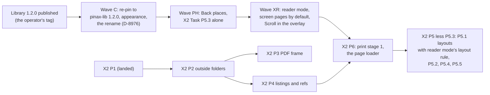

# Native Docs reader: reader mode (X6) Implementation Plan

> **For agentic workers:** REQUIRED SUB-SKILL: Use superpowers:subagent-driven-development (recommended) or superpowers:executing-plans to implement this plan task-by-task, under the dispatched `ccrc-worker` role. XR1 and XR2 are each their own run, dispatched by the coordinator; one worker never executes more than its wave. The library landing LX6 is the library programme's, built in its own repository. Steps use checkbox (`- [ ]`) syntax for tracking.

**Goal:** A Reader mode button that takes the open Docs page full screen, Kindle-like: only the text, turned one screen at a time, with a minimal overlay, one Back model and the place kept.

**Architecture:** ccrc owns the view: a reading container around the Docs screen's body that draws a fill over the console and asks for element full screen on itself, an overlay, a history place through X2's popstate dispatcher, and a screen wake lock (XR1, on the library's contract release, in continuous scroll, entering a desktop by a remount with the reader's chrome off). The library adds screen pages, in-place reading chrome, a text size and one op each way on the existing port (LX6), in the contract release if ready by its cut, otherwise the next. XR2 adopts the release that carries LX6 and drops the remount.

**Tech Stack:** TypeScript, React 19, the existing `@ccrc/ui` sheet primitive (vaul), the Fullscreen and Screen Wake Lock APIs, package-local vitest, the existing `browser (pwa)` leg (Playwright-driven Chrome), the shared library at the contract release (X1's contract and X2's history places, pinned by X1's wave C) for XR1, and at the release carrying LX6 for XR2.

**Spec:** `docs/superpowers/specs/2026-11-20-native-docs-reader-mode-design.md` (read it with this plan). Also the rich-docs spec `2026-10-12-rich-docs-reader-and-shared-renderer-design.md` §4.1, §4.4 and §5; X1's spec `2026-11-18-native-docs-appearance-continuity-design.md` §2, §6 and §10 (test 8, test 9); X2's spec `2026-11-18-native-docs-parity-design.md` §4.7 and its plan's Task P5.3; the completion plan `2026-11-07-native-docs-reader-completion.md` (Global Constraints, Task 17).

**Status:** 2026-11-20, X6 design wave (run 2847). No implementation is claimed by this document. Run ids and deviation blocks for XR1 and XR2 are issued when each opens.

**Amended 2026-11-24** (wave 41, run 3605, D-8974 and D-8975): Reader Mode now comes first, as one wave, XR, on the library's 1.2.0 release, after X1's wave C and a wave PH that builds X2's Task P5.3 alone. Read § Amendment 2026-11-24 below before the waves; where it and the rest of this plan differ, above or below it, it governs.

## Global Constraints

- Reader frame sandbox exactly `allow-scripts`; no `allow`, no `allowfullscreen` on it; shell CSP meta exactly `frame-src 'none'`; no parent-DOM access by any frame; no extra message channel; no window `message` listener anywhere in `pwa/src`; never `allow-modals`.
- The shared library by exact pin only, each release adopted with provenance, `npm audit signatures` and the import list (rich-docs §4.7). XR1 runs on the contract release exactly as X1's wave C pins it and changes no pin. XR2 adopts the release carrying LX6, unless X2's P5 or another wave already pinned it. No library repository edit from a ccrc wave.
- Both 2026-11-06 phone blocks byte for byte; production Mermaid stays on request (`E17-READING does-not-hold`).
- Tap floor `--tap-min` 44 px; the one bar 44 px tall, its title at most 61 px down with at most 48 px of it the console's (`docs-compact-head.browser.test.ts`: `TAP = 44`, `ONE_BAR_TITLE_MAX = 61`, `CONSOLE_PART_MAX = 48`); the desktop head at most 80 px (`HEAD_MAX`) and its row on one line, at 1280 by 800.
- Reader mode's values, each one constant in `pwa/src/docs/reader/readerMode.ts`: `READER_WAKE_IDLE_MS = 300000`; `READER_EXIT_SETTLE_MS = 100`; `READER_REMOUNT_QUIET_MS = 400`; `READER_LAYOUT_RULE: 'remount' | 'default-only'`, set by Task XR1.1 Step 0's measurement (spec §4.3): `'remount'` unless that measurement shows the layout remount breaks a budget.
- Reader mode reads in the default layout only (the coordinator's ruling on review 2947 F3): entering mounts the frame in `default` for its duration and leaving restores the reader's own layout; under `'default-only'`, reader mode is offered only while the default layout is active. Outside it, the desktop head and the one bar draw no Reader mode action, because the one bar has no room for a sentence. Page details shows the sentence "Reader mode reads in the default layout. Choose it here to use reader mode." beside X2's Layout row. If device row FS-9 later breaks a budget on a phone engine, the coordinator switches the constant to `'default-only'` in a follow-up, whose tests XR1 already carries. LX6's cases and AR-X6 hold for the default layout and say so. The layer token `--z-reading: 70` in `ui/src/styles/tokens.css`, between `--z-toast` (60) and `--z-block` (100).
- No new `popstate` listener (X2's `lib/popstate.ts` is the only one), no new window `keydown` listener (the command registry), no new `visibilitychange` subscription (`lib/pageClock.ts`'s `onPageVisible` and `onPageHidden`, D-7191), one hiding owner, `ui/src/lib/modal-layers.ts`, which gains `hideAsPage` and `releaseAsPage` beside `recordModalLayer` (reader mode calls no `hideOthers` of its own, and `sheet.tsx`'s lift rule is unchanged), no second progress mechanism (`readerBar.ts#createReaderProgress`).
- Fixture HOMEs only where a fixture spawns tools; `ccrc test -- <command>` for every test and typecheck, foreground, timeout at least 600000 ms; mutation runs through the coordinator's mutation runner, scratch outside the worktree.
- Public repository: neutral names only; private-name scan of every changed file and every commit message before each push.
- Each wave opens with its own run and issued deviation block; a departure found mid-wave is `D-TBD-<slug>` and reported.
- Ownership against the sibling waves: X1's wave C owns the re-pin to the contract release and the reader's prefs and appearance; X2's P5.3 owns `lib/popstate.ts`, `lib/historyPlaces.ts` and `docs/reader/places.ts`, which XR1 extends by one place kind after P5 merges; X2's P6 and P5 edit `ReaderFrame.tsx`, `DocsHead.tsx`, `docs.css` and `reader/{bridge,policy}.ts`, so XR1 and XR2 claim those files only after X1's wave C and X2's P5 and P6 have merged, and only while no other wave holds them.

## Review Focus

- The browser leaves full screen while a sheet raised from the frame is open (the external-link sheet in reader mode): reader mode ends once, the sheet stays open and usable in the normal view, and nothing is left in the hidden portal target. Owned by Task XR1.2 (`reader mode: losing full screen with a sheet open keeps the sheet usable`).
- The frame falls back to the plain view while reader mode is on (the reading remount's watchdog): reader mode ends, the fallback note shows, and the reader place is consumed, so the next Back leaves the doc and is not spent on a dead place. Owned by Task XR1.4 (`reader mode: a fallback after entering ends reader mode and consumes its place`).
- Esc or the browser's exit and a Back land together (Android Back in full screen, a double press): exactly one exit, at most one history step, the doc still shown. Owned by Task XR1.3 (`reader place: fullscreenchange and popstate in either order exit once`).
- The page is hidden and shown again (a tab switch, the phone locked) while reading: the wake lock is requested again on return if reader mode is still on; if the browser dropped full screen on the way, reader mode has ended once and the wake lock is released. Owned by Task XR1.2 (`wake lock: re-requested on visible, released when reader mode ended while hidden`).
- A rotation or a resize while reading: the place is kept and, in screen pages, the top lands on a whole line. Owned by Task XR2.3 (`screen pages: a resize keeps the place and lands on a whole line`).

---

## Waves, order and file ownership

| Wave | Tasks | Depends on | Owns (create or modify) |
|---|---|---|---|
| XR1 reader mode on the contract release, in scroll | XR1.1 to XR1.5 | X1's wave C (ccrc re-pinned to the contract release); X2's P5, P5.3's dispatcher and decider included, and P6 | `pwa/src/docs/reader/{readerMode,readerModeWords}.ts` (new), `pwa/src/docs/{useReaderMode.ts,DocsReading.tsx,ReaderModeOverlay.tsx,readerModeHandle.ts}` (new), `ui/src/lib/modal-layers.ts` (`hideAsPage`, `releaseAsPage`), `ui/src/index.ts` (those four exports), `pwa/src/command/useShortcuts.ts` (the Cmd or Ctrl+K branch), `pwa/src/screens/DocsScreen.tsx` (the container around `{body}`), `pwa/src/docs/ReaderFrame.tsx`, `pwa/src/docs/reader/{bridge,policy}.ts` (the `reading` chrome), `pwa/src/docs/DocsHead.tsx` (`ActionsRow`, `OneBarControls`), `pwa/src/docs/docs.css`, `pwa/src/command/commands.ts` and the command layer's key-holding check, `pwa/src/lib/historyPlaces.ts`, `pwa/src/lib/popstate.ts` and `pwa/src/docs/reader/places.ts` (the `reader` kind and its host slot), `ui/src/primitives/sheet.tsx` (the portal target context), `ui/src/styles/tokens.css` (`--z-reading`), rich-docs spec §4.4 (D-8805) and §5.2 (D-8831) |
| LX6 the library landing | LX6.1 to LX6.3 | the library's L1 (X1's landing), its rename and L2 (X2's landing); in the contract release if ready by its cut, otherwise the next release, and the cut never waits for it | the library's repository only: designed here (§ Library landing LX6), built by the library programme |
| XR2 reader ops, the screen pages | XR2.1 to XR2.3 | XR1; the release carrying LX6 (the contract release or the next) | `pwa/package.json` and lock (only if the contract release lacks LX6 and no other wave has pinned the release carrying it), `pwa/src/docs/reader/{bridge,policy,readerMode}.ts`, `pwa/src/docs/{ReaderFrame.tsx,ReaderModeOverlay.tsx,useReaderMode.ts}`, `pwa/src/lib/readerRenderJob.ts` (reading time), rich-docs spec §4.4 (D-8803, D-8804) |

The order is the coordinator's ruling on review 2933 F7, option (a): the library lands L1, its rename and L2, and cuts the contract release; X1's wave C re-pins ccrc to it; X2's P6 follows X1's host wave and P4, and X2's P5 then adopts the release (X2 plan's waves table); XR1 follows on it, in continuous scroll. XR1 needs that release, not a split of P5.3: its places tests use the frame's `place` op and `hash {push, from}`, which the 1.1 bridge drops. LX6 joins the contract release if ready by its cut, otherwise the next release; XR2 follows on whichever carries it. Every wave ends with the common acceptance cycle of the completion plan (exact-tip CI and CodeQL, privacy scan, review run).

*Amended 2026-11-24 (D-8974, D-8975): the table and the order above are superseded by § Amendment 2026-11-24 §2. LX6 has landed in the library, and the 1.2.0 candidate carries it, so XR1 and XR2 run as one wave, XR.*

## Acceptance row (proposed for completion Task 17)

| Row | Task 17 row | Installed action and observation | Waves |
|---|---|---|---|
| AR-X6 | Reader mode | On the installed release carrying XR2, in the default layout (reader mode switches to it for its duration, and the other four layouts are never reached in reader mode; one entry from `review` checks the switch and the return, or, under `default-only`, the note): open a spec on a phone (412 by 915, in the browser and installed) and on a desktop (1280 by 800 and 1920 by 1080). Enter by the button and by `r`. Only the text remains. (After XR1 alone, the text scrolls and two small controls stay over its top corners, ccrc's menu control and the reader's own Aa, spec §4.2; the row is run in full after XR2.) Turn forward and back by a side tap, a swipe and the arrow keys; every turn lands on a whole line; a link, a selection and a Render button never turn; a wide table scrolls under a swipe. Switch to Scroll and back. A tap at the top shows the percentage, the time left, Aa and Exit. Leave by Esc, Back (Android Back, iOS swipe), Exit and the browser's own exit, each once. Reopen the doc: the place is kept. The screen stays on while reading and sleeps after the idle release. An external link's sheet shows inside reader mode. Every control meets 44 px. Device rows FS-1 to FS-10 (spec §4.4) recorded per engine | XR1, XR2 |

*Amended 2026-11-24 (D-8975): the row's text stands. It is run after wave XR, which carries XR1 and XR2 together, so "the release carrying XR2" is the release carrying XR, and its parenthesis "(After XR1 alone, …)" describes no shipped state. Its layout clause ("one entry from `review` checks the switch and the return, or, under `default-only`, the note") and device row FS-9 move to X2's P5.1, which brings the layouts; FS-10 is recorded against the overlay's Aa. § Amendment 2026-11-24 §5 says when Reader Mode is done.*

---

## Amendment 2026-11-24: Reader Mode first (wave 41, run 3605)

The operator's priority of 2026-11-24: Reader Mode in the console comes first. This section changes the order and the shape of the waves above. It changes no wall, op, decider or test unless a row below says so. The rest of the plan, above and below this section (the task bodies and the mutation rows included), stays as the dispatched record, and where the two differ, this section governs. D-8974 and D-8975 are defined at its end. D-8976, the library's new package name, is defined in X1's plan (`2026-11-18-native-docs-appearance-continuity.md`, its amendment of the same date).

### What was verified first

Each of the brief's three statements about the library holds. They were read as git objects of the library's repository (now `Synapsium-Labs/pinax-lib`) at `996a39b2602d2e1e636c54c95cc9e403fe55cf88`. That commit is the versioned 1.2.0 candidate of the package `@synapsium-labs/pinax-lib`, not yet tagged or published.

| Statement | Where, at that commit | Holds |
|---|---|---|
| The appearance contract | `appearance` in `FRAME_ACCEPTS`, `PARENT_OPS` and `OP_KEYS` (`src/frame/protocol.ts`); `parseAppearance` (`src/enhance/appearance.ts`), exported from `./frame` | Yes |
| The frame's `place` op and `hash {push, from}` | `place` in `FRAME_OPS`, `OP_KEYS.place = ['t', 'kind']`; `OP_KEYS.hash = ['t', 'id', 'push', 'from']`; both sent only to a seed with `bridge.places`, which `onPlace` sets (`src/host/mount.ts`, `src/frame-runtime/adapters.ts`) | Yes |
| LX6 | `reading` in `FRAME_ACCEPTS` (`READING_MODES`: `screens`, `scroll`, `off`); `reader` in `FRAME_OPS` (`READER_ACTS`: `menu`, `exit`, `toggle`, `active`); `BRIDGE_LIMITS.readerWindowMs` 250 and `readerActiveMs` 60000; `HostAdapters.onReader`; `DocFrame.setReading`; screen pages (`src/enhance/pages.ts`); `size` (`s`, `m`, `l`, `xl`) in enhance's own prefs; `meta.readingMinutes` | Yes |

The library's changelog entry for 1.2.0 adds three facts this section relies on:
- while a reading mode is on, the `settings` command still opens the frame's settings menu;
- `setReading` is replayed at the ready of that `DocFrame`'s own later mounts, and is "not a paint guarantee: a mount that leaves chrome out cannot restore it in place" (the ledger's LX6 outcome records this as the library's D-8950);
- the 1.2.0 assets' hashes, which `assets/assets.json` records at that commit.

### 1. The smallest slice: what reader mode consumes from P5 and P6

Traced against X2's plan (`2026-11-18-native-docs-parity.md`) and `main` at `2b5b5e32a6`. On `main`, X2's P1 has landed and none of P2 to P6 has: `pwa/src/lib/popstate.ts`, `pwa/src/lib/historyPlaces.ts`, `pwa/src/docs/reader/places.ts`, `pwa/src/docs/print/` and `pwa/src/lib/printAllow.ts` are all absent. X1's wave C has not landed either: `pwa/package.json` still pins the old package at 1.1.0.

| What reader mode consumes | Named in | Comes from | Needs P2, P4, P6 or the rest of P5? |
|---|---|---|---|
| The one `popstate` dispatcher and `onPop`, with the router's, `useReaderOnly`'s and the release gate's listeners moved onto it | Global Constraints, XR1.3 | P5.3 (`lib/popstate.ts`, `lib/router.ts`, `docs/readerHistory.ts`, `lib/swupdate.ts`) | No |
| The pop decider `decidePop` and its answers (`close-overlay`, `goto`, `consume`, `skip`, `router`) | XR1.3 | P5.3 (`lib/historyPlaces.ts`) | No |
| The place host, `setPlaceHost`, beside which XR1.3 adds the reader host | XR1.3 | P5.3 (`lib/popstate.ts`) | No |
| The tab record (`visit`, `doc`, `places`, `pendingSeq`, `lastIdx`, `next`), `docsIdx` on every entry, and `PLACES_MAX = 20` (amended 2026-11-26; D-9139: was 50) | XR1.3 | P5.3 | No |
| The place push in `docs/reader/places.ts`, to which XR1.3 adds the drop of recorded places above `lastIdx` | XR1.3 | P5.3 | No |
| The frame's `place` (`overlay`, `overlay-closed`) and a `hash` with `push` reaching ccrc: `onPlace` and the two-argument `onHash`, passed by the bridge | XR1.3; XR1.4 (wake-lock activity) | P5.3's wiring in `ReaderFrame.tsx` and `reader/bridge.ts` | No. It needs the library at 1.2.0, which is wave C's pin |
| `close-overlay` sent on the step-back's pop | XR1.3 | P5.3, through `DocFrame.closeOverlay()`, which 1.2.0 adds (the shipped 1.1.0's `COMMAND_OPS` has only the four tools) | No. It needs wave C's pin, like the places |
| `ReaderLayout`, the five layouts and the Layout row in Page details | XR1.1 (`readerModeOffered`), XR1.4 (`remount({chrome, layout})`), XR1.5 (the note) | P5.1 | Only for the layout rule, which has nothing to decide while the console mounts the default layout alone. The rule moves to P5.1 (D-8975) |
| The library at a release carrying the contract, the places and LX6 | Global Constraints | Wave C's re-pin (X1's Task 1), not P5.1 | No |
| `lib/pageClock.ts` (`onPageVisible`, `onPageHidden`, `onWindowBlur`), `modal-layers.ts#recordModalLayer`, `readerBar.ts#createReaderProgress`, `ReaderMount.command`, `readerMountPlan` and `ReaderChrome` | XR1.2, XR1.4 | Already on `main` | No |
| Print, the page loader, `docs.css`'s print rules, `DocsHead.tsx`'s Print row | none | P6 | No. P6 shares files with reader mode (`ReaderFrame.tsx`, `DocsHead.tsx`, `docs.css`). "P6 before P5" only serialised those edits, and claims serialise them just as well |
| Tracker links, reading-layer flags, print stage 2 | none | P5.2, P5.4, P5.5 | No |

So the slice is X2's Task P5.3 alone, as its plan writes it, on wave C's pin. Its real dependencies are three:
- the frame's `place` op and `hash {push, from}` exist only from the 1.2.0 release, so the slice waits for wave C;
- the one dispatcher, decider, place host and tab record are what XR1.3 extends;
- `ReaderFrame.tsx` and `reader/bridge.ts` are edited in turn by P5.3, reader mode, and later P6 and P5.1, each under its own claim.

### 2. The new order

*Figure A1. The order from 2026-11-24. Start at the library's release. Wave C re-pins ccrc to 1.2.0, wave PH builds Back places on it, and wave XR builds reader mode on PH. The rest of X2 follows, and P5.1, which brings the layouts, takes reader mode's layout rule. P2 to P4 touch no reader host file except P2.4's truth line, so they may run beside C, PH and XR under claims.*

**A scroll-only XR1 is no longer worth shipping apart from XR2.** 1.2.0 carries LX6, so one wave delivers screen pages as the default, with continuous scroll kept as the reader's own choice. The reasons:
- XR2.1 removes every part that only XR1 needs: the `reading` chrome and the desktop remount with its 400 ms quiet wait, the corner menu control, the frame's own Aa in reader mode and the window-blur hide. The plan's own retirement list names nine mutation rows built for them (X6.21, X6.25, X6.35, X6.54, X6.55, X6.56, X6.66, X6.68, X6.69). Wave XR keeps X6.25's guard with its test reworded, and adds X6.73 to the rows never built (below).
- The remount is a frame swap of 0.2 to 1.4 s (lab E4) and resets the changed-since notice, the open folds and the drawn figures. The in-place `reading` op keeps all of them.
- Screen pages are the operator's answer to ask 656. Scroll-only first would ship the reading model that was not chosen, as the default.
- XR alone is smaller than XR1 and XR2 together, because the parts XR2 removes are never built.

**Where the Scroll choice lives.** The choice of Pages or Scroll stays where XR2.2 puts it: a switch in reader mode's overlay, remembered per device, with Pages as the default. Nothing is added to the Settings screen. The Settings audit (`docs/superpowers/specs/2026-11-22-settings-audit.md`) keeps three pages (Appearance, Security, Updates) and lists per-device view state as "remembered toggles, not settings". The switch is such a toggle, beside the reading it changes. Ask 656's "scroll kept as a reader setting" is that switch. The text size is the frame's own (LX6.3, in its Aa menu, which the overlay's Aa opens).

#### Wave C: X1's Tasks 1 to 7, on 1.2.0

| | |
|---|---|
| Tasks | X1's Tasks 1 to 7 as written, on 1.2.0. Task 1 also takes the rename (D-8976): every import, test and script reference in §3 below moves in Task 1's first commit, before Tasks 2 to 7, and only what needs the registry waits for the wave's last commit (§4) |
| Files | X1's "File ownership (wave C)" table, and the rename's files (§3) |
| Tests | As written. The rename edits the existing pins: `reader-pin.test.ts` (name, version, `resolved`), `server/test/ci-pipeline.test.ts` (the provenance step's repository, signer, lock key and pack name), `server/test/docs-parity.test.ts` (M79's specifier rule) |
| Mutation rows | X1's rows as written. The rename adds none: each renamed line is already pinned by an existing test, which a revert reds |
| Depends on | The 1.2.0 publication, for its pull request only (§4) |
| Overlap | None with PR #3138 (X3's R1: server review files, `shared/docs.ts`, `pwa/src/docs/export/policy.ts`, docs). None with the live claims measured on 2026-11-24 |

#### Wave PH: Back places, X2's Task P5.3 alone (D-8974)

| | |
|---|---|
| Tasks | P5.3 Steps 0 to 6 as written: lab E16 per engine first, the characterization commit for `router-location.test.tsx` and `reload-on-move.test.ts`, then the places. It carries the programme ledger's P5.3 items (the forward-skip trap with `lastIdx` updated on a skip, case 8b of `reader-history-adapter.test.tsx`, M11.73 extended, A1's skip-loop bound and counter seeding) |
| Files | P5.3's Files, and from P5's row the two it needs: `pwa/src/docs/reader/bridge.ts` (pass `onPlace`, take `onHash`'s second argument) with `pwa/test/reader-bridge.test.ts`; rich-docs §4.4 (D-8763). `onPlace` rides input presence in `bridge.ts`: the library's adapter is optional, and passing it is what sets the seed's `bridge.places`, so `reader/policy.ts` is not needed |
| Tests | P5.3's Step 1 list, and `reader-places` in the browser leg |
| Mutation rows | M11.27, M11.28, M11.29, M11.30, M11.49, M11.57, M11.63, M11.64, M11.73 |
| Depends on | Wave C merged. It may be built ahead on a workspace cut from wave C's branch (before publication, C has no accepted tip), and absorbs `main` once C has merged; its pull request opens after C's merge |
| Overlap | None with PR #3138. None with the live claims measured on 2026-11-24 |

#### Wave XR: reader mode, XR1 and XR2 as one wave (D-8975)

The task ids are kept, so every row and test above stays traceable.

| Task | In wave XR |
|---|---|
| XR1.1 | As written, with three changes. `readerModeOffered` takes no `layout` or `rule`, and `readerModeLayoutNote`, `READER_LAYOUT_RULE` and `READER_REMOUNT_QUIET_MS` are not defined here (all to P5.1). `readerModeStep` gains XR2.1's events `frame-exit` and `frame-toggle`. Step 0 re-reads the facts on the installed 1.2.0, LX6's included: `setReading` hides and restores the chrome in place with the same nonce; `onReader`'s acts and their pacing; the `settings` command while reading; `r` and Esc. Its layout measurement moves to P5.1. M-3, M-4 and M-7's frame half stay. The row `offered: under remount, …` moves to P5.1 |
| XR1.2 | As written, with one change: `ReaderModeContext.setFrame` takes `{ ready, focus() }` and the mount's `setReading`, with no `remount` and no `layout`. `ReaderLayout` does not exist until P5.1, which adds both back with the layout rule. And the focus wrap: while reader mode is on and no ccrc control is drawn (the overlay hidden), the leading focus guard sends focus to the frame, not to the last ccrc control. This is the coordinator's ruling on review 3626 A3, a consequence of D-8975: the menu control that held that place in XR1 is never built. Browser row `focus: with the overlay hidden, Shift+Tab out of the frame's first control returns focus to the frame`; mutation row X6.77 |
| XR1.3 | As written, on wave PH. The row `reader place: a Back during the desktop remount still exits` reads `reader place: a Back during a same-document remount still exits` (a new commit, or `openAt`): entering no longer remounts |
| XR1.4 | XR2.1's in-place mount replaces XR1.4's remount. Not built: the `reading` chrome, `ReaderMount.remount`, `ReaderModeMenuControl`, the window-blur subscription. The overlay is XR2's: a top strip with the title only, a bottom strip with Exit, the turn switch and Aa (`onAa` hides the overlay and its layer, then sends `command settings`), and the clear layer between them; `onReader` and `setReading`. Kept from XR1.4: `onProgress` on every production mount (D-8805), `ReaderMount.focus()`, a changed share and the frame's figure places counted as activity, the fallback reaching the context, and Step 5's amendments (D-8805, D-8831) beside XR2.1's Step 5 (D-8803, D-8804). `readerMountPlan` takes reader mode's state: a mount made while it is on is sent `setReading` with the turn before its ready, because each of ccrc's mounts is a new `DocFrame` and the library replays only within one. XR2.1's Step 0 is not run: wave C has already pinned 1.2.0 |
| XR1.5 | As written, less its `default-only` rows (to P5.1) |
| XR2.1 | Folded into XR1.4 above, as written, with three exceptions. Step 0 is not run, and its package files are not touched. `remount` is not kept for a layout switch, which comes with P5.1: the Files clause "`remount` kept only for the layout switch" and the parenthesis of `reader ops: entering sends setReading with the stored turn and remounts nothing` ("from another layout …") move to P5.1. The row `reader ops: with the frame accepting reader, ccrc's menu control is not drawn` is dropped, because the control is never built |
| XR2.2 | As written |
| XR2.3 | As written |

- **XR1.4's tests in XR:** `every production mount asks for progress, the lab's does not`; `focus: the frame is focused after entering and after leaving` (reworded: entering no longer makes a new mount); `reader mode: a fallback after entering ends reader mode and consumes its place`; the three `wake lock:` rows; `overlay: hidden on entry, a menu act shows it, Esc on it hides it and returns focus to the frame`; `overlay: Exit leaves reader mode`; `overlay: a tap on the layer outside it hides it and does nothing else`; `overlay: nothing hides it on a timer`; `overlay: an Esc that closes a sheet in reader mode neither hides the overlay nor leaves reader mode`; `overlay: the percentage follows progress, at most once a second`; `overlay: every control is at least the tap floor`; and one new row, `mount plan: a mount made while reader mode is on is sent setReading with the turn before its ready`. With them, XR2.1's Step 1 list as written, less the row it drops.
- **XR1.4's browser rows in XR:** none of them is run. Five name the menu control or the frame's Aa while the overlay shows, and are never built: `menu control: the frame's Aa is uncovered …`, `menu control: a drag that starts at the frame's top centre …`, `overlay: while shown, the frame's Aa corner is uncovered`, `overlay: Exit never sits where the menu control was`, `overlay: a click on the frame's Aa while shown …`. `overlay: Exit is the strip's rightmost control, left of the frame's Aa corner` is replaced by XR2.1's own row for the bottom strip (`reader ops: the top strip holds no control …`, X6.74). XR2.1's browser row and XR2.3's rows stand.
- **Two rows the programme's definition of done needs** (review 3626; the gap is older than this amendment, and wave XR closes it):
  - `reader mode: a new mount made while reader mode is on paints its first frame with the reader's chrome hidden`. Browser, a same-document remount at 412 by 915 and at 1280 by 800, sampled on every animation frame from the new frame's first paint. `setReading`'s replay at ready is not a paint guarantee, so where it fails, XR keeps the new mount under the reading ground until its `ready` has applied the turn. That stays inside the existing container, with nothing widened.
  - `reader mode: leaving after a same-document remount sends off to the new mount, never to the destroyed one`. jsdom, through the mount's real path. Mutation row X6.78.
- **A Docs page in its own tab** (the coordinator's addendum to fix round 1, 2026-11-24): a Docs page can open in a browser tab of its own at desk width, with no console around the reader and no history entry before it. Browser row, XR1.3's: `reader place: on a Docs page that is the first history entry in its own tab, entering reader mode, then Exit, and again Back, each leave reader mode and stay on the document, and no entry before the page is consumed`, at 1280 by 800, checking `history.length` and the URL after each. Mutation row X6.79.
- **Mutation rows built in XR:** every row whose task is XR1.1, XR1.2, XR1.3, XR1.5, XR2.1 or XR2.2, less those moved below. Of XR1.4's rows: X6.24, X6.36, X6.43, X6.49, X6.53, X6.64 and X6.67, and X6.25 with its test reworded as above. X6.20's red test is renamed with XR1.3's row: `reader place: a Back during a same-document remount still exits`.
- **Never built, their mechanism never ships:** X6.21, X6.35, X6.54, X6.55, X6.56, X6.66, X6.68, X6.69 and X6.73.
- **Moved to P5.1 (D-8975):** X6.22, X6.23, X6.59, X6.60, X6.70.
- **New:** X6.76, X6.77, X6.78 and X6.79 (below).
- **Files:** XR1's row and XR2's row of the waves table, less `pwa/package.json` and its lock, `reader-pin.test.ts`, `reader-assets.test.ts` and `frame-cost.browser.test.ts` (wave C pinned the release and took the BASE), and with `pwa/test/reader-mode-overlay.test.tsx` and `pwa/test/w7-storage-keys.test.ts` (XR2.2).
- **Depends on:** wave PH merged, and so wave C.
- **Overlap:** none with PR #3138. With the live claims measured on 2026-11-24, one file: `ui/src/index.ts` (XR1.2's four exports), held by a desktop-polish fix round. XR claims it at dispatch and asks the holder by mail if it is still held.
- **Overlap, the Docs tab view:** the tab view of the row above belongs to the Desktop polish programme. It does not edit the Docs head or the reader frame, and wave XR absorbs it from main.

| Row | Task | Mutation | Red test |
|---|---|---|---|
| X6.76 | XR1.4 | A mount made while reader mode is on is not sent `setReading` | mount plan: a mount made while reader mode is on is sent setReading with the turn before its ready |
| X6.77 | XR1.2 | The leading focus guard sends focus to the last ccrc control even when none is drawn | focus: with the overlay hidden, Shift+Tab out of the frame's first control returns focus to the frame (browser) |
| X6.78 | XR1.4 | Leaving sends `off` to the mount reader mode was entered on, not to the current one | reader mode: leaving after a same-document remount sends off to the new mount, never to the destroyed one |
| X6.79 | XR1.3 | `stepBelowReaderPlace` steps one entry further than the reader place (`n` plus 1) | reader place: on a Docs page that is the first history entry in its own tab, entering reader mode, then Exit, and again Back, each leave reader mode and stay on the document, and no entry before the page is consumed (browser) |

#### The rest of X2, after XR

- **P2, P3 and P4** keep their order and may run beside C, PH and XR: they touch no reader host file, except P2.4's truth line in `DocsHead.tsx`, which is serialised by claim (XR1.5 edits the same file). They share two other files with wave C: `pwa/package.json` and its lock (P3.1 adds `pdfjs-dist`) and `server/test/docs-parity.test.ts` (P2.1's `H.VERBS` case, beside the M79 rename). A claim serialises each.
- **P6**, as written, after XR and P4.
- **P5, less P5.3**, as written, after P6. P5.1 no longer pins the library, because wave C did: it takes the layouts, and with them reader mode's layout rule (D-8975). That means XR1.1 Step 0's layout measurement, `READER_LAYOUT_RULE`, `readerModeOffered`'s `layout` and `rule` inputs, `readerModeLayoutNote`, the remount into `default` on entry and back on exit with `READER_REMOUNT_QUIET_MS` and no opening hash, the Page details note, the rows `offered: under remount, …`, `remount: entering from review …`, `remount: under default-only …`, `remount: the same document, no body read, no initialHash`, `remount: waits 400 ms after the last progress message` and the `default-only` rows of XR1.5, mutation rows X6.22, X6.23, X6.59, X6.60 and X6.70, device row FS-9, and AR-X6's layout clause. It also takes the rule that a same-document remount made while reader mode is on (a new commit, or `openAt`) is planned in the default layout, whatever the stored layout pref: X6.68's layout half, whose chrome half never ships.
- **The HTML-artifacts plan's wave A5** (`2026-11-19-native-docs-html-artifacts.md`) still waits for P6, so under this order it lands later, after XR.

### 3. The rename

The package is now `@synapsium-labs/pinax-lib` and the repository `Synapsium-Labs/pinax-lib`; the console still pins `@synapsium-labs/docserver` at 1.1.0. Every file outside `docs/` that names the old package or repository, measured on `main` at `2b5b5e32a6` with `git grep`, goes to **wave C's Task 1** (D-8976), split by what each change needs:
- **Task 1's first commit, on the branch as it is built.** Every import, test and script reference moves here, ahead of Tasks 2 to 7 and of PH. The built-ahead tarball installs under the new name, so code left on the old name would resolve to the locked 1.1.0, which has neither the contract nor the places.
- **The wave's last commit (§4).** Only what needs the registry waits: the package file's dependency, the lock, and the pin and asset tests' literals.

| File | What names the old package or repository |
|---|---|
| `pwa/package.json` | The dependency `"@synapsium-labs/docserver": "1.1.0"` (last commit) |
| `pwa/package-lock.json` | The root dependency and the `node_modules/@synapsium-labs/docserver` entry (`resolved`, `integrity`), re-taken from the registry (last commit) |
| `pwa/src/docs/reader/assets.ts` | A type import of `./frame` and five `?raw` imports of assets |
| `pwa/src/docs/reader/bridge.ts` | Imports of `./frame` and `./host` |
| `pwa/src/docs/reader/labPolicy.ts` | An import of `./frame` |
| `pwa/src/lib/readerRenderJob.ts` | An import of `./render` |
| `pwa/test/docs-scans.test.ts` | `LIBRARY`, the allowed edges and the planted specifiers |
| `pwa/test/markdown-purity.test.ts` | `ALLOWED_PACKAGES`' `…/render` |
| `pwa/test/reader-pin.test.ts` | `LIB` and its title (first commit); the version and the `resolved` prefix, `…/pinax-lib/-/pinax-lib-1.2.0.tgz` (last commit) |
| `pwa/test/reader-assets.test.ts`, `reader-bridge.test.ts`, `reader-built.test.ts`, `reader-diff.test.ts`, `reader-images.test.ts`, `reader-lab-bridge.test.ts`, `reader-lab-frames.test.ts`, `reader-policy.test.ts`, `reader-commands.test-d.ts`, `reader-history-types.test-d.ts` | Imports of the library's entry points, `reader-assets`' built specifiers (its hash rows in the last commit), and in `reader-images.test.ts` a deep import of the installed package's `dist/frame/seed.js` |
| `pwa/test/w7-storage-keys.test.ts` | An import of `./frame`, and a path to the package's `dist/host` joined from separate segments (`'@synapsium-labs', 'docserver', …`), which a search for the whole path string misses |
| `pwa/browser/reader-frame.browser.test.ts` | An import of `./frame` and the path `node_modules/@synapsium-labs/docserver/assets/frame/bootstrap.js` |
| `.github/ci/library-provenance.sh` | `REPO`, `SIGNER` (`…/.github/workflows/release.yml`), the lock key, the `npm pack` spec, the tarball's name and the closing line |
| `server/test/ci-pipeline.test.ts` | The pins of those lines, the fake lock and tarball, the expected log lines, and the scan for the signer's holders |
| `server/test/docs-parity.test.ts` | M79's specifier rule and its planted cases, the near-miss cases (`@synapsium-labs/docserverx`, `@other/docserver`) included |

Not renamed:
- the lines that name the standalone docs server, the operator's own tool, rather than the library: `CLAUDE.md`, `ccd/ccrc`, `ccd/ccrc-doctor-checks`, `server/test/ccrc-doctor-exposure.test.ts` and `server/test/ccrc-memory.test.ts`;
- the dated plans and specs under `docs/`, which are the record. Their instructions for later waves are amended by this wave's dated notes.

### 4. Building ahead of publication

This is analysis only. This wave packs and installs nothing.

**What can be built before publication.** Wave C, and PH on wave C's branch, can be built and tested on worker branches against a tarball packed from the verified commit. The console reads the library only through its package's entry points and frame assets. At `996a39b2…` the frame assets' hashes are committed (`assets/assets.json`), and the library's `prepack` (`scripts/verify-assets.mjs`) refuses a pack whose built assets differ from them. The worker:
1. exports `996a39b2…` from the library's repository into its session temp root (`git archive`, never a checkout of the library's working tree);
2. runs the library's `npm ci` and `npm run build`, then `npm pack`;
3. records the tarball's sha512 and every asset hash in Results;
4. installs it into its worktree's `node_modules` with `npm install --no-save`, which writes neither `package.json` nor the lock.

That install is of a package that is not from the registry, so it needs the coordinator's word at dispatch. The pressure reclaim deletes scratch older than 14 days, so the recorded digest is what lets a later worker pack the same bytes again. With Task 1's rename commit in place, the typecheck, the unit suites and the browser leg run against the 1.2.0 code. `reader-pin.test.ts` and `library-provenance.sh` fail there by design until the pin commit, and nothing edits them to pass.

**What waits for the registry.** These, and only these, go in the wave's last commit, which only the published release can make. Every import, test and script reference was renamed in Task 1's first commit (§3):
- the exact pin `1.2.0` in `pwa/package.json`;
- the lock's `resolved` (the registry's address) and `integrity` (the registry tarball's sha512, which a local pack need not match);
- `reader-pin.test.ts`'s and `reader-assets.test.ts`'s literals, read from the installed package;
- the provenance check: `library-provenance.sh` against the registry's attestation;
- `npm audit signatures`.

No `file:` spec, no tarball and no weakened pin or provenance check is ever committed.

**The exact condition that holds the pull request.** The branch is pushed and its pull request opened only when all of these hold, checked in this order:
1. `@synapsium-labs/pinax-lib@1.2.0` resolves on the public registry.
2. `v1.2.0` is a signed annotated tag on `996a39b2602d2e1e636c54c95cc9e403fe55cf88`.
3. The provenance step, renamed in Task 1's first commit, verifies the registry tarball's attestation: repository `Synapsium-Labs/pinax-lib`, signer workflow `Synapsium-Labs/pinax-lib/.github/workflows/release.yml`, source ref `refs/tags/v1.2.0`. The worker reads both names from the published attestation and checks that they equal the step's. Any other value stops the wave.
4. `npm audit signatures` is clean.
5. The installed package's `assets/assets.json` equals the one at `996a39b2…`, hash for hash. If not, the branch was built against other bytes: the wave's suites run again at the registry pin before the push.
6. The last commit (the pin, the lock, and the pin and asset tests' literals) is the branch's last, and the wave's own checks pass on it. The import list (rich-docs §4.7, M8.10) was read at Task 1 Step 1, per X1's amendment.

Then the worker pushes once and the common acceptance cycle runs on the exact tip. Wave PH's pull request opens after wave C's merges, and wave XR's after PH's.

### 5. When Reader Mode is done

Reader Mode is done when all three hold:
- wave XR has merged through the common acceptance cycle: exact-tip CI and CodeQL, the privacy scan, and a held-out review run before the landing;
- a release carrying XR is installed;
- AR-X6 passes on that release as written, with two exceptions, both defined by D-8975. Its layout clause, and device row FS-9 with it, is run at P5.1's acceptance, because until P5.1 the console mounts only the default layout, so there is no layout to enter from. FS-10 is recorded against the overlay's Aa, the only Aa on screen in reader mode from XR on; its pass words hold for it unchanged.

That is Reader Mode's own definition of done; this wave's acceptance is the review of this amendment. No setting is added.

### Deviations defined by this amendment

The plan's `## Deviations found` stays as it was; these two are defined here, as issued to this run.

- **D-8974 (2026-11-24)** — reader-mode-first. Reader mode moves ahead of X2's P2, P4, P6 and the rest of P5. The order becomes wave C, then wave PH (X2's Task P5.3 alone), then wave XR, then the rest of X2 (§2). It departs from three texts:
  - the order this plan records from the coordinator's ruling on review 2933 F7, option (a): "X2's P6 follows X1's host wave and P4, and X2's P5 then adopts the release (X2 plan's waves table); XR1 follows on it";
  - this plan's ownership constraint: "XR1 and XR2 claim those files only after X1's wave C and X2's P5 and P6 have merged";
  - X2's waves table and its Figure 7, where P5 is one wave, after P6, and last.

  Argued: the operator's priority of 2026-11-24. F7 did not split P5.3 because of the library release, and the 1.2.0 candidate now carries the places, the contract and LX6 (verified above). Reader mode needs P5.3 alone (§1), and "P6 before P5" only serialised shared files, which claims serialise as well. Issued to run 3605 (wave 41), block 8974 to 8976.
- **D-8975 (2026-11-24)** — reader-mode-one-wave. XR1 and XR2 run as one wave, XR, on 1.2.0, with screen pages the default from its first release. XR1's interim parts are never built: the `reading` chrome remount, the corner menu control, the frame's own Aa in reader mode and the window-blur hide. R21's layout rule moves to X2's P5.1, which brings the layouts, and with it AR-X6's layout clause and device row FS-9 (§2, §5). FS-10 is recorded against the overlay's Aa. It departs from this plan's waves table, its acceptance row's Waves column (XR1, XR2) and its Global Constraints on `READER_LAYOUT_RULE`, and from the design's R16, R20 and §7.5.

  Argued:
  - with LX6 in the same release, XR1's interim parts would be built only for XR2.1 to remove them: nine mutation rows by the plan's own list;
  - the remount costs a 0.2 to 1.4 s frame swap and resets the notice, folds and figures, which the in-place op keeps;
  - screen pages are the operator's answer to ask 656;
  - before P5.1 the console mounts only the default layout, so the layout rule has nothing to decide and AR-X6's entry from `review` cannot be run.

  Issued to run 3605.

## Wave XR1: reader mode on the contract release, in continuous scroll

### Task XR1.1: The decisions (L1), and the measurements first

**Files:** Create `pwa/src/docs/reader/readerMode.ts`, `pwa/src/docs/reader/readerModeWords.ts`; Test `pwa/test/reader-mode-policy.test.ts` (new), browser `pwa/browser/reader-mode-lab.browser.test.ts` (new); `server/test/single-definition/docs-ring.test.ts` if it lists `docs/reader/*` modules by ring.

**Interfaces:**
- Produces:
  - `type ReaderTurn = 'screens' | 'scroll'`
  - `type ReaderModeHow = 'full-screen' | 'fill'`
  - `type ReaderModeState = { on: false } | { on: true; doc: string; how: ReaderModeHow; overlay: boolean; placed: boolean }`
  - `type ReaderModeEvent = { kind: 'enter'; doc: string; activation: boolean; fullscreenEnabled: boolean; placeFree: boolean } | { kind: 'full-screen-granted' } | { kind: 'full-screen-refused' } | { kind: 'full-screen-lost' } | { kind: 'settled'; landedBelow: boolean } | { kind: 'esc' } | { kind: 'exit-tap' } | { kind: 'key' } | { kind: 'place-popped' } | { kind: 'doc-changed'; doc: string } | { kind: 'fallback' } | { kind: 'block' } | { kind: 'menu' } | { kind: 'dismiss' }` (`menu` toggles the overlay; `dismiss`, a tap on the layer outside it or focus entering the frame, only hides it)
  - `type ReaderModeAct = 'draw-fill' | 'push-place' | 'request-full-screen' | 'exit-full-screen' | 'clear-fill' | 'await-settle' | 'step-back' | 'focus-frame' | 'hide-console' | 'show-console' | 'toggle-overlay' | 'announce'`
  - `readerModeStep(state: ReaderModeState, event: ReaderModeEvent): { state: ReaderModeState; acts: readonly ReaderModeAct[] }`
  - `readerModeOffered(input: { frameReady: boolean; plainView: boolean; modalMounted: boolean; layout: ReaderLayout; rule: 'remount' | 'default-only' }): boolean`, with X2's `ReaderLayout`; under `'default-only'` it is false outside `default`; `readerModeLayoutNote(input: { layout: ReaderLayout; rule: 'remount' | 'default-only' }): string | null`, the fallback's sentence or null; `modalMounted` is true while any `[role="dialog"]` is in the document, open or still animating closed, so reader mode never starts its hiding under a modal layer (spec §4.1)
  - `wakeLockWanted(input: { on: boolean; visible: boolean; lastActivityMs: number; nowMs: number }): boolean`, the one wake-lock decider, re-read on every state change
  - `timeLeftMinutes(readingMinutes: number, share: number): number` (unrounded)
  - `READER_WAKE_IDLE_MS = 300000`, `READER_EXIT_SETTLE_MS = 100`, `READER_REMOUNT_QUIET_MS = 400`
  - In `readerModeWords.ts`: `READER_MODE_TEXT` (`enter: 'Reader mode'`, `exit: 'Exit reader mode'`, `live: 'Reader mode. Back or Exit leaves it.'`, `toolbar: 'Reader mode'`, `menu: 'Reader mode menu'`) and `timeLeftText(minutes: number): string` (`'less than a minute left'` below 1, else `'about N min left'` with N rounded).

- [ ] **Step 0: Measure before any code (spec §1, §4.5).** First re-read, from the installed contract release's `dist/`, the facts spec §1.1 took from 1.1.0, and record each in Results with the file read: the chrome keys and that they are read at mount; that `settings: false` unregisters the `settings` command; the keys the frame binds; `progress` and its 250 ms window; `pos` and that `initialHash` wins over it; the frame's Aa (`.aa-wrap`) and where it draws with the bar off. If any differs from spec §1.1, stop and report it with the release's text before writing code. All of these are read in the `default` layout. Next, measure the layout rule (spec §4.3) in the browser leg at 412 by 915: enter from `review` and from `guided`, and record the remount's cost (X2 spec §4.2 already says a layout change remounts the frame): its time (five runs, the worst against lab E4's 1.4 s), and whether the one bar's budgets (`TAP`, `ONE_BAR_TITLE_MAX`, `CONSOLE_PART_MAX`) hold after the return and no figure is drawn without a request. Set `READER_LAYOUT_RULE` to `'default-only'` if any breaks, otherwise `'remount'`, and record the reading and the choice in Results; the phones' half is device row FS-9. Then, in `pwa/browser/reader-mode-lab.browser.test.ts`, against a page of the built PWA with a ready reader frame and a wrapper around its host: M-3 (inside the frame, `document.fullscreenEnabled` is false and `requestFullscreen` rejects), M-4 (with the wrapper full screen and the frame focused, `?` opens the library's keys sheet), and M-7's frame half (`navigator.wakeLock` absent or refused inside the frame). Record each as a line in Results. M-1's refusal without activation and M-5's Esc are the device item's (FS-8, FS-5): Playwright evaluates with a gesture and headless Chrome owns no Esc. If M-3 shows the frame CAN enter full screen, stop and report: the sandbox reading is wrong.
- [ ] **Step 1: Failing tests** in `reader-mode-policy.test.ts`: `reader mode: enter draws the fill, pushes the place, then requests full screen, hides the console, focuses the frame and announces, in that order` (acts equal `['draw-fill','push-place','request-full-screen','hide-console','focus-frame','announce']`); `reader mode: enter without fullscreenEnabled draws the fill and never requests full screen`; `reader mode: enter without activation draws the fill alone`; `reader mode: enter with the place budget spent opens unplaced`; `reader mode: a refusal keeps reader mode on as fill`; `reader mode: losing full screen exits and awaits the settle before stepping back`; `reader mode: settled after a pop landed below steps nothing, otherwise steps back once`; `reader mode: a popped place exits without stepping back`; `reader mode: Exit and r each step back exactly once` (table); `reader mode: esc hides the overlay and focuses the frame, and never exits` (the `esc` event is Esc on ccrc's overlay; Esc in browser full screen arrives as `full-screen-lost`); `reader mode: an unplaced exit steps back nothing`; `reader mode: every exit shows the console and focuses the frame, and no exit closes the frame's overlay itself` (the step-back's pop does, XR1.3); `reader mode: a place popped after an exit is a no-op`; `reader mode: a doc change exits and steps back nothing`; `reader mode: a fallback exits and steps back once`; `reader mode: a block exits full screen and reader mode`; `reader mode: menu toggles the overlay`; `reader mode: dismiss hides a shown overlay, does nothing when hidden, and never exits`; `offered: only a ready frame outside the plain view, and never while a modal layer is mounted`; `offered: under remount, in every layout; under default-only, in the default layout only, with the note elsewhere`; `wake: wanted at 299999 ms idle, not at 300000`; `wake: never while hidden or off`; `time left: 10 minutes at share 0.5 is 5 and at 1 is 0`; `time left text: 0.6 minutes is less than a minute, 1.4 is about 1 min, 11.6 is about 12 min`.
- [ ] **Step 2:** run, expect red (module missing).
- [ ] **Step 3:** implement `readerModeStep` as one table over (state, event); no I/O, no DOM.
- [ ] **Step 4:** run, expect green; run the `pwa` typecheck.
- [ ] **Step 5: Commit** `feat(docs): reader mode decisions (X6 XR1.1)`.

### Task XR1.2: The reading container, fill, full screen, sheets, the hidden console and the wake lock

**Files:** Create `pwa/src/docs/DocsReading.tsx`, `pwa/src/docs/useReaderMode.ts`, `pwa/src/docs/readerModeHandle.ts`; Modify `pwa/src/screens/DocsScreen.tsx` (call `useReaderMode` above `DocsHead` and provide its context to the head and the body; wrap `{body}` in `<DocsReading>`, always, with no key), `pwa/src/docs/docs.css` (the container's flex rules; the child-combinator rules that select `.docs-leaf` as a child of `.docs-screen`, such as `.docs-screen:has(.docs-reader) > .docs-leaf` and `… > .docs-leaf:has(> .docs-reader)`, rewritten for the container; its `[data-reader-mode]` fill rules), `ui/src/styles/tokens.css` (`--z-reading: 70`), `ui/src/primitives/sheet.tsx` (`SheetPortalContext` only; its lift rule unchanged), `ui/src/lib/modal-layers.ts` (`hideAsPage`, `releaseAsPage`), `ui/src/index.ts` (exports `hideAsPage`, `releaseAsPage`, `type PageHiding` and `SheetPortalContext`: the package's one entry, which `pwa` reads as source); Test `pwa/test/reader-mode.test.tsx` (new), `pwa/test/sheet-trap-hide.test.tsx` (the `modal layers:` rows and the sheet rows, beside the shipped sheet-hiding tests: `ui` has no vitest, its `npm test` is a typecheck), browser `pwa/browser/reader-mode.browser.test.ts` (new).

**Interfaces:**
- Consumes: Task XR1.1's `readerModeStep`, `wakeLockWanted`, `READER_MODE_TEXT`; `lib/pageClock.ts#onPageVisible`, `#onPageHidden`; the app's block and sign-in state, read from the same source `app.tsx` reads for `blocked` and `authLost` (name it in Step 0).
- Produces:
  - In `ui/src/lib/modal-layers.ts`, beside `recordModalLayer`: `type PageHiding = { inerted: readonly Element[]; hidden: readonly Element[] }`; `hideAsPage(keep: Element): PageHiding` (every sibling of `keep` and of each ancestor up to `body` gets `inert`; each of them not already `aria-hidden` also gets `aria-hidden="true"`, with no `data-aria-hidden` mark) and `releaseAsPage(h: PageHiding): void` (removes `inert` from every node in `inerted`; a node in `hidden` keeps its `aria-hidden` only when it carries `data-aria-hidden` and a `[role="dialog"][data-state="open"]` is in the document, the open-modal test `sheet.tsx` uses, and is then deleted from every layer's record, so that modal's close lifts it; every other node in `hidden` loses `aria-hidden`, including one marked by a sheet still animating closed, which has already made its one lift).
  - `ReaderModeContext` (in `useReaderMode.ts`): `{ state: ReaderModeState; offered: boolean; enter(by: 'button' | 'key'): void; exit(cause: 'exit-tap' | 'key'): void; menu(): void; escOverlay(): void; activity(): void; dismiss(): void; setFrame(f: { ready: boolean; focus(): void; remount(opts: { chrome: ReaderChrome; layout: ReaderLayout }): void; layout: ReaderLayout } | null): void; setFallback(): void }`, provided by `DocsScreen`.
  - `setReaderModeHandle(h: { offered(): boolean; on(): boolean; toggle(): void } | null): void` and `readerModeHandle()` in `readerModeHandle.ts`, set by `DocsScreen` while mounted.
  - `SheetPortalContext` (in `ui/src/primitives/sheet.tsx`): `HTMLElement | null`; `Sheet` passes it as `Drawer.Portal`'s `container` when non-null; on a Docs page it is always the container's `div.docs-reading-portal`.
  - The container: `
`, holding, in order, the leading focus guard, `{body}`, ccrc's controls (Task XR1.4's menu control or overlay), the trailing focus guard, the polite live region and `div.docs-reading-portal`; in the normal view no `z-index`, `transform` or clip. The guards are empty `span`s, `tabindex` 0 while reader mode is on and -1 otherwise: focus on the leading one moves to the last ccrc control, focus on the trailing one calls the frame's `focus()`. While reader mode is on, every child of the Docs body but the reader host is undrawn, so nothing focusable sits between the frame and ccrc's controls.

- [ ] **Step 1: Failing tests** (jsdom, the Fullscreen and Wake Lock APIs faked): `reader mode: enter sets data-reader-mode to fill before requestFullscreen resolves`; `reader mode: requestFullscreen is called on the container with navigationUI hide, in the same task as enter, after the place is pushed`; `reader mode: granted sets full-screen, refused keeps fill`; `reader mode: fullscreenchange to no element ends reader mode once`; `reader mode: exitFullscreen is called only when the container is the full-screen element`; `reader mode: a block or sign-in screen appearing ends reader mode`; `reader mode: sheets on a Docs page portal into the container in both views and survive entering and leaving`; `reader mode: losing full screen with a sheet open keeps the sheet usable`; `reader mode: everything outside the container is inert and aria-hidden, with no data-aria-hidden mark, while on, and restored after`; `reader mode: a sheet opened and closed inside reader mode leaves the console hidden and inert` (the external-link sheet, opened and closed through `sheet.tsx` unchanged); `reader mode: leaving with a sheet open keeps the console hidden until the sheet closes, then announced`; `reader mode: leaving during a sheet's exit animation announces the console at once and leaves it focusable` (the sheet turned closed, its panel still mounted with `data-state="closed"` and its marks in place: after the exit no console node is `aria-hidden` or `inert`, and after the sheet unmounts none is either); `modal layers: hideAsPage makes a node the page hid already inert without touching its aria-hidden, and releaseAsPage leaves it hidden`; `reader mode: the entry announcement is not inside any aria-hidden or inert node` (the live region sits in the container); `reader mode: not offered while a sheet is animating closed` (a `[role="dialog"][data-state="closed"]` still mounted); `wake lock: requested on enter, released on exit`; `wake lock: released after 300000 ms with no activity and requested again on the next activity`; `wake lock: re-requested on visible, released when reader mode ended while hidden` (through `onPageVisible` and `onPageHidden`); `wake lock: a missing API or a refusal changes nothing`; `docs screen: the container wraps the body in every view and remounts nothing` (the reader host element is the same node across renders with reader mode off, on and off); `handle: empty on every other screen`. Browser (`reader-mode.browser.test.ts`, headless Chrome): `reader mode: the container goes full screen and the frame does not reload` (one `load`); `reader mode: refused full screen leaves the fill covering the head and banners` (`requestFullscreen` stubbed to reject; `elementFromPoint` at the head's centre is inside the container); `reader mode: the external-link sheet shows inside reader mode`; `reader mode: no allowfullscreen or allow attribute on the reader frame`; `focus: Tab from the last ccrc control lands in the frame` (`document.activeElement` is the reader's iframe, and `?` then opens the library's keys sheet); `focus: Tab out of the frame's last control lands on the first ccrc control`; `focus: Shift+Tab out of the frame's first control lands on the last ccrc control`; `focus: a head control cannot take focus while reader mode is on` (its `focus()` leaves `document.activeElement` unchanged, which Chrome's `inert` decides). These are browser rows because jsdom 30 implements no `inert` and user-event no tab order across a frame, so a jsdom row would pass or fail whatever the guard does.
- [ ] **Step 2:** run, expect red.
- [ ] **Step 3:** implement. `useReaderMode` applies `readerModeStep`'s acts in order and holds the Docs screen's one `fullscreenchange` subscription; visibility comes from the page clock; `hide-console` calls `hideAsPage(container)` and keeps the returned `PageHiding`; `show-console` calls `releaseAsPage` with it. The live region (`announce`) is a child of the container. `modalMounted` is read as `document.querySelector('[role="dialog"]') !== null` at each offer. The wake lock's idle timer is one `setTimeout` whose handle the hook holds in a ref: every `activity()` re-arms it to fire at the last activity plus `READER_WAKE_IDLE_MS`, and when it fires it re-reads `wakeLockWanted` and applies the answer; exit clears it. The fill rule: `position: fixed; inset: 0; z-index: var(--z-reading)`, padding from `--safe-top`, `--safe-bottom` and `env(safe-area-inset-left/right)`, the reader's ground.
- [ ] **Step 4:** run, expect green; run the `ui` typecheck, `server/test/rings/pwa-one-owner.test.ts`, and the `pwa` suite's tap-target and theme tests (`tap-targets.test.tsx`, `contrast.test.ts`).
- [ ] **Step 5: Commit** `feat(docs): the reading container, full screen and the wake lock (X6 XR1.2)`.

### Task XR1.3: The reader place

**Files:** Modify `pwa/src/lib/historyPlaces.ts` (place kind `reader`, answer `exit-reader`), `pwa/src/lib/popstate.ts` (`setReaderPlaceHost`), `pwa/src/docs/reader/places.ts` (`pushReaderPlace`, `stepBelowReaderPlace`, `landedBelowReaderPlace`); Test `pwa/test/reader-places.test.ts` (extend X2's), browser `pwa/browser/reader-places.browser.test.ts` (extend X2's).

**Interfaces:**
- Consumes: X2 P5.3's `decidePop`, `onPop`, `setPlaceHost`, the tab record (`lastIdx`, `places`, `pendingSeq`) and `PLACES_MAX`.
- Produces: the tab record gains `baseIdx: number`, the `docsIdx` of the visit's base entry, stamped when the visit starts; `Place.kind` gains `'reader'`; the reader place that counts is the topmost `reader` place of the current visit at or below `lastIdx`; `decidePop` gains `{ kind: 'exit-reader'; closeOverlay: boolean; route: boolean }`, answered only when the reader host reports `on()` and the pop crosses that place (popped `docsIdx` below the place's, `lastIdx` at or above it), however many frame places sit between; `route` is false for a landing at or above `baseIdx` (consumed, the doc shown) and true below it (X2's own answer for that landing follows in the same event); `closeOverlay` is true when an open overlay place lies between the landing and `lastIdx`; `decidePop`'s signature grows from `(popped, tab)` to `(popped, tab, readerOn: boolean)`, pure, with `popstate.ts` reading the reader host's `on()` and passing it; the tab record also gains `exitPending: boolean`, set by the hook when reader mode ends by any path but a pop and by `leaveDead()` before it steps back, kept set through the settle and the step-back after it, and cleared when a crossing landing is consumed, at once when no step-back follows (unplaced, a doc change, or a settle whose `landedBelowReaderPlace()` is true), and when the visit ends; a crossing pop while reader mode is off is consumed, with the same `closeOverlay`, only while `exitPending` is set (the exit that just happened), so the frame's `close-overlay` is sent on that pop and nowhere else; any other crossing while off is X2's answer with the reader place left out; `decidePop` gains `{ kind: 'leave-dead-reader' }` for a pop that lands at or above a current-visit reader place while `readerOn` is false (Forward onto a dead entry), which the dispatcher hands to the reader host's `leaveDead()`, which calls `stepBelowReaderPlace()`; the hook makes the same check when it registers its host after a reload (`lastIdx` at or above a reader place with reader mode off); reader mode never reopens there; `setReaderPlaceHost(host: { on(): boolean; exitReader(closeOverlay: boolean): void; leaveDead(): void } | null): void`, held by the reader-mode hook, independent of the frame's `setPlaceHost`; `pushReaderPlace(): boolean` (false when the visit's budget is spent); `stepBelowReaderPlace(): number` (calls `history.go(-n)`, records the landing, returns `n`, 0 when there is no reader place; `n` is 1 plus the count of recorded places with `docsIdx` above the reader place's and at or below `lastIdx`, never an index difference); X2's place push (`places.ts`) first drops every recorded place with `docsIdx` above `lastIdx`, the forward entries the push discards; `landedBelowReaderPlace(): boolean` (the settle's re-read).

- [ ] **Step 1: Failing tests:** `reader place: Back exits reader mode and stays on the doc` (no router subscriber runs); `reader place: after an exit by Exit, one Back leaves the doc for the previous screen` (`decidePop` answers exactly `{kind: 'router'}`, the reader host's `exitReader` is never called, and the router runs once); `reader place: after an exit by Back, the next Back leaves the doc`; `reader place: a Back two entries deep from reader mode exits and routes in one event` (`go(-2)` from the reader place, landing below `baseIdx` on the previous screen's entry: `exit-reader` with `route` true); `reader place: the doc's own entry and the previous screen's are told apart by baseIdx`; `reader place: B, enter, Back, Forward, enter, Back, Back: every Back has a visible effect and the last leaves the doc` (the reviewer's sequence: Forward onto the dead entry steps back below it at once, and the re-entry's push drops it); `reader place: a reload in reader mode steps below the reader place once, and the next Back leaves the doc`; `reader place: a crossing while off that is not the exit that just happened is X2's answer` (no consume, no `close-overlay`); `reader place: decidePop takes readerOn as input and never calls the host` (a pure-function table, with rows for `exitPending` set and clear and for `leave-dead-reader`); `reader place: Forward onto a dead reader entry answers leave-dead-reader and steps back once`; `reader place: with two reader places in the visit, the topmost at or below lastIdx counts`; `reader place: Exit and losing full screen each consume exactly one reader place`; `reader place: losing full screen with no engine pop and a figure overlay open consumes the step-back's landing and sends close-overlay once`; `reader place: leaveDead's landing is consumed and no router subscriber runs`; `reader place: a jump then Exit leaves no place behind` (n is 2, one go); `reader place: overlay, Back, then a jump, then Exit steps over the two live entries only` (R, O, Back closes O, J pushed: O dropped from the record, n is 2 and the landing is the doc's own entry, not the entry before it); `places: a push drops the recorded places above lastIdx`; `reader place: Back with a figure overlay open closes it first, the next Back leaves reader mode`; `reader place: Exit with a figure overlay open sends close-overlay once, on the step-back's pop` (the contract release's command, on a phone with no remount); `reader place: fullscreenchange and popstate in either order exit once` (the jsdom test queues a `popstate` 50 ms after the `fullscreenchange`, and again with the `popstate` first); `reader place: a Back during the desktop remount still exits` (the frame's host slot empty, the reader host registered); `reader place: a stale reader place after leaving the doc costs no Back`; `reader place: a pop below the reader place after Chromium skipped it still exits`; `reader place: counts toward PLACES_MAX`; `reader place: the pushed entry's URL is the doc's current URL and keeps the only base`. Browser: `reader place: Back from reader mode shows the doc in the normal view, a second Back leaves it`.
- [ ] **Step 2 to 4:** run, implement, run.
- [ ] **Step 5: Commit** `feat(docs): Back leaves reader mode (X6 XR1.3)`.

### Task XR1.4: The reading mount and the overlay

**Files:** Create `pwa/src/docs/ReaderModeOverlay.tsx`; Modify `pwa/src/docs/reader/policy.ts` (`ReaderChrome` gains `'reading'`; `readerMountPlan` takes it; every production plan asks for progress), `pwa/src/docs/reader/bridge.ts` (a `reading` mount passes `features: { chrome: { bar: false, rail: false, topSpace: false } }`, `settings` left on, because at the contract release, as at 1.1.0, `settings: false` also unregisters the `settings` command; `onProgress` on every production mount; `ReaderMount.remount({chrome, layout})` and `ReaderMount.focus()`; `readerMountPlan` takes reader mode's state, and while it is on, plans every mount, a same-document remount included, in `default` with the chrome reader mode entered with (the reading chrome on a desktop, `host-bar` on a phone, whose rail stays because a phone leaves without a remount)), `pwa/src/docs/ReaderFrame.tsx` (on a desktop, chrome `reading` while reader mode is on, through `remount`, never a new mount effect; on a phone, no remount; each `progress` message through `createReaderProgress`, and to the context's `activity()` when its share differs from the last one; X2's `place {kind: 'overlay'}` and `overlay-closed` (a figure's full screen opening and closing) to `activity()` too; in XR1 those are the wake lock's only signs of reading inside the frame; `setFrame` on ready and `setFallback` to the context), `pwa/src/docs/docs.css` (overlay and menu control rules), rich-docs spec §4.4 (D-8805) and §5.2 (D-8831); Test `pwa/test/reader-mode-mount.test.tsx` (new), `pwa/test/reader-bridge.test.ts` (rows for `reading`, `remount`, `focus` and progress).

**Interfaces:**
- Consumes: `ReaderModeContext`; `readerBar.ts#createReaderProgress`; `ReaderMount.command`.
- Produces: `ReaderMount.remount(opts: { chrome: ReaderChrome; layout: ReaderLayout }): void` (the same rendered document, a new channel and nonce, `initialHash` cleared so the stored place wins, in the layout given: entering passes `'default'`, leaving passes the reader's own layout back; a phone already in `default` does not call it); `ReaderMount.focus(): void` (focuses the frame element); `ReaderModeOverlay(props: { title: string; progress: ReaderProgress; onExit(): void })`, a `role="toolbar"` named `READER_MODE_TEXT.toolbar`: the title, a `role="status"` percentage updated at most once a second, then Exit, in that DOM and visual order, so Exit sits at the strip's right end (no Aa in XR1: the frame's own stays on screen); `ReaderModeMenuControl(props: { expanded: boolean; onMenu(): void })`, XR1's menu control, a `button` labelled `READER_MODE_TEXT.menu` with `aria-expanded`, at least `--tap-min` square, in the reading view's top-left corner inside the safe areas, never over the frame's top-right corner where the frame draws its Aa; `onMenu` toggles the overlay (`menu()` shows it when hidden and hides it when shown). While the overlay shows: its strip runs from the menu control's right edge to the left edge of the frame's Aa corner, with Exit at the strip's right end; `ReaderModeScrim(props: { onDismiss(): void })`, a clear layer over the reading area below the strip, never over the Aa corner, not focusable and `aria-hidden`, taking touch and wheel scrolling while it shows, whose tap calls `onDismiss` (the context's `dismiss()`) and nothing else; and, in XR1 only, the hook subscribes `lib/pageClock.ts#onWindowBlur` to call `dismiss()` when focus enters the frame (XR2.1 removes that subscription with the frame's Aa). No timeout hides it. Nothing else of ccrc's is over the frame: the menu control always, and the strip and the clear layer only while the overlay shows.

- [ ] **Step 1: Failing tests:** `reading mount: chrome off with settings left on, and onProgress passed`; `every production mount asks for progress, the lab's does not`; `remount: the same document, no body read, no initialHash` (a doc opened at `#sec`, scrolled, entered: the seed carries no hash); `remount: waits 400 ms after the last progress message` (fake clock: a tap 100 ms after a progress message remounts at 400 ms after it, not before); `remount: a phone mount in the default layout enters in place, with no remount`; `remount: leaving remounts back to the bar the width asks for`; `remount: entering from review remounts in default, on a phone too, and leaving restores review` (the stored `layout` pref is never written by reader mode); `remount: under default-only, nothing remounts for the layout, because reader mode is not offered outside default`; `mount plan: while reader mode is on, a same-document remount (a new commit, or openAt) is planned in default with the reading chrome, whatever the stored layout pref`; `mount plan: on a phone, a same-document remount while reader mode is on keeps the rail, and after leaving the one bar's Contents opens the drawer`; `focus: the frame is focused on the new mount's ready, after entering and after leaving`; `reader mode: a fallback after entering ends reader mode and consumes its place`; `wake lock: a progress message counts as activity` (fake clock, the mount's real progress path: a `progress` with a new share at 299 s keeps the lock at 300 s and 598 s, and it is released at 599 s with no further message); `wake lock: a progress with the same share counts for nothing` (the same share resent every second from 0 s: released at 300 s); `wake lock: a figure's full screen opening and closing each count as activity` (X2's `place` op through the mount); `overlay: hidden on entry, the menu control shows it, Esc on it hides it and returns focus to the frame`; `overlay: Exit leaves reader mode`; `overlay: a tap on the layer outside it hides it and does nothing else` (no exit, no step-back, focus to the frame); `overlay: a second tap on the menu control hides it` (`aria-expanded` back to false); `overlay: focus entering the frame hides it` (the page clock's window blur, faked); `overlay: nothing hides it on a timer` (fake clock, 10 minutes: still shown); `overlay: an Esc that closes a sheet in reader mode neither hides the overlay nor leaves reader mode` (the external-link sheet open over the shown overlay); `overlay: XR1 draws no Aa and sends no command`; `overlay: the percentage follows progress, at most once a second`; `overlay: every control is at least the tap floor`. Browser (`reader-mode.browser.test.ts`, 412 by 915 and 1280 by 800): `menu control: the frame's Aa is uncovered and opens the frame's settings in reader mode` (`elementFromPoint` at the frame's Aa centre is the frame, and a click there opens the library's Aa menu); `menu control: a drag that starts at the frame's top centre scrolls the frame`; `overlay: while shown, the frame's Aa corner is uncovered` (`elementFromPoint` at the Aa centre is the frame, at 412 by 915, 915 by 412 and 1280 by 800); `overlay: Exit never sits where the menu control was` (while shown, `elementFromPoint` at the menu control's centre is the menu control); `overlay: Exit is the strip's rightmost control, left of the frame's Aa corner`; `overlay: a click on the frame's Aa while shown hides the overlay, and the Aa menu takes the next click` (headless Chrome; the phones are device row FS-10, where an engine that moves no focus costs one extra tap, as spec §4.2 states).
- [ ] **Step 2 to 4:** run, implement, run.
- [ ] **Step 5: Amend rich-docs §4.4 and §5.2.** In §4.4's `progress` row, replace "ccrc asks only for a frame mounted on its own bar" with "ccrc asks for it from every production mount, never from the reader lab's (amended <date>; X6 XR1, D-8805)". In §5.2's phishing row, after "ccrc's chrome stays outside the frame.", add " In reader mode it is hidden while you read and shows on a tap; in the installed app, and on any fill path without the browser's bars, nothing names the site, and the walls in this row still hold (amended <date>; X6 XR1, D-8831)."
- [ ] **Step 6: Commit** `feat(docs): the reading mount and the overlay (X6 XR1.4, D-8805, D-8831)`.

### Task XR1.5: Entry: the head action, the one-bar control and `r`

**Files:** Modify `pwa/src/docs/DocsHead.tsx` (`ActionsRow` first action; `OneBarControls` last control; both read `ReaderModeContext`), `pwa/src/command/commands.ts` (one command, key `r`, whose `run` calls `readerModeHandle()?.toggle()` only when the handle is set and offered or on, and whose `when` is `(ctx) => !ctx.paletteOpen && (readerModeHandle()?.offered() === true || readerModeHandle()?.on() === true)`, so the palette never lists it and the shortcut sheet lists `r` only where it acts, spec §3.1), `pwa/src/command/useShortcuts.ts` (the Cmd or Ctrl+K branch returns early while the handle reports reader mode on; the key-holding check holds single keys but `r` while it is on), `pwa/src/docs/docs.css`; Test `pwa/test/docs-desk-head.test.tsx`, `pwa/test/docs-one-bar.test.tsx`, `pwa/test/tap-targets.test.tsx`, `pwa/test/command-registry.test.ts`, `pwa/test/command-layer.test.tsx`, browser `pwa/browser/docs-compact-head.browser.test.ts`.

- [ ] **Step 1: Failing tests:** `desk head: Reader mode leads the actions row, a word at stage 0 and an icon after`; `desk head: no Reader mode on the plain view or before ready`; `desk head and one bar: under default-only, outside the default layout, no Reader mode action is drawn, and Page details shows the note beside the Layout row`; `one bar: Reader mode is the last control, after Jump, Contents and a plan's Outline, labelled Reader mode`; `one bar: oneBarTools is unchanged` (the library command names only); `tap targets: the reader mode control floors on --tap-min`; `commands: r enters reader mode on a Docs page with a ready frame`; `commands: r does nothing on every other screen`; `palette: Reader mode is never listed, and r still enters with the palette closed`; `shortcut sheet: r is listed on a Docs page that offers reader mode and on no other screen`; `commands: while reader mode is on, Cmd or Ctrl+K opens no palette and the single keys but r are held`. Browser (`docs-compact-head.browser.test.ts`): `one bar: with Reader mode the bar stays 44 px, the title at most 61 px down, every control at least 44 by 44, at 412 by 915 and 915 by 412`; `one bar: at 360 by 800, a plan's bar holds back, four tools and the title with no sideways scroll, every control at least 44 by 44 and the title's tap width at least 44 px` (`document.documentElement.scrollWidth` equals the viewport's width, and the last control's right edge is at most `innerWidth`, so an ancestor that clips cannot hide an overflow); `one bar: under default-only, outside the default layout, at 360 by 800 and 412 by 915 the bar keeps today's budgets` (no Reader mode control, every control at least 44 by 44, no sideways scroll); `desk head: with Reader mode the row stays one line and the head at most 80 px at 1280 by 800 and 1920 by 1080`.
- [ ] **Step 2 to 4:** run, implement, run. Confirm `git diff` of this wave leaves both 2026-11-06 phone blocks untouched.
- [ ] **Step 5: Commit** `feat(docs): enter reader mode from the head, the one bar and r (X6 XR1.5)`.

---

## Library landing LX6 (designed here, built by the library programme)

The library programme builds it after its L1 (X1's landing), its rename and L2 (X2's landing). It joins the contract release if it is ready by that release's cut, otherwise the next release; the cut never waits for it (the coordinator's ruling on review 2933 F7). A shares-only landing first records X6's shares: frame 15 360 characters, total 59 392 (spec §7.4). Every case below runs in the `default` layout and says so: reader mode reads only there, and the host never sends `reading` to a frame in another layout. The enhance modules are shared, so test 8 still counts the growth in all five layouts. If the landing measures above either, it stops and asks the coordinator with its rows.

### Task LX6.1: The `reader` ops and in-place reading chrome

**Interfaces:**
- Parent to frame: `{t: 'reading', mode: 'screens' | 'scroll' | 'off'}`, `OP_KEYS.reading = ['t', 'mode']`; `FRAME_ACCEPTS` gains `'reading'`; `DocFrame.setReading(mode)` queues before `ready`, latest wins, and seeds a later remount.
- Frame to parent: `{t: 'reader', act: 'menu' | 'exit' | 'toggle' | 'active'}` (`active`: a sideways scroll of a table or code block, or a scroll, pan or zoom in a figure's full screen, while reader mode is on, paced on its own window by a second new protocol constant, `readerActiveMs: 60000`: at most one `active` per window, never in the `readerWindowMs` window and never in place of a pending `menu`, `exit` or `toggle`), `OP_KEYS.reader = ['t', 'act']`; `FRAME_OPS` gains `'reader'`; the host parser refuses any other key or act; the frame paces it by a new protocol constant `readerWindowMs: 250` (leading edge, the latest act at the window's end), so the host never refuses a well-paced frame; `HostAdapters` callback `onReader(act)`; sent only when the seed's `bridge.reader` is true (the host passed `onReader`).
- While `mode` is not `off`: the root carries `data-reading`; the bar, running head, progress line, rail, settings button and top space are hidden in place; `r` and Esc (with no frame overlay open) send `exit`; while `off`, `r` sends `toggle`; the keys sheet lists `r` when `bridge.reader` is true.
- **Cases:** the op parser rows for both directions (an unknown mode ignored by the frame; an unknown act or an extra key refused by the host; `reading`'s key refused by the host parser and `reader`'s by the port parser); taps on the top band at ten a second never close the bridge; a minute of sideways table scrolling in reader mode sends `active` once, and none while reader mode is off; a tap on the top band during sideways scrolling still sends its `menu` (an `active` never replaces a pending act); a 1.1 host (no `onReader`) receives no `reader` op and counts no refusal; in-place chrome hides and restores without a remount (the same nonce); Esc with the jump open closes the jump and sends nothing; test 9's record gains one entry (`reading` in `FRAME_ACCEPTS`, `reader` in `FRAME_OPS`, disjoint).

### Task LX6.2: Screen pages

**Interfaces:** a module beside `nav` and `position`, active only in `screens` mode: the turn (spec §5.3), its target offset by the lowest bottom edge of the elements pinned at the top (computed `position` `sticky` or `fixed`, overlapping the text column, at their own sticky offset), re-measured once after the scroll, and the ground band over the line the bottom edge cuts (only when that line's top is inside the reading area and the line is shorter than a third of a screen), the tap zones and top band (spec §5.4, Figure 4), the swipe, the keys (ArrowRight, PageDown, Space forward; ArrowLeft, PageUp, Shift+Space back), the interactive-target selector list, and the re-snap after a resize, a text size or a width change through `tokenOf`.

- **Cases (real browser):** a forward and a back turn land on a whole line in a fixture of known line boxes, at three widths and both fonts; in a table of 60 rows taller than the screen, each forward turn puts the next row's top at the pinned head's bottom (within 1 px), never under it, and every row is wholly shown on some page, forward and back, both with the bar's offset (`.fits`) and without; a card head and a figure's pinned tools offset the target the same way; after a turn, the line cut by the bottom edge is covered by the ground band, which a scroll removes; after a turn that steps through an image taller than the screen, no band is drawn and the image shows to the bottom edge; a block taller than the screen is stepped through with one line of overlap; every turn moves at least a third of a screen; a tap on a link, a button, a Render button, a summary and a card never turns; a non-empty selection never turns; a swipe inside a wide table scrolls the table; the top band sends `menu` in both modes; turns are instant with and without reduced motion; a resize keeps the place and lands on a whole line; `scroll` mode turns nothing.

### Task LX6.3: Text size and reading time

**Interfaces:** `size: 's' | 'm' | 'l' | 'xl'` in enhance's own stored prefs (`PREF_VALUES`, beside the lens), never in `FRAME_PREF_VALUES`, so the `prefs` op does not widen (16, 18, 20, 22 px, scaling `--rem`), an Aa row, absent reads as `m`, stored with width and font; `render()`'s `meta.readingMinutes: number`, by the rule `reading.js` already applies (230 words a minute prose, 520 code, half a minute per figure), equal to the byline's figure for every conformance document.

- **Cases:** each size's computed body size; an absent or unknown size reads `m`; `meta.readingMinutes` equals the enhance byline's minutes across the corpus; test 8's growth row under X6's `Size-Design:` line, within both shares.

---

## Wave XR2: adopt the reader ops

### Task XR2.1: In place, and progress for every mount

**Files:** Modify `pwa/package.json` and lock, `pwa/test/reader-pin.test.ts` (its version literal), `pwa/test/reader-assets.test.ts` (its asset rows) and `pwa/browser/frame-cost.browser.test.ts` (its BASE), all four only if the contract release lacks LX6 and no other wave has pinned the release carrying it, `pwa/src/docs/reader/{bridge,policy}.ts` (pass `onReader`; `setReading`; `ReaderChrome` loses `'reading'`; `remount` kept only for the layout switch into and out of `default`), `pwa/src/docs/ReaderFrame.tsx` (no chrome remount on entering or leaving; the layout remount into and out of `default` stays), `pwa/src/docs/ReaderModeOverlay.tsx` (the overlay's Aa; `ReaderModeMenuControl` retired), `pwa/src/docs/useReaderMode.ts` (`onReader` acts: `menu`, `exit`, `toggle`, and `active`, which calls `activity()` only), rich-docs spec §4.4 (D-8803, D-8804); Test `pwa/test/reader-bridge.test.ts`, `pwa/test/reader-mode-mount.test.tsx`, browser `pwa/browser/reader-mode.browser.test.ts`.

**Interfaces:** `ReaderModeOverlay` gains `onAa(): void`, which first hides the overlay and its layer (the context's `dismiss()`) and then calls `ReaderMount.command('settings')`, so the frame's settings menu takes the next tap; `ReaderMount.setReading(mode: 'screens' | 'scroll' | 'off'): void`; `ReaderMountInput.onReader?(act: 'menu' | 'exit' | 'toggle' | 'active'): void`; `readerModeStep` gains events `{kind: 'frame-exit'}` and `{kind: 'frame-toggle'; activation: boolean; frameFocused: boolean}`.

- [ ] **Step 0: Adopt the release, only if this wave re-pins** (the contract release lacks LX6 and no other wave has pinned the release carrying it), each step as Global Constraints and rich-docs §4.7 require per release, recorded in Results before any other step:
  1. the exact pin in `pwa/package.json` and the lock;
  2. the tarball's provenance, verified;
  3. `npm audit signatures`, clean;
  4. the import list, unchanged or each change named;
  5. `pwa/test/reader-pin.test.ts`'s literals and `pwa/test/reader-assets.test.ts`'s rows, updated to the new release. The literals are the version, the lock's `resolved` URL, and the hashes of `frame/bootstrap.js`, `frame/enhance.js`, `frame/reader.css` and `reader.css`, each read from the installed package's `assets/assets.json`, never typed from memory;
  6. the release's test 8 tables, read at its tagged commit as X1's Task 1 Step 2a reads them ('The release'): LX6's row within X6's shares (frame 15 360, total 59 392), and the last row's `total` equal to the sum of the installed manifest. Then `frame-cost`'s BASE re-taken per layout at the new pin, before any XR2 code, as X1's Task 6 Step 1 and X2's P5.1 take theirs, and recorded in Results, so that ccrc's own srcdoc budgets are judged over a BASE that already holds LX6's growth. The table read judges LX6's growth; the BASE does not.

  If any of these fails, stop and report: XR2 does not adopt that release.
- [ ] **Step 1: Failing tests:** `reader ops: entering sends setReading with the stored turn and remounts nothing` (the same nonce, in the default layout; from another layout XR2 still remounts once into `default` under `READER_LAYOUT_RULE`, as XR1 does); `reader ops: leaving sends off and closes an open frame overlay`; `reader ops: frame exit leaves reader mode`; `reader ops: an active act counts as wake-lock activity and does nothing else`; `reader ops: frame toggle enters as fill without activation, and asks for full screen with it`; `reader ops: frame toggle is refused unless the frame is ready and focused`; `reader ops: with the frame accepting reader, ccrc's menu control is not drawn`; `reader ops: a second menu act hides the overlay, and a tap on the layer or anywhere on the top strip hides it` (in portrait and in landscape); `reader ops: the top strip holds no control and a tap anywhere on it hides the overlay; Exit, the turn setting and Aa sit in the bottom strip` (portrait and landscape); `reader ops: the hook does not subscribe to the window's blur` (a blur after a band tap hides nothing, so the paced `menu` cannot reopen what it hid); `reader ops: entering hides the frame's Aa in place, and the overlay's Aa sends command settings`; `reader ops: the overlay's Aa hides the overlay and its layer before it sends command settings`. Browser: `reader ops: Esc in the fill, focus in the frame, leaves reader mode`.
- [ ] **Step 2 to 4:** run, implement, run.
- [ ] **Step 5: Amend rich-docs §4.4:** add the `reading` (parent to frame) and `reader` (frame to parent) rows and, in the hello paragraph's list of later parent messages, `reading` (amended <date>; X6 XR2, D-8804). In the `command` row, after "Sent only from a tap on ccrc's own bar", add ", or from the reader-mode overlay's Aa (amended <date>; X6 XR2, D-8803)".
- [ ] **Step 6: Commit** `feat(docs): reader mode in place (X6 XR2.1, D-8803, D-8804)`.

### Task XR2.2: The turn setting and time left

**Files:** Modify `pwa/src/docs/ReaderModeOverlay.tsx` (a Pages or Scroll switch), `pwa/src/docs/useReaderMode.ts` (the turn stored in the console's storage, one writer, named by the convention `pwa/test/w7-storage-keys.test.ts` holds), `pwa/src/lib/readerRenderJob.ts` (carry `meta.readingMinutes`), `pwa/src/docs/reader/readerMode.ts` (`timeLeftMinutes` used); Test `pwa/test/reader-mode-overlay.test.tsx` (new), `pwa/test/w7-storage-keys.test.ts`.

- [ ] **Step 1: Failing tests:** `turn: Pages by default, Scroll kept per device, sent with setReading`; `turn: the storage key is in the census and written in one place`; `time left: the overlay reads about N min left from readingMinutes and the share`; `time left: absent readingMinutes shows the percentage alone`.
- [ ] **Step 2 to 5:** run, implement, run, commit `feat(docs): screen pages and time left (X6 XR2.2)`.

### Task XR2.3: The reading proved end to end

**Files:** Test browser `pwa/browser/reader-mode.browser.test.ts`.

- [ ] **Step 1: Browser rows on the real release:** `screen pages: ArrowRight, a right tap and a swipe each turn forward and the progress rises`; `screen pages: a link tap opens the link, not a turn`; `screen pages: a resize keeps the place and lands on a whole line`; `scroll: a tap below the band turns nothing`; `size: Aa's text size applies in reader mode and after it`.
- [ ] **Step 2 to 3:** run, fix only integration defects in ccrc (a library defect goes to the coordinator), commit `test(docs): reader mode end to end (X6 XR2.3)`.

---

## Mutation rows

Each row ships with the task that owns it; it is red when the guard is removed and green when restored. Run through the coordinator's mutation runner. Rows X6.21, X6.25, X6.35, X6.54, X6.55, X6.56, X6.66, X6.68 and X6.69 pin XR1's corner menu control, the frame's own Aa, the window-blur hide and the `reading` chrome, all of which XR2.1 removes. XR2.1 retires them: before its Step 1 it rewrites or deletes their tests in a commit of its own (an intended behaviour change, by the characterization rule), and X6.33, X6.58, X6.71 and XR2.1's other rows take their place. From XR2 on, the mutation runner runs no retired row.

| Row | Task | Mutation | Red test |
|---|---|---|---|
| X6.1 | XR1.1 | `readerModeStep`'s enter requests full screen before pushing the place | reader mode: enter draws the fill, pushes the place, then requests full screen, hides the console, focuses the frame and announces, in that order |
| X6.2 | XR1.1 | Enter requests full screen without `fullscreenEnabled` | reader mode: enter without fullscreenEnabled draws the fill and never requests full screen |
| X6.3 | XR1.1 | A refusal sets the state off | reader mode: a refusal keeps reader mode on as fill |
| X6.4 | XR1.1 | `full-screen-lost` steps back at once instead of awaiting the settle | reader mode: losing full screen exits and awaits the settle before stepping back |
| X6.5 | XR1.1 | `settled` steps back even when a pop landed below | reader mode: settled after a pop landed below steps nothing, otherwise steps back once |
| X6.6 | XR1.1 | `place-popped` adds `step-back` | reader mode: a popped place exits without stepping back |
| X6.7 | XR1.1 | An exit ignores `placed` | reader mode: an unplaced exit steps back nothing |
| X6.8 | XR1.1 | `block` ignored | reader mode: a block exits full screen and reader mode |
| X6.9 | XR1.1 | `READER_WAKE_IDLE_MS` compared with `<=` | wake: wanted at 299999 ms idle, not at 300000 |
| X6.10 | XR1.1 | `readerModeOffered` ignores `plainView` or `modalMounted` | offered: only a ready frame outside the plain view, and never while a modal layer is mounted |
| X6.11 | XR1.1 | `timeLeftText` rounds before the one-minute threshold | time left text: 0.6 minutes is less than a minute, 1.4 is about 1 min, 11.6 is about 12 min |
| X6.12 | XR1.2 | The fill drawn after the request resolves | reader mode: enter sets data-reader-mode to fill before requestFullscreen resolves |
| X6.13 | XR1.2 | `SheetPortalContext` not provided on a Docs page | reader mode: sheets on a Docs page portal into the container in both views and survive entering and leaving (and the browser row) |
| X6.14 | XR1.2 | `hideAsPage` applies no `inert` | focus: a head control cannot take focus while reader mode is on (browser) |
| X6.44 | XR1.2 | The trailing focus guard removed | focus: Tab from the last ccrc control lands in the frame (browser) |
| X6.45 | XR1.2 | The leading focus guard removed | focus: Shift+Tab out of the frame's first control lands on the last ccrc control (browser) |
| X6.40 | XR1.2 | `hideAsPage` writes the `data-aria-hidden` mark (as `hideOthers` does) | reader mode: a sheet opened and closed inside reader mode leaves the console hidden and inert |
| X6.41 | XR1.2 | `releaseAsPage` removes `aria-hidden` from a node a modal still marks | reader mode: leaving with a sheet open keeps the console hidden until the sheet closes, then announced |
| X6.50 | XR1.2 | The live region rendered outside the container | reader mode: the entry announcement is not inside any aria-hidden or inert node |
| X6.51 | XR1.2 | `hideAsPage` skips `inert` on a node the page hid already | modal layers: hideAsPage makes a node the page hid already inert without touching its aria-hidden, and releaseAsPage leaves it hidden |
| X6.52 | XR1.2 | `releaseAsPage` keeps `aria-hidden` on any `data-aria-hidden` node, the open-dialog test dropped | reader mode: leaving during a sheet's exit animation announces the console at once and leaves it focusable |
| X6.15 | XR1.2 | The wake lock not re-read on exit | wake lock: requested on enter, released on exit |
| X6.16 | XR1.2 | The page clock's visible handler not subscribed | wake lock: re-requested on visible, released when reader mode ended while hidden |
| X6.17 | XR1.2 | The container rendered only while reader mode is on | docs screen: the container wraps the body in every view and remounts nothing |
| X6.18 | XR1.3 | `decidePop` answers `router` for a pop below a reader place | reader place: Back exits reader mode and stays on the doc |
| X6.37 | XR1.3 | `exit-reader` answered for any pop below the reader place, `lastIdx` and `on()` ignored | reader place: after an exit by Exit, one Back leaves the doc for the previous screen |
| X6.47 | XR1.3 | A crossing while off answers `closeOverlay` false | reader place: Exit with a figure overlay open sends close-overlay once, on the step-back's pop |
| X6.48 | XR1.3 | `baseIdx` ignored: every crossing landing taken as the doc's own | reader place: the doc's own entry and the previous screen's are told apart by baseIdx |
| X6.61 | XR1.3 | Every crossing while off consumed, the just-happened test dropped | reader place: a crossing while off that is not the exit that just happened is X2's answer |
| X6.62 | XR1.3 | No step-back when the tab lands on a dead reader entry | reader place: B, enter, Back, Forward, enter, Back, Back: every Back has a visible effect and the last leaves the doc |
| X6.63 | XR1.3 | The reload check on the reader host's registration removed | reader place: a reload in reader mode steps below the reader place once, and the next Back leaves the doc |
| X6.72 | XR1.3 | exitPending cleared at the settle's end, before the step-back | reader place: losing full screen with no engine pop and a figure overlay open consumes the step-back's landing and sends close-overlay once |
| X6.38 | XR1.3 | `route` always false: every `exit-reader` consumed | reader place: a Back two entries deep from reader mode exits and routes in one event |
| X6.39 | XR1.3 | `n` taken as the `docsIdx` difference, or the push's drop of discarded places removed | reader place: overlay, Back, then a jump, then Exit steps over the two live entries only |
| X6.19 | XR1.3 | `stepBelowReaderPlace` steps one entry, ignoring frame places above | reader place: a jump then Exit leaves no place behind |
| X6.20 | XR1.3 | The reader place answered through the frame's host slot | reader place: a Back during the desktop remount still exits |
| X6.21 | XR1.4 | The `reading` mount keeps the bar | reading mount: chrome off with settings left on, and onProgress passed |
| X6.22 | XR1.4 | `remount` keeps `initialHash` | remount: the same document, no body read, no initialHash |
| X6.23 | XR1.4 | The quiet wait removed | remount: waits 400 ms after the last progress message |
| X6.24 | XR1.4 | The fallback does not reach the context | reader mode: a fallback after entering ends reader mode and consumes its place |
| X6.43 | XR1.4 | `progress` not routed to `activity()` (the progress line alone) | wake lock: a progress message counts as activity |
| X6.49 | XR1.4 | Every `progress` counted as activity, the share not compared | wake lock: a progress with the same share counts for nothing |
| X6.53 | XR1.4 | The layer outside the overlay not drawn, or its tap not wired to `dismiss` | overlay: a tap on the layer outside it hides it and does nothing else |
| X6.54 | XR1.4 | The menu control only shows, never hides | overlay: a second tap on the menu control hides it |
| X6.55 | XR1.4 | The strip or the layer drawn full width, over the Aa corner | overlay: while shown, the frame's Aa corner is uncovered (browser) |
| X6.56 | XR1.4 | Exit placed first in the strip, at the menu control's spot | overlay: Exit never sits where the menu control was (browser) |
| X6.57 | XR1.1 | `dismiss` treated as an exit | reader mode: dismiss hides a shown overlay, does nothing when hidden, and never exits |
| X6.59 | XR1.4 | Entering keeps the reader's layout | remount: entering from review remounts in default, on a phone too, and leaving restores review |
| X6.60 | XR1.1 | `readerModeOffered` ignores `rule` | offered: under remount, in every layout; under default-only, in the default layout only, with the note elsewhere |
| X6.64 | XR1.4 | X2's overlay `place` ops not routed to `activity()` | wake lock: a figure's full screen opening and closing each count as activity |
| X6.65 | XR2.1 | `active` not passed to `activity()` | reader ops: an active act counts as wake-lock activity and does nothing else |
| X6.66 | XR1.4 | The blur subscription removed | overlay: focus entering the frame hides it |
| X6.67 | XR1.4 | A timer added that hides the overlay | overlay: nothing hides it on a timer |
| X6.68 | XR1.4 | `readerMountPlan` ignores reader mode's state | mount plan: while reader mode is on, a same-document remount (a new commit, or openAt) is planned in default with the reading chrome, whatever the stored layout pref |
| X6.73 | XR1.4 | a phone's in-reader remount planned with rail: false | mount plan: on a phone, a same-document remount while reader mode is on keeps the rail, and after leaving the one bar's Contents opens the drawer |
| X6.69 | XR1.4 | The layer drawn under the Aa menu's region after the blur, or the blur not hiding the layer | overlay: a click on the frame's Aa while shown hides the overlay, and the Aa menu takes the next click (browser) |
| X6.70 | XR1.5 | Under `default-only`, the action drawn outside the default layout | desk head and one bar: under default-only, outside the default layout, no Reader mode action is drawn, and Page details shows the note beside the Layout row |
| X6.71 | XR2.1 | The blur subscription kept in XR2 | reader ops: the hook does not subscribe to the window's blur |
| X6.25 | XR1.4 | Esc on the overlay leaves reader mode | overlay: hidden on entry, the menu control shows it, Esc on it hides it and returns focus to the frame |
| X6.36 | XR1.4 | The overlay's Esc handler bound on the container instead of the toolbar | overlay: an Esc that closes a sheet in reader mode neither hides the overlay nor leaves reader mode |
| X6.35 | XR1.4 | The menu control drawn as a strip across the frame's top | menu control: the frame's Aa is uncovered and opens the frame's settings in reader mode |
| X6.42 | XR1.5 | The `r` row's `when` removed | palette: Reader mode is never listed, and r still enters with the palette closed |
| X6.46 | XR1.5 | The one-bar title set to `flex: none` | one bar: at 360 by 800, a plan's bar holds back, four tools and the title with no sideways scroll, every control at least 44 by 44 and the title's tap width at least 44 px |
| X6.26 | XR1.5 | The one-bar control below the tap floor | tap targets: the reader mode control floors on --tap-min |
| X6.27 | XR1.5 | The Cmd or Ctrl+K branch's reader-mode test removed | commands: while reader mode is on, Cmd or Ctrl+K opens no palette and the single keys but r are held |
| X6.28 | XR1.5 | The `r` command's `run` calls the handle without checking it | commands: r does nothing on every other screen |
| X6.29 | XR1.5 | Reader mode offered before ready | desk head: no Reader mode on the plain view or before ready |
| X6.30 | XR2.1 | `onReader` not passed | reader ops: frame exit leaves reader mode |
| X6.31 | XR2.1 | Frame toggle accepted without focus | reader ops: frame toggle is refused unless the frame is ready and focused |
| X6.32 | XR2.1 | Frame toggle requests full screen without activation | reader ops: frame toggle enters as fill without activation, and asks for full screen with it |
| X6.58 | XR2.1 | The second `menu` act only shows the overlay, or the layer outside it dropped in landscape | reader ops: a second menu act hides the overlay, and a tap on the layer or anywhere on the top strip hides it |
| X6.74 | XR2.1 | Exit drawn in the top strip | reader ops: the top strip holds no control and a tap anywhere on it hides the overlay; Exit, the turn setting and Aa sit in the bottom strip |
| X6.75 | XR2.1 | onAa sends the command without hiding | reader ops: the overlay's Aa hides the overlay and its layer before it sends command settings |
| X6.33 | XR2.1 | Entering still remounts | reader ops: entering sends setReading with the stored turn and remounts nothing |
| X6.34 | XR2.2 | A second writer of the turn key | turn: the storage key is in the census and written in one place |

## Deviations found

- **D-8803 (2026-11-20)** — reader-overlay-commands. Wave XR2 (Task XR2.1): the reader-mode overlay's Aa sends `command settings` to the frame, once the frame hides its own Aa in place (XR1's overlay has no Aa; the frame's own stays on screen, review 2933 F4). Departs from rich-docs spec §4.4's `command` row: "Sent only from a tap on ccrc's own bar, through the library's `DocFrame.command`, which focuses the frame first and sends nothing before `ready`". Argued: the overlay is ccrc's own chrome, outside the frame, and the tap is yours on it; the command is one of the four existing names, through the same `DocFrame.command`, under the same parser and limits, with no new channel. XR2 amends §4.4 (Task XR2.1 Step 5). Issued to run 2847 (X6) in its brief's block 8803 to 8805.
- **D-8804 (2026-11-20)** — reader-mode-ops. Wave XR2 (Task XR2.1) and the library landing LX6: one new op in each direction on the existing port, `reading {mode}` from ccrc and `reader {act}` from the frame, two names because `OP_KEYS` is one table both parsers read. Departs from rich-docs spec §4.4: "Every later parent message goes on the port, and is `prefs`, `changes.result`, `mermaid` or `command`", and from the closed frame-op table. Argued against the checked-bridge boundary: both are additive with closed value sets, ride the existing port, parser and `BRIDGE_LIMITS`, with `reader` paced by the frame (`readerWindowMs`, 250 ms, and its `active` act at most once per `readerActiveMs`, 60 000 ms) so the host never refuses a well-paced frame, send no URL or position, are sent by the frame only when the seed says ccrc accepts them, and add no channel, window listener, parent-DOM access or CSP source (spec §7.2, §8). XR2 amends §4.4 (Task XR2.1 Step 5). Issued to run 2847 (X6).
- **D-8805 (2026-11-20)** — progress-beyond-the-bar. Wave XR1 (Task XR1.4): ccrc asks for `progress` from every production mount, never from the reader lab's. Departs from rich-docs spec §4.4's `progress` row: "ccrc asks only for a frame mounted on its own bar". Argued: the op is unchanged, already allowed with the bar off (the library's `onProgress` contract), at most four a second, and carries a share only; the overlay's percentage and time left need it on a desktop, and its arrival times XR1's desktop remount. XR1 amends §4.4 (Task XR1.4 Step 5). Issued to run 2847 (X6); the first block is spent.
- **D-8831 (2026-11-20)** — reader-mode-chrome-hidden. Wave XR1 (Task XR1.4), and XR2 from its overlay on: in reader mode ccrc's chrome is hidden while you read. Departs from rich-docs spec §5.2's phishing row, whose mitigation reads: "ccrc's chrome stays outside the frame. The frame cannot send anything out (0/27, `form-action 'none'`). Every external link opens only from the external-link sheet, which names the host (§4.4). `error`'s text is never shown." Argued: the frame fills the screen in reader mode, so a document can draw a fake "Exit" or a fake sign-in box. A browser's own full-screen notice fades, and in the installed app (FS-2), and on any fill path without the browser's bars, nothing names the site; an iPhone Safari tab's fill keeps Safari's address bar (FS-1). The harm stays low because the row's other walls hold: raw HTML is off, so no drawn input takes text; the frame sends nothing out; and every external link opens through the sheet that names the host. The real Exit is the overlay's, Back always works, and XR1 keeps ccrc's menu control on screen (spec §8). XR1 amends §5.2 (Task XR1.4 Step 5). Issued to run 2847 (X6) in review 2933's fix round, for A1.

## Results

### What was read and measured (2026-11-20)

- Read at `main` `62276e71b`: `pwa/src/docs/{ReaderFrame.tsx,DocsHead.tsx,readerBar.ts,docs.css}`, `pwa/src/docs/reader/{bridge,policy}.ts`, `pwa/src/screens/DocsScreen.tsx`, `pwa/src/command/useShortcuts.ts`, `ui/src/primitives/sheet.tsx`, `ui/src/styles/tokens.css`, `pwa/vite.config.ts`'s manifest, the browser leg's harness and budgets (`docs-compact-head.browser.test.ts`, `tap-targets.test.tsx`). The installed library 1.1.0's `dist/` and `README.md`, read from an existing install on the box, never installed here. Two of the reads were Sonnet fact checks with citations; the design reads were the worker's.
- Measured: element full screen around a `sandbox="allow-scripts"` srcdoc frame on headless Chromium 156, rows M-1, M-2, M-6, M-7 (the console's half) and M-8 (spec §4.5). M-3, M-4, M-5 and M-7's frame half are UNMEASURED; Task XR1.1 Step 0 and the device item take them.

### The adversarial pass (Opus, high, 2026-11-20)

Before the push, one Opus reviewer read the spec and this plan against shipped source and the installed 1.1.0: 14 important and 12 minor findings, every one fixed in the text before the push, the sheet-portal finding by its own simpler alternative. The main changes: two op names (`reading`, `reader`) because `OP_KEYS` is shared; the frame paces `reader` so fast taps never close the bridge; exits step back over the frame's own places, wait `READER_EXIT_SETTLE_MS` after a lost full screen, and step nothing when unplaced; the reader place has its own host slot; blocks end reader mode in full screen; the console is inert and hidden behind it through the modal layers' mechanism; the phone enters in place, and the desktop remount (a new `remount`, no `initialHash`) waits `READER_REMOUNT_QUIET_MS` after the last progress message; focus returns to the frame; visibility goes through the page clock; the `r` command goes through a Docs-screen handle and Cmd or Ctrl+K is held in its own branch; the text size stays in the layout's own prefs; XR1 keeps the frame's Aa, because at 1.1.0 `settings: false` unregisters its command; the headless leg's Esc and activation rows moved to the device item.

### Asks and rulings

- **Ask 656, pages or scroll (product):** screen pages, with scroll kept as a reader setting; the operator's answer, relayed by the coordinator on 2026-11-20.
- **Three refusals, each reported and answered by the coordinator before any retry:** the session hook refused an edit of the scratch measurement script after a `cd` whose target it could not resolve; it refused the first draft of that report, which quoted the refusal's text naming the account secrets directory; and the graph gate refused a source grep before one graph query. The coordinator allowed the script to be edited by its absolute temp-root path with the Edit tool and run twice, then deleted (done), and allowed one graph query followed by free reads (done).

### Commands

- The measurement: `node <session temp root>/x6fs/measure.mjs <the cached Chromium 156>`, run three times: once before the first refusal (its values empty), then twice under the coordinator's word, the last after the one-line fix that made the host page's script run. Chromium was killed by its own PID each time; the script and its three profile directories are deleted.
- No test, typecheck or install ran: this wave is docs only.

### Fix round 1 (review run 2933 at `52c0de20d`, 2026-11-20)

The review found 8 important findings (F1 to F8) and 6 minor ones (A1 to A6). The coordinator ruled F7 and directed the rest. Each finding has its own commit, except A2 and A5, which share one because they are one Esc model; this design's text above is the fixed state.

- **F7, the coordinator's ruling, option (a):** XR1 runs on the contract release (X1's contract and X2's history places, after the library's L1, rename and L2), in continuous scroll. LX6 joins that release if it is ready by the cut, else the next, and no release waits for it. XR2 follows on the release that carries LX6. The parts the 1.1.0 premise forced were redone on that release:
  - **F4:** XR1 keeps the frame's own Aa, because the contract release still unregisters its command with `settings: false`. A corner menu control replaces the strip that covered Aa. The overlay's Aa and D-8803 move to XR2.
  - **A3:** the In short says what each wave delivers.
  - **A2 and A5:** Esc on the overlay only hides it, through a handler on the toolbar element.
- **F1:** `exit-reader` applies only while reader mode is on, and only to a pop that crosses the reader place. It routes when the pop lands past the doc, which the record's new `baseIdx` decides.
- **F2:** the step-back counts live entries, and a place push drops the recorded places above `lastIdx`.
- **F3:** the console is hidden as the page's own, without a mark, through `hideAsPage` and `releaseAsPage` in `modal-layers.ts`. The shipped record and the sheet's lift rule never lift that hiding. Reader mode is not offered under any dialog, and the palette does not list it.
- **F5:** a turn lands below whatever is pinned at the top, and a bounded band covers the cut bottom line.
- **F6:** a `progress` whose share changed counts as reading activity.
- **F8:** two focus guards wrap Tab, proved in browser rows.
- **A1:** D-8831, issued for this finding, amends rich-docs §5.2's phishing row.
- **A4:** a 360 by 800 row tests the one bar.
- **A6:** Figure 2 now pushes the place, then requests full screen.
- **The adversarial pass on the changed sections (Opus, high):** 4 important and 6 minor findings, all fixed in one commit. Among them: `baseIdx` and `route` in the decider, `close-overlay` only on the crossing pop, a bounded bottom band, no offer under a closing dialog, a live region inside the container, and a repeated share that counts for nothing.
- New mutation rows: X6.35 to X6.51. No test, typecheck or install ran: docs only.

### Fix round 2 (review run 2947 at `8524e7aba`, 2026-11-20)

The review found 4 important findings (F1 to F4) and 8 minor ones (A-a to A-h). The coordinator ruled F2 and F3 and directed the rest. Each important finding has its own commit, and F2's XR2 mutation row has a second one. A-a and A-b share one commit, being one history rule; A-d has its own; A-c and A-e to A-h share one text commit.

- **F1:** `releaseAsPage` keeps `aria-hidden` only while an open dialog (`[role=dialog][data-state=open]`) holds the node, so leaving during a sheet's exit animation announces the console at once.
- **F2, the coordinator's ruling, Kindle-like both ways:**
  - a tap anywhere outside the overlay hides it, through a clear ccrc layer over the reading area;
  - a second tap on the menu control hides it, and there is no timeout;
  - Exit sits at the strip's right end, never where the menu control was;
  - the frame's Aa corner stays clear, and in XR1 the window's blur hides the overlay when the Aa takes focus;
  - XR2 does the same in landscape.
- **F3, the coordinator's ruling:** reader mode reads in the default layout, and the reader's own layout returns on exit. `READER_LAYOUT_RULE` is set by XR1.1 Step 0's measurement, and later by device row FS-9; under `'default-only'`, no action is drawn outside the default layout, and Page details carries the sentence. LX6, AR-X6 and the acceptance row name the default layout. Decision R21.
- **F4:** XR2.1 Step 0 adopts a re-pinned release with every per-release step, updates `reader-pin.test.ts` and `reader-assets.test.ts`, and re-takes `frame-cost`'s BASE before LX6's growth is judged.
- **A-a and A-b:**
  - a crossing while reader mode is off is consumed only while `exitPending` marks the exit that just happened;
  - ccrc never stands on a dead reader entry (`leave-dead-reader`, and a check at the host's registration after a reload);
  - `decidePop` takes `(popped, tab, readerOn)`.
- **A-d:** a figure's full screen counts as activity, and from XR2 the frame's `active` act, paced once a minute on its own window, does too. The idle timer is named.
- **A-c, and A-e to A-h:**
  - D-8831's wording on the fill path;
  - Mockup 1, and the overlay's word;
  - the modal-layer rows in `pwa/test/sheet-trap-hide.test.tsx`;
  - X2's P6 before P5;
  - the commit-per-finding wording.
- **The adversarial pass on the changed sections (Opus, high):** 8 important and 9 minor findings, all fixed in one commit. Among them: the §4.2 table, the blur in XR1 only, `active` on its own window, every mount planned in `default` while on, the fallback off the one bar, `leave-dead-reader` and `exitPending`, and FS-10.
- New mutation rows: X6.52 to X6.71. No test, typecheck or install ran: docs only.

### Fix round 3 (review run 2953 at `865a27bfb`, 2026-11-20, the last)

The review found 8 important findings (F1 to F8) and 8 minor ones (A-a to A-h). The coordinator accepted X6 at the review cap, on condition that the report's replacement texts were applied verbatim in this round, one commit per id. Three quoted texts did not match exactly once: F7's plan:43 text, A-e's escaped quote marks and A-g's missing bold. The worker stopped and reported them, and the coordinator ruled on each. The texts were then applied as ruled, with no rewording.

- **F1:** applied verbatim.
- **F2:** applied verbatim.
- **F3:** applied verbatim, both XR2 mockups redrawn at their box widths.
- **F4:** applied verbatim.
- **F5:** applied verbatim.
- **F6:** applied verbatim.
- **F7:** applied verbatim (plan:86 first, then plan:43 alone, by the coordinator's ruling).
- **F8:** applied verbatim.
- **A-a:** applied verbatim.
- **A-b and A-h:** not applied: superseded by F3 (coordinator's ruling at the cap).
- **A-c:** applied verbatim.
- **A-d:** applied verbatim.
- **A-e:** applied verbatim (the report's JSON escapes removed, by the coordinator's ruling).
- **A-f:** applied verbatim.
- **A-g:** applied verbatim (the bold lead on spec:488 kept, by the coordinator's ruling).
- **XR2.1's hide test renamed:** coordinator's correction at the cap, follow-on to F3. The test and mutation row X6.58 now name a tap anywhere on the top strip.
- New mutation rows: X6.72 to X6.75. No test, typecheck or install ran: docs only.

### Wave XR (run 3992, wave 54, 2026-11-26)

Built ahead of publication on this workspace's own branch, over two local merges and nothing cut new: wave PH's branch at `39e4db2ca1` (Back places, X2 P5.3), then wave C's at `a042be374f` (the appearance wave, with the library pinned to the registry's `@synapsium-labs/pinax-lib` 1.2.0). Both merged with no conflict. `ui` and `pwa` were installed with `npm ci`, as their locks say; no pin, lock or pin test changed.

#### XR1.1 Step 0: the facts, re-read on the installed 1.2.0

Read from `pwa/node_modules/@synapsium-labs/pinax-lib` (version 1.2.0), before any reader-mode code. Every fact spec §1.1 took from 1.1.0 holds on 1.2.0, so nothing stopped the wave.

| Fact (spec §1.1) | Read in | On 1.2.0 |
|---|---|---|
| The chrome keys, read once at mount | `dist/enhance/options.js` (`CHROME_KEYS = ['bar', 'rail', 'settings', 'topSpace']`, each true by default, read by the options parse) | Holds |
| `settings: false` unregisters the `settings` command | `dist/enhance/settings.js#build`: it returns before it builds the tool and before `ctx.commands.register('settings', …)` | Holds |
| The keys the frame binds | `dist/enhance/keys.js` (`SHEET_ORDER = ['/', 'j', 'k', 'w', 'i', 'n', 'p', 'm', 'o', '?']`, Mod+K, Esc); LX6 adds `r` and Esc in `dist/enhance/reader.js`, bound only when the host passed `onReader` | Holds, plus LX6's two |
| `progress` and its 250 ms window | `dist/frame/protocol.d.ts` (`BRIDGE_LIMITS.progressWindowMs: 250`); `dist/host/mount.d.ts` (`onProgress`: at most four a second, the latest of each window at its end) | Holds |
| `pos`, and `initialHash` wins over it | `dist/frame/doc-fields.generated.js` (`DOC_FIELDS` holds `pos`); `dist/enhance/position.js` (`SAVE_MS = 250`; "landing: initialHash wins, else the stored position") | Holds |
| The frame's Aa with the bar off | `dist/enhance/settings.js#build` (into the bar's tray when there is one, else first in the root); `assets/frame/reader.css` (`.aa-wrap` sticky at `top: 8px`, pushed right by `margin: … auto`) | Holds |

LX6's facts, which the amendment adds to Step 0:

| Fact | Read in | On 1.2.0 |
|---|---|---|
| `setReading` hides and restores the chrome in place, with the same nonce | `dist/host/mount.js` (`setReading` posts `reading` on the current mount's port once ready, else queues it, the latest winning; it seeds every later mount of that `DocFrame`, which posts it again at its own ready, and an `off` posts nothing); `dist/enhance/reader.js#set` (the root's `data-reading`, through the journal, no remount); `assets/frame/reader.css` lines 1399 to 1404 (the running head, the Aa button, the bar's other tools, the progress line and the contents rail hidden, `--bar-h: 0`) | Holds |
| `onReader`'s acts and their pacing | `dist/enhance/reader.js` (`READER_ACTS = ['menu', 'exit', 'toggle', 'active']`; nothing is sent unless the host passed `onReader`, which sets the seed's `bridge.reader`, `dist/host/mount.js`); `dist/frame/protocol.d.ts` (`readerWindowMs: 250`, `readerActiveMs: 60000`) | Holds |
| The `settings` command while reading | `assets/frame/reader.css` line 1399: in a reading mode the bar stays with no height "so the settings command still opens its menu"; the command is registered whenever `chrome.settings` is on | Holds |
| `r` and Esc | `dist/enhance/reader.js`: `r` sends `toggle` while off and `exit` while on; Esc sends `exit` only while a reading mode is on, and `dist/enhance/keys.js` gives Esc to an open overlay of the frame first | Holds |
| Reading time | `dist/render/types.d.ts` (`RenderMeta.readingMinutes: number`) | Present (XR2.2 carries it) |

The browser leg's three rows, `pwa/browser/reader-mode-lab.browser.test.ts`, on the built PWA with a ready reader frame, a wrapper around its host put full screen from the console's window (headless Chrome, Playwright, this box):

- **M-3:** inside the frame `document.fullscreenEnabled` is false and `requestFullscreen` rejects (`TypeError`), at 1280 and at 412 wide; the frame's `sandbox` is exactly `allow-scripts`, with no `allow` and no `allowfullscreen`. Line: `M-3 {"width":1280,"enabled":false,"outcome":"rejected TypeError","element":null,"sandbox":"allow-scripts","allow":null,"allowFullscreen":null}` (and the same at 412).
- **M-4:** with the wrapper full screen and the frame focused by its element's `focus()`, `?` reaches the frame and opens the library's keys sheet. Line: `M-4 {"refused":null,"focused":true,"frameHasFocus":true,"keys":["?"],"opened":true,"stillFull":true}`. A harness finding on the way: the library's mount focuses the iframe as it inserts it (step 8), and a headless page has no system focus until it is brought to the front, so the iframe was the console's active element while its document had no focus, and a second `focus()` on an element already active is a no-op. Four runs read `frameHasFocus: false` and no key arrived until the console's focus moved; a raw click on the frame's text, or a blur then a focus, gave it focus. The row blurs first. Reader mode's own focus (`ReaderMount.focus()`) follows the same rule (XR1.4).
- **M-7, the frame's half:** inside the frame the wake lock is refused (`NotAllowedError`); the console's window is granted one (`screen`). Line: `M-7 {"inFrame":"refused NotAllowedError","inConsole":"granted screen"}`.

Not measured here: M-1's refusal without activation (FS-8) and M-5's Esc (FS-5), which the device item takes, as spec §4.5 says. The layout measurement moved to X2's P5.1 (D-8975).

#### XR1.1: the decisions

`pwa/src/docs/reader/readerMode.ts` and `readerModeWords.ts` (L1), tested by `pwa/test/reader-mode-policy.test.ts` (34 cases, green). As amended: `readerModeOffered` takes `{frameReady, plainView, modalMounted}` only, and `READER_LAYOUT_RULE`, `READER_REMOUNT_QUIET_MS` and the layout note are not defined (P5.1). Built beyond the task's text, each folded from XR2.1 or asked by its review:
- the acts `start-reading` and `stop-reading` (XR2.1's `setReading` with the turn, and with `off`), so the in-place reading is decided in the table, not in delivery; the plan's `toggle-overlay` act is not defined, because the overlay is the state's own `overlay` field;
- `frame-exit` exits as Exit does; `frame-toggle` carries the entry's facts plus `offered` (the whole of `readerModeOffered`, so the frame's `r` never starts the hiding under a closing modal, spec §4.1) and `frameFocused`; while on it exits as `r` does;
- `leave`, the Docs screen unmounting while on: it gives the page back (full screen, the fill, the console) and steps nothing, so delivery chooses no cleanup of its own;
- a `full-screen-granted` that arrives after the exit answers `exit-full-screen`, so a late grant cannot leave the page full screen with reader mode off;
- `block` steps back once when placed, as Exit does, so a sign-in loss leaves no dead reader entry.
The words file has no `menu` string: the menu control is never built.

The Opus review of the diff (before the commit; it read all three files) found one important gap, no case pinning `block`'s step-back, and five minor ones; all six were fixed before the commit. One is a stated residue, not fixed: an entry within `READER_EXIT_SETTLE_MS` (100 ms) of a lost full screen is accepted, and the pending settle then finds reader mode on and does nothing, so the old reader place stays below the new one and costs one Back after the second exit. It needs a second tap or key inside 100 ms.

Mutation rows, each made with the Edit tool and restored, red on the row's test as the runner printed it: X6.1 (`… then requests full screen, hides the console, focuses the frame and announces, in that order`, and `reader ops: frame toggle enters as fill …`), X6.2, X6.3, X6.4, X6.5, X6.6, X6.7 (`a fallback exits and steps back once`, `an unplaced exit steps back nothing`), X6.8 (`a block exits full screen and reader mode`, and three others), X6.9, X6.10 (two runs: `plainView` ignored, then `modalMounted` ignored), X6.11, X6.57, X6.31, X6.32; and, for the review's finding, `block` exiting with no step-back: red on `reader mode: a block exits full screen and reader mode`.

#### A bound first item: the hosted faces wait gets the watchdog (the appearance wave's review, coordinator mail of 2026-11-26)

A hosted mount awaited the reader faces just before the library's mount with no deadline, while the library's fallback watchdog starts only inside that mount: a face load that never settled left the body in its mounting state for ever. `pwa/src/docs/reader/bridge.ts` now races that wait against the same watchdog the Mermaid wait beside it is raced against (`plan.watchdogMs`, `readerWatchdogMs(bytes)` for the Docs reader), with the timer a local of the call, cleared as the wait settles. What the reader then sees: the frame mounts without the hosted faces, exactly as after a face load that failed, so the document draws in the library's own faces (its stylesheet's stacks), under the console's colours; no note is shown, and the frame is not given up (no fallback to the plain view). A face load that settles in time changes nothing. Tested by `pwa/test/reader-faces-deadline.test.ts` (new: wave PH's `reader-bridge.test.ts` stays its own and green, 99 cases): `reader faces: a face load that never settles ends within the watchdog, and the mount goes on with the library's own faces`, red before the fix (`expected "vi.fn()" to be called 1 times, but got 0 times`); and `reader faces: a settled face load changes nothing, and leaves no timer behind`, red with the timer's clear removed.
