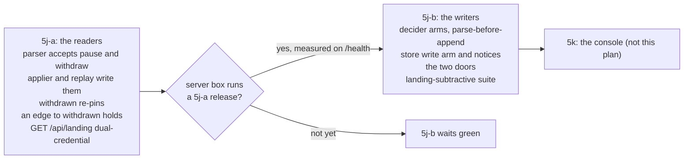

# Landing order, wave 5j — the operator's two doors on the landing line Implementation Plan

> **For agentic workers:** REQUIRED SUB-SKILL: Use superpowers:subagent-driven-development or superpowers:executing-plans to implement this plan task-by-task, as the dispatch specifies. Steps use checkbox (`- [ ]`) syntax for tracking. This plan dispatches nothing itself: each half is built by a worker the coordinator dispatches.

**Status: revised on 2026-11-25 after review run 3735 (fix round 1), with the coordinator's rulings on its findings and on questions Q1 to Q4.** Drafted for run 3729 from the brief's eight decisions. No implementation exists. The wave is built as two halves, **5j-a** then **5j-b**, each its own run and pull request (section 2 says where the seam is and why). Wave 5k (the console) follows 5j-b and is not planned here.

**Goal:** The operator can pause and resume one project's landing line, and withdraw one entry from it with a notice to that entry's coordinator, from two session-only routes. Both facts are journalled and survive replay. Neither door chooses, reorders or brings forward which entry lands next: a withdrawal frees nothing that waited on the withdrawn entry. The console can read the line with its session.

**Architecture:** Two new record kinds in the one authority journal (`landing.log`), parsed by its one parser, decided by the one mutation decider and written by the one authority writer (`CoordStore.writeLandingAuthority`). That writer now parses every record it built with the journal's own parser before it appends. Its private record applier (`applyLandingRecord`) is the single SQL writer of both facts, for live writes and replay alike. The order's one owner (`landingLine.ts#landingOrder`) keeps an edge to a withdrawn entry outstanding. The transaction bodies go in a same-ring companion file, `server/src/coord/landingDoorsTx.ts`, as `landingControlTx.ts` did. The routes are thin L4 code in `server/src/coord/routes.ts`.

**Tech Stack:** TypeScript ESM, Node >=22.16.0, synchronous `node:sqlite`, Fastify, Vitest. No dependency, migration, `ccd` verb, client verb or wire version change.

**Spec:** `docs/superpowers/specs/2026-09-23-landing-order-and-main-churn-design.md` §4 (the Operator row; "the session-gated landing routes can pause or remove, never choose a successor"), §5.5 (Data; "PWA doors"; "The coordinator lands" steps 4 and 6), §6 (the `routes.ts`, census and `CLAUDE.md` rows) and §7 (the coord.db amendment). Ledger: `docs/superpowers/programs/landing-order.md`, rows 5j and 5k, and Decisions 2026-10-30 23:24 (the `CLAUDE.md` lines travel in the PR) and 2026-10-31 08:14 (the journal protects the pause and withdrawals, first written in 5j).

**Source baseline:** `origin/main` at `1ec2db8ec32d1c936dbcda0d42df4797119efb28`. Every present-tense claim about the code below was read there. The review read the same code at `9ae84dca5b`, whose two later commits change only docs and `server/test/sim`. A worker whose dispatch base is newer re-reads each cited owner before changing it and says what moved in the task note.

**What was measured (read at the baseline by this plan's author, two read-only scouts and review run 3735):**
- `landingJournalPolicy.ts#shape` refuses any `kind` other than `entry` and `order` with reason `kind`. `CoordStore.landingHistoryOf` turns that into `landing-journal-invalid`, `CoordStore.replayLandingJournal` refuses, and `server/src/index.ts` then calls `process.exit(1)` before the HTTP server starts. So **a server older than this wave does not start** once `landing.log` holds a record of a new kind. One unknown record voids the whole journal. The box rollback command does not restore a failed rollback (`ccd/ccrc#_upd_rollback_no_restore`), so such a box stays down until it rolls forward. Nothing else reads `landing.log`: the backup, snapshot and restore pairs never name it.
- `writeLandingAuthority` appends the record it built (`JSON.stringify(record)` and a newline) without parsing it. Any field the parser would refuse therefore lands in the journal and stops the next boot. The review found a live path: a session's device label is the raw User-Agent cut to 120 characters and never trimmed (`server/src/server.ts#deviceLabel`).
- Every session-only door in `routes.ts` records its actor as `deps.cfg.authEnabled ? deviceActor(sessionAuth(req).device) : 'flag-off'` (`server/src/ccdargv.ts#deviceActor`: `unmeasured` for a session with no label, else `device:` and the label with control characters made spaces, cut to 120 characters, untrimmed).
- `landing_entries.state` has no CHECK constraint; its one CHECK ties `quarantineKind` to `state = 'unknown'`. `landing_projects` already has `operatorPaused INTEGER NOT NULL DEFAULT 0`. **No migration is needed.**
- No writer of `operatorPaused` and none of the `withdrawn` state exist. `landingFlagsOfRow`, `landingOrder`, `landingBindingOf` and `LANDING_ENTRY_TERMINAL.withdrawn` already read them.
- **Today an edge to a terminal target is met.** `landingOrder` walks `pinned` entries only, and a target that is `withdrawn`, `landed` or `closed` is not outstanding (`landing-line-order.test.ts` case C10 pins it for all three). With A the head, B after A and C after B, withdrawing B frees C, and C can sort ahead of A (`byKey`: `fixesMain`, then pin time, then PR). A stacked C would then land B's commits, which the operator just pulled. This plan changes that rule for `withdrawn` only (section 4.3).
- `decideLandingWrite` keeps a `withdrawn` row on a pin (`{kind:'kept', state:'withdrawn'}`), and so does a retreat. `decideLandingMutation` refuses an `entry` command for an existing (project, pr) with `landing-entry-exists`. Those are what block re-entry of a withdrawn PR (decision 7).
- `queueLandingNoticeTx` dedupes on a `run_events` row under the run's current-episode predicate, so it writes nothing (`run-gone`) for a run that has left `merging`. `queueRunlessNoticeTx` dedupes on its subject across every delivery state and needs no run.
- `GET /api/landing` calls `requireMailToken` on every box, dark ones included, after answering `501` when coordination is absent. It sits in `auth/gate.ts`'s `EXEMPT` table as a box-token lane. `GET /api/feed` is the dual-credential model: with sign-in armed, a session passes, and failing that a valid box token is required, before even `501 not-configured`. With sign-in dark the check does not run.
- `landing_entries.detail` is written by the land arm, set to `NULL` by a re-pin, and read by nothing.
- `server/src/coord/store.ts` and `server/src/coord/routes.ts` are both growth-checked (`server/test/growthCheck.ts`, 40 net code lines per PR). A new file waives a listed file's growth only when it has the same ring and context (the new-file rule, D-8563); `landingControlTx.ts` is the precedent (L3, context C5).
- The spec's two control rows (§5.5 step 6: a pause survives red to green; a pause set before red survives the red and the later green) exist on main as `landing-control.test.ts`'s two M14 cases, with the pause set by fixture.

## 1. Decisions

The brief's eight decisions, as the coordinator ruled them after review, and the choices this plan made inside them.

| # | Decision | How this plan keeps it |
|---|---|---|
| 1 | Both facts journalled through the existing authority writer | Two new kinds, `pause` and `withdraw`, in `LandingJournalRecord`; the one parser, decider, writer, applier and replay. The writer parses every record it built, of every kind, before the append. The older-server consequence is carried in "What this does not claim", with the reader-first split as its mitigation (D-9045). |
| 2 | Pause set and cleared by the operator only; never disturbs `mainRedHold` | One statement writes `operatorPaused`, in the applier's companion. `applyLandingControlTx`'s statement stays the only writer of `mainRedHold`. Both directions are pinned by the census and by behaviour. |
| 3 | Withdraw makes any non-terminal entry `withdrawn`, terminal; the head and `unknown` rows included | The decider refuses only a terminal entry (`landing-entry-terminal`), an absent one, a stale compare-and-set (`landing-entry-moved`), an entry whose stored word, pin time or association does not read, and an unresolved recovery of the entry itself. No order edge is written. |
| 3a | (F8 ruling) A withdrawal never brings another landing forward | An edge whose target's stored word is `withdrawn` stays **outstanding**. Its dependant is held, with the read naming the wait (`order.waits`), until its setter declares its order again without that target, or the target re-enters and lands. `landed` and `closed` targets keep today's meaning. The withdrawal tells the coordinator of each direct dependant, in the same transaction, once (D-9047, D-9050). |
| 4 | The console can read the line | `GET /api/landing` becomes a dual-credential read in the `GET /api/feed` shape, in 5j-a, open on a dark box (Q4 ruled yes; D-9048). |
| 5 | The notice, in the write's own transaction, once | `queueRunlessNoticeTx`: subject `landing-withdrawn:#<pr>:<sha256>` to the entry's coordinator, and `landing-held:#<pr>:<sha256>` to each direct dependant's. The coordinator is the run's `claimedBy`, or for a run-less entry its journalled creation claimant. With nobody to tell, no mail is sent, and the answer and the feed event say so (D-9050). |
| 6 | (Q1 ruling) Pause and withdraw narrow and work dark; resume widens | Resume needs a signed-in session. It refuses with that file's existing word, `sign-in-unarmed` (403), when sign-in is dark or the caller holds no session, as `POST /api/coord/delegation-adopt`'s `on` does through `signedInOf`. No step-up. The actor is the text every session-only door in that file records: the device actor armed, `flag-off` dark (F1 and F7 ruling; D-9049). |
| 7 | A withdrawal is not a ban | A run-bound withdrawn row re-pins at its run's next verified `advance → merging`, exactly as a `closed` row does. A run still at `merging` gets there by a retreat to `working` first, since a retreat over a withdrawn row keeps it (D-9047). Re-entry of a **run-less** entry is out (Q3 ruled yes), as follow-up `landing-runless-reentry`. |
| 8 | `store.ts` growth | New bodies in `landingDoorsTx.ts` (L3, C5); the guard, owned transaction and fence stay in the store. |

**Choices made here, which the coordinator kept:**
- **The withdraw body carries a compare-and-set,** `pinnedAt`, the value the console read. A re-pin moves `pinnedAt` (D-7617), so an operator never withdraws a PR re-entered after their screen was drawn. A mismatch, or a stored pin time that does not read, answers `landing-entry-moved` (409).
- **Pause refuses a project the line has never seen** (`landing-project-unknown`, 404): no entry, no journal subject and no `landing_projects` row.
- **A repeated pause or resume appends nothing**: no record, `changed: false`, `seq: null`, no feed event. A repeated withdraw is refused `landing-entry-terminal`.
- **Neither door has a `ccrc-api` verb.** The client carries the box token, and armed, the doors refuse a token-only caller. Dark, a token call would succeed, but a session-only door is the operator's, so no verb is shipped for it.

## 2. The two halves, and why each lands green alone


*Figure 1. The seam. 5j-a ships every reader of the new records and their order rule before anything can write one; 5j-b adds the writers.*

| Half | What lands | Why it is green alone | What changes on a live box |
|---|---|---|---|
| **5j-a** (Tasks 1 to 5) | L0 record vocabulary and the read's `waits`; the parser's two kinds; the applier's two statements in `landingDoorsTx.ts`; replay of both; the withdrawn re-pin; the withdrawn-edge rule; the dual-credential read and its census, README and `CLAUDE.md` lines | Nothing writes a new record or a `withdrawn` row yet, so every new branch is reached by tests through fixture journals and fixture rows only | **`GET /api/landing` changes on every box.** Dark, it answers any caller, where today it demands the box token. Armed, it takes a session too, and its 401 now comes before `501`. The order rule and the applier change nothing until a `withdrawn` row or a door record exists, and none can until 5j-b. A journal written by `main` is one 5j-a reads |
| **5j-b** (Tasks 6 to 10) | Commands, refusal words, decider arms, record builder, the writer's parse-before-append and arms, the notices, the two routes, the censuses, `landing-subtractive.test.ts`, the remaining `CLAUDE.md` lines and the README journal sentence | It builds on 5j-a's applier, parser and order rule, which pass their own tests | The two doors, and the parse-before-append on every landing write. A rollback to a 5j-a release is safe: it parses and replays both kinds and holds the same dependants. A rollback below 5j-a after a door was used leaves the server down (D-9045) |

**The landing gate between them (the mitigation, Q2 ruled sufficient for this wave):** the coordinator enqueues 5j-b only after the server box's `/health` `version` measures a release that contains 5j-a's merge commit. Until then 5j-b waits green. This keeps `~/.ccrc/previous`, the box rollback command's default target, at a build that reads the new kinds on the box where the journal lives. It holds at enqueue time only.

## 3. File responsibilities

| File | Ring, context | Half | Responsibility |
|---|---|---|---|
| `shared/landingLine.ts` | L0 | a, b | Record kinds and `LandingWait` (a); four mutation codes, `LandingWithdrawNotice`, `LandingNoticeOutcome` (b). Imports nothing. |
| `shared/refusal.ts` | L0 | b | `LANDING_REFUSAL_STATUS` gains the four codes. |
| `server/src/coord/landingJournalPolicy.ts` | L1, C4 | a | The one parser accepts `pause` and `withdraw` with exact keys and the actor grammar. |
| `server/src/coord/landingLine.ts` | L1, C4 | a | `landingOrder`: an edge to a withdrawn target stays outstanding, and the order answers `waits`. |
| `server/src/coord/landingEntry.ts` | L1, C4 | a, b | `decideLandingWrite` re-pins a withdrawn row (a); `landingRecordOf` builds the two records, and `landingFactsOf` adds `flagsRow` and `pinTimes` (b). |
| `server/src/coord/landingWrites.ts` | L1, C4 | b | `parseLandingDoor`, the decider's two arms and their decision types, `landingWithdrawNoticesOf`, the feed notice's arms. |
| `server/src/coord/landingWritesAct.ts` | L4, C4 | b | `actLandingWrite` typed for three result shapes (section 4.4). |
| `server/src/coord/landingDoorsTx.ts` (new) | L3, C5 | a, b | `applyLandingDoorRecordTx` (a): the two statements. `queueLandingDoorNoticesTx` (b): the digests and the notices. Opens no transaction. |
| `server/src/coord/store.ts` | L3, C5 | a, b | `applyLandingRecord` calls the companion for the two kinds, and `landingHistoryOf` keeps the journal text (a); `writeLandingAuthority`'s typed answer, its parse-before-append, and its apply arm calling the notices (b). |
| `server/src/coord/routes.ts` | L4 | a, b | The read's credential block (a); the two handlers after `POST /api/landing/order` (b). |
| `server/src/auth/gate.ts` | — | a | `GET /api/landing`'s `EXEMPT` reason becomes `EXEMPT-BUT-AUTHENTICATED`; the header's reason-2 list names it. The doors are NOT added to `EXEMPT`. |
| `README.md`, `CLAUDE.md` | — | a, b | Section 9's blocks. The README auth paragraph names `/api/landing` among the exempt-but-authenticated GETs (a). Its journal sentence gains the two facts (b). |
| Tests | — | a, b | Each task names its files; section 8 names the case each mutation turns red. |

Do not add a repository, a port, a second journal, a poller or a client verb. Do not call `advanceLanding` from a door (`landing-entry-census.test.ts`'s `LANDING_CALLERS` pins its three callers). A new literal in `server/src/coord` is a single word, or a code already declared in an L0 list that `mail-routes.test.ts`'s kebab-token scan admits (the landing mutation codes are). That is why this plan's new reason words are `unchanged`, `unclaimed`, `unrecorded` and `withdrawn`.

## 4. Interfaces

### 4.1 Journal records (L0, `shared/landingLine.ts`; Task 1)

The record union is split, so the pause, which names a project and no subject, is not forced to carry one. Every record keeps `v: 1`: a new kind is a new shape under the same version, and an older parser refuses it as `kind`, which is the truthful word.

```ts
interface LandingJournalHead { v: 1; seq: number; at: number; setBy: string }
export type LandingJournalSubjectRecord = LandingJournalHead & { subject: LandingSubjectRef } & (
  | { kind: 'entry'; claim: { pinnedSha: string; handoffCommit: string } }
  | { kind: 'order'; after: LandingSubjectRef[]; fixesMain: boolean }
  | { kind: 'withdraw'; actor: string }
);
export type LandingJournalPauseRecord = LandingJournalHead & {
  kind: 'pause'; project: string; paused: boolean; actor: string;
};
export type LandingJournalRecord = LandingJournalSubjectRecord | LandingJournalPauseRecord;
```

- `setBy` is the literal `'operator'` on both new kinds; the parser refuses any other value as `fields`.
- **`actor` is the recorded actor text, never a raw label.** The route computes it with the file's existing expression, `deps.cfg.authEnabled ? deviceActor(sessionAuth(req).device) : 'flag-off'`, and the decider and the record builder receive only that string. The parser accepts exactly the owner's output grammar, which is not trimmed: `'flag-off'`, `'unmeasured'`, or `device:` followed by at most 120 UTF-16 code units, none of them a control character (`\p{Cc}`). A blank label after `device:` is accepted, as the owner produces it.
- `withdraw`: exact keys `v, seq, at, setBy, subject, kind, actor`. `subject.binding` is the entry's current association, as an order record's is.
- `pause`: exact keys `v, seq, at, setBy, kind, project, paused, actor`. `project` is a name (nonblank, already trimmed); `paused` a boolean.
- Identity: a `withdraw` subject is a mention like any other (`Identities.mention`), and may be its subject's first mention (a run-bound entry is never journalled at creation). A `pause` mentions no identity.
- Every consumer that reads `r.subject` narrows first; TypeScript names each one (`applyLandingRecord`, the parser's identity loop, `landingRecordOf`).

### 4.2 Applying a record (L3; Task 2)

`CoordStore.applyLandingRecord(r)` stays the one applier for live writes and replay. Its body becomes:
- a `pause` record: `applyLandingDoorRecordTx(this.db, r)`, then the cursor update. No subject or authority row is written.
- a `withdraw` record: the existing subject upsert (no claim); NO `landing_authority` write, since a withdrawal never touches `afterIds` or `fixesMain`; `applyLandingDoorRecordTx(this.db, r)`; then the cursor update.
- `entry` and `order`: unchanged.

`server/src/coord/landingDoorsTx.ts`:

```ts
/** The two door records' statements, run by `CoordStore.applyLandingRecord` alone, inside the transaction it is in (a live
 *  write's or a replay's). Opens no transaction, reads nothing, decides nothing. */
export function applyLandingDoorRecordTx(db: DatabaseSync, r: LandingJournalPauseRecord | Extract<LandingJournalSubjectRecord, { kind: 'withdraw' }>): void
```

- **Pause, the flag's one writer:** `INSERT INTO landing_projects (project, operatorPaused) VALUES (?, ?) ON CONFLICT(project) DO UPDATE SET operatorPaused = excluded.operatorPaused`. It never names `mainRedHold`.
- **Withdraw, the one writer of this word:** `UPDATE landing_entries SET state = 'withdrawn', quarantineKind = NULL, detail = ? WHERE id = ? AND project = ? AND pr = ? AND state NOT IN (<LANDING_TERMINAL_STATES, joined>)`. `detail` is `JSON.stringify({ v: 1, by: 'operator', at: r.at, word: 'withdrawn', seq: r.seq })`. The terminal guard keeps a `landed` or `closed` row as the sweep wrote it ("the sweep wins for landed state"). A row this statement does not match (absent, or already terminal) is left alone, and the record still advances the cursor.
- **Three columns of `landing_entries` gain a second writer:** `state`, `detail` and `quarantineKind`, which `advanceLanding` (and, for `state` and `detail`, the land arm) write today. This is recorded as legitimately different (D-9046), and one writer per fact still holds.
  - Each writer owns a different fact. `advanceLanding` writes the measured lane facts: pinned, ejected, the stale-head quarantine. The land arm writes GitHub's terminal answer. The applier writes the operator's authoritative withdrawal.
  - The withdrawal must be written by the journal's applier, because replay has to restore it after an append whose apply failed, and `advanceLanding` is a run's lane that replay never reaches.
- **The replay sentence, corrected:** replay now writes one projection column word, `withdrawn` (with its `detail` and the cleared marker). It still writes no pin, landed state, association or witness, and it sends no notice. The comment on `replayLandingJournal` ("It never writes a projection or a witness") is rewritten to say exactly that.
- `landingHistoryOf` also answers the journal's text (`''` when absent). Section 4.4's parse-before-append reads it.

### 4.3 The order: an edge to a withdrawn target holds (L1, `landingLine.ts`; Task 4)

`landingOrder`'s walk, its keys and its other rules are unchanged; one more kind of target is outstanding.

- **A withdrawn target** is an entry whose stored word is `withdrawn` when `stateWords` is given (one exactly identified record, as `settled` already demands), or whose display state is `withdrawn` when it is not.
- A withdrawn target is **outstanding**. `settled` no longer settles a stored `withdrawn` behind a display `unknown`; `landed` and `closed` still settle.
- Every pinned entry with a direct edge to a withdrawn target is listed in the answer's new additive field, and it waits as any held entry does: last, in key order, never the head.

```ts
/** Why a pinned entry waits (wave 5j): a direct `after` edge to an entry the operator withdrew. Absent from an older server. */
export interface LandingWait { entryId: number; reason: 'withdrawn'; on: number[] }
// LandingOrder, both arms: `waits?: LandingWait[]` — present only when non-empty; `on` sorted ascending.
```

- The wait ends without any door writing an edge, in one of two ways. Its setter declares the entry's order again without that target, through the existing `POST /api/landing/order`. Or the target re-enters (it is then `pinned`, outstanding as any pinned target is) and later lands (`landed`, met).
- `landingBindingOf` selects its head through the same walk, so a held dependant is never a binding head, and nothing is cued to land it.
- `landed` and `closed` targets keep today's meaning: met. Whether a `closed` target should hold too is a follow-up question ("What this does not claim").

### 4.4 Commands, decisions and the writer (L1 and L3; Tasks 7 and 8)

```ts
export type LandingAuthorityCommand =
  | /* entry, order: unchanged */
  | { kind: 'withdraw'; project: string; pr: number; pinnedAt: number; setBy: 'operator'; actor: string }
  | { kind: 'pause'; project: string; paused: boolean; signedIn: boolean; setBy: 'operator'; actor: string };

export type LandingDoorParse =
  | { ok: true; kind: 'withdraw'; project: string; pr: number; pinnedAt: number }
  | { ok: true; kind: 'pause'; project: string; paused: boolean }
  | { ok: false; error: 'bad-request' };
/** A door body, closed: `{project, pr, pinnedAt}` or `{project, paused}`, nothing else (no `after`, `afterIds`, `head` or
 *  successor field can ride along). `pinnedAt` is a nonnegative safe integer. */
export function parseLandingDoor(kind: 'withdraw' | 'pause', body: unknown): LandingDoorParse;
```

`signedIn` is the route's `signedInOf(req)`, the existing helper beside `POST /api/coord/delegation-adopt`. It is a fact handed to the decider, which makes the decision.

**New facts on `LandingMutationFacts`**, gathered by `landingFactsOf` from the rows it already reads:
- `flagsRow: boolean`: whether the project has a `landing_projects` row.
- `pinTimes: { id: number; value: number | null }[]`: each entry's stored `pinnedAt` read strictly, `null` when it does not read. The display entry turns an unreadable pin time into `0`, so the compare-and-set must never read the display.

**`LandingMutationDecision` gains three mutation arms**, beside `noop`, `entry` and `order`:

```ts
  | { kind: 'unchanged'; project: string; operatorPaused: boolean }
  | { kind: 'pause'; project: string; paused: boolean }
  | { kind: 'withdraw'; entry: LandingEntry; coordinator: Coordinator; binding: LandingSubjectRef['binding'];
      recipient: LandingRecipient; dependants: { entry: LandingEntry; recipient: LandingRecipient }[] }
// LandingRecipient = { kind: 'session'; toId: string } | { kind: 'none'; reason: 'unclaimed' | 'unrecorded' }
```

Its error union gains `sign-in-unarmed` and the four new codes.

**Pause**, first match wins:
1. `paused === false` and `!signedIn` → `sign-in-unarmed`, whether or not the line is paused.
2. The project is unknown (no entry, no listed or recorded subject of it, `flagsRow` false) → `landing-project-unknown`.
3. `paused === facts.flags.operatorPaused` → `unchanged`.
4. Otherwise `pause`. Recovery, identity conflicts and the main-red hold never refuse a pause or a resume: neither moves an entry.

**Withdraw**, first match wins:
1. An identity conflict listed in the project's recovery → `landing-identity-conflict`.
2. No entry of (project, pr) → `landing-recovery-unresolved` when a listed subject has that key, otherwise `landing-entry-missing`.
3. The entry's own subject is listed in recovery → `landing-recovery-unresolved`. This is `landingHoldGate`'s `land` rule: another subject's hold does not stop a subtractive act.
4. The stored state word (`facts.stateWords`): a terminal word → `landing-entry-terminal`; `'unrecognised'` → `landing-projection-unreadable` (a newer build's word may be terminal).
5. `pinTimes` is `null` for the entry, or differs from `command.pinnedAt` → `landing-entry-moved`. A body carrying the `0` the console was shown for a damaged row is refused here.
6. The current association (`facts.coordinators`) is unreadable → `run-unreadable`.
7. Otherwise `withdraw`.
   - The entry's `recipient` is `{kind:'session', toId}` from a run's `claimedBy`, or from a run-less entry's recorded creation claimant (`facts.creations`). Failing those it is `{kind:'none', reason:'unclaimed'}` for a run with no claimant, or `{kind:'none', reason:'unrecorded'}` for a run-less entry with no recorded creation.
   - `dependants` is every non-terminal entry whose readable dependencies (`facts.dependencies`) name the target directly, each with its recipient by the same rule. An entry whose dependencies do not read is not listed: its edges are unknown, and its display state keeps it out of the line already.

A pinned, ejected or `unknown` row passes, the head included, whatever its pin SHA or setter, so long as steps 4 to 6 read.

`landingRecordOf` (`landingEntry.ts`) builds `{v:1, seq, at, setBy:'operator', subject:{…, binding}, kind:'withdraw', actor}` and `{v:1, seq, at, setBy:'operator', kind:'pause', project, paused, actor}`.

**The notices, pure** (`landingWrites.ts`):

```ts
/** The withdrawal's notices, from values: one to the entry's coordinator and one to each direct dependant's, each with the
 *  identity tuple the store hashes and its body. No clock, no hash. Recipients of kind `none` get no notice. */
export function landingWithdrawNoticesOf(f: { project: string; mutation: Extract<…, { kind: 'withdraw' }>; seq: number;
  at: number }): { word: 'landing-withdrawn' | 'landing-held'; toId: string; pr: number; identity: string; body: string }[];
```

- **The entry's notice:** `identity` is `JSON.stringify(['landing-withdrawn', 1, project, entry.id, entry.pr, seq, toId])`. The body says:
  - The operator withdrew `<project> #<pr>` (entry `<id>`, state `<state>`, pinned at `<pinnedSha>`) at `<ISO time>`, journal seq `<seq>`.
  - Nothing chose a successor, and any entry that waited on this one keeps waiting.
  - Do not land this PR at that pin. On a project that composes candidates, drop its candidate refs from your own shell (`ccd land-candidate --project <p> --pr <n> --drop`, spec §5.5 step 4).
  - A run-bound entry comes back by a retreat of its run from `merging` to `working` (when it is still at `merging`) and then a new advance to `merging`.
  - A run-less one cannot come back yet (follow-up `landing-runless-reentry`), and `POST /api/landing/entries` refuses it `landing-entry-exists`.
- **Each dependant's notice:** `identity` is `JSON.stringify(['landing-held', 1, project, dependant.id, dependant.pr, entry.id, seq, toId])`. The body says:
  - `<project> #<dependant pr>` waits on `#<pr>`, which the operator withdrew, and will not land while that edge stands.
  - To release it, declare its order again without `#<pr>` (`POST /api/landing/order`). Otherwise it waits until `#<pr>` re-enters and lands.

`landingMutationNotice` is retyped (below) and owes these feed events, all `record-only`, each with `sessionId: ''` as every operator door's event in `routes.ts` carries (the review-cap and capture-again doors). The actor text goes in the body:
- `landing-paused: <project>` or `landing-resumed: <project>`, for a changed pause.
- `landing-withdrawn: <project> #<pr>`, for every withdrawal. Its body names the actor, each notice queued, and "no coordinator to tell" for each `none` recipient.

An `unchanged` pause owes no event.

**The writer, typed by its command,** in `advanceLanding`'s `AdvanceLandingResultOf` style:

```ts
writeLandingAuthority<C extends LandingAuthorityCommand>(command: C, at: number): LandingAuthorityWriteOf<C>;
type LandingAuthorityWriteOf<C> =
  C extends { kind: 'pause' } ? LandingPauseWrite : C extends { kind: 'withdraw' } ? LandingWithdrawWrite : LandingAuthorityWrite;
export type LandingPauseWrite =
  | { ok: true; project: string; operatorPaused: boolean; changed: boolean; seq: number | null }
  | ({ ok: false } & LandingInfrastructureFailure) | { ok: false; error: LandingMutationCode | 'sign-in-unarmed' };
export type LandingWithdrawWrite =
  | { ok: true; entry: LandingEntry; previous: LandingEntry; changed: true; seq: number; notices: LandingNoticeOutcome[];
      coordinator: Coordinator }
  | ({ ok: false } & LandingInfrastructureFailure) | { ok: false; error: LandingMutationCode | 'run-unreadable' };
// L0: LandingNoticeOutcome = { word: 'landing-withdrawn' | 'landing-held'; entryId: number }
//   & ({ kind: 'queued'; toId: string; mailId: number; deliveryId: number } | { kind: 'none'; reason: 'unclaimed' | 'unrecorded' })
```

- **Parse before append, for every kind, old and new** (F1 ruling):
  - In `decide`, after building the record, the writer runs `parseLandingJournal(hist.text + JSON.stringify(record) + '\n')`, the exact bytes the adapter would leave.
  - It refuses with `landing-record-unparseable` (500) unless the answer is `ok` with `lastSeq === record.seq`.
  - A refusal appends nothing and fences nothing, because it stops before the append.
- **Apply arm, withdraw:**
  - `applyLandingRecord(record)`, then read the entry back (absent → throw, as today).
  - `queueLandingDoorNoticesTx(this, notices)` in the same transaction: each notice through `queueRunlessNoticeTx`, subject `<word>:#<pr>:<64 hex of the identity>`, kind `status`.
  - A `duplicate` answer cannot happen (the seq is unique). It throws, the transaction rolls back, and the writer classifies the phase, as `landingControlTx.ts`'s run-episode invariant does.
- **Apply arm, pause:** `applyLandingRecord(record)`, then read the flags back.
- The guard, the cursor check, `appendThenApply`'s order, the fence and the phase words are unchanged. A failure once the append was entered fences every landing entrance and answers `mayApply`.

**The act** (`landingWritesAct.ts`) keeps one body and gains three overload signatures:
- `entry`/`order` → `LandingAuthorityWrite`, `pause` → `LandingPauseWrite`, `withdraw` → `LandingWithdrawWrite`.
- Its `write` port is the store's generic method.
- `landingMutationNotice` takes one argument, a discriminated pair `{ command, result }` over the three shapes, so each arm reads only the fields its result has.
- The route helper for entries and order still drops `coordinator` from its answer; the door handlers drop `ok` and `coordinator`.

### 4.5 Routes (L4, `server/src/coord/routes.ts`)

**`GET /api/landing` (Task 5).** Before `notConfigured`, the `GET /api/feed` block: with `deps.cfg.authEnabled`, a `sessionAuth(req)` whose `reason` is `session` passes; otherwise `checkMailToken(…, 'GET /api/landing')` must answer `ok`. Failing both, the route refuses through `refuseRoute(reply, 'unauthenticated', { verdict: session.verdict, detail: 'GET /api/landing takes a session cookie OR the box token (x-ccrc-mail-token); ccrc-api reads it cookieless from the fleet host' })`. It uses the helper, not an inline send: `refusal-status.test.ts` refuses a net-new inline refusal. Query, answer (now with `order.waits` when present) and every other refusal are unchanged.

**`POST /api/landing/pause` (Task 9).** Session-gated only.
- Body: `{ "project": string, "paused": boolean }`, closed.
- 200: `{ ok: true, project, operatorPaused, changed, seq }`.
- Refusals:
  - 400 `bad-request`.
  - 403 `sign-in-unarmed`, a resume only.
  - 404 `landing-project-unknown`.
  - 409 `landing-sequence-overflow`.
  - 500 `landing-record-unparseable`.
  - 503 every `LandingInfrastructureCode`.
  - 401 from the global gate when sign-in is armed and no session is presented, the box token notwithstanding.

**`POST /api/landing/withdraw` (Task 9).** Session-gated only.
- Body: `{ "project": string, "pr": number, "pinnedAt": number }`, closed.
- 200: `{ ok: true, entry, previous, changed: true, seq, notices }`.
- Refusals:
  - 400 `bad-request`.
  - 404 `landing-entry-missing`.
  - 409 `landing-entry-terminal` (its `detail` names the state), `landing-entry-moved`, `landing-recovery-unresolved`, `landing-identity-conflict` and `landing-sequence-overflow`.
  - 500 `landing-record-unparseable`.
  - 503 `landing-projection-unreadable` (with `recovery: 'repair'`), `run-unreadable` and every `LandingInfrastructureCode`.
  - 401 as for pause.

Both handlers:
1. `if (!deps.coord) return notConfigured(reply)`, then the parse (L1).
2. `const actor = deps.cfg.authEnabled ? deviceActor(sessionAuth(req).device) : 'flag-off'`. The pause also takes `signedIn: signedInOf(req)`.
3. Inside `coordMutex.run`, one `actLandingWrite(command, Date.now(), { write, notice })`.
4. Refusals through `refuseRoute`; the answer spreads the write's result less `ok` and `coordinator`.

Neither handler consults the box token, calls `requireAttribution` or names either token helper, even in a comment (`coord-pause-route.test.ts` reads the handler body). Place both after `app.post('/api/landing/order', …)`, never between `const landingWrite = async (` and `app.post('/api/landing/entries'` (`overlord-other-lanes-census.test.ts` reads that span).

**New refusal words** (L0, Task 6), each in `LandingMutationCode`, `LANDING_MUTATION_CODE_MAP` and `LANDING_REFUSAL_STATUS`:
- `landing-entry-terminal` 409
- `landing-entry-moved` 409
- `landing-project-unknown` 404
- `landing-record-unparseable` 500

`sign-in-unarmed` is an existing route word (403).

## Global Constraints

- **One writer per fact.**
  - `operatorPaused`: `applyLandingDoorRecordTx`'s pause statement, reached only from `applyLandingRecord`.
  - `withdrawn`: its withdraw statement, reached the same way.
  - `mainRedHold`: `applyLandingControlTx`'s statement, untouched. Nothing automatic clears `operatorPaused`; no lane, timer or control pass writes it.
  - `state`, `detail` and `quarantineKind` each gain the withdraw statement as a second writer of the column, for a different fact, recorded as legitimately different (section 4.2, D-9046).
- **No door chooses, reorders or brings forward.** No door writes `afterIds`, `fixesMain`, `pinnedAt`, `setBy` or `landing_authority`, answers a head or successor field, or calls the order writer. A withdrawal holds every direct dependant behind the withdrawn target (section 4.3).
- **No line its own reader refuses.** The writer parses each record it built, of every kind, before the append.
- **Decide in L1, act in L4.** The routes compute the actor text and `signedIn` with the file's existing expressions and pass them as facts; the decider decides.
- **`CoordStore` stays synchronous**: no `await` inside its transaction, no nested `tx`, no file read inside the mail transaction. The notices run inside the write's transaction; replay never notices.
- **No box token on either door**, and neither door joins `auth/gate.ts`'s `EXEMPT`. Wire changes are additive only; `FLEET_PROTO` stays 1. No migration, no `ccd` verb, no client verb.
- **5j-b lands only behind the landing gate in section 2.**
- **Tests use fixture HOMEs and the journal-backed fixture (`server/test/landingFixture.ts`)**; no live registry, transcript, journal or secret is read. Every test and typecheck runs through `ccrc test -- <command>`, in the foreground, with a tool timeout of at least 600000 ms and `--maxWorkers=2`, one file per process for the census suites.
- **Characterization first** where a task moves code: Task 1's parser cases for `entry` and `order` are green on the baseline before the union is split.
- **A case a later step inverts is named where it is inverted.** Task 1 Step 3, Task 4 Step 1 and Task 5 Step 1 each list theirs.
- **Claims and packets.** Read `GET /api/claims?project=ccrc-pwa` before each task and claim every path it edits. For a held file, send its holder a unified diff against a named `main` commit, inline, with its size and sha256, and leave the file untouched until the answer.
- **Neutral names only**: `project-a`, `lane-a`, `the fleet box` in fixtures, notes and commit text. Cite code as `file#symbol` or `file#@anchor`, never by line number.
- **Commits** on the workspace's own branch; push once per half, when its build is complete, with code, tests and notes together; the pull request stays a draft. Task notes go under `docs/superpowers/programs/landing-order/` as `wave5j-<a|b>-task-<n>.md`; never edit an existing plan or the programme ledger.
- **Deviation numbers are issued, never chosen.** This plan defines D-9045 to D-9052. A departure found while building is named by slug (`D-TBD-<slug>`) in the wave-done, and the coordinator numbers it.

## Review Focus

1. **Subtractive only, and nothing brought forward:** a door's only table changes are the target row's `state`, `detail` and `quarantineKind` plus one subject observation and the cursor (withdraw), or one `operatorPaused` value and the cursor (pause). A withdrawn middle entry still holds what waited on it. `landing-subtractive.test.ts` diffs every landing table and compares the head before and after.
2. **The two flags stay apart:** pause never writes `mainRedHold`, the control pass never writes `operatorPaused`, and a pause survives red, green and both in turn; Task 8's cases and the census pins hold both directions.
3. **No unreadable journal line:** a real, long User-Agent round-trips through the actor owner, the record builder, the parse-before-append and the journal's parser; a record the parser would refuse is refused before the append.
4. **Credentials:** armed, a door refuses a box-token-only caller and a resume refuses without a session; dark, pause and withdraw open, a resume refuses `sign-in-unarmed`, and the read opens. Task 5 and Task 9 pin each cell.
5. **The rollback floor is honest:** the parser and the order rule ship in 5j-a, the writers in 5j-b behind the `/health` gate, and the `CLAUDE.md` coord.db sentence states the consequence below 5j-a.

## What this does not claim

- **A rollback below wave 5j-a after either door has been used leaves the server box down.**
  - Its parser refuses the record's kind as `landing-journal-invalid`, its startup exits, and the box rollback command restores nothing for a failed rollback.
  - The mitigation is the seam: readers in 5j-a, writers in 5j-b behind the `/health` gate, so a rollback by one release is safe. A rollback two releases back is not, and nothing here refuses one. The way out is a roll forward.
  - The follow-up `landing-journal-rollback-floor` is one new row in the box update command's capability floor (`ccd/ccrc#CAP_FLOOR_ROWS`), not a new mechanism. The row's fact is "the journal holds a door record", and its word is a server capability the 5j-a build advertises. The follow-up decides how the floor's fact reader, which reads registry suffixes today, measures that fact.
- **A `closed` target is still met.** An entry behind a PR closed without merging is freed when GitHub closes it, as today. Whether a closed target should hold its dependants as a withdrawn one does is follow-up question `landing-closed-target-met`.
- **A withdrawn run-less entry cannot be entered again.** Re-entry needs a journal claim over an existing identity, which the parser forbids today. Follow-up `landing-runless-reentry`.
- **A withdrawn subject whose projection is later lost still holds its line**, as every missing projection does today. Replay does not invent a row for it. Follow-up `landing-withdrawn-missing-projection`.
- **A withdrawal applied by replay sends no notice.** If the append succeeded and the database apply failed, the replay applies the withdrawal, and the coordinators learn of it from the line, not from mail.
- **A withdrawal does not stop a merge GitHub already queued.** The PR may still merge. A withdrawn entry is not landable, so it stays `withdrawn` in the line, not `landed`, and its dependants keep waiting until their order is declared again.
- **The notices go to the session the run names** (`claimedBy`) or to the creation claimant, alive or not. No registry is read inside the mail transaction. A dead recipient's mail parks as any undeliverable mail does.
- **An entry whose dependencies do not read is not told** that its target was withdrawn. Its edges are unknown, and its display state already keeps it out of the line.
- **On a dark box the read opens to any caller that reaches the server**, as every dual-credential read does, and so do pause and withdraw. Today the read takes the box token even there. A dark resume is refused.
- **A pause stops no merge already in progress.** It suppresses the head in the line's order, the binding and the next-to-land cue. A coordinator that already enqueued is not recalled; it sees the pause on its next line read.

---

## Wave 5j-a — the readers (Tasks 1 to 5, one pull request)

### Task 1: the record vocabulary and the parser

**Files:** Modify `shared/landingLine.ts`, `server/src/coord/landingJournalPolicy.ts`, and every consumer TypeScript then names (`server/src/coord/store.ts#applyLandingRecord`, `server/src/coord/landingEntry.ts#landingRecordOf`, narrowing only). Test: `server/test/landing-journal.test.ts`.

**Interfaces:** Produces section 4.1's types and the parser's two arms. Consumes `splitJournalRecords` and `Identities`, unchanged.

- [ ] **Step 1: Characterize.** Add cases, green on the baseline: an `entry` and an `order` record parse to exactly today's objects; a record with `kind: 'withdraw'` or `kind: 'pause'` answers `{ok:false, reason:'kind', record:n}` (the old parser's answer, kept on file for D-9045). Commit the characterization alone.
- [ ] **Step 2: Failing cases** for the new arms.
  - Valid: a `withdraw` (its subject's first mention, then a later mention by an `order`), a `pause`, and each actor form: `flag-off`, `unmeasured`, `device:` with a label that ends in a space, `device:` with a label of 120 code units, and `device:` with an empty label.
  - Refused: an extra key, a missing key, `setBy` other than `'operator'`, an actor with a control character, an actor longer than the owner can produce, an actor of another shape, a `pause` whose project is blank, a `withdraw` whose subject contradicts the history (`identity`), and a kind still unknown (`kind`).

  Run red.
- [ ] **Step 3: Split the union and add the arms** to `shape`; narrow every `r.subject` reader. **Inverted here:** Step 1's two cases for `withdraw` and `pause` now parse; rewrite them to Step 2's valid cases. The unknown-kind case stays refused. Run green.
- [ ] **Step 4: Commit.** `feat(landing): the journal reads the operator's pause and withdraw records (wave 5j-a, D-9045)`

### Task 2: the applier and replay

**Files:** Create `server/src/coord/landingDoorsTx.ts`. Modify `server/src/coord/store.ts`: `applyLandingRecord`, `landingHistoryOf`'s answer (the text) and the comment on `replayLandingJournal`. Test: `server/test/landing-journal-store.test.ts`, `server/test/landing-entry-census.test.ts`, `server/test/single-definition/core-vocab.test.ts`.

**Interfaces:** Produces `applyLandingDoorRecordTx` (section 4.2). Consumes the store's `db` and `LANDING_TERMINAL_STATES`.

- [ ] **Step 1: Failing replay cases** on a real database and journal. The test writes the journal text into the fixture's directory itself, since no route writes it in 5j-a.
  - A `pause` record (`paused: true`) after an `entry`: replay leaves `operatorPaused` true and `mainRedHold` as it was, in both of its starting values. A later `pause` with `paused: false`: false.
  - A `withdraw` record over a `pinned` row, over an `ejected` one, and over a quarantined `unknown` one: each reads `withdrawn`, its `quarantineKind` null and its `detail` the JSON of section 4.2.
  - A `withdraw` over a `landed` row leaves it `landed`. Over no row, nothing is inserted and the subject is listed `missing` as today. In both, the cursor advances.
  - In every case, `afterIds`, `fixesMain`, `setBy` and `pinnedAt` of every row, and every `landing_authority` row, are byte-identical before and after.
- [ ] **Step 2: Implement** `applyLandingDoorRecordTx` and the two arms of `applyLandingRecord`. Keep store growth at or under 40 net code lines: the statements live in the new file (the new-file rule).
- [ ] **Step 3: Move the guards**, each red before its source change and green after:
  - `core-vocab.test.ts`: `landingDoorsTx.ts` imports `DatabaseSync` from `node:sqlite`, so it joins `HANDLE_HOLDERS` with a comment beside `landingControlTx.ts`'s.
  - `landing-entry-census.test.ts`, the `landing_projects` writers list: it becomes `['INSERT landingControlTx.ts', 'INSERT landingDoorsTx.ts']`. A new case pins the pause statement's text, that it names no `mainRedHold`, and that its one caller is `CoordStore.applyLandingRecord`. The existing `mainRedHold` case keeps saying `applyLandingControlTx`'s statement names no `operatorPaused`.
  - The same file, "every write of landing_entries is advanceLanding's": its outside-the-writer list goes from `['INSERT:true']` to `['INSERT:true', 'UPDATE:false']`, the new entry being the withdraw statement in `landingDoorsTx.ts#applyLandingDoorRecordTx`, pinned by text. The in-writer verb list does not change.
  - The same file, "quarantineKind has one writer, advanceLanding": it names the withdraw statement as the one other writer, which only clears the marker.
  - The same file, "detail has two statements, both inside advanceLanding": it names the withdraw statement as the one outside.
  - The same file, "replay owns neither": rewritten to say replay reaches exactly one `landing_entries` statement, the withdraw statement, through `applyLandingRecord`.
  - The one-overlay-writer pin is unchanged: the subject, authority and cursor statements stay in `applyLandingRecord`.
- [ ] **Step 4: Run** from `server/`, one file per process: `ccrc test -- ./node_modules/.bin/vitest run --maxWorkers=2 test/landing-journal-store.test.ts`, then `test/landing-entry-census.test.ts`, `test/single-definition/core-vocab.test.ts` and `test/landing-journal.test.ts`. Green.
- [ ] **Step 5: Commit.** `feat(landing): replay applies the operator's pause and withdrawal (wave 5j-a, D-9046)`

### Task 3: a withdrawn entry re-pins

**Files:** Modify `server/src/coord/landingEntry.ts#decideLandingWrite`. Test: `server/test/landing-entry-store.test.ts` (and the pure decider's cases where they live).

- [ ] **Step 1: Failing cases.**
  - Pure: a pin over a `withdrawn` row whose projection reads with no marker answers `{act:'repin', id}`; over a `withdrawn` row whose projection does not read, `kept` `withdrawn`.
  - Store: a fixture row inserted as `withdrawn`, its run at `merging`. A retreat to `working` stays `kept`. Then a verified `advance → merging` for that PR re-pins it: state `pinned`, a new `pinnedAt`, `detail` null, a witness written, and the line's order contains it.

  Run red.
- [ ] **Step 2: Implement:** the `closed` branch's condition takes `withdrawn` too (`current.state === 'closed' || current.state === 'withdrawn'`), with a comment naming decision 7 and D-9047. Nothing else changes.
- [ ] **Step 3: Run** the two files green; commit. `feat(landing): a withdrawn entry re-enters at its next verified pin (wave 5j-a, D-9047)`

### Task 4: an edge to a withdrawn entry holds

**Files:** Modify `server/src/coord/landingLine.ts#landingOrder`, `shared/landingLine.ts` (`LandingWait`, `LandingOrder.waits`). Test: `server/test/landing-line-order.test.ts`, `server/test/landing-control.test.ts` (the binding's cases).

- [ ] **Step 1: Failing cases, and the inversions.**
  - **Inverted:** case C10 ("an edge to a landed, withdrawn or absent id holds nothing") splits in two. A landed or absent target still holds nothing. A withdrawn one holds its dependant, which waits last and is listed in `waits`.
  - **Inverted:** the cases "a stored `<w>` behind display unknown settles the edge" keep `landed` and `closed`. A stored `withdrawn` now does not settle.
  - **New, "nothing brought forward":** A head, B after A, C after B with `fixesMain`. Withdraw B (fixture state): C waits (`waits: [{entryId: C, reason: 'withdrawn', on: [B]}]`), and the head stays A. With C older than A and no `fixesMain`: the same.
  - **New:** a withdrawn head with one dependant. The dependant waits, the head is the next independent entry, or `null` if there is none.
  - **New:** C's setter declares C's order again without B, and C is free. B re-pinned is outstanding as a pinned target. B landed is met.
  - **New:** `landingBindingOf` never selects a held dependant.
  - **New:** with `stateWords` omitted, a display `withdrawn` target holds too.

  Run red.
- [ ] **Step 2: Implement** section 4.3; `waits` is present only when non-empty.
- [ ] **Step 3: Run** `landing-line-order`, `landing-control` and `landing-read-route` green; commit. `feat(landing): an edge to a withdrawn entry holds its dependant (wave 5j-a, D-9047)`

### Task 5: the console can read the line

**Files:** Modify `server/src/coord/routes.ts` (the `GET /api/landing` handler), `server/src/auth/gate.ts` (its `EXEMPT` reason and the header's reason-2 list), `README.md` (the auth paragraph's list of exempt-but-authenticated GETs), `CLAUDE.md` (section 9, blocks 1 and 2). Test: `server/test/landing-read-route.test.ts`, `server/test/auth-gate.test.ts` (its hand-kept `EXEMPT_BUT_AUTHENTICATED` set gains `'GET /api/landing'`), `server/test/box-token-census.test.ts`.

- [ ] **Step 1: Failing cases, and the inversion.**
  - **Inverted:** `landing-read-route.test.ts`'s "refuses 401 without the box token" runs with sign-in dark, and becomes "answers 200 with no credential on a dark box".
  - **New, sign-in armed:**
    - a session and no token: 200;
    - a token and no session: 200;
    - neither: 401 with `verdict`, even when `deps.coord` is absent (before `501`);
    - a wrong token and no session: 401.

  Run red on the session-only and dark cells.
- [ ] **Step 2: Implement** section 4.5's read block, through `refuseRoute`.
- [ ] **Step 3: Rewrite** `GET /api/landing`'s `EXEMPT` reason to open `EXEMPT-BUT-AUTHENTICATED (landing order wave 5j-a, D-9048), the same dual-credential arrangement as GET /api/feed:`, and to say that `ccrc-api landing show` reads cookieless and the console with a session. Add `/api/landing` to the header's reason-2 list and to the README list, with no number word. Write section 9's blocks 1 and 2 into `CLAUDE.md`, byte for byte.
- [ ] **Step 4: The gate for 5j-a.** One file per process, from `server/`:
  - `landing-journal`, `landing-journal-store`, `landing-entry-store`, `landing-entry-census`, `landing-read-route`, `landing-writes-route`, `landing-line-order`, `landing-control` and `auth-gate`;
  - `box-token-census`, `coord-pause-route`, `coordinator-skill`, `refusal-status`, `secret-mask`, `mail-routes`, `growth-check`;
  - `citations`, `anchors`, `topology-clean`, `typecheck-tests`, `deviation-refs` (after `git fetch origin main`), and `single-definition/` whole.

  Then the server typecheck. `typecheck-tests` and `deviation-refs` have failed for the test box's own reasons before: re-run one alone, once with `ccrc test --local`, before calling it a break, and report both results.
- [ ] **Step 5: The 5j-a mutation rows** (section 8, rows A1 to A15), each measured red and restored from a saved copy with its sha256 checked, through the coordinator's mutation runner where it fits.
- [ ] **Step 6: Commit, push once, wave-done.** `feat(landing): the console reads the line with its session (wave 5j-a, D-9048)`. The wave-done waits for the pull request's fast run on the exact tip.

## Wave 5j-b — the writers (Tasks 6 to 10, one pull request, after 5j-a merged)

### Task 6: the words

**Files:** Modify `shared/landingLine.ts` (`LandingMutationCode` and its map, `LandingWithdrawNotice`'s successor `LandingNoticeOutcome`), `shared/refusal.ts` (`LANDING_REFUSAL_STATUS`). Test: `server/test/refusal-status.test.ts` (its `MUTATION` list), `server/test/mail-routes.test.ts` (it must stay green: the new codes pass through `LANDING_MUTATION_CODES`, and every other new literal is a single word).

- [ ] **Step 1:** Add the four codes to the test's list first; run red.
- [ ] **Step 2:** Add them to L0 with section 4.5's statuses; run `refusal-status` and `mail-routes` green.
- [ ] **Step 3: Commit.** `feat(landing): the doors' refusal words (wave 5j-b, D-9049)`

### Task 7: the decisions

**Files:** Modify `server/src/coord/landingWrites.ts` (parse, decider arms and decision types, notices, `landingMutationNotice`'s pair), `server/src/coord/landingEntry.ts` (`landingRecordOf`; `landingFactsOf`'s `flagsRow` and `pinTimes`). Test: `server/test/landing-writes.test.ts`.

- [ ] **Step 1: Failing pure cases.**
  - **`parseLandingDoor`** accepts exactly the two closed bodies. It refuses each extra key (`after`, `afterIds`, `fixesMain`, `head`, `next`), a blank project, a non-boolean `paused`, a non-integer or negative `pinnedAt`, and an array body.
  - **Withdraw**, each refusal of section 4.4 in its order. Each pair that could collide has a case where both hold and the earlier answers: a terminal entry with a stale `pinnedAt` answers `landing-entry-terminal`, and a listed own subject that is also terminal answers `landing-recovery-unresolved`. An identity conflict, an `'unrecognised'` word and an unreadable association each have their case.
  - **The pin time:** a damaged row whose display `pinnedAt` is `0`, withdrawn with `pinnedAt: 0`, answers `landing-entry-moved`.
  - **Withdraw accepts** a pinned head, an ejected entry, a quarantined `unknown` row, and a pinned row whose `pinnedSha` does not read.
  - **Recipients:**
    - `claimedBy` for a run-bound entry, and the creation claim for a run-less one;
    - `none` with `unclaimed` and with `unrecorded`;
    - `dependants` lists each direct dependant with its own recipient, never a transitive one, and never an entry whose dependencies do not read.
  - **Pause:**
    - a resume without `signedIn` answers `sign-in-unarmed`, the line paused or not;
    - an unknown project answers `landing-project-unknown`, and equal values answer `unchanged`;
    - a pause is not refused by a recovery hold or an identity conflict.
  - **Records:** `landingRecordOf` builds both records, and each parses with Task 1's parser (a round trip), with a real, long User-Agent passed through `deviceActor`. Pick one whose 120-unit cut ends in a space, and one with an emoji at the cut.
  - **Notices:** `landingWithdrawNoticesOf`'s identity strings and bodies name what section 4.4 says, the retreat first included. `landingMutationNotice` owes the three feed events, each with `sessionId: ''`, and none for `unchanged`.

  Run red.
- [ ] **Step 2: Implement** section 4.4's L1 half. The decider stays one function; the new arms read only the facts they are given.
- [ ] **Step 3: Run green; commit.** `feat(landing): the doors' decisions, records and notices (wave 5j-b, D-9049, D-9050)`

### Task 8: the writer, the journal and the notices

**Files:** Modify `server/src/coord/store.ts` (`writeLandingAuthority`'s typing, its parse-before-append and its apply arm), `server/src/coord/landingDoorsTx.ts` (`queueLandingDoorNoticesTx`), `server/src/coord/landingWritesAct.ts` (the overloads). Test: `server/test/landing-journal-store.test.ts`, `server/test/landing-entry-store.test.ts`, `server/test/landing-control.test.ts`, and the file that tests `actLandingWrite` today (`git grep -l actLandingWrite server/test`).

- [ ] **Step 1: Failing cases** on a real database and journal.
  - **The journal record:** a withdraw appends exactly one `withdraw` record, whose seq is the answer's `seq`, and changes the entry to `withdrawn`.
  - **The notices:**
    - The entry's notice and one `landing-held` notice per direct dependant are queued, each exactly once, from `operator`, in the same transaction.
    - A fault injected into the second mail insert rolls the whole apply back, and the writer answers `landing-db-apply` with `mayApply`.
    - A run-less entry's notice goes to its creation claimant.
    - A recipient of kind `none` gets no mail, and the answer's `notices` says why.
  - **Parse before append:** a record the parser would refuse (a test-only seam builds one with a control character in its actor, and one an `order` record with a duplicate `after`) answers `landing-record-unparseable`. The journal's bytes and the database are unchanged, and the fence stays open.
  - **Fence and replay:**
    - A fault after the append (the journal port's test seam, as the file already uses for order writes) fences every landing entrance.
    - `replayLandingJournal` then clears it. The entry is `withdrawn`, its dependants wait, and no mail was queued by the replay.
    - The same holds for a pause.
  - **Pause:**
    - It appends one record and sets `operatorPaused`.
    - With `mainRedHold` set beforehand, `mainRedHold` stays set.
    - A repeated pause appends nothing and answers `changed: false, seq: null`.
    - A resume clears `operatorPaused` only.
  - **The spec's two control rows, with the pause written by this writer:** the two M14 cases of `landing-control.test.ts` set the pause by fixture. Add their twins with the pause written by `writeLandingAuthority`: a pause survives red to green, and a pause set before red survives the red and the later green.
  - **The act:** `actLandingWrite` answers each of the three shapes and raises the right feed event for each.

  Run red.
- [ ] **Step 2: Implement** section 4.4's L3 half and the act's overloads. Measure `store.ts`'s growth (`growth-check`), and keep it at or under 40 net code lines through the companion file.
- [ ] **Step 3: Run green; commit.** `feat(landing): the authority writer journals the operator's pause and withdrawal, parses before it appends, and tells the coordinators (wave 5j-b, D-9045, D-9049, D-9050)`

### Task 9: the two doors

**Files:** Modify `server/src/coord/routes.ts`, `README.md` (its journal sentence, section 9's README block). Test, new: `server/test/landing-doors-route.test.ts`. Census, modify: `server/test/coord-pause-route.test.ts` (`SESSION_ONLY`), `server/test/coordinator-skill.test.ts` (`EXEMPT`), `server/test/auth-gate.test.ts` (the per-file and total route tallies, and the landing-doors case), `CLAUDE.md` (section 9, blocks 3 to 5).

- [ ] **Step 1: Move the census pins first, and see them red.**
  - **`coord-pause-route.test.ts`:** add `'/api/landing/pause', '/api/landing/withdraw'` to `SESSION_ONLY`, with a `//` comment that holds no closing square bracket and no quoted string (`routeRegistrations.ts#harvestSet` reads the set as text).
  - **`coordinator-skill.test.ts`:** add `'POST /api/landing/pause'` and `'POST /api/landing/withdraw'` to its census's `EXEMPT`, with a reason comment: operator doors the coordinator is never told about. Add nothing to the skill text: a pin there holds the writes reference's landing paths to exactly three.
  - **`auth-gate.test.ts`, the case "the landing write doors … are plain EXEMPT box-token lanes":** it asserts that the `SESSION_ONLY` literal holds no `/api/landing/`. Narrow it to say the literal names neither `/api/landing/entries` nor `/api/landing/order`.
  - **`auth-gate.test.ts`, the tallies:** raise the `coord/routes.ts` tally and the total by two each, from the values measured at the dispatch base (78 and 305 at the baseline), each with a dated comment.
- [ ] **Step 2: Failing route cases** in `landing-doors-route.test.ts`, on the `landing-writes-route.test.ts` harness:
  - **Sign-in dark:**
    - a pause and a withdraw each answer 200, and the record's actor is `flag-off`;
    - a resume answers 403 `sign-in-unarmed` and journals nothing.
  - **Sign-in armed with a session:** each answers 200, the resume included. The record's actor is the device actor text, `unmeasured` for a session with no label.
  - **Armed with the box token only:** each door answers 401 and nothing is journalled.
  - **Armed with neither:** 401.
  - **Bodies and refusals:** each bad body answers 400, and each refusal of section 4.5 has its status and word.
  - **Answers:** no door answers a `head`, `next` or `order` field.
- [ ] **Step 3: Implement** the two handlers (section 4.5). Measure `routes.ts`'s growth; if it is over 40 net code lines, add `server/test/growth-waivers/D-9052-coord-routes-ts.json` on the model of the existing waivers, with its `maxDelta` set to the measured growth.
- [ ] **Step 4: Write section 9's blocks 3 to 5 into `CLAUDE.md` and its README block into `README.md`,** byte for byte, then run `box-token-census` green (it requires every `SESSION_ONLY` path named in the bullet).
- [ ] **Step 5: Commit.** `feat(landing): the operator's pause and withdraw doors (wave 5j-b, D-9049)`

### Task 10: the subtractive property, the mutation table, the gate

**Files:** Create `server/test/landing-subtractive.test.ts`.

- [ ] **Step 1: Write the suite.** It goes red on the mutations of section 8.
  - **Table diff, withdraw.**
    - Fixture lines: a head A, an entry B `after` A, an entry C `after` B, an entry D with `fixesMain` `after` B, an ejected entry and a quarantined `unknown` entry, in run-bound and run-less forms.
    - For every non-terminal entry X: snapshot every row of `landing_entries`, `landing_projects`, `landing_subjects`, `landing_authority`, `landing_projection_witness` and `landing_journal_cursor`; withdraw X through the route; snapshot again.
    - The only differences are X's `state`, `detail` and `quarantineKind`, X's subject row (inserted or its observation replaced) and the cursor. The journal grew by exactly one `withdraw` record.
  - **Table diff, pause.** Pause, then resume. The only differences after each are that project's `operatorPaused` and the cursor. The journal grew by one `pause` record each.
  - **Nothing brought forward** (the F8 ruling's three cases):
    - **A withdrawn middle entry with edges on both sides.** Withdraw B: the head stays A, and C and D wait on B (`waits`), D's `fixesMain` notwithstanding.
    - **A withdrawn head with a dependant.** Withdraw A: B waits on A, and the head is the next independent entry or `null`.
    - **A fixes-main dependant.** D, with `fixesMain`, never becomes the head while its edge to the withdrawn B stands, under main-red as well.

    In each case, every entry's position and head-eligibility after the door is computed with the same function from the stored rows. No door wrote it.
  - **The dependants are told:** each case's direct dependants got one `landing-held` mail each, and a transitive dependant got none.
  - **Pause and resume restore the head:** after a pause then a resume, the head equals the head before the pause.
  - **No door names a successor.** A static read of `routes.ts`: the two handlers' bodies construct only `withdraw` and `pause` commands and name neither `afterIds` nor `fixesMain`. The parse refusals above cover the request side.
- [ ] **Step 2: The 5j-b mutation rows** (section 8, rows B1 to B26), each measured red and restored from a saved copy with its sha256 checked.
- [ ] **Step 3: The gate for 5j-b.** Task 5 Step 4's list, plus `landing-doors-route`, `landing-subtractive`, `landing-writes`, the act's test file and `overlord-other-lanes-census`, one file per process, and the server typecheck.
- [ ] **Step 4: The landing gate.** Before the wave-done, read the server box's `/health` `version` through the console's own read, and say in the wave-done whether it contains 5j-a's merge. The coordinator enqueues only when it does.
- [ ] **Step 5: Commit, push once, wave-done.** `test(landing): the doors may pause or remove, never choose, reorder or bring forward (wave 5j-b)`

## 8. Mutation table

Each row is one change to the built code, measured red by the named test, then restored. "A" rows run in 5j-a, "B" rows in 5j-b.

| id | Mutation | Predicted red |
|---|---|---|
| A1 | the parser accepts any `kind` (drop the kind check) | `landing-journal`'s unknown-kind case |
| A2 | the parser accepts a `pause` with an extra key | `landing-journal`'s exact-keys case |
| A3 | the parser accepts a door record whose `setBy` is not `'operator'` | `landing-journal`'s setBy case |
| A4 | the parser's actor rule trims or refuses a trailing space | `landing-journal`'s trailing-space actor case |
| A5 | the parser's actor rule admits a control character | `landing-journal`'s control-character case |
| A6 | `applyLandingRecord` skips the companion for `pause` (a replay that loses a pause) | `landing-journal-store`'s pause replay case |
| A7 | `applyLandingRecord` skips the companion for `withdraw` (a replay that loses a withdrawal) | `landing-journal-store`'s withdraw replay case |
| A8 | the pause statement also sets `mainRedHold = 0` (a pause write that touches `mainRedHold`) | `landing-entry-census`'s pause statement pin, and the replay case with `mainRedHold` set beforehand |
| A9 | the withdraw statement loses its terminal guard | `landing-journal-store`'s landed-row case |
| A10 | the withdraw statement no longer clears `quarantineKind` | `landing-journal-store`'s quarantined-row case (the schema's CHECK refuses the write) |
| A11 | the withdraw statement writes no `detail` | `landing-journal-store`'s `detail` JSON assertion |
| A12 | `decideLandingWrite` drops `withdrawn` from the re-pin branch | `landing-entry-store`'s re-pin case |
| A13 | `landingOrder` treats a withdrawn target as met again (a withdrawal that brings a landing forward) | `landing-line-order`'s nothing-brought-forward cases |
| A14 | `settled` settles a stored `withdrawn` behind display unknown | `landing-line-order`'s stored-word cases |
| A15 | the read's credential block is removed (the read answering a session-less, token-less caller) | `landing-read-route`'s armed neither-credential case; `auth-gate`'s property sweep |
| B1 | the withdraw apply arm also writes another entry's `afterIds` (a door that reorders) | `landing-subtractive`'s withdraw table diff |
| B2 | the withdraw answer adds `head: <next entry>` (a door that names a successor) | `landing-doors-route`'s no-head case; `landing-subtractive`'s answer check |
| B3 | `applyLandingControlTx`, on a green transition, also sets `operatorPaused = 0` (a pause that clears on green) | `landing-control`'s writer-set pause-survives-green case |
| B4 | the same, on a red transition | `landing-control`'s pause-set-before-red case |
| B5 | `writeLandingAuthority` applies a withdraw without appending (a withdraw without its journal record) | `landing-journal-store`'s one-record case; `landing-subtractive`'s journal growth check |
| B6 | the apply arm skips the entry's notice (a withdraw without its notice) | `landing-journal-store`'s notice case |
| B7 | the apply arm skips the dependants' notices | `landing-subtractive`'s dependants-told case |
| B8 | the dependants list includes transitive dependants | `landing-writes`' direct-only case |
| B9 | replay calls the notices too | `landing-journal-store`'s no-mail-on-replay case |
| B10 | the writer appends without its parse (the parse-before-append guard) | `landing-journal-store`'s unparseable-record case |
| B11 | the route records the raw device label instead of the device actor text | `landing-doors-route`'s armed actor case; `landing-writes`' User-Agent round trip |
| B12 | `'POST /api/landing/withdraw'` joins `auth/gate.ts`'s `EXEMPT` (a door reachable with the box token alone) | `coord-pause-route`'s not-in-EXEMPT check; `landing-doors-route`'s armed token-only case |
| B13 | the pause handler calls the box token helper (a door that takes the token) | `coord-pause-route`'s handler-body scan |
| B14 | the decider lets a resume through without `signedIn` | `landing-writes`' resume case; `landing-doors-route`'s dark resume case |
| B15 | the decider withdraws a terminal entry | `landing-writes`' terminal case |
| B16 | the decider compares `pinnedAt` with the display entry, not `pinTimes` | `landing-writes`' damaged-pin-time case |
| B17 | the decider ignores `pinnedAt` | `landing-writes`' moved case |
| B18 | the decider skips the identity-conflict refusal | `landing-writes`' identity-conflict case |
| B19 | the decider skips the own-subject recovery refusal | `landing-writes`' recovery case |
| B20 | the decider accepts an `'unrecognised'` stored word | `landing-writes`' unrecognised case |
| B21 | the decider folds an unreadable association into no run | `landing-writes`' run-unreadable case |
| B22 | the recipient of a run-bound entry is the creation claimant, not `claimedBy` | `landing-writes`' recipient cases |
| B23 | the decider refuses a pause during a recovery hold | `landing-writes`' pause-under-hold case |
| B24 | the decider pauses an unknown project | `landing-writes`' unknown-project case |
| B25 | a repeated pause appends a record | `landing-journal-store`'s repeated-pause case |
| B26 | `parseLandingDoor` ignores an unknown key instead of refusing it | `landing-writes`' extra-key cases |

## 9. CLAUDE.md and README lines for the operator to read

Five `CLAUDE.md` blocks and one `README.md` block. Each gives the exact old lines and the exact new lines at the baseline, indented as the file is. `CLAUDE.md` blocks 1 and 2 ride 5j-a; blocks 3 to 5 and the README block ride 5j-b. At landing the coordinator compares the pull request's lines to these byte for byte.

**Block 1 (5j-a), the box-token bullet: the read leaves the `requireMailToken` list.**

Old:
```text
  `POST /api/coordinators/:session/intent`, `POST /api/leases/:lease/retain`, `POST /api/ledger/deviations`, `GET /api/ledger`, `GET /api/landing`,
```
New:
```text
  `POST /api/coordinators/:session/intent`, `POST /api/leases/:lease/retain`, `POST /api/ledger/deviations`, `GET /api/ledger`,
```

**Block 2 (5j-a), the box-token bullet: the read joins the dual-credential reads.**

Old:
```text
  the open items cookieless through `ccrc-api`, the console with a session)
  and the update projection read `GET /api/updates/intent/:nodeId` (a fleet node's timer pulls it cookieless from
```
New:
```text
  the open items cookieless through `ccrc-api`, the console with a session), the landing line's read `GET /api/landing`
  (landing order wave 5j, D-9048: a coordinator reads it cookieless through `ccrc-api landing show`, the console with a session)
  and the update projection read `GET /api/updates/intent/:nodeId` (a fleet node's timer pulls it cookieless from
```

**Block 3 (5j-b), the box-token bullet: the two doors join the session-only writes.**

Old:
```text
  `POST /api/questions/:id/answer` (W3 Q3f, D-7030, the operator's answer door of the question family) and
  `POST /api/leases/:lease/operator-retain` and `POST /api/leases/:lease/resolve` (delegation wave 5 PR8, the operator's
```
New:
```text
  `POST /api/questions/:id/answer` (W3 Q3f, D-7030, the operator's answer door of the question family),
  `POST /api/landing/pause` and `POST /api/landing/withdraw` (landing order wave 5j, D-9049: the operator's pause and resume
  of one project's landing line, and the operator's withdrawal of one entry from it with a notice to its coordinator and to
  the coordinator of each entry that waited on it; neither chooses, reorders or brings forward the head, and a resume, which
  widens, also refuses `sign-in-unarmed` while sign-in is dark or the caller holds no session) and
  `POST /api/leases/:lease/operator-retain` and `POST /api/leases/:lease/resolve` (delegation wave 5 PR8, the operator's
```

**Block 4 (5j-b), the box-token bullet: the count word, and the doors' dark rule.** The bullet said eighteen at the baseline, where the set holds nineteen (D-9051).

Old:
```text
  that one file is invisible to the set that pins the doors. The other eighteen are in that file's `SESSION_ONLY`
  set, and `box-token-census.test.ts` checks this sentence against it in both directions (D-1231). The update
```
New:
```text
  that one file is invisible to the set that pins the doors. The other twenty-one are in that file's `SESSION_ONLY`
  set, and `box-token-census.test.ts` checks this sentence against it in both directions (D-1231). Of the landing line's
  two doors, a pause and a withdrawal narrow the line and work while sign-in is dark; a resume widens it and needs a
  signed-in session (D-9049). The update
```

**Block 5 (5j-b), the coord.db bullet: the journal sentence.**

Old:
```text
  `~/.ccrc/landing.log` restores no-run creation evidence, order edges, `fixesMain` and setter attribution before
  service starts. Leave it in place when restoring coord.db; no backup copies it or restores an older copy over it.
```
New:
```text
  `~/.ccrc/landing.log` restores no-run creation evidence, order edges, `fixesMain` and setter attribution before
  service starts. Since landing order wave 5j it also restores the operator's pause of a project's line and the operator's
  withdrawal of an entry (D-9045, D-9046), and a server older than wave 5j-a refuses to start on a journal that holds
  either record, so once either door has been used a rollback below wave 5j-a leaves the server down until it rolls
  forward. Leave it in place when restoring coord.db; no backup copies it or restores an older copy over it.
```

**README block (5j-b), the landing line's journal sentence** (F9).

Old:
```text
entry only when its projection is readable and carries no quarantine marker (D-8626). A project the line has never seen answers no entries and both flags off. The line's authority (no-run creation evidence,
order edges, `fixesMain` and setter attribution) is journalled in `~/.ccrc/landing.log`, which a restored `coord.db` leaves in
```
New:
```text
entry only when its projection is readable and carries no quarantine marker (D-8626). A project the line has never seen answers no entries and both flags off. The line's authority (no-run creation evidence,
order edges, `fixesMain`, setter attribution, and since wave 5j the operator's pause of the line and withdrawals of entries) is
journalled in `~/.ccrc/landing.log`, which a restored `coord.db` leaves in
```

The census phrases still match after these blocks: `landing-entry-census.test.ts`'s `landing-journal-prose` phrases and its leave-in-place passage, and `box-token-census.test.ts`'s reading of the bullet. Block 5's new sentence sits between two pinned phrases and changes neither. Block 4 adds a sentence inside the bullet, before "The update", and names no route path, so the census's path checks are unaffected.

## 10. Rulings received (2026-11-25, on review run 3735)

| Item | Ruling | Where the plan carries it |
|---|---|---|
| F8 | A withdrawal never brings another landing forward: an edge to a withdrawn target stays outstanding; the direct dependants' coordinators are told; `closed` keeps today's meaning, as a follow-up question | Decision 3a, section 4.3, Task 4, Task 10, rows A13, A14, B7, B8, "What this does not claim" |
| F1, F7 | No new actor mapping or word; the existing device actor text armed, `flag-off` dark; parse every built record before the append | Section 4.1, section 4.4, Task 7 and Task 8 cases, rows A4, A5, B10, B11 |
| Q1 | Resume is stricter: a signed-in session, `sign-in-unarmed` otherwise, no step-up; pause and withdraw work dark | Decision 6, section 4.4, Task 9, row B14, blocks 3 and 4 |
| Q2 | The split and the `/health` gate suffice for this wave; the follow-up is one capability floor row | Section 2, "What this does not claim" |
| Q3 | Run-less re-entry is out, as a named follow-up | Decision 7, "What this does not claim" |
| Q4 | The read opens on a dark box, in the feed read's shape | Decision 4, section 4.5, Task 5 |
| F2 to F6, F9 to F12 | Fixed as the report says | Sections 2 to 4, Global Constraints, Tasks 1 to 10, section 9's README block |

## Deviations found

Eight numbers were issued for this plan on 2026-11-25 (D-9045 to D-9052), and all eight are defined below. D-9052 is used only if Task 9 measures `routes.ts` over the growth limit; the 5j-b wave-done says which.

- **D-9045 (2026-11-25)** — `landing-journal-door-kinds`: the authority journal gains two record kinds, `pause` (project-level, no subject) and `withdraw` (a subject), under `v: 1`.
  - Each new record carries `setBy: 'operator'` and the actor text the existing device actor owner records (`flag-off` dark). The parser accepts that owner's untrimmed output grammar.
  - The writer now parses every record it built, of every kind, with the journal's own parser before the append, and refuses `landing-record-unparseable` on a miss. No input can leave a line its own reader refuses.
  - Read at the baseline: an older server's parser refuses either new kind as `kind`, its replay answers `landing-journal-invalid`, and its startup exits. A rollback below the build that reads them therefore leaves the server down, and the box rollback command does not restore a failed rollback.
  - Mitigation: the readers ship first (5j-a), and 5j-b is enqueued only once the server box runs a 5j-a release. The rollback guard is follow-up `landing-journal-rollback-floor`, one capability floor row.
- **D-9046 (2026-11-25)** — `landing-replay-writes-withdrawn`: replay writes one projection column word, `landing_entries.state = 'withdrawn'`, with `quarantineKind` cleared and a `detail`.
  - Why: a withdrawal is authoritative state (spec §5.5), and an append whose apply failed must not lose it.
  - The statement runs only from `applyLandingRecord`, the same path for live writes and replay. It is guarded to non-terminal rows, so the sweep's landed state wins.
  - `state`, `detail` and `quarantineKind` thereby gain a second writer, legitimately different: each writer owns a different fact. `advanceLanding` writes the measured lane facts, the land arm GitHub's answer, and the applier the operator's withdrawal. Replay reaches only the applier.
  - Replay still writes no pin, landed state, association or witness, and still sends no notice.
- **D-9047 (2026-11-25)** — `landing-withdrawn-holds-and-repins`: a withdrawal is neither a ban nor a release.
  - **Not a ban:** a run-bound `withdrawn` entry re-pins at its run's next verified `advance → merging` (after a retreat when it is still at `merging`) over a readable, unquarantined projection, exactly as a `closed` one does.
  - **Not a release:** an edge to a withdrawn target stays outstanding, so its dependant waits, named in the read's `order.waits`, until its setter declares its order again or the target re-enters and lands. Today an edge to any terminal target is met; `landed` and `closed` keep that meaning.
  - Re-entry of a run-less entry is left out (follow-up `landing-runless-reentry`): it needs a journal claim over an existing identity, which the parser forbids.
- **D-9048 (2026-11-25)** — `landing-read-dual-credential`: `GET /api/landing` takes a session or the box token, in the `GET /api/feed` shape, authenticated before `501`, and open on a dark box like every dual-credential read. Before, it took the box token on every box, so the console could not read the line.
- **D-9049 (2026-11-25)** — `landing-operator-doors`: `POST /api/landing/pause` and `POST /api/landing/withdraw`, session-only (no box token, not `EXEMPT`).
  - Pause and withdraw work dark. A resume refuses `sign-in-unarmed` without a signed-in session, as the delegation-adopt door's `on` does.
  - Closed bodies, and a `pinnedAt` compare-and-set on withdraw, read from the stored pin time.
  - Four refusal words: `landing-entry-terminal`, `landing-entry-moved`, `landing-project-unknown` and `landing-record-unparseable`.
  - The actor text is recorded, repeated pauses are not journalled, and no client verb is shipped.
- **D-9050 (2026-11-25)** — `landing-withdraw-notices`: the withdrawal's notices ride `queueRunlessNoticeTx`, not `queueLandingNoticeTx`, whose current-episode predicate would drop a notice for an entry whose run has left `merging`.
  - Subjects: `landing-withdrawn:#<pr>:<sha256>` to the entry's coordinator, and `landing-held:#<pr>:<sha256>` to each direct dependant's.
  - Recipient: the run's `claimedBy`, or a run-less entry's journalled creation claimant.
  - Sent in the write's transaction, never by replay. With nobody to tell, no mail is sent, and the answer and the feed event say so. Each feed event carries `sessionId: ''`, as every operator door's does.
- **D-9051 (2026-11-25)** — `session-only-count-word`: `CLAUDE.md`'s box-token bullet said "The other eighteen" at the baseline, while `coord-pause-route.test.ts`'s `SESSION_ONLY` held nineteen and no test pinned the word. With the two doors it reads "twenty-one".
- **D-9052 (2026-11-25)** — `landing-doors-routes-growth`: the growth waiver for `server/src/coord/routes.ts` in 5j-b, added only if the two handlers measure over 40 net code lines. The routes must sit in that file, so the two scanners that read it alone see them (spec §5.5, "PWA doors").
