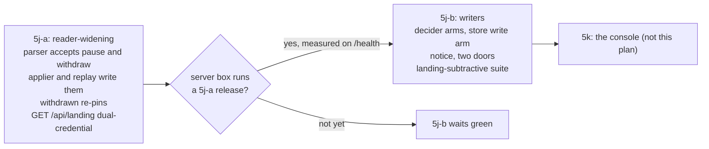

# Landing order, wave 5j — the operator's two doors on the landing line Implementation Plan

> **For agentic workers:** REQUIRED SUB-SKILL: Use superpowers:subagent-driven-development or superpowers:executing-plans to implement this plan task-by-task, as the dispatch specifies. Steps use checkbox (`- [ ]`) syntax for tracking. This plan dispatches nothing itself: each half is built by a worker the coordinator dispatches.

**Status: drafted for the programme's coordinator on 2026-11-25 (run 3729), from the brief's eight decisions.** No implementation exists. The wave is built as two halves, **5j-a** then **5j-b**, each its own run and pull request (section 2 says where the seam is and why). Wave 5k (the console) follows 5j-b and is not planned here.

**Goal:** The operator can pause and resume one project's landing line, and withdraw one entry from it with a notice to that entry's coordinator, from two session-only routes. Both facts are journalled, survive replay, and never choose or reorder which entry lands next. The console can read the line with its session.

**Architecture:** Two new record kinds in the one authority journal (`landing.log`), parsed by its one parser, decided by the one mutation decider and written by the one authority writer (`CoordStore.writeLandingAuthority`), whose private record applier (`applyLandingRecord`) is the single SQL writer of both facts for live writes and replay alike. The transaction bodies go in a same-ring companion file, `server/src/coord/landingDoorsTx.ts`, as `landingControlTx.ts` did. The routes are thin L4 code in `server/src/coord/routes.ts`.

**Tech Stack:** TypeScript ESM, Node >=22.16.0, synchronous `node:sqlite`, Fastify, Vitest. No dependency, migration, `ccd` verb, client verb or wire version change.

**Spec:** `docs/superpowers/specs/2026-09-23-landing-order-and-main-churn-design.md` §4 (the Operator row; "the session-gated landing routes can pause or remove, never choose a successor"), §5.5 (Data; "PWA doors"; "The coordinator lands" steps 4 and 6), §6 (the `routes.ts`, census and `CLAUDE.md` rows) and §7 (the coord.db amendment). Ledger: `docs/superpowers/programs/landing-order.md`, rows 5j and 5k, and Decisions 2026-10-30 23:24 (the `CLAUDE.md` lines travel in the PR) and 2026-10-31 08:14 (the journal protects the pause and withdrawals, first written in 5j).

**Source baseline:** `origin/main` at `1ec2db8ec32d1c936dbcda0d42df4797119efb28`. Every present-tense claim about the code below was read there. A worker whose dispatch base is newer re-reads each cited owner before changing it and says what moved in the task note.

**What was measured (read at the baseline, by this plan's author and two read-only scouts):**
- `landingJournalPolicy.ts#shape` refuses any `kind` other than `entry` and `order` with reason `kind`. `CoordStore.landingHistoryOf` turns that into `landing-journal-invalid`, `CoordStore.replayLandingJournal` refuses, and `server/src/index.ts` then calls `process.exit(1)` before the HTTP server starts. So **a server older than this wave does not start** once `landing.log` holds a record of a new kind. `ccrc rollback` does not restore a failed rollback (`ccd/ccrc#_upd_rollback_no_restore`: "no automatic restore runs for a --from rollback run"), so such a box stays down until it rolls forward.
- `landing_entries.state` has no CHECK constraint; its one CHECK ties `quarantineKind` to `state = 'unknown'`. `landing_projects` already has `operatorPaused INTEGER NOT NULL DEFAULT 0`. **No migration is needed.**
- No writer of `operatorPaused` and none of the `withdrawn` state exist. `landingFlagsOfRow`, `landingOrder`, `landingBindingOf` and `LANDING_ENTRY_TERMINAL.withdrawn` already read them.
- `landingOrder` walks `pinned` entries only. A target that is `withdrawn`, `landed` or `closed` is not outstanding, so an `after` edge to it is satisfied; an `ejected` or `unknown` target holds its dependants. A withdrawal therefore needs no order edit: a terminal target already releases what waits on it.
- `decideLandingWrite` keeps a `withdrawn` row on a pin (`{kind:'kept', state:'withdrawn'}`), and `decideLandingMutation` refuses an `entry` command for an existing (project, pr) with `landing-entry-exists`. Those are the two things that block a coordinator re-entering a withdrawn PR (decision 7).
- `queueLandingNoticeTx` dedupes on a `run_events` row under the run's current-episode predicate, so it writes nothing (`run-gone`) for a run that has left `merging`. `queueRunlessNoticeTx` dedupes on its subject across every delivery state and needs no run.
- `GET /api/landing` calls `requireMailToken` and sits in `auth/gate.ts`'s `EXEMPT` table as a box-token lane. `GET /api/feed` is the dual-credential model: with sign-in armed, a session passes, and failing that a valid box token is required, before even `501 not-configured`. With sign-in dark the check does not run.
- `landing_entries.detail` is written by the land arm only, set to `NULL` by a re-pin, and read by nothing.
- `server/src/coord/store.ts` and `server/src/coord/routes.ts` are both growth-checked (`server/test/growthCheck.ts`, 40 net code lines per PR). A new file waives a listed file's growth only when it has the same ring and context (the new-file rule, D-8563); `landingControlTx.ts` is the precedent (L3, context C5).

## 1. Decisions taken in this plan

The brief's eight decisions are kept; this table records how, and the choices this plan made inside them.

| # | Brief decision | How this plan keeps it |
|---|---|---|
| 1 | Both facts journalled through the existing authority writer | Two new kinds, `pause` and `withdraw`, in `LandingJournalRecord`; the one parser, decider, writer, applier and replay. The older-server consequence is measured above and carried in "What this does not claim", with the reader-first split as its mitigation (D-9045). |
| 2 | Pause set and cleared by the operator only; never disturbs `mainRedHold` | One statement writes `operatorPaused` (`INSERT … ON CONFLICT(project) DO UPDATE SET operatorPaused = excluded.operatorPaused`), in the applier's companion. `applyLandingControlTx`'s statement stays the only writer of `mainRedHold`. Both directions are pinned by the census and by behaviour. |
| 3 | Withdraw makes any non-terminal entry `withdrawn`, terminal; the head and `unknown` rows included | The decider refuses only a terminal entry (`landing-entry-terminal`), an absent one, a stale compare-and-set (`landing-entry-moved`), an entry whose identity, stored word or association does not read, and an unresolved recovery of the entry itself. No order edge is written. |
| 4 | The console can read the line | `GET /api/landing` becomes a dual-credential read in the `GET /api/feed` shape, in 5j-a (D-9048). |
| 5 | The notice, in the write's own transaction, once | `queueRunlessNoticeTx`, subject `landing-withdrawn:#<pr>:<sha256>`, to the run's `claimedBy`, or for a run-less entry its journalled creation claimant. Nobody to tell: no mail, the answer and the feed event say so (D-9050). |
| 6 | Sign-in dark: the spec's `SESSION_ONLY` class; record who acted; no step-up | Both doors sit behind the global gate only. The record carries `actor`: the session's device label, or `sign-in-dark`. Whether resume should be stricter is put to the coordinator as question Q1. |
| 7 | A withdrawal is not a ban | A withdrawn row re-pins at the run's next verified `advance → merging`, exactly as a `closed` row does (one condition in `decideLandingWrite`, D-9047). Re-entry of a **run-less** entry is not small (a new journal claim over an existing identity) and is left out as follow-up `landing-runless-reentry`. |
| 8 | `store.ts` growth | New bodies in `landingDoorsTx.ts` (L3, C5); the guard, owned transaction and fence stay in the store. |

**Choices made here, which the coordinator may overturn:**
- **The withdraw body carries a compare-and-set,** `pinnedAt`, the value the console read. A re-pin moves `pinnedAt` (D-7617), so an operator never withdraws a PR re-entered after their screen was drawn. A mismatch answers `landing-entry-moved` (409).
- **Pause refuses a project the line has never seen** (`landing-project-unknown`, 404): no entry, no journal subject and no `landing_projects` row. A typo would otherwise create a paused project nobody sees.
- **A repeated pause or resume is a no-op**: no record, `changed: false`, `seq: null`, no feed event. A repeated withdraw is not a no-op: it is refused `landing-entry-terminal`, as decision 3 says.
- **Neither door has a `ccrc-api` verb.** The client carries the box token, and the doors take no box token, so a verb could never succeed.

## 2. The two halves, and why each lands green alone


*Figure 1. The seam. 5j-a ships every reader of the new records before anything can write one; 5j-b adds the writers.*

| Half | What lands | Why it is green alone | Rollback consequence |
|---|---|---|---|
| **5j-a** (Tasks 1 to 4) | L0 record vocabulary; the parser's two kinds; the applier's two statements in `landingDoorsTx.ts`; replay of both; the withdrawn re-pin; the dual-credential read and its census, README and `CLAUDE.md` lines | Nothing writes a new record yet, so every new branch is reached by tests through fixture journals and fixture rows only; no route, answer or journal byte changes on a live box | None: a journal written by `main` is a journal 5j-a reads |
| **5j-b** (Tasks 5 to 9) | Commands, refusal words, decider arms, record builder, the writer's arms, the notice, the two routes, the censuses, `landing-subtractive.test.ts`, the remaining `CLAUDE.md` lines | It builds on 5j-a's applier and parser, which already pass their own tests | Rolling back to a 5j-a release is safe: it parses and replays both kinds. Rolling back below 5j-a after a door was used leaves the server down (D-9045) |

**The landing gate between them (the mitigation):** the coordinator enqueues 5j-b only after the server box's `/health` `version` measures a release that contains 5j-a's merge commit. Until then 5j-b waits green. This keeps `~/.ccrc/previous`, the default target of `ccrc rollback`, at a build that reads the new kinds on the box where the journal lives.

## 3. File responsibilities

| File | Ring, context | Half | Responsibility |
|---|---|---|---|
| `shared/landingLine.ts` | L0 | a, b | Record kinds and `LandingOperatorActor` (a); door commands' wire answers, three mutation codes, `LandingWithdrawNotice` (b). Imports nothing. |
| `shared/refusal.ts` | L0 | b | `LANDING_REFUSAL_STATUS` gains the three codes. |
| `server/src/coord/landingJournalPolicy.ts` | L1, C4 | a | The one parser accepts `pause` and `withdraw` with exact keys. |
| `server/src/coord/landingEntry.ts` | L1, C4 | a, b | `decideLandingWrite` re-pins a withdrawn row (a); `landingRecordOf` builds the two records (b). |
| `server/src/coord/landingWrites.ts` | L1, C4 | b | `parseLandingDoor`, `landingActorOf`, the decider's two arms, `landingWithdrawNoticeOf`, the feed notice's two arms. |
| `server/src/coord/landingDoorsTx.ts` (new) | L3, C5 | a, b | `applyLandingDoorRecordTx` (a): the two statements. `queueLandingWithdrawNoticeTx` (b): digest and notice. Opens no transaction. |
| `server/src/coord/store.ts` | L3, C5 | a, b | `applyLandingRecord` calls the companion for the two kinds (a); `writeLandingAuthority`'s typed answer and its apply arm call the notice (b). |
| `server/src/coord/landingWritesAct.ts` | L4, C4 | b | Unchanged shape: it already writes once and raises the owed feed event. |
| `server/src/coord/routes.ts` | L4 | a, b | The read's credential block (a); the two handlers after `POST /api/landing/order` (b). |
| `server/src/auth/gate.ts` | — | a | `GET /api/landing`'s `EXEMPT` reason becomes `EXEMPT-BUT-AUTHENTICATED`; the header's reason-2 list names it. The doors are NOT added to `EXEMPT`. |
| `README.md`, `CLAUDE.md` | — | a, b | Section 9's lines; the README auth paragraph names `/api/landing` among the exempt-but-authenticated GETs (a). |
| Tests | — | a, b | Each task names its files; section 8 names the case each mutation reds. |

Do not add a repository, a port, a second journal, a poller or a client verb. Do not call `advanceLanding` from a door (`landing-entry-census.test.ts`'s `LANDING_CALLERS` pins its three callers).

## 4. Interfaces

### 4.1 Journal records (L0, `shared/landingLine.ts`; Task 1)

The record union is split so the pause, which names a project and no subject, is not forced to carry one. Every record keeps `v: 1`: a new kind is a new shape under the same version, and an older parser refuses it as `kind`, which is the truthful word.

```ts
/** Who acted on an operator door: the session the auth gate measured, or no session because sign-in is dark. */
export type LandingOperatorActor = { kind: 'session'; device: string | null } | { kind: 'sign-in-dark' };

interface LandingJournalHead { v: 1; seq: number; at: number; setBy: string }
export type LandingJournalSubjectRecord = LandingJournalHead & { subject: LandingSubjectRef } & (
  | { kind: 'entry'; claim: { pinnedSha: string; handoffCommit: string } }
  | { kind: 'order'; after: LandingSubjectRef[]; fixesMain: boolean }
  | { kind: 'withdraw'; actor: LandingOperatorActor }
);
export type LandingJournalPauseRecord = LandingJournalHead & {
  kind: 'pause'; project: string; paused: boolean; actor: LandingOperatorActor;
};
export type LandingJournalRecord = LandingJournalSubjectRecord | LandingJournalPauseRecord;
```

- `setBy` is the literal `'operator'` on both new kinds; the parser refuses any other value as `fields`.
- `withdraw`: exact keys `v, seq, at, setBy, subject, kind, actor`. `subject.binding` is the entry's current association, as an order record's is.
- `pause`: exact keys `v, seq, at, setBy, kind, project, paused, actor`. `project` is a name (nonblank, already trimmed); `paused` a boolean.
- `actor`: exactly `{kind:'sign-in-dark'}`, or exactly `{kind:'session', device}` with `device` null or a name.
- Identity: a `withdraw` subject is a mention like any other (`Identities.mention`), and may be the subject's first mention (a run-bound entry is never journalled at creation). A `pause` mentions no identity.
- Every consumer that reads `r.subject` narrows first; TypeScript names each one (`applyLandingRecord`, the parser's identity loop, `landingRecordOf`).

### 4.2 Applying a record (L3; Task 2)

`CoordStore.applyLandingRecord(r)` stays the one applier for live writes and replay. Its body becomes:
- a `pause` record: `applyLandingDoorRecordTx(this.db, r)`, then the cursor update. No subject or authority row is written.
- a `withdraw` record: the existing subject upsert (no claim), NO `landing_authority` write (a withdrawal never touches `afterIds` or `fixesMain`), `applyLandingDoorRecordTx(this.db, r)`, then the cursor update.
- `entry` and `order`: unchanged.

`server/src/coord/landingDoorsTx.ts`:

```ts
/** The two door records' statements, run by `CoordStore.applyLandingRecord` alone, inside the transaction it is in (a live
 *  write's or a replay's). Opens no transaction, reads nothing, decides nothing. */
export function applyLandingDoorRecordTx(db: DatabaseSync, r: LandingJournalPauseRecord | Extract<LandingJournalSubjectRecord, { kind: 'withdraw' }>): void
```

- **Pause, the flag's one writer:** `INSERT INTO landing_projects (project, operatorPaused) VALUES (?, ?) ON CONFLICT(project) DO UPDATE SET operatorPaused = excluded.operatorPaused`. It never names `mainRedHold`.
- **Withdraw, the state's one writer for this word:** `UPDATE landing_entries SET state = 'withdrawn', quarantineKind = NULL, detail = ? WHERE id = ? AND project = ? AND pr = ? AND state NOT IN (<LANDING_TERMINAL_STATES, joined>)`. `detail` is `JSON.stringify({ v: 1, by: 'operator', at: r.at, word: 'withdrawn', seq: r.seq })`. The terminal guard keeps a `landed` or `closed` row as the sweep wrote it ("the sweep wins for landed state"). A row this statement does not match (absent, or already terminal) is left alone, and the record still advances the cursor.
- This is the one place replay writes a projection column, and only the authoritative `withdrawn` word (D-9046). The comment on `replayLandingJournal` ("It never writes a projection or a witness") is amended to say so; replay still writes no pin, landed state, association or witness.

### 4.3 Commands and decisions (L1, `server/src/coord/landingWrites.ts`; Task 6)

```ts
export type LandingAuthorityCommand =
  | /* entry, order: unchanged */
  | { kind: 'withdraw'; project: string; pr: number; pinnedAt: number; setBy: 'operator'; actor: LandingOperatorActor }
  | { kind: 'pause'; project: string; paused: boolean; setBy: 'operator'; actor: LandingOperatorActor };

export type LandingDoorParse =
  | { ok: true; kind: 'withdraw'; project: string; pr: number; pinnedAt: number }
  | { ok: true; kind: 'pause'; project: string; paused: boolean }
  | { ok: false; error: 'bad-request' };
/** A door body, closed: `{project, pr, pinnedAt}` or `{project, paused}`, nothing else (no `after`, `afterIds`, `head` or
 *  successor field can ride along). `pinnedAt` is a nonnegative safe integer. */
export function parseLandingDoor(kind: 'withdraw' | 'pause', body: unknown): LandingDoorParse;
/** The actor from what the auth gate measured: `session` with its device label, otherwise `sign-in-dark`. */
export function landingActorOf(gate: { reason: string; device: string | null }): LandingOperatorActor;
```

`decideLandingMutation` gains two arms; the `entry` and `order` arms do not change. **Pause:**
1. The project is unknown (no entry, no listed or recorded subject, no `landing_projects` row) → `landing-project-unknown`. This needs one more fact on `LandingMutationFacts`: `flagsRow: boolean`, whether a `landing_projects` row exists (the store's existing flags SELECT already reads it).
2. `paused === facts.flags.operatorPaused` → `{kind:'noop-pause'}`.
3. Otherwise `{kind:'pause', project, paused}`. Recovery, identity conflicts and the main-red hold never refuse a pause or a resume: neither moves an entry.

**Withdraw**, first match wins:
1. An identity conflict listed in the project's recovery → `landing-identity-conflict`.
2. No entry of (project, pr) → `landing-recovery-unresolved` when a listed subject has that key, otherwise `landing-entry-missing`.
3. The entry's own subject is listed in recovery → `landing-recovery-unresolved`. This is `landingHoldGate`'s `land` rule: another subject's hold does not stop a subtractive act.
4. The stored state word (`facts.stateWords`): a terminal word → `landing-entry-terminal`; `'unrecognised'` → `landing-projection-unreadable` (a newer build's word may be terminal).
5. `command.pinnedAt !== entry.pinnedAt`, or the row's `pinnedAt` does not read → `landing-entry-moved`.
6. The current association (`facts.coordinators`) is unreadable → `run-unreadable`.
7. Otherwise `{kind:'withdraw', entry, coordinator, binding, recipient}`, where `recipient` is `{kind:'session', toId}` from a run's `claimedBy`, or a run-less entry's recorded creation claimant (`facts.creations`), else `{kind:'none', reason:'unclaimed-run' | 'no-creation-claim'}`.

A pinned, ejected or `unknown` row passes, the head included, whatever its pin metadata, so long as steps 4 to 6 read.

`landingRecordOf` (`landingEntry.ts`) builds `{v:1, seq, at, setBy:'operator', subject:{…, binding}, kind:'withdraw', actor}` and `{v:1, seq, at, setBy:'operator', kind:'pause', project, paused, actor}`.

The notice text, pure:

```ts
/** The withdrawal's notice, from values: the identity tuple the store hashes, and the body. No clock, no hash. */
export function landingWithdrawNoticeOf(f: { project: string; entry: LandingEntry; seq: number; at: number; toId: string;
  runLess: boolean }): { identity: string; body: string };
```

- `identity` is `JSON.stringify(['landing-withdrawn', 1, project, entry.id, entry.pr, seq, toId])`.
- The body says: the operator withdrew `<project> #<pr>` (entry `<id>`, state `<state>`, pinned at `<pinnedSha>`) at `<ISO time>`, journal seq `<seq>`; nothing chose a successor, and the recorded order and the radar decide the next head; do not land this PR at that pin; on a project that composes candidates, drop its candidate refs from your own shell (`ccd land-candidate --project <p> --pr <n> --drop`, spec §5.5 step 4); a run-bound entry comes back by advancing the run to `merging` again; a run-less one cannot come back yet (follow-up `landing-runless-reentry`), and `POST /api/landing/entries` refuses it `landing-entry-exists`.

`landingMutationNotice` gains the two feed events, both `record-only`: `landing-paused: <project>` or `landing-resumed: <project>` for a changed pause, and `landing-withdrawn: <project> #<pr>` for every withdrawal, its body naming the actor and the notice outcome ("no coordinator to tell" when there is none). A no-op pause owes none.

### 4.4 The writer (L3; Task 7)

`writeLandingAuthority` keeps its one body and becomes typed by its command, in `advanceLanding`'s `AdvanceLandingResultOf` style:

```ts
writeLandingAuthority<C extends LandingAuthorityCommand>(command: C, at: number): LandingAuthorityWriteOf<C>;
type LandingAuthorityWriteOf<C> =
  C extends { kind: 'pause' } ? LandingPauseWrite : C extends { kind: 'withdraw' } ? LandingWithdrawWrite : LandingAuthorityWrite;
export type LandingPauseWrite =
  | { ok: true; project: string; operatorPaused: boolean; changed: boolean; seq: number | null }
  | ({ ok: false } & LandingInfrastructureFailure) | { ok: false; error: LandingMutationCode };
export type LandingWithdrawWrite =
  | { ok: true; entry: LandingEntry; previous: LandingEntry; changed: true; seq: number; notice: LandingWithdrawNotice }
  | ({ ok: false } & LandingInfrastructureFailure) | { ok: false; error: LandingMutationCode | 'run-unreadable' };
```

- **Apply arm, withdraw:** `applyLandingRecord(record)`; read the entry back (absent → throw, as today); then, when `recipient.kind === 'session'`, `queueLandingWithdrawNoticeTx(this, notice)` in the same transaction. A `duplicate` answer from it cannot happen (the seq is unique); it throws, the transaction rolls back and the writer classifies the phase, as `landingControlTx.ts`'s run-episode invariant does.
- **Apply arm, pause:** `applyLandingRecord(record)`, then read the flags back.
- The guard, the cursor check, `appendThenApply`'s order, the fence and the phase words are unchanged: a failure once the append was entered fences every landing entrance and answers `mayApply`.

```ts
// landingDoorsTx.ts — the notice body; the SHA-256 digest is taken here (L3), never in L1.
export function queueLandingWithdrawNoticeTx(coord: WatcherCoordPort,
  n: { toId: string; identity: string; body: string; pr: number }): StallNoticeQueued
// subject `landing-withdrawn:#<pr>:<64 hex>`, kind 'status', through `queueRunlessNoticeTx`
```

`LandingWithdrawNotice` (L0) is `{kind:'queued'; toId: string; mailId: number; deliveryId: number} | {kind:'none'; reason: 'unclaimed-run' | 'no-creation-claim'}`.

### 4.5 Routes (L4, `server/src/coord/routes.ts`)

**`GET /api/landing` (Task 4).** Before `notConfigured`, the `GET /api/feed` block: with `deps.cfg.authEnabled`, a `sessionAuth(req)` whose `reason` is `session` passes; otherwise `checkMailToken(…, 'GET /api/landing')` must answer `ok`, or the route refuses through `refuseRoute(reply, 'unauthenticated', { verdict: session.verdict, detail: 'GET /api/landing takes a session cookie OR the box token (x-ccrc-mail-token); ccrc-api reads it cookieless from the fleet host' })`. Through the helper, not an inline send: `refusal-status.test.ts` refuses a net-new inline refusal. Query, answer and every other refusal are unchanged.

**`POST /api/landing/pause` (Task 8).** Session-gated only.
- Body `{ "project": string, "paused": boolean }`, closed.
- 200 `{ ok: true, project, operatorPaused, changed, seq }`.
- 400 `bad-request`; 404 `landing-project-unknown`; 503 every `LandingInfrastructureCode`; 401 from the global gate when sign-in is armed and no session is presented, the box token notwithstanding.

**`POST /api/landing/withdraw` (Task 8).** Session-gated only.
- Body `{ "project": string, "pr": number, "pinnedAt": number }`, closed.
- 200 `{ ok: true, entry, previous, changed: true, seq, notice }`.
- 400 `bad-request`; 404 `landing-entry-missing`; 409 `landing-entry-terminal` (its `detail` names the state), `landing-entry-moved`, `landing-recovery-unresolved`, `landing-identity-conflict`, `landing-sequence-overflow`; 503 `landing-projection-unreadable` (with `recovery: 'repair'`), `run-unreadable` and every `LandingInfrastructureCode`; 401 as for pause.

Both handlers: `if (!deps.coord) return notConfigured(reply)`; parse (L1); `const actor = landingActorOf(sessionAuth(req))`; then inside `coordMutex.run`, one `actLandingWrite(command, Date.now(), { write, notice })`; refusals through `refuseRoute`; the answer spreads the write's result less `ok`. Neither consults the box token, calls `requireAttribution` or names either token helper, even in a comment (`coord-pause-route.test.ts` reads the handler body). Place both after `app.post('/api/landing/order', …)`, never between `const landingWrite = async (` and `app.post('/api/landing/entries'` (`overlord-other-lanes-census.test.ts` reads that span).

New refusal words (L0, Task 5): `landing-entry-terminal` 409, `landing-entry-moved` 409, `landing-project-unknown` 404, each in `LandingMutationCode`, `LANDING_MUTATION_CODE_MAP` and `LANDING_REFUSAL_STATUS`.

## Global Constraints

- **One writer per fact.** `operatorPaused`: `applyLandingDoorRecordTx`'s pause statement, reached only from `applyLandingRecord`. `withdrawn`: its withdraw statement, reached the same way. `mainRedHold`: `applyLandingControlTx`'s statement, untouched. Nothing automatic clears `operatorPaused`; no lane, timer or control pass writes it.
- **No door chooses or reorders.** No door writes `afterIds`, `fixesMain`, `pinnedAt`, `setBy` or `landing_authority`, answers a head or successor field, or calls the order writer.
- **Decide in L1, act in L4.** The routes compare nothing but the parse result's `ok`; `landingActorOf` maps the gate's reason.
- **`CoordStore` stays synchronous**: no `await` inside its transaction, no nested `tx`, no file read inside the mail transaction. The notice runs inside the write's transaction; replay never notices.
- **No box token on either door**, and neither door joins `auth/gate.ts`'s `EXEMPT`. Wire additive only; `FLEET_PROTO` stays 1. No migration, no `ccd` verb, no client verb.
- **5j-b lands only behind the landing gate in section 2.**
- **Tests use fixture HOMEs and the journal-backed fixture (`server/test/landingFixture.ts`)**; no live registry, transcript, journal or secret is read. Every test and typecheck runs through `ccrc test -- <command>`, in the foreground, with a tool timeout of at least 600000 ms and `--maxWorkers=2`, one file per process for the census suites.
- **Characterization first** where a task moves code: Task 1's parser cases for `entry` and `order` are green on the baseline before the union is split.
- **Claims and packets.** Read `GET /api/claims?project=ccrc-pwa` before each task and claim every path it edits. For a held file, send its holder a unified diff against a named `main` commit, inline, with its size and sha256, and leave the file untouched until the answer.
- **Neutral names only**: `project-a`, `lane-a`, `the fleet box` in fixtures, notes and commit text. Cite code as `file#symbol` or `file#@anchor`, never by line number.
- **Commits** on the workspace's own branch; push once per half, when its build is complete, with code, tests and notes together; the pull request stays a draft. Task notes go under `docs/superpowers/programs/landing-order/` as `wave5j-<a|b>-task-<n>.md`; never edit an existing plan or the programme ledger.
- **Deviation numbers are issued, never chosen.** This plan defines D-9045 to D-9052. A departure found while building is named by slug (`D-TBD-<slug>`) in the wave-done, and the coordinator numbers it.

## Review Focus

1. **Subtractive only:** a door's only table changes are the target row's `state`, `detail` and `quarantineKind` plus one subject observation and the cursor (withdraw), or one `operatorPaused` value and the cursor (pause); `landing-subtractive.test.ts` diffs every landing table before and after.
2. **The two flags stay apart:** pause never writes `mainRedHold`, the control pass never writes `operatorPaused`, and a pause survives a red-to-green control pass; Task 7's cases and the census pins hold both directions.
3. **Replay restores both facts:** an append that succeeded before a failed apply leaves a fence that replay alone clears, with the entry `withdrawn` or the flag set, and no second notice; Task 2 and Task 7 pin this on a real journal.
4. **Credentials:** armed, a door refuses a box-token-only caller, and the read refuses a caller with neither credential before `501`; dark, both open; Task 4 and Task 8 pin each cell.
5. **The rollback floor is honest:** the parser change ships in 5j-a, the writers in 5j-b behind the `/health` gate, and the `CLAUDE.md` coord.db sentence states the consequence below 5j-a.

## What this does not claim

- **A rollback below wave 5j-a after either door has been used leaves the server box down.** Its parser refuses the record's kind as `landing-journal-invalid`, its startup exits, and `ccrc rollback` restores nothing for a failed rollback. The mitigation is the seam: readers in 5j-a, writers in 5j-b behind the `/health` gate, so a rollback by one release is safe. A rollback two releases back is not, and nothing here refuses one. The way out is a roll forward. A guard in `ccrc rollback` that refuses a target whose server cannot read the journal is follow-up `landing-journal-rollback-floor`, not this wave.
- **A withdrawn run-less entry cannot be entered again.** Re-entry needs a journal claim over an existing identity, which the parser forbids today. Follow-up `landing-runless-reentry`.
- **A withdrawn subject whose projection is later lost still holds its line**, as every missing projection does today. Replay does not invent a row for it. Follow-up `landing-withdrawn-missing-projection`.
- **A withdrawal applied by replay sends no notice.** If the append succeeded and the database apply failed, the replay applies the withdrawal and the coordinator learns of it from the line, not from mail.
- **A withdrawal does not stop a merge GitHub already queued.** The PR may still merge. A withdrawn entry is not landable, so it stays `withdrawn` in the line, not `landed`.
- **The notice goes to the session the run names** (`claimedBy`) or to the creation claimant, alive or not. No registry is read inside the mail transaction. A dead recipient's mail parks as any undeliverable mail does.
- **On a dark box the read opens to any caller that reaches the server**, as every dual-credential read and both doors do. Today it takes the box token even there.
- **A pause stops no merge already in progress.** It suppresses the head in the line's order, the binding and the next-to-land cue. A coordinator that already enqueued is not recalled; it sees the pause on its next line read.

---

## Wave 5j-a — the readers (Tasks 1 to 4, one pull request)

### Task 1: the record vocabulary and the parser

**Files:** Modify `shared/landingLine.ts`, `server/src/coord/landingJournalPolicy.ts`, and every consumer TypeScript then names (`server/src/coord/store.ts#applyLandingRecord`, `server/src/coord/landingEntry.ts#landingRecordOf`, narrowing only). Test: `server/test/landing-journal.test.ts`.

**Interfaces:** Produces section 4.1's types and the parser's two arms. Consumes `splitJournalRecords` and `Identities`, unchanged.

- [ ] **Step 1: Characterize.** Add cases, green on the baseline: an `entry` and an `order` record parse to exactly today's objects; a record with `kind: 'withdraw'` or `kind: 'pause'` answers `{ok:false, reason:'kind', record:n}`. Commit the characterization alone. (The second pair is the old parser's answer, which this measurement keeps on file for D-9045.)
- [ ] **Step 2: Write the failing cases** for the new arms. A valid `withdraw` (first mention of its subject, then a later mention by an `order`), a valid `pause`, each actor form, and each refusal: an extra key, a missing key, `setBy` other than `'operator'`, an actor with an extra key, a device that is blank or untrimmed, a `pause` whose project is blank, a `withdraw` whose subject contradicts the history (`identity`), and a kind still unknown (`kind`). Run red.
- [ ] **Step 3: Split the union and add the arms** to `shape`. Narrow every `r.subject` reader. Re-run Step 1's and Step 2's cases green.
- [ ] **Step 4: Commit.** `feat(landing): the journal reads the operator's pause and withdraw records (wave 5j-a, D-9045)`

### Task 2: the applier and replay

**Files:** Create `server/src/coord/landingDoorsTx.ts`; modify `server/src/coord/store.ts` (`applyLandingRecord` and the comment on `replayLandingJournal` only). Test: `server/test/landing-journal-store.test.ts`, `server/test/landing-entry-census.test.ts`.

**Interfaces:** Produces `applyLandingDoorRecordTx` (section 4.2). Consumes the store's `db` and `LANDING_TERMINAL_STATES`.

- [ ] **Step 1: Failing replay cases** on a real database and journal. The test writes the journal text into the fixture's directory itself; no route writes it in 5j-a.
  - A `pause` record (`paused: true`) after an `entry`: replay leaves `operatorPaused` true and `mainRedHold` as it was, in both of its starting values.
  - A later `pause` with `paused: false`: false.
  - A `withdraw` record over a `pinned` row, over an `ejected` one, and over a quarantined `unknown` one: each reads `withdrawn`, its `quarantineKind` null, and its `detail` the JSON of section 4.2.
  - Over a `landed` row: it stays `landed`, and the cursor still advances.
  - Over no row: nothing is inserted, the subject is listed `missing` as it is today, and the cursor advances.
  - In every case, `afterIds`, `fixesMain`, `setBy` and `pinnedAt` of every row, and every `landing_authority` row, are byte-identical before and after.
- [ ] **Step 2: Implement** `applyLandingDoorRecordTx` and the two arms of `applyLandingRecord`. Keep store growth at or under 40 net code lines; the statements live in the new file (the new-file rule).
- [ ] **Step 3: Move the census pins**, each red before its source change and green after:
  - The `landing_projects` writers list becomes `['INSERT landingControlTx.ts', 'INSERT landingDoorsTx.ts']`.
  - A new case pins the pause statement's text, says it names no `mainRedHold`, and says its one caller is `CoordStore.applyLandingRecord`.
  - The existing `mainRedHold` case still says `applyLandingControlTx`'s statement names no `operatorPaused`.
  - The `landing_entries` writer rule names the withdraw statement in `landingDoorsTx.ts#applyLandingDoorRecordTx` as the one write outside `advanceLanding` and `writeLandingAuthority`, with its text, and its verb list grows by one `UPDATE`.
  - The one-overlay-writer pin is unchanged: the subject, authority and cursor statements stay in `applyLandingRecord`.
- [ ] **Step 4: Run** from `server/`: `ccrc test -- ./node_modules/.bin/vitest run --maxWorkers=2 test/landing-journal-store.test.ts`, then `test/landing-entry-census.test.ts`, then `test/landing-journal.test.ts`. Green.
- [ ] **Step 5: Commit.** `feat(landing): replay applies the operator's pause and withdrawal (wave 5j-a, D-9046)`

### Task 3: a withdrawn entry re-pins

**Files:** Modify `server/src/coord/landingEntry.ts#decideLandingWrite`. Test: `server/test/landing-entry-store.test.ts` (and the pure decider's file beside it, if the decider's cases live there).

- [ ] **Step 1: Failing cases.**
  - Pure: a pin over a `withdrawn` row whose projection reads with no marker answers `{act:'repin', id}`; over a `withdrawn` row whose projection does not read it answers `kept` `withdrawn`.
  - Store: a fixture row inserted as `withdrawn`, then a run's verified `advance → merging` for that PR, re-pins it: state `pinned`, a new `pinnedAt`, `detail` null, a witness written, and the line's order contains it.
  - A retreat over a `withdrawn` row stays `kept`. Run red.
- [ ] **Step 2: Implement:** the `closed` branch's condition takes `withdrawn` too (`current.state === 'closed' || current.state === 'withdrawn'`), and the comment says why (decision 7, D-9047). Nothing else changes.
- [ ] **Step 3: Run** the two files green; commit. `feat(landing): a withdrawn entry re-enters at its next verified pin (wave 5j-a, D-9047)`

### Task 4: the console can read the line

**Files:** Modify `server/src/coord/routes.ts` (the `GET /api/landing` handler), `server/src/auth/gate.ts` (its `EXEMPT` reason and the header's reason-2 list), `README.md` (the auth paragraph's list of exempt-but-authenticated GETs), `CLAUDE.md` (section 9, blocks 1 and 2). Test: `server/test/landing-read-route.test.ts`, `server/test/auth-gate.test.ts` (its hand-kept `EXEMPT_BUT_AUTHENTICATED` set gains `'GET /api/landing'`), `server/test/box-token-census.test.ts`.

- [ ] **Step 1: Failing cases**, in `landing-read-route.test.ts` with sign-in armed:
  - a session and no token: 200;
  - a token and no session: 200;
  - neither: 401 with `verdict`, even when `deps.coord` is absent (before `501`);
  - a wrong token and no session: 401.

  With sign-in dark, no credential: 200. Run red on the session-only cell.
- [ ] **Step 2: Implement** section 4.5's read block, through `refuseRoute`.
- [ ] **Step 3: Rewrite** `GET /api/landing`'s `EXEMPT` reason to open `EXEMPT-BUT-AUTHENTICATED (landing order wave 5j-a, D-9048), the same dual-credential arrangement as GET /api/feed:` and to say that `ccrc-api landing show` reads cookieless and the console with a session. Add `/api/landing` to the header's reason-2 list and to the README list, with no number word. Write section 9's blocks 1 and 2 into `CLAUDE.md`, byte for byte.
- [ ] **Step 4: The gate for 5j-a.** One file per process, from `server/`:
  - `landing-journal`, `landing-journal-store`, `landing-entry-store`, `landing-entry-census`, `landing-read-route`, `landing-writes-route`, `landing-line-order` and `auth-gate`;
  - `box-token-census`, `coord-pause-route`, `coordinator-skill`, `refusal-status`, `secret-mask`, `growth-check`;
  - `citations`, `anchors`, `topology-clean`, `typecheck-tests`, `deviation-refs` (after `git fetch origin main`), and `single-definition/` whole.

  Then the server typecheck. `typecheck-tests` and `deviation-refs` have failed for the test box's own reasons before: re-run one alone, once with `ccrc test --local`, before calling it a break, and report both results.
- [ ] **Step 5: The 5j-a mutation rows** (section 8, rows A1 to A8), each measured red and restored from a saved copy with its sha256 checked, through the coordinator's mutation runner where it fits.
- [ ] **Step 6: Commit, push once, wave-done.** `feat(landing): the console reads the line with its session (wave 5j-a, D-9048)`. The wave-done waits for the pull request's fast run on the exact tip.

## Wave 5j-b — the writers (Tasks 5 to 9, one pull request, after 5j-a merged)

### Task 5: the words

**Files:** Modify `shared/landingLine.ts` (`LandingMutationCode` and its map, `LandingWithdrawNotice`), `shared/refusal.ts` (`LANDING_REFUSAL_STATUS`). Test: `server/test/refusal-status.test.ts` (its `MUTATION` list).

- [ ] **Step 1:** Add the three codes to the test's list first; run red. **Step 2:** add them to L0 with section 4.5's statuses; run green. **Step 3: Commit.** `feat(landing): the doors' refusal words (wave 5j-b, D-9049)`

### Task 6: the decisions

**Files:** Modify `server/src/coord/landingWrites.ts`, `server/src/coord/landingEntry.ts` (`landingRecordOf`, and `landingFactsOf`'s `flagsRow` fact). Test: `server/test/landing-writes.test.ts`.

- [ ] **Step 1: Failing pure cases:**
  - `parseLandingDoor` accepts exactly the two closed bodies and refuses each extra key (`after`, `afterIds`, `fixesMain`, `head`, `next`), a blank project, a non-boolean `paused`, a non-integer or negative `pinnedAt`, and an array body.
  - `landingActorOf` maps `session` with its device, and every other reason to `sign-in-dark`.
  - Each withdraw refusal of section 4.3 in its order. Each pair that could collide has a case where both hold and the earlier answers: a terminal entry with a stale `pinnedAt` answers `landing-entry-terminal`, and a listed own subject that is also terminal answers `landing-recovery-unresolved`.
  - Withdraw accepts a pinned head, an ejected entry, a quarantined `unknown` row, and a pinned row whose `pinnedSha` does not read.
  - The recipient comes from `claimedBy`, from a creation claim, or is `none` with each reason.
  - Pause answers `landing-project-unknown`, `noop-pause`, and the mutation; it is not refused by a recovery hold or an identity conflict.
  - `landingRecordOf` builds both records, and each parses with Task 1's parser (round trip).
  - `landingWithdrawNoticeOf`'s identity string and body name what section 4.3 says.
  - `landingMutationNotice` owes the three feed events and none for a no-op.

  Run red.
- [ ] **Step 2: Implement** section 4.3. The decider stays one function; the new arms read only the facts it is given.
- [ ] **Step 3: Run green; commit.** `feat(landing): the doors' decisions and records (wave 5j-b, D-9049, D-9050)`

### Task 7: the writer, the journal and the notice

**Files:** Modify `server/src/coord/store.ts` (`writeLandingAuthority`'s typing and apply arm), `server/src/coord/landingDoorsTx.ts` (`queueLandingWithdrawNoticeTx`). Test: `server/test/landing-journal-store.test.ts`, `server/test/landing-entry-store.test.ts`, `server/test/landing-control.test.ts`.

- [ ] **Step 1: Failing cases** on a real database and journal:
  - A withdraw appends exactly one `withdraw` record, whose seq is the answer's `seq`, and changes the entry to `withdrawn`.
  - It queues exactly one mail, subject `landing-withdrawn:#<pr>:<64 hex>`, to the run's `claimedBy`, from `operator`, in the same transaction: a fault injected into the mail insert rolls the record's apply back, and the writer answers `landing-db-apply` with `mayApply`.
  - A run-less entry's notice goes to its creation claimant.
  - An unclaimed run, or a run-less entry with no recorded creation, queues no mail and answers `notice: {kind:'none', reason}`.
  - Fence and replay: a fault after the append (the journal port's test seam, as `landing-journal-store.test.ts` already does for order writes) fences every landing entrance. `replayLandingJournal` then clears the fence, and the entry is `withdrawn` with no mail queued by the replay. The same holds for a pause.
  - Pause: it appends one record and sets `operatorPaused`; with `mainRedHold` set beforehand it stays set; a repeated pause appends nothing and answers `changed: false, seq: null`; a resume clears `operatorPaused` only.
  - `applyLandingControl` with fresh green evidence clears `mainRedHold` and leaves `operatorPaused` true; with fresh red it sets `mainRedHold` and leaves `operatorPaused` false. Each is measured both ways (spec §5.5 step 6's two mutation rows).

  Run red.
- [ ] **Step 2: Implement** section 4.4. Measure `store.ts`'s growth (`growth-check`), and keep it at or under 40 net code lines through the companion file.
- [ ] **Step 3: Run green; commit.** `feat(landing): the authority writer journals the operator's pause and withdrawal, with its notice (wave 5j-b, D-9049, D-9050)`

### Task 8: the two doors

**Files:** Modify `server/src/coord/routes.ts`. Test, new: `server/test/landing-doors-route.test.ts`. Census, modify: `server/test/coord-pause-route.test.ts` (`SESSION_ONLY`), `server/test/coordinator-skill.test.ts` (`EXEMPT`), `server/test/auth-gate.test.ts` (the per-file and total route tallies), `CLAUDE.md` (section 9, blocks 3 to 5).

- [ ] **Step 1: Move the census pins first, and see them red.**
  - Add `'/api/landing/pause', '/api/landing/withdraw'` to `SESSION_ONLY`, with a `//` comment that holds no closing square bracket and no quoted string (`routeRegistrations.ts#harvestSet` reads the set as text).
  - Add `'POST /api/landing/pause'` and `'POST /api/landing/withdraw'` to the coordinator-skill census's `EXEMPT`, with a reason comment: operator doors the coordinator is never told about. Add nothing to the skill text: a pin there holds the writes reference's landing paths to exactly three.
  - Raise `auth-gate.test.ts`'s `coord/routes.ts` tally and its total by two each, from the values measured at the dispatch base (78 and 305 at the baseline), each with a dated comment.
- [ ] **Step 2: Failing route cases** in `landing-doors-route.test.ts`, on the `landing-writes-route.test.ts` harness:
  - Sign-in dark: each door answers 200, and its record's actor is `sign-in-dark`.
  - Sign-in armed with a session: 200, and the actor carries the device label.
  - Armed with the box token only: 401, and nothing is journalled.
  - Armed with neither: 401.
  - Each bad body: 400. Each refusal of section 4.5 has its status and word.
  - The answer of each door carries no `head`, `next` or `order` field.
- [ ] **Step 3: Implement** the two handlers (section 4.5). Measure `routes.ts`'s growth; if it is over 40 net code lines, add `server/test/growth-waivers/D-9052-coord-routes-ts.json` on the model of the existing waivers, with its `maxDelta` set to the measured growth.
- [ ] **Step 4: Write section 9's blocks 3 to 5 into `CLAUDE.md`,** byte for byte, then run `box-token-census` green (it requires every `SESSION_ONLY` path named in the bullet).
- [ ] **Step 5: Commit.** `feat(landing): the operator's pause and withdraw doors (wave 5j-b, D-9049)`

### Task 9: the subtractive property, the mutation table, the gate

**Files:** Create `server/test/landing-subtractive.test.ts`.

- [ ] **Step 1: Write the suite.** It goes red on the mutations of section 8.
  - **Table diff, withdraw.** Build fixture lines, each with a head A, an entry B `after` A, an entry C with `fixesMain`, an ejected entry and a quarantined `unknown` entry, in run-bound and run-less forms. For every non-terminal entry X, snapshot every row of `landing_entries`, `landing_projects`, `landing_subjects`, `landing_authority`, `landing_projection_witness` and `landing_journal_cursor`. Withdraw X through the route, then snapshot again. The only differences are X's `state`, `detail` and `quarantineKind`, X's subject row (inserted or its observation replaced) and the cursor. The journal grew by exactly one `withdraw` record.
  - **Table diff, pause.** Pause, then resume. The only differences after each are that project's `operatorPaused` and the cursor, and the journal grew by one `pause` record each.
  - **The head is the line's.** After withdrawing the head A, the read's `order.head` is B when B's only edge was to A. `landingOrder` computes that over the stored rows; no door wrote it. After pause then resume, the head equals the head before the pause.
  - **No door names a successor.** A static read of `routes.ts`: the two handlers' bodies construct only `withdraw` and `pause` commands, and name neither `afterIds` nor `fixesMain`. The parse refusals above cover the request side.
- [ ] **Step 2: The 5j-b mutation rows** (section 8, rows B1 to B12), each measured red and restored from a saved copy with its sha256 checked.
- [ ] **Step 3: The gate for 5j-b.** Task 4 Step 4's list, plus `landing-doors-route`, `landing-subtractive`, `landing-writes`, `landing-control` and `overlord-other-lanes-census`, one file per process, and the server typecheck.
- [ ] **Step 4: The landing gate.** Before the wave-done, read the server box's `/health` `version` through the console's own read, and say in the wave-done whether it contains 5j-a's merge. The coordinator enqueues only when it does.
- [ ] **Step 5: Commit, push once, wave-done.** `test(landing): the doors may pause or remove, never choose or reorder (wave 5j-b)`

## 8. Mutation table

Each row is one change to the built code, measured red by the named test, then restored. "A" rows run in 5j-a, "B" rows in 5j-b.

| id | Mutation | Predicted red |
|---|---|---|
| A1 | the parser accepts any `kind` (drop the kind check) | `landing-journal`'s unknown-kind case |
| A2 | the parser accepts a `pause` with an extra key | `landing-journal`'s exact-keys case |
| A3 | `applyLandingRecord` skips the companion for `pause` (a replay that loses a pause) | `landing-journal-store`'s pause replay case |
| A4 | `applyLandingRecord` skips the companion for `withdraw` (a replay that loses a withdrawal) | `landing-journal-store`'s withdraw replay case |
| A5 | the pause statement also sets `mainRedHold = 0` (a pause write that touches `mainRedHold`) | `landing-entry-census`'s pause statement pin, and the replay case with `mainRedHold` set beforehand |
| A6 | the withdraw statement loses its terminal guard | `landing-journal-store`'s landed-row case |
| A7 | `decideLandingWrite` drops `withdrawn` from the re-pin branch | `landing-entry-store`'s re-pin case |
| A8 | the read's credential block is removed (the read answering a session-less, token-less caller) | `landing-read-route`'s armed neither-credential case; `auth-gate`'s property sweep |
| B1 | the withdraw apply arm also writes the next entry's `afterIds` (a door that reorders) | `landing-subtractive`'s withdraw table diff |
| B2 | the withdraw answer adds `head: <next entry>` (a door that names a successor) | `landing-doors-route`'s no-head case; `landing-subtractive`'s answer check |
| B3 | `applyLandingControlTx`, on a green transition, also sets `operatorPaused = 0` (a pause that clears on green) | `landing-control`'s pause-survives-green case |
| B4 | `writeLandingAuthority` applies a withdraw without appending (a withdraw without its journal record) | `landing-journal-store`'s one-record case; `landing-subtractive`'s journal growth check |
| B5 | the apply arm skips `queueLandingWithdrawNoticeTx` (a withdraw without its notice) | `landing-journal-store`'s notice case |
| B6 | replay calls the notice too | `landing-journal-store`'s no-mail-on-replay case |
| B7 | `'POST /api/landing/withdraw'` joins `auth/gate.ts`'s `EXEMPT` (a door reachable with the box token alone) | `coord-pause-route`'s not-in-EXEMPT check; `landing-doors-route`'s armed token-only case |
| B8 | the pause handler calls the box token helper (a door that takes the token) | `coord-pause-route`'s handler-body scan |
| B9 | the decider withdraws a terminal entry | `landing-writes`' terminal case |
| B10 | the decider ignores `pinnedAt` | `landing-writes`' moved case |
| B11 | the decider refuses a pause during a recovery hold | `landing-writes`' pause-under-hold case |
| B12 | `parseLandingDoor` ignores an unknown key instead of refusing it | `landing-writes`' extra-key cases |

## 9. CLAUDE.md lines for the operator to read

Five blocks, each the exact old lines and the exact new lines of `CLAUDE.md` at the baseline, two-space indented as the file is. Blocks 1 and 2 ride 5j-a; blocks 3 to 5 ride 5j-b. At landing the coordinator compares the pull request's lines to these byte for byte.

**Block 1 (5j-a), the box-token bullet: the read leaves the `requireMailToken` list.**

Old:
```text
  `POST /api/coordinators/:session/intent`, `POST /api/leases/:lease/retain`, `POST /api/ledger/deviations`, `GET /api/ledger`, `GET /api/landing`,
```
New:
```text
  `POST /api/coordinators/:session/intent`, `POST /api/leases/:lease/retain`, `POST /api/ledger/deviations`, `GET /api/ledger`,
```

**Block 2 (5j-a), the box-token bullet: the read joins the dual-credential reads.**

Old:
```text
  the open items cookieless through `ccrc-api`, the console with a session)
  and the update projection read `GET /api/updates/intent/:nodeId` (a fleet node's timer pulls it cookieless from
```
New:
```text
  the open items cookieless through `ccrc-api`, the console with a session), the landing line's read `GET /api/landing`
  (landing order wave 5j, D-9048: a coordinator reads it cookieless through `ccrc-api landing show`, the console with a session)
  and the update projection read `GET /api/updates/intent/:nodeId` (a fleet node's timer pulls it cookieless from
```

**Block 3 (5j-b), the box-token bullet: the two doors join the session-only writes.**

Old:
```text
  `POST /api/questions/:id/answer` (W3 Q3f, D-7030, the operator's answer door of the question family) and
  `POST /api/leases/:lease/operator-retain` and `POST /api/leases/:lease/resolve` (delegation wave 5 PR8, the operator's
```
New:
```text
  `POST /api/questions/:id/answer` (W3 Q3f, D-7030, the operator's answer door of the question family),
  `POST /api/landing/pause` and `POST /api/landing/withdraw` (landing order wave 5j, D-9049: the operator's pause and resume
  of one project's landing line, and the operator's withdrawal of one entry from it with a notice to its coordinator; neither
  chooses or reorders the head) and
  `POST /api/leases/:lease/operator-retain` and `POST /api/leases/:lease/resolve` (delegation wave 5 PR8, the operator's
```

**Block 4 (5j-b), the box-token bullet: the count word** (D-9051: it read eighteen at the baseline, where the set holds nineteen).

Old:
```text
  that one file is invisible to the set that pins the doors. The other eighteen are in that file's `SESSION_ONLY`
```
New:
```text
  that one file is invisible to the set that pins the doors. The other twenty-one are in that file's `SESSION_ONLY`
```

**Block 5 (5j-b), the coord.db bullet: the journal sentence.**

Old:
```text
  `~/.ccrc/landing.log` restores no-run creation evidence, order edges, `fixesMain` and setter attribution before
  service starts. Leave it in place when restoring coord.db; no backup copies it or restores an older copy over it.
```
New:
```text
  `~/.ccrc/landing.log` restores no-run creation evidence, order edges, `fixesMain` and setter attribution before
  service starts. Since landing order wave 5j it also restores the operator's pause of a project's line and the operator's
  withdrawal of an entry (D-9045, D-9046), and a server older than wave 5j-a refuses to start on a journal that holds
  either record, so once either door has been used a rollback below wave 5j-a leaves the server down until it rolls
  forward. Leave it in place when restoring coord.db; no backup copies it or restores an older copy over it.
```

`landing-entry-census.test.ts`'s `landing-journal-prose` phrases and its leave-in-place passage still match after block 5: the new sentence sits between two pinned phrases and changes neither.

## 10. Questions for the coordinator

- **Q1: Should resume be stricter than pause?** The reason to ask: a pause narrows and a resume widens. On a dark box anyone who reaches the server can resume a line the operator paused. The Overlord's pause and rung doors already draw that line: a lowering works dark, a raise takes the account gate's step-up. This plan follows decision 6, the same class for both, and changes nothing until you rule. A stricter resume would refuse `auth-off` dark and take a step-up armed. It is a one-line arm in the pause handler and a row each in the route test and the mutation table.
- **Q2: Is the rollback mitigation enough?** That is the reader-first split plus the `/health` gate before enqueueing 5j-b. The alternative is a guard in `ccrc rollback` (follow-up `landing-journal-rollback-floor`), which is ccd-side work outside this wave's contexts.
- **Q3: Run-less re-entry left out** (follow-up `landing-runless-reentry`): agreed?
- **Q4: The read opens on a dark box**, as the `GET /api/feed` shape does: agreed? The alternative keeps the token required when no session is armed. A dark console then could not read the line, which defeats decision 4 there.

## Deviations found

Eight numbers were issued for this plan on 2026-11-25 (D-9045 to D-9052). All eight are defined below; D-9052 is used only if Task 8 measures `routes.ts` over the growth limit, and the 5j-b wave-done says which.

- **D-9045 (2026-11-25)** — `landing-journal-door-kinds`: the authority journal gains two record kinds, `pause` (project-level, no subject) and `withdraw` (a subject), under `v: 1`, with `setBy: 'operator'` and an `actor`. Measured at the baseline: an older server's parser refuses either kind as `kind`, its replay answers `landing-journal-invalid`, and its startup exits, so a rollback below the build that reads them leaves the server down; `ccrc rollback` does not restore a failed rollback. Mitigation: the readers ship first (5j-a), and 5j-b is enqueued only once the server box runs a 5j-a release. A rollback guard is follow-up `landing-journal-rollback-floor`.
- **D-9046 (2026-11-25)** — `landing-replay-writes-withdrawn`: replay writes one projection column, `landing_entries.state = 'withdrawn'` (with `quarantineKind` cleared and a `detail`), because a withdrawal is authoritative state (spec §5.5) and an append whose apply failed must not lose it. The statement runs only from `applyLandingRecord`, the same path for live writes and replay, guarded to non-terminal rows so the sweep's landed state wins. Replay still writes no pin, landed state, association or witness, and still sends no notice.
- **D-9047 (2026-11-25)** — `landing-withdrawn-repins`: a `withdrawn` entry re-pins at its run's next verified `advance → merging` over a readable, unquarantined projection, exactly as a `closed` one does, so a withdrawal is not a ban. Re-entry of a run-less entry is left out (follow-up `landing-runless-reentry`): it needs a journal claim over an existing identity, which the parser forbids.
- **D-9048 (2026-11-25)** — `landing-read-dual-credential`: `GET /api/landing` takes a session or the box token, in the `GET /api/feed` shape, authenticated before `501`, and open on a dark box like every dual-credential read. Before, it took the box token on every box; the console could not read the line.
- **D-9049 (2026-11-25)** — `landing-operator-doors`: `POST /api/landing/pause` and `POST /api/landing/withdraw`, session-only (no box token, not `EXEMPT`, open dark). Their closed bodies, a `pinnedAt` compare-and-set on withdraw, three refusal words (`landing-entry-terminal`, `landing-entry-moved`, `landing-project-unknown`), the actor recorded, no-op pauses unjournalled, and no client verb.
- **D-9050 (2026-11-25)** — `landing-withdraw-notice`: the withdrawal's notice rides `queueRunlessNoticeTx`, not `queueLandingNoticeTx`, whose current-episode predicate would drop the notice for an entry whose run has left `merging`. Its subject is `landing-withdrawn:#<pr>:<sha256 of the identity tuple>`. Its recipient is the run's `claimedBy`, or a run-less entry's journalled creation claimant. It is sent in the write's transaction, never by replay, and with nobody to tell it sends no mail and says so in the answer and the feed event.
- **D-9051 (2026-11-25)** — `session-only-count-word`: `CLAUDE.md`'s box-token bullet said "The other eighteen" at the baseline, while `coord-pause-route.test.ts`'s `SESSION_ONLY` held nineteen and no test pinned the word. With the two doors it reads "twenty-one".
- **D-9052 (2026-11-25)** — `landing-doors-routes-growth`: the growth waiver for `server/src/coord/routes.ts` in 5j-b, added only if the two handlers measure over 40 net code lines. The routes must sit in that file so the two scanners that read it alone see them (spec §5.5, "PWA doors").
