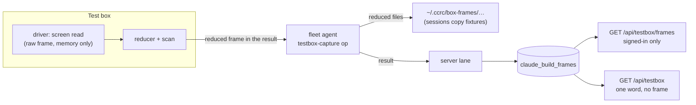

# Box frames: a third recipe on the build capture runner, so each Claude Code build's input box is on record

> **For agentic workers:** REQUIRED SUB-SKILL: Use superpowers:subagent-driven-development (recommended) or
> superpowers:executing-plans to implement this plan task by task. Steps use checkbox (`- [ ]`) syntax for tracking.
> **STEP 1 OF THE WAVE: no code before the coordinator's yes and the capture owner's yes to section 5 (the packet).**

**Goal:** every build the capture lane trusts has its input box drawn on record in fixed shapes: an empty box, tall
drafts around the row cap, a long line in view and scrolled out, a draft typed as a person types, a held stash and a
queued message, each with and without an earlier turn. Each shape is recorded at 220x50 and 220x40. A session can turn a
recorded frame into a test fixture with no file carried by hand. When a new build draws the box in another FORM, the lane
says so in one word on the status read, and the frame itself is not on that read.

**Why now (desktop-polish wave 187).** The console's send presses Enter only on a box it can prove holds its own text, and
those proofs are built from panes of one build, 2.1.300 (`docs/superpowers/plans/2026-10-15-paste-chip-send.md`). The
operator's picture of 2.1.332 shows a tall draft in another form: the top rule carries `↑ 156 more`, and the first row in
view has no prompt glyph. The send no longer recognises its own text, and long pastes sit unsent. Wave 185 (the
tall-draft submit worker) needs the real bytes of that form for its proof and for a second guard. Nothing on the fleet may
run Claude Code (the operator's ruling of 2026-11-10), and the capture lane runs fixed recipes only. Its owner, the
Overlord coordinator, ruled (its call 1549) that frames are a third recipe on the one runner, built as the delivery recipe
was (`docs/superpowers/programs/desktop-polish/paste-delivery.md`).

**Architecture:** the delivery recipe's shape, kept: a pure recipe in `shared/` (the cases, the version, the shape rule),
its result and its one reader in a file of their own (no case text in the capture contract's module graph), the
reducer in `shared/` (pure), the drive in `agent/src/testbox/`, and the product's own driver
(`server/src/inject/deliveryDrive.ts`) for every key typed. A lane decider in `shared/`, the server lane acting on it, a
table of its own, a signed-in read, and a status-read word. Decide in L1, act in L4. No door: nothing starts a capture
but the lane.

**Tech stack:** TypeScript, vitest, `node:sqlite`; `shared/`, `agent/`, `server/`.

**Claims are labelled** **read** (from the code at `origin/main` c435573bc4), **inferred**, or **to measure** (in step 2,
by a named case). Nothing in this plan was run against Claude Code, and nothing will be: the runner's tests drive the fake
build (`agent/test/fixtures/fake-delivery-build.mjs`'s pattern), never Claude Code.

## 1. In short

- **One frame is one capture.** Each frame case runs on a fresh scratch directory and a fresh start of the build, at one
  pane size. So no frame depends on clearing the box between frames, which on a new form is exactly what cannot be
  proved. That gives 44 parts: 22 cases at 220x50 and at 220x40. The lane sends one part a pass, after trust and after
  delivery.
- **Every key comes from the product.** Drafts are typed by the send's own line loop, moved out of `sendPrompt` into
  one exported function that `sendPrompt` itself calls. The stash key is the send's own. The submit and the queued
  message go through `sendPrompt` with the route's options. The driver is the one driver, `deliveryDrive.ts`, with a frames
  input form beside its case form. Two key shapes are the recipe's own and are named as such: the person's typing
  (`person`) and the view moved up inside the box (`view-up`).
- **A frame is reduced on the test box, before it leaves the capture.** No raw frame leaves the test box. It is not
  written to disk there either: it lives in the runner's memory between the screen read and the reducer. The result, the
  stored row, the signed-in read and the fixture files all carry the REDUCED frame only. A frame the reducer cannot clear
  is refused whole, with its rule word: never cut.
- **Where frames are read.** On the server, through a new signed-in read that checks no box token and refuses while
  sign-in is dark. On the fleet box, as files under one fixed directory that the fleet agent writes when it relays an
  answered frames capture. That directory is how a session gets a fixture without the operator carrying a file (section
  5.4, the owner's approval asked). No box-token read carries any frame text.
- **The alarm.** A pure SHAPE rule turns a frame into a signature that keeps its structure and drops the build's own text.
  The rule keeps the row classes, our rows in view, the rule rows' label skeletons, chips, the glyph and the cursor. The
  status read carries one word, `same-form`, `new-form`, `first-form` or `incomplete`, with the ids of the frames that
  differ, and never a frame (section 7).
- **Nothing that exists moves.** The trust recipe, its verdict and its record are untouched. So are the delivery recipe and
  `DELIVERY_RECIPE_VERSION`, which printed `da16fe2f55551e0b` before the first edit. A migration is needed: a table of its
  own (section 5.3).

## 2. What is read today (read)

- **The runner** (`agent/src/testbox/captureRunner.ts#CaptureRunner.run`) sets up one capture, starts the stand-in, starts
  the build in a private tmux server (`-L ccrc-capture`) at a pane size the recipe names (trust 200x50, delivery
  `DELIVERY_PANE` 220x50 with `ccd/tmux.conf`), drives it, and tears it down. A recipe branches at the top of the drive. The
  delivery branch calls `captureDeliveryRun.ts#runDeliveryDrive` with a driver child.
- **The driver** (`server/src/inject/deliveryDrive.ts`) is a server entry point, run compiled from the release tree, never
  imported. It refuses any input but `{capture, tmux, case}`, any scratch or tmux directory but the capture's own, and runs
  tmux only, on the capture's server, through the one socket lookup. It calls the real `sendPrompt` with the route's
  plain-prompt options over the real `Tmux` adapter.
- **The send's keys** (`server/src/inject/send.ts#sendPrompt`): per composed line one `sendLiteral`, with `M-Enter` between
  lines, inline in the send's attempt. The screen is read by `Tmux.captureAnsi` (`capture-pane -p -e`). The stash is
  `C-s` (`stashDraft`). The row cap 2.1.300 drew is `boxRowCap(rows) = floor((rows - 10) / 2)`: 20 at 50 rows, 15 at 40.
  The collapse floor is 800 characters (`PASTE_COLLAPSE_FLOOR`).
- **The contract** (`shared/claudeBuildCapture.ts#CaptureRecipe` = `build-trust | delivery`; `shared/testbox.ts`'s
  `capture.submit` and `capture.state` readers; `shared/agent-protocol.ts#TestboxCaptureReq` and
  `readTestboxCaptureReply`). Every recipe field is additive and read by one reader per frame.
- **The lane** (`server/src/buildCaptureLane.ts`): one capture a pass, trust first, then `deliveryLane.ts#nextDeliveryJob`
  for the newest trusted build only, with no back-fill and an hour's spacing per part. The store is
  `coord/claudeBuildDeliveriesStore.ts`, migration 130's table.
- **The private-name matchers** (read): `shared/private-names.mjs` (the committed, hashed list; `hitsIn`), and the tree
  ratchets `server/test/topology-clean.test.ts` and `private-names.test.ts`, which scan every tracked file, fixtures
  included.

## 3. The frame cases (the first version)

Each case is one capture: start, the model switch (the delivery recipe's `DELIVERY_STEPS_BEFORE`, the same objects), the
case's steps, a frame, `/exit`. Each case runs at both pane sizes, 220x50 (the fleet's pinned window) and 220x40, with
`ccd/tmux.conf` as the delivery recipe has it. A frame's id is `<case>@<cols>x<rows>`.

**The drafts** are fixed texts built from rules, like the delivery cases. They are named by id and never travel on a
wire. A row of a tall draft is `frames row NNN of MMM` (14 to 20 characters, so one draft line is one box row at 220
columns). The long line is 900 characters, built by the delivery recipe's `asciiRun` rule, so it is over the
800-character collapse floor. No draft starts with `/`, `!`, `#` or `@`; the delivery recipe's mode-character pin covers
the frames texts too.

| Case | Steps after the model switch | Draft |
|---|---|---|
| `empty` | frame | none |
| `cap` | type, frame | rows = 2.1.300's cap for the pane (20 at 50, 15 at 40) |
| `cap-over` | type, frame | that cap + 1 |
| `rows-25` | type, frame | 25 rows |
| `rows-180` | type, frame | 180 rows |
| `long-in-view` | type, frame | 180 rows, the LAST one the 900-character line |
| `long-out` | type, frame | 180 rows, the SECOND one the 900-character line |
| `view-up` | type, view-up, frame | 180 rows, then `Up` pressed 60 times |
| `person` | type as a person, frame | the same 180 rows |
| each of the nine above, `+turn` | turn, then the case's steps | one earlier short user turn first |
| `submitted` | send, wait for the turn, frame | the 180 rows, through `sendPrompt` |
| `chip` | type, frame | one line of 900 characters |
| `stash` | type, stash, frame | `frames stash probe ZQX-END-stash` |
| `queued` | held turn, send, frame | `frames queued probe ZQX-END-queued` while a held turn runs |

That is 22 cases at each size, 44 frames a build.

**The steps, and whose keys they are.**
- `type`: the send's own line loop (section 4.1), the same keys `sendPrompt` types and no submit.
- `turn`: `sendPrompt` of `frames earlier turn ZQX-END-turn` with the route's options. The runner waits for the turn's
  Stop (the delivery recipe's settle and quiet), as it does for a delivery case.
- `send`: `sendPrompt` of the 180 rows with the route's options. Its answer word is recorded beside the frame. On a new
  form the send may refuse (`verify-failed`), and then the frame shows the draft left unsent. That is the evidence, not a
  fault. Nothing presses a raw Enter: the only submit is the product's.
- `stash`: the send's own stash key (exported from `send.ts`, section 4.1).
- `held turn`: `sendPrompt` of `frames held turn ZQX-HOLD`, which the stand-in holds open (section 4.3). Once the build's
  UserPromptSubmit is recorded, `send` the queued text, then frame. The runner then releases the hold.
- `view-up`: the recipe's own key shape. `Up` is sent 60 times through the `Tmux` adapter's `sendKey`, one call each.
- `person`: the recipe's own key shape, a second case shape of `type`, named as such. One `sendLiteral` per character,
  15 ms apart, with each line break typed as `\` then `Enter`, the line break Claude Code documents that needs no
  terminal setup. If a build submits on it, the stand-in receives a turn, and the case records that count (section 5.1).
- `frame`: the driver reads the screen through `Tmux.captureAnsi`, the send's own read, so a fixture holds the bytes the
  send reads. It also reads the cursor (`display-message -p '#{cursor_x} #{cursor_y}'`). It reads until two reads 500 ms
  apart are equal, within the frame bound. A frame that never settles is kept, marked `unsettled`.

**What the driver cannot produce, and why.**
- **A box drawn on macOS.** The test box is Linux. macOS reads about 1 KB at a time, which changes chips and lost heads
  (2.1.300 measured both). Not reachable.
- **A real person's typing.** `person` is one tmux call per key at a fixed pause. It is not a keyboard: no key repeat, no
  input method, no paste from a clipboard, and its timing is the test box's. It shows the box drawn from keystrokes that
  arrive one at a time, not every way a person types.
- **A submit by Enter at the terminal.** That would be a second copy of the submit. `submitted` is the product's send
  only. If the send refuses on a new form, the frame after a person's Enter is not on record.
- **The view moved by the mouse wheel**, and any scroll position other than 60 presses of `Up` from the end.
- **The exact row cap of a new build.** `cap` and `cap-over` use 2.1.300's formula. The recipe does not read the box to
  find the cap, because reading this form is what is broken. `rows-25` and `rows-180` exceed any cap seen. The cap a build
  draws is read off those frames by a person or by the shape rule's `T` count (section 7).
- **What a real account and model draw**: the signed-in banner, a real model's spinner and its streaming text, the
  rate-limit menu, the fleet's status line and session hook. The capture has its own settings and the stand-in.

## 4. The drive

### 4.1 The send's keys, one copy (a `send.ts` hunk)

`sendPrompt`'s two-line loop (`if (i > 0) sendKey('M-Enter'); if (!sendLiteral(parts[i])) return type-failed`) moves into
an exported `typeComposedLines(tmux, id, parts): Promise<boolean>`. `sendPrompt` calls it in the same place, with the same
refusal, so its keys do not change. A characterization case pins the send's key log for a three-line text on `main`
before the move and after it. The stash key becomes an exported constant that `stashDraft` reads, `STASH_KEY = 'C-s'`.
`send.ts` is held today by the wave 185 worker (claim 7384): the hunk goes to that worker as a diff packet first.

### 4.2 The driver's frames form

`deliveryDrive.ts` takes a second input form, `{capture, tmux, frames: <step word>}`, beside `{capture, tmux, case}`. The
same directory refusals, the same runner (tmux only, the capture's socket, an environment built from empty), and the
same halt on the first call that could not complete. The step words are fixed:
`type:<case>`, `person:<case>`, `view-up`, `stash`, `send:<case>`, `turn`, `hold`, `frame`. A word names a draft by its
case id. No text crosses the input. The answer stays one JSON line: the send word for a send step, `{"typed":true}` for a
typing step, and `{"frame":<text>,"cursor":[x,y],"settled":<bool>}` for `frame`. The frame step's output cap is
`FRAMES_DRIVER_OUTPUT_MAX` (192 KiB: a 64 KiB frame JSON-escaped); every other step keeps 4096. The driver's input
reader refuses anything else (`bad-input`), pinned per form.

### 4.3 The stand-in's hold

The frames recipe's reply rule answers every request `ccrc frames: ok`, except a request whose last user text contains
`ZQX-HOLD`. That one it holds open until the runner releases it, or for at most `framesHoldMs` (60 s), and then answers
`ccrc frames: ok`. This is an optional field on the text reply (`StandInReply`'s `text` kind gains `holdMs?`). Build
trust's rule never returns one, and a case pins that trust's rule is unchanged over its probe bodies.

### 4.4 The window

Like the delivery drive: the requests and hooks between a case's first step and its frame. The case records how many
turns the stand-in received (by the delivery recipe's one request rule, `deliveryTurnOf`) and how many side requests.
`person` and `view-up` should receive none. A count above zero is reported, never judged.

## 5. Storage, readers and reduction (THE CAPTURE OWNER'S PACKET)

This section and the contract change in 5.6 go to the capture owner as a packet before any code.

### 5.1 The result and its one reader

`shared/framesResult.ts` (L0; imports `shared/` siblings only, and no case text: the drafts live in
`shared/framesCapture.ts`, which the capture contract does not import, as with delivery):

```text
FramesCaptureResult {
  recipe: 'frames'
  version: string            16 lowercase hex (FRAMES_RECIPE_VERSION)
  build: string              the build grammar (isClaudeVersion)
  part: number               0..FRAMES_PART_COUNT-1, echoed
  case: FramesCaseId         a fixed word from the case table
  pane: {cols, rows}         the part's pane, equal to the part's own
  release: string | null     a release tag (isReleaseTag) or null: unknown
  unmeasured: ('fleet-tmux-config')[]   as delivery's
  word: FramesWord           'framed' | 'gaps'
  sends: {step, send}[]      at most 3; step a fixed word, send DELIVERY_SEND_WORD's shape (40 chars)
  turns: number              stand-in turns in the case's window, capped at DELIVERY_COUNT_MAX
  sideRequests: number       the same, capped
  frame: {
    outcome: 'drawn' | 'unsettled' | 'over-cap' | 'refused'
    refusal: FramesReducerRefusal | null    a fixed word, only with 'refused'
    rows: number, width: number, bytes: number   measured, of the frame as read (before reduction)
    cursor: [number, number] | null
    text: string | null      the REDUCED frame; only with 'drawn' or 'unsettled'
  }
}
```

- **Every string field, and its bound.** `recipe`, `case`, `word`, `outcome`, `refusal`, `step` and `unmeasured` are fixed
  words checked against their maps. `version` is 16 hex. `build` is the build grammar. `release` is the release grammar or
  null. `send` is `^[a-z][a-z-]{0,39}$`. `text` is the one free string. It must be at most `FRAME_BYTES_MAX` (65536) UTF-8
  bytes, at most `rows` lines (the pane's), and each line at most `cols` printable code points after its SGR sequences are
  removed. It may hold no control character but ESC and LF, and no escape sequence but SGR (`ESC [ <digits and ;> m`). The
  reader refuses anything else whole. An OSC hyperlink or a cursor sequence is a refused result, not a stripped one.
- **The cap is a refusal, never a cut.** The runner measures the frame as read. Over 50 rows, over 220 printable columns or
  over 65536 bytes, the frame is not carried: `outcome: 'over-cap'`, `text: null`, with the measured `rows`, `width` and
  `bytes`. The reader refuses a `text` over the cap, so the producer never writes one.
- **The word.** `framed` when the frame is `drawn`; `gaps` for `unsettled`, `over-cap` or `refused`. A box fault (a step
  before the case that did not finish, a driver that did not answer or refused its input, a build gone during the case)
  gives no result, as for delivery. The lane spaces it by its hour.
- **One reader**, `readFramesCaptureResult(v, build, part)`, with a case per refusal. A result's whole size is bounded by
  its frame: about 66 KiB at most.

### 5.2 The reducer (pure, L0, with its own cases)

`shared/framesReduce.ts#reduceFrame(frame, ours, privates, scan)`. It runs **on the test box**, in the runner, on the frame
the driver read, before the result is built. The raw frame then goes out of scope, and nothing writes it anywhere.
- `ours`: the case's own typed lines and the fixed texts of its turns and the stand-in's reply (all ours, fixed).
- `privates`: the exact strings this capture knows. They are the home directory and its `~` form, the user name, the host
  name (short and full), the capture's scratch directory, its tmux directory, the release tree's path, the build's file
  path, and the stand-in's `127.0.0.1:<port>`.
- `scan`: the committed private-name matcher (`shared/private-names.mjs#hitsIn` over the committed list), composed by the
  runner, so the reducer stays pure.

The rules, in order. Each has its own case:
1. **Shape gate.** Not a frame by 5.1's rules: refused (`not-a-frame`).
2. **Our rows stay byte for byte.** A row whose text without SGR is a run of `ours` (whitespace squashed, as `send.ts`'s
   `squash` reads it) is kept as read.
3. **Working directory.** A row holding any `privates` string, after SGR is removed, has its content replaced by the fixed
   text `‹working directory›`. The row's leading and trailing border characters (`│`, `╭`, `╰`, spaces) are kept, and the
   text is padded or cut to the content's width, so every row keeps its width. The row's SGR goes with its content.
4. **Model line.** A row naming a model (`opus`, `sonnet`, `haiku`, `fable`, `claude-…`, or the stand-in's
   `ccrc-capture-stand-in`, case-insensitive, as words) becomes `‹model›` by rule 3's layout.
5. **Account and plan line.** A row naming an account or plan (`api usage billing`, `claude pro|max|team|enterprise`,
   `organization`, `account`, `plan`, an `@` followed by a dotted name) becomes `‹account›`.
6. **Status line.** The capture's own settings configure no status line, and a case pins that. So there is no status line
   to replace. A row that rules 3 to 5 catch below the box is replaced like any other row.
7. **The scan, then refuse.** On the reduced text: `scan` hits anything (`private-name`); or a private shape remains
   (`private-shape`). A private shape is an absolute path under `/home/`, `/Users/`, `/root` or `/mnt/`, a `~/` path, an
   email shape, an IPv4 address other than `127.0.0.1`, a dotted host name with a public suffix, or a run of 32 or more
   hex characters (an id or a token). A hit refuses the whole frame (`outcome: 'refused'`, `text: null`, the rule word).
   Nothing is cut out to make it pass.
8. **Idempotent.** `reduceFrame(reduceFrame(f)) = reduceFrame(f)` on every case's fixture, pinned.

Rules 4 and 5 can over-replace a row of the build's own help text that happens to say "plan" or "account". That is the safe
direction: the row keeps its width and its border, so the shape rule sees the same row class.

### 5.3 Where frames are stored, and who can read them

- **The server: a table of its own, so a migration is needed.** `claude_build_frames`, one row per (build, part). The
  columns are `version`, `release`, `word`, `result` (the result's JSON, with the reduced frame), `shape` (the
  signature, section 7), `shapeVersion`, `at`, `attempts`, `lastAttemptAt` and `notSent`. It mirrors migration 130's
  delivery table, which is not altered. Its one writer is the capture lane, through a store file of its own beside
  `claudeBuildDeliveriesStore.ts`, with `CoordStore` keeping the delegates (`store.ts` is held today, claim 7359: a hunk
  packet). The number is the first free one on `main` at my last merge before the push (133 today), mailed to the
  coordinator before the push.
- **Bounded.** The lane keeps `result` for the newest `FRAMES_KEEP_BUILDS` (16) framed builds. An older build's rows
  keep their shape and their word and lose the text. That is one `UPDATE` in the same transaction as a new build's
  first record, and its own case. At 44 frames of at most 66 KiB, that is under 50 MiB at worst. A plain 220x50 frame
  is about 11 to 25 KiB (inferred), so about 1 MiB a build is typical.
- **The signed-in read.** `GET /api/testbox/frames?build=<build>` answers that build's rows: every part's case, pane, word,
  outcome, cursor and reduced text. It is registered from a route file of its own. It asks the account gate first and
  refuses `auth-off` while sign-in is dark. It consults no box token, and is in no EXEMPT table. The census reads the
  file as a lane source and keeps its name in a hand-kept list checked both ways, as `UPDATE_DOORS` does. With a
  session it answers. With the box token alone it answers 401, which a case proves through the route.
- **The builds read and the status read carry no frame text.** `GET /api/testbox/builds` is unchanged. `GET /api/testbox`
  gains `frames` beside `delivery`: section 7's word only.

### 5.4 How a session gets a reduced frame, with no file carried by hand (the owner's approval asked)

There is no server read a session can make that keeps frames off box-token reads. Every session holds the box token and no
session can sign in, so any server read a session can reach is a box-token read. I say so plainly. The route I propose
is the one the owner's condition names, **a file by a fixed path**:

- **The fleet agent writes it.** A frames capture's reply passes through the fleet agent's `testbox-capture` op
  (`agent/src/testboxOp.ts`) on its way to the server. When that reply is `answered` and its frames result passes the one
  reader, the agent writes the reduced frame to
  `~/.ccrc/box-frames/<build>/<frames version>/<case>@<cols>x<rows>.ansi`. Beside it goes `<same>.json`, the record
  without the text: outcome, cursor, sends, turns, release. Each file is written to a temporary name and renamed.
- **The path is built from checked values only:** a build of the build grammar, 16 hex, a fixed case word, and the two
  pane numbers the part names. No free text reaches a path, and a case proves a hostile build string is refused before
  any write.
- **What it holds is what the reducer let out.** The raw frame never reached the fleet box, so the directory can hold
  only reduced frames. Retention: the agent keeps the newest 8 build directories it wrote and removes the rest, by the
  exact paths it derived. That removal is pure (`framesFilesPlan`, L1) and has its own case.
- **A session makes a fixture** by copying a file from that directory into `server/test/fixtures/panes/box/`, named
  `cc<build>-frame-<case>-<cols>x<rows>.ansi`. Two checks then hold it. A new tree test, `box-frame-fixtures.test.ts`,
  runs the reducer's check on every `*-frame-*.ansi` fixture: the frame equals its own reduction, and the scan finds
  nothing. And the tree ratchets (`topology-clean`, `private-names`) scan every tracked file anyway.
- **Who can read the directory.** Every session on the fleet box, as for any file there (one UNIX user). That is the
  audience the box token has. It is acceptable only because the directory holds reduced frames, which are made to be
  committed to a public repository. **If the owner does not accept a fleet-box directory, there is no other route** that
  keeps frames off box-token reads and needs no hand-carried file. The coordinator then raises it.

### 5.5 What travels where



*Figure 1. Where a frame goes. The raw frame never leaves the test box's memory. Every arrow carries the reduced frame,
except the status read, which carries a word.*

### 5.6 The contract change in `shared/` (the packet's second half)

All additive, with no `FLEET_PROTO` or `TESTBOX_PROTO` bump, one reader per field, and the delivery arms unchanged:
- `claudeBuildCapture.ts#CaptureRecipe` gains `frames`. `CaptureRun` and `capture.state` gain an optional `frames` field,
  read by `readFramesCaptureResult`, and only on a frames capture. A delivery or trust capture naming `frames` is
  refused, as a trust capture naming `delivery` is today.
- `testbox.ts`'s `capture.submit` takes `recipe: 'frames'` with a `part` of the frames recipe (`isFramesPart`).
- `agent-protocol.ts#TestboxCaptureReq.recipe` becomes `'delivery' | 'frames'`. `TestboxCaptureReply` gains
  `frames?: FramesCaptureResult | null`, and `readTestboxCaptureReply` gains a frames arm. `agent-protocol.ts` is held
  today (claim 7373): a hunk packet to its holder.
- An older box refuses the frames submission at its frame reader, as with delivery, and the lane records
  `recipe-not-run`. An older fleet agent answers bad request, which the remote arm reads as not-taken on a frames job,
  as on a delivery job.

## 6. The version, the parts, the lane and the cost

- **The version.** `FRAMES_RECIPE_VERSION`, 16 hex. It is computed over every case's id and steps, every draft's text,
  the pane sizes, the part list, the person pause and the `view-up` count, and the reducer's answers on a fixed probe
  table. It is never kept by hand. The shape rule has a version of its own, `FRAME_SHAPE_VERSION`. The server applies the
  shape rule to stored text, so changing that rule re-reads stored frames and asks nothing of the box again.
- **The parts.** One part is one case at one size: `FRAMES_PARTS` is the 22 cases at 220x50, then the same 22 at 220x40,
  so 44. The count is the list's length, not a derivation. A test holds every part's worst case inside the pair bound
  with a trust capture and with the longest part, from the one timing contract (`CaptureTimings` gains
  `framesDriveMs`, `framesPersonDriveMs`, `framesSettleMs` and `framesHoldMs`; no second constant set).
- **The lane.** `shared/framesLane.ts#nextFramesJob`: the newest trusted build only (`deliveryLane.ts#newestTrustedBuild`,
  the same decider), its first part with no current row, spaced by `BUILD_CAPTURE_RETRY_MS` per part, and never skipping
  ahead. It is asked only on a pass that sent no trust job and no delivery job. So the order is trust, then delivery, then
  frames, and the delivery lane's behaviour does not change. One capture at a time, one desk, one runner, as today.
- **A build already framed.** Every part has a current row (this version, a word, a result or its kept shape, and a time):
  nothing is asked, ever, at this version. A new recipe version makes the newest trusted build's rows another recipe's,
  so its parts are asked again. Older builds are never asked again: no back-fill. A build superseded before its frames
  finish stays `incomplete`.
- **The cost per build (inferred until measured).** For a part's worst case, take the delivery part's fixed share: start
  17 s, the start and model-switch steps 85 s, `/exit` 49.5 s, the exit wait 30.5 s and teardown 19.5 s, 201.5 s in all.
  Each driver step adds its bound plus 1 s of grace and 2 s of drain. `frame` is 25 s, so 28 s. `type` is 28 s. A `turn`
  adds 28 s plus the settle and quiet (18 s). `person` is 120 s plus 3 s. So the worst cases are a plain case 257.5 s,
  `+turn` 303.5 s, and `person+turn` 398.5 s, about trust's 399.5 s. A `person+turn` part beside a trust capture is
  828 s with the margin, inside the 900 s wait. The typical run is not measured: perhaps 15 s a part, and 60 to 70 s for
  `person` (2,900 keys at about 20 ms each). That is about 15 minutes of test box time a build. The wall clock is at least
  44 lane passes, one a minute, so about an hour on a quiet box. The first real run's recorded times replace these
  figures in the task note.

## 7. The alarm: what a NEW FORM looks like to the lane

**The property.** Two builds draw the box in the same form when, for every frame id both hold as `drawn` at the same shape
version, their SHAPES are equal. A shape is computed from the reduced text by a pure rule
(`shared/framesShape.ts#frameShape`). It keeps structure and drops the build's own words:
- every row is classed after SGR is removed. `R` is a rule row: a run of `─` of 10 or more, plus its label skeleton,
  the label's characters with every digit run as `9` (so `↑ 156 more` is `↑ 9 more`). `G` is a row that starts with the
  prompt glyph. `T` is a row of our own text (rule 2's test). `C` is a chip row, its skeleton by the same digit rule. `B`
  is a blank row. `X` is any other row, kept only as its indent and its border characters, never its words;
- the dim attribute of `T`, `G` and `C` rows (the send's readers undim, so dim is structural);
- runs: `X` and `B` runs above the last `R`-over-`G` pair collapse to `X+` and `B+`, so a longer banner or scrollback is
  not a new form. Runs of `T`, `C`, `R` and `G` keep their exact counts (the count of `T` rows in view is the row cap);
- the cursor, as its row offset from the box's top rule and its column.

The signature is that token list. It is stored beside the row and hashed for comparison.

**What the status read carries.** `GET /api/testbox`'s `frames`, beside `delivery`, has one of four kinds. `standing` holds
the newest trusted build, the build it is compared against (the previous build with a full current set, or null), a word,
and `differing`: at most 44 frame ids. `no-trusted-build`, `unreadable` and `unknown` are as delivery's are. The word is
one of `same-form`, `new-form`, `first-form` (nothing earlier to compare) or `incomplete` (the newest build's parts are not
all current). Only fixed words, build names and frame ids: no shape tokens and no text. One reader, with the delivery
standing's checks, and a case that feeds a frame holding a marker and finds it in no serialised answer.

**What it cannot see.**
- Words. A changed hint, banner or label word (`more` to `lines above`) inside a row of the same class is the same form.
  Only the digit skeleton of rule labels and chips is kept.
- Behaviour that a settled frame does not show: when an Enter submits, paste detection's timing, the auto-submit split,
  key handling, and what the send does next. The delivery recipe measures the send. Frames record only the drawing.
- Anything outside the 44 frames: other sizes, other drafts, macOS, a real model or account (section 3).
- Colour, except dim on our rows, chips and the glyph.
- A form that differs only in rows the reducer replaced. Those rows keep their class, so a change inside a working
  directory or model line is invisible.
- Two builds that are each wrong the same way. The alarm says "changed", never "fine".

## 8. Tasks (step 2, on both yeses)

- [ ] **F0.** Print `DELIVERY_RECIPE_VERSION` (`da16fe2f55551e0b` at the plan). Packets to the claim holders of
  `send.ts`, `store.ts` and `agent-protocol.ts`, by diff.
- [ ] **F1.** `send.ts`: `typeComposedLines` and `STASH_KEY` moved out; the characterization case first, green on `main`.
- [ ] **F2.** `shared/framesCapture.ts` (cases, drafts, version), `shared/framesResult.ts` (the result and its one reader),
  red first per refusal.
- [ ] **F3.** `shared/framesReduce.ts` and its cases, one per rule. Idempotence over every case shape. The scan
  composed in the agent.
- [ ] **F4.** The contract (section 5.6): submit, state, request and reply readers, each refusal red first.
- [ ] **F5.** The driver's frames form (`deliveryDrive.ts`) with its input refusals and output caps. The stand-in's hold.
- [ ] **F6.** `agent/src/testbox/captureFrames*.ts`: the steps, the frame read, the reduction, the window, the worst case.
  The runner's frames branch. The pair-bound test on the composed runner, with a virtual clock, like G1.
- [ ] **F7.** The fleet agent's file writer and `framesFilesPlan`, with the path-grammar refusals and retention.
- [ ] **F8.** The lane (`framesLane.ts`, `buildCaptureLane.ts`), the migration, the store, the 16-build text bound.
- [ ] **F9.** `shared/framesShape.ts`, the standing, the status read's `frames`, its one reader, and the no-text case.
- [ ] **F10.** The signed-in read and its census entry. The 401 case with the box token alone.
- [ ] **F11.** `box-frame-fixtures.test.ts` over the fixture directory (empty today, so it passes vacuously, with a planted
  case proving it reds).
- [ ] **F12.** The mutation round, through `ccrc test`, the table in the task note
  (`docs/superpowers/programs/desktop-polish/box-frames-recipe.md`). `DELIVERY_RECIPE_VERSION` printed again. The
  whole-tree guards on the exact commit, then one push.

Each guard ships with the case that goes red without it, by name. Every run goes through `ccrc test`, local, in the
foreground. No real tmux of the fleet, no Claude Code, and no live home are touched.

## 9. Departures to record (each "legitimately different", for the coordinator's ledger)

- **frames-driver-form**: the one driver gains a second input form. It is the same entry point, refusals and runner, not
  a second driver.
- **frames-agent-writes-reduced-files**: the fleet agent becomes the writer of `~/.ccrc/box-frames/`. It is another
  process on another host from the server's store, and the only route that keeps frames off box-token reads (section 5.4).
- **frames-reduced-at-source**: the owner's condition reads "stored with the capture's result". The stored result holds
  the REDUCED frame, because no raw frame leaves the test box. The signed-in read therefore shows reduced frames. This is
  stricter than the condition. The alternative, carrying the raw frame too, was rejected, because the raw frame would
  then pass through the fleet agent and sit in `coord.db`.
- **send-type-loop-exported**: `sendPrompt`'s two-line type loop moves into an exported function with no behaviour
  change, so the recipe types the send's own keys from one copy.

## Deviations found

None yet. A deviation found in step 2 is mailed to the coordinator, who issues its number. No placeholder number goes in
the tree.

## Where things stand

- **Agreed:** the brief's frame list, sizes and constraints; one frame a capture; reduction at the source.
- **Waiting on you:** the coordinator's yes to the plan. The capture owner's yes to section 5 (the packet): above all
  the fleet-box directory of 5.4, the reduced-only storage of section 9, and the contract in 5.6.
- **Later:** a console surface for frames (none in this wave). A frames-driven guard in the send is wave 185's work, and
  it feeds on this recipe's first real frames.
