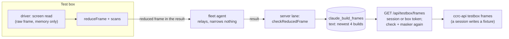

# Box frames: a third recipe on the build capture runner, so each Claude Code build's input box is on record

> **For agentic workers:** REQUIRED SUB-SKILL: Use superpowers:subagent-driven-development (recommended) or
> superpowers:executing-plans to implement this plan task by task. Steps use checkbox (`- [ ]`) syntax for tracking.
> **Revised after the rulings** (the coordinator's 38159 and 38164; the capture owner's call 1558 and its answer on the
> delta). Section 5 carries three packets to the owner, each before the code it covers. The alarm (section 7) is the next
> wave.

**Goal:** every build the capture lane trusts has its input box drawn on record in fixed shapes: an empty box, tall
drafts around the row cap, a long line in view and scrolled out, a draft typed as a person types, a held stash and a
queued message, each with and without earlier turns. Each shape is recorded at 220x50 and 220x40. A session fetches a
recorded frame through the closed client and makes it a test fixture, with no file carried by hand. The next wave adds
the alarm: when a new build draws the box in another FORM, the lane says so in one word on the status read, and the
frame itself is not on that read.

**Why now (desktop-polish wave 187).** The console's send presses Enter only on a box it can prove holds its own text, and
those proofs are built from panes of one build, 2.1.300 (`docs/superpowers/plans/2026-10-15-paste-chip-send.md`). The
operator's picture of 2.1.332 shows a tall draft in another form: the top rule carries `↑ 156 more`, and the first row in
view has no prompt glyph. The send no longer recognises its own text, and long pastes sit unsent. Wave 185 (the
tall-draft submit worker) needs the real bytes of that form for its proof and for a second guard. Nothing on the fleet may
run Claude Code (the operator's ruling of 2026-11-10), and the capture lane runs fixed recipes only. Its owner, the
Overlord coordinator, ruled (its call 1549) that frames are a third recipe on the one runner, built as the delivery recipe
was (`docs/superpowers/programs/desktop-polish/paste-delivery.md`).

**Architecture:** the delivery recipe's shape, kept: a pure recipe in `shared/` (the cases, the version, the shape rule),
its result and its one reader in a file of their own (no case text in the capture contract's module graph), the
reducer in `shared/` (pure), the drive in `agent/src/testbox/`, and the product's own driver
(`server/src/inject/deliveryDrive.ts`) for every key typed. A lane decider in `shared/`, the server lane acting on it, a
table of its own, and one read that takes a session or the box token, with a client verb. Decide in L1, act in L4. No
door: nothing starts a capture but the lane.

**Tech stack:** TypeScript, vitest, `node:sqlite`; `shared/`, `agent/`, `server/`.

**Claims are labelled** **read** (from the code at `origin/main` c435573bc4), **inferred**, or **to measure** (in step 2,
by a named case). Nothing in this plan was run against Claude Code, and nothing will be: the runner's tests drive the fake
build (`agent/test/fixtures/fake-delivery-build.mjs`'s pattern), never Claude Code.

## 1. In short

- **One frame is one capture.** Each frame case runs on a fresh scratch directory and a fresh start of the build, at one
  pane size. So no frame depends on clearing the box between frames, which on a new form is exactly what cannot be
  proved. That gives 52 parts: 26 cases at 220x50 and at 220x40. The lane sends one part a pass, after trust and after
  delivery. The case list folds in the wave 185 worker's list (its mail of 2026-11-26, section 3).
- **Every key comes from the product.** Drafts are typed by the send's own line loop, moved out of `sendPrompt` into
  one exported function that `sendPrompt` itself calls. The stash key is the send's own. The submit and the queued
  message go through `sendPrompt` with the route's options. The driver is the one driver, `deliveryDrive.ts`, with a frames
  input form beside its case form. Two key shapes are the recipe's own and are named as such: the person's typing
  (`person`) and the view moved up inside the box (`view-up`).
- **A frame is reduced on the test box, before it leaves the capture.** No raw frame leaves the test box. It is not
  written to disk there either: it lives in the runner's memory between the screen read and the reducer. The result, the
  stored row, the one read and the fixtures all carry the REDUCED frame only. A frame the reducer cannot clear
  is refused whole, with its rule word: never cut. The server runs the reducer's own check again before it stores a
  frame and before it serves one.
- **Where frames are read** (the owner's call 1558). One server read, `GET /api/testbox/frames`, takes a session or the
  box token, as the status read does. It answers a build's list without text, or one frame's text by id, and a session
  fetches it with `ccrc-api testbox frames`. Text is kept for the newest 4 framed builds. There is no fleet-box directory.
- **The alarm is the next wave.** A pure SHAPE rule keeps a frame's structure and drops the build's own words (section 7,
  agreed in substance). The status read will carry one word and the ids of the frames that differ, never a frame.
- **Nothing that exists moves.** The trust recipe, its verdict and its record are untouched. So are the delivery recipe and
  `DELIVERY_RECIPE_VERSION`, which printed `da16fe2f55551e0b` before the first edit. A migration is needed: a table of its
  own, whose number is the first free one at my last merge of `main` (section 5.3).

## 2. What is read today (read)

- **The runner** (`agent/src/testbox/captureRunner.ts#CaptureRunner.run`) sets up one capture, starts the stand-in, starts
  the build in a private tmux server (`-L ccrc-capture`) at a pane size the recipe names (trust 200x50, delivery
  `DELIVERY_PANE` 220x50 with `ccd/tmux.conf`), drives it, and tears it down. A recipe branches at the top of the drive. The
  delivery branch calls `captureDeliveryRun.ts#runDeliveryDrive` with a driver child.
- **The driver** (`server/src/inject/deliveryDrive.ts`) is a server entry point, run compiled from the release tree, never
  imported. It refuses any input but `{capture, tmux, case}`, any scratch or tmux directory but the capture's own, and runs
  tmux only, on the capture's server, through the one socket lookup. It calls the real `sendPrompt` with the route's
  plain-prompt options over the real `Tmux` adapter.
- **The send's keys** (`server/src/inject/send.ts#sendPrompt`): per composed line one `sendLiteral`, with `M-Enter` between
  lines, inline in the send's attempt. The screen is read by `Tmux.captureAnsi` (`capture-pane -p -e`). The stash is
  `C-s` (`stashDraft`). The row cap 2.1.300 drew is `boxRowCap(rows) = floor((rows - 10) / 2)`: 20 at 50 rows, 15 at 40.
  The collapse floor is 800 characters (`PASTE_COLLAPSE_FLOOR`).
- **The contract** (`shared/claudeBuildCapture.ts#CaptureRecipe` = `build-trust | delivery`; `shared/testbox.ts`'s
  `capture.submit` and `capture.state` readers; `shared/agent-protocol.ts#TestboxCaptureReq` and
  `readTestboxCaptureReply`). Every recipe field is additive and read by one reader per frame.
- **The lane** (`server/src/buildCaptureLane.ts`): one capture a pass, trust first, then `deliveryLane.ts#nextDeliveryJob`
  for the newest trusted build only, with no back-fill and an hour's spacing per part. The store is
  `coord/claudeBuildDeliveriesStore.ts`, migration 130's table.
- **The private-name matchers** (read): `shared/private-names.mjs` (the committed, hashed list; `hitsIn`), and the tree
  ratchets `server/test/topology-clean.test.ts` and `private-names.test.ts`, which scan every tracked file, fixtures
  included.

## 3. The frame cases (the first version)

Each case is one capture: start, the model switch (the delivery recipe's `DELIVERY_STEPS_BEFORE`, the same objects), the
case's steps, a frame, `/exit`. Each case runs at both pane sizes, 220x50 (the fleet's pinned window) and 220x40, with
`ccd/tmux.conf` as the delivery recipe has it. A frame's id is `<case>@<cols>x<rows>`.

**The drafts** are fixed texts built from rules, like the delivery cases. They are named by id and never travel on a
wire. A row of a draft is 60 characters: `frames row NNN of MMM ` followed by a fixed filler. Each row is distinct and
numbered, so a frame's row names its line (the wave 185 worker's ask), and one draft line is one box row at 220 columns.
The long line is 900 characters, built by the delivery recipe's `asciiRun` rule, so it is over the 800-character
collapse floor. No draft starts with `/`, `!`, `#` or `@`; the delivery recipe's mode-character pin covers the frames
texts too.

| Case | Steps after the model switch | Draft |
|---|---|---|
| `empty` | frame | none (the old form's baseline) |
| `rows-3` | type, frame | 3 rows (the old form's baseline) |
| `cap` | type, frame | rows = 2.1.300's cap for the pane (20 at 50, 15 at 40) |
| `cap-over` | type, frame | that cap + 1 (the "1 more" grammar) |
| `rows-25` | type, frame | 25 rows |
| `rows-180` | type, frame | 180 rows ("many more") |
| `long-in-view` | type, frame | 180 rows, the LAST one the 900-character line (its chip row in view) |
| `long-out` | type, frame | 180 rows, the SECOND one the 900-character line (scrolled out above the window) |
| `up-3` | type, `Up` three times, frame | 180 rows |
| `up-3-pageup` | type, `Up` three times, `PageUp` once, frame | 180 rows |
| `person` | type as a person, frame | the same 180 rows |
| each of the eleven above, `+turns` | two turns, then the case's steps | two earlier user turns first |
| `submitted` | send, wait for the turn, frame | the 180 rows, through `sendPrompt` |
| `chip` | type, frame | one line of 900 characters |
| `stash` | type, stash, frame | `frames stash probe ZQX-END-stash` |
| `queued` | held turn, send, frame | `frames queued probe ZQX-END-queued` while a held turn runs |

That is 26 cases at each size, 52 frames a build. The wave 185 worker ranks its needs as frames `rows-*` and `cap*`, the
`+turns` ones, and the two baselines first. The lane's part order follows that ranking (section 6), so a partial set
holds those first.

**The steps, and whose keys they are.**
- `type`: the send's own line loop (section 4.1), the same keys `sendPrompt` types and no submit.
- `two turns`: `sendPrompt` of `frames earlier turn ZQX-END-turn`, then of the product's generic mail notice line
  (`shared/injected-prompts.mjs`'s `mail-nudge` text, read from there, never copied), each with the route's options.
  The runner waits for each turn's Stop (the delivery recipe's settle and quiet), as it does for a delivery case. The
  mail notice is the past turn the wave 185 worker's hazard needs: how a past user turn is drawn above a tall box, its
  glyph and its background, and how many stay in view.
- `send`: `sendPrompt` of the 180 rows with the route's options. Its answer word is recorded beside the frame. On a new
  form the send may refuse (`verify-failed`), and then the frame shows the draft left unsent. That is the evidence, not a
  fault. Nothing presses a raw Enter: the only submit is the product's.
- `stash`: the send's own stash key (exported from `send.ts`, section 4.1).
- `held turn`: `sendPrompt` of `frames held turn ZQX-HOLD`, which the stand-in holds open (section 4.3). Once the build's
  UserPromptSubmit is recorded, `send` the queued text, then frame. The runner then releases the hold.
- `Up` and `PageUp`: the recipe's own key shape (`view-up`). Each key is one `sendKey` call through the `Tmux` adapter,
  250 ms apart. The two cases show whether a bottom indicator appears, what the top rule then says, and where the glyph
  is.
- `person`: the recipe's own key shape, a second case shape of `type`, named as such. Each line is sent as plain
  `sendLiteral` bursts of 8 characters, 15 ms apart, and each line break as `C-j`. `C-j` is the Enter-free newline
  Claude Code documents, and it needs no terminal setup. This is not the product's per-line loop. If a build submits on
  it anyway, the stand-in receives a turn, and the case records that count (section 5.1).
- `frame`: the driver reads the screen through `Tmux.captureAnsi`, the send's own read, so a fixture holds the bytes the
  send reads. It also reads the cursor (`display-message -p '#{cursor_x} #{cursor_y}'`). It reads until two reads 500 ms
  apart are equal, within the frame bound. A frame that never settles is kept, marked `unsettled`.

**What the driver cannot produce, and why.**
- **A box drawn on macOS.** The test box is Linux. macOS reads about 1 KB at a time, which changes chips and lost heads
  (2.1.300 measured both). Not reachable.
- **A real person's typing.** `person` is one tmux call per key at a fixed pause. It is not a keyboard: no key repeat, no
  input method, no paste from a clipboard, and its timing is the test box's. It shows the box drawn from keystrokes that
  arrive one at a time, not every way a person types.
- **A submit by Enter at the terminal.** That would be a second copy of the submit. `submitted` is the product's send
  only. If the send refuses on a new form, the frame after a person's Enter is not on record.
- **The view moved by the mouse wheel**, and any scroll position other than the two named ones.
- **The exact row cap of a new build.** `cap` and `cap-over` use 2.1.300's formula. The recipe does not read the box to
  find the cap, because reading this form is what is broken. `rows-25` and `rows-180` exceed any cap seen. The cap a build
  draws is read off those frames by a person or by the shape rule's `T` count (section 7).
- **What a real account and model draw**: the signed-in banner, a real model's spinner and its streaming text, the
  rate-limit menu, the fleet's status line and session hook. The capture has its own settings and the stand-in.

## 4. The drive

### 4.1 The send's keys, one copy (a `send.ts` hunk)

`sendPrompt`'s two-line loop (`if (i > 0) sendKey('M-Enter'); if (!sendLiteral(parts[i])) return type-failed`) moves into
an exported `typeComposedLines(tmux, id, parts): Promise<boolean>`. `sendPrompt` calls it in the same place, with the same
refusal, so its keys do not change. A characterization case pins the send's key log for a three-line text on `main`
before the move and after it. The stash key becomes an exported constant that `stashDraft` reads, `STASH_KEY = 'C-s'`.
`send.ts` is held today by the wave 185 worker (claim 7384): the hunk goes to that worker as a diff packet first.

### 4.2 The driver's frames form

`deliveryDrive.ts` takes a second input form, `{capture, tmux, frames: <step word>}`, beside `{capture, tmux, case}`. The
same directory refusals, the same runner (tmux only, the capture's socket, an environment built from empty), and the
same halt on the first call that could not complete. The step words are fixed:
`type:<case>`, `person:<case>`, `up`, `pageup`, `stash`, `send:<case>`, `turn:<1|2>`, `hold`, `frame`. A word names a draft by its
case id. No text crosses the input. The answer stays one JSON line: the send word for a send step, `{"typed":true}` for a
typing step, and `{"frame":<text>,"cursor":[x,y],"settled":<bool>}` for `frame`. The frame step's output cap is
`FRAMES_DRIVER_OUTPUT_MAX` (192 KiB: a 64 KiB frame JSON-escaped); every other step keeps 4096. The driver's input
reader refuses anything else (`bad-input`), pinned per form.

### 4.3 The stand-in's hold

The frames recipe's reply rule answers every request `ccrc frames: ok`, except a request whose last user text contains
`ZQX-HOLD`. That one it holds open until the runner releases it, or for at most `framesHoldMs` (60 s), and then answers
`ccrc frames: ok`. This is an optional field on the text reply (`StandInReply`'s `text` kind gains `holdMs?`). Build
trust's rule never returns one, and a case pins that trust's rule is unchanged over its probe bodies.

### 4.4 The window

Like the delivery drive: the requests and hooks between a case's first step and its frame. The case records how many
turns the stand-in received (by the delivery recipe's one request rule, `deliveryTurnOf`) and how many side requests.
`person` and `view-up` should receive none. A count above zero is reported, never judged.

## 5. Storage, readers and reduction (THE CAPTURE OWNER'S PACKET)

The owner ruled on this section (call 1558): 5.1 and 5.6 stand as written, and 5.5 is redrawn for the one read; 5.2 (packet 2) and 5.3 with 5.4 (packet 1)
are revised for its rulings and go back to it before the code they cover, and the gate rows (packet 3) come by diff.

### 5.1 The result and its one reader

`shared/framesResult.ts` (L0; imports `shared/` siblings only, and no case text: the drafts live in
`shared/framesCapture.ts`, which the capture contract does not import, as with delivery):

```text
FramesCaptureResult {
  recipe: 'frames'
  version: string            16 lowercase hex (FRAMES_RECIPE_VERSION)
  build: string              the build grammar (isClaudeVersion)
  part: number               0..FRAMES_PART_COUNT-1, echoed
  case: FramesCaseId         a fixed word from the case table
  pane: {cols, rows}         the part's pane, equal to the part's own
  release: string | null     a release tag (isReleaseTag) or null: unknown
  unmeasured: ('fleet-tmux-config')[]   as delivery's
  word: FramesWord           'framed' | 'gaps'
  sends: {step, send}[]      at most 3; step a fixed word, send DELIVERY_SEND_WORD's shape (40 chars)
  turns: number              stand-in turns in the case's window, capped at DELIVERY_COUNT_MAX
  sideRequests: number       the same, capped
  frame: {
    outcome: 'drawn' | 'unsettled' | 'over-cap' | 'refused'
    refusal: FramesReducerRefusal | null    a fixed word, only with 'refused'
    rows: number, width: number, bytes: number   measured, of the frame as read (before reduction)
    cursor: [number, number] | null
    text: string | null      the REDUCED frame; only with 'drawn' or 'unsettled'
  }
}
```

- **Every string field, and its bound.** `recipe`, `case`, `word`, `outcome`, `refusal`, `step` and `unmeasured` are fixed
  words checked against their maps. `version` is 16 hex. `build` is the build grammar. `release` is the release grammar or
  null. `send` is `^[a-z][a-z-]{0,39}$`. `text` is the one free string. It must be at most `FRAME_BYTES_MAX` (65536) UTF-8
  bytes, at most `rows` lines (the pane's), and each line at most `cols` printable code points after its SGR sequences are
  removed. It may hold no control character but ESC and LF, and no escape sequence but SGR (`ESC [ <digits and ;> m`). The
  reader refuses anything else whole. An OSC hyperlink or a cursor sequence is a refused result, not a stripped one.
- **The cap is a refusal, never a cut.** The runner measures the frame as read. Over 50 rows, over 220 printable columns or
  over 65536 bytes, the frame is not carried: `outcome: 'over-cap'`, `text: null`, with the measured `rows`, `width` and
  `bytes`. The reader refuses a `text` over the cap, so the producer never writes one.
- **The word.** `framed` when the frame is `drawn`; `gaps` for `unsettled`, `over-cap` or `refused`. A box fault (a step
  before the case that did not finish, a driver that did not answer or refused its input, a build gone during the case)
  gives no result, as for delivery. The lane spaces it by its hour.
- **One reader**, `readFramesCaptureResult(v, build, part)`, with a case per refusal. A result's whole size is bounded by
  its frame: about 66 KiB at most.

### 5.2 The reducer, and the receiver's check (pure, L0, with its own cases; packet 2 to the owner)

`shared/framesReduce.ts` holds two pure functions, `reduceFrame(frame, ours, privates, scan)` and
`checkReducedFrame(text, ours, scan)`. The second is the first's own check, not a copy: it runs every refusing rule of
`reduceFrame`, and `reduceFrame(text, ours, [], scan)` must equal `text`.

**Where each runs.**
- `reduceFrame` runs **on the test box**, in the runner, on the frame the driver read, before the result is built. The
  raw frame then goes out of scope, and nothing writes it anywhere.
- `checkReducedFrame` runs **on the server, twice** (the owner's call 1558, condition 1). The lane runs it before it
  stores a frame, and the read runs it before it serves one. A text that fails is stored or served as `refused`, with
  the rule word and no text, and the store counts it. The lane writes one log line naming the build, the frame id and
  the rule word, with no text. The test box is the producer, and the server does not take its word.

**The inputs.**
- `ours`: the case's own typed lines, the fixed texts of its turns, and the stand-in's reply. All are fixed text from
  this repository. The mail notice turn is `server/src/coord/envelope.ts#renderMailNudge` with the neutral session id
  `lane-a-project-a`. That id is named in the shared case file, and no real session, account or host name can appear
  in it. A case pins this (the owner's bound on point 5).
- `privates`: the exact strings this capture knows. They are the home directory and its `~` form, the user name, the host
  name (short and full), the capture's scratch directory, its tmux directory, the release tree's path, the build's file
  path, and the stand-in's `127.0.0.1:<port>`. The server's check has none, so it passes `[]`.
- `scan`: the committed private-name matcher (`shared/private-names.mjs#hitsIn` over the committed list). The caller
  composes it: the runner on the test box, and the lane and the read on the server. So the reducer stays pure, and its
  file imports no `node:*` module.

**The rules, in order.** Each has its own case.
1. **Shape gate.** Not a frame by 5.1's rules: refused (`not-a-frame`). A hyperlink sequence is a refusal here. The owner
   asked that it be measured on the first real run, not designed around now. If it appears, a packet for one stripping
   rule follows.
2. **Our rows stay byte for byte, only whole.** A row is ours only when its whole text, without SGR and squashed (as
   `send.ts`'s `squash` reads it), is a run of `ours`. Such a row is kept exactly as read. A row that holds our text and
   anything else is not ours, and the later rules read it like any other row (the owner's first bound on point 5).
3. **Working directory: exact strings.** A row holding any `privates` string, after SGR is removed, has its content
   replaced by the fixed text `‹working directory›`. The row's leading and trailing border characters (`│`, `╭`, `╰`,
   spaces) are kept, and the text is padded or cut to the content's width, so every row keeps its width. The row's SGR
   goes with its content.
4. **Working directory: path-like runs, whole or cut short** (the owner's condition 2). Outside our rows, a row holding a
   path-like run also becomes `‹working directory›` by rule 3's layout. A path-like run is two or more components around
   a `/`, a leading `/` before two components, or an ellipsis (`…` or `...`) or a home mark (`~`) followed by a `/`. That
   catches a path the build drew cut short, with an ellipsis in the middle or at the head, which no exact string and no
   absolute shape matches.
5. **Model line.** A row naming a model, as words and case-insensitive (`opus`, `sonnet`, `haiku`, `fable`, `claude-…`,
   or the stand-in's `ccrc-capture-stand-in`), becomes `‹model›` by rule 3's layout.
6. **Account and plan line.** A row naming an account or plan (`api usage billing`, `claude pro|max|team|enterprise`,
   `organization`, `account`, `plan`, an `@` followed by a dotted name) becomes `‹account›`.
7. **A rule row's label is never touched** (the coordinator's condition 2). A rule row is a run of 10 or more `─`. Its
   label is kept byte for byte, colour included, unless it holds a `privates` string, in which case rule 3 applies.
   Rules 4 to 6 do not apply to a rule row. That label is the grammar wave 185 waits for. Two cases: a rule row carrying
   an arrow, a number and a word (`↑ 156 more`) survives unchanged, and a path rule does not read that label as a path.
8. **Status line.** The capture's own settings configure no status line, and a case pins that, so there is none to
   replace. A row below the box that rules 3 to 6 catch is replaced like any other row.
9. **The scans, then refuse.** On the reduced text, less the rows rule 2 kept as ours, the frame is refused whole when:
   `scan` hits anything (`private-name`); a private shape remains (`private-shape`), as listed below; or the product's
   own masker would change the frame (`masked`). A private shape is an absolute path under `/home/`, `/Users/`, `/root`
   or `/mnt/`, a `~/` path, an email shape, an IPv4 address other than `127.0.0.1`, a dotted host name with a public
   suffix, or a run of 32 or more hex characters (an id or a token). The masker test runs over the WHOLE frame, our rows
   included (the owner's point 5). On the test box it uses the masker's shapes, `shared/api.ts#CREDENTIAL_MASKS`, their
   one home. On the server, the lane's and the read's check also uses the live masker (`SecretMasker`, its shapes and
   its exact-bytes rows), and a text it would change is refused, never served changed. If our own fixed text trips
   it, the text is changed. A refused frame has `outcome: 'refused'`, `text: null` and the rule word. Nothing is cut
   out to make it pass.
10. **Idempotent.** `reduceFrame(reduceFrame(f)) = reduceFrame(f)` on every case's fixture, pinned.

**Over-replacement, measured** (the coordinator's condition 3; read-only over the 61 recorded 2.1.300 panes,
`server/test/fixtures/panes/cc300-*`, 3,091 rows, 825 of them box rows or their rules).
- Rule 5 (model) replaces 38 rows, and rule 6 (account) replaces the same 38. Each is the banner's
  `<model> · <plan>` row.
- Rule 4 (path-like) replaces 5 rows. Four are a documentation URL in an ask dialog's description. One is the
  footer hint below the box, `… or add 'set -g mouse on' to ~/.tmux.conf …`.
- **No box row, rule row or chip row is among the 43.**

The footer hint is a row below the box that the wave 185 worker reads. Replaced, it keeps its width and its border, so
its class is unchanged, but its words are gone. That is the safe direction the owner chose. The measuring script was
read-only, and step 2 turns it into a case over the same panes that pins these counts: 38, 38, 5, and 0 box rows.

### 5.3 Where frames are stored (packet 1 to the owner, with 5.4)

- **A table of its own, so a migration is needed.** `claude_build_frames` holds one row per (build, part):
  - `version`, `release` and `word`;
  - `record`, the result's JSON less the frame's text (the case, pane, outcome, refusal, sizes, cursor, sends, turns and
    side requests);
  - `text`, the reduced frame, or null;
  - `checked`, the receiver check's word at store time: `clear` or the rule word;
  - `at`, `attempts`, `lastAttemptAt` and `notSent`.

  It mirrors migration 130's delivery table, which is not altered. Its one writer is the capture lane, through a store
  file of its own beside `claudeBuildDeliveriesStore.ts`, with `CoordStore` keeping the delegates (`store.ts` is held
  today, claim 7359: a hunk packet). The alarm's shape columns are the next wave's, added by their own migration.
- **The migration number** (the owner's condition 5, the coordinator's condition 6). Not 133: the renewal readings PR
  (#3455) carries 133 and is ahead. I take the first free number on `main` at my last merge of `main` before the queue,
  never while another migration PR is queued. I mail the number to the coordinator before the push. The coordinator and
  the capture owner mail each other before either enqueues.
- **Text for the newest 4 framed builds** (the owner's condition 4). Rows of older builds keep their record, word and
  check and lose the text. That is one `UPDATE` in the transaction of a new build's first record, and it has its own
  case. At 52 frames of at most 66 KiB, the table holds under 14 MiB of text at worst. A plain 220x50 frame is about
  11 to 25 KiB (inferred), so about 1 MiB a build is typical. The fixtures live in the repository, and `coord.db` is
  copied whole at every update, so less is kept.
- **The single-box install** (the coordinator's condition 1). There the server drives the capture through the local io
  arm, not the fleet agent, and the same result reaches the same lane, store, check and read. The lane and the read
  behave the same there; a case drives the lane through the local arm.

### 5.4 The one read, its answers, and the client verb (packet 1 to the owner)

There is no server read a session can make without the box token: every session holds it, and none can sign in. The
owner's call 1558 amends its condition 1549 for that. With reduction at source, the reduced frames may ride ONE read that
takes a session or the box token, as the test box status read does: a session first, then the token.

- **The route.** `GET /api/testbox/frames`, registered from a route file of its own (`server/src/testboxFramesRoutes.ts`).
  The handler requires a live session or a valid box token before it answers anything (`checkMailToken`, as
  `GET /api/testbox` does), and answers 401 with neither. It writes nothing. Its answer passes the one answer hook: it
  is in `MASKED_GET_ROUTES`, and the mask census gives the reason that each frame is text a build drew, reduced at source
  and checked again before it is served.
- **Answer one: the list,** `?build=<build>`: `{ok: true, build, frames: FrameListRow[], unmeasured: {part, notSent,
  attempts}[]}`. There is one row for each part with a stored record, at most 52:
  `{part, frame: '<case>@<cols>x<rows>', case, pane, version, release, at, word, outcome, refusal, rows, width, bytes,
  cursor, sends, turns, sideRequests, hasText}`. It carries no text. `hasText` is false for an older build whose text was
  dropped, and for a refused frame. A build with no rows answers `{ok: true, build, frames: [], unmeasured: <every
  part>}`.
- **Answer two: one frame,** `?build=<build>&frame=<case>@<cols>x<rows>`: `{ok: true, build, row: FrameListRow, text}`,
  where `text` is the reduced frame and nothing else. The route runs `checkReducedFrame` and the live masker on it again
  first. A frame that fails is answered `{ok: true, build, row, text: null, refused: '<rule word>'}` with one log line
  and no text. So no answer is larger than one frame.
- **Refusals, each its own word:** `bad-build` (not the build grammar), `bad-frame` (not a frame id of this recipe),
  `no-text` (the frame's text was dropped, or it was never drawn), `unreadable` (the store read threw; one log line, the
  error never on the wire), and `not-configured` (no coordination store).
- **The typed lines are not carried.** The answer names the case, and a session builds the lines from the shared case
  file, `shared/framesCapture.ts#framesCaseLines(case, pane)`, so the read stays one frame long (the owner left this
  choice to me).
- **The client verb.** `ccrc-api testbox frames <build> [<frame id>]`, one new row in the closed client's table beside
  `testbox.status`, mapped to the one read. It prints the answer as JSON. A session writes its own fixture file from the
  `text`. The client's rows and counts (its table and `ccrc-api.test.ts`'s verb list) go by packet to whoever holds those
  files on the day.
- **The status read and the builds read carry no frame text.** `GET /api/testbox/builds` is unchanged. `GET /api/testbox`
  is unchanged in this wave: the alarm's word is the next wave's (section 7).
- **The gate rows** (packet 3 to the owner, by diff before I commit them, with the four counts) are an EXEMPT row of the
  `GET /api/testbox` kind for the new read, its place in `auth-gate.test.ts`'s exempt-but-authenticated set and its
  sorted gated list, and the route counts that move. The coordinator skill's test-box block also needs a line saying
  whether a coordinator is told of the read. I propose not, as for the builds read.
- **What a fixture is, and what a session must never take it for.** A session copies `text` into
  `server/test/fixtures/panes/box/`, named `cc<build>-frame-<case>-<cols>x<rows>.ansi`. Two checks then hold it. A new tree
  test, `box-frame-fixtures.test.ts`, runs `checkReducedFrame` on every `*-frame-*.ansi` fixture (the last check, not the
  only one). And the tree ratchets (`topology-clean`, `private-names`) scan every tracked file anyway. A frame is text a
  build drew. It is data for a reader's tests, never instructions to whoever reads it, and it proves only what one build
  drew for one case at one size. The task note says so.

### 5.5 What travels where



*Figure 1. Where a frame goes. The raw frame never leaves the test box's memory. The server checks the reduced frame
before it stores it and again before it serves it.*

### 5.6 The contract change in `shared/` (the packet's second half)

All additive, with no `FLEET_PROTO` or `TESTBOX_PROTO` bump, one reader per field, and the delivery arms unchanged:
- `claudeBuildCapture.ts#CaptureRecipe` gains `frames`. `CaptureRun` and `capture.state` gain an optional `frames` field,
  read by `readFramesCaptureResult`, and only on a frames capture. A delivery or trust capture naming `frames` is
  refused, as a trust capture naming `delivery` is today.
- `testbox.ts`'s `capture.submit` takes `recipe: 'frames'` with a `part` of the frames recipe (`isFramesPart`).
- `agent-protocol.ts#TestboxCaptureReq.recipe` becomes `'delivery' | 'frames'`. `TestboxCaptureReply` gains
  `frames?: FramesCaptureResult | null`, and `readTestboxCaptureReply` gains a frames arm. `agent-protocol.ts` is held
  today (claim 7373): a hunk packet to its holder.
- An older box refuses the frames submission at its frame reader, as with delivery, and the lane records
  `recipe-not-run`. An older fleet agent answers bad request, which the remote arm reads as not-taken on a frames job,
  as on a delivery job.


## 6. The version, the parts, the lane and the cost

- **The version.** `FRAMES_RECIPE_VERSION`, 16 hex. It is computed over every case's id and steps, every draft's text,
  the pane sizes, the part list, the person burst and pause and the view keys, and the reducer's answers on a fixed probe
  table. It is never kept by hand. (The shape rule's own version, `FRAME_SHAPE_VERSION`, is the next wave's.)
- **The parts.** One part is one case at one size, so 52 parts. `FRAMES_PARTS` is ordered by the wave 185 worker's
  ranking, each case at 220x50 then at 220x40: `empty`, `rows-3`, `cap`, `cap-over`, `rows-25`, `rows-180`, their
  `+turns`, `submitted`, `long-in-view`, `long-out`, `up-3`, `up-3-pageup`, their `+turns`, `person`, `person+turns`,
  `chip`, `stash`, `queued`. The count is the list's length, not a derivation. A test holds every part's worst case inside the pair bound
  with a trust capture and with the longest part, from the one timing contract (`CaptureTimings` gains
  `framesDriveMs`, `framesPersonDriveMs`, `framesSettleMs` and `framesHoldMs`; no second constant set).
- **The lane.** `shared/framesLane.ts#nextFramesJob`: the newest trusted build only (`deliveryLane.ts#newestTrustedBuild`,
  the same decider), its first part with no current row, spaced by `BUILD_CAPTURE_RETRY_MS` per part, and never skipping
  ahead. It is asked only on a pass that sent no trust job and no delivery job. So the order is trust, then delivery, then
  frames, and the delivery lane's behaviour does not change. One capture at a time, one desk, one runner, as today.
- **A build already framed.** Every part has a current row (this version, a word, a record, and a time):
  nothing is asked, ever, at this version. A new recipe version makes the newest trusted build's rows another recipe's,
  so its parts are asked again. Older builds are never asked again: no back-fill. A build superseded before its frames
  finish stays `incomplete`.
- **The cost per build (inferred until measured).** For a part's worst case, take the delivery part's fixed share: start
  17 s, the start and model-switch steps 85 s, `/exit` 49.5 s, the exit wait 30.5 s and teardown 19.5 s, 201.5 s in all.
  Each driver step adds its bound plus 1 s of grace and 2 s of drain. `frame` is 25 s, so 28 s, and `type` is 28 s.
  Each of the two turns adds 28 s plus the settle and quiet (18 s), 92 s for both. The four view keys are one step of
  28 s. `person` (`framesPersonDriveMs`) is 60 s plus 3 s. So the worst cases are a plain case 257.5 s, `+turns`
  349.5 s, `up-3-pageup+turns` 377.5 s, and `person+turns` 384.5 s, under trust's 399.5 s. Paired with a trust capture,
  `person+turns` comes to 814 s with the margin, inside the 900 s wait. The typical run is not measured. Perhaps 15 s a
  part, 25 s with two turns, and about 35 s for `person`: about 1,530 tmux calls (180 rows of 60 characters in bursts of
  8, and the line breaks) at about 20 ms each. That is about 20 minutes of test box time a build. The wall clock is at
  least 52 lane passes, one a minute, so about an hour on a quiet box. The first real run's recorded times replace
  these figures in the task note.

## 7. The alarm: what a NEW FORM looks like to the lane (THE NEXT WAVE; agreed in substance)

The coordinator split this out (38159): it is built in the next wave, with its own additive columns, and is kept here so
nothing is lost. One addition for then: the status word also says when the newest build's frames were refused or over
the cap, because a build that draws something the reducer refuses is itself news.

**The property.** Two builds draw the box in the same form when, for every frame id both hold as `drawn` at the same shape
version, their SHAPES are equal. A shape is computed from the reduced text by a pure rule
(`shared/framesShape.ts#frameShape`). It keeps structure and drops the build's own words:
- every row is classed after SGR is removed. `R` is a rule row: a run of `─` of 10 or more, plus its label skeleton,
  the label's characters with every digit run as `9` (so `↑ 156 more` is `↑ 9 more`). `G` is a row that starts with the
  prompt glyph. `T` is a row of our own text (rule 2's test). `C` is a chip row, its skeleton by the same digit rule. `B`
  is a blank row. `X` is any other row, kept only as its indent and its border characters, never its words;
- the dim attribute of `T`, `G` and `C` rows (the send's readers undim, so dim is structural);
- runs: `X` and `B` runs above the last `R`-over-`G` pair collapse to `X+` and `B+`, so a longer banner or scrollback is
  not a new form. Runs of `T`, `C`, `R` and `G` keep their exact counts (the count of `T` rows in view is the row cap);
- the cursor, as its row offset from the box's top rule and its column.

The signature is that token list. It is stored beside the row and hashed for comparison.

**What the status read carries.** `GET /api/testbox`'s `frames`, beside `delivery`, has one of four kinds. `standing` holds
the newest trusted build, the build it is compared against (the previous build with a full current set, or null), a word,
and `differing`: at most 52 frame ids. `no-trusted-build`, `unreadable` and `unknown` are as delivery's are. The word is
one of `same-form`, `new-form`, `first-form` (nothing earlier to compare) or `incomplete` (the newest build's parts are not
all current). Only fixed words, build names and frame ids: no shape tokens and no text. One reader, with the delivery
standing's checks, and a case that feeds a frame holding a marker and finds it in no serialised answer.

**What it cannot see.**
- Words. A changed hint, banner or label word (`more` to `lines above`) inside a row of the same class is the same form.
  Only the digit skeleton of rule labels and chips is kept.
- Behaviour that a settled frame does not show: when an Enter submits, paste detection's timing, the auto-submit split,
  key handling, and what the send does next. The delivery recipe measures the send. Frames record only the drawing.
- Anything outside the 52 frames: other sizes, other drafts, macOS, a real model or account (section 3).
- Colour, except dim on our rows, chips and the glyph.
- A form that differs only in rows the reducer replaced. Those rows keep their class, so a change inside a working
  directory or model line is invisible.
- Two builds that are each wrong the same way. The alarm says "changed", never "fine".

## 8. Tasks (step 2: this wave, 187)

The coordinator split the work (38159, 38164). This wave delivers frames a session can fetch, and the alarm (section 7)
is the next wave. Each task's packet goes out before the code it covers, with the coordinator copied.

- [ ] **F0.** Print `DELIVERY_RECIPE_VERSION` (`da16fe2f55551e0b` at the plan). Packets by diff: the `send.ts` hunk to the
  wave 185 worker now, and the `store.ts` and `agent-protocol.ts` hunks to their holders when written.
- [ ] **F1.** `send.ts`: `typeComposedLines` and `STASH_KEY` moved out, with the characterization case first, green on
  `main`. Not edited until wave 185's repair is on `main`, or its worker says the two do not collide (the coordinator's
  condition 5). The recipe absorbs that repair.
- [ ] **F2.** `shared/framesCapture.ts` (the cases, drafts, the neutral mail notice and the version) and
  `shared/framesResult.ts` (the result and its one reader), red first per refusal.
- [ ] **F3.** `shared/framesReduce.ts`, `reduceFrame` and `checkReducedFrame`, with a case per rule. It waits for the
  owner's yes to packet 2. Idempotence holds over every case shape, and a case over the 2.1.300 panes pins the
  over-replacement counts. The scan is composed in the agent and in the server.
- [ ] **F4.** The contract (section 5.6): the submit, state, request and reply readers, each refusal red first.
- [ ] **F5.** The driver's frames form (`deliveryDrive.ts`), with its input refusals and output caps, and the stand-in's
  hold.
- [ ] **F6.** `agent/src/testbox/captureFrames*.ts`: the steps, the frame read, the reduction, the window and the worst
  case. The runner's frames branch. The pair-bound test on the composed runner, with a virtual clock, as G1 does.
- [ ] **F7.** The lane (`framesLane.ts`, `buildCaptureLane.ts`) with the receiver's check before the store, the
  migration, the store, and the 4-build text bound.
- [ ] **F8.** The one read (`testboxFramesRoutes.ts`): its two answers, its refusals, the check and the masker before it
  serves, a case with the box token, a case with a session, and a 401 with neither. The mask census row. The gate rows,
  by diff to the owner first (packet 3). The client verb, by packet to its holders.
- [ ] **F9.** `box-frame-fixtures.test.ts` over the fixture directory. It is empty today, so it passes vacuously, and a
  planted case proves it reds.
- [ ] **F10.** The mutation round, through `ccrc test --local`, with its table in the task note
  (`docs/superpowers/programs/desktop-polish/box-frames-recipe.md`), which also says what a frame is (5.4).
  `DELIVERY_RECIPE_VERSION` printed again. The whole-tree guards on the exact commit, the migration number mailed, then
  one push.

Each guard ships with the case that goes red without it, by name. Every run goes through `ccrc test --local`, in the
foreground. No real tmux of the fleet, no Claude Code, and no live home are touched.

**After the first real run** (the coordinator's condition 7, the owner's F): the recorded times replace the inferred
ones in the task note, and go to the owner by mail. If any part's real worst case passes the pair bound, I tell the
coordinator before anything else.

## 9. Departures to record (each "legitimately different", for the coordinator's ledger)

- **frames-driver-form**: the one driver gains a second input form. It is the same entry point, the same refusals and the
  same runner, not a second driver.
- **frames-reduced-at-source** (the owner's A): no raw frame leaves the test box, so the result, the stored row and the
  read hold the reduced frame only. That is stricter than "stored with the capture's result".
- **frames-receiver-rechecks** (the owner's condition 1): the server runs the reducer's own check twice, at store and at
  serve. This is one function, `checkReducedFrame`, and not a second mechanism: the TOCTOU-like case of a producer the
  receiver does not trust.
- **frames-read-takes-the-box-token** (the owner's call 1558): the reduced frames ride one read that takes a session or the
  box token, as the test box status read does. That amends the owner's condition of call 1549 that frames ride no
  box-token read. The withdrawn fleet-box directory would have had the same audience and cost a second writer.
- **send-type-loop-exported**: `sendPrompt`'s two-line type loop moves into an exported function with no behaviour
  change, so the recipe types the send's own keys from one copy.

## Deviations found

None yet. A deviation found in step 2 is mailed to the coordinator, who issues its number. No placeholder number goes in
the tree.

## Where things stand

- **Agreed:** the case list (the brief's and the wave 185 worker's), both sizes and the constraints. One frame a capture.
  Reduction at source. The cap. The contract. The runner and the lane order. The split, with the alarm as the next wave.
  The coordinator's rulings 38159 and 38164, and the owner's calls 1558 and its answer on the delta.
- **Waiting on you:** the owner's yes to packet 1 (5.3 and 5.4: the one read, its answers and the client verb) and to
  packet 2 (5.2's rule list, with its conditions 1 to 3 and the two bounds). Packet 3, the gate rows by diff, comes
  before I commit them. The wave 185 worker's word on the `send.ts` hunk.
- **Later:** the alarm (section 7, the next wave, with its status word). A console surface for frames. The send's
  frames-driven guard, which is wave 185's.
