# Program: ccrc-history

Spec: `docs/superpowers/specs/2026-10-05-ccrc-history-lossless-dag-design.md` (rev 3.6; operator-approved design,
rulings Q1–Q14 of 2026-10-05 and Q15–Q19 of 2026-10-07; rev 3.5 folds in the refresh reviews' rulings, rev 3.6 what
W1-B2 shipped, below)
Plans: `docs/superpowers/plans/2026-10-05-ccrc-history-w1-capture.md` (waves 1 and 2: W1 Part A and W1-B1, merged);
`2026-10-06-ccrc-history-w1-b2-recall.md` (wave 3, merged), `2026-10-07-ccrc-history-w1-b3-card-line.md` (wave 4) and
`2026-10-07-ccrc-history-w1-b4-export.md` (wave 5), operator-approved 2026-10-07, refreshed on B1's merged code, and
B3's re-measured on B2's merged code (2026-10-15). Wave 5h-1:
`2026-10-19-ccrc-history-w5h1-export-hardening.md` (#692), approved under the operator's directive of 2026-10-19 (below).
W2: `2026-10-19-ccrc-history-w2-decisions.md`, the authority every W2 plan cites, with the W2-3 and W2-4 plans
(`2026-10-19-ccrc-history-w2-3-gate-module.md`, `2026-10-19-ccrc-history-w2-4-driver-core.md`); the other W2 plans
are written as their PRs become dispatchable. Wave 5h-2: `2026-10-19-ccrc-history-w5h2-redaction-and-ops.md`. W2-1:
`2026-10-21-ccrc-history-w2-1-recall-off-and-exports.md`; W2-2a: `2026-10-22-ccrc-history-w2-2a-as-of-cut.md`; W2-5a:
`2026-10-22-ccrc-history-w2-5a-quiz-builder.md`; W2-2b: `2026-10-22-ccrc-history-w2-2b-headless-seam.md`; W2-5b1:
`2026-10-22-ccrc-history-w2-5b1-arms-and-judge.md`; W2-6: `2026-10-22-ccrc-history-w2-6-counters.md`; W2-5b2:
`2026-10-23-ccrc-history-w2-5b2-pilot-and-verdict.md`; each approved under the operator's directive of 2026-10-19.
W1 fixes, written under the operator's instruction of 2026-10-25: CP-39: `2026-10-25-ccrc-history-sweep-forward-progress.md`;
CP-38: `2026-10-26-ccrc-history-cp38-rss-preload.md`; CP-39b: `2026-10-26-ccrc-history-cp39b-streamed-sidecar.md`; CP-39c:
`2026-10-26-ccrc-history-cp39c-export-slice.md`.
Home project: `ccrc-pwa`   Coordinator: `ccrc-pwa-quiet-ridge`   Workspace: **a fresh child per wave** (one PR per child)

**What this program is.** ccrc keeps its own lossless, searchable copy of every Claude Code session transcript on
each box that hosts sessions, and gives a session a way to recall what it compacted away: a per-box SQLite store
(node:sqlite + FTS5) fed by a sole-writer indexer from hook spool lines, a DAG of summaries (native leaves first,
session-written leaves in W3), and a `ccrc history` CLI plus a skill. Modelled on lossless-claw (MIT), ported rather
than depended on (spec §11–§12). A replay eval (W2) decides whether W3 and W4 ship at all.

## Waves

| # | scope | deploy class | PRs | state |
|---|---|---|---|---|
| 1 | W1 Part A: Node floor `>=22.16.0` in the three engines, node-floor assertion 4, the `node floor (22.16.0)` CI leg (plan Tasks 1–2) | engines + CI; full suite | #300 | **merged** 2026-10-06 16:53Z as `f7e51156f` (run 293, after review 298, fix round 1 and review 301) |
| 2 | W1-B1 "capture": `lib.mjs`, `store.mjs`, `sweep.mjs`, the shim, the hook's spool line, journal + pre-migration snapshot + purge carve-out, `status`, install/uninstall/deploy, doctor `history`, lifecycle rows, `measure-history.py` (plan Tasks 3–36). Sessions see no change | fleet (shim + timer); full suite (ci.yml) | #315 | **merged** 2026-10-09 02:12Z as `69ef7102b` at head `561609adc` (run 302, after reviews 316, 344, 351 and 353 and fix rounds 1–3) |
| 3 | W1-B2 "recall": read verbs, parser, native leaves, the skill, operator verbs (`prune`, `doctor --repair/--backup/--adopt/--restore/--rebuild/--migrate`, `reparse`), recovery step; from its reviews, schema v2 (heavy) and doctor's pass-aware freshness | fleet + skills | #404 | **merged** 2026-10-15 06:15Z as `de0ab03e1` at head `15af45165` (run 354, after reviews 441, 462, 466 and 467 and fix rounds 1–3) |
| 4 | W1-B3 "card line": scope marker, `_hook_history_card`, the S6-R11 census re-measure | fleet (hook) | #425 | **merged** 2026-10-18 05:52Z as `7284c8501` (run 468; reviews 476, 479, 495, 503 and 586; four fix rounds and a landing round) |
| 5 | W1-B4 "sole-copy export" (ruled Q6, e) | fleet | #623 | **merged** 2026-10-19 04:14Z as `ad65fb394` at head `2eca753d7` (run 587; reviews 614, 621, 623, 624 and 625; four fix rounds); **live on every session-hosting node before the earliest W1-k date, at the latest 2026-12-19** |
| 5h-1 | B4's export hardening ("Owed from B4", items 1–8): the check after a bind in bounded, resumable batches, with doctor's rule for a check that cannot finish; a carried segment that counts only when whole and this store's; a vanished segment that re-arms the check; replay that marks by the last carrier; `expand`'s variants and `ENTRY_UPSERT`'s tie; the history-off advice for a carry; B4's errata | fleet | #737 | **merged** 2026-10-20 12:58Z as `3af16cf97` at head `adcea723e` (run 626; reviews 644, 675, 689 and 700; three fix rounds) |
| 5h-2 | B2's owed items 1–5 ("Owed from B2") and B3's errata ("Owed from B3"): the named value class widened (the `Bearer` and box-token header classes stay as they are), with stored text re-cleaned as a sweep phase; the relay's look-behind window; the op marker's identity; `lag-high`'s remedy; the errata. B2's item 6 stays later | fleet | #1010 | **merged** 2026-10-21 15:39Z as `02d75ae5f` at head `90bfaadf9` (run 702; reviews 711, 721, 725, 744, 749 and 753; five fix rounds) |
| 6 | W2: the replay eval and its gate (ruled Q7, Q14), in nine PRs on two lanes (rows below; W2-5b split in two, S1); the W2 decisions document is the authority | fleet + deploy | — | the build is complete with W2-5b2's merge, the last of its nine PRs; the window waits on the operator's acts (decisions §5); the completion plan of 2026-10-25 (below) orders what is left |
| W2-1 | the recall-off verb and its generation checks, the per-tick presence record, the exports the deploy lane reads | fleet | #1105 | **merged** 2026-10-22 02:23Z as `cd622b2f6` at head `69105d4f9` (run 755; reviews 761 and 763; one fix round) |
| W2-2a | the as-of cut | fleet | #1126 | **merged** 2026-10-22 15:55Z as `ecbab815e` at head `d119d6e90` (run 764; reviews 778 and 791; one fix round) |
| W2-2b | the headless seam | fleet | #1154 | **merged** 2026-10-23 11:50Z as `92dac5764` at head `42c9aaf24` (run 809; reviews 829 and 849; one fix round) |
| W2-3 | `deploy/history-gate.mjs`, pure: windows, bootstrap, assignment, the gate, the quiz's labeller and admission, the open-record validator; `measure-history.py`'s raw rows and census | deploy | #856 | **merged** 2026-10-20 08:27Z as `36d0a92c1` at head `99325dc26` (run 636; reviews 664, 680 and 686; two fix rounds) |
| W2-4 | `deploy/history-replay.mjs`, the driver core: the spawn contract, account admission, `--out`, limits and budget, preflights, step 0a and the probe | deploy | #826 | **merged** 2026-10-20 13:28Z as `780c8126c` at head `8660b6cf9` (run 637; reviews 657, 681, 696 and 701; three fix rounds) |
| W2-5a | reconstruction, admission, the quiz builder and the open-record subcommands | deploy | #1134 | **merged** 2026-10-22 17:54Z as `c34f82830` at head `ac30619a3` (run 765; reviews 795 and 811; one fix round) |
| W2-5b1 | the arms and the judge: `marker`, `verify` for the pilot and quiz sections, `arms` and `judge` | deploy | #1497 | **merged** 2026-10-25 23:31Z as `66c8bfa84` at head `0de4cc990` (run 828; reviews 949, 953 and 958; two fix rounds, under one consolidated contract) |
| W2-5b2 | the pilot and the verdict: `step0b`, `fidelity`, `pilot-result`, `open --amend`, `handcheck`, `report`, `open --finalize`'s derived budget, README's driver paragraph and the spec errata | deploy | #1560 | **merged** 2026-10-26 20:51Z as `cfcdb724f` at head `1a2349d49` (run 864; reviews 981, 998 and 1019; two fix rounds) |
| W2-6 | the report-only counters: `deploy/history-counters.mjs`, its `count` and `combine` | deploy | #1547 | **merged** 2026-10-26 06:05Z as `fa25c9ee6` at head `605ff80e4` (run 851; reviews 963, 965 and 966; two fix rounds; one merge-queue ejection on a timing flake in a file outside the PR, re-queued at the same head) |
| W1-fix (CP-39) | the sweep's forward progress under load: a one-pass sidecar link index with resumable walks, budgeted and rotating discovery, a minimum slice of the run budget for each derivation step, an import that lists sidecars once | fleet | #1549 | **merged** 2026-10-26 05:06Z as `ed6386c79` at head `35085c09e`, release v0.0.720 (run 954; review 964; accepted with no fix round); **live** on the fleet box from 05:38Z; the import backfill ran 05:54-06:08Z |
| W1-fix (CP-38) | the RSS preload reads the process's own peak (`VmHWM` where `/proc` exists), not the spawning test worker's; no bound changes | tests + CI; full suite (one `ci.yml` line) | #1557 | **merged** 2026-10-26 as `ba36d7420` (run 967) |
| W1-fix (CP-39b) | a sidecar over 8 MiB (`SIDECAR_READ_WHOLE_MAX`) is captured by the streamed arm, which reads into one reused piece | fleet | #1561 | **merged** 2026-10-26 12:55Z as `f70956cc3` at head `bb917402a`, release v0.0.725 (run 973; reviews 979 and 987; one fix round) |
| W1-fix (CP-39c) | the export pass runs on its own slice of the run budget, and the check after a bind on a slice of its own | fleet | #1577 | **merged** 2026-10-26 as `ce7b94dab`, release v0.0.728 (run 982; review 999; accepted with no fix round); its live check waits on the fleet's rollout to v0.0.728 |
| 7 | W3: steering (session-written leaves) | fleet (hook) | — | only if the operator records the W2 gate as passed |
| 8 | W4: subagents and `touched` | fleet | — | only if the operator records the W2 gate as passed, and never before wave 5 is live |

## Decisions & deviations

- **Operator rulings 2026-10-05** (spec §15.1): Q1 fixed root + `db/` symlink; Q2 spool on PostCompact, Stop,
  SessionStart(startup|resume|clear); Q3 many fleet and many server boxes (one store per session-hosting box, none on
  a server box); Q4 the disk spec's `history` role; Q5 exact span partition; Q6 backup = pre-migration snapshot +
  retained journal + purge keeps the store + restore/rebuild in W1, sole-copy export before retention bites, no
  scheduled full copies; Q7 cluster-bootstrap gate; Q8 recall on every provider and lane, surviving provider
  migration; Q9 archive-quoted gists; Q10–Q14 as recommended.
- **Operator rulings 2026-10-07** (spec rev 3.4): Q15 per-copy export due (B2 Task 35 makes it the default); Q16
  `SessionStart(fork)` spools from W1-B2 (B2 Task 34); Q17 `--purge` keeps history with a warning, `--purge-history`
  removes it; Q18 the smallest uptake that can pass the statistical gate (W2); Q19 no W1 hand-mapping mode; `prune
  --apply` may run below the free-space floor.
- **Coordinator rulings at plan review (2026-10-06):** R1 — `sweep.mjs` and `cli.mjs` end in their entry guard, with
  no top-level await, and every later block is inserted above it; R2 — redaction catches a `RangeError` from the
  shape regexes on a multi-MiB run and redacts the whole run (fail closed), pinned at 16 MiB; R3 — a `statfs` that
  throws reads `low-disk` (spec §9.10's failure table).
- **How the plan was checked.** Eight batch reviewers, an integration reviewer and a refute pass per reviewer, then
  two smoke runs that transcribed every task into a throwaway worktree at `d12b5aba0` and ran it: every new
  history suite and every existing suite the plan edits passed (the one red, `tmp-sweep`, is red at the base too).
- **Departures.** The wave-1 plan's 95 departures were issued in one block by the allocator on 2026-10-06 (95
  numbers starting at D-4165) and are defined in the plan's `## Deviations found`, each beside its spec §16 slug.
  Each wave's run gets its own small block at run-open, named in its brief and written bare here until a plan on
  `main` defines it.
  - Run 293 (wave 1) held 4260 to 4265. It defined D-4260, D-4261 and D-4262 in the plan (on `main` with #300).
    4263, 4264 and 4265 were never used and stay unassigned.
  - Run 302 (wave 2) used 35 numbers, all defined in the wave-1 plan on `main` (#315): 4296–4315 (its brief's
    block), 4336–4347 (an extension), 4418 and 4419 (fix round 1; 4418 is RF6's hook regular-file append), and 4550
    (fix round 2, the USAGE_PROSE allowance). None was left unused.
  - The B2, B3 and B4 plans' own departures were issued in one block on 2026-10-09 (D-4675 through D-4767: B2
    4675–4735, B3 4736–4753, B4 4754–4767) and are defined in each plan's `## Deviations found`; B3 and B4 cite B2's
    numbers for the slugs B2 defines first.
  - Run 354 (wave 3) held 4587 to 4616 and used 4587 to 4614, all defined in the B2 plan on `main` (#404); 4615 and
    4616 were never used and stay unassigned. Its fix rounds held a second block, 5015 to 5038: 5015 to 5025 (round
    1), 5026 and 5027 (round 2); round 3 needed none, and 5028 to 5038 stay unassigned.
  - Run 468 (wave 4) holds the 30 numbers 5049 to 5078, issued at run-open and listed one by one in its brief.
  - The 5h-1 plan's own departures were issued on 2026-10-19 and are defined in its `## Deviations found`: D-5632,
    D-5633, D-5634, D-5635, D-5636, D-5637 and D-5638. Run 626 (wave 5h-1) held 23 numbers for what it found while
    executing: that block's unused 5639, 5640 and 5641, and 20 issued at run-open, listed one by one in its brief. It
    defined D-5639, D-5640, D-5641, D-5725, D-5726 and D-5727 in the plan (on `main` with #737); the rest stay
    unassigned.
  - The W2 decisions document's 19 departures were issued on 2026-10-19 in one block: D-5763, D-5764, D-5765,
    D-5766, D-5767, D-5768, D-5769, D-5770, D-5771, D-5772, D-5773, D-5774, D-5775, D-5776, D-5777, D-5778, D-5779,
    D-5780 and D-5781. Each is defined once, in the plan of the first W2 PR that ships it (the document's section 6
    names which); the W2-3 plan defines eleven of them. Runs 636 (W2-3) and 637 (W2-4) each held 15 numbers for what
    they found while executing, issued at run-open and listed one by one in their briefs; run 637 also held a block of
    eight issued at its fix-round-1 ruling (below).
  - The 5h-2 plan's departures were issued on 2026-10-19 and are defined in its `## Deviations found`: D-5745,
    D-5746, D-5747 and D-5748. 5749 and 5750 of that block stay unassigned: the coordinator withdrew the JSON key
    rule they would have carried (below). Run 702 (wave 5h-2) holds 20 numbers for what it finds while executing,
    issued at run-open and listed one by one in its brief.
- **Wave 1 reviews.**
  - **Review 298** (at `4f2ba96e9`) raised F1 to F6. Rulings:
    - F1 strengthen the O18 pin (D-4261);
    - F2, F3 and F6 prose fixes (D-4260);
    - F4 the probe child's spawn error surfaces as itself, under a timeout (D-4262);
    - F5 no change (squash merge).
    The worker ran one fix round.
  - **Review 301** (at `ea3b8f7d1`, the fix round) found every ruling landed as ruled, with each mutant red-first measured. Rulings:
    - F1 (a quoted `uses:` plus an expression `node-version:` still evades the pin) is the accepted stopping line for this regex guard: two deliberate evasions at once, while every ordinary spelling reds. No action.
    - F2: Part A's floor remedy in `ccrc-doctor-checks` and `install.sh` says a server below the floor "boots without ccrc history's search". History lives only on session-hosting boxes (Q3), and no server code uses FTS5. Carried into wave 2, which rewords both lines in place once the store exists.
    - The refuted finding (spec §9.9 "past 500 rows") needs no edit: §9.9 already names the forced `gc()` every 100 rows, and "past 500" is the row count.
- **Wave 2 (B1) reviews**, each a held-out panel (three or more Opus · high lenses, three Sonnet · high refuters per
  finding, majority deciding; no lens dead or unexamined in any):
  - **Review 316** (at `6a6987532`): 42 findings, 10 critical (redaction, FTS candidate discovery, unbounded reads,
    wedging inputs), 6 important, 26 minor; all accepted. Fix round 1 (RF1a–RF8, FU1–FU10) with departures
    D-4343–D-4347, D-4418 and D-4419.
  - **Review 344** (at `be9df58ba`): 42 of 42 closed; 9 minor confirmed, 3 refuted. Rulings (mail 4019): fix all
    nine; D-4307's stopping line stands for B1 (its measured price, 31 of 32 characters, is carried into B2's
    substring belt); `store-read-failed` ledgered under D-4313; the USAGE_PROSE allowance takes D-4550.
  - **Review 351** (at `aa42a3972`): 9 of 9 closed, the main merge a pure keep-both; 4 minor confirmed, 3 refuted.
    Ruling (mail 4043): close bare-name arithmetic in the S1 pins in B1 (CLOSED class), LIST four deliberate evasions.
  - **Review 353** (at `561609adc`): 3 of 3 closed; 5 minor, all S1 static-pin precision with no live exposure.
    Ruling: stop iterating the regex guard (the stopping-line rule); accept the worker's extensions and listed
    evasions; carry the housekeeping into B2 Task 34. Merged.
- **The B2–B4 refresh after B1 merged (2026-10-08/09).** The plans were re-anchored on B1's real code (2,253
  anchors checked, 91 mismatches), then took the coordinator-owed amendments (the substring belt as B2 Tasks 7A/7B,
  search reach, README residuals, the B1 worker's notes, B4's due-since fix) and four reviews: a 330-agent review of
  the refresh (77 confirmed), a verification review (38), and a focused attack on the three redesigns (7). Their
  rulings are spec rev 3.5's rules: the belt (layer 4 and glue windows, version-tagged generations, a witness that
  records the belt due after a build without the belt ran, linear cost, unicode61's exact fold), windowed display
  redaction (window plus margins read as one text, exact or fail-closed), journal redact pairs applied before a
  restore links, the operator passes' belt rule, B3's scope marker on B1's regular-file rule, and recall-off parity
  between the CLI and B3's hook. One coordinator confirmation the operator should see in the docs PR: the CLI and
  its `--regex` child hold registered secret values in process memory (read from the frozen list and the declared
  files named in meta `redact_sources`); nothing persists, journals or prints them.
- **Routing (clause 13).** Wave 1 is a dependent chain that fits one context: Opus · high main loop, Sonnet · high
  implementers, Opus · high per-task reviewer, workflows off, `compact 40`. Wave 2 (34 tasks) outgrows one context:
  the bulk row — Opus · ultracode orchestrating, Sonnet · high workers (implementation never below Sonnet · high),
  workflows on. Wave 2 also carries `compact 40`: its tasks are a dependent chain (lib, then store, then sweep), so
  later tasks should start lean even under an orchestrating main loop. Wave 3 (38 tasks, B2) keeps wave 2's row:
  wave 2's evidence (42 held-out findings at its first review, three fix rounds) argues for its whole-branch review
  before wave-done, which the brief asks for, not for a different class.
  Wave 4 (B3, 14 tasks over a 7,300-line plan) keeps the same row. Its tasks are a dependent chain (lib, then
  `card.mjs`, then the sweep, then the hook), and the plan does not fit one context. Wave 3's evidence: on a GPT
  lane, implementers dropped pins and subagents loaded the worker's role skill. So the brief asks for the
  subagent sentence on every prompt, and a mail at once if the session is moved to a GPT lane. The held-out review
  always runs on an Anthropic lane, which I check before accepting it.

- **Wave 3 (B2) execution.** Run 354 (worker `brisk-meadow`) was dispatched on 2026-10-09 from base `5c922c866`.
  - **Lane.** At 19:55Z that day the session reached its account's limit and was moved to a GPT lane. Tasks 1–12
    and their per-task reviews ran on GPT-5.6 models until the operator moved it back to an Anthropic lane. The
    held-out review found that those tasks had dropped four of the plan's pins (review 441 F3, F4, F5 and F7);
    fix round 1 restored them as the plan wrote them, with no ledgered drop.
  - **False wave-dones.** Twice on that lane a GPT subagent loaded the `ccrc-worker` skill and mailed a false
    wave-done as the worker. Both were refused on re-measurement, and the worker's main loop voided one itself.
    Since then every subagent prompt in a brief opens with the subagent sentence. The lane's fix (Claude Code's
    system prompt kept as the model's instructions) shipped separately in #378.
  - **Push protection (ask 32).** GitHub refused the first push: synthetic AWS-key-shaped test fixtures. The
    operator answered "Bypass: used in tests" from the worker's pane, and four bypasses are recorded. Fixtures in
    later rounds are assembled at runtime.
- **Wave 3 reviews**, each a held-out panel on an Anthropic lane (three Opus · high lenses plus added lenses, three
  Sonnet · high refuters per finding, majority deciding; no lens dead or unexamined in any):
  - **Review 441** (at `63c1b595b`, 78 agents; added lenses redaction, cost, whole-branch): 18 confirmed (1
    critical, 4 important, 13 minor), 6 refuted. Rulings (mail 4901):
    - F1, critical: every healthy pass read the whole `blobs` table cold, +3 to +7 min per pass on a 0.5 GB store.
      B2 does not ship until the owed check is O(owed). Schema v2 became a heavy §6.11 version with a partial index
      and three more indexes (D-5015, D-5017 to D-5020). Measured after: the owed check in 170 to 188 ms cold, against
      18 s.
    - The tick-stale defect (B1's, ruled at 00:55Z on 10-14 for B3) moved into this round, because B2 made passes
      longer (D-5016).
    - F2 and F8: the final lines run the field pass (D-5021). F10: the operator relay holds the shim's stderr and
      redacts it whole (D-5022). F6 and F11 (D-5023), F12 (D-5025) and F13 (D-5024) as recorded.
    - F3, F4, F5 and F7: restore the dropped pins. F9: reword D-4614 only. F15 to F18: the skill, README and usage
      text.
  - **Review 462** (at `eeb1483df`, 48 agents): all 18 closed, each by mutants. New: F1 important (a pass the
    carrier kills leaves a marker that the next live pass masks, so a sweep killed every pass read as a WARN for
    ever), F2 to F8 minor, and suite note S1. Rulings (mail 5049): the death record (D-5026); a held pass is fresh for
    tick-stale (D-5027); pins for the stderr cap, the final pass and the forks scan; `ccrc-install.test.ts` gains the
    per-test fixture cure.
  - **Review 466** (at `70e2d37b0`, 56 agents; added lens pass-death): all closed. 7 minor: D-5027 over-claimed
    `schema-newer` and "alone"; `pass` and `pass-died` were undeclared in the manifest; three pins could not fail
    or bound one side only. Rulings (mail 5080): fix the record and the pins, declare both files; no code change. I
    accepted the worker's four rulings in my rulings' gaps (an off switch or an operator pass holds the death line;
    a thrown pass records itself; the count's wording; status re-reads the marker), which the review had measured.
  - **Review 467** (at `15af45165`, 27 agents): all closed, every named mutant red, no product logic changed. 4
    findings, record only. **Ruling: no fourth fix round.** F2 (the PR body's "alone") was a body edit, with no
    commit. F3 (a stamp from before a store became newer holds tick-stale back for up to 10 min) is a bounded
    residual, now stated in spec §9.6. F1 and F4 are errata, carried to the hardening wave.
  - Merged on that review. CodeQL's one open alert (`js/redos` on test data: catastrophic patterns the test asserts
    the guard refuses) was dismissed as used in tests.
- **The review-close order.** A review run closes from `working`: advance it to `working` with the WORK run's
  fingerprint, then close it with the reviewer's `{reviewedTip, report}`. Closing straight from `dispatched` is
  refused. Every wave-3 review was closed this way.
- **Owed from B2.** Rulings in wave 3's rounds sent these to "B3's list". **Ruling (2026-10-15): they are a hardening
  wave with its own plan (wave 5h, now 5h-2), not part of B3's card-line PR,** so B3's review keeps its own surface. B3 also
  edits the hook, and none of these do.
  1. Value classes end at `"`, `'`, `&`, `;`, `,` and so on (D-5021's residual, single quote included; for
     example `password=abc&def` and `Bearer abc"def`). B1 shipped the same rule. Widen them with a reindex plan for
     rows already indexed.
  2. The operator relay's stdout stays per-line, so a shape split across lines is not seen whole. Add a
     multi-line reading and a per-stream look-behind window (D-5022).
  3. The op marker carries no process identity, and `pidAlive` reads EPERM as alive. So a marker behind a reused
     pid holds the death line until the pid is freed or an operator pass removes it. Give it D-5016's identity
     (D-5026 residual (i)).
  4. `lag-high`'s remedy names a standing hold when one is present, rather than a backlog that cannot drain
     (D-5027).
  5. Errata: D-5022's claim that `(1 << 20) - 1` reds the no-line-break over-cap case holds only on some read
     splits, and `history-maint.test.ts`'s "never on timing" comment over-states the same (review 467 F1). The
     lib.mjs comment on D-5027 and the plan entry should name the stale-stamp window (review 467 F3). "At most 87 B"
     for `pass` is 86, in `shared/lifecycle.ts`, spec §9.4 and D-5016 (review 467 F4).
  6. Later, unless a measurement asks for them sooner: strict O(owed), an ineligible-when-written state (D-5017;
     the check is O(index), 176 ms warm on a harness-heavy fixture), and a rescan from a pinned cursor for the leaves'
     `todo` and fork scans (D-5024).
- **Wave 4 (B3), 2026-10-15 to 10-18.** Reviews 479, 495 and 503 each found only minor items, and four fix rounds
  closed them (mails 5238, 5370 and 5399). Two substitutions by the worker were accepted on review 495's
  measurements:
  - the generation record keeps no window test of its own, because its bounded NUL probe is its one guard;
  - a line-only DIRECT/PROBED strace pair stands in for the `withLine` run, which never reaches the probes.
  #397 and #410 stayed unmerged, and #397 waits on an operator decision, so #425 was landed first (landing round
  6169, base `36d536c99`). The merge met three changes on main, each fixed in B3's tests only:
  - D-5301's role subject: the card-line fixtures now plant a child row;
  - the dispatch-live gate's indent: the scope-marker case now anchors at any indentation;
  - #448's spool `def maxpath: 512;`: the hand-kept-512 scan sets that one token aside. Review 586 judged it a
    separate quantity, the spool's `pathBytes`, so there is no single-definition finding against main.
  A case for a manual (coordinator) session, which gets the role subject and the line together, was added. Before
  the merge, the coordinator re-ran the suites the merge with main `65f4b5ab4` could affect, and all were green.
- **Operator ruling 2026-10-18: segment replay keeps the prune.** A blob the store holds as a prune tombstone stays
  body-less when a segment carries its bytes: replay inserts blobs insert-or-ignore, as B4's plan and the spec read,
  so a recovery never undoes an operator's prune. Ingest's revival on recapture (D-4589) is unchanged.
  **Its scope, as the coordinator read it (2026-10-18, D-5397; put to the operator):** the ruling covers a tombstone
  the store holds before a replay begins. Replay applies every segment's bytes before any segment's stubs, both
  insert-or-ignore, so a stub from an older segment never hides the bytes a later segment carries: those bytes are a
  revival's record (D-4589), or the pruned text §6.6 says a rebuild replays. A held tombstone still takes no bytes,
  and `export_blob_tombstone_kept` counts each body that replay keeps out over one.
- **Owed from B3** (wave 5h-2, errata only, from review 586):
  1. `single-definition.test.ts`'s comment over the set-aside token says "512-character path bound". It is 512
     bytes (`pathBytes`, pinned by `delegation-spool.test.ts`).
  2. "Drop either and only a FIFO changes the verdict" (B3's plan at its line 4934 and in D-5063, and
     `session-hook.test.ts`'s FIFO rows' comment) becomes "only a FIFO (or a device node, which only root can
     plant) changes the verdict". Ruled 2026-10-18.
- **Wave 5 (B4), 2026-10-18 to 10-19.** Five reviews, each the held-out panel. The first two added sole-copy,
  recovery and fleet lenses, and the last three an operator lens.
  - **Review 614** (at `20c3375d1`): 3 important and 11 minor.
    - F1: a pruned lost blob stranded its referrers (D-5396).
    - F2: replay let an older segment's stub hide a later segment's bytes (D-5397).
    - F3: an export step that started on a spent budget held silently.
    - F6: an unlinked sidecar row naming an already-exported blob was never exported again. A grep test scoped to the
      row's own transcript decided it: the reads missed, so it was fixed (D-5399).
    - F4 took D-5398.
  - **Review 621** (at `62fd2b68f`): all 14 closed; 1 important. The check after a bind writes WAL of about 1-2 times
    the cleared blobs' stored bytes, in one transaction, outside the budget. The fix round's 78 B a mark held only
    for narrow rows. **Ruling: restate it; do not bound it in this wave.** A correct bound is a redesign of the
    D-5395/D-5396 path ("Owed from B4", below). The PR body's step 9 asks the operator to check for room first.
  - **Review 623** (at `d5bbfb22c`): 2 minor. Step 8 overstated what catches a bad segment copy on an adopt. An adopt
    registers no recovery step, so the operator's size comparison is the only guard. Fixed in text.
  - **Review 624** (at `c18d60ab3`): no findings. CodeQL alert 135 (`js/shell-command-injection-from-environment`,
    on a test's `sh -c` umask wrapper) then held an open review thread, and the ruleset refuses an admin merge past
    one. Fixed in code: the child sets its own umask.
  - **Review 625** (at `2eca753d7`): 2 wording items, carried below.
  - Departures D-5393, D-5394, D-5395, D-5396, D-5397, D-5398 and D-5399, each defined in the plan. The rest of the
    block is unused.
  - Lesson: read the PR's review threads before the final review, not only at the merge. The CodeQL check read
    green on every run while its thread stayed open.
- **Owed from B4** (wave 5h-1):
  1. Bound the check after a bind:
     - each batch is one transaction that clears its blobs' referrers before those blobs' marks, never the blobs
       first;
     - batches page by a `blob_id` keyset, because `exported_seg` has no index;
     - a batch is bounded by stored bytes and by the existing row cap, which is a memory bound;
     - the WAL is truncated after each batch, and a checkpoint that a reader's snapshot leaves busy is not an error;
     - no batch starts once the run budget is spent;
     - the cleared total accumulates in each batch's transaction, and the done stamp follows the last batch.
     Decide it against D-4762, which keeps the export outside db/'s floor.
  2. A doctor rule for a check that cannot finish. It needs one meta word, saying why the check stopped and since
     when, written by the check and cleared by its done stamp.
  3. An adopt that opens or sizes each carried segment against what it should hold (review 623 F2). Until then, the
     operator's size comparison is the only guard.
  4. `expand --json` reports `variants: []` over a pruned primary body, though a later variant is placed. Recall's
     `expandEntryText` returns before it reads variants, against D-4596's `variants_total`.
  5. On a restore, an entry's structure can move onto its `exported:` dead-file row (review 614 F7, RV15's
     tie-break).
  6. After a rebuild, an earlier segment's mark covers the rows a later segment adds for a blob the earlier one holds,
     D-5399's unlinked rows included. Lose the later segment and rebuild again, and those rows are gone (review 621
     F3; named in the plan's residuals).
  7. Review 624's advice: history-off holds ticks during a late carry, and a move-aside after the first tick clears
     nothing until the next bind.
  8. Errata (review 625): the plan's Global Constraints at its line 118 and Task 4's code block still show the
     `/bin/sh` umask wrapper. `history-store.test.ts`'s modes case title says "inherited umask".
- **Wave 5h-2's plan (2026-10-19).** Seven Opus writers, an integration pass and four Opus review lenses with a Sonnet
  refute pass. A redaction lens then reproduced a regression: the relay's batched reading let a JSON key take the next
  key as its value and print it, where today's line-by-line relay masks it. Three adversarial rounds followed, and each
  found a new input where a widened rule printed what today's rules mask; each fold patched one shape. The coordinator
  then ruled a structural fix instead of a fourth patch (R11, composition): every redaction door is the widened rules
  applied over the base door's output, so no value today's doors mask can print or be stored again. A sixth review
  round could not break it on 60,000 adversarial texts. The JSON key rule (once D-5749) is withdrawn; the relay's
  line-aligned union with today's per-line reading closes the relay case. Named residuals: widening lost where the
  base's mark already took a name (about 0.6% of planted values), about twice the redaction cost, and the JSON-key
  shape in the index, which today's doors share.
- **Operator directive 2026-10-19 12:27Z:** "I want you to proceed through the remaining build waves without stopping
  unless you're blocked by something." The coordinator reads it as follows. Each reading stands until the operator
  says otherwise, and none of it is an operator ruling on a question by name.
  - It approves the wave 5h-1 plan (#692). The coordinator takes R5 as written, in the operator's place: doctor WARNs
    `export-marks-unchecked` while a check of the export marks stands unfinished, and FAILs `export-marks-stalled`
    once `wal-held`, `unlistable` or `failed` has stood longer than 24 h. That FAIL turns doctor red and makes
    `ccrc update` exit 3. `budget` and `off` never escalate.
  - Each later plan (5h-2, then W2, then W3 and W4 if the gate passes) gets the same adversarial review before it
    merges, and merges without a separate approval. Its PR body lists every ruling the coordinator made in the
    operator's place. Build questions a worker raises, the coordinator rules on the same way and records here.
  - The two questions asked on 2026-10-18 (below) stay open. Until they are answered, the coordinator's scope reading
    stands and replay keeps bytes out over a held tombstone, as now. No wave depends on the answers.
  - Wave 5h-2's four redaction questions take the recommendations measured in 5h's scope reading, taken by the
    coordinator in the operator's place:
    1. The named value class widens in its field form only; the final form is unchanged (D-4613's structure safety).
       A quoted value reads to its closing quote on the same line, and an empty quoted value counts as no value. An
       unquoted value still ends at whitespace and the backtick; `&` ends it only before `NAME=`; `,`, `;`, `"` and
       `'` end it only before whitespace, `,`, `;`, a closer (`)`, `}`, `]`) or the end of the text.
    2. The single quote is treated as `"` is: it opens a quoted value, and inside an unquoted value it ends the value
       only under the conditions above. So it widens, and is not a hard end (D-5021's open question).
    3. The `Bearer` and box-token header classes stay as they are: neither token can hold a quote.
    4. Stored text is re-cleaned as a sweep phase, not by an operator op: `BELT_VERSION` goes up, and a layer-2
       rule-hit in the re-derivation probe makes the belt generation rewrite only the rows the widening changes. No
       schema change and no new meta key. Stored node fields heal through the nodes-belt step.
    The trade-off taken with them: quoted values, including prose after `token: "`, are masked whole, so search loses
    those words. The re-clean runs on every node after the rollout, an estimated 0.3 to 1.3 h of ticks on a 2 GB
    store (the live store's indexed share was not measured). A rollback to B4 and forward again pays it twice.
  - W2's plans, reviews and builds go ahead while the backfill question (below) stands. The backfill gates pilot
    sourcing, and so the live window as well as the quiz: the window's pre-registration carries the frozen quiz's
    sha256 (§10.2; W2 decisions, W2-D8). This corrects the sentence that stood here, which said only the quiz waited.
  - It does not cover acts outside the build: re-running the backfill, a rollout, opening or closing W2's live window
    (its pre-registration and the `recall-off` files on live nodes), or any other operator act. Those still come to
    the operator. The coordinator computes W2's gate as Q7 and Q14 define it and reports it; the operator records
    the decision (§10.6), and W3 and W4 open only after that record.
- **W2 decisions (2026-10-19).** Under the operator's directive, the coordinator scoped W2 (six Opus scouts and a
  completeness critic), drafted its rulings by cluster (five Opus drafters, two Opus checkers each, and a
  cross-cluster consistency pass), added the quiz's rulings, and consolidated them into one document,
  `docs/superpowers/plans/2026-10-19-ccrc-history-w2-decisions.md`, checked by two more Opus lenses. It holds W2-D1
  to W2-D90, the PR split and order, the open record's two-part protocol, the operator's acts in order, and the spec
  errata each W2 PR carries.
  - Coordinator amendment (W2-D3): 5h-2 keeps its `shared/lifecycle.ts` edit (the op marker's bound and the 87 B to 86
    B correction) rather than handing it to W2-1. If W2-4 still holds that file when 5h-2 dispatches, the two edit
    disjoint rows by the coordinator's consent.
  - Coordinator rulings from the W2-3 and W2-4 plan reviews are recorded in the document in place (empty-arm,
    `question-not-run`, a closed and chained open-record validator, window bounds echoed, the turn-bound reading,
    `--verbose`).
  - The live window opens only after every W2 PR has merged and been rolled onto the named nodes, and the open
    record's part 1 is signed. From that rollout to close, the named nodes' trees do not move (W2-D6).
- **Later (coordinator), from 5h-1's first review:** close the successor-premise residual in code with bind facts
  (the names each bind replayed whole), so a segment absent or skipped at a bind can never read as a predecessor.
- **The build, 2026-10-19 to 2026-10-20 (coordinator rulings under the operator's directive).**
  - **5h-1 (run 626), fix round 1, from review 644.**
    - F1: a held mark naming an unlisted segment of another writer stays for the check, and comes off at once in a
      forked directory. Writers are ranged over the listed names plus the names the store's marks hold. This rides
      D-5726.
    - The worker's probe M then showed that the layout must hold across a replay's steps: a take-off can remove the
      last mark that witnesses a fork. That became D-5727, ruled after three Opus lenses with Sonnet refuters:
      - one meta key per replay, tagged with the recover row's version;
      - measured at the first export chunk, from the listing and the marks;
      - widened by each later step's listing, and never narrowed;
      - the widest layout taken when the key is missing or stale past that point;
      - deleted when the recovery completes.
    - The residuals after it are three: the successor premise (widened by F2), a segment moved into the export
      directory part-way through a replay, and one the worker traces and states.
  - **W2-4 (run 637).**
    - The wave-done at `619f1aa6b` was re-measured and accepted. Review 657 found 4 important findings and 12 minor.
    - Fix round 1 is ruled: no live child is left spending unseen; one driver per `--out`; the budget is stated as a
      soft stop; type-safe reads and writes under `--out`; the sha on stderr.
    - The decisions document is amended in place: W2-D25, W2-D52, W2-D55, W2-D57, W2-D59, section 5 act 7, and
      section 7.
    - Numbers for the fix round: D-5815, which was unused, and a block of eight issued at the ruling. Each is defined
      in W2-4's plan by the commit that first cites it. They were not named here before that commit landed, so this
      file never names a number above the plans' high-water mark; the ones the plan defines are named at W2-4's
      landing (below).
  - **W2-3 (run 636)** takes W2-4's F4: part 1 requires `box_init` to be non-null.
  - **W2-3 (run 636)**, review 664: 4 important findings and 9 minor. Fix round 1 is ruled after two Opus checkers read
    the draft.
    - The gate's clusters are taken in key order, so its result no longer depends on input order.
    - The hand-check share stays a signed default, read exactly; its other three members and Q18's procedure are fixed.
    - The labeller's command arm refuses a further command-shaped piece, and a `./` path form is admitted.
    - The validator binds step 0a, the census and the assignment to part 1's nodes and account.
    - The decisions document is amended in place: W2-D18, W2-D25, W2-D63, W2-D71, W2-D79, W2-D81, section 4, section 7,
      and W2-5a's entry.
  - **5h-2's brief** carries the fix of the stale "six PRs" comment in `server/test/lifecycle.test.ts`, which W2-4 left
    as it was, because 5h-2 edits that file. The brief now says seven, the count of `HISTORY_ROWS_BY_PR`'s keys on
    `main`, because #826 merged first and split the W2 key.
  - **5h-1 (run 626, PR #737), fix rounds 2 and 3.**
    - Review 675 read fix round 1: 4 important findings and 7 minor. Fix round 2 is ruled by the coordinator, under the
      operator's directive of 2026-10-19, after three Opus checkers read the draft. The replay's layout is measured at the phase advance into the export phase, not at a chunk, and
      history-off is re-checked just before that advance. A put-back under a name the check recorded damaged keeps
      another whole copy outside the export directory. The forked-directory remedy is retired: no measurement tells an
      operator whether the current store holds a forked directory's old writers' rows whole, so no readable segment of
      the store is moved out.
    - Review 689 read fix round 2: 8 minor findings, 7 refuted, none a loss path. Fix round 3 is ruled on it. Its F8, the coordinator's
      ruling under the same directive: a full run red only on an advisory macOS leg is accepted as green for a wave-done, because macOS is advisory by
      standing ruling.
  - **5h-1 landed:** #737 merged on 2026-10-20 at 12:58Z as `3af16cf97`, at `adcea723e`. Its fix rounds were ruled by
    the coordinator under the operator's directive of 2026-10-19. Before the merge, the coordinator ran deviation-refs,
    docs-policy and citations on the would-be merge tree (main had moved by docs only), and all were green.
    - Review 700 (at `adcea723e`), a narrow re-review of fix round 3, confirmed 2 minor text findings and refuted 5. F4's
      new pin (unlistable at the advance) is green at the tip, and under the swallow mutant it reds only on its cursor
      and key assertions. Every named suite, the PR run and the full run were green, macOS included.
    - The coordinator's rulings on review 700:
      - F1 is fixed in the PR body only: mutants 2 and 10's red lists gain the new case, as review 700 measured.
      - F2 is the coordinator's, amended by this ledger's PR in the 5h-1 plan: the Pinned list's opener names its two
        exceptions (the first call of the off race and of unlistable at the advance), and the describe's 28 cases
        read as measured whole.
    - Departures D-5639, D-5640, D-5641, D-5725, D-5726 and D-5727, each defined in the 5h-1 plan. The rest of run
      626's block is unused.
  - **W2-3 (run 636), fix round 2, from review 680:** 2 minor findings, 10 refuted. The rulings, after two Opus
    checkers read the draft:
    - The validator refuses every q18_settings value on which `q18Power` throws or never returns, whatever the
      families: W2-D25's "a q18_settings value that Q18's procedure cannot honour".
    - The power list holds every level part 2's figures read, and `lookback_days` is at least 1.
    - Part 2's registry drops and quiz families bind to part 1's nodes, a drop's reason is one of W2-D20's set, and a
      family both dropped and assigned is refused.
    - The labeller's command rule also refuses `or` in any case or bracket, a flag after any Unicode dash, and a
      spaced slash; `LABELLER.boundaries` becomes `'v2'`. D-5789 states each clause's cost.
    - The plan's entries leave W2-D25, section 4's rows and section 7's labeller costs and residuals for the
      coordinator to amend in the decisions document.
  - **W2-3 landed:** #856 merged on 2026-10-20 at 08:27Z as `36d0a92c1`. Every ruling in its two fix rounds was the
    coordinator's, or the worker's and confirmed by the coordinator, under the operator's directive of 2026-10-19.
    - Review 686 (at `99325dc26`), a narrow re-review of fix round 2, confirmed no finding and refuted 11.
    - It judged the worker's five rulings in that round, and the coordinator confirmed each: power levels 0.5 and 0.8
      frozen as `Q18_FIGURE_POWER`, so they are no longer defaults the operator can drop (which narrows section 4's
      q18_settings row); a family both dropped and assigned refused at `assignment[j]`, keyed by store, id and
      generation; an NFD letter beside `or` as a stated cost; the grid check's reason text in place of "does not
      divide 1 - x"; and four line citations turned into symbol citations.
    - Departures D-5786, D-5787, D-5788, D-5789, D-5790 and D-5791, each defined in the W2-3 plan. The rest of run
      636's block is unused.
  - **W2-4 (run 637), fix rounds 2 and 3.**
    - Review 681 read fix round 1: 5 important findings and 6 minor, and no sequence that loses a charge. Fix round 2
      is ruled on it by the coordinator, under the operator's directive of 2026-10-19.
    - Mail 7140, the coordinator's ruling under the same directive: creating `--out` refuses `out-refused create-failed <code>`, and writing
      its marker refuses `out-refused marker-unwritable <code>`. It overturns the coordinator's own qualifier on the
      worker's fix-round-1 ruling, which let a failed creation of `--out` exit 1.
    - Review 696 read fix round 2: 5 findings, 3 refuted, and the worker's four rulings in that round confirmed. Fix
      round 3 is ruled on it:
      - a hand-set file-size limit is the seam that pins the write arms of the ledger and of the lock, and a FIFO
        with a reader pins the ledger's regular-file check;
      - the window from a lane's yield to its spawn is stated as up to c children, each stopped and charged;
      - an escapee's stream (a setsid grandchild, or a group member with no pipe to the driver) is stated truly: a
        resume runs the job again beside it;
      - a marker that cannot be written is a stated cost, and its refusal says to remove `--out` before a re-run.
    - The decisions document was amended in place by #964, before #826 merged: W2-D53, W2-D55, W2-D59, W2-D80 and
      section 7.
    - Neither round takes a new number.
  - **W2-4 landed:** #826 merged on 2026-10-20 at 13:28Z as `780c8126c`, at `8660b6cf9`. Its fix rounds were ruled by
    the coordinator under the operator's directive of 2026-10-19. Before the merge, the coordinator ran deviation-refs,
    docs-policy, citations, ci-pipeline, node-floor and lifecycle on the would-be merge tree, and all were green.
    - Review 701 (at `8660b6cf9`), a narrow re-review of fix round 3, confirmed 1 minor finding and refuted 6.
      Mutants M-A, M-B, M-C and M-D reproduced, and every named suite and CI were green.
      - F1, an extra comment rewrite at `measureClaudeVersion`: accepted by the coordinator as within F2's "drop the
        claim". The new text is true: that function has one spawn after its yield and no sibling lanes.
      - The worker's three rulings in fix round 3, confirmed by the coordinator: the qualifier on "the leader is dead
        when charged", the refill folded into the last commit, and a control per EFBIG pin.
    - Departures D-5801, D-5802, D-5803, D-5804, D-5805, D-5806, D-5807, D-5808, D-5809, D-5810, D-5811, D-5812,
      D-5813, D-5814, D-5815, D-5983, D-5984, D-5985 and D-5986, each defined in the W2-4 plan. The rest of run 637's
      numbers are unused.
  - **5h-2 (run 702) dispatched** on 2026-10-20, after #826 merged, on base #826's merge `780c8126c`. Its brief is
    below ("Next-wave brief"). It carries the "six PRs" fix (above), and holds 20 numbers issued at run-open.
  - **W2-4 follow-up (run 713, PR #1032).** `history-replay.test.ts` was red on macOS: the child's environment
    carried an extra Darwin key, and that red blocked a stable promotion. A test-only Darwin helper fixed it. The
    driver did not change, and Linux carries its pins and mutants. Review 717 found one minor point, in the PR body
    only, which the coordinator corrected. #1032 merged on 2026-10-20 as `47f95987c`, after a full run with every
    macOS leg green. Departure D-6122 is defined in the W2-4 plan.
  - **5h-2 (run 702, PR #1010), 2026-10-20 to 10-21.** Five fix rounds, each read by a review run with a held-out
    panel. From review 725 on, each panel had a leak lens under a neutral-marker discipline: marker values only,
    secret NAMEs read from `lib.mjs` at runtime, and counts and offsets reported, never a text. That discipline let
    the lens run; review 721's leak lens had been stopped by a content filter, and was counted unverified, not as an
    approval. Every ruling below is the coordinator's, made in the operator's place under the directive of
    2026-10-19.
    - **Review 711** (the wave): 6 findings. F1 (important, inherited from rev 3.6): the display doors read the
      widened rules after the cut, so a value whose NAME sits just before the window prints its tail at any distance.
      Ruled: fix it in code. R11 is amended so the widened rules read the margin-widened base. That fix is D-6071.
    - **Review 721** (fix round 1): 9 findings. It confirmed the worker's substitution: within R11 as amended, the
      widened reading of the margin-widened base, with every shown token span that no longer prints taken as a mark,
      instead of the literal cut, which it measured as worse. Ruled: measure every value against the pre-round
      composition, and make the door subtractive over it if any value printed.
    - **Review 725** (fix round 2): its F1, several words in escaped quotes, each recurring in the window, printed
      where the pre-round composition masked them. A ruling panel of four Opus lenses found a cheap exact fix:
      reorder the composition to the widened reading of the masked widened reading, plus a per-token edge guard that
      fails closed. That reorder was ruled, then a third membership (keep a token of the widened reading only if
      the shown text holds it too). Bar (c), "0 values the previous tip masked print now", was first restated for
      the first reading's token-level same-characters residual.
    - **Review 744** (fix round 3): its F2, the window door's dropped second reading, mattered where the cut splits
      a mark, and was ruled closed in code: the window reads the tokens of the pre-round output it already holds.
      Its F1 was accepted as bar (c)'s class (ii): a value in JSON-escaped double quotes whose NAME an earlier unit's
      open or odd double quote swallows. Every reading prints that value whole, the base door's and rev 3.6's
      included. That was the second restatement of bar (c). An amendment closed item 11 (a dotted key-shaped token
      at the snippet's edges) as measured: what printed is the base rules' own word-boundary miss (below).
    - **Review 749** (fix round 4): leak lens verified; bars (a), (b) and (d) at 0 over about 780,000 value-level
      calls; every bar (c) value class (ii); the licence exact. Four text findings were fixed by fix round 5, text
      only.
    - **Review 753** (fix round 5): the code unchanged by three methods, and both doors' outputs byte-identical
      over about 1.09M calls. Two wording points in D-6071's Measured bullet were accepted as they stand (below).
    - Departures: D-5745, D-5746, D-5747 and D-5748, the plan's own, and D-6068, D-6069, D-6070 and D-6071 from run
      702's block, each defined in the 5h-2 plan. The rest of run 702's block is unused.
  - **5h-2 landed:** #1010 merged on 2026-10-21 at 15:39Z as `02d75ae5f`, at `90bfaadf9`. Its PR body lists the
    rulings on reviews 721, 725, 744, 749 and 753, each the coordinator's.
  - **Errata accepted at 5h-2's landing** (review 753), in D-6071's Measured bullet in the 5h-2 plan:
    - the sentence on review 749 is labelled as its leak lens, but its licence figure (0 mismatches over 315,445
      calls) is from review 749's correctness lens, and its cost figure (0.97 to 1.08 times) from the reviewer's own
      bench;
    - "the tokens of `mid` are the tokens of `pre`" reads "are among": for an inexact window `pre` also holds the
      note's tokens. The wording was the coordinator's.
  - **W2-1's plan (2026-10-21).** Six Opus drafters wrote one task each against `main` at `02d75ae5f`, and an
    Opus writer wrote the header. An Opus integrator assembled it and applied the coordinator's rulings. Four Opus
    lenses (decisions conformance, code reality, test discipline and safety, cross-task consistency) reviewed it,
    each finding went to a Sonnet refuter, and an Opus pass folded in what was confirmed. The coordinator's rulings
    R1 to R6, made in the operator's place under the directive, are in the plan's Decisions table. Three departures
    were found while planning: D-6238 (the body-pick helper answers five state words, adding `undecodable`), D-6239
    (recall-off's pass touches no store) and D-6240 (seen_ms survives a restore or an adopt). Each is defined in the
    W2-1 plan, beside D-5763 and D-5764, the decisions document's W2-1 departures.
  - **W2-1 (run 755, PR #1105), 2026-10-21 to 10-22.** Six task commits, two fix rounds inside Task 3, and two fixes
    from the worker's own whole-branch review. Every ruling below is the coordinator's, made in the operator's place
    under the directive of 2026-10-19.
    - **D-6241** (`history-recall-off-stale-temp-kinds`), from run 755's block, was asked during the build and
      ratified: the stale `~tmp.*` loop unlinks only regular files and links; other kinds stay, and `--clear-all` names
      them under `skipped`. It is defined in the W2-1 plan. The rest of run 755's block is unused.
    - **Review 761** (the wave): 6 minor findings, none a behaviour defect. Three guards had no red: the absent arm's
      null `prev_seen_ms`, the presence step's two clocks, and the CLI's recall-off-only gate on the stated rc-1 words.
      Three were record errors: a sentence saying every registry read follows a link (only the sweep's does; the CLI
      and the hook refuse one), the PR body's commit count and spec-commit sentence, and guards the worker had accepted
      as unpinned that the PR body did not name. Ruled fix round 1: pin the three, pin the recall-off pass's directory
      fsyncs through the existing seam where it reaches, name every other unpinned guard in the PR body, and correct
      the record.
    - **Review 763** (fix round 1): every pin reds its guard for the guard's own reason, and the residual account is
      true and complete. One PR-body sentence, the coordinator's own wording, said every plan mutant reproduced where
      review 761 had sampled Tasks 1 and 2; the coordinator corrected it in the body.
    - The full run at the wave's tip was red only on two macOS legs, in files outside the PR
      (`session-hook-approval-wait`, `ccd-leaf-checkouts-pins`); the macOS legs are advisory.
  - **W2-1 landed:** #1105 merged on 2026-10-22 at 02:23Z through the merge queue as `cd622b2f6`, at `69105d4f9`. Its
    PR body lists R1 to R6 and the review rulings. Before queueing it, the coordinator ran citations, docs-parity,
    deviation-refs and docs-policy on its merge with `main`, which had moved README.
  - **Path-identity W3 (2026-10-22).** #1099 moved `session-hook.test.ts`'s `'ccd/ccd'` citation count from 147 to 151
    on `main`, which stopped W3 at its annex check. This programme owns that file's pins. The coordinator agreed that
    W3 takes `main`'s values as re-measured on its merged tree, never set by hand, and runs `session-hook.test.ts` and
    the citations test in full before its push; any other value stops it again.
  - **W2-2a's plan (2026-10-22).** Six Opus drafters wrote one task each against `main` at `cd622b2f6`, an Opus writer
    the header, and an Opus integrator assembled it with the coordinator's rulings R1 to R7. Five Opus lenses
    (conformance, code reality, leaks through every door, test discipline, cross-task consistency) reviewed it, each
    with a Sonnet refuter, and an Opus pass folded in what was confirmed. The leak lens found two more doors, ruled
    closed as R8 (tree's family headings, and describe's refs mined from hidden rows), and a convergence pass with two
    more lenses re-checked the folded plan.
    - The rulings fix the cut's names (`asOfCut`, `asOfEntrySql` and `asOfBinds` in lib, `asOfCutOf` in recall.mjs)
      and which task owns each door. W2-2a applies a cut only when one is set; W2-2b's seam sets it in production.
    - The plan defines D-5765 and D-5766, the decisions document's W2-2a departures. Two damaged-store cases fail
      closed with no number of their own: W2-D35 and W2-D39 are amended in place (a node with no leaf under it is
      hidden under any cut, and a boundary that no copy holds answers `asof-invalid`).
  - **W2-5a's plan (2026-10-22).** Eight Opus drafters, an Opus header writer and an Opus integrator, with the
    coordinator's rulings R1 to R9, then the same five lenses, refuters and fold, and R10 and R11 on what the review
    raised, re-checked by a convergence pass with three more lenses.
    - The plan defines D-5780, the decisions document's, and four departures found while planning, each issued for
      it: D-6277 (every whole line naming a transcript path is removed from the summary, wider than the spec's one
      pointer line), D-6278 and D-6279 (two readings that only grow Baseline B, so admission rejects more facts, never
      fewer) and D-6280 (`open --finalize` takes the spend budget from the operator until W2-5b derives it).
    - Section 5's act 9 is amended in place: one pilot node, and `pilot-source` runs once there. So is W2-D71 (R10):
      the quiz draws from every family with an admitted boundary, never only the census's active list, ordered across
      nodes by a per-family seeded key.
  - **W2-2a (run 764, PR #1126), 2026-10-22.** Dispatched on base `4f9d7ac4d` (#1118, which carried its plan). Every
    ruling below is the coordinator's, made in the operator's place under the directive of 2026-10-19.
    - **Ruling 7894, on the worker's question 7893.** The worker's own whole-branch review found two doors that
      W2-D35, as written, leaves open:
      - L2: a visible leaf other than N printed its summary row's text when the cut hides that row (its boundary
        visible, its summary row stamped after T_N, with no stamp, or outside N's holding copy);
      - L3 (a damaged store only): a visible parent over a leafless condensed child printed the child's rolled-up
        gist, topics and refs.
      Both were ruled fail closed, one number each from run 764's block, defined in the W2-2a plan: D-6282, a leaf with
      a summary pick is visible only if that row is too; D-6283, a node is hidden when any condensed node at or below
      it has no leaf below it. The ruling also accepted the worker's in-hand items, D-6281 among them (the store half
      keys N's transcript on the boundaries row's transcript, as derivation does), and BM25 ordering under
      `--sort relevance` or `hybrid` as a named PR residual (recency, the default, and `--regex` are unaffected).
      D-6283 flipped Task 3's ASOF=8 expectation for the parent, inside the PR.
    - **Wave-done (7932):** PR #1126 at `9fe784454`, 8 commits, 10 files (the File Structure plus the plan), using
      D-6281, D-6282 and D-6283. Re-measured: head equals tip, 25 checks success and 5 skipped, 0 threads, a clean
      merge-tree probe, and private-name scans at 0 (fixture paths only). Seven of the eight commits edit the plan, for
      measured predictions as the brief ordered, against the plan header's "only Task 6". Advanced to awaiting-review;
      review run 778 dispatched.
    - **Review 778** (at `9fe784454`): three Opus lenses, three Sonnet refuters per finding; 8 confirmed (1 important,
      7 minor) and 1 refuted, and every suite reproduced the worker's counts.
      - F1 (important): nothing pinned the order of the store half's copy rows (an `ORDER BY m.line DESC` mutant stayed
        green over the whole history-recall file). For a boundary N with no stamp, or anchored on itself, a wrong order
        fails open.
      - F2: D-6282's arm judges a leaf by the pick it re-computes at read time, so it failed open when that pick is NULL
        for a leaf that derivation summarised (a holding copy retired for a live one without the summary row).
      - F3: the store half's holds test was unpinned (fail closed). F4: `VERB_TABLES` lacked `boundaries` for grep,
        expand and tree. F5 and F6: the PR body's Task 4 mutant figure, and the plan-edit departure it did not name.
        F7: D-6282's pin covered only a summary row inside N's holding copy.
      - The ring question: the R8 ref-survival decider in recall.mjs is a fair follow-up, not a blocker, on the
        condition that it lands in lib before a second consumer exists (W2-5b's card parent).
    - **Ruling 7966, fix round 1:** fix all. F2 is closed fail closed with one number. Its blob half (a pick naming
      another blob) was adopted only if two facts measured true: derivation stores the picked entry's `blob_id`, and
      nothing moves either value afterwards; otherwise the NULL half alone, with the rest named as a fail-open residual.
      The refuted record nit was folded in: Task 6 Step 2 checks every number the plan defines.
    - **Fix round 1 (7993):** one commit, `d119d6e90`. F1: cut-A8 and cut-A9. F2: D-6284, both halves, on the two facts
      measured true. F3: cut-A10. F4: `boundaries` in `VERB_TABLES`. F5 and F6: the body. F7: the outside-copy case.
      The body's read-time-pick residual was dropped as closed. Re-measured clean; advanced to awaiting-review, and the
      scoped re-review run 791 dispatched.
    - **Review 791** (at `d119d6e90`): 6 minor confirmed, 1 refuted. Every pin reds its own case, and no consistent
      leaf is hidden over 1,200 seeded and transcript-shaped stores. The findings:
      - F-A: the seeded case's D-6284 blob assertion cannot red alone;
      - F-B: D-6284's over-hide is permanent, and holds under any cut;
      - F-C: the plan's D-6284 entry says the gist comes from the stored blob, where the gist doors print `nodes.gist`;
      - F-D: Task 6 Step 2's "defined in N plan(s)" loop checks two numbers, not six;
      - F-E: the PR body's title count (81, measured 88);
      - F-F: no census pins `VERB_TABLES`.
    - **The coordinator's ruling on review 791: merge without another round.** The coordinator patched #1126's body:
      the title count (88); D-6284's over-hide as its price (permanent until the holding copy again carries the stored
      blob, under any cut; a lossless rotation onto a prefix copy measured 26 of 2,512 leaves hidden under an
      all-visible cut); the reparse-then-revert residual (F-C's narrow fail-open shape); and "Notes for review: reviews
      778 and 791". F-C and F-D are corrected in place in the W2-2a plan by this file's PR; F-A and F-F are under
      "Later".
  - **W2-2a landed:** #1126 entered the merge queue at 15:27Z at `d119d6e90` and merged on 2026-10-22 at 15:55Z as
    `ecbab815e`. Run 764 is closed. The numbers it defines, each in the W2-2a plan: D-5765, D-5766, D-6281, D-6282,
    D-6283 and D-6284. The rest of run 764's block is unused.
  - **W2-D35 amended in place** in the decisions document, by this file's PR, as ruling 7894 said it would be. Under a
    cut, a leaf other than N is also hidden when its summary row is hidden, or when its stored summary blob is no longer
    what the read-time pick names (D-6282, D-6284); and a node is hidden when any condensed node at or below it has no
    leaf below it (D-6283). Each fails closed.
  - **W2-5a (run 765, PR #1134), 2026-10-22.** Every ruling below is the coordinator's, made in the operator's
    place under the directive of 2026-10-19.
    - **Ruling 7904, on the worker's question 7903.** R10's sentence ("a refusal that needs no store and no spawn
      answers before `--out` exists") also covers four refusals that the plan's Task 7 answered only inside
      `openWriter`, after `prepareOut`: account-refused, roster-invalid, a limits row at the threshold at open, and
      wrapper-unmeasured. Ruled: pilot-source and quiz-source pre-check each before `prepareOut`, through the same
      functions. `openWriter` keeps its calls as the authority, so a state that changes in between still refuses at
      open, leaving an empty `--out`, which the entry names. Each refusal gets a case, a CONTROL and a mutant that
      asserts the directory. One number from run 765's block.
    - **Ruling 7942, on the worker's whole-branch review (7930).** Six items, one number each from run 765's block,
      and the rest with none:
      - A: a key after a JSON `\n` reached the writer's stdin and `--out`. A `tool_use` input is redacted as values,
        through lib's `redactFinalJson`, before it is serialised, and no site in the PR redacts text already serialised
        as JSON.
      - B: a leaf-span fact is placed by its raw spelling, else its JSON-escaped one, else dropped under a counted
        word. A data case reached after `--out` or after spend never exits INTERNAL.
      - C: legacy families (generation `''`) are excluded in both modes, fidelity included, and counted, so the 60/12
        floor is honest.
      - D: preflight splits into its no-spawn half, which the pre-check calls, and the version comparison. Open's
        words and their order are unchanged, and there is no stand-in version.
      - E: W2-D63's 40-character SHA sampling is built in W2-5a. Shorter SHA facts are dropped under a counted word,
        pinned at 40 with a CONTROL at 7.
      - F: the pilot seed is pinned in `--out`: read back when present, drawn only when absent.
      - G and the rest, with no numbers: the depth CONTROL and its throw side, the writes-nothing pins, the empty-value
        refusals, sourcing in store order, the family-order-key parity pin, the plan-text sync and a stale comment.
    - **Wave-done (8020):** PR #1134 at `1f3677cf1`, 30 commits, 3 files. Its suite line read red, shallow: the shared
      after-all fixture cleanup overran its hook timeout under load, fixed in `dcc6cbe67`. It uses the departures
      W2-5a's PR defines, each defined once. The worker applied A's number to two more sites: the excerpt pair line's
      tool name, which a scoped re-review found, and `renderKeptMember`'s role tag. Its PR body names its precedence
      changes and its carried items. Re-measured clean; one external app's check, not a required one, reads
      action_required. Advanced to awaiting-review. Review run 795's dispatch was refused at the concurrency cap (14 of
      14), and it was dispatched once a slot freed.
    - **Review 795** (at `1f3677cf1`): three Opus lenses, three Sonnet refuters per finding, 33 agents with none lost;
      5 confirmed (1 important, 4 minor) and 5 refuted, and every suite and 13 mutants reproduced.
    - **Ruling 8124, fix round 1:**
      - F1 (important): a signed record's out-of-range values (`pilot_budget`, `limits.threshold_pct`,
        `limits.max_age_ms`, `quiz.target` and the quiz caps) got past `--out` and then exited INTERNAL. They are
        refused as an invalid record before `--out`, under the departure for 7942's B (a data case reached after
        `--out` never exits INTERNAL).
      - F2: the pilot-seed resume pin must red on the respawn, not only on the seed file being absent.
      - F3 and F5: plan text (the pre-check's two order changes, and the counts and words not yet synced).
      - F4: both extension sites stay under A's number, as W2-D54 conformance on the writer-stdin path. The record's
        attribution is corrected: "no text reaches a spawn stdin or a file under `--out` unredacted" is the brief's
        must-hold (a), not A's text.
      - R-3, refuted by the majority but raised as critical: lib's layer-1 redaction leaves a recorded-only pair value
        glued to a preceding alphanumeric (a literal backslash-n included) once its secret file is no longer loaded.
        It is lib-side, so it is accepted as a named residual in the PR body and carried to a lib redaction follow-up.
    - **Fix round 1 (8137):** three commits, tip `ac30619a3`. F1: `refuseOutOfRangeValues`, the first call in
      `refuseWriterAdmission`, refuses the seven fields `record-invalid` before `prepareOut` in both subcommands and
      writes nothing; one case per field through `open --draft --overrides`, each with a CONTROL at the boundary, plus an
      all-fields case and a unit case; D-6309's entry names the fields. One word changed: a threshold of 0 or below now
      answers `record-invalid`, not `limits-threshold`. F2: the fake writer's items depend on the seed, so a fresh seed
      reds on a third spawn. F3 to F5 and the record nit: plan text and the PR body. No new number. history-replay 773
      of 773; re-measured clean; advanced to awaiting-review, and the scoped re-review run 811 dispatched.
    - **Review 811** (at `ac30619a3`): three Opus lenses, three Sonnet refuters per finding, 33 agents with none lost;
      10 panel findings confirmed and merged into 7, all minor, none breaking a must-hold; 12 mutants and a control
      measured, and the suites green at the tip (history-replay 773).
      - F1: FW-H1's sentence and the wave-done overstated what dropping the range check reds: 8 of the 9 D-6309
        cases, four on the `--out` directory, one on `batchGate`'s `TypeError` after `--out`, three on the word.
      - F2: the threshold row (0 before 101) and the `max_age_ms` row can red only on the word, never on the `--out`
        hazard.
      - F3: D-6309's entry recorded one word change of four: the `max_age_ms` word, the fresh-row condition and the
        precedence ahead of admission went unrecorded, and no case pins that precedence.
      - F4: `settings_mode`, outside the seven fields, still throws after `--out` for a hand-assembled record that
        validates; the driver's own builder cannot produce one.
      - F5: the unit case's title claims "writes nothing" with no write assertion. F6: Review Focus 4 gave D-6311's
        mutants to D-6309. F7: the header's Task 1, 2, 4 and 6 bullets left out their fix-round numbers.
    - **The coordinator's ruling on review 811: merge without another round.** The coordinator patched #1134's body:
      H1's real reach, D-6309's other word changes, the carries and the notes for review. F1, F3, F6 and F7 are
      corrected in place in the W2-5a plan by this file's PR; F2, F3's precedence pin, F4 and F5 are W2-5b2's
      ("Carried constraints").
  - **W2-5a landed:** #1134 entered the merge queue at `ac30619a3` and merged on 2026-10-22 at 17:54Z as `c34f82830`
    (run 765; the worker's whole-branch review, reviews 795 and 811; one fix round). Run 765 is closed. The numbers it
    defines, each in the W2-5a plan: D-5780, D-6277, D-6278, D-6279, D-6280, D-6301, D-6302, D-6303, D-6304, D-6305,
    D-6306, D-6307, D-6308, D-6309, D-6310, D-6311, D-6312 and D-6313. The rest of run 765's block is unused.
  - **W2-2b's plan (2026-10-22).** Six Opus drafters wrote one task each against W2-2a's head `d119d6e90`, before it
    merged, and an Opus integrator assembled it with the coordinator's rulings R1 to R12. Five Opus lenses
    (conformance, code reality, seam safety, test discipline, cross-task consistency) reviewed it, each finding with a
    Sonnet refuter: 26 confirmed and folded, 0 refuted. A convergence pass of two Opus lenses (executability, and a
    re-check of the seam), with refuters, confirmed 5 more, all folded. Every count and red in the plan is a prediction
    nobody has run.
    - The plan defines D-5767, D-5768 and D-5769, the decisions document's W2-2b departures: the env path takes its
      family and generation from `CCRC_RECALL_ASOF` (D-5767), the marker's grammar (D-5768), and the two new refusal
      words `headless-malformed` and `headless-arm-unknown` (D-5769).
    - The rulings, each the coordinator's, made in the operator's place under the directive of 2026-10-19:
      - R1: the marker is read on one code line, only on the headless path, and folded once by `headlessMarkerOf`;
        `decideHeadless` is pure, calls W2-2a's `recallSeamEngaged` and `decideSeamInPane`, and answers in W2-D46
        step 1's order.
      - R2: `parseHeadlessList` takes text; a U+FFFD, an over-cap text, an empty line before the store line, an id
        spelled `store` and whitespace at either end of a line are each malformed (D-5768).
      - R3: `decideAsOfFamily` is strict (a transcript confirmed by more than one family refuses `asof-invalid`), the
        store line is checked before any ASOF row is read, and the anchor rule lives in lib (D-5767).
      - R4: Task 3 owns the env branch and sets `seen.id`, `seen.gen` and `seen.arm` at step 4's admission; Task 4 owns
        `recallLine`, the drain skip and their pins.
      - R5: step 4's own refusals write no counter line: they did not admit.
      - R5a, amending R5 after the plan review's CONF-1: R5's `asof-invalid` is step 4's family refusal; D-5765's store
        half runs at step 7 with the cut, after admission, and is counted.
      - R6: the spool's `arm` is not narrowed to `RECALL_ARMS`.
      - R7: W2-D41's env-only cross-project guard applies to every scope verdict that used a registry project, the
        default family scope included.
      - R8: Task 3 edits W2-2a's history-cli case in place (seam set, no pane: `no-identity` becomes
        `headless-unarmed`), the PR's one in-place test edit.
      - R9: the plan merges to `main` before dispatch, carrying D-5767, D-5768 and D-5769.
      - R10: `deploy/history-gate.mjs`' `ASSIGNMENT_ARMS` is a second spelling of the arm words; W2-2b's PR body names
        it as a residual, and W2-5b adds the parity pin ("Carried constraints").
      - R11: README's seam paragraph goes inside "Session history: lossless recall", after the box-verbs and
        operator-verbs paragraph.
      - R12: the history-switches row names root and tier exactly as W2-D49 does, with no "(removed at W2 close)".
  - **W2-2b (run 809, PR #1154), 2026-10-22 to 10-23.** Every ruling below is the coordinator's, made in the
    operator's place under the directive of 2026-10-19.
    - Dispatched once #1146, which carried its plan, merged as `30ba2d662` and the disk cleared `ccd`'s workspace floor.
      Two claim holders' consents went to its worker with the brief: one on `single-definition.test.ts`, and one on
      README, scoped, with conditions.
    - **Ruling 8216 (A), on the worker's question 8215.** The worker's own whole-branch review (four Opus lenses; nothing
      critical or important) confirmed one gap: on the env path, `--workspace`'s anchor (`cwd_real ?? cwd`) was trimmed
      by `decideScope`'s workspace arm, so a cwd with whitespace at either end read a sibling directory's family or
      answered `not-indexed`. Ruled: fixed in the PR, the env source untrimmed and the tmux trim kept, with an in-place
      edit of `decideScope` licensed. It is a departure W2-2b's PR defines, and a scoped re-review read the fix clean.
    - README's consented paragraph grew to 29 lines with Task 5's fix round (a departure W2-2b's PR defines). Its claim
      holder confirmed the 29 lines (8246) and re-declared its claim under a new number (8256); the worker was told both
      (8249, 8259).
    - **Wave-done (8268):** PR #1154 at `b25a12846`, 9 commits, 12 files (the File Structure plus the plan). The suite
      line reads red, from history-export's free-space case on a full temp volume, red at the merge-base too. The last
      commit fixes a test fixture CodeQL flagged, with nothing dismissed. Re-measured clean; advanced to
      awaiting-review, and review run 829 dispatched.
    - **Review 829** (at `b25a12846`): three Opus lenses (seam safety, correctness and pins with mutation, conformance
      and the record), three Sonnet refuters per finding, none lost; 1 important and 5 minor confirmed, 4 refuted. All
      eleven seam properties the brief named hold, each with a CONTROL, and 29 of 30 mutants red for their own reason.
      The suite line's red reproduced as box state: history-export's free-space case fails on the full temp volume, at
      the merge-base as well, and passes at the tip on a roomy one.
      - F1 (important): the env path's post-admission read-failure arm (`readFailure` with the admitted id and
        generation) had no red. Mutant M14, which drops them, left history-cli green, because every planted
        `SqliteError` on the env path lands before the admission.
      - F2: R1's reader bound is pinned by its source scan and by the narrowing direction only; widening it changes no
        answer, because the parser enforces the same bound.
      - F3: deleting `decideAsOfFamily`'s null-family check (M6c) reds only by a `TypeError`, not by the asserted
        `asof-invalid`.
      - F4 and F5, the record: the PR body counted eight commits where there are nine, and its Files paragraph missed
        two plan edits; the plan's sentence that a headless call "reaches only the families the marker lists" was
        false against W2-D41's widened scopes.
      - F6: Task 6's commit touched D-6445's entry (punctuation and a blank line), against the plan's own scope, with
        the meaning unchanged and the touch disclosed. It needed a ruling.
    - **Ruling 8408, fix round 1:** pin F1 with the same fault as a `SqliteError`, answering exit 5
      `store-read-failed` with exactly one counter line carrying rc 5, the resolved generation and arm `treatment`, red
      under M14; pin F3 with a hop that lands on no row beside a row that alone would admit; F2 recorded in the PR body,
      no change; F4 and F5 corrected in the body and the plan's sentence; F6 accepted as is, no restore, said in the
      body. The ruling also carries what a refuted conformance finding named as worth carrying: the gate's four
      arm-word literals ("Carried constraints", for W2-5b2).
    - **Fix round 1 (8426):** four commits, tip `42c9aaf24`.
      - A merge of `main` on a measured conflict (`git merge-tree` exit 1 with a tree id) in
        `single-definition.test.ts`: #1165 and Task 1 each appended a describe at the file's end. Both are kept, main's
        first, so every line `main` has keeps its number, which the session-hook line-citation audit relies on.
      - F1's case, with a CONTROL; M14 reds it alone. A further commit, from the per-commit reviewer, makes the case
        assert its own planted fault's message on stderr, so another post-admission read failure cannot keep it green.
      - F3: plain M6c cannot red by value, since any null crashes first. The worker measured M6d instead, the fail-open
        shape (the check deleted and null families filtered out), which reds the new case alone by its asserted
        `asof-invalid`, and disclosed the substitution in the commit, the wave-done and the PR body.
      - F5's sentence in the plan; the PR body patched for F2, F4, F6 and the carried residual.
      Suites at the tip: history-cli 113 passed and 1 skipped, history-lib 1,358, single-definition 848, deviation-refs
      31, both `tsc` runs clean. No D-number used in the round. Re-measured clean; advanced to awaiting-review, and the
      scoped re-review run 849 dispatched.
    - **Review 849** (at `42c9aaf24`, the round only): three Opus lenses (pins, the merge and coexistence, the record
      and reproduction), three Sonnet refuters per finding, none lost; 1 minor confirmed, none refuted, none needing a
      ruling. M14 and the planted-message change each red F1's case alone, and M6d F3's, for the guard's own reason. The
      merge kept `main`'s line numbers: all 78 `single-definition.test.ts` line citations match, and the citation audit
      passes 13 of 13. The minor: the F1 case's CONTROL title and comment say "the same fault before the admission",
      but its marker does not list the id, so it is refused at step 1 and the planted fault never fires.
    - **The coordinator's ruling on review 849: merge.** M6d is accepted for F3's ask, the substitution being
      disclosed and aimed at what the ask meant; the title correction is a follow-up ("Later"); #1154's body gained
      "Notes for review: reviews 829 and 849".
  - **W2-2b landed:** #1154 entered the merge queue at `42c9aaf24` and merged on 2026-10-23 at 11:50Z as `92dac5764`
    (run 809; the worker's whole-branch review, reviews 829 and 849; one fix round). Run 809 is closed. The numbers it
    defines, each in the W2-2b plan: D-5767, D-5768, D-5769, D-6444 and D-6445. The rest of run 809's block is unused.
  - **Disk, 2026-10-23, about 09:00Z.** The volume that holds the worktrees was short again. The removals below were
    approved by the operator, in answer to the coordinator's question, for this programme's coordinator and another
    programme's. That coordinator removed 55 dead `~/.cc-tmp` roots (13.95 GiB), three old Playwright Chromium builds
    (about 1.9 GiB) and 77 `node_modules` trees in a third programme's evidence directories (22.86 GiB). This
    programme's coordinator removed a cached Puppeteer browser and four unread Hugging Face reranker models (3.97 GiB).
    That brought the volume back to 62 GiB free, and it has more since (125 GiB free when this entry was written).
    Growing the volume is the operator's own act, not a coordinator's.
  - **W2-5b split in two (2026-10-22).** An Opus scoping pass against `c34f82830` (W2-5b's 18 ships, 24 carries and the
    spec errata it owns; about 9,000 to 10,500 added lines) recommended two serial PRs. Every ruling below is the
    coordinator's, made in the operator's place under the directive of 2026-10-19, and each plan names them so the
    operator can change them.
    - **S1, two serial PRs on the deploy lane.** W2-5b1, "the arms and the judge", ships `marker`, `verify --section
      pilot|quiz`, `arms` and `judge`, in the driver and its test file only, with no README and no spec. W2-5b2, "the
      pilot and the verdict", ships `step0b`, `fidelity`, `pilot-result`, `open --amend`, `handcheck` and `report`,
      edits `open --finalize`, and carries README's driver paragraph and the spec errata. Both wait for W2-2b (W2-D2);
      W2-5b2 dispatches after W2-5b1 merges, its plan drafted while W2-5b1 builds. The decisions document's W2-5b entry
      is divided between them, not changed.
    - **S2, the carries outside W2-5b's files.** R8's ref-survival decider is moot for W2-5b: the card's parent is W2-D35's
      node rule, already lib's, so it stays under "Later". The arm-word parity is a set-equality pin in the test file,
      with the gate's order unchanged and no import added. Report words are driver-local. The driver-side range check
      (D-6309's rule) extends to `spend_budget` and every part-2 field a W2-5b consumer reads, before `--out`; the
      validator change stays later. The read instant is each gathered measure-history file's mtime, labelled as a proxy,
      plus the report's own instant. lib's R-3 is a named residual: the judge's stdin and the sheet carry redacted replies.
    - **Q1 to Q31, the scoping questions**, grouped:
      - Surface and place: Q1 separate subcommands sharing one `--out`, each spending and resuming on its own; Q2 arms
        and judge per node in that node's `--out`, the sheet and the report on the reporting node over the gathered
        files, each with its sha; Q25 a fresh `--out` for the post-part-1 pilot and one per node for the window, refusing
        an `--out` that holds `pilot-source.json`.
      - Batches and runs: Q3 both arms of a question side by side at concurrency 2, 5 questions per 10-job batch in
        frozen qid order, the preflight before each; Q4 run names per attempt, a driver timeout `infra-failed`, one
        re-run, then run-failed; Q14 a per-batch manifest with the measured version and the run names; Q24 `not-run`
        stays emergent, and `DRIVER_REASONS`' stop/refusal partition is pinned, each word classified once; Q30 the batch
        summary prints the stop word and the not-run count, with no automatic retry; Q31 every `error` field a run
        prints is recorded, and `authentication_failed` stays unmeasured, a named residual.
      - Spend: Q5 a per-node share, ceil(spend_budget × node questions / all questions), printed and enforced by that
        node's ledger; Q6 the judge runs in the usage pilot, the extrapolation is ceil(1.25 × n_questions × the pilot's
        spend per question, arms and judge), recorded with its inputs, and `--spend-budget` stays the operator's echo,
        refused on a mismatch; Q7 a charge is the larger of the result usage and the assistant-message sum, subagents
        included, both recorded.
      - The pilot: Q8 fidelity spawns in box mode, with no marker; Q9 `fidelity` takes `--pilot` and its sha and checks
        them against part 1; Q10 a failed pilot fails closed, and a control exit 8 that is not `is_error` makes uptake
        `unmeasured`, never a failure; Q11 step 0b asks the first usage question in qid order with a nonexistent synthetic
        transcript path, and a subagent's tool list is inferred from `parent_tool_use_id`; Q12 a mid-window re-pilot is
        step 0b on a listed quiz family plus fidelity, its sha the amendment's `repilot_sha256`; Q26 a skill missing under
        `--restricted` is recorded and halts, for a re-run with `--settings-mode fallback`; Q27 `open --finalize` refuses a
        failed pilot unless `--accept-failed-pilot` is given, printed and recorded as the operator's act.
      - Records: Q13 the detail schemas of `open --amend`'s three kinds (the freeze exception's as K6 amends it, below);
        Q23 the pilot subcommands take no `--allow-code-change`, and arms, judge and report accept it after window start
        only, stamping every output and the verdict.
      - The as-of pieces: Q16 D-6284's over-hide is measured per node, read-only, in `verify --section quiz`; Q20 display
        prefixes over the family's whole node-id set, and the card line, one blank line, then the payload; Q21 the
        re-check is the one `screenRedaction`, any answerable source, and the frozen source entry visible under the cut;
        Q22 the two parity pins against lib's cut.
      - The verdict: Q15 `unrealised` comes from the per-node `verify --section ab` outputs, sha-checked; Q17 the read
        instant as S2 says; Q18 positional judge ids from the `'judge-order'` shuffle, the id map in its own file; Q19 the
        label file's grammar, a missing judge-failed label leaving the verdict `incomplete` and a missing sampled label
        refusing; Q28 the report's vocabularies as S2 says.
      - Q29: W2-6 may run beside W2-5b2 under W2-D3 if its plan shows the two line-disjoint; the coordinator rules on that
        plan before dispatching them together.
  - **W2-5b1's plan (2026-10-22).** Six Opus drafters wrote one task each against `main` at `c34f82830`, before W2-2b
    merged, and the coordinator ruled their open questions as R1 to R26. An Opus integrator assembled it. Five Opus
    lenses (conformance, code reality, the must-holds, test discipline, cross-task consistency) reviewed it, each finding
    with a Sonnet refuter: 27 confirmed and folded, 1 refuted. The coordinator ruled R27 to R32 on what the review raised,
    and a convergence pass of two Opus lenses (executability, and a re-check of the must-holds), with refuters, confirmed
    4 more, all folded, and refuted 1. Every count, red and fixture assumption in the plan is a prediction nobody has run.
    - The rulings, each the coordinator's, made in the operator's place under the directive of 2026-10-19:
      - Names and layout: R8 every consumer takes the owning task's names; R9 tests may nest in W2-5a Task 7's describe,
        each titled "W2-5b1 Task <N>:"; R22 Task 6's census reads those titles; R24 Q16 lives in Task 3's verify and Q25 in
        Task 4's arms; R26 Task 4 factors `refuseSpawnAdmission` and `preflightSpawn` out of W2-5a's writer code, W2-5a's
        behaviour and pins unchanged.
      - Refusals: R2 family-unlisted, family-recall-off and quiz-unanswerable are refusals, not stops; R11 a store with no
        family of the section refuses `input-invalid`, `formatHeadlessList`'s throws refuse `record-invalid`, and no new
        `DRIVER_REASONS` word unless a task's Interfaces names one; R12 a pilot family sits on a node the record names;
        R13 `verify` takes no `--allow-code-change`; R20 the judge refuses `input-invalid` until every (qid, arm) of the
        node's section is answered or run-failed; R30 the range refusals for a version move have one spelling.
      - The batch: R4 the record's `limits.batch_max` and `concurrency` are honoured within the driver's bounds; R28
        `batch_max`'s floor is 2, so a batch holds both arms; R6 the re-mine reads every rostered config dir; R7 no
        family-moved check in clause (a); R14 re-runs are per arm; R15 the summary after `interrupted` is printed, not
        written; R17 the spend-share line goes to stderr and the summary.
      - Payloads and the judge: R5 the card line is not redacted, being lib's grammar over two node ids and a constant;
        R16 the answer record keeps the raw reply under the 0700 `--out`, redacted at each spawn and at the sheet, a
        named residual; R18 the judge-order map covers every frozen pair, so ids are global; R19 a failed judge run folds
        into malformed: one retry, then judge-failed.
      - Over-hide: R10 a whole-store count with its binds stated and the hidden leaf ids capped; R29 the cap is 1,000,
        and the total is always given.
      - Tests and the record: R21 the arms-then-judge walk is Task 6's; R23 each owning task adds its own W2-D24 re-check
        cases; R25 plan-text commits carry build-time numbers and corrected predictions; R27 narrows R23, licensing three
        in-place edits of W2-5a cases, each named in its commit and the PR body; R31 red-first cases, CONTROLs and mutants
        for `readArmAnswers`' refusals and the pilot-only settings-mode check; R32 the fixtures' assumptions are
        predictions the worker measures, fixing the fixture, never the guard.
      - R1 step 0b's main-thread count is W2-5b2's, and R3 is the four departures below.
    - The plan defines four departures, issued for it while planning:
      - D-6467 (Task 1): every spawn's charge, in every mode, is the larger of the result usage and the assistant-message
        sum, subagents included, charged unconditionally. It departs from decisions section 7's C6, which measures in the
        pilot first and charges only if the spend is missing. W2-4's pinned probe spend moves from 15 to 60.
      - D-6468 (Task 2): W2-D78(iii)(a) runs as the one `screenRedaction` over a re-mined candidate, where W2-D78 reads
        F_raw alone; a question also refuses on F, a repo root or its leaf, and a source pruned or tombstoned after the
        freeze refuses at (a).
      - D-6469 (Task 4): a fourth clause beyond W2-D78(iii)'s three: a question whose arm-time payload no longer
        reconstructs refuses `quiz-unanswerable` before any spawn of the batch, and is never dropped.
      - D-6470 (Task 5): the judge's `answer_field` is capped at the reply's 16 KiB, beyond W2-D79's letter, which caps
        the reply only, so the judge's stdin is bounded.
    - Run 828 is open for W2-5b1 (wave 12), with the 20 numbers issued for it at run-open. It dispatches after W2-2b
      merges, on the merge of this file's PR or later. It was dispatched once W2-2b merged.
  - **W2-6's plan (2026-10-22 to 10-23).** Four Opus drafters wrote one task each against `main` at `4f560398c` (W2-5a
    and W2-5b1's plan merged, W2-2b not yet), and the coordinator ruled their open questions as U1 to U18. An Opus
    integrator assembled it. Five Opus lenses (conformance, code reality, the counters' correctness, test discipline,
    cross-task consistency) reviewed it, each finding with a Sonnet refuter: 33 confirmed and folded, none refuted. Two
    were blocking, one defect two lenses found: Task 4's pin that the counter calls `turnsOf` on exactly one code line
    was red against the counter as written. Nine were important and 22 minor. The coordinator ruled V1 to V5 on what the
    review raised, and a convergence pass of two Opus lenses (executability, and a re-check of the counters), with
    refuters, confirmed 5 more, all minor and folded, and refuted 3. Every count, red and fixture assumption in the plan
    is a prediction nobody has run.
    - The rulings, each the coordinator's, made in the operator's place under the directive of 2026-10-19:
      - The module: U1 the counter imports the driver's exported helpers, and its refusal words are `DRIVER_REASONS`
        under its own prefix (W2-D88 forbids only the driver importing the counter); U7 Task 1 owns the frame, the store
        handle, the spec shape, `stratify`, the unmeasured list, the report and W2-D88's input checks in one ordered
        function, and Tasks 2 and 3 add their specs in its shape; U18 the base is `main` after W2-5b1 merges, and Task 1
        Step 0 checks W2-5b1's `arms` and `judge` handlers exist.
      - A run: U2 one node per run, the strata per node, and a `combine` subcommand that sums the nodes' reports, each
        passed with its sha, so the cross-node arm comparison is W2-6's, not W2-5b2's report's; U5 every measure is
        called for every boundary, and answers `window-unmeasured` itself when it needs turns; U6 `count` accepts
        `--allow-code-change` after window start only, and stamps the report `code_changed`, as `report` does (Q23).
      - The drops: U3 the per-arm counters drop changed families (W2-D86) and assignment-unrealised ones, read from
        each node's sha-checked `verify --section ab` output (V1 rewords it); U8 changed families are kept out of the
        arm and producer cells and tallied apart by producer, and per-window rows carry `changed: true` (V3 adds the
        arm).
      - The counters: U9 echo hits read the stored `entries.provenance` with its `prov_version`, a mismatch counted
        `prov_stale`, with no re-pairing walk; U10 untimed echo rows are counted over the positional range, boundary to
        the next main boundary, a named residual; U11 making the span's path absolute against N's epoch cwd is a
        reading, not a departure, and E25 states it.
      - The tests: U4 W2-6's tests are whole describes at one interior anchor in `history-replay.test.ts`, directly
        after W2-5a's last describe and before W2-5b1's first appended block, with no existing line edited, every
        import and fixture inside the region and `w6c`-prefixed, and one top-level describe per task, "W2-6 Task <N>:
        …"; U12 the single-definition pin naming the gate and the counter as `turnsOf`'s only callers lands in Task 4,
        after the counter first calls it, so every commit stays green.
      - The prose and the record: U13 README's paragraph names the entry and its rules, not the argv, the usage text
        being the one spelling; U14 the paragraph sits at its own anchor, which W2-5b2's driver paragraph cannot
        overlap, and W2-6's spec errata are its own rows only (E25), each citing its number; U15 the keep-off list
        carried into W2-5b2's plan ("Carried constraints"); U16 the decisions document's §2 "one README line" becomes
        "one README paragraph", amended in place by this file's PR, with no number; U17 plan-text commits are allowed
        for build-time numbers and corrected predictions, under the task whose prediction it was.
    - The plan defines two departures, issued for it while planning:
      - D-6561 (Task 3): re-discovery reads a `NotebookEdit` tool_use's file from its `notebook_path`. It departs from
        W2-D86 and the signed `COUNTERS_DEF_V1` text, which say `file_path`; that text cannot change without moving
        `COUNTERS_DEF_V1_SHA256` in the gate, which W2-6 never touches.
      - D-6562 (Task 2): the card measure's glue around lib's shared `cardIdsIn`, `cardWindowComplete` and
        `decideCardDelivery` is spelled a second time in the counter, because `card.mjs`'s `deliveryOf` is
        module-private and W2-6 never touches `ccd/**`. It departs from W2-D87's "no rule is spelled again". A parity
        CONTROL against `card.mjs`'s `measureCardDelivery` on the same fixture store, and mutants, hold the two
        spellings together; a boundary no copy holds answers unmeasured `boundary-uncopied`, where `card.mjs` answers
        `none`. Moving the glue into lib is a later `ccd/**` follow-up ("Later").
    - After the plan review (2026-10-23):
      - V1, amending U3's wording: the per-arm counters drop every family whose verify state is not `ok`, and list each
        state apart: `control-absent` and `control-mismatch` (W2-D23's assignment-unrealised), `treatment-named` (Q15),
        and `unreadable` (unmeasured is never folded, W2-D84). U3's "no departure" reads "W2-D23 as extended by Q15 and
        W2-D84's never-fold". The same state set is carried into W2-5b2's plan.
      - V2: a verify output whose presence record has not seen the newest recall-off write (`seen_after_write` not
        true) refuses `input-invalid`, `verify-ab-presence-stale`, after the verify-output checks, with a red-first
        case, a CONTROL and a mutant.
      - V3, amending U8: the dropped tallies are keyed by arm as well as producer,
        `dropped_strata[kind][arm][producer | 'all']`.
      - V4, the integrator's open points: the counter imports W2-5b1's `loadFinalRecord`, the one part-2 loader, and
        Task 1 Step 1 stops if W2-5b1 did not ship it; the verify output must name the current part 2's sha, and
        README's paragraph tells the operator that a mid-window amendment means re-running `verify --section ab` before
        `count`; `combine` refuses node reports counted by different counter scripts; echo hits answer
        `boundary-absent` when the store does not hold the boundary.
      - V5, review F2: the plan's Base, its Q29 table and the PR body say W2-2b's headless-seam paragraph already sits
        after the box-verbs paragraph on the dispatch base; README's, `lib.mjs`'s and `single-definition.test.ts`'s
        anchors are re-measured at W2-2b's `42c9aaf24`; W2-5b2's README slot is after W2-2b's seam paragraph, or
        wherever W2-5b2's plan puts it outside W2-6's lines. W2-6's own insertion point is unaffected.
    - Run 851 is open for W2-6 (wave 13), with the 20 numbers issued for it at run-open. Its plan merges to `main` with
      this file's PR, and it dispatches after W2-5b1 merges. The plan merged with #1174 on 2026-10-23 as `35c436e58`.
  - **W2-5b1 (run 828), 2026-10-23: two build questions.** Both rulings are the coordinator's, made in the operator's
    place under the directive of 2026-10-19.
    - **Question 8510:** Task 2's new word `card-unrenderable` reds W2-5a Task 4's `RECON_DISCARDS` length pin (`35 +
      1`), a literal R27 did not name. **Ruling 8512:** R27 is extended to it. Task 2 re-pins that one line to `35 + 2`,
      with the case's title and its other assertions unchanged, and names the edit in its commit and under the PR body's
      in-place edits. Leaving the word out was refused, by the plan's Vocabularies constraint.
    - **Question 8523:** Task 2's implementer measured that answerability's clause 3 (W2-5a's `checkSource`, a
      `blobs_fts` lookup by `MATCH` and `rowid =`) answers a deleted rowid with another matching row on the
      contentless-delete FTS5 table, so a source whose index row is gone reads answerable: it fails open. **Ruling
      8525:** fixed in W2-5b1, fail-closed only, under a number from run 828's block, with a red-first case, a CONTROL
      and a mutant, and the SQLite version recorded. The sweep's lookup is not affected. No quiz had been frozen.
  - **W2-5b2's plan (2026-10-23).** Six Opus drafters wrote one task each against `main` at `92dac5764` (W2-2b merged)
    and the W2-5b1 plan's Interfaces, since W2-5b1 is still in build. The coordinator ruled their open questions, and
    the header's, as K1 to K20, and had three numbers issued for the departures they found. Two Opus revisers reworked
    Tasks 2 and 3 on those rulings, and an Opus integrator assembled the plan; the coordinator ruled K21 to K23 on what
    integration raised. Six Opus lenses (conformance, code reality, the must-holds adversarially, test discipline,
    cross-task consistency, and the docs and coexistence with W2-6) reviewed it, each finding with a Sonnet refuter: 40
    confirmed and folded, 2 refuted. Four were blocking, all the same defect: K21's binding was not yet written into
    the plan. Eighteen were important and 18 minor. A convergence pass of two Opus lenses (executability, and a re-check
    of the must-holds), with refuters, confirmed 9 more and refuted none: eight folded, and the ninth, D-6646 naming too
    narrow a residual, became K24 and was then folded. The pass's one blocking finding was a driver range row for
    `halts.absent_rate_max` that could never red, because the validator refuses the value first; the plan now pins the
    validator's row and keeps the driver's as defence. Every count, red and fixture assumption in the plan is a
    prediction nobody has run.
    - The rulings, each the coordinator's, made in the operator's place under the directive of 2026-10-19:
      - The pilot: K2 `fidelity`, `arms` and `judge --section pilot` take `--step0b`/`--step0b-sha256` and run in that
        passed step 0b result's settings mode (else part 1's); K3 one halt rule: every pilot act whose check fails writes
        its file, prints its sha, then refuses `pilot-failed`, and `open --finalize` refuses a failed pilot unless
        `--accept-failed-pilot`; K13 both extra pilot failures kept, fidelity short and a settings-mode mismatch; K14
        part 2 keeps only `pilot_result`'s five fields, the failures stay in the pilot-result file, printed under
        `--accept-failed-pilot`, each use recorded here (Q27); K15 W2-D82's reading lives in part 2, at
        `pilot_result.usage_extrapolation.uptake.quiz_uptake`; K21 `open --finalize` refuses `input-invalid` a pilot
        result whose `record_sha256` is not part 1's sha, naming both, with a red-first case, a CONTROL and a mutant.
      - Version moves and the freeze: K1 the mid-window re-pilot (Q12) is Task 3's: `step0b`, `fidelity` and
        `pilot-result --section quiz`, the last writing `quiz/repilot-result.json`, which `open --amend --kind
        version-move` reads by sha and refuses when it failed or names another record, node or version; no usage pilot
        is re-run; K6 a freeze exception follows W2-D6 with no departure: its detail becomes `{surface, ruling,
        release_tag?}`, **amending Q13's schema**, and after window start, under `--allow-code-change`, a node's stamp
        equal to its newest exception's `release_tag` is admitted and stamped `code-changed`, `tree-moved` otherwise,
        the gate untouched; K7 a move's re-run resets the attempts, a reading of W2-D56 with no number; K22 the
        re-pilot's own choices accepted, each a named PR residual where it limits the operator: (a) its spend on its own
        `--out` ledger, recorded in the result; (b) one re-pilot per `--out`, pinned in `quiz/repilot-version.json`; (c)
        no override for a failed re-pilot, the operator ruling whether that node's window stands; (d) a re-pilot on a
        node a freeze exception moved refuses `tree-moved` (Q23); (e) "newest" read as the newest exception carrying a
        `release_tag`.
      - The hand-check: K9 `handcheck --sheet` takes `--allow-code-change` under `loadFinalRecord`'s rule, stamped on
        its manifest, extending Q23; K10 the sheet's judge inputs are bound by form and named by sha in `sheet.json`,
        W2-5b1's `judged.json` shape unchanged; K19 no label template, the sheet's header states the grammar.
      - The report: K8 node outputs must name the current record, and after an amendment `arms`, `judge` and both
        `verify` sections re-run on each node; K11 a `verify --section ab` output whose `seen_after_write` is not true
        refuses `input-invalid`, as W2-6's V2 does; K12 V1's state set reaches every per-arm figure, quiz uptake
        included, and not the hand-check sample; K23 the end-to-end walk builds its verify outputs with
        `verifyAbReport`, a fixture choice and a prediction; K24 D-6646 states its residual as it is: per-question
        uptake is pinned only as per-arm sums, so quiz uptake by arm is marked `aggregate-only` when V1 drops a quiz
        family, and W2-5b1's summary shape is not changed.
      - Names and in-place edits: K4 the owning task's names win at assembly (R8 carried); K5 in-place edits licensed
        under R27's rule: W2-4's three pins, Task 2's W2-5a Task 7 edits, Task 3's open-modes edit and K2's extension of
        W2-5b1's two pilot forms, each named in its commit and the PR body, and no other.
      - The docs and W2-6: K16 README's W2-2b seam sentence on the as-of cut reworded in place to agree with E11
        (D-5766); K17 README's driver paragraph pinned by a test, the errata script-checked; K18 no §17 revision line
        and no status change; K20 W2-6's plan, on `main`, re-checked: none of its pins reds on this PR's additions, and
        the two land in either order.
    - The plan defines three departures, issued for it while planning:
      - D-6644 (Task 2): when the pilot sees no control history call, the `is_error` reading is a third one, `unseen`,
        and quiz uptake reads `unmeasured`, never a failure. It departs from W2-D82, which names two outcomes.
      - D-6645 (Task 4): the hand-check sheet shows the judge's own pinned input (kind, question, F, answer field and
        reply, masked at its node, the reply and the answer field cut at 16 KiB under D-6470) and the signed rubric. It
        departs from W2-D81's "the question, F and the redacted reply": the reporting node cannot mask another node's
        raw reply (W2-D54, R16).
      - D-6646 (Task 5): the report reads the answer records, which carry no printed sha, from each node's gathered
        `--out`, located by the sha-checked arms summary and held byte for byte to it through `armsSummaryOf` and to
        the sha-checked judged file, and `verdict.json` names each by its own sha. It departs from W2-D85's reading
        that the operator passes each record with its own sha. Its residual is K24's.
    - Run 864 is open for W2-5b2 (wave 14), with the 20 numbers issued for it at run-open. Its plan merges to `main`
      with this file's PR, and it dispatches after W2-5b1 merges, beside W2-6 (run 851) under Q29: the plan's Q29 table
      shows the two line-disjoint file by file, and K20 finds no pin of either that the other's additions red, so they
      land in either order. Whichever lands second merges `main` and keeps both sides.
  - **W2-5b1 (run 828), 2026-10-23 to 10-25: the corrections, and the stall.**
    - **The corrections.** The wave's own whole-branch review found three real defects, and the coordinator approved
      a correction for each as a departure in W2-5b1's plan. The plan defines all three; they are named here once it
      merges.
      - The FTS source-answerability lookup could be satisfied by another matching row. It now fails closed on a
        rowid mismatch.
      - Refreshing the pair index could drop transient secret coverage after a source rotated or vanished. The
        fix keeps a bounded set of retained snapshots: at most 8, 16 MiB per index and 64 MiB in all, one
        admission candidate. Every arm payload and judge job is rebuilt from its original inputs under each
        snapshot, and the batch is refused before any spawn or persistence unless every reading agrees. There is no
        union, no chaining and no newest-only fallback.
      - An answered sibling whose payload drifted is excluded as `arm-payload-changed`: run-failed, counted toward
        W2-D89's 5%, never refused outright.
    - **The suite.** By 2026-10-24 about 11:27Z the test-project typecheck and the whole `history-replay` file
      (1121 of 1121) were green.
    - **What stalled it after that.** Packaging and evidence did:
      - a checker built against the wrong baseline;
      - missing provenance records;
      - a model-identity stop (the worker's session runs on a non-Anthropic lane);
      - PR-body sections found missing one at a time.

      These took eleven operator exception cycles on 2026-10-24. On 2026-10-24 at 21:36Z the worker's outbound
      privacy gate refused its own blocker report. Nothing was sent, and worker and coordinator waited on each other
      until 2026-10-25 about 17:20Z.
    - **The coordinator's share.** Its own diagnosis names: oversized evidence contracts; a wrong readonly-type
      recommendation; a whitespace-literal precheck defect; repairs authorised one at a time instead of reconciling
      the whole PR-body template once; and no minimal route for a blocked report. The original first whole run stays
      "suite: red, failure: unclear".
  - **The completion plan (2026-10-25).** The operator asked for a plan to programme completion, logged as tickets
    after plan review, then executed without stopping unless the operator's input is truly needed. The plan and its
    rulings are under "Completion plan" below.
    - **Rulings G1–G8, landing rule L and the run continuity rule** replace the regime that stalled run 828. They are
      the coordinator's, made in the operator's place under the directives of 2026-10-19 and 2026-10-25, and the
      operator may change any of them. Under G2, the narrow method exceptions the operator granted on 2026-10-24 are
      neither extended nor reused: the requirements they excepted from are retired.
    - **Run 828** received one consolidated completion contract to wave-done. It supersedes the last stop and every
      earlier single-item exception. Its held scoped review is folded into the held-out review as a wave lens (G5).
    - **The operator's answers, 2026-10-25:**
      - Run 828 finishes on its current lane, with its held-out review on an Anthropic lane as the independent gate.
      - The operator arms the server's stall watch to live.
      - The coordinator may run read-only history measurements, and may re-run the backfill (`import --apply`, with
        the sweep timer paused around it), answering the question of 2026-10-19.
      - W2's named node is the fleet box only. The account and the arm, writer and judge models are named at step 0a.
    - **The two questions of 2026-10-18** keep today's behaviour, as ruled by default under G7. The coordinator's
      scope reading stands, and a restore keeps a held tombstone's text out. The operator may change either.
- **Later (coordinator), from the build:**
  - The check after a bind runs two DISTINCT scans, over `blobs.exported_seg` and `entries.exported_seg`, on every
    check step. `exported_seg` sits after `z` and has no index, so a check spanning N steps likely reads the blob table
    N times. It is a cost, not a loss, and it runs only after a bind or a vanished segment. Measure it on a large store;
    an index or a per-check snapshot is the remedy. 5h-1's replay already pays its own scans once per replay
    (D-5727).
  - The sweep's per-pass cost under load. On 2026-10-19, two passes on a fleet node hit the unit's 10-minute start
    timeout while the box was starved of CPU. Each pass used about 3.75 CPU-minutes back to back, most likely the FTS
    catch-up that the stopped backfill left (`fts-pending`). Read-only status at the time: health ok, lag 341 s,
    export nothing due. Re-measure once the backfill question is answered.
  - A measured fork-provenance signal, so that a remedy for a forked export directory can return. 5h-1's fix round 2
    retired that remedy (review 675 F4), because nothing measured tells an operator whether the store holds a forked
    directory's old writers' rows whole.
  - **The display doors and the widened rules, from 5h-2's reviews.** These wait for the first wave after 5h-2
    that may change a base reading or the widened rules (D-5745's). None is a regression against rev 3.6: rev 3.6
    prints each of them too.
    - N1: rev 3.6's word rule for an inexact window is ASCII-only (review 721).
    - A position-aware first reading would close bar (c)'s class (i), the first reading's token-level
      same-characters residual. The fallback is to intersect with the previous order's output, at about 2.5 to 4
      times the cost (review 725, the coordinator's ruling).
    - The rules: a double-quoted value that takes its closing quote from a later pair's escaped quote swallows that
      pair's NAME. Both rule sets miss it, and it is bar (c)'s class (ii) (review 744).
    - The rules: a multi-word value in escaped quotes takes no quoted arm. Rev 3.6 prints it whole, and the widened
      rules mask only its first word. At the snippet door, that first word prints wherever the value as a whole is
      masked: 8 word exceptions in review 749.
    - The base shape layer's word boundary: a dotted key-shaped token right after a word character is not matched,
      by rev 3.6 or by the widened rules. None of the 1,700 hits measured in fix round 4 had a JSON escape before it,
      so it is not common in stored transcripts.
    - D-5746's owed-hit count rises with the composition (informational, review 721).
  - **stripTs reads `/` after `)` as division** (`server/test/growthCheck.ts`), so a regex literal right after an
    `if (…)` that holds `//` would be stripped as a comment. Review 753 found it, as a general limitation that did
    not apply to its round. It matters to anyone who relies on stripTs to show that code is unchanged.
  - **From W2-1's plan (rulings R1 and R3):** W2-5a rewords `deploy/history-replay.mjs`'s header sentence "never
    loads node:sqlite in any form" once the driver imports W2-1's exports. The next fleet PR that holds
    `ccd/session-hook.sh` corrects its comment that the CLI reads 4,096 bytes of `recall-off/<id>`: since W2-D29 it
    reads up to `CONTROL_FILE_MAX`, and the hook still fails closed. W2-5a took the first of these (#1134).
  - **From W2-1's reviews and PR body:**
    - `history-holds` and `history-export` hold cases that read the box's real free space, so on a box below the
      store's free-space floor three of them fail, at the base as well. Hermetic fixtures would stop a full box from
      reading as a red suite.
    - The recall-off pass's `fsyncSync` of its temp file has no red: the existing seam records directory descriptors
      only. An `fsyncSync` spy inside `history-op.test.ts` would pin it (review 763).
    - `recallOffKind` is a second lstat-kind predicate beside `card.mjs`'s private one; a PR that holds `card.mjs` or
      `store.mjs` merges them.
    - A full-size planted `recall-off/` costs up to about 256 MiB of reads and hashing per tick, outside the run
      budget, and the `change:` and `gap:` rows are never pruned.
    - An adopt carries the old box's `seen_ms`, so a clock that ran ahead there narrows the next interval; an adopt
      mid-window is outside the W2 procedure.
    - `deploy/history-gate.mjs`'s `assembleReports` doc does not mention `recall_off`.
  - **From W2-2a's reviews (778 and 791) and its PR body:**
    - Pin "D-6284 hides no consistent leaf": run `asOfHiddenNodesSql` over the seeded stores under an all-visible cut
      and assert that no leaf is hidden that the base shows (review 791 F-A; the seeded case's blob assertion cannot red
      alone). Review 791 measured it by script, at 0.
    - A census of the tables each verb's statements name against its `VERB_TABLES` row, so that dropping `boundaries`
      or `memberships` reds (review 791 F-F).
    - For D-6284's over-hide: re-point `summary_blob_id` when a copy rotates to a row of equal content, so a leaf that
      a lossless rotation hid comes back.
    - derive.mjs's `refreshLeaf` (reparse) re-derives gist and topics from the read-time pick while keeping
      `summary_blob_id`. It is pre-existing; D-6284 fails closed there, and the reparse-then-revert shape is #1126's
      named residual.
    - A lib `summaryMetaOf` that derive adopts, since `asOfCut`'s meta mapping duplicates derive's.
    - `producerOfLeaf`'s per-witness prepare under a cut: splice the cut into the witness statement.
    - `cutHidesASource` checking refs before it walks the lineage.
    - `scanRegexJob` refusing a malformed cut.
  - **From W2-5a's reviews 795 and 811, and W2-5b's split:**
    - Tighten W2-3's gate validator to range-check the record fields review 795 F1 names, and `spend_budget` and
      `settings_mode` with them. Until then the driver refuses them before `--out`: D-6309's rule, extended by W2-5b1 (S2)
      and, for `settings_mode`, by W2-5b2 ("Carried constraints").
    - lib's `redactField` and its glued-prefix limit for a recorded-only pair value (R-3), named as a residual in W2-5a's
      PR body and in W2-5b's.
    - A read-instant field in measure-history's families output (S2); W2-5b2's report records a labelled mtime proxy
      until then.
    - R8's ref-survival decider moves from recall.mjs into lib before a consumer that needs R8's ref rule. W2-5b's card
      does not: its parent is W2-D35's node rule (S2).
  - **From W2-2b's review 849, and W2-6's plan:**
    - Correct the title and comment of history-cli's post-admission read-failure case (review 829's F1 pin). Its
      CONTROL says "the same fault before the admission is not counted", but its marker does not list the id, so it is
      refused `headless-unlisted` at step 1 and the planted fault never fires. Retitle it, and say step 1 where the
      comment says step 4, or plant the same `SqliteError` on a pre-admission statement as the CONTROL.
    - Move `card.mjs`'s card-delivery glue (the private `deliveryOf`) into lib, so that the sweep's card measure and
      W2-6's counter call one function and D-6562's second spelling can go. It is a `ccd/**` change, which W2-6 never
      makes.
    - Name `deploy/history-counters.mjs` as a creator of the `history-replay-out` class in `shared/lifecycle.ts`:
      `count` and `combine` make their `--out` through the driver's `prepareOut`, while the class names the driver as
      its only creator. Nothing reds; it is outside W2-6's files, and W2-6's PR body names it.
  - **From W2-5b2's plan (its rulings and its PR body's residuals):**
    - The gate validator follow-up above also takes `pilot.tolerance`, which the validator types as a bare number.
      Until then W2-5b2's driver row refuses it before `--out` through `decimalOf`, a second spelling of the gate's
      private `decimalFrac` held by a parity pin; a rule the gate exports would let that spelling go.
    - The gate spells the arm words as literals on four code lines outside `ASSIGNMENT_ARMS` (`armOf`,
      `handcheckAgreement`, `decideGate`, `recValidate`). W2-5b2 names it as a residual and never edits the gate; the
      next PR that holds W2-3's file reads them from `ASSIGNMENT_ARMS` or scans them (review 829's carry).
    - The end-to-end walk's `verify --section ab` outputs are built with `verifyAbReport` (K23). A presence record in
      the walk's fixture stores would let the walk run `verify` itself.
    - Quiz uptake by arm is exact only while V1 drops no quiz family (K24). If the figure is wanted exact under a drop,
      W2-5b1's arms summary needs a per-question uptake, which K24 refused for this PR.
    - K22's limits on the operator: a failed re-pilot has no override, and a node whose release a freeze exception
      moved cannot re-pilot (no pilot form takes `--allow-code-change`). Revisit if the window meets either.
    - The hand-check sheet shows a reply's control characters as themselves, and the gathered directories' paths may
      hold a link, which is followed (only each file must be a regular file).
- **Later, for the operator.**
  - A way to forget a mislearned secret pair. None exists: pairs are permanent by design (D-4587). My
    recommendation is to keep it that way.
  - Feeding retired box-token digests into redaction. It matters only for a store bound after a value retired;
    measured on 2026-10-10, the live store already redacts the retired values.
  - `--regex` reach without a literal (spec §8.4, rev 3.6).
  - **Asked 2026-10-18:** is the coordinator's scope reading of the 2026-10-18 ruling (above) what was meant?
  - **Asked 2026-10-18:** a restore whose backup holds a tombstone keeps that text body-less even when ingest revived
    it after the backup and a later segment carries it. Should replay keep such bytes out, as now (counted by
    `export_blob_tombstone_kept`), or take them?
  - **At W2 open (decisions §4 and §5):** the operator signs the open record's part 1 and part 2, kept off the
    repo. Part 1 carries defaults the W2 decisions document sets, each changeable then: the quiz sources SHA, path,
    command and error facts but not decisions (D-5775); a 7-character prefix of a longer SHA scores correct
    (D-5777); residual answers are labelled uncertain (D-5778); the question writer sees a bounded excerpt (D-5779);
    `ROW_CAP` 400; the limits threshold; and the maintenance and build freezes on the named nodes.
  - **Asked 2026-10-19, answered 2026-10-25:** W2 (wave 6) waits on the backfill. The operator stopped it on
    2026-10-18, with the transcripts imported and the sidecars only in part. May the coordinator re-run it to finish the
    sidecars, with the sweep timer paused around it as before? **Yes** (the operator, 2026-10-25): the coordinator
    re-runs it on the fleet box (CP-33).

- **2026-10-25 to 2026-10-26: W2-5b1 landed; CP-39 found and dispatched; the backfill's fast route; W2-5b2 after W2-6.**
  - **Run 828 (W2-5b1)** finished under its one contract. Wave-done went through three held-out reviews: 949, then 953 after fix round 1, then 958 after fix round 2. 958 was the last the cap allows. Each panel ran with refuters, and 953 and 958 ran it exactly as written.
    - Fix round 1 folded review 949's findings: arms-side consumer pins, the CAST case, the masked-reply `answer_field`, the spend clamp at `MAX_SAFE_INTEGER`, the SIGINT stop after exclusions, documentary rows and the named residuals.
    - Fix round 2 folded review 953's F1. If whole-reply masking swallowed any raw ANSWER line, `answer_field` carries the mask mark, even when an earlier ANSWER line survives. It also folded three documentary items.
    - Review 958's F1 is carried into W2-5b2 rather than fixed here (Carried constraints below): the answer-line break class is an unpinned hand copy of the gate's private splitter. Its F2 and F4 are corrected in W2-5b1's plan by this file's PR.
    - Landed through the merge queue under rule L as `66c8bfa84`, MERGED at the handoff commit. Run 828 closed `done`.
  - **Two timeout rulings.** Under the box's load, a suite whose only failures are timeouts is re-run once with `--testTimeout=120000` on the command line, never in source or config. Both runs are reported, and CI's run of the file arbitrates. An exit 137 at startup is the OOM killer: re-run once when memory is comfortable.
  - **CP-39, a W1 defect, measured read-only on the fleet box.**
    - Every budget-gated derivation step of the scheduled sweep pass had stopped advancing: the FTS backfill, the leaves, the card measure and the export census. The census had sat at its first cursor since 2026-10-09, so W1-k's dates were never recorded and doctor's "no export-overdue" was vacuous.
    - Only ingest advanced. The pass spent its 90 s wall-clock budget in the sidecar link walk, which costs rows × names with no budget check and about 4 min of CPU a pass for one large transcript. It also spent it re-discovering every home's sidecars on every tick, because the scan mark waited on a sidecar half that never finished.
    - Ruled: a one-pass link index, budgeted resumable discovery, and a minimum slice of the one run budget for each derivation step, on the rederive slice's precedent. A separate derivation timer was rejected.
    - Planned, held-out reviewed, and fold-checked three times. Dispatched as run 954, its plan the first commit of its own PR, with eleven departure numbers defined there and one spare.
    - Its one spec line (§9.2 step 7) is applied by the coordinator after W2-6 lands, because W2-6's claim holds the spec.
  - **The backfill's fast route (operator, 2026-10-25: "if there's a faster backfill, we should go the faster route").**
    - The retry planned for 2026-10-26 03:17Z was cancelled, because the import goes through the same slow linker.
    - Measured: 189,007 sidecar files (about 66 GB) and 8,414 stored (raw to compressed about 0.11). The FTS backlog is 486,160 blobs (about 830 MB raw), an upper bound read through the owed index.
    - After CP-39 rolls out, the coordinator runs the import from a transient unit at default priority with the timer paused: about 30-90 min for the sidecars. The FTS index then catches up on the ticks in about a day, and the store grows from about 3 GB to about 16 GB (cap 50 GB).
    - That is off the critical path, because W2-5b2 takes longer to build.
  - **W2-5b2 after W2-6, not beside it.** Claims are whole-path, exclusive and all-or-nothing. W2-6's run holds `history-replay.test.ts` and the spec, which every W2-5b2 task edits. The completion plan's "side by side under Q29" overlooked that. Ruled: run 864 dispatches the moment run 851 lands. Q29's line-disjointness still governs the merge. The operator may authorise a shared-file exception instead.
  - **Run 851 (W2-6)** dispatched on W2-5b1's merge, with a brief citing G1-G8 and a pre-ruled correction: single-definition's last describe has moved, so append after the dispatch base's last line.
  - **The W2-5b2 amendment** (K25 to K28) was re-verified against W2-5b1's merged code (CP-20): about 60 re-anchors and corrected predictions. It also absorbs the fix rounds:
    - the W5B5 `HANDLERS` pin edit, licensed under K5 and made index-based;
    - usage readings saturated through `spendTokens`' one clamp, with a saturated pilot out refusing at the ledger as W2-5b1 does;
    - `refuseIfStopping`'s ninth call site;
    - K28's anchors and consumers;
    - review 958's F1 pin, as Task 5 Step 8a.
    Fold-checked twice. The amended plan rides as the first commit of run 864's PR.

- **2026-10-26: CP-39 and W2-6 landed; the fleet box on v0.0.720; the fast backfill; W2-5b2 dispatched.**
  - **Run 954 (CP-39)** sent wave-done at `35085c09e` (#1549).
    - Its CI found a latent red on `main`: an older case in `ccrc-uninstall.test.ts` (the namesake case) started a foreign transient unit and never stopped it, so a shard that ended on that file failed the leaked-process check (D-3533). It has surfaced since #1501's longest-first shard order. Under the coordinator's ruling it was fixed in the PR as its own test-only commit, defined as D-6941.
    - Review 964 found no behaviour defect: 2 confirmed items, both wording or record (the stale D-6932 and D-6934 text; `SIDECAR_WALK_CHARS_MAX` is a soft bound), 8 advisories and 9 refuted.
    - ACCEPTED with no fix round, under the operator's fast-route instruction. The worker patched the PR body over REST, with no push, and named the residuals there. The wording items are carried: the plan text to this file's docs PR, and the code comments to the next wave that edits `lib.mjs` (Carried constraints).
    - The review asked about transcript discovery having no cursor. It was accepted as a named residual on one condition: the first six passes after the rollout must write `scan_discover_ms`. That condition was measured as met (step 3, below).
    - Merged through the merge queue at its head on the first attempt; run 954 closed.
  - **Run 851 (W2-6)** built Tasks 1-4 and went through three held-out reviews: 963, then 965 after fix round 1, then 966 after fix round 2.
    - `README.md` was held by another programme's run claim (run 774's), whose intent said README is unchanged. The coordinator ruled the fleet's coexistence-consent practice: the holder's written consent, fenced to one paragraph and one hunk; no claim attempt while the claim lives; the PR body names the consent without ids.
    - #1528 split `single-definition.test.ts` by area during the build. The worker absorbed `main` by merge, taking the deletion, and moved its describe to `server/test/single-definition/switches-history.test.ts` in a separate commit.
    - Review 963's F1 (`combine` folded off-shape node-report rows and answers) was ruled FIX: `combine` now refuses them as input-invalid. Its F2 pinned D-6563's null arm with a leaf that has no stamped row at or before its boundary.
    - The optional `answer` member on `CounterSpec` was ruled the coordinator's extension of U7's shape under F1, not a departure, so it takes no number.
    - Review 965's F1 (`__proto__`-like keys in `echo_hits.unreadable` were dropped or turned into strings) was fixed by a prototype-less fold. The stricter refusal was skipped, because no exported vocabulary holds the body-state words; the remaining width is named. Its F2 added `combine`'s `ab_state` and `unrealised` checks.
    - Review 966, the last round the cap allows, found 0 blocking. ACCEPTED. The worker patched the PR body over REST. The plan wording goes to this file's docs PR, and the counters module's comments to a later wave (Carried constraints).
    - The first merge-queue run ejected the PR on a wall-clock timing flake in `server/test/session-hook-approval-deny.test.ts`, a file the PR does not touch. Re-queued at the same head, it merged on the second attempt. Run 851 closed.
    - Only D-6563 was used; 19 issued numbers were unused.
  - **The rollout.** The operator's one console tap moved the fleet box to v0.0.720 (05:37:35Z; install complete 05:38Z) and then the server box (05:38:37Z to 05:48:24Z). The coordinator had asked for the fleet box alone and told the soak's coordinators the server was held without measuring it. So the import below ran inside the delegation broker's #1399 evidence window, which opens on the server's move (#1399 is server code); the soak's gate counts unmeasured session-hours. The soak's owner ruled that the overlap does not change that window's reading: load 12-15, idle weight, no kill, cadence and pass times unchanged before and after. The coordinator's lesson: measure a box's version before acting on "held".
  - **Step 3: six passes on v0.0.720 (05:39-05:50Z), every figure PASS.** The first pass still ran the old code.
    - The FTS owed count, by the sweep's own owed relation, fell 4,816 -> 256 -> 0. The 486,160 figure was an upper bound read through the index's two leading terms; the true owed count was 4,816.
    - The export census completed, for the first time since 2026-10-09, and again two passes later.
    - Leaves rose 0 -> 952 (boundaries without a leaf 2,911 -> 1,960).
    - The card-measure cursor rose 0 -> 952, moving on every pass after the first (the first pass still ran the old code).
    - `scan_discover_ms` was written in the second pass, which meets review 964's condition.
    - Sidecars seen rose about 650 a pass (threshold 40).
  - **Step 4: the import.** Under the soak owner's ruling it ran at idle CPU and I/O weight with a 1 GiB memory cap, behind a start gate of a 1-minute load of at most 40 and at least 6 GB available. Its start and end were mailed to the soak's watcher.
    - It ran 05:54:28-06:08:01Z (13.5 min, about 8 min of CPU), exit 0, with no pause.
    - Sidecars seen 17,675 -> 135,238; the store 3.39 -> 4.62 GB.
    - The sweep timer was paused for it and restarted at its end.
  - **Step 4.5: six passes after the import (06:09-06:20Z), every figure PASS.**
    - Index text owed fell 2.95 -> 2.81 GB, a mean of 23.3 MB a pass (threshold 20): about 4 h to drain.
    - The store 4.77 GB (expected at most about 16 GB; cap 50 GB). No low-disk pause.
    - Leaves, the card measure and the census still advance.
    - The sidecar scan's first full wrap completed, with 4,801 sidecars left unseen.
  - **The RSS guards measured the wrong process (CP-38).** The node floor (22.16.0) leg read CP-39's walk-cap peak RSS at 270,748 and 271,508 KiB on #1552's two trees, against O20's 256 MiB bound; five samples on the same history code (#1549's and #1547's runs) read 218,596-221,296 KiB. The codex bridge's session found the cause, and the coordinator reproduced it: on Linux a spawned child's `process.resourceUsage().maxRSS` inherits its parent's resident size at spawn (a child of a parent holding 400 MiB reports maxRSS 414,484 KiB and VmHWM 44,476 KiB). So the RSS preload reads max(the vitest worker, the sweep), for every consumer: O20, DM47 and the history-ingest and history-recall RSS cases. Opened as CP-38: the preload reads the process's own VmHWM where /proc exists. Until it lands, the node floor leg can read high on a tree whose test worker is larger.
  - **Run 864 (W2-5b2)** dispatched at about 06:07Z on W2-6's merge, with base `fa25c9ee6`. `README.md` is held by claim 2560 (run 774's), so its two README edits follow the same coexistence-consent path, pre-ruled in the brief; a refusal is a stop. Its brief is in this file's history.

- **2026-10-26: CP-38, CP-39b and CP-39c landed; W2-5b2 landed; the holding run opened.**
  - **Run 967 (CP-38)** merged as `ba36d7420` (#1557). The RSS preload now prints the process's own peak (`VmHWM`) where `/proc/self/status` exists, and `maxRSS` elsewhere (D-6964); the fixture ring's one allowance is D-6965. No bound changed. With the own peak, the node floor (22.16.0) leg still read CP-39's walk-cap case at 272,028 KiB against 262,144: the sweep's own peak was over O20's bound there, not only the test worker's. CP-39b fixes that.
  - **Run 973 (CP-39b, #1561).** The walk-cap case peaked over O20 whenever V8 had not shrunk the walk phase's heap before the sweep read a 64 MiB sidecar whole.
    - The sweep now reads a sidecar whole only up to `SIDECAR_READ_WHOLE_MAX`, 8 MiB, chosen (D-6971). A larger one goes through the streamed arm, and `compressFdRange` reads into one reused piece (D-6973). D-6972 edits three earlier test texts in place.
    - Review 979's F1 (a compressor failing on zlib's native error path never settled the call) was fixed in one fix round: each piece is raced against `finished`, and case (f) covers both error shapes. Review 987 confirmed nothing. ACCEPTED.
    - Merged 12:55Z as `f70956cc3` at head `bb917402a`, released as v0.0.725. On `main`, the full run's node floor (22.16.0) leg is green, with the walk-cap case at 190,644 KiB against 262,144.
    - Carried to the next wave that edits `sweep.mjs`: the false `let make` comment in `ingestSidecar`, and review 987's minors (Carried constraints).
  - **Run 982 (CP-39c, #1577).** The export pass had never completed on the live store: `history status` read 597 blobs due, doctor FAILed `export-overdue`, and the journal said every hour that the pass was held by the run's budget. The pass (tick step 23) ran on a run budget the steps before it had already spent.
    - The pass now runs on its own slice of the run budget, floor `EXPORT_SLICE_MS` (180 s) and `EXPORT_SLICE_BYTES` (256 MiB) (D-6974). The check after a bind runs on a slice of its own, floor `EXPORT_CHECK_SLICE_MS` (20 s) and `EXPORT_CHECK_SLICE_BYTES` (128 MiB) (D-6975). D-6976 names the slice in the held line and edits earlier test texts in place. This closes CP-39's named residual "`exportStep` keeps the full run budget".
    - Review 999 (round 1) accepted it with no fix round. Its F1 (the pass's tail after the writer's last budget check, `publishSegment` and `markExported`, is unbudgeted and outside D-6974's bound), F2 (the check's last page scans run past its last budget check) and F3 (the margin under `CARRIER_KILL_S` is optimistic at a low CPU share) are text, applied in this file's docs PR.
    - Merged as `ce7b94dab`, released as v0.0.728. Its live check waits on the fleet's rollout to v0.0.728, which is the operator's act. Then the coordinator reads, read-only, the journal's pass lines, the due count falling and doctor's `export-overdue` clearing.
    - Carried to the next wave that edits `sweep.mjs`: review 999's F4 and F5 (Carried constraints).
  - **Run 864 (W2-5b2, #1560)** went through three held-out reviews: 981, then 998 after fix round 1, then 1019 after fix round 2. 1019 was round 3 of 3, the last the cap allows.
    - Fix round 2 set out to close the class fix round 1 began. Of W2-5b2's 185 guards, 161 are pinned (a row and a mutant) and 24 are by design. Review 1019 found the class not closed in two places, its F1 and F2 below.
    - Review 1019 ACCEPTED it at `1a2349d49`. Its F1 is a named residual: an `answer_field.state` swapped between a correct and a non-correct record of the same arm and node, under an untouched sha-checked summary, exits INTERNAL in `report` rather than input-invalid. It throws before `--out` is touched, so nothing is written and no verdict is wrong, and only a record file edited by hand or corrupted reaches it. A code fix would need a fourth review, which the cap does not allow, and the defect does not warrant asking for the lift. Its F2 (the five `refuseColonInRealOut` call sites W2-5b2 added have no row) is a named residual too.
    - Carried to the next wave that edits `deploy/history-replay.mjs`: F1's `nodeAnswersOf` term with its own row and mutant, F2's colon-realpath rows, and advisories A9, A10 and A13 (Carried constraints). The plan's text corrections (F1's two sentences and D-6646's wording; A1 and A3 to A8) are made in this file's docs PR. A8's shipped commit message stays as published.
    - Enqueued under rule L at 20:28Z, at `1a2349d49`, and merged 20:51Z as `cfcdb724f` (#1560); run 864 closed after the holding run opened.
  - **The holding run.** "W2 live evaluation" was opened as run 1022 (planned, never dispatched) before run 864 closes (CP-26).
  - **Nothing builds next.** The programme waits on the operator's acts for W2's live evaluation, and on the fleet's rollout to v0.0.728 for CP-39c's live check (Next-wave brief).

## Completion plan (2026-10-25)

The coordinator wrote this plan on the operator's instruction of 2026-10-25: "Formulate a comprehensive plan from here to programme completion, log it as tickets in Linear (once you've been through plan review), and then start execution of the plan, and do not stop until programme is completed." A held-out review checked it before it was filed: three Opus · high lenses (completeness, governance and safety, convergence), Sonnet · high refuters on every finding, then a fold check. Its 51 work items (CP-01 to CP-82) are filed as tickets in the project's tracker, one per item, with the same dependencies. The work-item ids below are the tickets' titles.

The programme has shipped its foundations: capture, recall, the card line, the sole-copy export, two hardening waves and
six of the nine W2 build PRs. It has not delivered its outcome: a measured W2 verdict, and, only if that verdict
passes, W3 (steering) and W4 (subagents and `touched`). Nor has it measured W1's own acceptance rows.

What is left, in order:

1. **Finish the W2 build.**
   - Land W2-5b1 (run 828). It is functionally complete and stalled on packaging.
   - Finish the coordinator's K25–K27 amendment to the W2-5b2 plan.
   - Build W2-6 (run 851) and W2-5b2 (run 864) side by side.
2. **Run W2's live evaluation.** This is the 29 numbered acts of decisions §5, most of them the operator's, including a
   14–15 day live window. It ends in `verdict.json` and the operator's recorded gate decision. In parallel, measure
   W1's acceptance rows (spec §10.7) and hold B4's export deadline.
3. **If the gate passes, ship W3 and W4.** W4 first needs a spec addendum that the operator approves.
4. **Close the programme.** File the deferred follow-ups as separate tickets, close the final run and finalise the
   ledger.

This plan also changes how the programme runs, because last week's way of running it caused the stall. Run 828 needed
11 operator exception cycles in one day over evidence and prose defects. Then a blocker report that was never sent left
the worker and the coordinator waiting on each other for about 19 hours. Section 3's rulings G1–G8 replace that regime
and keep every product and safety pin.

### 1. Where the programme stands (measured 2026-10-25)

| Item | State |
|---|---|
| Merged | W1 Part A #300, B1 #315, B2 #404, B3 #425, B4 #623, 5h-1 #737, 5h-2 #1010, W2-1 #1105, W2-2a #1126, W2-2b #1154, W2-3 #856, W2-4 #826, W2-5a #1134; the plans for W2-5b1, W2-6 and W2-5b2 |
| Run 828, W2-5b1 "the arms and the judge" | `dispatched`, no PR. One commit since the correction base, plus three tracked files uncommitted. The test-project typecheck is green, whole `history-replay` is green at 1121/1121, and 28 further check receipts are green at the current file contents. Blocked on the PR body: three template sections are missing and several fixed lines are paraphrased. The held scoped review is unspent. The worker session runs on a non-Anthropic lane although its route says Opus |
| Run 851, W2-6 "the report-only counters" | `planned`. Its plan is on main (4 tasks). It dispatches after W2-5b1 merges. Every name it imports from the driver exists in run 828's branch |
| Run 864, W2-5b2 "the pilot and the verdict" | `planned`. Its plan is on main (6 tasks). The coordinator's local amendment is unfinished: K25 is the judge-scoped spend gate, K26 carries the pair-index refresh, K27 carries the payload-change exclusion, and it has one departure number issued. K26 and the M31 mutant wait on W2-5b1's merged snapshot-agreement code |
| Fleet box | runs v0.0.691, which contains 5h-1 (v0.0.454), 5h-2 (v0.0.536) and B4 (v0.0.319). The 5h-2 re-clean, the backfill finish and the W1-k dates are not recorded |
| Open operator questions | the backfill re-run (asked 2026-10-19), and two questions from 2026-10-18 on which no wave depends |
| Stall watch | runs in shadow only (no live arming), which is why the 19-hour silence raised no `stall:` mail |
| Committed ledger | stale since 2026-10-23: it shows W2-5b1 "in build" and carries no ruling made since |

### 2. The critical path

```mermaid
flowchart LR
  A[828 completion contract] --> B[828 PR + held-out review]
  B --> C[828 merged]
  C --> D[851 build + review]
  C --> E[K25-K27 amendment + Q29 re-measure + docs PR B]
  E --> F[864 build + review]
  D --> G[final W2 release]
  F --> G
  P[act 1 names, re-clean, backfill, W1-k dates] --> H
  G --> H[rollout + update intent pinned]
  H --> I[step 0a, part 1, census, power]
  I --> J[pilot]
  J --> K[quiz + part 2]
  K --> L[14-15 day window]
  L --> M[counters + report]
  M --> N{operator records gate}
  J -. halt .-> N
  L -. halt .-> N
  N --> S[close acts 26-29]
  S -- pass --> O[W3 steering]
  S -- pass --> Q[W4 subagents + touched]
  S -- fail --> R[close-out]
  O --> R
  Q --> R
```

*Figure 1. The critical path. Pre-window operator acts (P), W1's acceptance measurement and the W3/W4 drafting run
beside the build and the window, so none of them adds calendar time. A halt goes straight to the operator's ruling
and the close acts.*

The longest fixed wait is the window itself, 14–15 days (W2-D25). Everything before it is build and review time plus
how quickly the operator acts. So the plan front-loads every operator act that does not depend on the build, and
drafts W3 and W4 during the window.

### 3. How the programme runs from here (rulings G1–G8)

These are the coordinator's rulings under the operator's directives of 2026-10-19 ("proceed through the remaining build
waves without stopping unless you're blocked by something") and 2026-10-25 (above). They are recorded in the ledger
through docs PR A, and every brief from now on cites them rather than restating them. The operator can change any of
them.

- **G1. One contract per wave, and stops only on genuine reds.** Each wave gets one complete authority. A worker stops
  on any of these:
  - a failing test, check or CI leg;
  - a privacy-scan hit;
  - a review finding;
  - a consumed interface that is missing or whose contract changed;
  - a genuinely new product decision;
  - anything the repo's SAFETY rules, an operator-owned gate (push protection, a cap, a pause file) or a worker-skill
    clause refuses.

  A drifted anchor, line number or predicted count is a corrected prediction: it is recorded in the task's commit, and
  it is never a stop. G1 never narrows a pinned worker-skill clause.
- **G2. Evidence is what a reviewer or a gate consumes.** That means:
  - tests and their mutants, measured red then green;
  - each check's command and result, in the commit or the PR body;
  - the privacy scans (G8).

  These are retired as requirements:
  - pre-use hash records;
  - per-cell receipt ledgers;
  - preservation copies;
  - "all-cell controller reconciliation";
  - model-identity attestations.

  The operator's narrow method exceptions of 2026-10-24 (9001, 9381) were granted under the old regime. G2 does not
  extend or reuse them; it removes the requirement they excepted from. History is not rewritten: run 828's original
  "suite: red / failure: unclear" stays its signal.
- **G3. A stop must reach the coordinator.** If the outbound privacy gate refuses a full report package, the worker
  sends a short body-only mail naming its reports by relative file name. If that also fails, it sends the fixed mail
  `blocked: run <N> outbound gate refused` and nothing else. No session ever waits on a mail it did not send.
- **G4. The routed model is the model that runs.**
  - Worker main loops and every review panel run on an Anthropic account.
  - Right after each dispatch, the coordinator reads the session's lane with `peers list`.
  - A non-Anthropic placement goes to the operator for a swap at the session's next idle point. If the session must
    hold until then, the coordinator sends one `wait:` mail. A swap keeps the run, so no review slot is spent.
  - A review that ran on the wrong lane does not count as the held-out review.
  - Run 828's remaining work is mechanical. It continues on its current lane unless and until the operator swaps it,
    and its held-out review (on an Anthropic lane) is the independent gate.
- **G5. One independent gate per wave.** The held-out panel is that gate: three Opus · high lenses, Sonnet · high
  refuters, and any wave lens the brief names. The panel's refute and unverified rules apply to the wave lens exactly
  as they apply to the three standard lenses. A worker's own whole-branch review before wave-done stays as a
  self-check. There are no further reserved or scoped reviews. Run 828's held scoped review is folded into its
  held-out review as a wave lens that carries the bounded-review checklist verbatim (CP-16).
- **G6. Silence is caught by the server's stall watch, not by coordinator polling.** Clause 7 stands: the coordinator
  does not poll. The server's `sweepStalls` already mails a silent worker, then its coordinator, then pushes the
  operator. It ran in shadow only, which is why the 19-hour wait raised nothing. The operator arms it to live from
  Settings (CP-04). The coordinator may set a one-shot wake tied to a named deadline, such as a claim's hard expiry or a
  window date. It never sets a recurring one, and it never sends an unsolicited `wait:` that would reset the server's
  watch.
- **G7. Who decides what.**
  - Build questions are ruled by the coordinator in the operator's place, recorded in the ledger and named in each PR
    body.
  - Product intent, scope, spend or other tradeoffs nobody has ruled on, and irreversible acts, are released to the
    operator, never ruled (clause 11).
  - An open question with a stated default is answered by that default and recorded as a ruling. The operator may
    change it.
  - Section 6's acts stay the operator's.
- **G8. Public safety on every outward act.**
  - Every PR, docs PRs included, scans every file changed against `origin/main`, plus every commit message, the title
    and the body, for private names, hosts and home paths, and runs `deviation-refs` after `git fetch origin main`
    before each push.
  - Every coordinator mail and dispatch is sent only when its scan reads 0, checked in the same command.
  - Linear tickets go to team CCRC-PWA (CCRCP). Every title and description is scanned before saving. After filing,
    `gh issue list` is checked for a public mirror.
  - The ledger names no Linear URL or ticket id.
  - A D-number that has been issued but not yet defined on main is described by count in tracked text, never named.

**Landing rule L (every PR the coordinator lands).** Before enqueueing, re-read the PR's reviews and threads at the
handoff commit.
- On any CHANGES_REQUESTED, do not merge or enqueue. Ask the operator one single-select question, address or ignore,
  and record the answer in the ledger (operator ruling 2026-10-22).
- An open CodeQL thread is fixed in code. A test-only false positive is dismissed only as the standing memory rule
  describes.
- Then land with `gh pr merge <n> --match-head-commit <sha>` (never `--squash`, `--admin` or `update-branch`). Prove the
  PR is MERGED at the handoff commit before the run closes.

**Run continuity rule (clause and lifecycle).** The programme must never reach zero open runs, because the server
retires a programme with none and nothing reactivates it.
- Every close is preceded by the next run's open.
- A holding run, "W2 live evaluation", is opened before the second of runs 851 and 864 closes (CP-26). It stays
  `planned` through the window. A run that was never dispatched cannot take an ordinary close, so the holding run is
  ended with the abandon arm (`state:'failed'`) only once another run is open. The ledger records it as a holding run,
  not a failure.
- The programme's last run is always a real, dispatched wave that closes `done` with `final:true`. On a pass it is the
  last W3 or W4 run. On a fail it is the close-out wave (CP-82).

### 4. Work items

Owner key:
- **C**: the coordinator
- **W**: the wave's worker
- **R**: the review run
- **O**: the operator

"Depends" names the items that must finish first. Each item's exit criterion is what closes it.

#### Stage 0: reset (now)

| ID | Item | Owner | Depends | Exit criterion |
|---|---|---|---|---|
| CP-01 | Break the circular wait on run 828 | C | — | **Done**: mail 9641 told the worker its unsent result had been received and one consolidated contract follows |
| CP-02 | This plan: draft, run the held-out plan review, fold the findings, log it in Linear: a project in team CCRC-PWA, milestones per stage, one ticket per item, blocking relations set. Every ticket is scanned before saving (G8); duplicates are checked with `list_issues` first | C | — | reviewed plan saved; project and tickets filed; scans 0; `gh issue list` checked |
| CP-03 | Docs PR A: G1–G8, rule L, the run continuity rule and this plan, recorded in the ledger. W2-5b1's row brought current. Numbers not yet on main described by count; no Linear link | C | CP-02 | PR A merged under rule L; G8 scans 0; deviation-refs green |
| CP-04 | Stall watch: the operator sets the watch level to live, with escalation, in Settings (G6). The coordinator records it | O (C asks) | — | the watch reads live |
| CP-05 | Lane: swap run 828's worker onto an Anthropic account while it is idle, or the operator accepts the current lane for the mechanical remainder (G4) | O (C asks) | — | the lane reads Anthropic, or the operator's choice is recorded |

#### Stage 1: W2-5b1, run 828

| ID | Item | Owner | Depends | Exit criterion |
|---|---|---|---|---|
| CP-10 | One consolidated completion contract (G1), superseding the 9390 stop. It lists every permitted body addition by name and section, the exact order of steps, the hash check by content, and a pre-authorised `git commit --amend` of an unpushed message after a scan hit | C | CP-02 | mail sent behind the G8 gate; acknowledged |
| CP-11 | Draft the PR body **from Task 6 Step 11's fenced template, verbatim**. Changes are allowed only at the six substitution slots and at the named additions: the W2-4 re-pins; the `RECON_DISCARDS` re-pin; the two inaccurate historical commit messages; the FTS fail-closed departure's floor scope; the residuals L1-1, `.tmp-<pid>`, stream rereads and in-flight freshness; "W2-D78(iii) runs after `--out` is claimed"; the original first-run red; the Darwin skip census; the restored E21/E22 paragraph. The sections "Decisions this PR applies" and "Steps for the coordinator or the operator, never the worker" appear verbatim, and the opening line names #1154. Test status uses one fixed sentence: measured on bytes identical to the committed tip | W | CP-10 | a literal diff against the template shows only the slots and the named additions |
| CP-12 | Scan the two commit message texts first (private names, hosts, home paths, D-ranges, D-TBD). Then make two commits: `fix(history-replay): …` (driver and test) and `docs(plan): …`. Check `git show HEAD:<path> \| sha256sum` against the receipted sha256 of the driver and the test | W | CP-11 | `git status --short` empty; both sha256 equal the receipts, so the suite receipts carry over (on a mismatch: one whole `history-replay` run and one test typecheck) |
| CP-13 | `git fetch`, the clause 16 merge-tree probe (merge main only on a reported conflict), then the checks that read commits, the plan or main, using the plan's own commands: Step 2's departures checker with its CONTROL, bare-cited, D-TBD; Step 5's d-ranges; deviation-refs, citations, `GROWTH_CHECK=1` growth, dtbd, docs-policy, topology-clean. Fill `### Tests run`. Last, Step 9's private-name/host/home scan with both CONTROLs over added lines, every branch message, the title and the **final** body | W | CP-12 | every check rc 0 with its total in the body; scans 0 |
| CP-14 | Push, open the PR (ready, the plan's title), read threads and `gh pr checks --required`, wave-done | W | CP-13 | PR open; required checks green; 0 open threads; wave-done fingerprint with tip = PR head |
| CP-15 | Verify wave-done and advance to `awaiting-review`. Confirm the CI selection lists `history-replay`, `lifecycle` and `single-definition`, or dispatch a full run. Literal body diff against the template (N3) | C | CP-14 | advance `ok`; selection confirmed; body diff clean |
| CP-16 | Held-out review run with the reviewer's lane checked right after dispatch (G4). Its wave lens carries `bounded-review-brief.md`'s N1/N2 checklist verbatim: base `dcc3f0417`; at most 8 retained snapshots, 16,777,216 bytes per index, 67,108,864 aggregate, one admission candidate; validation before use; agreement of every reading on the original inputs before any spawn or persistence; the judge's raw selection made once; and per-guard negative, CONTROL and mutant pins for the payload-change exclusion's resume readers. The lens runs Opus · high under the panel's refute and unverified rules | C, R | CP-15 | review-done accepted by the server |
| CP-17 | Rule on the review; fix rounds as needed. The server allows three review runs per work run; a fourth needs the operator's lift | C, W, R | CP-16 | a clean review |
| CP-18 | Open-before-close holds: runs 851 and 864 are open. Land under rule L, prove MERGED at the handoff commit, close run 828 | C | CP-17 | run 828 `done`; merge SHA recorded |

#### Stage 2: the rest of the W2 build

| ID | Item | Owner | Depends | Exit criterion |
|---|---|---|---|---|
| CP-20 | Finish the K25–K27 amendment against the merged W2-5b1 code. First rule a new K row: the merged code has no named agreement helper (`maskingSnapshotsOf` and an inline loop in `armBatchPreflight` and in `judgeCommand`), so W2-5b2 Task 1 factors one module-private agreement function out of those two callers, licensed in place and pinned by their existing cases, and step 0b, fidelity and the re-pilot call it. Then rewrite K26 in Tasks 1–3 to it: drop the replacement-semantics case, the `refreshPairIndex` recipe and the K26F mutant; turn the two `.skip` recipes into real cases (AK-2); re-anchor M31; rename the K27 mutants away from Task 2's M47/M48. Re-measure the Q29 table (U15/K20) file by file against the amended tasks and the merged tree. One refute pass | C | CP-18 | the held markers (`K26 STOP`, `handoff STOP`, `STOP for K26`, `implementation-handoff STOP`, `HELD`, `PLACEHOLDER ONLY`, `b23It.skip('K26 handoff recipe`) count 0; Q29 re-ruled; refuters find no open blocker |
| CP-21 | Docs PR B: the amendment (defining its one departure number), W2-5b1's close in the ledger, the re-ruled Q29, and the 864 brief rewritten to cite G1–G8 (plus the 851 brief only if 851 has not yet dispatched). If the Q29 re-ruling changes any region W2-6 keeps off or owns, the running 851 worker is mailed the re-ruled regions behind the G8 gate | C | CP-20, CP-03 | PR B merged under rule L; G8 scans 0; issued-but-undefined numbers described by count; the 851 worker informed if needed |
| CP-22 | Dispatch run 851 (W2-6) on W2-5b1's merge. Its brief cites G1–G8 from PR A and carries the run's issued block, the claims read at dispatch (as an artifact) and a pre-ruled correction for Task 4 Step 5's stale "last describe" anchor. The composed size is measured against the 8,090-byte ceiling before dispatch. Lane checked (G4). Run 851 needs nothing from the amendment | C | CP-18, CP-03 | dispatch `ok`; lane Anthropic |
| CP-23 | Run 851: build, held-out review, fix rounds, landing under rule L | W, R, C | CP-22 | PR merged; run 851 closed only after CP-26 if it is the second of 851/864 to close |
| CP-24 | Dispatch run 864 (W2-5b2) after PR B merges. Lane checked | C | CP-21 | dispatch `ok`; lane Anthropic |
| CP-25 | Run 864: build, held-out review, fix rounds, landing under rule L. Whichever of 851 and 864 lands second absorbs main only under worker clause 16's triggers, by merge, keeping both sides (Q29) | W, R, C | CP-24 | PR merged; run 864 closed (after CP-26 if second) |
| CP-26 | Open the holding run "W2 live evaluation" (planned, never dispatched) before the second of 851/864 closes. It is ended with the abandon arm only after another run is open: W3's first run on a pass (CP-61), or the close-out wave on a fail (CP-82) | C | CP-22, CP-24 | `runs list` shows the holding run open before the second of 851/864 is closed |

#### Stage 3: the release, the window's prerequisites and W1's acceptance

Items CP-30 to CP-34 and CP-37 do not wait for the build; they start now.

| ID | Item | Owner | Depends | Exit criterion |
|---|---|---|---|---|
| CP-30 | Measure read-only, and record, what every session-hosting node runs. The fleet box runs v0.0.691, which contains 5h-1, 5h-2 and B4 | C | — | per-node version record in the ledger |
| CP-31 | Act 1: name the nodes, including every node pilot or quiz families may come from; the account; the arm model (not Fable); and the writer and judge model ids | O | — | recorded |
| CP-32 | Acts 2–3: any named or family node whose CP-30 version lacks 5h-1 or 5h-2 is first updated by the operator through the update mechanism. Then record per node that 5h-2's re-clean measured complete | O updates; C measures read-only on O's ask; O confirms | CP-31, CP-30 | every named and family node runs both, re-clean recorded per node |
| CP-33 | Act 4: finish the backfill on every named and family node, with the sweep timer paused around it. The question has been open since 2026-10-19. The operator runs it, or the coordinator does on the operator's explicit ask | O | CP-31 | per-node completion recorded |
| CP-34 | (a) Measure read-only each session-hosting node's W1-k dates (oldest row, first due date, first deletion date) and record the binding B4 deadline. (b) B4 is live on each node with doctor showing no `export-overdue` before that deadline, with #623's "After merge" checks as operator acts on any adopt or restore. Required on **both** the pass and the fail branch | C measures; O acts if a node lags | CP-30 | deadline recorded; every node clear |
| CP-35 | Act 5: the final W2 release. The release lane cuts it automatically on the last W2 merge; the coordinator posts its tag | C | CP-23, CP-25 | tag recorded |
| CP-36 | Act 6: roll that release onto every named node through ccrc's update mechanism, with update intent off or pinned to the tag until close. The coordinator monitors and records; it never rolls out by hand | O; C monitors | CP-35, CP-31 | every named node reads the tag; intent pinned |
| CP-37 | W1's acceptance rows (spec §10.7, W1-a to W1-k): census coverage, lag p95, duplicates, first-week growth, card-line serve rate, CLI p95, doctor PASS, gateway-lane recall, journal completeness, export dates. Measured read-only per node and recorded. W1-l, the rebuild drill on real data, is run by the operator from a terminal outside any session into a scratch HOME. A row that misses its target gets a recorded operator ruling | C measures (on O's ask for live reads); O runs W1-l | CP-30 | every W1 row recorded or ruled |

#### Stage 4: W2's live evaluation (decisions §5, acts 7–24)

The operator performs the acts. The coordinator writes the runbook beforehand, re-measures what §5 gives it to measure,
and computes the gate from the verdict.

| ID | Item | Owner | Depends | Exit criterion |
|---|---|---|---|---|
| CP-40 | Runbook for acts 7–29: the exact commands, inputs, outputs, stop and halt rules, and what to post. It includes the abort path from any halt (which markers exist at each act, then acts 26–29, and whether W2-D86's counter report still runs) and the coordinator's window duties: measure `git diff --quiet <piloted-tag> <candidate> -- <surface>` before any freeze exception, record every `--accept-failed-pilot` use, and record each forced frozen act's amendment and its W2-D78 re-check. Written during Stage 2 | C | CP-21 | runbook in the ledger, refuted against decisions §5 |
| CP-41 | Acts 7–12: step 0a per node; the maintenance freeze begins; `pilot-source`; `open --draft` (part 1, 0600, off-repo); census and `verify --registry`; `power` and the Q18 decision | O | CP-40, CP-36, CP-32, CP-33 | part 1's sha and the power decision posted |
| CP-41a | Only if Q18 adds nodes: on each added node, the 5h-1/5h-2 rollouts, re-clean, backfill, the final release with intent pinned, step 0a and its freeze start, all before the superseding draft (W2-D8, act 12) | O; C measures | CP-41 | each added node recorded |
| CP-42 | Acts 13–15: the pilot (headless-on marker; step 0b; fidelity and usage pilot; marker removed). A failed pilot halts W2 for the operator's ruling | O | CP-41 (and CP-41a if triggered) | pilot-result sha posted, or a halt ruling |
| CP-43 | Acts 16–17: quiz source and freeze (floor: 60 questions and 12 families); `open --finalize` (part 2, window dates, spend budget) | O | CP-42 | part 2's sha posted before window start |
| CP-44 | Acts 18–20: recall-off markers and headless-on; the verifies; the coordinator re-measures stamps and Claude Code versions at window start | O, C | CP-43 | verifies ok; start record |
| CP-45 | Act 21: the window (14–15 days). Arm and judge batches, resumes after limits stops, version moves through re-pilot and `open --amend`. The coordinator's runbook duties apply | O, C | CP-44 | every question run or classified, or a halt ruling |
| CP-46 | Acts 22–23: hand-check labels (operator only); the coordinator re-measures at window end; `measure-history.py` and `history-counters.mjs` per node | O, C | CP-45 | labels complete; counter reports |
| CP-47 | Act 24: `report` produces `verdict.json`; the coordinator computes the gate and reports only shas, counts and aggregates | O, C | CP-46 | verdict sha and gate computation posted |

#### Stage 5: the decision and the close acts

| ID | Item | Owner | Depends | Exit criterion |
|---|---|---|---|---|
| CP-50 | Act 25: the operator records the gate decision against the verdict's sha (pass or fail), or a ruling on a halt or `code-changed`, including a halt that ends W2 before a verdict | O | CP-47, or any halt ruling that ends W2 | decision in the ledger |
| CP-51 | Acts 26–29 under either outcome: `recall-off --clear-all` (check `skipped` is empty); remove headless-on; restore update intent and lift the freeze; archive privately and remove each `--out` | O | CP-50 | close acts recorded |

#### Stage 6: W3 steering (only on a pass)

| ID | Item | Owner | Depends | Exit criterion |
|---|---|---|---|---|
| CP-60 | W3 plan from spec §7, drafted during the window. Every hook line re-anchored by content; the spike as Task 1; the Plan B `STEER_TEXT` ordering (PX16) settled; the precompute reuse re-measured on the installed version. Adversarial review; docs PR | C | CP-21 (drafting); CP-50 pass (merge) | plan merged |
| CP-61 | W3 build waves, each opened before the previous run closes: expected the spike PR, then the hook, receipt, breaker and parser PRs. Each gets a held-out review and lands under rule L. Once W3's first run is open, the holding run is ended with the abandon arm (CP-26) | W, R, C | CP-60 | all W3 PRs merged |
| CP-62 | Per-backend compliance bars, set by the operator from the spike | O | CP-61 spike | bars recorded |
| CP-63 | Release, rollout and per-backend arming (`history-steer-live.<backend>`). The 48-hour kill rule watched. §10.7's W3 row measured: compliance at the bar, truncation 0, added p50 compaction time at most +10% | O arms; C measures | CP-61, CP-62, CP-51 | W3 row recorded |

#### Stage 7: W4 subagents and `touched` (only on a pass, and only with B4 live on every node)

| ID | Item | Owner | Depends | Exit criterion |
|---|---|---|---|---|
| CP-70 | W4 spec addendum, drafted during the window: a pin table, a failure table, the output and ranking of `touched`, the scan rules for subagent boundaries, cap and growth policy (about ×2.7), files and ownership, a PR split. These are new product decisions, so the operator approves it | C drafts; O approves | CP-21 (drafting); CP-50 pass (approval and merge) | addendum merged |
| CP-71 | W4 plan, adversarial review, docs PR | C | CP-70 | plan merged |
| CP-72 | W4 build waves, each opened before the previous run closes, each with a held-out review and landed under rule L | W, R, C | CP-71, CP-34 | all W4 PRs merged |
| CP-73 | Release, rollout, then §10.7's W4 row: at least 95% of subagent and workflow transcripts carry a parent link | O, C | CP-72, CP-51 | W4 row recorded |

#### Stage 8: close

| ID | Item | Owner | Depends | Exit criterion |
|---|---|---|---|---|
| CP-80 | File the programme's "Later" lists (about 40 items) and every PR residual as separate CCRC-PWA backlog tickets under G8. They do not block completion | C | CP-03 | every Later item has a ticket or a recorded drop |
| CP-82 | On a fail: the close-out wave. A small dispatched follow-up PR fixing programme-owned residuals the ledger assigns to "the next PR that holds the file": for example, `history-counters.mjs` as a lifecycle creator in `shared/lifecycle.ts`, the gate's arm-word literals, and the gate validator's range checks. Opened before the holding run is abandoned; held-out review; landed under rule L | C, W, R | CP-51 (fail) | PR merged; it is the programme's last run |
| CP-81 | Final ledger; close the last run with `final:true` (CP-82's run on a fail, the last W3/W4 run on a pass), after making sure no other run is open; memory updated | C | CP-51, CP-34, CP-37; on a pass also CP-63 and CP-73; on a fail CP-82 | the server retires the programme as `done`; ledger final |

On a **fail**, CP-60 to CP-73 are cancelled with the verdict as their reason. The programme ends at CP-51, CP-34, CP-37,
CP-80, CP-82 and CP-81. W1 stays: every session keeps its lossless, searchable history (spec §10.4).

### 5. Timeline (estimates, not commitments)

| Segment | Estimate | Main uncertainty |
|---|---|---|
| CP-10 to CP-18 (run 828 to merge) | 2–4 days | review findings; a fourth review round needs the operator's lift |
| CP-20 to CP-21 (the amendment) | 1–2 days, beside run 851 | K26's agreement function |
| CP-22 to CP-25 (runs 851 and 864) | 4–8 days, in parallel | run 864 is the largest remaining wave (11,900-line plan) |
| CP-35 to CP-44 (release to window start) | 2–4 days | operator availability; the pilot can halt |
| CP-45 (the window) | 14–15 days | fixed by W2-D25; Q18 may lengthen it |
| CP-46 to CP-51 (report, decision, close acts) | 1–2 days | hand-check labelling is the operator's |
| **W2 verdict** | **about 2026-11-20 to 2026-11-30** | |
| Stage 6 and Stage 7, on a pass | 3–5 weeks, partly parallel | approval of W4's spec addendum |
| **Programme complete on a pass** | **about late December 2026** | |
| **Programme complete on a fail** | **about early December 2026** | |

### 6. What the operator owns

**Wanted now, so the window is not delayed later:**
- CP-04: arm the stall watch to live in Settings.
- CP-05: swap run 828's worker onto an Anthropic account, or accept its current lane.
- CP-31: act 1's names.
- CP-33: the backfill answer.
- A standing permission for the coordinator to run read-only history measurements on live nodes: doctor without fix, status, the census. CP-32, CP-34 and CP-37 need it.
- The Linear sign-in, if an account swap loses it.

**At their time:**
- CP-36: rollout and intent.
- CP-41 to CP-46: every live act, signing parts 1 and 2, and the hand-check labels.
- CP-50: the gate record.
- CP-51: the close acts.
- CP-37: W1-l's drill.
- CP-62: the W3 bars.
- CP-63: arming.
- CP-70: approval of the W4 spec addendum.
- Any lift of a review-round cap.
- Any ruling on a halt.
- Any address-or-ignore question under rule L.

**Ruled by default and recorded (G7), changeable by the operator:**
- G1–G8, rule L and the run continuity rule.
- G5's fold of the scoped review into the held-out panel.
- K25's judge-scoped spend gate, whose exposure is about twice a node's share plus in-flight overshoot. It is disclosed in README and the PR body, and is the operator's to change at act 17's budget approval.
- The two questions of 2026-10-18 keep today's behaviour: the coordinator's scope reading stands, and a restore keeps a held tombstone's text out.

### 7. Risks

- **A halt.** A failed pilot or re-pilot, more than 5% `run-failed`, an absent rate over 0.05, or hand-check agreement
  under 0.8 halts W2 for the operator's ruling (W2-D89). CP-50 and CP-51 then run the abort path.
- **Limits.** Arm and judge batches pause at 70% of the account's limits.
- **K26.** If run 828's review reshapes the snapshot-agreement code, CP-20 re-anchors to whatever merges. That is why it
  waits for CP-18.
- **Review-round cap.** A fourth review run needs the operator's lift.
- **Main moves fast.** `single-definition.test.ts` and README are hot files. The second lander absorbs main by merge
  under clause 16, never by rebase.
- **Lane placement.** A fresh spawn can land on a non-Anthropic lane when every Anthropic home is at its ceiling. G4
  catches it at dispatch.
- **Disk.** The worktree volume has fallen below `ccd`'s 10G floor before. A refused dispatch is re-sent unchanged once
  there is room.
- **B4's deadline.** It is unknown until CP-34(a) measures the W1-k dates. It may be earlier than 2026-12-19.

### 8. Amendments (2026-10-26)

These change the work items above. Where a row and this list disagree, this list holds.

| Item | Change |
|---|---|
| CP-39 (new) | W1 fix: the sweep's forward progress under load (Decisions, 2026-10-25 to 26). **Landed** 2026-10-26 (#1549, `ed6386c79`, v0.0.720) and **live** on the fleet box from 05:38Z. Steps 3, 4 and 4.5 are done, every figure PASS (Decisions, 2026-10-26). Its one spec line is applied in this file's docs PR after run 864 (the D-6936 row). Its follow-ups CP-39b and CP-39c have landed (below) |
| CP-38 (new) | The RSS preload measures the sweep's own peak (VmHWM), not the spawning test worker's. **Landed** 2026-10-26 (#1557, `ba36d7420`). With the own peak, CP-39's walk-cap case was still over O20's bound on the node floor leg, which CP-39b fixed |
| CP-33 | **Done** 2026-10-26 (05:54-06:08Z), from a transient unit with the timer paused, at idle CPU and I/O weight under the soak owner's ruling rather than default priority. CP-39's per-pass rate thresholds were measured before and after it, all PASS. The FTS index completes on the ticks |
| CP-21 | Docs PR B carries the ledger and W2-5b1's plan corrections only. The amended W2-5b2 plan is the first commit of run 864's own PR, and CP-39's plan the first commit of run 954's PR, which saves a docs-PR cycle each |
| CP-24, CP-25 | Run 864 dispatches when run 851 (W2-6) lands, not beside it: claims are whole-path, and both edit `history-replay.test.ts` and the spec. It no longer waits on PR B |
| CP-26 | **Done** 2026-10-26: the holding run "W2 live evaluation" was opened as run 1022 (planned, never dispatched) before run 864 closes |
| CP-34, CP-37 | The export census has completed (2026-10-26), so the W1-k dates can be read. W1-b's lag row needs its 7-day window |
| D-6936 (CP-39's spec line) | **Applied** in this file's docs PR after run 864: §9.2 step 7 with CP-39c's bound (D-6974, D-6975), beside §9.2 step 4 (D-6971), CP-39c's other spec sentences and review 999's F1-F3 text |
| CP-39b (new) | W1 fix: a sidecar over 8 MiB is captured by the streamed arm, so the sweep's own peak stays under O20 on the floor interpreter. **Landed** 2026-10-26 (#1561, `f70956cc3`, v0.0.725). On `main` the node floor leg is green, the walk-cap case at 190,644 KiB against 262,144 |
| CP-39c (new) | W1 fix: the export pass and the check after a bind each run on a slice of their own of the run budget. **Landed** 2026-10-26 (#1577, `ce7b94dab`, v0.0.728). Its live check waits on the fleet's rollout to v0.0.728, the operator's act: then the coordinator reads the journal's pass lines, the due count falling and doctor's `export-overdue` clearing |
| CP-27 (new) | The replay driver's follow-ups from review 1019 (W2-5b2): F1's `nodeAnswersOf` term with a row and a mutant, F2's colon-realpath rows, and A9, A10 and A13. Owned by the next wave that edits `deploy/history-replay.mjs` (Carried constraints) |

### Where things stand

**Agreed:** the operator's instruction of 2026-10-25, and this plan and its rulings as the coordinator's. The fast route for the backfill (2026-10-25). The soak-shaped backfill (2026-10-26): idle CPU and I/O weight, a 1 GiB memory cap, a start gate, and its window mailed to the soak's watcher.

**Waiting on you:** CP-04, CP-05 and CP-31; the fleet's rollout to v0.0.728, for CP-39c's live check.

**Later:** every Stage 4 act at its time; W3 and W4 only after the gate.

## Carried constraints

- **Order.** Part A merged first (#300), then B1 (#315), then B2 (#404), then B3 (#425), then B4 (#623), then 5h-1
  (#737), then 5h-2 (#1010), then W2-1 (#1105), which builds on them and on W2-3 (#856) and W2-4 (#826). W2-2a (fleet
  lane) and W2-5a (deploy lane) built on W2-1 alongside each other, on disjoint files, and both merged (#1126, #1134).
  W2-2b (fleet lane, #1154), built on W2-2a, merged. W2-5b1 (deploy lane, run 828) was dispatched once W2-2b merged
  (W2-D2) and merged (#1497). W2-6 (run 851, #1547) merged next, then W2-5b2 (run 864, #1560), which waited for W2-6
  because both edit `history-replay.test.ts` and the spec (CP-24, CP-25). The W1 fixes CP-39 (#1549), CP-38 (#1557),
  CP-39b (#1561) and CP-39c (#1577) landed in that order on the fleet lane meanwhile.
- **Peers.** The worker reads `GET /api/claims?project=ccrc-pwa` before each first edit of an existing file. Wave 5h's
  hot files are `ccd/history/*.mjs`, `ccd/history/recall.mjs` and the history tests; whichever PR lands second merges
  main and keeps both sides. Path-identity W3 (its plan, #1055) has this programme's acknowledgement for four
  line-neutral in-place hunks in `ccd/ccd` and one in `ccd/ccrc`; it never edits `session-hook.test.ts`, and it mails
  this programme's coordinator before taking its census fallback (its step 4g), which was not agreed in advance. After
  #1099 it takes `main`'s re-measured citation counts on its merged tree (2026-10-22, above).
- **In W2-5b1's plan** (the earlier W2-5b carries it takes):
  - both parity pins against lib's cut (W2-5a's R8; Q22): the same-millisecond predicate against `asOfCut`, and the
    driver's kept(N) members against `asOfCut(N).keptUuids`;
  - the card parent through lib's widened node rule, W2-D35 as amended (D-6282, D-6283 and D-6284), never a second copy
    (ruling 7894);
  - the arm words' parity as a set-equality pin between the gate's `ASSIGNMENT_ARMS` and lib's `RECALL_ARMS`, beside the
    driver's arm-word scan (W2-2b's R10; S2);
  - D-6284's over-hide measured per node, read-only, in `verify --section quiz` (Q16, R10, R29); W2-5b2's report gathers
    the counts;
  - the driver-side range check extended to `spend_budget` and the part-2 fields its consumers read (S2).
  - not taken: R8's ref-survival decider, moot for W2-5b (S2), stays under "Later".
- **In W2-5b2's plan** (the carries it takes, each by the task named):
  - from W2-5a: README's driver paragraph names the driver's `--no-warnings` shebang (Task 6); the pilot-result file's
    shape, which W2-5a reads, is W2-5b2's producer contract, with `pilotResultError` exported and tightened (Task 2);
    `open --finalize` derives the spend budget and refuses a mismatch (D-6280), and refuses a failed pilot without
    `--accept-failed-pilot` (Q27) (Task 2);
  - from W2-5a's review 811 (Task 2): `settings_mode` refused before `--out` through one row, `settingsModeRow` (F4);
    the threshold row asks 101 first and the `max_age_ms` row uses a limits row stamped ahead, so each reds on the
    `--out` hazard (F2); the range check's precedence ahead of admission pinned (F3); the unit case's title (F5);
  - from W2-2b: an env call on a legacy family files its counter line under the registry's current generation, and
    live counters exclude arm rows: Task 5's uptake sources keep that row out of both uptake figures, pinned by a scan;
  - W2-D56's both-arms re-run through W2-5b1's per-batch manifests (Q14): Task 3, under `<arm>.m<i>.a<n>`, which
    retires W2-5b1's PR residual (`arms` after a version move completing the missing arm only);
  - the spec errata W2-5b owns (E2, E7, E8, E9, E10, E11 and E19 to E24), each citing its number: Task 6, as eighteen
    single-line replacements;
  - README: the driver paragraph after W2-2b's headless-seam paragraph, before the section's `---` (W2-6's V5): Task 6,
    pinned by a test (K17), with the seam sentence on the as-of cut reworded in place (K16);
  - from W2-6's plan (V1): every family whose `verify --section ab` state is not `ok` (`control-absent`,
    `control-mismatch`, `treatment-named`, `unreadable`) leaves every per-arm figure of the report, each state listed
    apart (Task 5, K12), and a stale presence record refuses as W2-6's V2 does (K11);
  - from W2-6's plan (U15), W2-6's lines kept off, in the plan's Q29 table file by file and measured by Task 6 hunk by
    hunk on the PR's diff; they bind for as long as the two build beside each other:
    - `deploy/history-counters.mjs`, the whole file; in the driver, the names the counter imports keep their
      signatures (`AB_STATES`, `VERIFY_AB_KIND`, `loadFinalRecord`, `loadInput`, `parseArgs`, `prepareOut`, `refuse`,
      `DriverRefusal`), and no driver line names `turnsOf`;
    - its README paragraph region: the card-line paragraph (`**The card line.**` to its last line), the gap where
      W2-6's paragraph and its blank line go, and the box-verbs paragraph's first line;
    - its spec errata rows, E25's two lines in §10.2's "The live A/B" list, and their buffer lines (the uptake bullet
      above and the stratification bullet below);
    - `single-definition.test.ts`'s W2-6 describe, appended at the file's end, and its buffer line, the line before it;
    - W2-6's test block in `history-replay.test.ts`, the region after W2-5a's last describe ending at its `end of
      W2-6's region (Q29)` marker, and the first line of W2-5b1's first appended block after it; W2-5b2's own describes
      go at the end of the file, and Tasks 2 and 3 nest one each inside W2-5a Task 7's describe, above W2-5a's fix-wave
      describes;
  - W2-6 beside W2-5b2 under Q29: the coordinator ruled on W2-5b2's plan against W2-6's (K20) before dispatching them
    together.
  - not taken: the gate's arm-word literals in four places beside `ASSIGNMENT_ARMS` (review 829's carry). W2-5b2 never
    edits the gate and names them as a PR residual; the fix stays under "Later".
  - kept: the coordinator records here each use of `--accept-failed-pilot` (Q27, K14).
- **W2's named node is the fleet box only** (the operator, 2026-10-25). The account and the arm, writer and judge models
  are named at step 0a.
- **Operator acts, still owed, in this order on each session-hosting node:**
  1. If the node keeps its store on a volume, link `~/.ccrc/history/db` onto it (spec §9.3: a 0700 root and target).
  2. **Done on both nodes (measured 2026-10-15).** Once the node runs B2 (v0.0.195 or later), run `ccrc history
     doctor --migrate` from a terminal outside any session. B2's schema v2 is heavy, so a store over about 1.5 GB waits at `snapshot-needs-op`: capture pauses,
     doctor FAILs `history: migration-needs-op` (and `lag-high` after 30 min), and an update that ends there exits 3.
     The fleet box's store measured 1.54 GB on 2026-10-14. B2's PR body, "After deploy", has the measured detail.
  3. **Partly done:** the backfill B1 left. `ccrc history import --apply` ran on the fleet box from 2026-10-18
     08:17Z and was stopped at 11:31Z by the operator's choice, with the transcripts imported and the sidecars only in
     part. A re-run finishes the sidecars. Pause the sweep timer around it, because back-to-back passes take the lock.
     The operator approved the re-run on 2026-10-25, and the coordinator runs it (CP-33).
  4. **B4's rollout** (#623's body, "After merge"). The fleet box runs v0.0.691 or later (measured 2026-10-25), which
     contains B4, 5h-1 and 5h-2. On that date its store's export showed nothing due (CP-34 measures the deadline). Before an adopt or a restore whose export directory does not come
     with it, check for room first (step 9). On an adopt, compare every carried segment's size with its source before
     the first tick (step 8).
  A rollback to B1 after the migrate reads the store as `schema-newer` and captures nothing until the node is
  updated forward again; B1 has no restore verb.
- **Operator acts Part A names:** a read-only `node --version` on every node before Part A merges; optionally making
  `node floor (22.16.0)` a required check.
- **Disk-hygiene W2 is not on `main`.** Its pins O30/O31 join whichever of B1 and disk-hygiene W2 lands second
  (plan Task 34 holds the code). The disk spec (`2026-10-03-fleet-disk-hygiene-design.md`) is still on the
  coordinator's branch, awaiting the operator's review; it is not part of this programme.
- **The volume.** `~/.cc-tmp` leaks ccrc test fixtures (2,327 dirs older than 60 min on 2026-10-06); every wave's
  suites add to it until disk-hygiene wave 1 lands. Workers clean up the fixtures their own runs create. On
  2026-10-21 the volume that holds the worktrees fell below `ccd`'s 10G floor for new workspaces, and a review's
  dispatch was refused until space was freed. A dispatch refused by that floor spawns nothing; dispatch it again
  unchanged once there is room.
- **Merge conflicts to expect** (spec §10.6): disk-hygiene W2 and GPT-lane Part 3a/3b edit `ccd/ccrc-doctor-checks`;
  landing-order and continuity edit `ccd/session-hook.sh`. A worker re-anchors by content on its own base.

- **W2-5b2 carries review 958's F1** (W2-5b1's `ANSWER_FIELD_LINE_BREAK`, an unpinned hand copy of the gate's private line splitter). It needs one case per line break (`\r`, `\r\n`, U+2028, U+2029) on the two-line reproduction, one measured mutant that narrows the class, and a recorded reason why the gate's splitter is not imported: the gate is a signed file no W2 build plan touches. It is in the amended plan as Task 5 Step 8a.
- **W2-5b2's Task 1 re-pins W2-5b1's `W5B5.HANDLERS` tail pin** index-based (judge immediately after arms), licensed under K5, so each later registration keeps W2-5b1's invariant.
- **CP-39's spec line** (§9.2 step 7, D-6936) is applied in this file's docs PR after run 864, with CP-39c's bound (D-6974, D-6975), beside §9.2 step 4 (D-6971).
- **For the next wave that edits `ccd/history/lib.mjs`** (review 964, from CP-39):
  - `SIDECAR_WALK_CHARS_MAX` is a soft bound: one name is admitted past it, and a walk's `done` grows by the names taken in the same call. Its doc comment and D-6931's wording say otherwise; say "soft bound", or cap `done` and test it.
  - The `DERIVE_SHARES` comment attributes the measured 0.1-0.17 of a core to the shipped unit settings alone; the figure was measured with a local, unshipped CPU-weight drop-in present.
- **For a later wave that edits `deploy/history-counters.mjs`** (review 966, from W2-6):
  - Name `excluded.unmeasured.count` and the dropped lists among the node-report fields `combine` does not check, or check them.
  - Reword "which the strata key on": `stratify` keys on `unrealised` only.
  - Add a case for an unknown `ab_state` word with `unrealised: true`, so the `AB_STATES` check is pinned by more than its message.
- **CP-38, the RSS preload** (`server/test/fixtures/history/preload-rss.mjs`), landed (#1557). It reads the process's own peak (VmHWM where /proc exists), never `maxRSS`, which on Linux inherits the spawning test worker's size. Every consumer's figure (O20, DM47, the history-ingest and history-recall RSS cases) was re-measured in CP-38's plan. The bounds are unchanged; widening O20 would be the operator's call.
- **For the next wave that edits `ccd/history/sweep.mjs`** (review 987, from CP-39b; review 999, from CP-39c):
  - `ingestSidecar`'s `let make;` comment says the body is made only when no live blob holds the sha. On the streamed arm, which CP-39b widened to sidecars of 8 to 64 MiB, `compressFdRange` has already compressed it. Correct the comment (987 F2).
  - `compressFdRange`'s short-read `enc.destroy()` is pinned by no test: add a case whose read returns 0, on (g)'s pattern (987 F1). Its reused piece's `Buffer.allocUnsafe` sits before the `try` (987 F5).
  - DM47's retitled 64 MiB case compares only the stored sha256 and `raw_len`, and its file is still named `whole64.txt` although it is streamed (987 F3). The over-long-line caller's non-success arms are reached by no case (987 F6).
  - Comments that still say the run's budget where the pass's slice now governs: `exportSelect`'s doc, `decide`'s doc and comment, the W1-B4 overview and `writeSegmentRows`' doc in `sweep.mjs`; the `exportPassIntervalMs` and `budgetHeldPass` docs in `lib.mjs`; the kept first line of E2's comment in `history-export.test.ts` (999 F4).
  - No case pins that a step whose preflight refuses makes no pass slice: a mutant that makes the slice before the statfs preflight would stay green; the review did not run it (999 F5).
- **For the next wave that edits `deploy/history-replay.mjs`** (review 1019, from W2-5b2; CP-27):
  - F1: `nodeAnswersOf`'s term `r.run !== null && r.correct === true && r.answer_field.state !== 'value'`, refusing "is not a settled answer record", with its own row (a swapped pair under an untouched summary) and its own measured mutant.
  - F2: one colon-realpath row per path, with its mutant, for the five `refuseColonInRealOut` call sites W2-5b2 added.
  - A9: a row whose `path.isAbsolute` half no mutant can redden. A10: `verifyAbOf` answers one detail for four defects; separate them, or record it as deliberate. A13: a CONTROL title names the wrong node.

## Next-wave brief

No build wave is dispatched next. The programme waits on the operator's acts for W2's live evaluation (CP-04, CP-05 and CP-31, as "Waiting on you" says, then Stage 4's acts), and on the fleet's rollout to v0.0.728 for CP-39c's live check. The replay driver's carries from review 1019 wait for the next wave that edits `deploy/history-replay.mjs`, and the sweep's carries for the next that edits `ccd/history/sweep.mjs` (Carried constraints). Earlier briefs, run 864's, run 851's and run 954's among them, are in this file's history.
