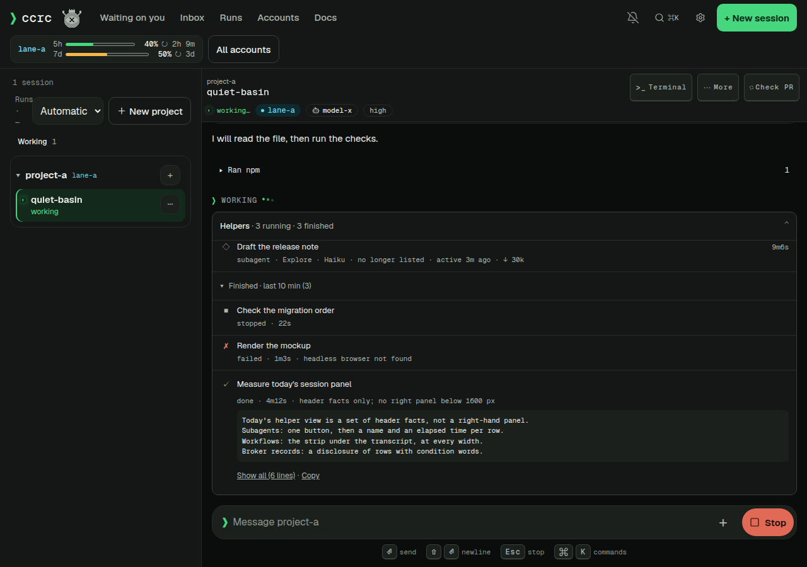
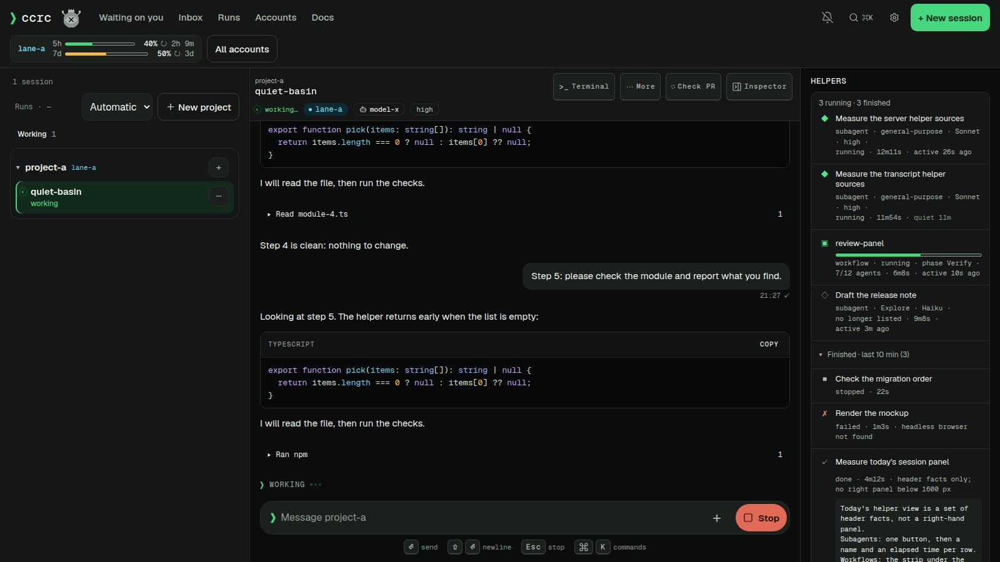
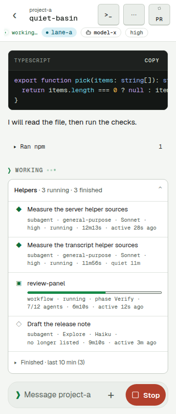
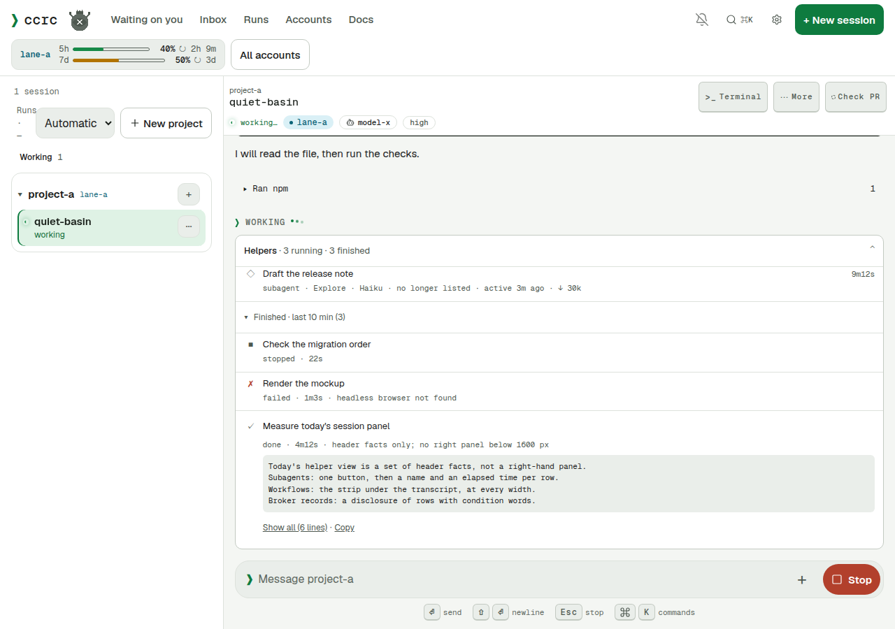
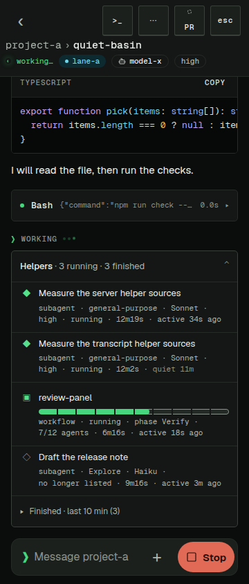
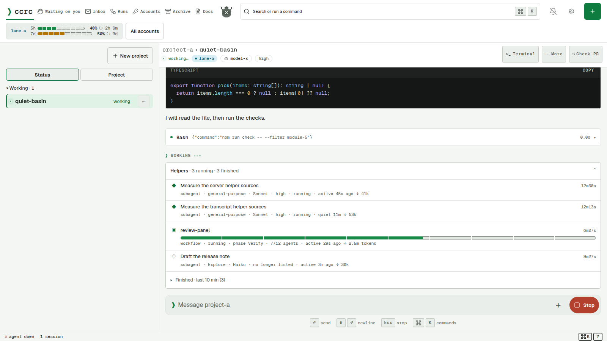

# Task H2: the task note (desktop polish run 3043, D-8872)

The note for Task H2, the first visible piece of C49's Helpers section: the section is drawn under the transcript and in the
inspector rail, from what H1a and H1b put on the session frame; the workflow keep moves from 30 s to ten minutes by one
owner; and a finished helper's report travels on request. Written by its worker for the coordinator to fold into the ledger.
Each claim says whether it was **measured** (read on the tree, seen in the running app, or in a test run by this task) or
**inferred**. The plan's Task H2 section carries the definition of D-8872 and the departures by slug; this note carries the
evidence.

The operator's words, 2026-11-19: "inside the session in the right hand panel I still want to see actual information about
any running workflows and subagents, for the session i'm inside of, in a useful way though please".

## 1. What it looks like

Seen in the real app (**measured**): the production build, served by the browser harness (`pwa/browser/app.ts`) with a session
whose frame carries two running subagents (one quiet past ten minutes), a running workflow, a no-longer-listed subagent and
three finished ones (done with a report, failed, stopped), at 360, 1280 and 1600 px, in Refined and Instrument, dark (Phosphor)
and light (Phosphor Daylight), the strip collapsed and open, the finished fold open and the done row's report expanded. The
data is invented. Every one of the 34 shots was looked at; twelve are kept.

| | |
|---|---|
|  |  |
| *Refined, dark, 1280 px: open.* | *Refined, dark, 1280 px: the fold open, a report expanded.* |
|  |  |
| *Refined, dark, 1600 px: in the rail.* | *Refined, light, 1600 px: in the rail.* |
|  |  |
| *Refined, dark, 360 px: collapsed.* | *Refined, dark, 360 px: open.* |
|  |  |
| *Refined, light, 360 px: open.* | *Refined, light, 1280 px: a report expanded.* |
|  |  |
| *Instrument, dark, 1280 px: open.* | *Instrument, light, 1280 px: a report expanded.* |
|  |  |
| *Instrument, dark, 360 px: open.* | *Instrument, light, 1600 px: no rail in this skin, so the strip stays in the column.* |

**What the look found (measured), fixed in this task.** At 360 px the collapsed glance cut line 1 to one letter ("M…"): the
row glyph's `grid-area: glyph` applied to the glance's grid too, which names no such area. The glyph's area is now the row's
alone (`.helper-row > .helper-glyph`), and the real-Chrome test checks the glance's order (glyph, line 1, state word), its
room (line 1 at least half the strip) and that it is one line. The figure of the spec's states mockup was re-rendered after
F16 (`helpers-states-1280.png`).

## 2. What was built

| Piece | Where | Basis |
|---|---|---|
| The Helpers section: `HelpersStrip`, `HelpersList`, `HelpersPanel`, row facts (`mainFacts`, `finishedFacts`, `activityWords`), glyphs, the report | `ui/src/components/workflow-strip.tsx`, `.css`, `.stories.tsx`, `ui/src/index.ts` | Measured: `helpers-section.test.tsx`, `workflow-strip.test.tsx`, `helpers-rail.browser.test.ts`; `ui` compiles |
| The head's counts and notes, the two lists | `pwa/src/session/helpersWords.ts` (new, L1) | Measured: `helpers-words.test.ts` |
| The rail section and the column's strip | `pwa/src/inspector/HelpersSection.tsx` (new), `InspectorSections.tsx`, `skins/refined/InspectorRail.tsx`, `screens/SessionScreen.tsx` | Measured: `helpers-section.test.tsx` (jsdom), `helpers-rail.browser.test.ts` (Chrome) |
| The request, the answer, `reports` and its reset sites | `pwa/src/stores/session.ts` | Measured: `helpers-report-store.test.ts` |
| `keepWorkflows` (replaces `selectRows`), `holdReports`, `reportAnswer` | `server/src/workflows/model.ts` | Measured: `helpers-keep.test.ts`, `helper-report.test.ts` |
| `finishedView` on the keep, a kept run left quiet, held reports, `reportOf` | `server/src/workflows/read.ts` | Measured: same |
| `helperReport` | `server/src/sessionws.ts` (3 net code lines of its 40: 511 to 514) | Measured: `helper-report.test.ts` |
| The parser and the socket handler | `server/src/server.ts` (3 net code lines of its 40: 2,109 to 2,112; consents below) | Measured: `helper-report.test.ts`, over a real socket |
| `HelperReportRequest`, `HelperReportAnswer`; `WORKFLOW_EVICT_MS` retired | `shared/workflows.ts` | Measured: `helpers-keep.test.ts` |
| The import line, `SessionClientMsg`, the frame's union | `shared/api.ts`: zero net code lines (5,110 of its cap of 5,140, before and after) | Measured: `growthCheck.ts#codeLines` |

## 3. Red first

The branch's first commit (`4ae37dab18`) holds every new case. Run against `main`'s code, one file per process, `ccrc test`,
`--maxWorkers=2`, load about 8 (**measured**):

| File | On main | Characterization pins (green on main, labelled so) |
|---|---|---|
| `server/test/helpers-keep.test.ts` | 11 failed, 2 passed | a run that finished long before the page opened is never read (main does this at 30 s); a summary with no start or duration ends at its file time |
| `server/test/helper-report.test.ts` | 14 failed, 1 passed | an older server's parser ignores the request (a copy of main's parser) |
| `pwa/test/helpers-report-store.test.ts` | 10 failed | none |
| `pwa/test/helpers-words.test.ts` | the file fails to load: the module does not exist | none |
| `pwa/test/helpers-section.test.tsx` | 34 failed, 2 passed | absence draws no section (main draws none either); the rail draws nothing for a session with no helpers |
| `pwa/browser/helpers-rail.browser.test.ts` | written red; not run on main (no section exists there to place) | none |

Added after the first commit, each red against the code before its fix (**measured**): the real-socket case of
`helper-report.test.ts` (the handler's routing; its mutant `handler-not-routed` below), and the glance's three checks in the
real-Chrome file (they fail on the glance that cut line 1, the defect the look found).

## 4. Mutation run

MUTATION_TABLE

## 5. Test runs

SWEEP_TABLE

## 6. Carries, consents and residuals

**Carries taken** (each by name): review 2900 F5, F7, F14, F15, F16, F18; review 2961 F8; review 3014 F13. The plan's Task H2
section says how.

**Consents** (each by mail, 2026-11-21): the holder of `shared/api.ts` (claim 6133) for the import line, `SessionClientMsg` and
the frame's member with its comment, with the warning that #3134 leaves the file at its cap exactly, so this task adds no code
line there; the holder of `server/src/server.ts` (claim 6166) for the parser and the socket handler, then for the one
`isHelperId` import line, the hierarchy route registration untouched; H1c (run 3044) for its call site in `readAll` and its
lines in `read.ts`, `model.ts` and `sessionws.ts`, which do not overlap mine.

**Residuals** (**inferred** unless marked):

- A kept finished workflow resumed in place is seen at the next quiet re-stat, up to `RESTAT_EVERY` readings (about 30 s)
  later than before H2 (the departure `kept-run-quiet-from-first-read`).
- An older server never answers a report request: the opened row shows nothing, and never says there is none (**measured** in
  `helpers-report-store.test.ts` and `helpers-section.test.tsx`).
- The section cannot tell an older server from one with no helpers (review 3014 F13): absence draws nothing either way.
- The held reports' bound and the finished fold's bound share an order (the newest by end time), so a report is never evicted
  while its row is still drawn, except when two ends tie in time across the 20th place.
