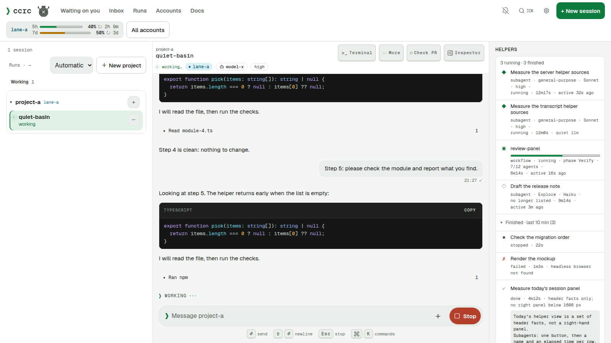
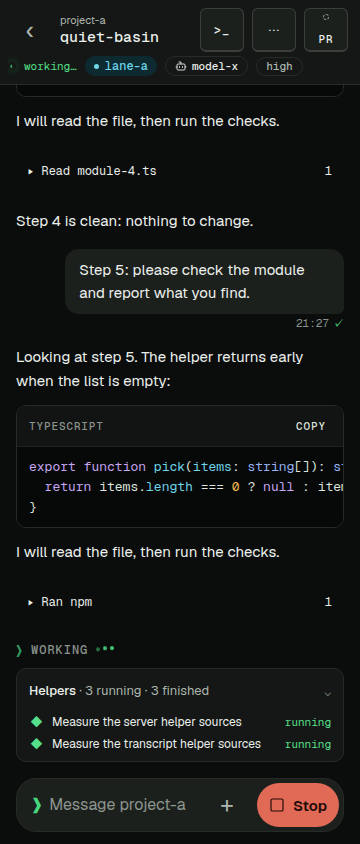

# Task H2: the task note (desktop polish run 3043, D-8872)

The note for Task H2, the first visible piece of C49's Helpers section: the section is drawn under the transcript and in the
inspector rail, from what H1a and H1b put on the session frame; the workflow keep moves from 30 s to ten minutes by one
owner; and a finished helper's report travels on request. Written by its worker for the coordinator to fold into the ledger.
Each claim says whether it was **measured** (read on the tree, seen in the running app, or in a test run by this task) or
**inferred**. The plan's Task H2 section carries the definition of D-8872 and the departures by slug; this note carries the
evidence.

The operator's words, 2026-11-19: "inside the session in the right hand panel I still want to see actual information about
any running workflows and subagents, for the session i'm inside of, in a useful way though please".

## 1. What it looks like

Seen in the real app (**measured**): the production build, served by the browser harness (`pwa/browser/app.ts`) with a session
whose frame carries two running subagents (one quiet past ten minutes), a running workflow, a no-longer-listed subagent and
three finished ones (done with a report, failed, stopped), at 360, 1280 and 1600 px, in Refined and Instrument, dark (Phosphor)
and light (Phosphor Daylight), the strip collapsed and open, the finished fold open and the done row's report expanded. The
data is invented. Every one of the 34 shots was looked at; twelve are kept. **Retaken in fix round 1** (review 3072): every
image below was captured again from the source this round commits, after its last change, and replaced in place; the first
round's images were captured before `5feb80c42f` (review 3072 F10). §7 says what the second look found.

| | |
|---|---|
|  |  |
| *Refined, dark, 1280 px: open.* | *Refined, dark, 1280 px: the fold open, a report expanded.* |
|  |  |
| *Refined, dark, 1600 px: in the rail.* | *Refined, light, 1600 px: in the rail.* |
|  |  |
| *Refined, dark, 360 px: collapsed.* | *Refined, dark, 360 px: open.* |
|  |  |
| *Refined, light, 360 px: open.* | *Refined, light, 1280 px: a report expanded.* |
|  |  |
| *Instrument, dark, 1280 px: open.* | *Instrument, light, 1280 px: a report expanded.* |
|  |  |
| *Instrument, dark, 360 px: open.* | *Instrument, light, 1600 px: no rail in this skin, so the strip stays in the column.* |

**What the look found (measured), fixed in this task.** At 360 px the collapsed glance cut line 1 to one letter ("M…"): the
row glyph's `grid-area: glyph` applied to the glance's grid too, which names no such area. The glyph's area is now the row's
alone (`.helper-row > .helper-glyph`), and the real-Chrome test checks the glance's order (glyph, line 1, state word), its
room (line 1 at least half the strip) and that it is one line. The figure of the spec's states mockup was re-rendered after
F16 (`helpers-states-1280.png`).

## 2. What was built

| Piece | Where | Basis |
|---|---|---|
| The Helpers section: `HelpersStrip`, `HelpersList`, `HelpersPanel`, row facts (`mainFacts`, `finishedFacts`, `activityWords`), glyphs, the report | `ui/src/components/workflow-strip.tsx`, `.css`, `.stories.tsx`, `ui/src/index.ts` | Measured: `helpers-section.test.tsx`, `workflow-strip.test.tsx`, `helpers-rail.browser.test.ts`; `ui` compiles |
| The head's counts and notes, the two lists | `pwa/src/session/helpersWords.ts` (new, L1) | Measured: `helpers-words.test.ts` |
| The rail section and the column's strip | `pwa/src/inspector/HelpersSection.tsx` (new), `InspectorSections.tsx`, `skins/refined/InspectorRail.tsx`, `screens/SessionScreen.tsx` | Measured: `helpers-section.test.tsx` (jsdom), `helpers-rail.browser.test.ts` (Chrome) |
| The request, the answer, `reports` and its reset sites | `pwa/src/stores/session.ts` | Measured: `helpers-report-store.test.ts` |
| `keepWorkflows` (replaces `selectRows`), `holdReports`, `boundReports`, `reportAnswer` | `server/src/workflows/model.ts` | Measured: `helpers-keep.test.ts`, `helper-report.test.ts` |
| `finishedView` on the keep, a kept run left quiet, held reports, `reportOf` | `server/src/workflows/read.ts` | Measured: same |
| `helperReport` | `server/src/sessionws.ts` (3 net code lines of its 40: 511 to 514) | Measured: `helper-report.test.ts` |
| The parser and the socket handler | `server/src/server.ts` (3 net code lines of its 40: 2,109 to 2,112; consents below) | Measured: `helper-report.test.ts`, over a real socket |
| `HelperReportRequest`, `HelperReportAnswer`; `WORKFLOW_EVICT_MS` retired | `shared/workflows.ts` | Measured: `helpers-keep.test.ts` |
| The import line, `SessionClientMsg`, the frame's union | `shared/api.ts`: zero net code lines (5,110 of its cap of 5,140, before and after) | Measured: `growthCheck.ts#codeLines` |

## 3. Red first

The branch's first commit (`4ae37dab18`) holds every new case. Run against `main`'s code, one file per process, `ccrc test`,
`--maxWorkers=2`, load about 8 (**measured**):

| File | On main | Characterization pins (green on main, labelled so) |
|---|---|---|
| `server/test/helpers-keep.test.ts` | 11 failed, 2 passed | a run that finished long before the page opened is never read (main does this at 30 s); a summary with no start or duration ends at its file time |
| `server/test/helper-report.test.ts` | 14 failed, 1 passed | an older server's parser ignores the request (a copy of main's parser) |
| `pwa/test/helpers-report-store.test.ts` | 10 failed | none |
| `pwa/test/helpers-words.test.ts` | the file fails to load: the module does not exist | none |
| `pwa/test/helpers-section.test.tsx` | 34 failed, 2 passed | absence draws no section (main draws none either); the rail draws nothing for a session with no helpers |
| `pwa/browser/helpers-rail.browser.test.ts` | written red; not run on main (no section exists there to place) | none |

Added after the first commit, each red against the code before its fix (**measured**): the real-socket case of
`helper-report.test.ts` (the handler's routing; its mutant `handler-not-routed` below), and the glance's three checks in the
real-Chrome file (they fail on the glance that cut line 1, the defect the look found).

## 4. Mutation run

`ccd/coordinator-skill/references/mutation-run.py`, through an adapter like H1a's and H1b's: each TypeScript file held as a
Python module's text; each mutant written into a scratch copy of the tree under this session's temp root (outside the work
tree, its `pwa/node_modules/@ccrc/ui` pointing at the scratch `ui`, so a design-system mutant is the one tested), its test
files run once through `ccrc test` with `--maxWorkers=2`, the original written back, and the tree removed after the run.
`--no-coverage`: the runner's trace sees the adapter, not the TypeScript. A vitest exit with no failed test is retried and
never counted as a kill. **Measured.**

- **Pass 1** (77 mutants as generated then): 69 killed. It found one defect, fixed in this task (`0c2ee7d55b`): the held
  reports had one bound by end time, so the notifications of tasks that are no Agent row (a workflow's, a shell's) could
  evict a drawn row's report; `boundReports` now keeps every drawn row's report and the newest 20 of the rest. Five
  survivors were missing cases, each added (`9ac7831e8c`, `0c2ee7d55b`): two ends at one time told apart by outcome, a helper
  continued after its end, one report ask per row, a glance of running rows only, and Refined's own rail placing the
  section (the jsdom rail suite seeds no helper, so its markup check could not see it).
- **Pass 2 and 3** (the changed modules, on the current code): two more cases (`a pending helper's report survives the
  bound`, `the reader's held set is bounded`) killed `bound-drawn-compete` and `bound-not-applied`.
- **At the tip: 77 mutants, 73 killed, 4 accepted**, each named below: three change only what the stream holds in memory,
  never an answer, and one is a branch the reader cannot reach. **Corrected in fix round 1:** one of the three,
  `bound-shown-without-report`, does change an answer (review 3072 F5); its form is now the code. The run was measured on
  the code of `72ed352f8c` (the two commits after it changed docs only), before `5feb80c42f` moved the state word into the
  words module, so the `state-word-missing` row's text below is gone from the tip (review 3072 F10); fix round 1's run
  mutates its new home (§7).

#### `server/src/workflows/model.ts`: 25 mutants, 22 killed

| Mutant | Original | Mutated to | Result |
|---|---|---|---|
| `keep-running-dropped` | `    if (v.state === 'running') { rows.push(v); continue; }` | `    if (v.state === 'running') { continue; }` | killed |
| `keep-noend-redrawn` | `      if (noEndShown.has(v.id)) continue; // drawn once already: it le…` | (removed) | killed |
| `keep-noend-never` | `      if (noEndShown.has(v.id)) continue; // drawn once already: it le…` | `      continue;` | killed |
| `keep-noend-not-remembered` | `      shown.add(v.id);⏎    } else if` | `    } else if` | killed |
| `keep-age-ignored` | `    } else if (!isFinishedKept(v.endedAt, now)) continue;⏎    finals.p…` | `    }⏎    finals.push(v);` | killed |
| `keep-own-clock` | `    } else if (!isFinishedKept(v.endedAt, now)) continue;` | `    } else if (now - v.endedAt >= 30_000) continue;` | killed |
| `keep-cap-removed` | `.slice(0, HELPER_KEPT_MAX);⏎  const keptIds` | `;⏎  const keptIds` | killed |
| `keep-cap-oldest` | `finals.sort((a, b) => rank(b) - rank(a) \|\|` | `finals.sort((a, b) => rank(a) - rank(b) \|\|` | killed |
| `keep-agents-uncapped` | `...kept.map(capKeptWorkflow)]` | `...kept]` | killed |
| `keep-memory-all` | `    noEndShown: new Set([...shown].filter((id) => keptIds.has(id))),` | `    noEndShown: new Set([...shown, ...noEndShown]),` | killed |
| `keep-order-newest-first` | `      .sort((a, b) => (a.startedAt ?? Infinity) - (b.startedAt ?? Infi…` | `      .sort((a, b) => (b.startedAt ?? Infinity) - (a.startedAt ?? Infi…` | killed |
| `same-end-no-outcome` | `a.outcome === b.outcome && a.at === b.at` | `a.at === b.at` | killed |
| `same-end-no-at` | `a.outcome === b.outcome && a.at === b.at && a.from` | `a.outcome === b.outcome && a.from` | killed |
| `same-end-no-hasreport` | `a.summary === b.summary && b.hasReport;` | `a.summary === b.summary;` | accepted, memory only: a held report whose end carries no report is never answered (`reportAnswer` needs the drawn row's `hasReport`, which describes that same end) |
| `hold-prev-all` | `    if (end !== null && sameEnd(h.end, end)) out.set(id, h);` | `    out.set(id, h);` | accepted, memory only: a held report whose end moved on is never answered (the row's `hasReport` describes the new end, whose own report replaced it in the same reading) |
| `hold-incoming-any` | `    if (end !== null && sameEnd(mine, end)) out.set(f.id, { text: f.re…` | `    out.set(f.id, { text: f.report, cut: f.reportCut, end: mine });` | killed |
| `hold-cut-lost` | `out.set(f.id, { text: f.report, cut: f.reportCut, end: mine });` | `out.set(f.id, { text: f.report, cut: false, end: mine });` | killed |
| `bound-drawn-dropped` | `  return new Map([...[...held].filter(([id]) => shown.has(id)), ...res…` | `  return new Map(rest);` | killed |
| `bound-drawn-compete` | `  const rest = [...held].filter(([id]) => !shown.has(id))⏎` | `  const rest = [...held]⏎` | killed |
| `bound-rest-uncapped` | `.slice(0, HELPER_KEPT_MAX);⏎  return new Map(` | `;⏎  return new Map(` | killed |
| `bound-rest-oldest` | `sort(([a, x], [b, y]) => rank(y) - rank(x)` | `sort(([a, x], [b, y]) => rank(x) - rank(y)` | killed |
| `bound-shown-without-report` | `  const shown = new Set(drawn.filter((a) => a.hasReport).map((a) => a.…` | `  const shown = new Set(drawn.map((a) => a.id));` | ~~accepted, memory only~~ **wrong, corrected in fix round 1** (review 3072 F5): an answer does change. A helper continued after its end is drawn running with no report, and can return to that end when its continuation turns unmeasurable; under the old rule twenty newer reports that are no row's evicted its report meanwhile, and the row then answered null. The mutant's form is now the code, with a two-reading case (§7) |
| `answer-any-held` | `  const h = drawn.some((a) => a.id === id && a.hasReport) ? held.get(i…` | `  const h = held.get(id);` | killed |
| `answer-drawn-without-report` | `drawn.some((a) => a.id === id && a.hasReport)` | `drawn.some((a) => a.id === id)` | killed |
| `answer-cut-dropped` | `report: h.text, cut: h.cut };` | `report: h.text, cut: false };` | killed |

#### `server/src/workflows/read.ts`: 7 mutants, 6 killed

| Mutant | Original | Mutated to | Result |
|---|---|---|---|
| `quiet-old-rule` | `      \|\| run.decision === 'finished';` | `      \|\| (run.decision === 'finished' && run.view === null);` | killed |
| `finishedview-no-keep` | `    if (!isFinishedKept(at, now)) return null;` | (removed) | killed |
| `noend-memory-not-stored` | `    this.noEndShown = kept.noEndShown;⏎` | (removed) | accepted, unreachable: the reader never builds a finished workflow without an end (`summaryView` falls back to the summary's file time). Fix round 1 corrected the memory itself (review 3072 F11, §7); the branch is still unreachable from the reader |
| `reports-not-held` | `    this.reports = holdReports(this.reports, i.facts, this.facts);⏎` | (removed) | killed |
| `drawn-not-stored` | `    this.drawn = arm.agents;⏎` | (removed) | killed |
| `bound-not-applied` | `    this.reports = boundReports(this.reports, arm.agents);⏎` | (removed) | killed |
| `reportof-wrong-arm` | `  reportOf(id: string): HelperReportAnswer { return reportAnswer(this.…` | `  reportOf(id: string): HelperReportAnswer { return reportAnswer(this.…` | killed |

#### `server/src/sessionws.ts`: 2 mutants, 2 killed

| Mutant | Original | Mutated to | Result |
|---|---|---|---|
| `stream-answers-nothing` | `    this.send(this.workflows?.reportOf(id) ?? { type: 'helper-report',…` | (removed) | killed |
| `stream-answers-null` | `    this.send(this.workflows?.reportOf(id) ?? { type: 'helper-report',…` | `    this.send({ type: 'helper-report', id, report: null, cut: false })…` | killed |

#### `server/src/server.ts`: 3 mutants, 3 killed

| Mutant | Original | Mutated to | Result |
|---|---|---|---|
| `parse-any-id` | `return isHelperId(o['id']) ? { type: 'helper-report', id: o['id'] } : …` | `return typeof o['id'] === 'string' ? { type: 'helper-report', id: o['i…` | killed |
| `parse-no-request` | `  if (o['type'] === 'helper-report') return isHelperId(o['id']) ? { ty…` | (removed) | killed |
| `handler-not-routed` | `        else if (m?.type === 'helper-report') stream.helperReport(m.id…` | (removed) | killed |

#### `pwa/src/session/helpersWords.ts`: 15 mutants, 15 killed

| Mutant | Original | Mutated to | Result |
|---|---|---|---|
| `count-helpers-as-running` | `  if (running.length > 0) counts.push('${running.length} running');⏎  …` | `  if (main.length > 0) counts.push('${main.length} running');⏎  else i…` | killed |
| `count-no-helpers` | `  else if (main.length > 0) counts.push(plural(main.length, 'helper', …` | (removed) | killed |
| `count-no-finished` | `  if (finished.length > 0) counts.push('${finished.length} finished');…` | (removed) | killed |
| `live-line-always` | `if (i.agentsUnmeasured !== null && i.agents.some((a) => a.state === 'u…` | `if (i.agentsUnmeasured !== null)` | killed |
| `tokens-note-dropped` | `  if (noTokens > 0) notes.push` | `  if (noTokens > 99) notes.push` | killed |
| `progress-note-dropped` | `  if (noProgress > 0) notes.push` | `  if (noProgress > 99) notes.push` | killed |
| `readevery-dropped` | `  if (i.readEvery !== null) {` | `  if (i.readEvery === undefined) {` | killed |
| `unreadable-dropped` | `  if (i.workflowsUnreadable) notes.push(` | `  if (false) notes.push(` | killed |
| `empty-draws` | `  if (items.length === 0 && !i.workflowsUnreadable) return null;⏎` | (removed) | killed |
| `unreadable-alone-null` | `  if (items.length === 0 && !i.workflowsUnreadable) return null;` | `  if (items.length === 0) return null;` | killed |
| `finished-oldest-first` | `sort((a, b) => endOf(b) - endOf(a)` | `sort((a, b) => endOf(a) - endOf(b)` | killed |
| `running-unsorted` | `const running = items.filter(isRunning).sort((a, b) => startOf(a) - st…` | `const running = items.filter(isRunning);` | killed |
| `claim-no-end-folds` | `const isFinal = (it: HelperItem): boolean => (it.kind === 'agent' ? is…` | `const isFinal = (it: HelperItem): boolean => (it.kind === 'agent' ? it…` | killed |
| `stale-line-wrong` | `case 'stale': return 'live state not known: no news from the session f…` | `case 'stale': return 'live state not known: this session reports nothi…` | killed |
| `foreign-as-unreadable` | `    case 'foreign':⏎    case 'unregistered': return 'live state not kn…` | `    case 'foreign':⏎    case 'unregistered': return 'live state not kn…` | killed |

#### `pwa/src/stores/session.ts`: 5 mutants, 5 killed

| Mutant | Original | Mutated to | Result |
|---|---|---|---|
| `answer-not-applied` | `      return { ...s, reports: { ...s.reports, [msg.id]: { report: msg.…` | `      return s;` | killed |
| `answer-cut-lost` | `[msg.id]: { report: msg.report, cut: msg.cut } } };` | `[msg.id]: { report: msg.report, cut: false } } };` | killed |
| `reports-not-pruned` | `        reports: reportsFor(s.reports, msg.agents ?? []),⏎` | `        reports: s.reports ?? {},⏎` | killed |
| `reset-keeps-reports` | `  ({ agents: [], agentsUnmeasured: null, readEvery: null, reports: {} …` | `  ({ agents: [], agentsUnmeasured: null, readEvery: null });` | killed |
| `request-not-sent` | `        socket?.send({ type: 'helper-report', id } satisfies HelperRep…` | (removed) | killed |

#### `ui/src/components/workflow-strip.tsx`: 14 mutants, 14 killed

| Mutant | Original | Mutated to | Result |
|---|---|---|---|
| `glyph-left-out-busy` | `  unmeasured: { glyph: '◇', tone: 'neutral' },` | `  unmeasured: { glyph: '◆', tone: 'busy' },` | killed |
| `glyph-launched-busy` | `  launched: { glyph: '◇', tone: 'neutral' },` | `  launched: { glyph: '◆', tone: 'busy' },` | killed |
| `quiet-never` | `  if (ms >= HELPER_QUIET_MS) return` | `  if (ms > 1e15) return` | killed |
| `report-all-lines` | `  const text = all ? answer.report : lines.slice(0, REPORT_LINES).join…` | `  const text = answer.report;` | killed |
| `report-cut-unsaid` | `      {answer.cut && 
<p…` | `  if (answer.report === null) return 
…` | killed |
| `report-not-asked` | `{ setAsked(true); onReport(it.id); }` | `{ setAsked(true); }` | killed |
| `report-asked-twice` | `if (!open && hasReport && !asked && reports[it.id] === undefined)` | `if (hasReport)` | killed |
| `open-without-report` | `  const hasReport = finished && it.kind === 'agent' && it.agent.hasRep…` | `  const hasReport = finished && it.kind === 'agent';` | killed |
| `glance-not-only-running` | `.filter((it) => (it.kind === 'agent' ? it.agent.state : it.workflow.st…` | `.slice(0, GLANCE_MAX);` | killed |
| `glance-uncapped` | `=== 'running').slice(0, GLANCE_MAX);` | `=== 'running');` | killed |
| `fold-open-default` | `  const [foldOpen, setFoldOpen] = useState(false);` | `  const [foldOpen, setFoldOpen] = useState(true);` | killed |
| `finished-shows-main-facts` | `        {finished⏎          ? <Facts parts={finishedFacts(it)} />` | `        {false⏎          ? <Facts parts={finishedFacts(it)} />` | killed |
| `state-word-missing` | `a.model, a.effort, AGENT_HELPER_STATE_WORDS[a.state]]);` | `a.model, a.effort]);` | killed |

#### `pwa/src/screens/SessionScreen.tsx`: 2 mutants, 2 killed

| Mutant | Original | Mutated to | Result |
|---|---|---|---|
| `strip-always` | `        {!inspectorHoldsStrips && <HelpersStripFor store={useStore} />…` | `        <HelpersStripFor store={useStore} />` | killed |
| `strip-never` | `        {!inspectorHoldsStrips && <HelpersStripFor store={useStore} />…` | (removed) | killed |

#### `pwa/src/inspector/InspectorSections.tsx`: 1 mutants, 1 killed

| Mutant | Original | Mutated to | Result |
|---|---|---|---|
| `rail-section-missing` | `      <MailSection />⏎      <HelpersSection />⏎` | `      <MailSection />⏎` | killed |

#### `pwa/src/skins/refined/InspectorRail.tsx`: 1 mutants, 1 killed

| Mutant | Original | Mutated to | Result |
|---|---|---|---|
| `refined-rail-missing` | `      <MailSection />⏎      <HelpersSection />⏎` | `      <MailSection />⏎` | killed |

#### `pwa/src/inspector/HelpersSection.tsx`: 2 mutants, 2 killed

| Mutant | Original | Mutated to | Result |
|---|---|---|---|
| `rail-draws-empty` | `  if (view === null) return null;` | `  if (view === null) return <InspectorSection id="helpers" title="Help…` | killed |
| `report-request-noop` | `  const onReport = (id: string): void => store.getState().requestHelpe…` | `  const onReport = (id: string): void => void id;` | killed |

## 5. Test runs

One file per process, `ccrc test`, `--maxWorkers=2`, the load recorded before each file (**measured**, 2026-11-21, on the fleet
box at load 5.6 to 24.8). The lists: every server test that names `workflows/read`, `workflows/model`, `sessionws`,
`shared/workflows`, the session socket or `server.ts` (where the message parser lives), every rings and single-definition suite,
the growth checks, `topology-clean`, `deviation-refs` (after `git fetch origin main`), `dtbd` and the ledger guard: **97 server
files**; every PWA test that imports the strip, the session store, SessionDetails, `shared/workflows`, the inspector sections or
SessionScreen, and the words, census, theme and contrast suites: **82 PWA files**.

| Result | Files |
|---|---|
| PWA | **82 of 82 green** on the first run |
| Server, green on the first run | 92 of 97 |
| `deviation-refs.test.ts` | the first run timed out at 20 s (the two-real-trees scan, load 6.5); alone, 34 of 34 green at load 13.2: a load time-out |
| `push-copy.test.ts` | first run: 18 failed (time-outs, load 5.6); alone: 57 failed (assertions, `expected length 1 but got 2`, load 12.6); alone again: 87 passed and 2 time-outs (load 14.7). A clean `origin/main` (66c63606c3) alone: 88 passed and 1 time-out (load 13.6). The 57-assertion run did not reproduce. The file names this task's files only in a comment and imports none of the changed modules |
| `secret-mask.test.ts` | time-outs (1 at load 16.9; 3 alone at load 24.8); clean `origin/main` alone: 1 time-out (load 8.6). Main shows it |
| `session-ladders-characterization.test.ts` | 2 assertion failures on the "gone + a fresh supervisor heartbeat (restarting)" rows, first run and alone (load 13.5 and 13.7); clean `origin/main` alone fails one of the same two (load 10.4). Main shows it on this box; the file imports none of the changed modules |
| `coord-store.test.ts` | stopped by its own PID after 15 minutes in disk sleep (`jbd2_log_wait_commit`); it names `sessionws.ts` only in a comment and imports none of the changed modules, so it was on the list by a text match |

The new and changed suites, each green (**measured**): `helpers-keep` 13, `helper-report` 21, `workflows-model` 35,
`workflows-read` 26, `helpers-frame` 41, `helpers-read` 39, `sessionws-helpers` 12, `session-workflows-frame` 6,
`helpers-decision` 154; `helpers-words` 26, `helpers-section` 40, `helpers-report-store` 10, `workflow-strip` 19,
`tap-targets` and `inspector` in the sweep; the real-Chrome `helpers-rail` 3 of 3. `tsc` passes for `server`, `pwa` (with
its tests) and `ui` (with its stories); `npm run build` passes for `pwa`; the contrast gate passes all 12,000 pairs.

**CI's fast run at c4b78a6c0a found what the sweep missed** (**measured**, PR #3148): four checks red, each from this task.
Two server suites pin `shared/api.ts`'s import lines word for word (`collect-lane-l0`, `peers-claims-l0`), and the import line
from `./workflows.js` now names `HelperReportAnswer` and `HelperReportRequest`; neither suite names a changed module or the
workflows frame, so the sweep's text match left them out. The PWA's `ui-package-boundary` allows two `ui` files only to import
a value from `shared/`, and the strip imported `AGENT_HELPER_STATE_WORDS` and `HELPER_REPORT_MAX_BYTES`: the state word and the
cut note are now decided in `helpersWords.ts` and travel on the view as data (`stateWord` on an Agent item, `cutNote` on the
view), so `ui` takes types only. The ledger guard found no `Ledger-Edit` trailer: it sat in a paragraph of its own, and git's
trailer parser reads only the message's last paragraph, so the head commit now carries it beside `Co-Authored-By`. After the
fix, each of the nine files it touches is green alone (`ui-package-boundary` 24, `helpers-section` 40, `helpers-words` 26,
`workflow-strip` 19, `tap-targets` 96, `helpers-report-store` 10, `inspector` 19, `collect-lane-l0` 8, `peers-claims-l0` 19, at
load 9.8), and `tsc` passes for `pwa` and `ui`.

**The suite signal.** The first full run after the implementation was complete was not all green: the load time-outs and
main-shown failures above, and the three suites CI found that the sweep's list missed. So the wave-done says `suite: red` with
`failure: shallow` (tests missed).

## 6. Carries, consents and residuals

**Carries taken** (each by name): review 2900 F5, F7, F14, F15, F16, F18; review 2961 F8; review 3014 F13. The plan's Task H2
section says how.

**Consents** (each by mail, 2026-11-21): the holder of `shared/api.ts` (claim 6133) for the import line, `SessionClientMsg` and
the frame's member with its comment, with the warning that #3134 leaves the file at its cap exactly, so this task adds no code
line there; the holder of `server/src/server.ts` (claim 6166) for the parser and the socket handler, then for the one
`isHelperId` import line, the hierarchy route registration untouched; H1c (run 3044) for its call site in `readAll` and its
lines in `read.ts`, `model.ts` and `sessionws.ts`, which do not overlap mine.

**Residuals** (**inferred** unless marked):

- A kept finished workflow resumed in place is seen at the next quiet re-stat, up to `RESTAT_EVERY` readings (about 30 s)
  later than before H2 (the departure `kept-run-quiet-from-first-read`).
- An older server never answers a report request: the opened row shows nothing, and never says there is none (**measured** in
  `helpers-report-store.test.ts` and `helpers-section.test.tsx`).
- The section cannot tell an older server from one with no helpers (review 3014 F13): absence draws nothing either way.
- The held reports are every drawn row's (since fix round 1, with a report or not, review 3072 F5) plus the newest 20 of the
  rest (**measured** in `helper-report.test.ts`): a helper whose row is not decided yet competes with the notifications of
  tasks that are no row, so more than 20 newer such notifications in one reading can drop its report before its row is
  drawn; the row then says the report is no longer held.
- A stream whose reader has not read yet answers no report request (review 3072 F4); the PWA asks again after that stream's
  first frame. A reader that never completes a reading never answers, and an open row then asks once per stream, as it does
  of an older server (**measured** for the first frame in `helpers-report-store` and `helpers-section`; the never-reading
  reader **inferred**).

## 7. Fix round 1 (review 3072 of `5feb80c42f`)

One finding blocked (F1); the coordinator ruled on the rest (mail of 2026-11-21) and took most of them now. Each is listed
with what changed and the case that holds it. **Measured** unless marked.

| Finding | What changed | Held by |
|---|---|---|
| F1 (blocks) | `lanes-row.browser.test.ts`'s meter-ring block waited on `.workflow-line`, which H2's rewrite removed. It now opens the section (collapsed under the transcript by default; always open in the rail) and selects the Helpers row's meter, `.helpers-strip .helper-bar .limit-track`, so the ring coverage on the session screen stays | the file alone, real Chrome: **89 of 89** (the review measured 6 failed at the tip) |
| F2 | The store keeps an answer with its row's end, and only while the frame draws that row with `hasReport` at that end; an answer for a row drawn without a report is for no row. A helper continued and ended again asks again and never shows its earlier report | `helpers-report-store`: the three-frame case and the end-key cases; `helpers-section`: the row asks again under the new end |
| F3 | A state outside the vocabulary draws the neutral ◇ (an Agent helper, a workflow, and a workflow's phase agent); nothing throws | `helpers-section`'s F3 case (`paused`, `queued`) |
| F4 | No wire change. The reader answers nothing (`reportOf` is null) before its first reading, and the stream then sends nothing, so "no longer held" is said only for an id it read and lost. The store owns the ask: once per id and end on a stream, nothing recorded for a send that did not go, and every ask forgotten at each stream's first `workflows` frame, so an open row with no answer asks again | `helper-report`: the reader before its first reading, the stream before `start()`, the real socket after its first frame; `helpers-report-store`: dedupe, a send that did not go, the first frame, a drop; `helpers-section`: an open row asks a new stream again, a row with its answer does not |
| F5 | `boundReports` protects every drawn row's report, with or without `hasReport` (the mutant's form); the note's §4 row is corrected | `helper-report`: the two-reading case (red under the old rule) |
| F6 | Spec §10 followed: at the phone width (the section's container under 480 px) the elapsed time moves into line 2, between the state and the activity, and line 1 draws none; at the desk it stays at the right of line 1 | `helpers-section` per width, with the parts each width's stylesheet hides removed (jsdom evaluates no container query) and the rules pinned; real Chrome `helpers-rail` at 360 and 1280 measures it |
| F7 | Line 2 is one run of text. Each fact, and the state with its times, is one group, an inline block no wider than the line: it moves to the next line whole, and the separators between groups are the break points. A group wider than a whole line breaks between its words (each an inline block too), never inside one. A summary is the one part that wraps anywhere | CSS-text pins and a DOM case in `helpers-section`; real Chrome `helpers-rail`: no group spans two lines at 360 and 1280, and no line 2 overflows the 1600 rail |
| F8 | The three lost pins: the token floor (`↓ 2.5m+ tokens`), no elapsed with no start (line 1 or line 2), the glance as a list | `helpers-section`, each red under its mutant (below) |
| F11 | `keepWorkflows`' no-end memory keeps every id it drew while the run still reads finished with no end (the Agent arm's rule), so it draws once, not every other reading; still unreachable from the reader | `helpers-keep`: a third reading |
| F12 | The fold label and the cut note are written once, in `shared/workflows.ts` beside the constants they carry (`HELPER_FOLD_LABEL` from `HELPER_FINISHED_KEEP_MS`, `HELPER_CUT_NOTE` from `HELPER_REPORT_MAX_BYTES`), handed to the strip by `helpersWords.ts`; the stories read the same two | `helpers-words`: the view carries both |
| F13 | The tokens note counts only main-list workflows (a finished row draws no tokens); a report ending in a newline counts its lines without the empty tail | `helpers-words` and `helpers-section` |
| F14 | " · " before the tokens and between the report links, as the mockup draws them | `helpers-section` |

**Records (review 3072 F9, F10, F14).**

- F9: the red-first commit `4ae37dab18`'s word-census case was red for a wrong reason: its fixture description,
  `Measure s-unmeasured`, carried the forbidden word itself, so the case failed for any code. A later commit renamed the
  fixture (`Helper number ${i}`) so that the case fails only when a row says the word; this note did not say so then.
  `helpers-words.test.ts` does not load at the base (its module is missing); against a stub module 24 of 26 cases are red on
  assertions, as §3 says.
- F10: which commit each first-round measurement ran on. The mutation run (§4): the code of `72ed352f8c`. The sweep (§5): the
  source of `c4b78a6c0a`, whose own commit changed docs only. The real-Chrome `helpers-rail` 3 of 3 and the twelve images:
  the source before `5feb80c42f`, which moved the state word and the cut note into the words module (the reviewer re-ran
  `helpers-rail` at `5feb80c42f`: 3 of 3). This round's measurements ran on the source this round commits (below).
- F14, the rest, as records: the tap floor stays the project's height-only rule (`min-height: var(--tap-min)`, carried; a
  link's width is its text). D-8872 was first named in `4ae37dab18`'s test headers and defined in the plan in `72653ba151`,
  the fifth commit (history only). The plan's Acceptance matrix (Refined and Instrument, light and dark, at 360, 390, 1280
  and 1920) is the programme's final gate, not this task's; the brief's matrix (360, 1280 and 1600, both skins, light and
  dark, fold open and closed, a report expanded) binds H2, and the plan's Task H2 section says so.

**What the second look found (measured), fixed in this round.** With F7's first form, one unbreakable `white-space: nowrap`
group, the 1600 px rail (narrower than 480 px, so it takes the phone layout) clipped a no-longer-listed row's line 2 ("no
longer listed · 9m9s · active 3m a…"): a group wider than the rail cannot wrap. The groups became inline blocks no wider
than the line, as above, and the real-Chrome file now checks that no line 2 overflows the rail.

**Mutation run, round 2.** The same runner and adapter as §4, on a scratch tree of this round's source, `--no-coverage`, each
mutant's test files once through `ccrc test` with `--maxWorkers=2`. **44 mutants of the changed decision branches, 44
killed.** The first pass left three alive, each a missing case, now added: `ask-with-answer` and `ask-once-per-mount` (an
open row with no answer asks a new stream again; one with its answer does not) and `state-words-not-blocks` (the state's
words are each a block). The CSS module's first baseline failed because its stylesheet changed under the run; it was run
again on the final source.

| Module | Mutants | Killed |
|---|---|---|
| `server/src/workflows/model.ts` | `keep-memory-not-unioned`, `keep-memory-unbounded`, `bound-drawn-with-report-only`, `bound-drawn-dropped` | 4 of 4 |
| `server/src/workflows/read.ts` | `reportof-before-read-answers` | 1 of 1 |
| `server/src/sessionws.ts` | `stream-answers-before-read`, `stream-never-answers` | 2 of 2 |
| `pwa/src/session/helpersWords.ts` | `tokens-note-counts-fold`, `state-word-missing`, `fold-label-lost`, `cut-note-lost` | 4 of 4 |
| `pwa/src/stores/session.ts` | `reports-keep-without-hasreport`, `reports-keep-any-end`, `answer-for-any-row`, `answer-for-no-row-kept`, `ask-no-dedupe`, `ask-dedupe-any-end`, `ask-recorded-unsent`, `first-frame-not-forgetting`, `every-frame-forgets`, `drop-not-reframing` | 10 of 10 |
| `ui/src/components/workflow-strip.tsx` | `glyph-no-fallback`, `phase-glyph-no-fallback`, `report-newline-counted`, `ask-without-open`, `ask-with-answer`, `ask-once-per-mount`, `state-group-split`, `state-word-dropped`, `elapsed-inline-dropped`, `elapsed-inline-sep`, `state-words-not-blocks`, `tokens-no-sep`, `report-links-no-sep`, `fold-label-ignored`, `cut-note-ignored`, `tokens-floor-lost`, `no-start-elapsed` | 17 of 17 |
| `ui/src/components/workflow-strip.css` | `css-fact-inline`, `css-fact-uncapped`, `css-line2-flex`, `css-phone-line1-elapsed`, `css-phone-inline-hidden`, `css-desk-inline-shown` | 6 of 6 |

**Test runs, round 2** (one file per process, `ccrc test`, `--maxWorkers=2`, load recorded per file). The lists are §5's,
plus the four suites CI's first run found (`collect-lane-l0`, `peers-claims-l0`, `single-definition-pin`,
`ui-package-boundary`), less `coord-store` (it names `sessionws.ts` only in a comment, imports no changed module, and sat in
disk wait for 15 minutes in round 1), and, in real Chrome, every browser file that imports the strip or `shared/workflows`
(`helpers-rail`, `lanes-row`) and the session-screen files the review ran (`inspector-hide`, `session-timers`,
`chat-width`, `session-header`, `role-fact`).

| Result | Files |
|---|---|
| Server | **99 files**: 97 with no failed test on the first run (load 6 to 18). Three of them exited 1 with every test passed: `account-canary` and `ask-pairing-transcript` by `ccrc test`'s check that names processes outliving a run (the PWA sweep ran beside this one in the same session), and `auth-gate`, whose worker was killed (SIGKILL) at 189 of 376 and which is **376 of 376 green alone** (load 9.4) |
| `secret-mask.test.ts` | 3 time-outs at 20 s (load 9.0); round 1 measured clean `origin/main` timing out on the same file on this box (§5) |
| `session-ladders-characterization.test.ts` | 1 failure, the "gone + a fresh supervisor heartbeat (restarting)" row (load 17.8), one of the two round 1 measured failing on clean `origin/main` (§5) |
| PWA | **83 files**: 82 green on the first run. `markup-census` was red for this round's code: the state group's class string was spelled twice; it is one named constant now, and the census is **11 of 11** green, with `helpers-section` 56 and `workflow-strip` 19 after it |
| Real Chrome (one file per process, load 6.5 to 8.8) | `helpers-rail` 3, `lanes-row` 89, `inspector-hide` 8, `session-timers` 17, `chat-width` 46, `session-header` 76, `role-fact` 66: **all green**. `helpers-rail` once timed out at 20 s waiting for the transcript to load while the mutation run held the box; alone it was 3 of 3 |

`tsc` passes for `server` (with its tests), `pwa` (with its tests) and `ui` (with its stories), and the production build that
the browser files serve was built by their own global setup. None of the non-green server files imports a changed module.
