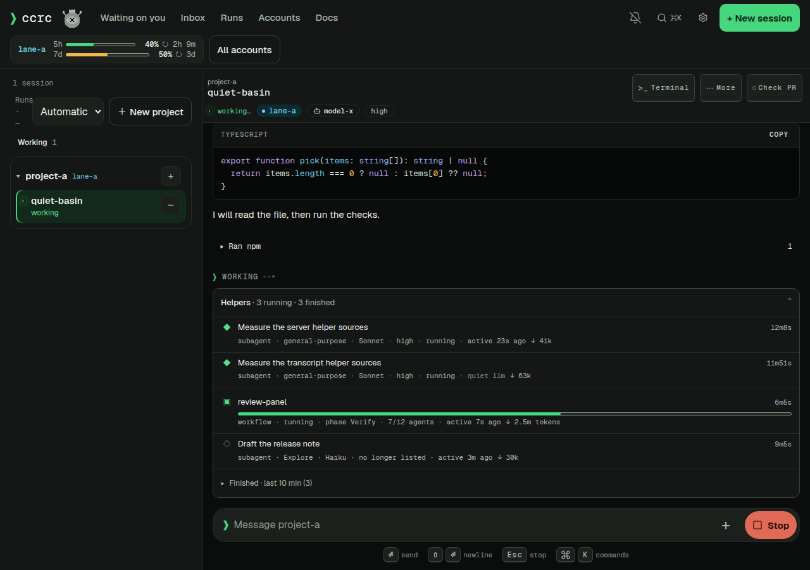
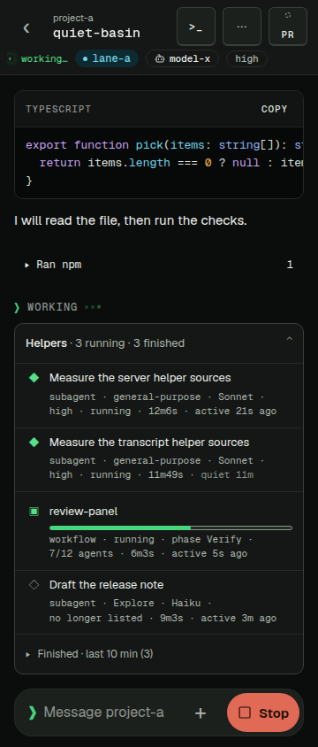
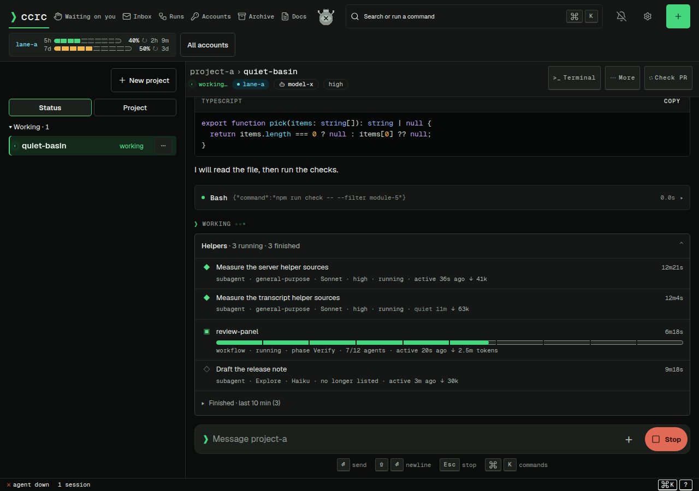
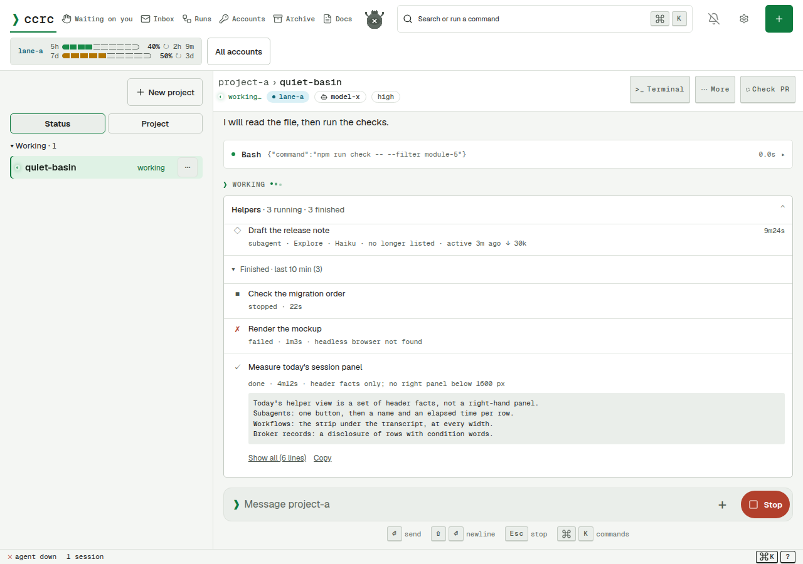

# Task H2: the task note (desktop polish run 3043, D-8872)

The note for Task H2, the first visible piece of C49's Helpers section: the section is drawn under the transcript and in the
inspector rail, from what H1a and H1b put on the session frame; the workflow keep moves from 30 s to ten minutes by one
owner; and a finished helper's report travels on request. Written by its worker for the coordinator to fold into the ledger.
Each claim says whether it was **measured** (read on the tree, seen in the running app, or in a test run by this task) or
**inferred**. The plan's Task H2 section carries the definition of D-8872 and the departures by slug; this note carries the
evidence.

The operator's words, 2026-11-19: "inside the session in the right hand panel I still want to see actual information about
any running workflows and subagents, for the session i'm inside of, in a useful way though please".

## 1. What it looks like

Seen in the real app (**measured**): the production build, served by the browser harness (`pwa/browser/app.ts`) with a session
whose frame carries two running subagents (one quiet past ten minutes), a running workflow, a no-longer-listed subagent and
three finished ones (done with a report, failed, stopped), at 360, 1280 and 1600 px, in Refined and Instrument, dark (Phosphor)
and light (Phosphor Daylight), the strip collapsed and open, the finished fold open and the done row's report expanded. The
data is invented. Every one of the 34 shots was looked at; twelve are kept.

| | |
|---|---|
|  |  |
| *Refined, dark, 1280 px: open.* | *Refined, dark, 1280 px: the fold open, a report expanded.* |
|  |  |
| *Refined, dark, 1600 px: in the rail.* | *Refined, light, 1600 px: in the rail.* |
|  |  |
| *Refined, dark, 360 px: collapsed.* | *Refined, dark, 360 px: open.* |
|  |  |
| *Refined, light, 360 px: open.* | *Refined, light, 1280 px: a report expanded.* |
|  |  |
| *Instrument, dark, 1280 px: open.* | *Instrument, light, 1280 px: a report expanded.* |
|  |  |
| *Instrument, dark, 360 px: open.* | *Instrument, light, 1600 px: no rail in this skin, so the strip stays in the column.* |

**What the look found (measured), fixed in this task.** At 360 px the collapsed glance cut line 1 to one letter ("M…"): the
row glyph's `grid-area: glyph` applied to the glance's grid too, which names no such area. The glyph's area is now the row's
alone (`.helper-row > .helper-glyph`), and the real-Chrome test checks the glance's order (glyph, line 1, state word), its
room (line 1 at least half the strip) and that it is one line. The figure of the spec's states mockup was re-rendered after
F16 (`helpers-states-1280.png`).

## 2. What was built

| Piece | Where | Basis |
|---|---|---|
| The Helpers section: `HelpersStrip`, `HelpersList`, `HelpersPanel`, row facts (`mainFacts`, `finishedFacts`, `activityWords`), glyphs, the report | `ui/src/components/workflow-strip.tsx`, `.css`, `.stories.tsx`, `ui/src/index.ts` | Measured: `helpers-section.test.tsx`, `workflow-strip.test.tsx`, `helpers-rail.browser.test.ts`; `ui` compiles |
| The head's counts and notes, the two lists | `pwa/src/session/helpersWords.ts` (new, L1) | Measured: `helpers-words.test.ts` |
| The rail section and the column's strip | `pwa/src/inspector/HelpersSection.tsx` (new), `InspectorSections.tsx`, `skins/refined/InspectorRail.tsx`, `screens/SessionScreen.tsx` | Measured: `helpers-section.test.tsx` (jsdom), `helpers-rail.browser.test.ts` (Chrome) |
| The request, the answer, `reports` and its reset sites | `pwa/src/stores/session.ts` | Measured: `helpers-report-store.test.ts` |
| `keepWorkflows` (replaces `selectRows`), `holdReports`, `boundReports`, `reportAnswer` | `server/src/workflows/model.ts` | Measured: `helpers-keep.test.ts`, `helper-report.test.ts` |
| `finishedView` on the keep, a kept run left quiet, held reports, `reportOf` | `server/src/workflows/read.ts` | Measured: same |
| `helperReport` | `server/src/sessionws.ts` (3 net code lines of its 40: 511 to 514) | Measured: `helper-report.test.ts` |
| The parser and the socket handler | `server/src/server.ts` (3 net code lines of its 40: 2,109 to 2,112; consents below) | Measured: `helper-report.test.ts`, over a real socket |
| `HelperReportRequest`, `HelperReportAnswer`; `WORKFLOW_EVICT_MS` retired | `shared/workflows.ts` | Measured: `helpers-keep.test.ts` |
| The import line, `SessionClientMsg`, the frame's union | `shared/api.ts`: zero net code lines (5,110 of its cap of 5,140, before and after) | Measured: `growthCheck.ts#codeLines` |

## 3. Red first

The branch's first commit (`4ae37dab18`) holds every new case. Run against `main`'s code, one file per process, `ccrc test`,
`--maxWorkers=2`, load about 8 (**measured**):

| File | On main | Characterization pins (green on main, labelled so) |
|---|---|---|
| `server/test/helpers-keep.test.ts` | 11 failed, 2 passed | a run that finished long before the page opened is never read (main does this at 30 s); a summary with no start or duration ends at its file time |
| `server/test/helper-report.test.ts` | 14 failed, 1 passed | an older server's parser ignores the request (a copy of main's parser) |
| `pwa/test/helpers-report-store.test.ts` | 10 failed | none |
| `pwa/test/helpers-words.test.ts` | the file fails to load: the module does not exist | none |
| `pwa/test/helpers-section.test.tsx` | 34 failed, 2 passed | absence draws no section (main draws none either); the rail draws nothing for a session with no helpers |
| `pwa/browser/helpers-rail.browser.test.ts` | written red; not run on main (no section exists there to place) | none |

Added after the first commit, each red against the code before its fix (**measured**): the real-socket case of
`helper-report.test.ts` (the handler's routing; its mutant `handler-not-routed` below), and the glance's three checks in the
real-Chrome file (they fail on the glance that cut line 1, the defect the look found).

## 4. Mutation run

`ccd/coordinator-skill/references/mutation-run.py`, through an adapter like H1a's and H1b's: each TypeScript file held as a
Python module's text; each mutant written into a scratch copy of the tree under this session's temp root (outside the work
tree, its `pwa/node_modules/@ccrc/ui` pointing at the scratch `ui`, so a design-system mutant is the one tested), its test
files run once through `ccrc test` with `--maxWorkers=2`, the original written back, and the tree removed after the run.
`--no-coverage`: the runner's trace sees the adapter, not the TypeScript. A vitest exit with no failed test is retried and
never counted as a kill. **Measured.**

- **Pass 1** (77 mutants as generated then): 69 killed. It found one defect, fixed in this task (`0c2ee7d55b`): the held
  reports had one bound by end time, so the notifications of tasks that are no Agent row (a workflow's, a shell's) could
  evict a drawn row's report; `boundReports` now keeps every drawn row's report and the newest 20 of the rest. Five
  survivors were missing cases, each added (`9ac7831e8c`, `0c2ee7d55b`): two ends at one time told apart by outcome, a helper
  continued after its end, one report ask per row, a glance of running rows only, and Refined's own rail placing the
  section (the jsdom rail suite seeds no helper, so its markup check could not see it).
- **Pass 2 and 3** (the changed modules, on the current code): two more cases (`a pending helper's report survives the
  bound`, `the reader's held set is bounded`) killed `bound-drawn-compete` and `bound-not-applied`.
- **At the tip: 77 mutants, 73 killed, 4 accepted**, each named below: three change only what the stream holds in memory,
  never an answer, and one is a branch the reader cannot reach.

#### `server/src/workflows/model.ts`: 25 mutants, 22 killed

| Mutant | Original | Mutated to | Result |
|---|---|---|---|
| `keep-running-dropped` | `    if (v.state === 'running') { rows.push(v); continue; }` | `    if (v.state === 'running') { continue; }` | killed |
| `keep-noend-redrawn` | `      if (noEndShown.has(v.id)) continue; // drawn once already: it le…` | (removed) | killed |
| `keep-noend-never` | `      if (noEndShown.has(v.id)) continue; // drawn once already: it le…` | `      continue;` | killed |
| `keep-noend-not-remembered` | `      shown.add(v.id);⏎    } else if` | `    } else if` | killed |
| `keep-age-ignored` | `    } else if (!isFinishedKept(v.endedAt, now)) continue;⏎    finals.p…` | `    }⏎    finals.push(v);` | killed |
| `keep-own-clock` | `    } else if (!isFinishedKept(v.endedAt, now)) continue;` | `    } else if (now - v.endedAt >= 30_000) continue;` | killed |
| `keep-cap-removed` | `.slice(0, HELPER_KEPT_MAX);⏎  const keptIds` | `;⏎  const keptIds` | killed |
| `keep-cap-oldest` | `finals.sort((a, b) => rank(b) - rank(a) \|\|` | `finals.sort((a, b) => rank(a) - rank(b) \|\|` | killed |
| `keep-agents-uncapped` | `...kept.map(capKeptWorkflow)]` | `...kept]` | killed |
| `keep-memory-all` | `    noEndShown: new Set([...shown].filter((id) => keptIds.has(id))),` | `    noEndShown: new Set([...shown, ...noEndShown]),` | killed |
| `keep-order-newest-first` | `      .sort((a, b) => (a.startedAt ?? Infinity) - (b.startedAt ?? Infi…` | `      .sort((a, b) => (b.startedAt ?? Infinity) - (a.startedAt ?? Infi…` | killed |
| `same-end-no-outcome` | `a.outcome === b.outcome && a.at === b.at` | `a.at === b.at` | killed |
| `same-end-no-at` | `a.outcome === b.outcome && a.at === b.at && a.from` | `a.outcome === b.outcome && a.from` | killed |
| `same-end-no-hasreport` | `a.summary === b.summary && b.hasReport;` | `a.summary === b.summary;` | accepted, memory only: a held report whose end carries no report is never answered (`reportAnswer` needs the drawn row's `hasReport`, which describes that same end) |
| `hold-prev-all` | `    if (end !== null && sameEnd(h.end, end)) out.set(id, h);` | `    out.set(id, h);` | accepted, memory only: a held report whose end moved on is never answered (the row's `hasReport` describes the new end, whose own report replaced it in the same reading) |
| `hold-incoming-any` | `    if (end !== null && sameEnd(mine, end)) out.set(f.id, { text: f.re…` | `    out.set(f.id, { text: f.report, cut: f.reportCut, end: mine });` | killed |
| `hold-cut-lost` | `out.set(f.id, { text: f.report, cut: f.reportCut, end: mine });` | `out.set(f.id, { text: f.report, cut: false, end: mine });` | killed |
| `bound-drawn-dropped` | `  return new Map([...[...held].filter(([id]) => shown.has(id)), ...res…` | `  return new Map(rest);` | killed |
| `bound-drawn-compete` | `  const rest = [...held].filter(([id]) => !shown.has(id))⏎` | `  const rest = [...held]⏎` | killed |
| `bound-rest-uncapped` | `.slice(0, HELPER_KEPT_MAX);⏎  return new Map(` | `;⏎  return new Map(` | killed |
| `bound-rest-oldest` | `sort(([a, x], [b, y]) => rank(y) - rank(x)` | `sort(([a, x], [b, y]) => rank(x) - rank(y)` | killed |
| `bound-shown-without-report` | `  const shown = new Set(drawn.filter((a) => a.hasReport).map((a) => a.…` | `  const shown = new Set(drawn.map((a) => a.id));` | accepted, memory only: it exempts a drawn row with no report (a continued helper) from the bound of the rest; no answer changes |
| `answer-any-held` | `  const h = drawn.some((a) => a.id === id && a.hasReport) ? held.get(i…` | `  const h = held.get(id);` | killed |
| `answer-drawn-without-report` | `drawn.some((a) => a.id === id && a.hasReport)` | `drawn.some((a) => a.id === id)` | killed |
| `answer-cut-dropped` | `report: h.text, cut: h.cut };` | `report: h.text, cut: false };` | killed |

#### `server/src/workflows/read.ts`: 7 mutants, 6 killed

| Mutant | Original | Mutated to | Result |
|---|---|---|---|
| `quiet-old-rule` | `      \|\| run.decision === 'finished';` | `      \|\| (run.decision === 'finished' && run.view === null);` | killed |
| `finishedview-no-keep` | `    if (!isFinishedKept(at, now)) return null;` | (removed) | killed |
| `noend-memory-not-stored` | `    this.noEndShown = kept.noEndShown;⏎` | (removed) | accepted, unreachable: the reader never builds a finished workflow without an end (`summaryView` falls back to the summary's file time) |
| `reports-not-held` | `    this.reports = holdReports(this.reports, i.facts, this.facts);⏎` | (removed) | killed |
| `drawn-not-stored` | `    this.drawn = arm.agents;⏎` | (removed) | killed |
| `bound-not-applied` | `    this.reports = boundReports(this.reports, arm.agents);⏎` | (removed) | killed |
| `reportof-wrong-arm` | `  reportOf(id: string): HelperReportAnswer { return reportAnswer(this.…` | `  reportOf(id: string): HelperReportAnswer { return reportAnswer(this.…` | killed |

#### `server/src/sessionws.ts`: 2 mutants, 2 killed

| Mutant | Original | Mutated to | Result |
|---|---|---|---|
| `stream-answers-nothing` | `    this.send(this.workflows?.reportOf(id) ?? { type: 'helper-report',…` | (removed) | killed |
| `stream-answers-null` | `    this.send(this.workflows?.reportOf(id) ?? { type: 'helper-report',…` | `    this.send({ type: 'helper-report', id, report: null, cut: false })…` | killed |

#### `server/src/server.ts`: 3 mutants, 3 killed

| Mutant | Original | Mutated to | Result |
|---|---|---|---|
| `parse-any-id` | `return isHelperId(o['id']) ? { type: 'helper-report', id: o['id'] } : …` | `return typeof o['id'] === 'string' ? { type: 'helper-report', id: o['i…` | killed |
| `parse-no-request` | `  if (o['type'] === 'helper-report') return isHelperId(o['id']) ? { ty…` | (removed) | killed |
| `handler-not-routed` | `        else if (m?.type === 'helper-report') stream.helperReport(m.id…` | (removed) | killed |

#### `pwa/src/session/helpersWords.ts`: 15 mutants, 15 killed

| Mutant | Original | Mutated to | Result |
|---|---|---|---|
| `count-helpers-as-running` | `  if (running.length > 0) counts.push('${running.length} running');⏎  …` | `  if (main.length > 0) counts.push('${main.length} running');⏎  else i…` | killed |
| `count-no-helpers` | `  else if (main.length > 0) counts.push(plural(main.length, 'helper', …` | (removed) | killed |
| `count-no-finished` | `  if (finished.length > 0) counts.push('${finished.length} finished');…` | (removed) | killed |
| `live-line-always` | `if (i.agentsUnmeasured !== null && i.agents.some((a) => a.state === 'u…` | `if (i.agentsUnmeasured !== null)` | killed |
| `tokens-note-dropped` | `  if (noTokens > 0) notes.push` | `  if (noTokens > 99) notes.push` | killed |
| `progress-note-dropped` | `  if (noProgress > 0) notes.push` | `  if (noProgress > 99) notes.push` | killed |
| `readevery-dropped` | `  if (i.readEvery !== null) {` | `  if (i.readEvery === undefined) {` | killed |
| `unreadable-dropped` | `  if (i.workflowsUnreadable) notes.push(` | `  if (false) notes.push(` | killed |
| `empty-draws` | `  if (items.length === 0 && !i.workflowsUnreadable) return null;⏎` | (removed) | killed |
| `unreadable-alone-null` | `  if (items.length === 0 && !i.workflowsUnreadable) return null;` | `  if (items.length === 0) return null;` | killed |
| `finished-oldest-first` | `sort((a, b) => endOf(b) - endOf(a)` | `sort((a, b) => endOf(a) - endOf(b)` | killed |
| `running-unsorted` | `const running = items.filter(isRunning).sort((a, b) => startOf(a) - st…` | `const running = items.filter(isRunning);` | killed |
| `claim-no-end-folds` | `const isFinal = (it: HelperItem): boolean => (it.kind === 'agent' ? is…` | `const isFinal = (it: HelperItem): boolean => (it.kind === 'agent' ? it…` | killed |
| `stale-line-wrong` | `case 'stale': return 'live state not known: no news from the session f…` | `case 'stale': return 'live state not known: this session reports nothi…` | killed |
| `foreign-as-unreadable` | `    case 'foreign':⏎    case 'unregistered': return 'live state not kn…` | `    case 'foreign':⏎    case 'unregistered': return 'live state not kn…` | killed |

#### `pwa/src/stores/session.ts`: 5 mutants, 5 killed

| Mutant | Original | Mutated to | Result |
|---|---|---|---|
| `answer-not-applied` | `      return { ...s, reports: { ...s.reports, [msg.id]: { report: msg.…` | `      return s;` | killed |
| `answer-cut-lost` | `[msg.id]: { report: msg.report, cut: msg.cut } } };` | `[msg.id]: { report: msg.report, cut: false } } };` | killed |
| `reports-not-pruned` | `        reports: reportsFor(s.reports, msg.agents ?? []),⏎` | `        reports: s.reports ?? {},⏎` | killed |
| `reset-keeps-reports` | `  ({ agents: [], agentsUnmeasured: null, readEvery: null, reports: {} …` | `  ({ agents: [], agentsUnmeasured: null, readEvery: null });` | killed |
| `request-not-sent` | `        socket?.send({ type: 'helper-report', id } satisfies HelperRep…` | (removed) | killed |

#### `ui/src/components/workflow-strip.tsx`: 14 mutants, 14 killed

| Mutant | Original | Mutated to | Result |
|---|---|---|---|
| `glyph-left-out-busy` | `  unmeasured: { glyph: '◇', tone: 'neutral' },` | `  unmeasured: { glyph: '◆', tone: 'busy' },` | killed |
| `glyph-launched-busy` | `  launched: { glyph: '◇', tone: 'neutral' },` | `  launched: { glyph: '◆', tone: 'busy' },` | killed |
| `quiet-never` | `  if (ms >= HELPER_QUIET_MS) return` | `  if (ms > 1e15) return` | killed |
| `report-all-lines` | `  const text = all ? answer.report : lines.slice(0, REPORT_LINES).join…` | `  const text = answer.report;` | killed |
| `report-cut-unsaid` | `      {answer.cut && 
<p…` | `  if (answer.report === null) return 
…` | killed |
| `report-not-asked` | `{ setAsked(true); onReport(it.id); }` | `{ setAsked(true); }` | killed |
| `report-asked-twice` | `if (!open && hasReport && !asked && reports[it.id] === undefined)` | `if (hasReport)` | killed |
| `open-without-report` | `  const hasReport = finished && it.kind === 'agent' && it.agent.hasRep…` | `  const hasReport = finished && it.kind === 'agent';` | killed |
| `glance-not-only-running` | `.filter((it) => (it.kind === 'agent' ? it.agent.state : it.workflow.st…` | `.slice(0, GLANCE_MAX);` | killed |
| `glance-uncapped` | `=== 'running').slice(0, GLANCE_MAX);` | `=== 'running');` | killed |
| `fold-open-default` | `  const [foldOpen, setFoldOpen] = useState(false);` | `  const [foldOpen, setFoldOpen] = useState(true);` | killed |
| `finished-shows-main-facts` | `        {finished⏎          ? <Facts parts={finishedFacts(it)} />` | `        {false⏎          ? <Facts parts={finishedFacts(it)} />` | killed |
| `state-word-missing` | `a.model, a.effort, AGENT_HELPER_STATE_WORDS[a.state]]);` | `a.model, a.effort]);` | killed |

#### `pwa/src/screens/SessionScreen.tsx`: 2 mutants, 2 killed

| Mutant | Original | Mutated to | Result |
|---|---|---|---|
| `strip-always` | `        {!inspectorHoldsStrips && <HelpersStripFor store={useStore} />…` | `        <HelpersStripFor store={useStore} />` | killed |
| `strip-never` | `        {!inspectorHoldsStrips && <HelpersStripFor store={useStore} />…` | (removed) | killed |

#### `pwa/src/inspector/InspectorSections.tsx`: 1 mutants, 1 killed

| Mutant | Original | Mutated to | Result |
|---|---|---|---|
| `rail-section-missing` | `      <MailSection />⏎      <HelpersSection />⏎` | `      <MailSection />⏎` | killed |

#### `pwa/src/skins/refined/InspectorRail.tsx`: 1 mutants, 1 killed

| Mutant | Original | Mutated to | Result |
|---|---|---|---|
| `refined-rail-missing` | `      <MailSection />⏎      <HelpersSection />⏎` | `      <MailSection />⏎` | killed |

#### `pwa/src/inspector/HelpersSection.tsx`: 2 mutants, 2 killed

| Mutant | Original | Mutated to | Result |
|---|---|---|---|
| `rail-draws-empty` | `  if (view === null) return null;` | `  if (view === null) return <InspectorSection id="helpers" title="Help…` | killed |
| `report-request-noop` | `  const onReport = (id: string): void => store.getState().requestHelpe…` | `  const onReport = (id: string): void => void id;` | killed |

## 5. Test runs

SWEEP_TABLE

## 6. Carries, consents and residuals

**Carries taken** (each by name): review 2900 F5, F7, F14, F15, F16, F18; review 2961 F8; review 3014 F13. The plan's Task H2
section says how.

**Consents** (each by mail, 2026-11-21): the holder of `shared/api.ts` (claim 6133) for the import line, `SessionClientMsg` and
the frame's member with its comment, with the warning that #3134 leaves the file at its cap exactly, so this task adds no code
line there; the holder of `server/src/server.ts` (claim 6166) for the parser and the socket handler, then for the one
`isHelperId` import line, the hierarchy route registration untouched; H1c (run 3044) for its call site in `readAll` and its
lines in `read.ts`, `model.ts` and `sessionws.ts`, which do not overlap mine.

**Residuals** (**inferred** unless marked):

- A kept finished workflow resumed in place is seen at the next quiet re-stat, up to `RESTAT_EVERY` readings (about 30 s)
  later than before H2 (the departure `kept-run-quiet-from-first-read`).
- An older server never answers a report request: the opened row shows nothing, and never says there is none (**measured** in
  `helpers-report-store.test.ts` and `helpers-section.test.tsx`).
- The section cannot tell an older server from one with no helpers (review 3014 F13): absence draws nothing either way.
- The held reports are every drawn row's with a report plus the newest 20 of the rest (**measured** in `helper-report.test.ts`):
  a helper whose row is not decided yet competes with the notifications of tasks that are no row, so more than 20 newer such
  notifications in one reading can drop its report before its row is drawn; the row then says the report is no longer held.
