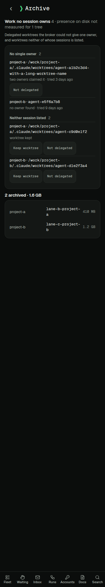
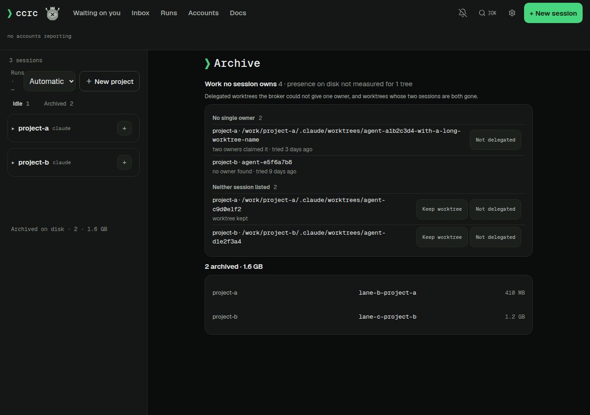
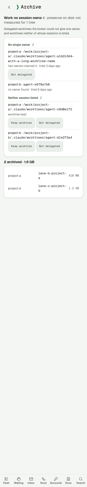
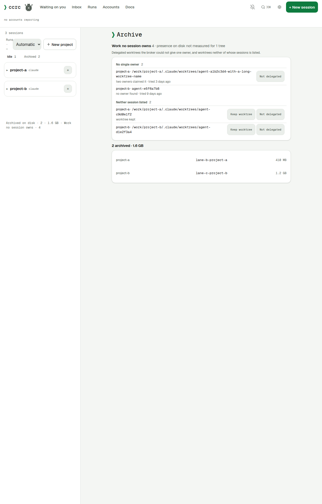
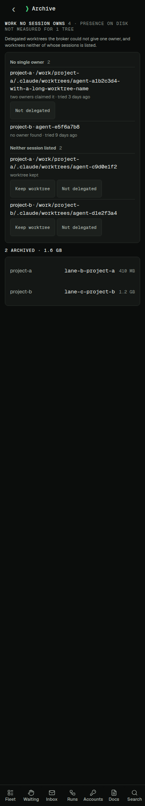
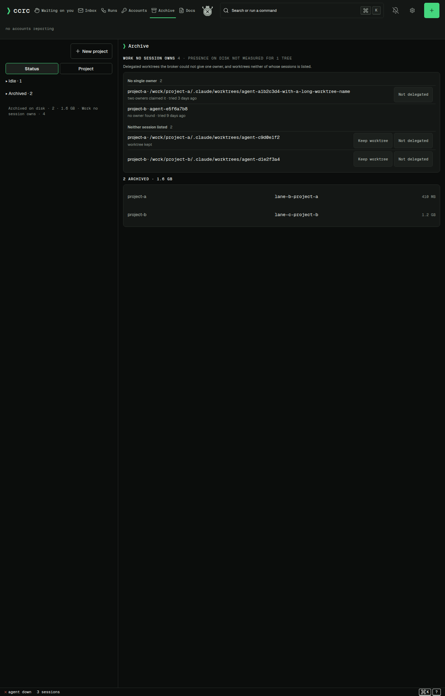
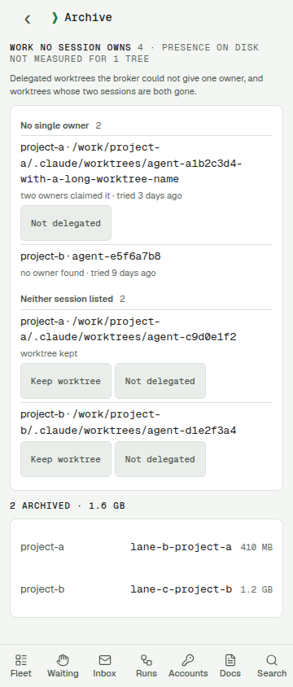
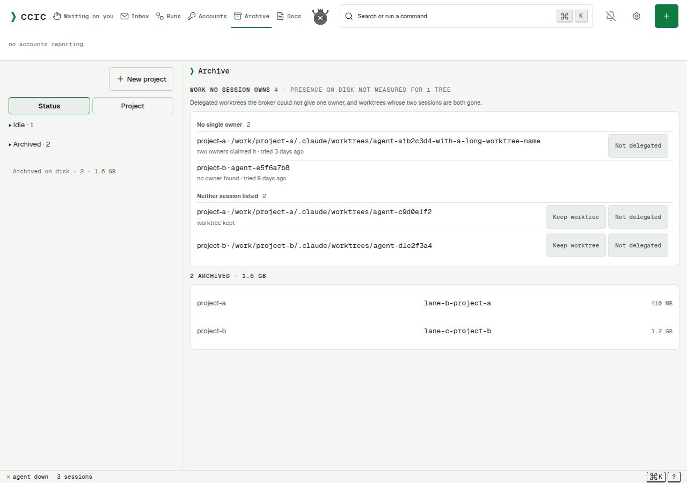

# Task H4: the Archive holds work no session owns (D-8828)

Task note for the desktop-polish programme (plan `docs/superpowers/plans/2026-10-22-desktop-polish.md`, section H4). Each claim is
labelled **measured** (a command or a real Chrome showed it) or **inferred** (reasoned, not shown). The design is
`docs/superpowers/specs/2026-11-19-session-helpers-design.md` §6, Table 8 and Table 13's H4 row.

## The operator's words (2026-11-19)

"inside the session in the right hand panel I still want to see actual information about any running workflows and subagents, for the
session i'm inside of, in a useful way though please" (the session helpers design's trigger), and, on C48, that the fleet list draws no
delegation row at all: "Yeah I want them out too". The coordinator ruled (ask 649) that unowned delegated work lives in a section of the
Archive screen.

## What changed

- The Archive screen draws **Work no session owns** above the archived workspaces, with its note ("Delegated worktrees the broker could
  not give one owner, and worktrees whose two sessions are both gone.") and two subheads, each with its count. **Measured** in real Chrome
  and in the jsdom render cases.
- **An unowned tree:** the project, the path (the admin record when no path is known), the verdict (`no owner found`, `two owners claimed
  it`) and the attempt's age (`tried 3 days ago`). Its one act, Not delegated, appears only where `leaseId` names a hidden lease, asks
  first, then posts `{action:'foreign'}` to `POST /api/leases/:lease/resolve`. **Measured** (render case, fetch recorded).
- **A worktree whose two sessions are both unlisted:** the project, the path and its disposition word, with `worktreeControls`' acts (Keep
  worktree posts to `operator-retain`; Not delegated as above; never Attach to…). **Measured.**
- **No row carries a liveness word, a `title` or the bare word `unmeasured`.** The head says once `presence on disk not measured for N
  tree(s)`, counted over both kinds. **Measured**: a case feeds every liveness the wire carries and a workspace of `unmeasured`, and
  matches the section's text against the liveness words, `unmeasured`, `unrecognised`, `live` and `running`; the real-Chrome file finds no
  non-empty `title` in the section.
- **With nothing of either kind, and for a frame that is null, empty or holds only activities, no section is drawn.** **Measured**
  (those cases pass at `origin/main` too: characterization pins, not reds). The fleet list is untouched (**inferred** from the diff: no
  file of the fleet list's drawing changed; `fleet-screen` ran unchanged).
- The route `/archive` reads the `delegation` frame from the store and hands it to the screen (`app.tsx`). **Measured**: a case in
  `app.test.tsx` goes red when the route drops it.

## Departures from the spec (D-8828, each a correction the coordinator folds into the spec)

`neither-session-listed`, `unlisted-means-not-listed-live`, `disposition-word-with-its-date`, `age-in-whole-words`,
`section-above-archived-and-alone`, `words-in-delegation-words`, `no-title-attributes` and `presence-in-the-head-title`. Each is defined in
the plan's Task H4 section under D-8828. Two need the operator's eye: the second changes which leases draw here (an archived coordinator's
lease draws here and on that row's own page, as the review of C48 left it), and the first renames the mockup's second subhead.
Figure 6's PNG in the spec's design folder still reads "Both sessions gone"; I left it, since it is the spec's file.

## Red first, against `origin/main` (measured)

`pwa/test/archive-unowned-work.test.tsx` (28 cases in its final form) and `app.test.tsx`'s one new case, run with the three edited
source files restored from `origin/main` (copies kept, restored byte for byte, `cmp` equal): **26 of 28 and 1 of 50 failed.** The
failures are the right ones: the screen draws no section there (`Unable to find an accessible element with the role "region"`), or the
words module has no such export (`... is not a function`, for the four words cases). The 2 that pass are the "draws nothing" cases,
which `main` satisfies too, and are labelled characterization pins.

## Mutants (measured)

The coordinator skill's `mutation-run.py` mutates Python modules (it compiles `--module` as Python), so these ran the way C36, C39 and
C41 ran theirs: each mutant one exact-once text replacement of a source line, the file restored from a saved copy and `cmp`-checked after,
one vitest file per process under a time and process cap. **31 mutants, all killed in the final table.** Branches mutated: the parent
check, the worker check and the archived-counts-as-listed rule of `unlistedLeases`; the hidden-lease gate (blank id), Not delegated being
the only act (Keep added), the verdict words swapped; the presence sentence's plural and its zero; the unmeasured count (leases left
out, every tree counted); the age's unit plural, the under-a-minute word and an unreadable time; Attach offered to a lease; the path
ignored; oldest-first; a null frame unguarded; the frame read without the tolerant reader; an empty section drawn; each subhead always
drawn; the presence line always drawn; an act drawn for a row with none, and an empty controls box; the age and the disposition left
out of a row; each kind's count wrong, and the head's; the screen dropping the section when something or nothing is archived; the route
dropping the frame. The first table left two alive (the tolerant reader, and the route); each got a case and now dies. Counts of
failing cases per mutant ran from 1 to 20.

## What the gates found (measured)

- `markup-census` refused two row components that drew the same block, then two group blocks: one row view and one group view now serve
  both kinds, and the verdict and age line moved into `unownedWork`.
- `contrast` refused the new stylesheet (not in the app's sheet list) and four inked rules with no ground: one list line (consent of the
  worker holding the claim on `contrast.test.ts`, 2026-11-20) and four entries in `pwa/design/audit.mjs`.
- `delegation-wave3.integration` refused three files that now name the broker's frame (`ArchiveUnownedWork.tsx`, `ArchiveScreen.tsx`,
  `app.tsx`): added to its list and to the mirror in `fleet-health.test.ts`, as C48 did for its files.
- `pwa/src/fleet/fleet.css` is capped (`server/test/growth-caps/pwa-src-fleet-fleet-css.json`) and was not touched; the styles are a new
  stylesheet. No file under `growth-frozen/` was touched. No cap was raised.

## What I looked at (measured, screenshots taken by me and looked at)

A real Chromium (Playwright revision 1243) over the production build, `pwa/browser/archive-unowned.browser.test.ts`: the fixture is the Archive with two
unowned trees (one with a hidden lease and a long path, one with no lease and no path, its presence not measured), two worktrees of
unlisted sessions (one kept, one inferred and ephemeral) and two archived workspaces. All eight cases (Refined and Instrument, dark
(Phosphor) and light, 360 and 1280 px) pass: every control inside its row, each control's height at least `--tap-min` (44 px), no title,
no sideways scroll, no uncaught page error, and the head text `Work no session owns 4 · presence on disk not measured for 1 tree`.
I opened all eight images. Paths break inside the word at 360 px, which is the `overflow-wrap` rule on purpose (a phone shows no
titles); the Instrument skin draws the section's title in capitals, which is its section style; the inferred worktree has no
disposition line, since its disposition is ephemeral and says nothing.

| | 360 px | 1280 px |
|---|---|---|
| Refined, dark |  |  |
| Refined, light |  |  |
| Instrument, dark |  |  |
| Instrument, light |  |  |

I did not look at the live fleet's real unowned work: the fixture's data is invented, and the real frame was not read.

## Files run (measured; one test file per process through `ccrc test`, `--maxWorkers=2`; load in the log)

Final code, load 9 to 38 on the shared box (the log of each run records it). **Passing, every case:**

- pwa, new: `archive-unowned-work` (28), `app` (50, one new case), and the real-Chrome `archive-unowned.browser` (8, built from the final tree by
  the browser config's own `vite build`).
- pwa, every file that imports `ArchiveScreen` or `delegationWords`: `delegation-words` (23), `archive-screen` (18), `app-lazy` (8),
  `accounts-screen` (43), `reap-sheet` (94), `w7-archived-table` (10), `tap-targets` (96), `screens-back-edges` (7), `page-scaffold` (29),
  `session-details-worktrees` (4), `fleetTree` (30), `card-header-facts` (95), `session-worktrees` (32), `session-screen-worktrees` (5),
  `worktree-confirm-close` (5).
- pwa, scans and design gates: `contrast` (368), `theme-catalogue` (20), `markup-census` (11), `plain-words` (65), `literal-census` (5),
  `fleet-css` (102), `control-census` (12), `css-vars` (3), `design-system-boundary` (15), `fixture-census` (3), `focus-ring` (11),
  `hover-states` (42), `ink-tiers` (9), `role-census` (10), `shape-census` (7), `skin-axis-census` (3), `skin-boundary` (47),
  `skin-identity` (74). `tsc --noEmit` exits 0.
- server: all 42 `single-definition/*.test.ts` files (`helpers.ts` is not a test), `dtbd`, `ci-ledger-guard` (32), `anchors` (9),
  `citations` (4), `ownership` (15), `growth-caps` (12), `growth-check` (61, 3 skipped), `rings/pwa-rings` (10), `rings/pwa-one-owner` (42),
  `rings/outward-edges` (7), `rings/totality` (11), `rings/shared-imports` (6), `oss-metadata` (29), `delegation-wave3.integration` (36),
  `fleet-health` (57), `topology-clean` (61), and `deviation-refs` (34, after `git fetch origin main`: it was SIGKILLed by the slice's memory cap twice
  first, then passed with one worker once the slice had room).

**Load and slice failures, none a break, each re-run alone** (the brief's rule): `topology-clean`, `single-definition/advance-switches`,
`single-definition/docs-l0`, four cases of `delegation-wave3.integration` and `fleet-health` failed as `Test timed out in 20000ms` (or, for
`topology-clean`, as the slice killing the worker at its 6 GB cap while other sessions held 5.8 GB); each passes with `--testTimeout=180000`, the
same assertions with a longer deadline. `contrast` and `control-census` failed once as `Test timed out in 5000ms` at load 17 to 38 and
pass alone. `fleet-health` and `delegation-wave3.integration` also failed once for a real reason, before my census edit: the three files
that now name the broker's frame were not on their lists; they pass after it. `npm run build` was killed twice by the slice's memory cap
(exit 137, the shared slice was full); the production build the browser file's global setup makes ran clean on the final tree.
CI's fast run on the first push found one real red I had not run: `test/browser-dist.test.ts` wants every browser file to hold `dist = sharedDist();` then `server = await serveDist(dist);`, and mine called `serveDist(sharedDist())`. Fixed in the browser file; `browser-dist` (15) and the 8 real-Chrome cases pass after it (measured).
I did not run the macOS legs or the full suite (a fast run on the PR, then the queue, run those).

## Consents (2026-11-20)

- `pwa/test/contrast.test.ts` (held by the Linear-hierarchy wave 7 worker): one added line in the app's stylesheet list, consent by
  mail on 2026-11-20.
- `docs/superpowers/plans/2026-10-22-desktop-polish.md` (held by H1a's worker): one new section between Tasks C49 and C50, consent by
  mail on 2026-11-20.

## Open for the operator to react to (inferred)

- An archived coordinator's lease draws in two places (its own page and this section). The alternative, drawing here only when neither
  session is a store row at all, leaves a lease whose two sessions are both archived with no obvious home; I took the first.
- `Attach to…` and `Keep worktree` for an unowned tree still wait on the server fields the spec's Later list names.
